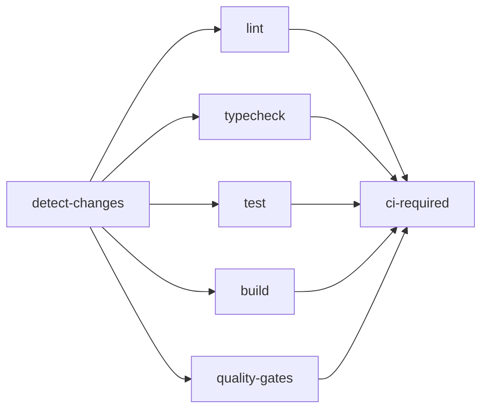

# CI



- PR в `main`: проверяются затронутые модули (`scripts/ci-scope.ts`). Изменение корневых файлов, `scripts/`, `infra/`, `.github/` или `packages/config` включает полный прогон. Устаревший прогон PR отменяется.
- `push` в `main` и `nightly.yml` — полный прогон.
- Артефакты `test-reports` и `bundle-stats` хранятся 14 дней (PR) или 30 дней (`main`).
- `pnpm check:ci-integrity` сверяет SHA действий, права токена, образы и ruleset.
- В CI выполняются интеграционные тесты пакетов. Тесты, управляющие Docker Compose (`infra/`, `scripts/`), выполняются локально: `pnpm test:integration`.

## Удалённый кэш Turborepo

Необязателен. Секреты репозитория: `TURBO_TOKEN`, `TURBO_TEAM`, `TURBO_API`. Без `TURBO_TOKEN`, в том числе в PR из форков, используется `actions/cache`.

```sh
gh secret set TURBO_TOKEN
gh secret set TURBO_TEAM
gh secret set TURBO_API
```

## Защита ветки main

Применяет администратор после первого зелёного `ci-required`:

```sh
gh api --method POST repos/{owner}/{repo}/rulesets --input .github/rulesets/main.json
```

Правило требует одного одобрения. Автор не может одобрить собственный PR, поэтому нужен второй участник.
