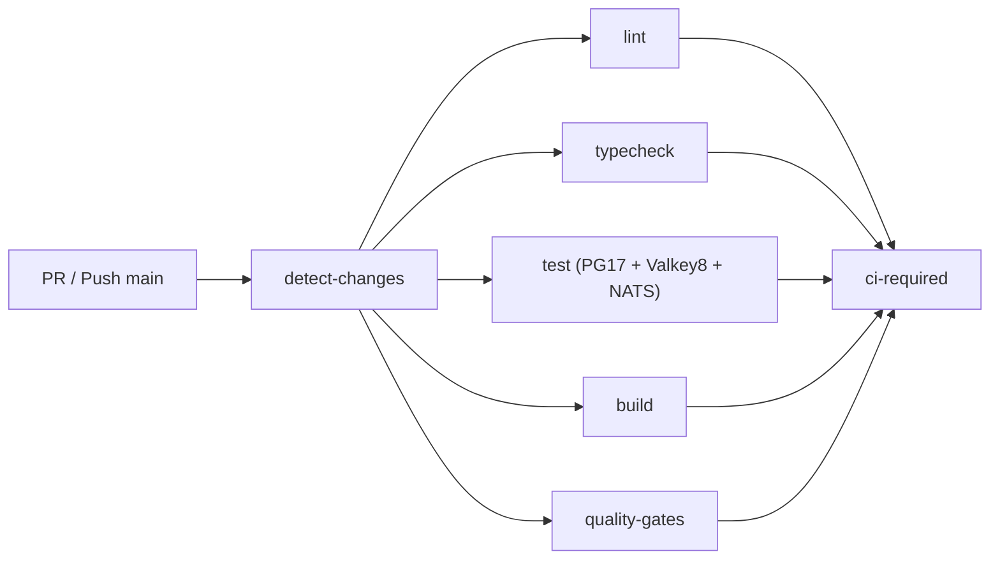

# Конвейер CI/CD и защита ветки `main` (`.github`)

## Архитектура стадий CI (`.github/workflows/ci.yml`)



- **Инкрементальный режим на PR**: если diff не затрагивает корневые конфиги (`.github/**`, `packages/config/**`, `scripts/**`, `package.json`, `pnpm-lock.yaml`, `turbo.json`, `tsconfig.base.json`), стадии `lint`, `typecheck`, `test:coverage` и `build` используют `turbo --filter=...[<base_sha>]`. На `push` в `main` и в `.github/workflows/nightly.yml` всегда выполняется полный прогон.
- **Отмена устаревших запусков**: `concurrency.cancel-in-progress` включён только для `pull_request` и никогда не отменяет прогоны ветки `main`.
- **Безопасность цепочки поставок**: все внешние `uses:` зафиксированы по 40-символьным commit SHA; верхнеуровневые права ограничены `permissions: { contents: read }`. Контролируется локально и в CI командой `pnpm check:ci-integrity`.

## Настройка опционального удалённого кэша Turborepo

Для ускорения сборок в GitHub Actions можно задать секреты и переменные репозитория:

- Secret `TURBO_TOKEN` — токен удалённого кэша Turborepo
- Variable `TURBO_TEAM` — идентификатор команды/пространства кэша
- Variable `TURBO_API` — URL self-hosted remote cache (если используется не Vercel)

Если `TURBO_TOKEN` не задан (в том числе для PR из внешних форков), `.github/actions/setup-workspace/action.yml` автоматически переключается на стандартный локальный кэш `actions/cache` для `.turbo`.

## Применение правил защиты ветки `main` (`.github/rulesets/main.json`)

После первого зелёного прогона `ci-required` в PR примените ruleset через GitHub CLI:

```bash
gh api \
  --method POST \
  -H "Accept: application/vnd.github+json" \
  /repos/<owner>/<repo>/rulesets \
  --input .github/rulesets/main.json
```
