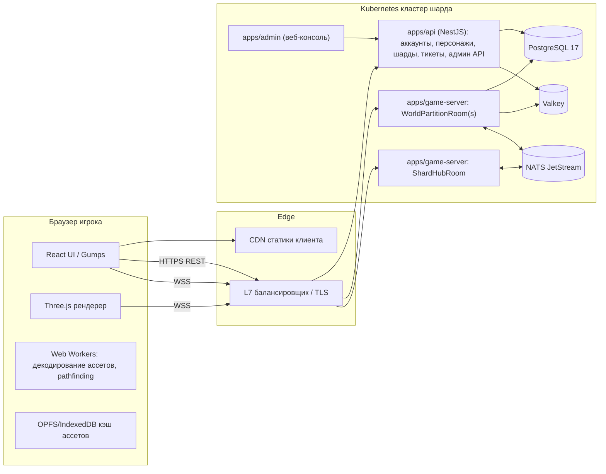

# Архитектура проекта UO3 — веб-MMORPG в духе Ultima Online

> Документ фиксирует **сквозные архитектурные решения** (ADR), обязательные для всех фаз из [ROADMAP.md](ROADMAP.md).
> Детальные требования каждой подсистемы находятся в OpenSpec-изменениях `openspec/changes/pNN-*`.
> Все решения приняты автономно с приоритетом «лучший долгосрочный вариант, даже если он сложнее».

## 1. Цели продукта

- Браузерный клиент и авторитарный сервер MMORPG, воспроизводящий геймплей **Ultima Online эпохи Renaissance (UO:R, 2000)**: открытый бесшовный мир, классовая система на навыках (skill-based), полный лут в Felucca, безопасный Trammel, крафт, дома, корабли, гильдии, экономика игроков.
- Клиент запускается по ссылке, без установки: React + Three.js (WebGL2, опционально WebGPU).
- Сервер: NestJS (мета-сервисы, DI, администрирование) + Colyseus (реалтайм-комнаты, синхронизация состояния).
- Целевая нагрузка шарда: **≥ 2 000 одновременных игроков** на шард (MVP — 500 на один процесс-партицию), задержка обработки команды на сервере p99 ≤ 30 мс, клиент 60 FPS на интегрированной графике в 1080p.
- Совместимость с ассетами оригинального клиента UO Classic (пользователь предоставляет собственную копию), а также собственный CC0-пак заглушек для разработки и CI.

## 2. Технологический стек (зафиксирован)

| Слой | Технология | Версия-ориентир | Обоснование |
|---|---|---|---|
| Язык | TypeScript (strict, ESM) | 5.x | Единый язык клиента/сервера, общие пакеты правил |
| Runtime | Node.js LTS | 22.x | Стабильность, производительность V8 |
| Монорепо | pnpm workspaces + Turborepo | pnpm 9, turbo 2 | Быстрые инкрементальные сборки, кэш задач |
| Клиент UI | React | 19 | Требование заказчика; DOM-оверлей для гампов |
| Клиент 3D | Three.js + @react-three/fiber + drei | r17x / v9 | Требование заказчика; декларативная сцена + императивные горячие пути |
| Клиент сборка | Vite | 6 | ESM, Web Workers, быстрая разработка |
| Клиент состояние | Zustand (+ immer) | 5 | Минимальные ре-рендеры, доступ из не-React кода |
| Клиент REST | TanStack Query | 5 | Кэш и ретраи HTTP-запросов к API |
| Сервер мета | NestJS | 11 | Требование заказчика; модульность, DI, OpenAPI |
| Сервер реалтайм | Colyseus (+ @colyseus/schema 3, StateView) | 0.16 | Требование заказчика; комнаты, дельта-синхронизация, seat reservation |
| Транспорт | WebSocket (uWebSockets.js transport) | — | Производительность; WebTransport — исследование в P32 |
| Валидация сообщений | TypeBox + скомпилированные валидаторы | — | JSON Schema, высокая скорость на горячем пути |
| БД | PostgreSQL | 17 | Транзакции, JSONB, PITR |
| ORM / миграции | Drizzle ORM + drizzle-kit | — | Типобезопасность, контроль SQL, пакетные операции |
| Кэш / presence | Valkey (Redis-совместимый) | 8 | Colyseus presence/driver, сессии, rate-limit |
| Межпроцессная шина | NATS JetStream | 2.10+ | События между партициями мира и сервисами |
| Тесты | Vitest, Playwright, k6, собственные headless-боты | — | Unit / e2e / нагрузка |
| Наблюдаемость | OpenTelemetry, Prometheus, Grafana, Loki, Tempo, Sentry | — | Метрики, логи, трейсы, ошибки клиента |
| Инфраструктура | Docker, Kubernetes, Helm, GitHub Actions | — | Воспроизводимые окружения, CI/CD |

## 3. Топология системы

### 3.1 Приложения монорепозитория

| Путь | Назначение |
|---|---|
| `apps/client` | Игровой клиент (React + Three.js), PWA |
| `apps/api` | NestJS HTTP API: identity, characters, shards, game tickets, admin API, OpenAPI |
| `apps/game-server` | NestJS application context + Colyseus: симуляция мира, комнаты партиций и хаба |
| `apps/admin` | Веб-консоль персонала (React) |
| `apps/asset-tool` | CLI: проверка/конвертация клиентских файлов UO, генерация тестового мира |
| `apps/bot-client` | Headless-клиент для нагрузочных и сценарных тестов |
| `packages/domain` | Базовые типы: Serial, Point3D, Direction, Layer, Body, Hue, Notoriety, AccessLevel |
| `packages/rules` | Детерминированные формулы правил (общие для клиента и сервера), профили эпох |
| `packages/protocol` | Сообщения клиент↔сервер, схемы состояния Colyseus, версии протокола, коды ошибок |
| `packages/uo-formats` | Парсеры бинарных форматов UO (MUL/UOP/IDX/verdata и др.), изоморфные (браузер + Node) |
| `packages/content` | Данные контента (YAML) + JSON Schema: предметы, существа, лут, спавны, регионы, рецепты, заклинания |
| `packages/db` | Схемы Drizzle, миграции, репозитории общего назначения |
| `packages/ui-kit` | Компоненты гампов и дизайн-токены |
| `packages/config` | Общие конфиги TS/ESLint/Vitest, загрузка env с валидацией |
| `packages/test-kit` | Фейковые часы, детерминированный RNG, фабрики сущностей, синтетический мир |

## 4. Архитектурные решения (ADR)

### ADR-001. Монорепозиторий pnpm + Turborepo
Все приложения и пакеты в одном репозитории; граф зависимостей пакетов контролируется правилами (клиент не импортирует серверный код; `rules`/`domain`/`protocol` — изоморфные и без побочных эффектов). Альтернатива Nx отклонена ради простоты и меньшей «магии».

### ADR-002. Правовая модель ассетов — «принеси свой клиент»
Проект **не распространяет** ассеты EA/Broadsword. Клиент: игрок указывает папку установленного UO Classic (7.0.x, UOP и MUL) через File System Access API / drag-and-drop; файлы разбираются **локально в Web Worker**, результаты (атласы, метаданные) кэшируются в OPFS. Сервер: оператор шарда предоставляет `map*`, `statics*`, `tiledata`, `multi` для коллизий. Для разработки и CI — **процедурно сгенерированный синтетический мир и CC0-пак заглушек**, позволяющие запускать все тесты без проприетарных файлов. Код и спецификации не содержат проприетарных данных.

### ADR-003. Рендеринг «2.5D в настоящем 3D»
- Ортографическая камера, классическая изометрическая проекция UO (ромб тайла 44×44 px, шаг Z = 4 px), целочисленный pixel-snapping для чётких спрайтов; зум 0.5×–2×.
- Земля — меш с высотами вершин (растянутые land-текстуры texmaps, нормали для освещения), статика/предметы/мобайлы — квады со спрайтами.
- Порядок отрисовки по правилам UO (ключ сортировки из (x+y), z, приоритета типа и высоты тайла) **кодируется в depth**, что позволяет батчинг через `InstancedMesh` и texture arrays/атласы; бюджет < 300 draw calls.
- Хью (перекраска) — палитрная подстановка во фрагментном шейдере по текстуре hues; поддержка partial hue.
- Освещение: глобальный уровень (день/ночь), персональный свет, источники света из light-масок, аддитивный проход.
- Скрытие крыш и верхних этажей при нахождении под крышей; опциональный «круг прозрачности».
- Пиксельно-точный пикинг через GPU ID-буфер.
- WebGL2 обязателен; WebGPU-рендерер Three.js — опциональный флаг.

### ADR-004. UI — React DOM-оверлей и серверные гампы
Гампы (окна) — React-компоненты поверх canvas, графика гампов из атласов. Серверные гампы описываются **декларативным языком разметки** (страницы, фоны, кнопки, тексты, поля ввода, чекбоксы/радио, HTML, арт предметов, тултипы), сервер отправляет описание и получает ответ (id кнопки, состояние переключателей, тексты). Это аналог пакетов 0xB0/0xDD оригинала, но в JSON-схеме протокола.

### ADR-005. Сеть — Colyseus, интересы и команды
- Клиент держит **два соединения**: `WorldPartitionRoom` (геймплей в своей партиции мира) и `ShardHubRoom` (чат, пати, гильдии, системные объявления, присутствие).
- Состояние мира реплицируется через `@colyseus/schema` с **StateView** — каждому клиенту видны только сущности в его зоне интереса (AOI): радиус обновления 18 тайлов (настраиваемо до 24), мульти (дома/корабли) — 31 тайл.
- Действия клиента — **намерения (intents)**, типизированные в `packages/protocol`, валидируемые TypeBox-валидаторами, с ограничением частоты. Сервер авторитарен во всём.
- Движение — шаговое по тайлам с номером последовательности (0–255) и клиентским предсказанием; сервер подтверждает или отклоняет с ресинхронизацией позиции (модель оригинала Walk Request / Ack / Deny).
- Патчи состояния — 20 Гц (50 мс); критичные события (урон, звуки, эффекты) — сообщениями немедленно.
- Версионирование протокола: semver; несовместимый клиент получает понятную ошибку и предложение обновиться.
- Коды закрытия WebSocket и диапазоны опкодов — только из [PROTOCOL_REGISTRY.md](PROTOCOL_REGISTRY.md) (прикладные коды закрытия `4100..4199`; `4000..4099` и `42xx` зарезервированы Colyseus).

### ADR-006. Модель симуляции сервера
- Сущности `Item` и `Mobile` с уникальными серийниками (мобайлы `0x00000001–0x3FFFFFFF`: персонажи игроков `0x00000001–0x1FFFFFFF`, NPC и существа `0x20000000–0x3FFFFFFF` — раздельные пулы аллокатора с собственным high-water mark; предметы `0x40000000–0x7FFFFFFF`), компонентная модель поведения (behaviours), данные — из `packages/content`.
- Пространственный индекс — сектора 16×16 тайлов на фасет.
- Планировщик тиков 20 Гц + **иерархическое колесо таймеров** для миллионов отложенных событий (decay, реген, задержки заклинаний, спавны).
- Детерминированность: инъецируемые часы и сидируемый RNG — для воспроизводимых симуляционных тестов.
- Поведение контента — TypeScript-модули, регистрируемые по типу; горячая перезагрузка данных контента в dev и для персонала.

### ADR-007. Мир — партиции и бесшовные переходы
- Каждый фасет делится на **партиции** (прямоугольники, кратные секторам), каждая обслуживается одной `WorldPartitionRoom` в одном процессе.
- MVP: одна партиция на фасет. Целевая архитектура (P32): несколько партиций на фасет, «призрачная» репликация пограничной полосы шириной ≥ радиуса AOI через NATS, бесшовный handoff игрока с заранее зарезервированным местом в соседней комнате, без видимого разрыва.
- Межфасетные перемещения (лунные врата, recall) — явный handoff между комнатами.

### ADR-008. Персистентность
- Мир живёт в памяти; источник истины при старте — PostgreSQL.
- **Инкрементальное сохранение**: dirty-tracking сущностей, пакетный flush каждые 60 с (настраиваемо) без остановки мира (в отличие от «World is saving...» оригинала).
- **Критические транзакции** (торговля, банк, покупка у вендора, передача дома, операции персонала с предметами) фиксируются синхронно и атомарно.
- Журнал событий предметов (item ledger) для расследования дюпов; ежедневные снапшоты, WAL-архивация и PITR.
- RPO для некритичного состояния ≤ 60 с, для критичного — 0; RTO ≤ 15 мин.

### ADR-009. Identity и доступ
- Аккаунты email + пароль (argon2id), подтверждение email, опционально TOTP 2FA и OAuth (Discord/Google).
- Access JWT (EdDSA, 15 мин) + ротируемый refresh-токен в httpOnly cookie.
- Вход в игру через **одноразовый game ticket** (≤ 60 с), выданный API и проверяемый в `onAuth` Colyseus.
- Уровни доступа как в оригинале: Player, Counselor, GameMaster, Seer, Administrator, Developer, Owner.

### ADR-010. Ruleset и эпоха
- Базовая эпоха — **UO:Renaissance**: фасеты Felucca и Trammel, 49 навыков, кап навыков 700.0, кап статов 225, без свойств предметов AOS.
- Все числовые константы и формулы — в `packages/rules` с **профилем эпохи** (era profile) и флагами функций; расширения (Ilshenar, AOS-свойства, tooltips) включаются флагами без переписывания ядра.

### ADR-011. Тестирование
- Каждая фаза приносит свои тесты (unit, контрактные, интеграционные) — тесты не откладываются на конец.
- Симуляционный харнес: headless-мир с фейковыми часами и сидируемым RNG.
- E2E клиента — Playwright (WebGL через SwiftShader), визуальная регрессия рендерера по эталонным снимкам синтетического мира.
- Нагрузка — `apps/bot-client` (≥ 2 000 ботов), k6 для HTTP API.

### ADR-012. Безопасность
- Сервер — единственный источник истины; клиент никогда не сообщает результаты (урон, успех навыка, позицию без проверки).
- Ограничение частоты всех сообщений, анти-спидхак через проверку таймингов шагов, инварианты единственного владельца предмета, аудит действий персонала.
- OWASP ASVS L2 для API; CSP, SRI, отсутствие eval в клиенте.

### ADR-013. Разработка с ИИ-агентами
Спецификации рассчитаны на реализацию ИИ-агентами (Antigravity / AI Studio / Claude / Gemini) по циклу OpenSpec: `/opsx-apply` для фазы → выполнение задач по чекбоксам → проверка → `/opsx-archive`. Каждая задача содержит критерий проверки. См. [AGENTS.md](../AGENTS.md).

## 5. Канонические константы (по умолчанию, настраиваются в профиле эпохи)

| Константа | Значение |
|---|---|
| Размер тайла | 44×44 px (ромб), шаг Z = 4 px |
| Фасеты UO:R | Felucca (0), Trammel (1) — 7168×4096 тайлов (размер клиента 7.0.x; legacy-карты 6144×4096 поддерживаются, размер фасета определяется загруженными данными) |
| Сектор пространственного индекса | 16×16 тайлов |
| Радиус обновления (AOI) | 18 тайлов (до 24), мульти — 31 |
| Высота персонажа / шаг подъёма | PersonHeight = 16, StepHeight = 2 |
| Скорость шага пешком | ходьба 400 мс, бег 200 мс |
| Скорость шага верхом | ходьба 200 мс, бег 100 мс |
| Тик симуляции / патчи | 50 мс / 50 мс |
| Игровое время | 1 игровой час = 5 реальных минут |
| Кап статов / навыков | 225 / 700.0 (макс. навык 100.0) |
| Хиты / стамина / мана | 50 + STR/2 / DEX / INT |
| Максимальный вес | 40 + 3.5 × STR камней |
| Рюкзак | 125 предметов, 400 камней |
| Таймер преступника | 2 мин |
| Убийца (красный) | ≥ 5 счётчиков; распад short-term 8 ч, long-term 40 ч игрового онлайна |
| Дальность речи | шёпот 1, обычная 15, крик 18 тайлов |
| Распад предметов на земле | 60 мин |
| Задержка выхода вне безопасной зоны | 5 мин (мгновенно в таверне/своём доме) |
| Номер последовательности движения | 0–255, окно до 4 неподтверждённых шагов |
