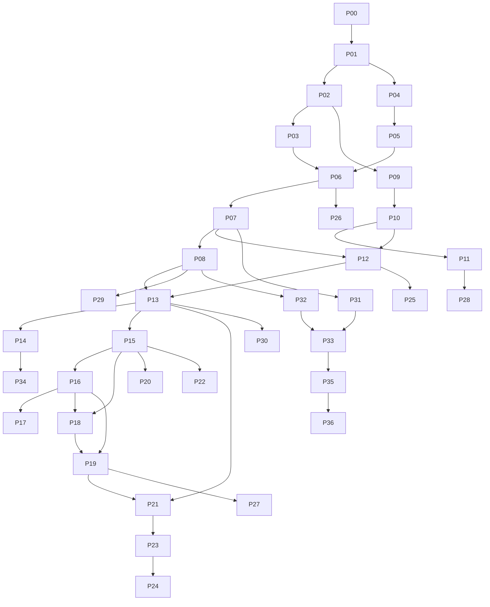

# Дорожная карта UO3 — фазы, вехи и реестр capability

> Каждая фаза = одно OpenSpec-изменение `openspec/changes/<id>/` (proposal → specs → design → tasks).
> **Реестр capability ниже — контракт между фазами**: одна capability принадлежит ровно одной фазе. Если фаза затрагивает чужую capability, она ссылается на неё в тексте, а не дублирует требования.
> Архитектура и сквозные решения — [ARCHITECTURE.md](ARCHITECTURE.md), термины — [GLOSSARY.md](GLOSSARY.md).

## Вехи (milestones)

| Веха | Фазы | Результат, который можно показать |
|---|---|---|
| **M0 Фундамент** | P00–P03 | Монорепо, CI, доменная модель, парсеры форматов UO, серверные данные карты |
| **M1 «Шаг по Британии»** | P04–P12 | Регистрация → выбор шарда → создание персонажа → вход в мир, отрисовка карты, анимированные персонажи, ходьба с предсказанием, видимость других игроков |
| **M2 «Живой мир»** | P13–P19 | Предметы и контейнеры, гампы, навыки, бой, нотореити, магия, NPC и спавны |
| **M3 «Ремесло и собственность»** | P20–P25 | Сбор ресурсов и крафт, экономика и торговля, утилитарные навыки, дома, корабли, регионы и окружение |
| **M4 «Сообщество»** | P26–P30 | Чат/пати/гильдии, квесты и события, звук и эффекты, инструменты персонала, контент-пайплайн |
| **M5 «Продакшен»** | P31–P36 | Античит, масштабирование партиций, эксплуатация, качество клиента, нагрузочная валидация, бета и запуск |

## Граф зависимостей фаз

## Реестр фаз

### P00 — `p00-monorepo-foundation` — Фундамент монорепозитория
**Цель:** репозиторий, в котором любой агент или разработчик за 10 минут поднимает всё окружение и получает зелёный CI.
**Зависит от:** —
**Capabilities:**
- `platform/monorepo-workspace` — структура apps/packages, граф зависимостей, правила импорта, общие конфиги TS/ESLint/Prettier.
- `platform/local-dev-environment` — docker compose (PostgreSQL, Valkey, NATS, Grafana-стек), скрипты bootstrap, seed.
- `platform/ci-pipeline` — GitHub Actions: lint, typecheck, test, build, кэш Turborepo, артефакты, обязательные проверки PR.
- `platform/code-quality-gates` — покрытие, conventional commits, changesets, Renovate, лицензии зависимостей, запрет проприетарных ассетов в репо.
- `platform/configuration-management` — типизированная загрузка конфигурации и секретов для всех приложений.

### P01 — `p01-shared-domain-model` — Общая доменная модель и правила
**Зависит от:** P00
- `domain/entity-identity` — серийники мобайлов/предметов, аллокация, уникальность, сериализация.
- `domain/world-coordinates` — Point3D, фасеты, направления (8 + флаг бега), расстояния, границы карт.
- `domain/core-enumerations` — Layer, Body, Hue, Notoriety, AccessLevel, Race/Gender, типы тайлов и флаги tiledata.
- `domain/ruleset-profile` — профиль эпохи UO:R, флаги функций, канонические константы, переопределение на шарде.
- `domain/deterministic-runtime` — инъецируемые игровые часы, сидируемый RNG, игровое время (1 ч = 5 мин).

### P02 — `p02-uo-asset-formats-and-import` — Форматы UO и импорт клиентских данных
**Зависит от:** P01
- `assets/uo-file-formats` — изоморфные парсеры: UOP/MUL/IDX/verdata, tiledata, hues, map, statics, art (land/static), gumps, texmaps, anim (MUL/UOP, bodyconv, mobtypes), multi, sound, light, cliloc, unifont/ascii fonts, radarcol.
- `assets/client-data-import` — выбор папки клиента в браузере, детекция версии, проверка полноты, понятные ошибки.
- `assets/web-asset-cache` — декодирование в Web Workers, упаковка атласов/texture arrays, кэш в OPFS, инвалидация по хэшу версии.
- `assets/synthetic-dev-world` — процедурный тестовый мир и CC0-пак заглушек в тех же форматах для разработки и CI.
- `assets/asset-tool-cli` — CLI `apps/asset-tool`: валидация, дампы, экспорт превью, генерация синтетического мира.

### P03 — `p03-server-world-data` — Серверные данные статического мира
**Зависит от:** P02
- `world/static-world-data` — загрузка карт/статики/tiledata/мульти в компактные структуры, запросы высот и поверхностей.
- `world/line-of-sight` — проверка прямой видимости по правилам UO.
- `world/map-diff-patches` — применение патчей карты и статики, версионирование данных мира.

### P04 — `p04-identity-and-accounts` — Идентификация и аккаунты
**Зависит от:** P01
- `identity/account-registration` — регистрация, подтверждение email, условия использования.
- `identity/authentication` — вход, выход, refresh-ротация, OAuth.
- `identity/two-factor-auth` — TOTP, резервные коды.
- `identity/account-security` — блокировки, сброс пароля, история входов, уведомления.
- `identity/access-levels` — роли персонала, проверка прав в API и игре.

### P05 — `p05-shards-and-characters` — Шарды и персонажи
**Зависит от:** P04
- `shard/shard-directory` — список шардов, статус, онлайн, правила (PvP-тип, эпоха).
- `shard/game-tickets` — одноразовые тикеты входа и резервирование места в комнате.
- `characters/character-roster` — слоты, удаление с задержкой, переименование, лимиты.
- `characters/character-creation` — статы, шаблоны навыков, внешность, стартовый город, валидация имени.

### P06 — `p06-game-server-runtime` — Среда выполнения игрового сервера
**Зависит от:** P03, P05
- `runtime/game-server-host` — NestJS-контекст + Colyseus, модули, жизненный цикл, graceful shutdown.
- `runtime/simulation-scheduler` — тик 20 Гц, колесо таймеров, бюджеты времени, детерминизм.
- `runtime/world-partition-rooms` — комнаты партиций, загрузка сущностей партиции, пространственный индекс секторов.
- `runtime/session-lifecycle` — вход персонажа, реконнект, задержка выхода, дубли сессий.
- `runtime/shard-hub-room` — общешардовая комната: присутствие, системные объявления.
- `runtime/simulation-test-harness` — headless-мир для детерминированных тестов всех следующих фаз.

### P07 — `p07-netcode-and-replication` — Сетевой код и репликация
**Зависит от:** P06
- `netcode/command-protocol` — каталог intents, валидация, коды ошибок, версии протокола.
- `netcode/interest-management` — AOI на StateView, вход/выход сущностей из видимости.
- `netcode/state-replication` — схемы состояния мобайлов/предметов, дельты, приоритеты, бюджет трафика.
- `netcode/time-sync-and-latency` — синхронизация часов, измерение RTT, индикация качества связи.

### P08 — `p08-world-persistence` — Персистентность мира
**Зависит от:** P07
- `persistence/world-store` — схема хранения сущностей, загрузка мира при старте.
- `persistence/incremental-save` — dirty-tracking и фоновый flush.
- `persistence/critical-transactions` — синхронные атомарные операции и журнал предметов.
- `persistence/backup-and-restore` — снапшоты, PITR, откат персонажа/предмета.

### P09 — `p09-client-shell` — Оболочка клиента
**Зависит от:** P02, P05
- `client/app-shell` — маршрутизация экранов, загрузчики, обработка ошибок, PWA-манифест.
- `client/login-and-character-select` — вход, выбор шарда, выбор/создание/удаление персонажа.
- `client/asset-bootstrap` — мастер подключения клиентских файлов, прогресс декодирования.
- `client/settings-profile` — настройки клиента, синхронизация профиля с аккаунтом.

### P10 — `p10-world-renderer` — Рендерер мира
**Зависит от:** P09
- `render/isometric-camera` — проекция, зум, следование за игроком, pixel-snapping.
- `render/terrain-and-statics` — земля с высотами, статика, предметы, мульти, стриминг чанков.
- `render/draw-order` — порядок отрисовки UO, кодирование в depth.
- `render/hue-and-lighting` — хью, день/ночь, источники света.
- `render/occlusion-and-roofs` — скрытие крыш/этажей, круг прозрачности.
- `render/object-picking` — пикинг объектов под курсором.
- `render/performance-budget` — бюджеты кадра, профили качества, метрики FPS.

### P11 — `p11-mobile-visuals` — Визуализация мобайлов
**Зависит от:** P10
- `render/mobile-animation` — тела, действия, направления, кадры, маунты, слои экипировки.
- `render/overhead-text-and-bars` — речь над головой, имена, числа урона, полоски здоровья.

### P12 — `p12-movement-and-navigation` — Движение и навигация
**Зависит от:** P07, P10
- `movement/movement-validation` — правила шага UO, Z, двери, блокировка мобайлами, проталкивание.
- `movement/client-prediction` — предсказание, очередь шагов, ресинхронизация.
- `movement/movement-timing` — скорости, анти-спидхак, стамина и перегрузка.
- `movement/pathfinding` — A* на сервере (NPC) и клиенте (автопуть), ограничения.
- `movement/teleporters` — телепорты, переходы между партициями/фасетами.

### P13 — `p13-items-and-containers` — Предметы и контейнеры
**Зависит от:** P08, P12
- `items/item-model` — свойства предмета, стаки, вес, флаги tiledata, метки (single-click).
- `items/containers` — контейнеры, вложенность, лимиты, просмотр.
- `items/drag-and-drop` — перенос, разделение стаков, правила владения.
- `items/equipment` — слои, надевание/снятие, требования.
- `items/item-lifecycle` — распад на земле, удаление, перемещение в мир, блокировки.

### P14 — `p14-client-gump-ui` — Интерфейс гампов
**Зависит от:** P13
- `ui/gump-framework` — серверные гампы, язык разметки, ответы, менеджер окон.
- `ui/paperdoll-and-status` — пейпердолл, статус-бар, полоски здоровья.
- `ui/journal-and-chat` — журнал, ввод речи, фильтры.
- `ui/skills-and-spellbook-windows` — окно навыков, книга заклинаний, иконки.
- `ui/macros-and-hotkeys` — макросы и горячие клавиши.
- `ui/targeting-and-cursors` — курсоры целеуказания, режимы.
- `ui/window-layout` — сохранение раскладки окон, масштаб UI.

### P15 — `p15-stats-and-skills` — Статы и навыки
**Зависит от:** P13
- `characters/stats-and-vitals` — STR/DEX/INT, hits/stam/mana, реген, рост статов, кап.
- `skills/skill-system` — 49 навыков, значения, использование, задержки.
- `skills/skill-gain` — формулы роста, анти-макро.
- `skills/skill-locks-and-caps` — блокировки (up/down/locked), кап 700.

### P16 — `p16-combat` — Бой
**Зависит от:** P15
- `combat/war-mode-and-targeting` — боевой режим, выбор цели, автоатака.
- `combat/melee-and-ranged` — свинги, скорость оружия, попадание, стрельба, боеприпасы.
- `combat/damage-and-armor` — урон, AR, парирование, прочность.
- `combat/healing-and-poison` — бинты, лечение, яды.
- `combat/death-and-resurrection` — смерть, призрак, труп, воскрешение.

### P17 — `p17-notoriety-and-pvp` — Нотореити и PvP
**Зависит от:** P16
- `pvp/notoriety` — цвета, агрессоры, атакуемость.
- `pvp/criminal-and-murder` — преступления, счётчики убийств, распад, штрафы.
- `pvp/guard-zones` — стража, вызов «guards».
- `pvp/facet-rulesets` — правила Trammel/Felucca.
- `pvp/looting-rules` — права лутинга трупов и последствия.

### P18 — `p18-magic` — Магия
**Зависит от:** P15, P16
- `magic/spellcasting` — каст, задержки, физзл, прерывание, мана, реагенты.
- `magic/spell-catalog` — 64 заклинания 8 кругов.
- `magic/spellbooks-and-scrolls` — книги, свитки, руны, рунбуки.
- `magic/fields-and-summons` — поля, призывы, длительные эффекты.
- `magic/spell-resistance` — Resisting Spells, отражение.

### P19 — `p19-npc-ai-and-creatures` — NPC, ИИ и существа
**Зависит от:** P16, P18
- `npc/creature-definitions` — определения существ, статы, навыки, тела, звуки.
- `npc/ai-behaviors` — деревья поведения: мили, маг, лучник, животное, стражник, вендор.
- `npc/spawning` — спавнеры, регионы спавна, респаун.
- `npc/loot-generation` — таблицы лута, золото, магические предметы UO:R.
- `npc/taming-and-pets` — приручение, команды, лояльность, стойла.
- `npc/npc-speech-and-services` — ключевые слова, банкир, хилер, стражники, обучение навыкам.

### P20 — `p20-gathering-and-crafting` — Сбор ресурсов и крафт
**Зависит от:** P15
- `crafting/resource-gathering` — добыча руды, дерева, рыбы, хлопка/шерсти, банки ресурсов.
- `crafting/craft-system` — меню крафта, шанс, качество, метка мастера, материалы.
- `crafting/craft-skill-catalog` — рецепты по навыкам.
- `crafting/repair-and-durability` — ремонт, прочность, разборка.

### P21 — `p21-economy-and-trade` — Экономика и торговля
**Зависит от:** P13, P19
- `economy/currency-and-banking` — золото, банк, чеки.
- `economy/secure-trade` — окно обмена, двойное подтверждение, атомарность.
- `economy/npc-vendors` — покупка/продажа, цены, рестоки.
- `economy/player-vendors` — вендоры игроков, оплата, комиссии.
- `economy/economy-telemetry` — источники/стоки золота, отчёты.

### P22 — `p22-utility-skills` — Утилитарные навыки
**Зависит от:** P15
- `skills/stealth-and-detection` — Hiding, Stealth, Detecting Hidden, Tracking.
- `skills/thievery` — Snooping, Stealing, Lockpicking, Remove Trap.
- `skills/bardic-skills` — Musicianship, Peacemaking, Provocation, Discordance.
- `skills/lore-and-identification` — Anatomy, Arms Lore, Item ID, Eval Int, Forensics, Taste ID, Animal Lore.
- `skills/misc-skills` — Begging, Camping, Herding, Spirit Speak, Cartography (чтение карт), Meditation.

### P23 — `p23-housing` — Дома
**Зависит от:** P21
- `housing/house-placement` — дипы, превью, проверка места, лимит один дом на аккаунт.
- `housing/house-access` — владелец, совладельцы, друзья, баны, ключи, публичность.
- `housing/lockdowns-and-secures` — фиксация предметов, сундуки, лимиты.
- `housing/house-decay` — распад, IDOC, передача владения.
- `housing/multi-objects` — мульти в мире, коллизии, двери, таблички.

### P24 — `p24-boats-and-sea` — Корабли и море
**Зависит от:** P23
- `sea/boats` — спуск, румпельщик, команды, движение, ключи, докование.
- `sea/sea-travel` — морская навигация, глубоководная рыбалка, морские монстры.

### P25 — `p25-world-regions-and-environment` — Регионы и окружение
**Зависит от:** P12
- `world/regions` — города, данжи, охраняемые зоны, запреты магии перемещения, музыка регионов.
- `world/facet-travel` — лунные врата, межфасетные переходы.
- `world/day-night-and-weather` — цикл дня, погода, сезоны.
- `world/world-decoration` — декорации, двери, таблички, вывески из данных.

### P26 — `p26-social-systems` — Социальные системы
**Зависит от:** P06
- `social/speech-and-chat` — речь в мире, каналы, эмоуты.
- `social/party` — группа, общий лут, чат пати.
- `social/guilds` — гильдкамень, ранги, войны, альянсы, Order/Chaos.
- `social/friends-and-ignore` — списки друзей и игнора.
- `social/chat-moderation` — фильтры, жалобы, муты.

### P27 — `p27-quests-and-world-events` — Квесты и события
**Зависит от:** P19
- `events/treasure-maps` — карты сокровищ, раскопки, стражи сундуков.
- `events/escort-quests` — сопровождение NPC.
- `events/gm-events` — инструменты событий персонала.
- `events/seasonal-events` — календарь, сезонный контент.

### P28 — `p28-audio-and-effects` — Звук и эффекты
**Зависит от:** P11
- `audio/sound-effects` — позиционные звуки, лимиты одновременных звуков.
- `audio/music` — музыка регионов, переходы, настройки.
- `effects/graphical-effects` — движущиеся/фиксированные эффекты, молния, частицы.

### P29 — `p29-staff-tools-and-admin` — Инструменты персонала
**Зависит от:** P08
- `admin/gm-commands` — внутриигровые команды (`[add`, `[tele`, `[props` ...), права.
- `admin/admin-console` — веб-консоль: игроки, аккаунты, баны, мир, метрики.
- `admin/help-paging` — очередь обращений игроков.
- `admin/audit-log` — аудит действий персонала и критичных событий.

### P30 — `p30-content-pipeline` — Контент-пайплайн
**Зависит от:** P13
- `content/content-definitions` — YAML-определения, JSON Schema, валидация в CI.
- `content/world-build` — импорт декораций/спавнов/регионов, сборка «мира шарда».
- `content/localization` — строки RU/EN, cliloc, плюрализация.
- `content/hot-reload` — горячая перезагрузка контента.

### P31 — `p31-security-and-anti-cheat` — Безопасность и античит
**Зависит от:** P07
- `security/server-authority` — инварианты авторитарности, fuzzing протокола.
- `security/rate-limiting` — лимиты сообщений, флуд-контроль, защита API.
- `security/anti-dupe` — инварианты владения, детекторы дюпа, сверка ledger.
- `security/bot-detection` — эвристики автоматизации, политика макросов.
- `security/client-hardening` — CSP, SRI, защита токенов, приватность.

### P32 — `p32-world-scaling` — Масштабирование мира
**Зависит от:** P08
- `scaling/world-partitioning` — несколько партиций на фасет, конфигурация границ.
- `scaling/seamless-handoff` — переход между партициями без разрыва.
- `scaling/cross-partition-bus` — призрачная репликация, события через NATS.
- `scaling/horizontal-scaling` — масштабирование API/хаба, размещение комнат.

### P33 — `p33-observability-and-operations` — Наблюдаемость и эксплуатация
**Зависит от:** P31, P32
- `ops/telemetry` — метрики, логи, трейсы, дашборды, алерты.
- `ops/deployment` — Docker, Helm, окружения, секреты.
- `ops/release-management` — релизы, рестарты с оповещением, миграции, откат.
- `ops/incident-response` — ранбуки, on-call, постмортемы.

### P34 — `p34-client-platform-quality` — Качество клиентской платформы
**Зависит от:** P14
- `client/touch-controls` — сенсорное управление и мобильные браузеры.
- `client/accessibility` — доступность UI, масштаб, контраст, клавиатура.
- `client/localization-ui` — локализация интерфейса RU/EN.
- `client/offline-and-updates` — сервис-воркер, обновления клиента, совместимость версий.

### P35 — `p35-load-and-acceptance-testing` — Нагрузочная и приёмочная валидация
**Зависит от:** P33
- `quality/bot-clients` — headless-боты со сценариями поведения.
- `quality/load-testing` — профили нагрузки, SLO, отчёты.
- `quality/release-acceptance` — приёмочные сценарии вех, критерии выхода.

### P36 — `p36-beta-and-launch` — Бета и запуск
**Зависит от:** P35
- `launch/beta-program` — инвайты, вайпы, обратная связь.
- `launch/legal-and-privacy` — ToS, GDPR (экспорт/удаление данных), возрастные ограничения, IP-политика ассетов.
- `launch/player-support` — поддержка, база знаний, статус-страница.
- `launch/live-operations` — календарь событий, балансные патчи, KPI.
