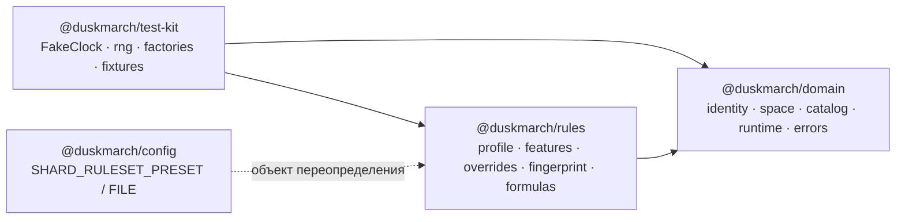

# Design: P01 Общая доменная модель и правила

## Context

P00 создала изоморфные пакеты `@duskmarch/domain`, `@duskmarch/rules` и `@duskmarch/test-kit` с проверкой границ (dependency-cruiser, ESLint) и порогами покрытия ядра 85/80 %. P01 наполняет их по [CONCEPT.md](../../../docs/CONCEPT.md) §2–5 и константам [ARCHITECTURE.md](../../../docs/ARCHITECTURE.md) §5. Сторонние форматы и понятия других игр не используются (§5, §6).

## Goals / Non-Goals

**Goals:**
- Единый словарь домена для клиента, сервера, инструментов и ботов с одинаковыми результатами на всех платформах.
- Детерминизм: время и случайность только через инъецируемые зависимости, целочисленная арифметика в правилах.
- Расширяемость без переписывания: новые планы, флаги функций и виды сущностей добавляются данными профиля или резервными кодами.

**Non-Goals:**
- Механики навыков, боя, плетений и репутации (P15–P18).
- Хранение данных и распределённая аренда идентификаторов (P08, P32).
- Формат чанков и ассетов (P02).

## Decisions

### D1. Брендированные примитивы вместо классов-обёрток
Идентификаторы, координаты, оттенки, значения навыков и ключи контента — `number` или `string` с брендом TypeScript (`type ItemId = number & { readonly [brand]: 'ItemId' }`) и конструктором-валидатором. Объектов-обёрток нет: значения дешёво копируются, сериализуются в JSON без преобразований и годятся для `@colyseus/schema`.
- *Альтернатива — классы:* лишние аллокации на горячем пути сервера и ручная сериализация.

### D2. Вид сущности в старших 3 битах идентификатора
32-битное значение `kind << 29 | seq`. Вид определяется сдвигом без таблиц, сравнение — беззнаковое (`>>> 0`). 29 бит дают 536 млн номеров на вид. Резервные коды `5` и `6` позволят ввести новые виды без миграции. Текстовая форма с буквой вида (`I-6000002A`) читается в журналах и консоли персонала.
- *Альтернатива — UUID:* 16 байт на каждую ссылку в репликации и индексах вместо 4.
- *Альтернатива — 64 бита:* `bigint` медленнее и не поддерживается `@colyseus/schema` без преобразования.

### D3. Блочная аренда идентификаторов
`IdAllocator` выдаёт номера из блоков `IdLeaseProvider`. В P01 есть `InMemoryIdLeaseProvider`; P08 добавит поставщика на PostgreSQL, P32 — общий для партиций. Предвыборка при остатке 20 % асинхронна: выдача синхронна, пока в текущем блоке есть номера; если следующий блок не успел прийти, вызывающий получает `ERR_ID_LEASE_PENDING` и повторяет на следующем тике. Хвост блока после сбоя не переиспользуется: отметка (`highWater`) — конец выданного блока.

### D4. Высота в целых шагах 0,25 м
`h` — целое `-1 024..1 023` (−256…+255,75 м). Целые шаги исключают ошибки сравнения чисел с плавающей точкой при проверке подъёма и зазоров; перевод в метры выполняется только для сцены.

### D5. Направления и повороты камеры без тригонометрии
Направление к цели определяется по секторам ±22,5° без `atan2`: ось выбирается, если `1000·|меньшее смещение| ≤ 414·|большее|` (tan 22,5° ≈ 0,414), иначе диагональ по знакам `dx`, `dy`. Экранное направление при повороте камеры `r` — `(d − 2r) mod 8`.

### D6. Навыки в десятых долях, коэффициенты в сотых
Значения навыков — целые `0..1 000`; формулы ресурсов и веса используют коэффициенты в сотых (`60 + floor(might × 60 / 100)`). Результаты совпадают на всех движках JavaScript.

### D7. Профиль правил: TypeBox-схема, глубокая заморозка, канонический JSON
Профиль описан TypeBox-схемой; итог собирается так: пресет → переопределение → проверка схемы → проверка инвариантов (все нарушения одним списком) → `deepFreeze`. Отпечаток — SHA-256 канонического JSON; SHA-256 написан на чистом TypeScript, чтобы пакет оставался изоморфным. Разбор файла переопределения (JSON или YAML) выполняет `@duskmarch/config` на сервере и передаёт объект в `@duskmarch/rules`; поэтому у `rules` нет зависимости от парсера YAML, а у `config` — от `rules`.

### D8. `xoshiro128++` с инициализацией `splitmix32`
128-битное состояние в четырёх `uint32` и только 32-битные операции (`Math.imul`, `>>> 0`) работают одинаково и быстро во всех движках, без `bigint`. Строковые сиды хэшируются FNV-1a. `fork(label)` выводит сид потока из текущего состояния и хэша метки, не продвигая родителя. Эталонные векторы хранятся в `packages/domain/src/runtime/rng.vectors.json`.

### D9. Цикл света вместо дня и ночи
Эйра всегда обращена к звезде, поэтому освещённость плана задаётся треугольной волной по игровой минуте суток между `min` и `max` плана. Сезоны Света и Стужи сдвигают эти границы в P25 через профиль, не меняя функцию.

### D10. Статическая защита чистоты ядра
ESLint-правила `no-restricted-globals`, `no-restricted-properties` и `no-restricted-syntax` для `packages/domain/src` и `packages/rules/src` запрещают недетерминированные API; исключение — `packages/domain/src/runtime/system-clock.ts`. dependency-cruiser из P00 уже запрещает `node:*` в изоморфных пакетах.

## Architecture & Contracts



### Модули `@duskmarch/domain`
| Путь | Содержимое |
| --- | --- |
| `errors/` | `DomainError`, реестр `DomainErrorCode` |
| `identity/` | `EntityId` и виды, текст и байты, `IdAllocator`, `InMemoryIdLeaseProvider`, `EntityRegistry`, `EphemeralIdAllocator` |
| `space/` | `Cell`, `Position`, `Area`, реестр планов, сектора и чанки, направления, расстояния, камера, зазоры |
| `catalog/` | характеристики, ресурсы, навыки и школы, тоны, слоты, репутация, доступ, каркасы, поверхности, флаги клеток, `Tint`, `ContentKey` |
| `runtime/` | `GameClock`, `SystemClock`, `SeededRng`, игровое время, цикл света |
| `util/` | `deepFreeze`, канонический JSON |

Экспорт через подпути `@duskmarch/domain/identity`, `/space`, `/catalog`, `/runtime`, `/errors` и общий корень.

### Модули `@duskmarch/rules`
`profile/` (схема, пресеты `standard` и `proving`), `features/`, `override/` (применение и инварианты), `fingerprint/` (SHA-256), `public/` (клиентский срез), `formulas/` (ресурсы, вес, шаг, капы).

### Таблица профиля `duskmarch`
Значения по ARCHITECTURE §5; все величины целые.

| Поле | Значение | Публичное |
| --- | --- | --- |
| `version` | `1` | да |
| `space.heightStepMm` | `250` | да |
| `space.sectorSize` / `space.chunkSize` | `16` / `32` | да |
| `realms` | `dawn` 0 и `dusk` 1 — 4096×4096 | да |
| `interest.radius` / `interest.largeRadius` | `20` / `32` | да |
| `movement.walkMs` / `runMs` | `360` / `220` | да |
| `movement.mountedWalkMs` / `mountedRunMs` | `250` / `150` | да |
| `movement.window` / `movement.sequenceModulo` | `4` / `256` | да |
| `movement.heroHeightSteps` / `climbSteps` | `7` / `2` | да |
| `time.tickMs` / `time.gameHourMs` | `50` / `240 000` | да |
| `stats.min` / `stats.max` / `stats.totalCap` | `10` / `120` / `240` | да |
| `skills.maxTenths` / `skills.totalCapTenths` | `1 000` / `6 000` | да |
| `inventory.packSlots` | `80` | да |
| `speech.whisper` / `normal` / `shout` | `2` / `14` / `24` | да |
| `light.dawn` / `light.dusk` | `25..85` / `10..50` | да |
| `features.*` | все `true` | да |
| `reputation.offenderMs` | `300 000` | нет |
| `reputation.outcastKills` / `outcastDecayMs` | `4` / `43 200 000` | нет |
| `limits.groundDecayMs` | `2 700 000` | нет |
| `limits.logoutDelayMs` | `120 000` | нет |

### Таблица навыков
| id | Ключ | Название | Школа |
| --- | --- | --- | --- |
| 0 | `edge` | Клинки | Клинок |
| 1 | `haft` | Древковое оружие | Клинок |
| 2 | `maul` | Дробящее оружие | Клинок |
| 3 | `ward` | Щит | Клинок |
| 4 | `brawl` | Кулачный бой | Клинок |
| 5 | `tactics` | Тактика | Клинок |
| 6 | `archery` | Стрельба | Охота |
| 7 | `tracking` | Следопытство | Охота |
| 8 | `trapping` | Ловушки | Охота |
| 9 | `taming` | Приручение | Охота |
| 10 | `skinning` | Свежевание | Охота |
| 11 | `stealth` | Скрытность | Охота |
| 12 | `smithing` | Кузнечное дело | Ремесло |
| 13 | `joinery` | Столярное дело | Ремесло |
| 14 | `weaving` | Ткачество | Ремесло |
| 15 | `brewing` | Зельеварение | Ремесло |
| 16 | `cooking` | Кулинария | Ремесло |
| 17 | `masonry` | Каменное дело | Ремесло |
| 18 | `heat` | Жар | Созвучие |
| 19 | `frost` | Стужа | Созвучие |
| 20 | `stone` | Камень | Созвучие |
| 21 | `wind` | Ветер | Созвучие |
| 22 | `light` | Свет | Созвучие |
| 23 | `binding` | Сплетение | Созвучие |
| 24 | `mining` | Горное дело | Путь |
| 25 | `felling` | Лесорубство | Путь |
| 26 | `foraging` | Собирательство | Путь |
| 27 | `angling` | Рыболовство | Путь |
| 28 | `sailing` | Мореходство | Путь |
| 29 | `beaconry` | Маячное дело | Путь |
| 30 | `trade` | Торговля | Общество |
| 31 | `mending` | Врачевание | Общество |
| 32 | `lore` | Знание | Общество |
| 33 | `oratory` | Красноречие | Общество |
| 34 | `music` | Музыка | Общество |
| 35 | `stewardship` | Хозяйство | Общество |

### Снимок аллокатора (контракт для P08)
Числа — `основание вида + номер`: `next` — следующий идентификатор, `highWater` — граница выданных блоков (первый номер, который поставщик выдаст следующим). Граница может равняться основанию следующего вида, когда диапазон исчерпан. Поставщик обязан выдавать блоки не ниже `highWater`.

```json
{
  "version": 1,
  "kinds": {
    "hero": { "next": 536870913, "highWater": 536875009 },
    "creature": { "next": 1073741825, "highWater": 1073745921 },
    "item": { "next": 1610612737, "highWater": 1610616833 },
    "structure": { "next": 2147483649, "highWater": 2147487745 }
  }
}
```

### Пример переопределения шарда (`shard-ruleset.yaml`)
```yaml
preset: standard
override:
  features:
    playerBounties: false
  limits:
    groundDecayMs: 1800000
```

### Коды ошибок
`ERR_INVALID_ENTITY_ID`, `ERR_ENTITY_KIND_MISMATCH`, `ERR_RESERVED_ENTITY_ID`, `ERR_ENTITY_ID_COLLISION`, `ERR_ENTITY_ID_EXHAUSTED`, `ERR_INVALID_LEASE_SIZE`, `ERR_ID_LEASE_PENDING`, `ERR_INVALID_COORDINATE`, `ERR_HEIGHT_OUT_OF_RANGE`, `ERR_OUT_OF_REALM_BOUNDS`, `ERR_UNKNOWN_REALM`, `ERR_REALM_MISMATCH`, `ERR_SKILL_VALUE_OUT_OF_RANGE`, `ERR_INVALID_TONE_SET`, `ERR_UNKNOWN_CELL_FLAG`, `ERR_INVALID_CONTENT_KEY`, `ERR_INVALID_TINT`, `ERR_UNKNOWN_FEATURE_FLAG`, `ERR_RULESET_INVARIANT`, `ERR_RULESET_SCHEMA`, `ERR_CLOCK_REGRESSION`, `ERR_INVALID_DICE`.

## Risks / Trade-offs

- **Резерв видов исчерпается** → два свободных кода; при необходимости P32 вводит 64-битные идентификаторы через новую версию протокола.
- **Асинхронная аренда может не успеть** → `ERR_ID_LEASE_PENDING` вместо блокировки; блок 4 096 при порогах 20 % выдерживает всплески создания предметов.
- **Ошибки в собственной реализации SHA-256** → проверка по векторам NIST FIPS 180-4 и сверка с `node:crypto` в тесте (только в тестах).
- **Список навыков изменится при балансировке** → числовые id неизменны, новые навыки получают новые id, удалённые помечаются устаревшими.

## Migration Plan

Новая функциональность без данных. Заглушки `index.ts` из P00 заменяются реальными экспортами; потребителей в приложениях пока нет. Откат — `git revert`.

## Open Questions

- Окончательные названия навыков школы «Общество» уточняются при разработке механик P22 и P26; id остаются неизменными.
