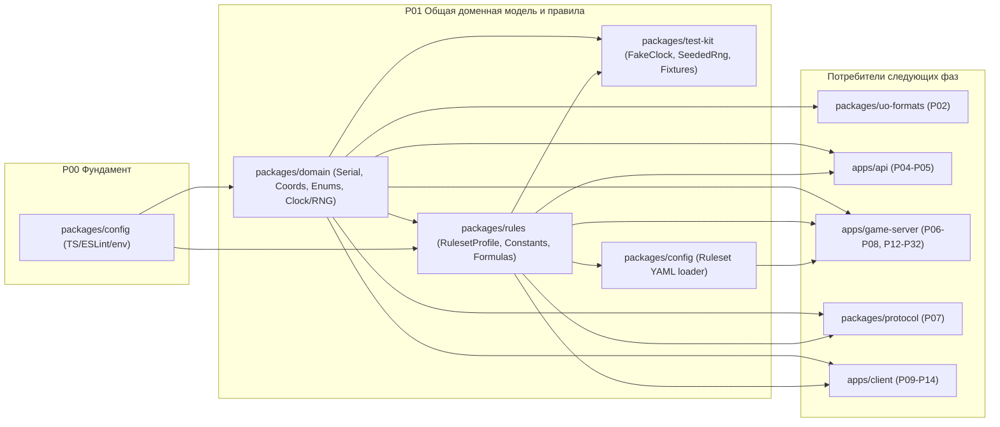
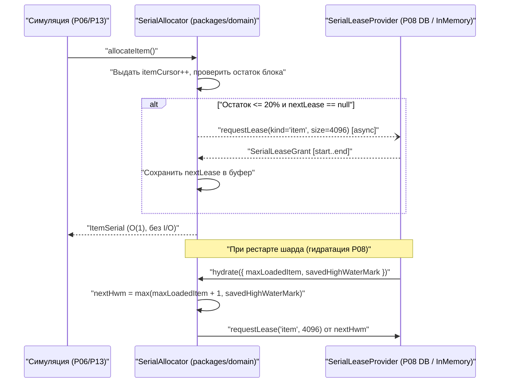
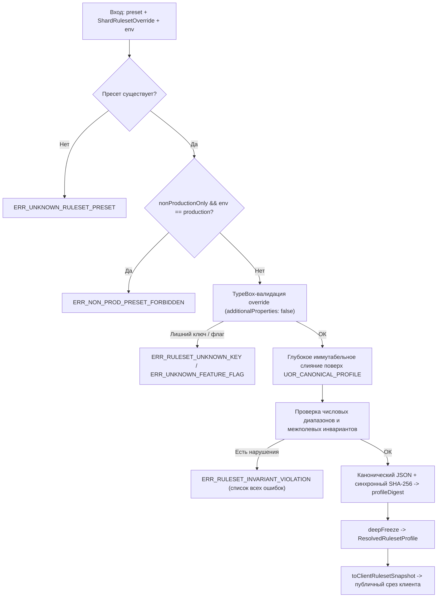

# Design: P01 Общая доменная модель и правила

## Context

Фаза P01 формирует изоморфное доменное и нормативное ядро монорепозитория UO3 (`packages/domain`, `packages/rules`, базовые утилиты `packages/test-kit` и интеграцию схемы правил в `packages/config`) поверх каркаса P00. Мотивация и границы скоупа зафиксированы в [proposal.md](proposal.md).

Ограничения среды и архитектурного фундамента ([ARCHITECTURE.md](../../../docs/ARCHITECTURE.md)):
- **ADR-001:** `packages/domain` и `packages/rules` строго изоморфны (Node 22 ESM и браузер Vite 6 + Web Workers), не содержат серверных или браузерных побочных эффектов и не импортируют `apps/*`, `packages/db` или `packages/uo-formats`.
- **ADR-006:** 32-битные серийники с раздельными диапазонами мобайлов и предметов, сектора пространственного индекса `16×16`, тик `20 Гц` (`50 мс`), полная детерминированность через инъецируемые часы и сидируемый ГПСЧ.
- **ADR-007:** архитектура пространственных границ и аллокации серийников должна с первого дня поддерживать несколько партиций на фасет (P32), даже если в MVP на фасет приходится одна партиция.
- **ADR-010:** базовая эпоха **UO:Renaissance** (`uor`) со всеми константами раздела 5, но с расширяемыми флагами функций (`FeatureFlags`) и переопределениями шарда без переписывания ядра.
- **ADR-011 / ADR-012:** каждый доменный примитив валидируется скомпилированными TypeBox-валидаторами, имеет детерминированный код ошибки и проверяется unit/contract/property-based тестами в Vitest.

## Goals / Non-Goals

**Goals:**
- Обеспечить нулевой runtime-оверхед типобезопасности (branded primitives) в горячих циклах симуляции 20 Гц и рендерера 60 FPS.
- Зафиксировать побитово воспроизводимую арифметику для координат, направлений, флагов тайлов, формул профиля, ГПСЧ (`xoshiro128++`) и игрового времени, идентичную в V8 (Node.js) и браузерных движках.
- Предоставить готовый к горизонтальному масштабированию (P32) и персистентности (P08) механизм блочной аренды серийников с защитой от коллизий и переполнения диапазонов.
- Спроектировать единый декларативный контракт `RulesetProfile` с TypeBox-валидацией, проверкой межполевых инвариантов, синхронным изоморфным SHA-256 отпечатком и безопасным публичным срезом для клиента.
- Создать единый набор фейковых часов, детерминированного ГПСЧ и тестовых фабрик в `packages/test-kit` для всех последующих фаз P02–P36.

**Non-Goals:**
- Реализация бинарных парсеров `MUL`/`UOP`/`IDX` (P02) и структур статического мира в памяти (P03).
- Хранение сущностей и high-water mark серийников в PostgreSQL / Drizzle-миграции (P08 — в P01 определяется только порт/интерфейс `SerialLeaseProvider` и формат снапшота).
- Реализация цикла тиков 20 Гц, иерархического колеса таймеров, пространственного индекса секторов в памяти и headless-мира (P06).
- Сетевые комнаты Colyseus, `@colyseus/schema` и каталог клиентских команд `intents` (P07).
- Игровые формулы прокачки навыков, боя, магии и расчёта нотореити (P15–P18).

## Decisions

### D1. Номинальные брендированные примитивы (Branded Types) вместо классов-обёрток и сырых `number`
- **Выбор:** `Serial`, `MobileSerial`, `ItemSerial`, `EphemeralSerial`, `FacetId`, `BodyId`, `Hue`, `LandId`, `ItemId`, `MultiId`, `SkillId`, `SkillTenths`, `TileFlags` реализуются как TypeScript branded-типы поверх `number` / `bigint` (`type MobileSerial = number & { readonly __brand: 'MobileSerial' }`) с конструкторами-валидаторами (`asMobileSerial`, `parseSerial`) и type guards (`isMobileSerial`).
- **Обоснование:** На сервере с `>= 2 000` игроков и сотнями тысяч предметов в памяти (ADR-006) создание объектных обёрток (`new Serial(x)`) создаёт давление на V8 GC и усложняет сериализацию в `@colyseus/schema` и TypedArray. Branded-типы полностью стираются при компиляции (нулевой runtime-оверхед), но компилятор TypeScript гарантированно запрещает передать `ItemSerial` туда, где ожидается `MobileSerial`, или `LandId` вместо `ItemId`.
- **Отвергнутые альтернативы:**
  - *Сырые `number` без брендинга:* допускают тихие логические баги (перепутаны `x`/`y`, `LandId`/`ItemId`, `MobileSerial`/`ItemSerial`).
  - *ООП-классы-обёртки (`class Serial`, `class Hue`):* лишние аллокации в горячем пути 20 Гц, невозможность использовать напрямую как ключи `Map`/`Set` по значению, проблемы совместимости с `@colyseus/schema` примитивами.

### D2. Партиционно-безопасная блочная аренда серийников (`SerialAllocator` + `SerialLeaseProvider`) без переиспользования
- **Выбор:** Аллокация ведётся раздельно для мобайлов (`0x00000001..0x3FFFFFFF`) и предметов (`0x40000000..0x7FFFFFFF`). `SerialAllocator` работает через локальные арендованные блоки размером по умолчанию `4 096` (настраиваемо `256..65 536`), получаемые из абстрактного порта `SerialLeaseProvider`. При остатке `<= 20%` (`<= Math.floor(leaseSize * 0.2)`) аллокатор асинхронно предвыбирает следующий блок (`nextLease`). Освобождённые серийники и неиспользованные хвосты блоков после рестарта никогда не возвращаются в пул.
- **Обоснование:** Диапазон в `1 073 741 824` серийников на тип при средней скорости 50 новых предметов/сек и размере блока 4 096 обеспечивает запас свыше **680 лет непрерывной работы** даже с учётом потерь хвостов блоков при перезапусках. Отказ от переиспользования полностью устраняет класс уязвимостей ABA / висячих ссылок в `item_ledger` (P08), отложенных таймерах (P06) и аудите персонала (P29). Блочная аренда позволяет в P06 использовать in-memory провайдер, в P08 — атомарный `UPDATE ... RETURNING` в PostgreSQL, а в P32 — десятки параллельных партиций без межпроцессных блокировок на горячем пути.
- **Отвергнутые альтернативы:**
  - *UUIDv4 / ULID / Snowflake 64-bit:* противоречат ADR-006 и канону UO (32-битные серийники), увеличивают объём трафика репликации AOI в 2–4 раза.
  - *Переиспользование удалённых серийников (free-list):* ломает аудит дюпов в item ledger (P08, P31) и требует сложных версий-поколений (generational indices).
  - *Синхронный запрос к БД/Valkey на каждый новый серийник:* создаёт сетевую задержку в тике 50 мс при массовом спавне лута и монстров.

### D3. Иммутабельные плоские структуры координат и целочисленный октантный расчёт направлений
- **Выбор:** `Point2D`, `Point3D`, `Rect2D`, `WorldLocation` представляются как `Readonly` plain-объекты со строго проверенными целыми числами (`uint16` X/Y, `int8` Z) и набором чистых функций. Индекс сектора `16×16` упаковывается в 32-битный целочисленный ключ `packSectorKey(sx, sy) = ((sy & 0xFFFF) << 16) | (sx & 0xFFFF)` (без строковых аллокаций). Вычисление направления от точки A к точке B выполняется целочисленным алгоритмом ServUO/RunUO по знакам и соотношению `|dx|` и `|dy|` (порог наклона `|dx| > 2 * |dy|` или `|dy| > 2 * |dx|` — точное деление на 8 секторов без `Math.atan2`).
- **Обоснование:** Отказ от `Math.atan2` устраняет различия в реализации трансцендентных функций между libm/V8/WebKit и ускоряет вычисление направления в поиске пути (P12) и ИИ (P19). Целочисленные ключи секторов снижают расход памяти и ускоряют поиск в `Map` при расчёте AOI (P06, P07).
- **Отвергнутые альтернативы:**
  - *Числа с плавающей точкой для мировых координат:* противоречат тайловой модели UO и усложняют проверку равенства позиций и коллизий (P03, P12).
  - *`Math.atan2` для направления:* медленнее и не гарантирует побитового совпадения на границах октантов между платформами.

### D4. 64-битные флаги `TileFlags` на базе `bigint`
- **Выбор:** `TileFlags` хранится как брендированный `bigint` (маска `0n..0xFFFFFFFFFFFFFFFFn`). Для JSON-сериализации используется каноническая hex-строка `"0x..."` (16 hex-цифр или минимальная форма с префиксом `0x`, принимаемая TypeBox-паттерном `^0x[0-9a-fA-F]{1,16}$`), а для человекочитаемой отладки и YAML-контента (P30) — массив имён флагов (`TileFlagName[]`).
- **Обоснование:** Стандартные побитовые операторы JS (`&`, `|`, `<<`) работают только со знаковыми 32-битными целыми (`int32`), а `Number` теряет точность выше 53 бит. Файлы High Seas `tiledata.mul` (P02) используют 64-битные маски флагов (вплоть до бита 40 `MultiMovable` и выше). `bigint` нативно поддерживает все 64 бита и безопасные побитовые операции, а в горячих проверках P03/P10 флаги читаются из кэшированных `TileData` объектов без повторного парсинга.
- **Отвергнутые альтернативы:**
  - *Пара `flagsLow: number, flagsHigh: number`:* усложняет API всех потребителей (P02, P03, P10, P13), повышает риск ошибочного сравнения только младших 32 бит.
  - *`Set<TileFlagName>` на каждый тайл:* неприемлемые затраты памяти для 65 536 записей `ItemTileData` и 16 384 `LandTileData`.

### D5. Декларативный `RulesetProfile` с TypeBox, глубокой заморозкой и синхронным изоморфным SHA-256
- **Выбор:** Схема полного профиля и частичных переопределений шарда (`ShardRulesetOverride`) описывается на `@sinclair/typebox` с `additionalProperties: false` и компилируется через `TypeCompiler.Compile(...)`. Построение `ResolvedRulesetProfile` выполняется в 4 стадии: (1) выбор пресета/эпохи → (2) валидация схемы переопределений → (3) глубокое иммутабельное слияние и проверка межполевых инвариантов → (4) глубокая заморозка (`deepFreeze`) и синхронный расчёт SHA-256 отпечатка по канонизированному JSON (сортировка ключей по UTF-16 code units, без пробелов — совместимо с RFC 8785 JCS). SHA-256 реализуется компактным чистым модулем (~80 строк чистой 32-битной арифметики по FIPS 180-4) внутри `packages/rules`.
- **Обоснование:** Синхронный чистый SHA-256 не зависит от `node:crypto` (который отсутствует в браузере/Web Worker) и не требует `async/await` как `WebCrypto crypto.subtle`, что позволяет вычислять отпечаток прямо в синхронных конструкторах, тестах и на старте комнаты. TypeBox уже зафиксирован в стеке [ARCHITECTURE.md](../../../docs/ARCHITECTURE.md), что обеспечивает единый инструмент валидации для P01, P07 и P30.
- **Отвергнутые альтернативы:**
  - *`node:crypto`:* нарушает ADR-001 (не работает в браузере `apps/client`).
  - *`crypto.subtle.digest`:* асинхронный API, ломающий синхронную сборку профилей и требующий secure context в браузере.
  - *Не-криптографический хэш (FNV-1a / Murmur3):* выше риск коллизий при сверке версий правил между клиентом и шардом.

### D6. Целочисленное представление навыков в десятых долях (`SkillTenths`) и точная формульная арифметика
- **Выбор:** Значения навыков и капов навыков в доменной модели и правилах хранятся в десятых долях (`0..1000` для `0.0..100.0`, кап `7000` для `700.0`). Базовые формулы профиля используют исключительно целочисленную арифметику: `maxHits = 50 + Math.floor(str / 2)`, `maxWeight = 40 + Math.floor((str * 7) / 2)`.
- **Обоснование:** В UO навыки имеют точность строго `0.1`. Использование `float64` приводит к ошибкам накопления (`699.9999999999999` вместо `700.0`) при проверке капа суммы 49 навыков (P15). Целочисленные десятые доли исключают погрешности и позволяют безопасно сериализовать навык в `uint16`.
- **Отвергнутые альтернативы:**
  - *`number` с плавающей точкой (`70.3`):* требует постоянного округления `Math.round(x * 10) / 10` во всех формулах и сравнениях.

### D7. Генератор `xoshiro128++` с `SplitMix64`-сидированием и rejection sampling без modulo bias
- **Выбор:** Детерминированный ГПСЧ реализуется по эталонной спецификации **xoshiro128++** (Blackman & Vigna): состояние `s = Uint32Array(4)` (128 бит), на каждый шаг `nextUint32()` выполняются только 32-битные операции сложения по модулю 2³², XOR и циклических сдвигов (`rotl32`). Инициализация из числового/строкового сида: строковый сид хэшируется в 64-битное зерно через канонический SHA-256 (первые 8 байт big-endian) → прогоняется через 4 шага **SplitMix64** (с использованием `BigInt` только один раз при инициализации/форке!) для заполнения `s[0..3]` с гарантией ненулевого состояния. `nextInt(min, max)` устраняет modulo bias через цикл отбраковки (`limit = 0x100000000 - (0x100000000 % range)`). `fork(label)` создаёт дочерний поток через хэширование `(текущий снимок состояния 16 байт + UTF-8 label)` без продвижения состояния родителя (или с явным счётчиком дочерних веток — фиксируем чистую деривацию из `(seedSnapshot, label)` с неизменным состоянием родителя, если передан ключ, что делает порядок создания веток независимым!).
- **Обоснование:** `xoshiro128++` имеет период `2^128 - 1`, проходит все тесты TestU01 BigCrush и PractRand, работает на чистом 32-битном коде JS без единой `BigInt`-аллокации на горячем пути (`>100M` чисел/сек), сериализуется в 16 байт (`[s0, s1, s2, s3]`) и побитово идентичен в Node.js, Chromium, Firefox и Safari.
- **Отвергнутые альтернативы:**
  - *`Math.random()`:* не сидируется, зависит от реализации движка.
  - *`Mulberry32`:* 32-битное состояние недостаточно для MMORPG-шарда (коллизии на длинных симуляциях, не проходит BigCrush).
  - *`PCG32`:* требует 64-битного умножения на каждом шаге; в JS это либо `BigInt` (дорогие аллокации в тике), либо сложная эмуляция 32×32→64.
  - *`MT19937`:* 624×32-битное состояние (2.5 КБ) неэффективно для частых форков подсистем и снапшотов.

### D8. Разделённые часы `GameClock`: фиксируемое монотонное время тика + отдельная UTC-метка
- **Выбор:** Интерфейс `GameClock` предоставляет: `nowMs(): number` (монотонное время тика в целых мс), `currentTick(): number` (`Math.floor(nowMs / tickMs)`), `tickMs: number`, `wallClockEpochMs(): number` (UTC Unix ms для логов/БД). `SystemGameClock` использует монотонный источник (`performance.now()` — доступен и в Node 22, и в браузере, привязан к `CLOCK_MONOTONIC`) и метод `latch()` в начале каждого тика симуляции (P06) с защитой от скачков (`maxTickDeltaMs = 250 мс` и callback `onDrift(droppedMs)`). `FakeGameClock` в `packages/test-kit` реализует тот же интерфейс + `advanceBy(ms)`, `advanceTicks(n)`, `advanceTo(ms)`, `snapshot()`, `restore(snap)`.
- **Обоснование:** Разделение монотонного игрового времени и настенного UTC-времени защищает таймеры (преступник 2 мин, выход 5 мин, распад 60 мин, кулдауны боя/магии) от переводов часов NTP/DST, а фиксация `latch()` гарантирует, что все события внутри одного тика `50 мс` видят согласованную метку времени.
- **Отвергнутые альтернативы:**
  - *Использование `Date.now()` напрямую:* уязвимо к скачкам NTP назад и делает невозможным детерминированное тестирование.
  - *Передача `nowMs: number` параметром в каждую функцию:* раздувает сигнатуры, не даёт единого контракта `currentTick` и `wallClockEpochMs`.

### D9. Статическая защита детерминизма и границ пакетов
- **Выбор:** В `packages/domain` и `packages/rules` вводятся локальные ESLint-ограничения (`no-restricted-globals`, `no-restricted-properties`, `no-restricted-imports`): запрещены `Math.random`, `Date.now`, `new Date` без аргументов, `process.env`, `node:*`, `window`, `document`. Единственное исключение с явным `eslint-disable` — файл `packages/domain/src/runtime/system-clock.ts` (использует `performance.now` и `Date.now` для `wallClockEpochMs`). Экспорты пакетов описаны строго через `package.json` `exports` (ESM-only, tree-shakeable сабпаты).
- **Обоснование:** Автоматическая проверка на этапе CI (P00) гарантирует, что ни один разработчик или ИИ-агент в последующих фазах P02–P36 не внесёт случайно недетерминированный вызов в общие правила.

## Architecture & Contracts

### Топология пакетов и поток зависимостей



### Структура модулей пакетов

#### 1. `packages/domain` (`@uo3/domain`)
- `src/errors/domain-error.ts` — базовый класс `DomainError` и исчерпывающий enum `DomainErrorCode`:
  - Identity: `ERR_INVALID_SERIAL`, `ERR_SERIAL_KIND_MISMATCH`, `ERR_SERIAL_COLLISION`, `ERR_SERIAL_RANGE_EXHAUSTED`, `ERR_INVALID_LEASE_SIZE`, `ERR_RESERVED_SERIAL`.
  - Coordinates: `ERR_INVALID_COORDINATE`, `ERR_Z_OUT_OF_RANGE`, `ERR_UNKNOWN_FACET`, `ERR_INVALID_FACET_DIMENSIONS`, `ERR_OUT_OF_MAP_BOUNDS`, `ERR_UNALIGNED_PARTITION_BOUNDS`, `ERR_INVALID_DIRECTION`, `ERR_FACET_MISMATCH`.
  - Enumerations: `ERR_INVALID_LAYER`, `ERR_INVALID_BODY`, `ERR_INVALID_HUE`, `ERR_HUE_OUT_OF_ALLOWED_RANGE`, `ERR_INVALID_NOTORIETY`, `ERR_INVALID_ACCESS_LEVEL`, `ERR_RACE_DISABLED_IN_ERA`, `ERR_INVALID_GENDER`, `ERR_INVALID_GRAPHIC_ID`, `ERR_INVALID_TILE_FLAGS`, `ERR_INVALID_SKILL_ID`, `ERR_INVALID_STAT_ID`, `ERR_INVALID_LOCK_STATE`.
  - Ruleset (переиспользуется `packages/rules`): `ERR_UNKNOWN_FEATURE_FLAG`, `ERR_RULESET_UNKNOWN_KEY`, `ERR_RULESET_INVARIANT_VIOLATION`, `ERR_UNKNOWN_RULESET_PRESET`, `ERR_NON_PROD_PRESET_FORBIDDEN`, `ERR_INVALID_STAT_VALUE`.
  - Runtime: `ERR_CLOCK_BACKWARD_JUMP`, `ERR_INVALID_TIME_DELTA`, `ERR_INVALID_RNG_SEED`, `ERR_INVALID_RANGE`, `ERR_INVALID_PROBABILITY`, `ERR_EMPTY_COLLECTION`, `ERR_INVALID_WEIGHT`, `ERR_INVALID_RNG_STATE`, `ERR_INVALID_GAME_TIME_PARAM`.
- `src/identity/`
  - `serial.ts` — константы границ (`SERIAL_NULL = 0`, `MOBILE_SERIAL_MIN = 0x00000001`, `MOBILE_SERIAL_MAX = 0x3FFFFFFF`, `ITEM_SERIAL_MIN = 0x40000000`, `ITEM_SERIAL_MAX = 0x7FFFFFFF`, `EPHEMERAL_SERIAL_MIN = 0x80000000`, `EPHEMERAL_SERIAL_MAX = 0xFFFFFFFE`, `SERIAL_SENTINEL = 0xFFFFFFFF`), брендированные типы, классификация `getSerialKind()`, `compareSerials()`, `formatSerial()`, `parseSerial()`, `writeSerialBE/LE()`, `readSerialBE/LE()`.
  - `serial-allocator.ts` — `SerialAllocator`, интерфейс `SerialLeaseProvider`, `InMemorySerialLeaseProvider`, `SerialRegistry` (защита от `ERR_SERIAL_COLLISION`), `SerialAllocatorSnapshot`, пороги предупреждений 80% / 95%.
  - `ephemeral-allocator.ts` — клиентский локальный аллокатор для диапазона `0x80000000..0xFFFFFFFE`.
  - `serial.schema.ts` — TypeBox-схемы (`SerialNumberSchema`, `SerialHexSchema`, `MobileSerialSchema`, `ItemSerialSchema`).
- `src/coordinates/`
  - `point.ts` — `Point2D`, `Point3D`, `Rect2D`, `WorldLocation`, конструкторы-валидаторы, иммутабельные смещения, `rectContains`, `rectIntersects`, `rectClampToFacet`, бинарные кодеки (5 байт `Point3D`, 6 байт `WorldLocation`).
  - `facet.ts` — `FacetId`, `FacetRuleType` (`FeluccaPvP`, `TrammelSafe`, `Internal`), встроенный реестр фасетов (`Felucca=0`, `Trammel=1`, `Ilshenar=2`, `Malas=3`, `Tokuno=4`, `TerMur=5`, `Internal=127`), регистрация синтетических фасетов, `validatePartitionBounds()`.
  - `sectors.ts` — `SECTOR_SIZE = 16`, `MAP_BLOCK_SIZE = 8`, `toSectorCoord()`, `packSectorKey()`, `unpackSectorKey()`, `getCoveringSectors(point, radius, facet)`, `toMapBlockCoord()`, `toBlockCellIndex()`.
  - `direction.ts` — `Direction` (`0..7`), `DIRECTION_MASK = 0x07`, `DIRECTION_RUNNING_BIT = 0x80`, таблица смещений `DIRECTION_OFFSETS`, `encodeDirection()`, `decodeDirection()`, `rotateDirection()`, `reverseDirection()`, `getDirectionBetween()`.
  - `distance.ts` — `chebyshevDistance()`, `manhattanDistance()`, `euclideanDistanceSquared()`, `euclideanDistance()`, `verticalDistance()`, `isInRange()` (с проверкой фасета).
  - `isometric.ts` — `TILE_WIDTH_PX = 44`, `TILE_HEIGHT_PX = 44`, `TILE_HALF_PX = 22`, `Z_STEP_PX = 4`, `worldToIsoScreen()`, `isoScreenToWorld()`, `computeBaseDrawDepth()`.
  - `clearance.ts` — `PERSON_HEIGHT = 16`, `STEP_HEIGHT = 2`, `Z_MIN = -128`, `Z_MAX = 127`, `verticalIntervalsOverlap()`, `canStepDeltaZ()`, `hasVerticalClearance()`.
  - `coordinates.schema.ts` — TypeBox-схемы для `Point2D`, `Point3D`, `Rect2D`, `WorldLocation`, `DirectionByte`.
- `src/enums/`
  - `layer.ts` — `Layer` (`0x00..0x1D`), таблица метаданных `LAYER_METADATA` (категория, видимость, перетаскиваемость, конфликтующие слои, канонический порядок наложения `LAYER_DRAW_ORDER`).
  - `body.ts` — `BodyId`, `BodyType`, канонические константы (`HUMAN_MALE = 400`, `HUMAN_FEMALE = 401`, `HUMAN_MALE_GHOST = 402`, `HUMAN_FEMALE_GHOST = 403`, `STAFF_ROBE = 987`), `classifyBody()`, `isGhostBody()`, `isHumanBody()`.
  - `hue.ts` — `Hue`, маски `HUE_INDEX_MASK = 0x3FFF`, `HUE_PARTIAL_BIT = 0x8000`, `HUE_TRANSLUCENT_BIT = 0x4000`, `encodeHue()`, `decodeHue()`, диапазоны `SKIN_HUE_RANGE = [1002, 1058]`, `HAIR_HUE_RANGE = [1102, 1149]`, валидаторы.
  - `notoriety.ts` — `Notoriety` (`1..7`), таблица `NOTORIETY_METADATA` (цвет-токен, классический UO hue, `isCriminalToAttack`, `canReceiveDamage`).
  - `access-level.ts` — `AccessLevel` (`0..6`), `hasAtLeastAccess()`, `isStaffAccess()`, `canStaffTarget()`, `parseAccessLevel()`.
  - `race-gender.ts` — `Race` (`Human=0`, `Elf=1`, `Gargoyle=2`), `Gender` (`Male=0`, `Female=1`), `resolveCharacterBody(race, gender, isGhost)`.
  - `tile-data.ts` — `TileKind` (`Land`, `Static`, `DynamicItem`), `LandId`, `ItemId`, `MultiId`, константы `NO_DRAW_LAND_ID = 0x0002`, `NO_DRAW_ITEM_ID = 0x0001`, 64-битный enum `TileFlag` (`0n`..`1n << 40n` и до 63 бит), `hasTileFlag()`, `tileFlagsToHex()`, `parseTileFlagsHex()`, `tileFlagsToNames()`, интерфейсы `LandTileData`, `ItemTileData`, функции `calcTileHeight()`, `isTileImpassable()`, `doesTileBlockLos()`.
  - `skills-stats.ts` — `SkillId` (`0..48` — все 49 навыков UO:R с кодами, ключами и базовыми метаданными), `StatId` (`0..2`), `LockState` (`Up=0`, `Down=1`, `Locked=2`), `SkillTenths` (`0..1000`).
  - `enums.schema.ts` — TypeBox-схемы для всех перечислений.
- `src/runtime/`
  - `clock.ts` — интерфейс `GameClock`, `GameClockSnapshot`, опции `SystemGameClockOptions`.
  - `system-clock.ts` — `SystemGameClock` с монотонным таймером, `latch()`, защитой дрейфа `maxTickDeltaMs = 250`.
  - `rng.ts` — интерфейс `SeededRng`, `RngSnapshot` (`readonly [number, number, number, number]`), `WeightedEntry<T>`, реализация `Xoshiro128PlusPlusRng`, `SplitMix64` (для сидирования), `createSeededRng()`.
  - `game-time.ts` — `GameTime`, `DayPhase` (`Night`, `Dawn`, `Day`, `Dusk`), `MoonPhase` (`0..7`), `computeGameTime()`, `msUntilGameHour()`, `computeGlobalLightLevel()`, `computeMoonPhases()`.

#### 2. `packages/rules` (`@uo3/rules`)
- `src/schema/ruleset.schema.ts` — TypeBox-схемы `FeatureFlagsSchema`, `RulesetProfileSchema`, `ShardRulesetOverrideSchema` (с `additionalProperties: false`), `ClientRulesetSnapshotSchema`, константа `RULESET_SCHEMA_VERSION = "1.0.0"`.
- `src/profiles/uor-canonical.ts` — замороженный канонический профиль `UOR_CANONICAL_PROFILE` со всеми константами из [ARCHITECTURE.md](../../../docs/ARCHITECTURE.md).
- `src/profiles/presets.ts` — реестр пресетов `uor`, `uor-felucca-only`, `uor-dev-fast` (с `nonProductionOnly: true`).
- `src/resolver/merge-and-validate.ts` — глубокое иммутабельное слияние, проверка числовых диапазонов, проверка всех межполевых инвариантов, сбор полного массива `RulesetValidationIssue[]`, `resolveRulesetProfile(options)`.
- `src/digest/sha256.ts` и `src/digest/canonical-json.ts` — изоморфный чистый SHA-256 (FIPS 180-4) и канонический сериализатор ключей для вычисления `profileDigest`.
- `src/projection/client-snapshot.ts` — `toClientRulesetSnapshot(profile)` (отсечение внутренних серверных порогов).
- `src/formulas/core-formulas.ts` — `calcBaseMaxHits()`, `calcBaseMaxStam()`, `calcBaseMaxMana()`, `calcMaxCarryWeight()`, `calcStepDelayMs()`, `isFacetEnabled()`, `isRaceEnabled()`, `isSkillEnabled()`.

#### 3. `packages/test-kit` (`@uo3/test-kit`)
- `src/clock/fake-clock.ts` — `FakeGameClock` (реализует `GameClock`, методы `advanceBy`, `advanceTicks`, `advanceTo`, `snapshot`, `restore`, валидация откатов и дробных дельт).
- `src/rng/test-rng.ts` — фабрики детерминированных генераторов с фиксированным сидом и утилиты записи/сравнения трасс бросков.
- `src/fixtures/domain-fixtures.ts` — фабрики `createTestSerialAllocator()`, `createTestRulesetProfile()`, `createSyntheticFacet()` (`256×256`), генераторы координат и `TileData` для тестов P02–P36.

#### 4. Точки интеграции с другими модулями (контракты для будущих фаз)
- `packages/config` (обновляется в P01): схема загрузки `SHARD_RULESET_PRESET` и пути к YAML-файлу `shard-ruleset.yaml` (переопределения шарда) + валидация при старте.
- `apps/game-server` (интегрируется в P06, P08, P32): NestJS DI-токены `GAME_CLOCK`, `RULESET_PROFILE`, `SERIAL_ALLOCATOR`, `ROOT_RNG`; Colyseus комнаты получают `ResolvedRulesetProfile` и `GameClock` через DI.
- `apps/api` (интегрируется в P04–P05): использует `AccessLevel` для RBAC и `ClientRulesetSnapshot` + `profileDigest` в ответе каталога шардов (`GET /shards`).
- `apps/client` (интегрируется в P09–P14): хранит `ClientRulesetSnapshot` в Zustand-сторе при подключении к шарду и сверяет `schemaVersion` / `profileDigest`.

### Модели данных и wire-форматы

#### Бинарные форматы доменных примитивов

| Структура | Размер | Порядок байт | Поля |
|---|---|---|---|
| `Serial` | 4 байта | Big-Endian (опц. LE) | `uint32 value` |
| `Point3D` | 5 байт | Big-Endian | `uint16 x`, `uint16 y`, `int8 z` |
| `WorldLocation` | 6 байт | Big-Endian | `uint8 facetId`, `uint16 x`, `uint16 y`, `int8 z` |
| `DirectionByte` | 1 байт | — | бит 7: `Running`, биты 6..3: `0`, биты 2..0: `Direction (0..7)` |
| `Hue` | 2 байта | Big-Endian | бит 15: `PartialHue`, бит 14: `Translucent`, биты 13..0: `hueId` |
| `TileFlags` | 8 байт | Big-Endian / LE | `uint64 bitmask` (`bigint`) |
| `RngSnapshot` | 16 байт | Little-Endian | `4 × uint32 (s0, s1, s2, s3)` |

#### Контракт персистентного состояния аллокатора серийников (для P08 PostgreSQL/Drizzle)
P01 не создаёт SQL-миграций, но фиксирует строгий JSON/DB-контракт `SerialLeaseState`, реализуемый таблицей `shard_serial_leases` в P08:
```ts
export interface SerialLeaseGrant {
  readonly kind: 'mobile' | 'item';
  readonly rangeStart: number; // включительно
  readonly rangeEnd: number;   // включительно
  readonly leaseId: string;
}

export interface SerialAllocatorSnapshot {
  readonly mobileCursor: number;      // следующий выдаваемый серийник мобайла
  readonly mobileHighWaterMark: number; // верхняя граница арендованных блоков + 1
  readonly itemCursor: number;        // следующий выдаваемый серийник предмета
  readonly itemHighWaterMark: number;   // верхняя граница арендованных блоков + 1
  readonly leaseSize: number;         // 256..65536 (по умолчанию 4096)
}
```

#### Пример YAML-файла переопределений правил шарда (`shard-ruleset.yaml`)
```yaml
preset: uor
environment: production # production | staging | development | test
overrides:
  features:
    trammelEnabled: false
  network:
    aoiRadiusTiles: 22
  character:
    skillCapTenths: 7200
  lifecycle:
    itemDecayMs: 3600000
```

### Ключевые потоки и алгоритмы

#### Поток 1. Блочная аренда серийников и восстановление после сбоя



#### Поток 2. Пайплайн сборки, валидации и проекции `RulesetProfile`



#### Ключевые математические алгоритмы

1. **`xoshiro128++` шаг генерации (32-битная точная арифметика):**
   ```text
   rotl32(x, k) = ((x << k) | (x >>> (32 - k))) >>> 0
   result = (rotl32((s[0] + s[3]) >>> 0, 7) + s[0]) >>> 0
   t = (s[1] << 9) >>> 0
   s[2] = (s[2] ^ s[0]) >>> 0
   s[3] = (s[3] ^ s[1]) >>> 0
   s[1] = (s[1] ^ s[2]) >>> 0
   s[0] = (s[0] ^ s[3]) >>> 0
   s[2] = (s[2] ^ t) >>> 0
   s[3] = rotl32(s[3], 11)
   return result
   ```
   Устранение modulo bias для `nextInt(min, max)`:
   `range = (max - min + 1)` (целое `1..0x100000000`); при `range === 1` сразу вернуть `min`; иначе `limit = 0x100000000 - (0x100000000 % range)`; повторять `v = nextUint32()` пока `v >= limit`; вернуть `min + (v % range)`.

2. **Целочисленное определение направления `getDirectionBetween(from, to)` (канон UO):**
   - `dx = to.x - from.x`, `dy = to.y - from.y`; при `dx === 0 && dy === 0` возвращается `North (0)` (или исходное направление, если передано fallback).
   - `ax = |dx|`, `ay = |dy|`.
   - Если `ax > 2 * ay`: `dx > 0 ? East (2) : West (6)`.
   - Иначе если `ay > 2 * ax`: `dy > 0 ? South (4) : North (0)`.
   - Иначе диагональ по знакам `(dx, dy)`: `(+,-) → Right (1)`, `(+,+) → Down (3)`, `(-,+) → Left (5)`, `(-,-) → Up (7)`.

3. **Изометрическая проекция и обратная проекция (ADR-003):**
   - Прямая: `screenX = (x - y) * 22`, `screenY = (x + y) * 22 - z * 4`, `baseDepth = x + y`.
   - Обратная на плоскости `z`: пусть `syAdj = screenY + z * 4`, тогда:
     `x = Math.floor((syAdj + screenX) / 44)` (или точное `(syAdj + screenX) / 44` для вещественной привязки курсора),
     `y = Math.floor((syAdj - screenX) / 44)`.

4. **Игровое время, кривая глобальной темноты (`0..26`) и фазы лун:**
   - `totalRealMs = elapsedRealMs + shardEpochOffsetMs`.
   - `minuteRealMs = gameHourRealMs / 60` (в `uor`: `300_000 / 60 = 5_000 мс`).
   - `totalGameMinutes = Math.floor(totalRealMs / minuteRealMs)`.
   - `day = Math.floor(totalGameMinutes / 1440)`, `minuteOfDay = totalGameMinutes % 1440`, `hour = Math.floor(minuteOfDay / 60)`, `minute = minuteOfDay % 60`.
   - Фаза и глобальная темнота `globalLightLevel` (`0` = день, `26` = ночь):
     - `06:00..19:59` (`minuteOfDay ∈ [360, 1199]`): `Day`, уровень `0`.
     - `20:00..21:59` (`minuteOfDay ∈ [1200, 1319]`): `Dusk`, прогресс `p = (minuteOfDay - 1200) / 120`, уровень `Math.round(p * 26)`. (В `21:00` → `p = 0.5` → `13`).
     - `22:00..03:59` (`minuteOfDay >= 1320 || minuteOfDay < 240`): `Night`, уровень `26`.
     - `04:00..05:59` (`minuteOfDay ∈ [240, 359]`): `Dawn`, прогресс `p = (minuteOfDay - 240) / 120`, уровень `Math.round((1 - p) * 26)`. (В `05:00` → `p = 0.5` → `13`).
   - Фазы лун (классика UO, 8 фаз `0..7`):
     - `trammelPhase = day % 8` (полный цикл 8 игровых дней).
     - `feluccaPhase = Math.floor((day % 24) / 3)` (полный цикл 24 игровых дня, смена фазы каждые 3 игровых дня).

## Risks / Trade-offs

- **[Расход ёмкости серийников при частых аварийных рестартах с большим размером блока]** → Размер блока по умолчанию `4 096` даёт запас на `> 260 000` аварийных перезапусков; кроме того, размер блока настраивается от `256` до `65 536`, а мониторинг предупреждает на порогах 80% и 95% ёмкости.
- **[Накладные расходы `bigint` при проверке `TileFlags` в сверхгорячих циклах рендерера/LOS]** → Для `ItemTileData` и `LandTileData` флаги считываются как предвычисленные булевы или битовые кэши при загрузке таблицы в P02/P03/P10, при этом каноническим доменным контрактом остаётся полный 64-битный `bigint` без потери старших флагов High Seas.
- **[Дрейф между TypeBox-схемами и TypeScript-типами `RulesetProfile`]** → Все TypeScript-типы конфигурации выводятся напрямую через `Static<typeof Schema>` из TypeBox-схем, исключая ручное дублирование определений.
- **[Ложные срабатывания при проверке детерминизма из-за `SystemGameClock`]** → `SystemGameClock` выделен в изолированный модуль `runtime/system-clock.ts` с локальным разрешением ESLint; все остальные файлы `packages/domain` и `packages/rules` строго проверяются lint-правилом на отсутствие `Date.now` / `Math.random` / `performance.now`.
- **[Изменение канонической сериализации SHA-256 при эволюции схемы профиля]** → Вводится явное поле `schemaVersion` (semver) внутри профиля и клиентского среза; при добавлении новых полей в будущих фазах `schemaVersion` инкрементируется, а клиент получает явный признак несовместимости (ADR-005).
- **[Просадка точности в `nextFloat()` при 32-битном vs 53-битном преобразовании]** → Для `nextFloat()` фиксируется ровно один вызов `nextUint32() / 0x100000000` (2³² равномерных шагов в `[0, 1)`), чтобы не тратить два шага генератора и сохранять простую проверяемость побитовых трасс; для редких задач высокой точности доступен `nextUint32()`.
- **[Асинхронная предвыборка следующего блока серийников может не успеть при пиковой вспышке создания предметов]** → Порог предвыборки `20%` (819 серийников при блоке 4 096) покрывает всплеск > 16 000 предметов/сек при задержке БД 50 мс; если блок всё-таки исчерпан до завершения предвыборки, аллокатор переходит в явное ожидание промиса предвыборки (`allocateAsync`) или возвращает контролируемую ошибку при синхронном вызове без буфера.
- **[Синтетические фасеты для тестов могут пересекаться по ID с расширяемыми фасетами UO]** → Для синтетических тестовых фасетов выделяется отдельный диапазон ID `200..254`, не пересекающийся с `0..5` (официальные фасеты UO) и `127` (`Internal`).

## Migration Plan

1. **Внедрение в монорепозиторий:** Фаза P01 вводит новые пакеты `packages/domain`, `packages/rules` и расширяет `packages/test-kit` и `packages/config` (каркас которых создан в P00). Действующих продакшен-данных и БД на этой вехе (M0) ещё нет, поэтому миграции БД не требуются.
2. **Совместимость с последующими фазами:** Все экспортируемые типы, числовые коды перечислений (`Layer`, `Notoriety`, `AccessLevel`, `SkillId`, `FacetId`, `TileFlag`) и `DomainErrorCode` считаются **стабильным публичным контрактом** с момента завершения P01. Изменения существующих числовых значений запрещены; допустимы только обратно совместимые расширения (добавление новых флагов в `FeatureFlags` с дефолтом `false`, добавление новых пресетов).
3. **План отката:** Поскольку P01 содержит только чистые изоморфные пакеты без миграций хранилища, откат выполняется стандартным откатом коммита/версии пакетов в монорепо до начала интеграции P02/P04.

## Open Questions

Блокирующих архитектурных или геймдизайнерских вопросов, влияющих на спецификации или разбиение задач P01, нет. Отложимые детали для будущих фаз:
- **P08 / P32:** политика периодического сжатия или архивирования записей об истёкших блоках аренды в таблице `shard_serial_leases` (на сам контракт `SerialLeaseProvider` из P01 не влияет).
- **Пост-MVP (AOS-эпоха):** формат миграции персонажей при переключении работающего шарда с профиля `uor` на расширенный профиль (например, включение `aosItemProperties` или добавление 50+ навыков); в P01 достаточно `schemaVersion` и флагов функций.
