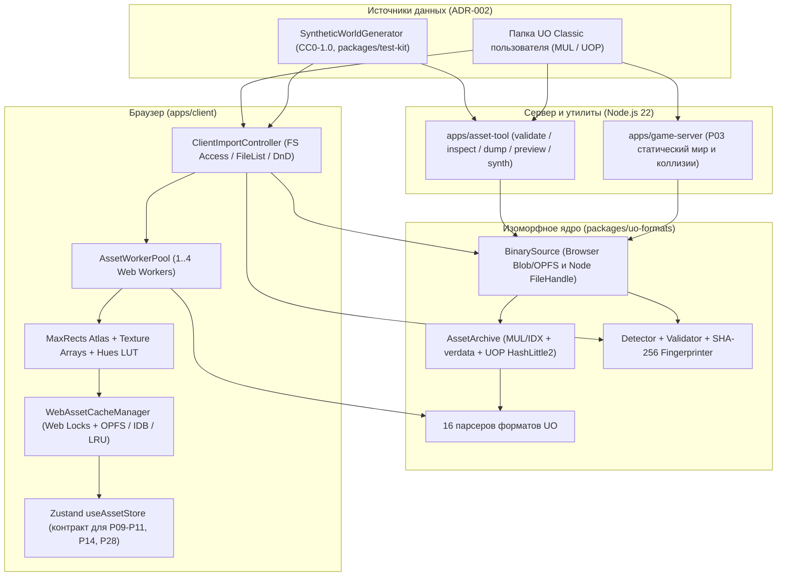
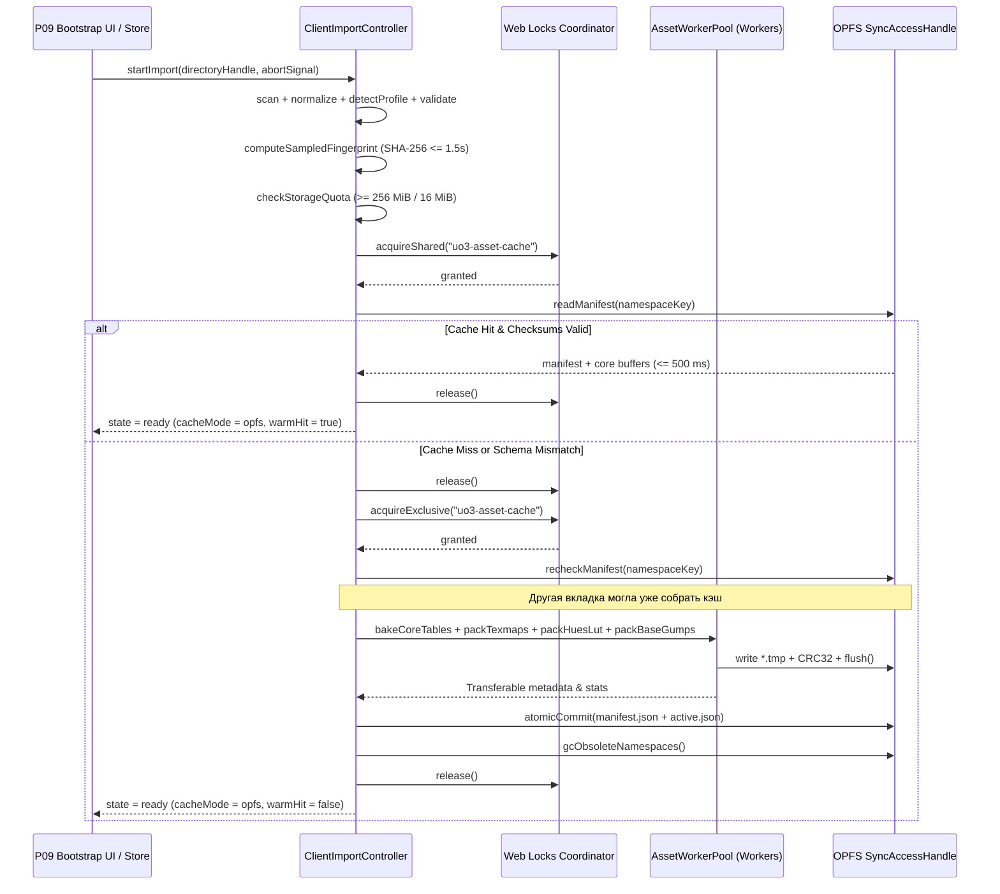
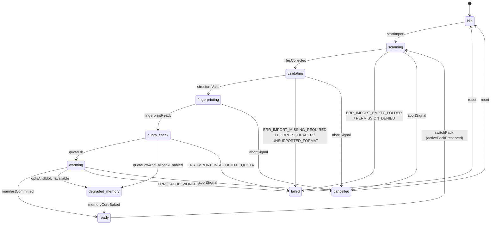

# Design: P02 Форматы UO и импорт клиентских данных

## Context

Фаза P02 реализует слой работы с ассетами Ultima Online в рамках вехи **M0 «Фундамент»** (мотивацию и продуктовые границы см. в [proposal.md](proposal.md), поведенческие контракты — в `specs/assets/*/spec.md`). На входе фазы уже определены структура монорепозитория и правила графа зависимостей (P00, ADR-001), а также базовые доменные типы `Point3D`, `FacetId`, `Direction`, `Layer`, `Body`, `Hue`, `TileFlag`, канонические константы UO:R (`44×44 px`, `Z = 4 px`, `PersonHeight = 16`, `StepHeight = 2`) и сидируемый детерминированный ГПСЧ (P01).

Ключевые архитектурные ограничения из [docs/ARCHITECTURE.md](../../../docs/ARCHITECTURE.md):
- **ADR-001:** строгий TypeScript ESM, разделение изоморфного кода и платформенных адаптеров; клиент не импортирует серверный код; `packages/uo-formats` обязан работать в браузере (включая Web Workers) и в Node.js 22 без Node-специфичных зависимостей в ядре.
- **ADR-002:** модель «принеси свой клиент» — ни одного байта проприетарных ассетов EA/Broadsword в репозитории, артефактах CI и сетевом трафике; вся обработка файлов игрока локальна в браузере; разработка и CI опираются на процедурный синтетический мир и CC0-пак заглушек в идентичных бинарных форматах.
- **ADR-003:** подготовка данных под рендерер Three.js WebGL2 (опц. WebGPU) — бюджет `< 300 draw calls` достигается за счёт плотной упаковки спрайтов в текстурные атласы, однородных `texmaps`/земли в WebGL2 2D Texture Arrays, единой LUT-текстуры `hues` для фрагментного шейдера и одноканальных масок `light`.
- **ADR-011 / ADR-012:** воспроизводимость тестов (включая Playwright SwiftShader), строгий CSP без `eval`, защита от path traversal и утечки пользовательских файлов.

## Goals / Non-Goals

**Goals:**
- Создать единую изоморфную библиотеку `packages/uo-formats` с произвольным доступом по байтовым диапазонам (`BinarySource`) и побитово идентичными парсерами всех 16 семейств форматов UO Classic (MUL/IDX, `verdata.mul`, UOP v4/v5 LegacyMUL и High Seas).
- Обеспечить локальный браузерный импорт из трёх источников (File System Access API, `<input webkitdirectory>`, Drag-and-Drop) с автоопределением профиля клиента, валидацией и быстрым SHA-256 отпечатком (`≤ 1.5 с` на 3 ГиБ).
- Реализовать неблокирующий конвейер декодирования в пуле Web Workers с упаковкой MaxRects-BSSF (1 px экструзия), WebGL2 Texture Arrays, `hues` LUT 32×3001 и персистентным кэшем в OPFS (`SyncAccessHandle`) с атомарной фиксацией, Web Locks и fallback на IndexedDB / RAM LRU.
- Реализовать детерминированный генератор синтетического CC0-мира (`packages/test-kit` + энкодеры `packages/uo-formats`), выдающий подлинные файлы MUL/UOP с эталонными тестовыми ориентирами и пресетом `ci-compact` (`≤ 5 с`, `≤ 16 МиБ` / `≤ 4 МиБ` в архиве).
- Поставить потоковый CLI `apps/asset-tool` (`RSS ≤ 512 МиБ`) с чистыми TypeScript-энкодерами PNG/WAV без нативных C++-аддонов.

**Non-Goals:**
- Построение серверных пространственных структур, расчёт проходимости/высот, проверка прямой видимости (LOS) и применение `mapdif*`/`stadif*` — зона **P03**.
- Визуальные React-экраны мастера импорта, роутинг и хранение настроек аккаунта — зона **P09** (P02 предоставляет headless-контроллер и Zustand-стор).
- Three.js-сцена, изометрическая камера, depth-сортировка, фрагментные шейдеры `hues`/освещения и стейт-машина анимаций — зона **P10–P11**.
- Рендеринг React-гампов, Web Audio API воспроизведение и контент-пайплайн YAML — зоны **P14**, **P28**, **P30**.

## Decisions

### D1. Изоморфная абстракция произвольного доступа `BinarySource` с оконным кэшем
**Выбор:** Все парсеры в `packages/uo-formats` работают исключительно через интерфейс `BinarySource` (`readonly size: number`, `readRange(offset: number, length: number): Promise<Uint8Array>`, `close(): Promise<void>`) и вспомогательный буферизованный `PagedBinaryReader` (окно 64 КиБ, до 8 страниц на файл, чистый `DataView` little-endian). Реализации вынесены в платформенные entrypoint'ы:
- `@uo3/uo-formats/browser`: `BlobBinarySource` (через `File.slice().arrayBuffer()`), `SyncAccessHandleBinarySource` (для OPFS внутри Web Worker), `MemoryBinarySource` (`Uint8Array`).
- `@uo3/uo-formats/node`: `NodeFileBinarySource` (через `fs.promises.FileHandle.read()`), `MemoryBinarySource`.

**Обоснование:** Клиентские файлы UO достигают 1–3 ГиБ (`artLegacyMUL.uop`, `AnimationFrame*.uop`, `map0.mul`). Загрузка целиком в `ArrayBuffer` приводит к OOM в мобильных браузерах и нарушает лимит 512 МиБ RSS в CLI/сервере. Оконное чтение по 64 КиБ минимизирует количество системных вызовов `read()`/`Blob.slice()` при обходе плотных таблиц (`staidx`, `tiledata`, `uop` block tables) и гарантирует побитовую идентичность в V8 браузера и Node.js 22.

**Отвергнутые альтернативы:**
- *Загрузка файлов целиком в `ArrayBuffer`:* неприемлемо по памяти (> 2 ГиБ пикового RAM на старте клиента).
- *Полифил `node:buffer` / `node:fs` в браузерном бандле:* раздувает бандл, нарушает ADR-001 и ломает Web Workers.

### D2. Унифицированный слой архивов `AssetArchive` (MUL/IDX + `verdata.mul` + UOP v4/v5) и `fflate`
**Выбор:** Поверх `BinarySource` строится единый интерфейс `IndexedRecordStore` (`getEntryMeta(id)`, `readEntry(id)`, `count`, `iterateIds()`), скрывающий различия между:
1. `MulIdxStore`: читает 12-байтные записи `.idx` (`int32 lookup`, `int32 length`, `int32 extra`), применяя поверх них таблицу перекрытий `VerdataOverlay` (`Map<VerdataFileId, Map<number, VerdataPatch>>`) при наличии `verdata.mul`.
2. `UopArchive`: парсит заголовок `MYP\0` (v4/v5), обходит связный список таблиц блоков, строит `Map<bigint, UopEntry>` по 64-битному ключу `HashLittle2` и выполняет zlib-распаковку через изоморфную библиотеку `fflate` с жёстким лимитом распакованного размера 64 МиБ на запись.
3. `UopLegacyMulAdapter`: отображает числовые ID записей в канонические пути UOP (`build/artlegacymul/{id:08d}.tga`, `build/gumpartlegacymul/{id:08d}.tga` / `.bin`, `build/map{n}legacymul/{chunk:08d}.dat`, `build/soundlegacymul/{id:08d}.dat`, `build/multicollection/{id:06d}.bin`, `build/animationlegacyframe/{body:06d}/{group:02d}.bin`).

**Обоснование:** Современный UO Classic (7.0.24+) смешивает UOP (`art`, `gumpart`, `map*`, `sound`, `multi`, `anim`) и MUL (`tiledata`, `hues`, `radarcol`, `statics*`, `staidx*`, `texmaps`, `light`, `unifont`, `fonts`). Единый `IndexedRecordStore` позволяет парсерам `art`, `gumpart`, `sound` и `map` не дублировать логику декодирования, а `fflate` работает синхронно в Web Workers и Node.js без асинхронного оверхеда потоков `DecompressionStream` на тысячах мелких спрайтов (1–8 КиБ).

**Отвергнутые альтернативы:**
- *Нативный Web `DecompressionStream('deflate')` на каждый спрайт:* высокий оверхед создания Web Streams на 60 000+ мелких записей (в 5–8 раз медленнее `fflate.unzlibSync` в воркере) и отсутствие поддержки raw/zlib в старых реализациях.
- *Использование 53-битного JS `Number` для хэшей UOP:* теряет старшие биты 64-битного `HashLittle2`, вызывая коллизии и пропуски записей; используем `BigInt` (или пару `uint32` при вычислении с упаковкой в `BigInt` ключ).

### D3. Строгие бинарные декодеры с защитой границ и единой семантикой цвета
**Выбор:** Все 16 декодеров (`tiledata`, `hues`, `radarcol`, `map`, `statics`, `art`, `texmaps`, `gumpart`, `light`, `anim`, `bodyconv`/`body`/`mobtypes`, `multi`, `sound`, `cliloc`, `unifont`, `fonts`) реализуются как чистые модули с предвалидацией размеров (`width <= 4096`, `height <= 4096`), проверкой границ чтения и типизированными ошибками `UoFormatError(code, fileName, offset, details)`. Преобразование RGB555 → RGBA8888 вынесено в единый инлайнируемый хелпер с 65 536-элементной предвычисленной LUT-таблицей `Uint32Array(65536)` (256 КиБ, один раз на воркер).

**Обоснование:** Предвычисленная LUT-таблица `RGB555_TO_RGBA8888` ускоряет декодирование десятков тысяч спрайтов и `texmaps` в 3–4 раза по сравнению с побитовыми операциями на каждый пиксель, гарантируя идентичную формулу `c8 = (c5 << 3) | (c5 >> 2)` и единую обработку прозрачного цвета `0x0000` (`alpha = 0`) против тёмно-чёрного `0x0001` (`alpha = 255`). Явные лимиты защищают браузер и сервер от DoS-файлов и повреждённых RLE-потоков.

**Отвергнутые альтернативы:**
- *Побитовое вычисление RGB555 в каждом декодере:* риск расхождения формул (например, `c5 << 3` вместо `(c5 << 3) | (c5 >> 2)` даёт серый `#F8F8F8` вместо белого `#FFFFFF`) и лишняя нагрузка на CPU воркеров.

### D4. Многоисточниковый браузерный импорт и быстрый отпечаток пака
**Выбор:** Клиентский модуль импорта (`apps/client/src/assets/import/`) инкапсулирует различия браузерных API за интерфейсом `VirtualDirectory`:
- `FsAccessDirectory`: обёртка над `FileSystemDirectoryHandle` (поддерживает сохранение handle в IndexedDB для последующего `queryPermission` / `requestPermission`).
- `FileListDirectory`: обёртка над `FileList` от `<input type="file" webkitdirectory>` (работает в Firefox и Safari).
- `DataTransferDirectory`: рекурсивный обход `FileSystemDirectoryEntry` при Drag-and-Drop (глубина сканирования ограничена 3 уровнями).
- `SyntheticVirtualDirectory`: виртуальный каталог из встроенного/генерируемого CC0-бандла для dev/CI/demo-режима.

Отпечаток `PackFingerprint` вычисляется алгоритмом `SHA-256` по канонически отсортированному реестру распознанных файлов UO: для каждого файла хэшируется строка `normalizedName + ":" + size + ":" + sampleSha256`, где `sampleSha256` — полный SHA-256 для файлов `≤ 256 КиБ`, либо SHA-256 конкатенации трёх срезов по 64 КиБ (`[0..64K)`, `[mid..mid+64K)`, `[size-64K..size)`) для крупных файлов.

**Обоснование:** Чтение всех 2.5 ГиБ клиента для полного SHA-256 занимает 5–12 секунд и тратит I/O впустую при каждом рестарте. Выборочный 3-зонный SHA-256 читает менее 4 МиБ суммарно (`< 300 мс` на SSD, гарантированно `≤ 1 500 мс` на HDD), при этом гарантированно обнаруживает изменение размера, заголовка, таблиц блоков или хвоста любого файла. Ни один байт и ни один путь ОС не покидает браузер (ADR-002).

**Отвергнутые альтернативы:**
- *Полный SHA-256 всех файлов папки:* неприемлемое время ожидания пользователя при старте.
- *Отпечаток только по именам и `lastModified`/размерам:* `lastModified` сбрасывается при копировании/распаковке и не ловит битовые патчи того же размера (например, перекраска тайлов или модификация `map0.mul` фиксированного размера).

### D5. Пул Web Workers, упаковка MaxRects-BSSF и WebGL2 Texture Arrays
**Выбор:** Декодирование и упаковка вынесены в пул воркеров `AssetWorkerPool` (`size = clamp(navigator.hardwareConcurrency - 1, 1, 4)`), взаимодействующий с главным потоком через типизированный RPC с `Transferable` (`ArrayBuffer`).
- **Переменные спрайты (`art` static, `gumpart`, `anim` frames):** упаковываются алгоритмом **MaxRects (Best Short Side Fit — BSSF)** в страницы RGBA8888 по умолчанию `2048×2048` (динамически ограничивается `min(gl.MAX_TEXTURE_SIZE, 4096)`). Каждый спрайт получает **1 px бордюр экструзии** (копирование крайних пикселей спрайта в отступ) плюс 1 px прозрачный зазор при необходимости, чтобы при масштабировании `0.5×–2×` в P10 не возникал texture bleed. Сверхкрупные спрайты `> 2048 px` (до `4096 px`) размещаются на выделенной странице точного размера.
- **Однородные текстуры (`texmaps` 64×64, `texmaps` 128×128, land 44×44):** упаковываются в плотные WebGL2 2D Texture Arrays (`texmaps64`, `texmaps128`, `land44`), разбиваемые на батчи по `min(gl.MAX_ARRAY_TEXTURE_LAYERS, 2048)` слоёв.
- **Шейдерные таблицы:** `hues` собирается в единую текстуру `32×3001` RGBA8888 (строка `0` — identity градиент `i * 255 / 31`, строки `1..3000` — палитры `hues.mul`), `light` — в R8-атлас.

**Обоснование:** Прямо соответствует ADR-003: Texture Arrays позволяют рисовать весь рельеф за 1–2 draw call, а плотные атласы MaxRects (коэффициент заполнения ~88–94 %, выше Shelf/Row на 15–20 %) удерживают общее число draw calls `< 300`.

**Отвергнутые альтернативы:**
- *Отдельная `WebGLTexture` на каждый спрайт/тайл:* десятки тысяч текстур мгновенно убивают производительность батчинга и нарушают бюджет draw calls.
- *Упаковка Shelf/Strip:* заметно хуже плотность для разноразмерных гампов и кадров анимаций, увеличивает расход VRAM на 20–35 %.

### D6. Персистентный кэш в OPFS (`SyncAccessHandle`), атомарная фиксация и Web Locks
**Выбор:** Кэш организован в OPFS под корнем `/uo3-asset-cache/` со схемой хранения:
- Активный указатель: `/uo3-asset-cache/active.json` (`{ namespaceKey, packFingerprint, cacheSchemaVersion, decoderVersion, committedAt }`).
- Пространство имён: `/uo3-asset-cache/ns/<namespaceKey>/`, где `namespaceKey = sha256(packFingerprint + ":" + cacheSchemaVersion + ":" + decoderVersion).slice(0, 32)`.
- Внутри пространства имён: `manifest.json` (с SHA-256 контрольной суммой), `core-tables.uo3bin` (`tiledata`, `hues`, `radarcol`, `cliloc` индекс), `hues-lut.uo3tex`, `light-atlas.uo3tex`, `texarray-<kind>-<idx>.uo3arr`, `atlas-<kind>-<pageId>.uo3tex`, `anim-cache/<bodyId>.uo3bin`.
- Все записи выполняются в Dedicated Web Worker через `FileSystemFileHandle.createSyncAccessHandle()` во временный файл `*.tmp`, с `flush()`, вычислением CRC32 и атомарным переименованием/обновлением `manifest.json`.
- Координация вкладок: `navigator.locks.request('uo3-asset-cache', { mode: 'shared' | 'exclusive' })` (таймаут очистки 5 000 мс).
- Каскад деградации бэкенда (`CacheStorageBackend`): `OpfsSyncBackend` → `IndexedDbBackend` → `MemoryLruBackend` (с предупреждением `WARN_CACHE_MEMORY_ONLY`).
- Оперативный кэш декодированных буферов ограничен `MemoryLruCache` (по умолчанию `256 МиБ`, вытеснение до `≤ 85 %` при превышении; закреплённые базовые таблицы не вытесняются).

**Обоснование:** `SyncAccessHandle` в OPFS обеспечивает пропускную способность 300–800 МиБ/с (в 5–10 раз быстрее IndexedDB на крупных бинарных блобах), что даёт тёплый старт `≤ 500 мс`. Атомарная фиксация защищает от обрыва вкладки, а Web Locks предотвращает гонки при открытии двух вкладок игры.

**Отвергнутые альтернативы:**
- *Только IndexedDB:* заметные паузы транзакций и сериализации при записи десятков мегабайт атласов, худший тёплый старт.
- *Cache API (Service Worker):* ориентирован на HTTP Request/Response, неудобен для произвольного доступа к чанкам и конфликтует с зоной ответственности P34.

### D7. Синтетический CC0-мир на базе настоящих энкодеров UO
**Выбор:** В `packages/uo-formats` добавляется подмодуль `writers/*` (MUL/IDX, UOP v5 LegacyMUL, `verdata.mul`, `tiledata.mul` 32/64-bit, `hues.mul`, `radarcol.mul`, `map*`, `statics*`, `art`, `texmaps`, `gumpart`, `anim`, `multi`, `sound`, `light`, `cliloc`, `unifont`, `fonts`), а в `packages/test-kit` — высокоуровневый `SyntheticWorldGenerator`, использующий сидируемый ГПСЧ из P01.
- Рельеф генерируется многооктавным целочисленным value/simplex-шумом в диапазоне `Z = −15..+45` с детерминированным «врезанием» плоских тестовых стендов (`landmarks`): `town_plaza`, `stairs_ramp` (ступеньки шаг `StepHeight = 2`, потолок выше `PersonHeight = 16`), `los_wall_window` (стена `Impassable|NoShoot` и окно `Window`), `roofed_building` (2 этажа с `Roof`), `water_bridge` (`Bridge|Surface` над `Wet`), `dungeon_cave`, `house_plot`, `sea_dock`.
- Графика синтезируется процедурными растеризаторами (44×44 изометрические ромбы с цветовой кодировкой биомов и координатной сеткой, 64/128 texmaps, узнаваемые силуэты стен/деревьев/дверей/крыш/сундуков/фонарей, 5-направленные фигурки мобайлов с фазами шага/бега/атаки/каста, встроенный минимальный 8×8/8×12 CC0-шрифт для ASCII + кириллицы `U+0400..U+04FF`).
- Звуки синтезируются формулами DSP (синусоида с огибающей ADSR, фильтрованный шум шага, аккорд заклинания) прямо в `Int16Array` 22 050 Гц.
- Матрица форматов позволяет собрать один и тот же `seed` как `mul-legacy-32bit`, `mul-high-seas-64bit`, `mul-with-verdata` или `uop-legacymul`, плюс набор контролируемых «битых» фикстур для негативных тестов.

**Обоснование:** Поскольку синтетический мир записывается в подлинные бинарные форматы UO, вся цепочка P02 → P03 → P09 → P10 → P11 тестируется на реальных парсерах без единого `if (isSynthetic)` в коде парсинга или рендеринга. Это также обеспечивает строгую юридическую чистоту (SPDX `CC0-1.0`, ADR-002).

**Отвергнутые альтернативы:**
- *JSON-мок вместо бинарных файлов UO:* скрывает ошибки бинарных парсеров, RLE-декодеров и UOP-хэширования до встречи с реальным клиентом игрока.
- *Хранение предсобранных бинарников синтетического мира в Git:* раздувает историю Git и создаёт конфликты; храним только код генератора и минимальные (< 100 КиБ) контрактные фикстуры.

### D8. Потоковый CLI `apps/asset-tool` без нативных бинарных зависимостей
**Выбор:** `apps/asset-tool` строится на чистом TypeScript (Node 22 ESM, `commander` для разбора CLI-флагов), используя `@uo3/uo-formats/node` и `@uo3/test-kit`. Кодирование PNG-превью реализовано компактным чистым PNG-энкодером поверх `fflate.zlibSync` + CRC32 (без `sharp`/`node-canvas`), а кодирование аудио-превью — прямым RIFF/WAVE-заголовком (44 байта + сырой PCM). Для экспорта радара 7168×4096 используется построчное (band-by-band по 8 строк = 1 полоса блоков) чтение карты и инкрементальная запись PNG `IDAT`-чанков, удерживая RSS `≤ 512 МиБ`.

**Обоснование:** Отсутствие нативных C++-аддонов (`sharp`, `canvas`, `libvips`) исключает проблемы сборки на разных ОС/контейнерах CI и ускоряет `pnpm install`. Явные барьеры безопасности проверяют `path.resolve` внутри `--out`, ограничивают массовый экспорт (порог 10 000 файлов) и блокируют запись несинтетических дампов в отслеживаемое Git-дерево.

**Отвергнутые альтернативы:**
- *Использование `sharp` для PNG-превью:* тяжёлая платформенная бинарная зависимость ради простой записи несжатых/zlib RGBA8888-спрайтов.

---

## Architecture & Contracts

### Топология модулей в монорепозитории

| Пакет / приложение | Модуль | Ответственность |
|---|---|---|
| `packages/uo-formats` | `src/io/*` | `BinarySource`, `PagedBinaryReader`, `MemoryBinarySource`, `UoFormatError` |
| `packages/uo-formats` | `src/browser/*`, `src/node/*` | Платформенные адаптеры (`BlobBinarySource`, `SyncAccessHandleBinarySource`, `NodeFileBinarySource`) |
| `packages/uo-formats` | `src/archives/*` | `MulIdxStore`, `VerdataOverlay`, `UopArchive`, `HashLittle2`, `UopLegacyMulAdapter` |
| `packages/uo-formats` | `src/parsers/*` | 16 декодеров (`tiledata`, `hues`, `radarcol`, `map`, `statics`, `art`, `texmaps`, `gumpart`, `light`, `anim`, `bodydefs`, `multi`, `sound`, `cliloc`, `unifont`, `asciifont`) |
| `packages/uo-formats` | `src/color/*` | `RGB555_TO_RGBA8888` LUT, применение `Hue` / `PartialHue` |
| `packages/uo-formats` | `src/detect/*` | `ClientProfileDetector`, `PackValidator`, `PackFingerprinter`, таблицы обязательных/опциональных файлов |
| `packages/uo-formats` | `src/writers/*` | Бинарные энкодеры MUL/IDX, UOP v5, `verdata`, `tiledata`, `map`, `statics`, `art`, `anim`, `multi`, `sound`, `cliloc`, шрифтов |
| `packages/test-kit` | `src/synthetic-world/*` | `SyntheticWorldGenerator`, генератор биомов и landmarks, процедурные CC0-растеризаторы, аудио-синтезатор, матрица форматов и битых фикстур |
| `apps/client` | `src/assets/import/*` | `VirtualDirectory` (FS Access / FileList / DnD / Synthetic), `ClientImportController`, проверка квоты, локализованная диагностика RU/EN |
| `apps/client` | `src/assets/workers/*` | `AssetWorkerPool`, `asset-decode.worker.ts`, протокол Transferable RPC |
| `apps/client` | `src/assets/packing/*` | `MaxRectsPacker` (BSSF + 1 px extrusion), `TextureArrayPacker`, `HuesLutBuilder`, `LightAtlasBuilder` |
| `apps/client` | `src/assets/cache/*` | `WebAssetCacheManager`, `OpfsSyncBackend`, `IndexedDbBackend`, `MemoryLruBackend`, `TabLockCoordinator`, `MemoryLruCache` |
| `apps/client` | `src/assets/store/*` | Headless Zustand-стор `useAssetStore` (контракт для P09 `client/asset-bootstrap` и P10–P11/P14/P28) |
| `apps/asset-tool` | `src/commands/*` | CLI-команды `validate`, `inspect`, `dump`, `export-preview`, `generate-synthetic`, `fingerprint`, потоковый PNG/WAV-экспорт, security guards |

### Диаграмма 1: Сквозной поток данных ассетов (Браузер и Node.js)



### Диаграмма 2: Последовательность импорта, многовкладочной блокировки и кэширования в OPFS



### Диаграмма 3: Конечный автомат сессии импорта и состояния кэша



### Справочная таблица бинарных форматов UO Classic

| Формат / файлы | Структура записей и размеры | Варианты и особенности |
|---|---|---|
| **UOP** (`*.uop`) | Header 40B (`MYP\0`, `uint32 version=4|5`, `uint32 format=0xFD23EC43`, `uint64 firstBlock`, `uint32 blockSize`, `uint32 fileCount`); Block Header 12B (`uint32 count`, `uint64 nextBlock`); Entry 34B (`uint64 offset`, `uint32 headerLen`, `uint32 compLen`, `uint32 decompLen`, `uint64 hash`, `uint32 adler32`, `uint16 flags`) | `flags === 1` → zlib; 64-bit `HashLittle2`; макс. `decompLen <= 64 MiB` |
| **IDX** (`*.idx`) | 12B/запись: `int32 lookup`, `int32 length`, `int32 extra` | `lookup === -1` или `length <= 0` → пустой слот |
| **verdata.mul** | `int32 patchCount` + `patchCount × 20B` (`int32 fileId`, `int32 blockId`, `int32 pos`, `int32 len`, `int32 extra`) | Приоритетное наложение на `map0=0`, `staidx0=1`, `statics0=2`, `artidx=3`, `art=4`, `anim.idx=5`, `anim.mul=6`, `soundidx=7`, `sound=8`, `texidx=9`, `texmaps=10`, `gumpidx=11`, `gumpart=12`, `multi.idx=13`, `multi.mul=14`, `tiledata=16`, `hues=32` |
| **tiledata.mul** | 512 групп Land × (`4B header + 32 × landEntry`), далее 512/1024/2048 групп Item × (`4B header + 32 × itemEntry`) | **Legacy 32-bit:** land 26B (`u32 flags, u16 texId, char[20] name`), item 37B (`u32 flags, u8 weight, u8 quality, u16 misc, u8 unk2, u8 qty, u16 anim, u8 unk3, u8 hue, u16 stackOff, u8 height, char[20] name`). **High Seas 64-bit:** `u64 flags` → land 30B, item 41B |
| **hues.mul** | 375 групп × (`4B header + 8 × 88B`) = 3 000 палитр; палитра: `32 × u16 RGB555`, `u16 tableStart`, `u16 tableEnd`, `char[20] name` | Индекс 1..3000; 0 = identity |
| **radarcol.mul** | `65 536` или `81 920` × `u16 RGB555` | `0x0000..0x3FFF` = land, `0x4000+` = static |
| **map\*** (MUL/UOP) | Блоки 8×8 = 196B (`u32 header` + 64 × (`u16 tileId`, `i8 z`)) | Column-major `blockIdx = blockX * heightBlocks + blockY`; Felucca/Trammel `7168×4096` (896×512) и legacy `6144×4096` (768×512); в UOP чанки по 4096 блоков (`0xC4000` байт) |
| **statics\* / staidx\*** | IDX на каждый 8×8 блок; запись статики 7B (`u16 tileId`, `u8 x`, `u8 y`, `i8 z`, `u16 hue`) | `x, y ∈ [0..7]`, `z ∈ [-128..127]` |
| **art** (MUL/UOP) | `id < 0x4000`: 1024 × `u16 RGB555` (ромб 44×44). `id >= 0x4000`: `u32 flag`, `u16 w`, `u16 h`, `h × u16 rowOff`, RLE `(u16 xOff, u16 xRun, pixels)` до `(0,0)` | `0x0000` прозрачный; макс. `4096×4096` |
| **texmaps** | `extra === 0` → `64×64 × u16` (8 192B); `extra === 1` → `128×128 × u16` (32 768B) | Растягиваемые текстуры земли |
| **gumpart** (MUL/UOP) | MUL: `w = extra >>> 16`, `h = extra & 0xFFFF`; UOP: префикс `u32 w, u32 h`; далее `h × u32 rowOff`, RLE `(u16 color, u16 run)` | Защита от переполнения `run` за `w` (`WARN_UO_RLE_OVERFLOW`) |
| **light** | `w = extra & 0xFFFF`, `h = extra >>> 16`; `w × h` байт интенсивности (`int8` / `0..31`) | Конвертируется в R8 маску с сохранением знака/интенсивности |
| **anim** (MUL/UOP) | MUL: `256 × u16 palette`, `i32 frameCount`, `frameCount × i32 offs`, кадр (`i16 cx, i16 cy, u16 w, u16 h`, RLE `u32 header` до `0x7FFF7FFF`). UOP: `AnimationFrame1..4.uop` (`AMOU`/кадры) + `AnimationSequence.uop` | `bodyconv.def`, `body.def`, `mobtypes.txt`; направления `0..4`, `5..7` зеркалятся (`3,2,1`) |
| **multi** (MUL/UOP) | MUL: 12B (`u16 id, i16 x, i16 y, i16 z, u32 flags`) или HS 16B (`u64 flags`). UOP: `MultiCollection.uop` zlib-запись с `u32 count`, полями компонента и списком cliloc | Вычисляемый AABB `(minX..maxX, minY..maxY, minZ..maxZ)` |
| **sound** (MUL/UOP) | 40B заголовок (`char[32] name`, `u32 unk1`, `u32 unk2`) + PCM 22 050 Гц, 16-bit signed LE, 1 канал | `sampleCount = (len - 40) / 2`, проверка чётности |
| **cliloc.\<lang\>** | 6B заголовок (`u32=2, u16=1`) + записи (`u32 id, u8 flag, u16 len, utf8[len]`) | Подстановка `~1_LABEL~` из `\t`-аргументов + `#<id>` глубина ≤ 4 |
| **unifont\* / fonts.mul** | `unifont`: `65536 × u32 offs`, глиф (`i8 xOff, i8 yOff, u8 w, u8 h`, `h × ceil(w/8)` 1-bit MSB). `fonts.mul`: 10 шрифтов × (`u8 hdr` + 224 глифа `u8 w, u8 h, u8 hdr, w×h u16 RGB555`) | Поддержка латиницы и кириллицы (`U+0400..U+04FF`) |

### Ключевые алгоритмы и формулы

#### 1. Конвертация RGB555 → RGBA8888 и правило `PartialHue`
Для 16-битного пикселя `raw` (`uint16`):
- Если `raw === 0`: прозрачный пиксель `RGBA = (0, 0, 0, 0)`.
- Иначе:
  ```text
  r5 = (raw >> 10) & 0x1F
  g5 = (raw >>  5) & 0x1F
  b5 =  raw        & 0x1F
  R  = (r5 << 3) | (r5 >> 2)
  G  = (g5 << 3) | (g5 >> 2)
  B  = (b5 << 3) | (b5 >> 2)
  A  = 255
  ```
- При применении палитры `hueId ∈ [1..3000]`:
  - Если `partialHue === true` и `!(r5 === g5 && g5 === b5)`: пиксель остаётся исходным `(R, G, B, 255)`.
  - Иначе: результирующий цвет берётся из `hues[hueId].colors[r5]` (индекс `0..31` по 5-битному красному/яркостному каналу). Та же формула воспроизводится в фрагментном шейдере P10 выборкой из текстуры `hues` LUT `32×3001` по координатам `(u = (r5 + 0.5)/32, v = (hueId + 0.5)/3001)`.

#### 2. Ромб земли 44×44 px (`art` Land)
Для строки `y ∈ [0..43]`:
```text
halfRow = y < 22 ? y : 43 - y
runWidth = (halfRow + 1) * 2        // 2, 4, ..., 44, 44, ..., 2
xStart   = 22 - (halfRow + 1)       // 21, 20, ..., 0, 0, ..., 21
```
Сумма `runWidth` по `y = 0..43` равна ровно `1024` пикселя (`2048` байт). Пиксели с `x < xStart` или `x >= xStart + runWidth` имеют `alpha = 0`.

#### 3. 64-битный хэш UOP (`HashLittle2`)
Выполняется над ASCII-байтами пути в нижнем регистре с начальными 32-битными регистрами `eax = ecx = edx = (len + 0xDEADBEEF) >>> 0` (реализация Jenkins `lookup3` `hashlittle2` с 12-байтными раундами `mix` и финальным `final`, возвращающая `(BigInt(esi) << 32n) | BigInt(edi)`). Все промежуточные сдвиги и сложения выполняются через `>>> 0` и `Math.imul` для точной 32-битной беззнаковой арифметики в JS без потери точности.

#### 4. Индексация анимаций MUL и зеркалирование направлений
Для `anim.mul` (до ремаппинга через `bodyconv.def`):
- `body < 200` (High-Detail Monsters): `base = body * 110`, 22 действия × 5 направлений.
- `200 <= body < 400` (Low-Detail Animals): `base = 22000 + (body - 200) * 65`, 13 действий × 5 направлений.
- `body >= 400` (Human / Equipment): `base = 35000 + (body - 400) * 175`, 35 действий × 5 направлений.
- В файлах `anim2.mul`..`anim5.mul` применяются канонические пороги слотов ClassicUO/ServUO (`anim2`: `<200` / `200..399` / `>=400`; `anim3`: `<300` / `300..399` / `>=400`; `anim4`/`anim5`: аналогично по `bodyconv.def`).
- Направление игрока `dir ∈ [0..7]` (по доменному `Direction` из P01):
  - `dir ∈ {0, 1, 2, 3, 4}` → `storedDir = dir`, `flipHorizontal = false`.
  - `dir = 5` → `storedDir = 3`, `flipHorizontal = true`; `dir = 6` → `storedDir = 2`, `flipHorizontal = true`; `dir = 7` → `storedDir = 1`, `flipHorizontal = true`.

#### 5. Битовый RLE кадров `anim*.mul`
Каждая команда RLE — `uint32 header`:
- Терминатор: `header === 0x7FFF7FFF`.
- `xRun = header & 0x0FFF` (12 бит).
- `rawX = (header >>> 22) & 0x03FF`; `xOffset = rawX >= 0x200 ? rawX - 0x400 : rawX` (знаковое 10-битное).
- `rawY = (header >>> 12) & 0x03FF`; `yOffset = rawY >= 0x200 ? rawY - 0x400 : rawY` (знаковое 10-битное).
- Координаты записи в буфер кадра: `px = centerX + xOffset + i`, `py = centerY + yOffset + height` (проверяются на `0 <= px < width`, `0 <= py < height`), цвет из `palette[byte]`.

### Контракты данных и форматов кэша

#### Формат бинарной страницы кэша OPFS (`*.uo3tex` / `*.uo3arr`)
```text
Offset  Size  Field
0       4     magic: "UO3T" (atlas) или "UO3A" (texture array)
4       2     schemaVersion (uint16 LE, текущая = 1)
6       2     pixelFormat (1 = RGBA8888, 2 = R8)
8       4     width (uint32 LE)
12      4     height (uint32 LE)
16      4     layers (uint32 LE; 1 для 2D atlas, N для Texture Array)
20      4     payloadByteLength (uint32 LE)
24      4     payloadCrc32 (uint32 LE)
28      4     reserved (0)
32      N     raw pixel bytes (width * height * layers * bytesPerPixel)
```

#### Контракт состояния `useAssetStore` (`apps/client`, для P09–P11/P14/P28)
```ts
type AssetImportStatus =
  | 'idle' | 'scanning' | 'validating' | 'fingerprinting'
  | 'quota_check' | 'warming' | 'ready' | 'failed' | 'cancelled';

type ClientPackProfile =
  | 'uo-mul-legacy' | 'uo-mul-high-seas' | 'uo-uop-classic'
  | 'uo3-synthetic' | 'unknown';

type CacheBackendMode = 'opfs' | 'indexeddb' | 'memory-only';

interface AssetDiagnostic {
  code: string;                 // e.g. ERR_IMPORT_MISSING_REQUIRED, WARN_IMPORT_OPTIONAL_MISSING
  severity: 'error' | 'warning';
  fileName?: string;            // только базовое нормализованное имя, без пути ОС
  offset?: number;
  i18nKey: string;              // ключ рекомендации RU/EN
  params?: Record<string, string | number>;
}

interface ActiveAssetPackInfo {
  profile: ClientPackProfile;
  fingerprint: string;          // 64 hex SHA-256
  tileDataFormat: 'legacy-32bit' | 'high-seas-64bit';
  facets: Array<{ id: number; width: number; height: number; format: 'mul' | 'uop' }>;
  cacheBackend: CacheBackendMode;
  cacheNamespace: string;
  warmHit: boolean;
  cachedBytes: number;
  recoveredPages: number;
}
```

#### Протокол сообщений `AssetWorkerPool` (Main ↔ Worker)
- Запросы (`WorkerRequest`):
  - `INIT_PACK`: передаёт карту `Record<string, File | ArrayBuffer>` (или `FileSystemFileHandle` / OPFS paths), `namespaceKey`, `gpuLimits { maxTextureSize, maxArrayLayers }`.
  - `BAKE_CORE`: декодирует `tiledata`, `hues` LUT, `radarcol`, `cliloc`, `light`, `texmaps`, стартовые `gumpart`/шрифты, пишет в OPFS, возвращает `Transferable` буферы + `manifest`.
  - `DECODE_ART_BATCH` / `DECODE_GUMP_BATCH` / `DECODE_ANIM_GROUP` / `DECODE_MAP_BLOCK` / `DECODE_SOUND`: ленивое декодирование и доупаковка в атлас с записью в OPFS.
  - `INSPECT_CACHE` / `CLEAR_CACHE`: операции обслуживания в воркере.
- Ответы (`WorkerResponse`): `PROGRESS { stage, done, total, bytes }`, `RESULT { requestId, payload, transferables }`, `ERROR { requestId, code, message, fileName, offset }`.

#### Контракт манифеста синтетического мира (`synthetic-manifest.json`)
Содержит поля: `schemaVersion: 1`, `license: "CC0-1.0"`, `generatorVersion`, `seed`, `preset` (`ci-compact` | `dev-standard` | `full-scale-sparse`), `format` (`mul-legacy-32bit` | `mul-high-seas-64bit` | `mul-with-verdata` | `uop-legacymul`), `facets` (`[{ id, name, width, height }]`), `landmarks` (карта именованных координат `{ x, y, z, facetId, description }` для `town_plaza`, `stairs_ramp`, `los_wall_window`, `roofed_building`, `water_bridge`, `dungeon_cave`, `house_plot`, `sea_dock`), `files` (`Record<string, { size: number; sha256: string }>`), `packFingerprint`.

## Risks / Trade-offs

- **[Разнородность реальных клиентов UO Classic (пиратские/кастомные шарды, патчи, смешанные MUL+UOP)]** → Детектор не полагается на жёсткий список версий `client.exe`, а определяет формат каждого подсемейства независимо (наличие `*LegacyMUL.uop` против `.mul/.idx`, размер `tiledata.mul` для 32/64 бит, stride `multi.mul` 12/16 байт) с поддержкой гибридных сборок и явным логированием нетипичных комбинаций.
- **[Ограничения Safari/Firefox на File System Access API и OPFS в приватном режиме]** → Поддерживаются все 3 способа выбора папки (`showDirectoryPicker`, `<input webkitdirectory>`, Drag-and-Drop) и трёхуровневый бэкенд кэша (`OPFS SyncAccessHandle` → `IndexedDB` → `Memory LRU`), поэтому клиент остаётся работоспособным во всех современных браузерах.
- **[Нехватка квоты диска или OOM при декодировании 2.5+ ГиБ клиента на слабых устройствах]** → Preflight-проверка `navigator.storage.estimate()` до старта декодирования, поэтапная прогревка (только ядро + видимые по мере игры чанки/спрайты вместо преддекодирования всех 65 536 артов и всех анимаций сразу) и жёсткий LRU-лимит 256 МиБ в RAM.
- **[Конкурентный доступ к OPFS из нескольких вкладок одного браузера]** → `SyncAccessHandle` в спецификации WHATWG не допускает одновременного открытия одного файла на запись двумя воркерами; все операции чтения/записи координируются через `navigator.locks` (shared/exclusive) и перепроверку манифеста после захвата эксклюзивной блокировки.
- **[Атака через специально сформированные битые файлы UO (zlib-бомба, переполнение RLE, OOB-смещения)]** → Все парсеры проверяют границы до выделения буферов, ограничивают размеры спрайтов `4096×4096` и распаковку UOP `64 МиБ`, покрываются property/fuzz-тестами на усечённых и мутированных входах.
- **[Случайное попадание проприетарных файлов UO или их PNG-превью в Git]** → Двойной барьер: CLI `apps/asset-tool` блокирует запись несинтетических выгрузок внутри отслеживаемого Git-дерева без `--allow-repo-write`, а правила P00 CI сканируют репозиторий на расширения `.mul`/`.uop`/`.idx` и превышение размера фикстур.
- **[Синтетические ассеты слишком примитивны для выявления багов рендеринга P10–P11]** → Генератор синтезирует геометрически точные объекты с разными высотами, 2 этажами, крышами, прозрачными окнами, частичной перекраской (`PartialHue` серые области + цветные акценты), 5-направленными асимметричными спрайтами (для явной проверки зеркалирования направлений 5–7) и кириллицей в `unifont`.
- **[Траты на кодирование/декодирование PNG в чистом TS в CLI `apps/asset-tool`]** → Чистый PNG-энкодер поверх `fflate` работает за < 150 мс для полос анимаций и < 4 с для полноразмерного радара 7168×4096 при `RSS ≤ 512 МиБ`, полностью избавляя проект от хрупких нативных C++-зависимостей.

## Migration Plan

Фаза P02 не вносит миграций PostgreSQL и не ломает существующие серверные контракты (это новая базовая подсистема вехи M0). Порядок поэтапного внедрения и развёртывания:
1. Реализовать и покрыть тестами изоморфное ядро `packages/uo-formats` (I/O, архивы, 16 парсеров, энкодеры, детектор, валидатор, фингерпринтер) с проверкой dual-runtime (Node + jsdom/browser Vitest).
2. Реализовать `SyntheticWorldGenerator` в `packages/test-kit` и зафиксировать эталонный детерминированный `ci-compact` пресет для CI (генерируется шагом сборки в `tmp`/артефакт, не коммитится в Git).
3. Собрать `apps/asset-tool` и прогнать сквозную матричную валидацию `generate-synthetic` → `validate` → `inspect` → `dump` → `export-preview` по всем 4 форматам (`mul-legacy-32bit`, `mul-high-seas-64bit`, `mul-with-verdata`, `uop-legacymul`).
4. Реализовать клиентский слой импорта, `AssetWorkerPool`, упаковщик атласов/Texture Arrays и `WebAssetCacheManager` (OPFS/IDB/LRU + Web Locks) в `apps/client` с Playwright-интеграционными тестами в Chromium (OPFS + Web Workers).
5. **Обратная совместимость и откат:** формат OPFS-кэша версионирован полями `cacheSchemaVersion` и `decoderVersion`. При откате релиза клиента на предыдущую версию кэш автоматически переключится на ключ старой схемы или безопасно пересоберётся из исходной папки без ручного вмешательства пользователя.

## Open Questions

Блокирующих архитектурных вопросов для реализации P02 и разблокирования P03/P09/P10 нет — все форматы, контракты и лимиты зафиксированы.

Отложимые вопросы для последующих фаз:
- **GPU-сжатые текстуры (ETC2/BC7/KTX2) в кэше OPFS:** для десктопного WebGL2 (M1–M4) несжатые RGBA8888-атласы и Texture Arrays обеспечивают попиксельную чёткость UO и мгновенную упаковку без долгого транскодирования; оценка сжатия для мобильных браузеров с жёстким лимитом VRAM может быть выполнена в **P34 (`p34-client-platform-quality`)** через инкремент `cacheSchemaVersion`.
- **Прямой импорт через Origin-hosted CDN для полностью кастомного CC0-шарда:** архитектура `VirtualDirectory` уже поддерживает `SyntheticVirtualDirectory`; при желании раздавать собственный бесплатный не-EA арт-пак по HTTPS это добавится новым адаптером в **P30/P34** без изменения парсеров и кэша P02.
