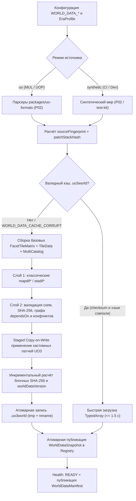
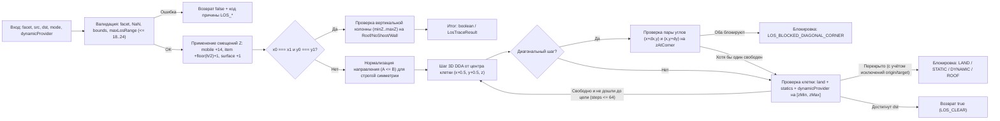
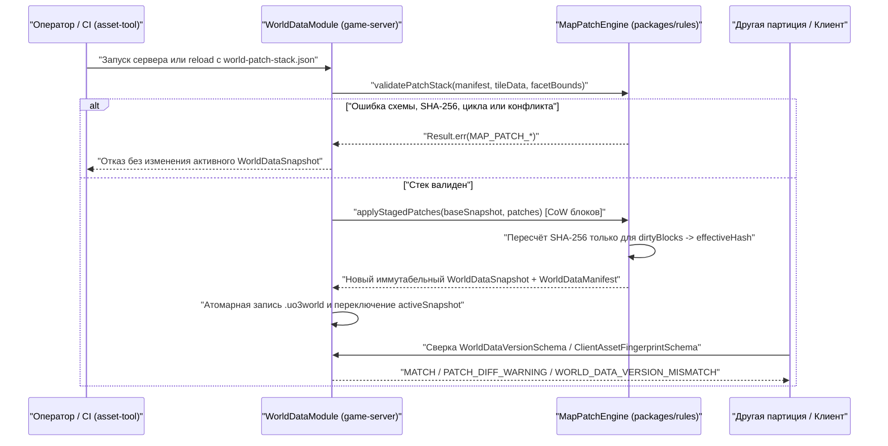

# Design: P03 Серверные данные статического мира

## Context

Фаза **P03** завершает веху **M0 «Фундамент»** (см. `proposal.md` — *Why*) и создаёт авторитарный, детерминированный и компактный слой данных статического мира для `apps/game-server`, общих изоморфных формул `packages/rules` и утилит `apps/asset-tool`.

Проектирование опирается на зафиксированные архитектурные ограничения из [docs/ARCHITECTURE.md](../../../docs/ARCHITECTURE.md):
- **ADR-001 (Монорепозиторий):** чёткое разделение пакетов; общие формулы и чистые алгоритмы живут в изоморфном `packages/rules`, типы — в `packages/domain`, протокольные контракты — в `packages/protocol`, бинарные парсеры — в `packages/uo-formats`, серверная оркестрация — в `apps/game-server`.
- **ADR-002 (Правовая модель ассетов):** проприетарные файлы UO Classic предоставляются оператором шарда при развёртывании; вся разработка и CI обязаны проходить на процедурном синтетическом мире из P02 (`packages/test-kit` / `apps/asset-tool`).
- **ADR-006 / ADR-007 (Симуляция и партиции):** тик симуляции `20 Гц` (`50 мс`), целевая задержка команды `p99 ≤ 30 мс`, пространственные сектора `16×16` тайлов (= `2×2` блока UO `8×8`), радиус AOI `18` тайлов (настраиваемо до `24`, мульти — `31`), задел на многопартиционные фасеты (P32).
- **ADR-010 (Ruleset UO:R):** фасеты по умолчанию Felucca (`0`) и Trammel (`1`) размером `7168×4096` (плюс поддержка legacy `6144×4096`, произвольных кратных 8 размеров и дополнительных фасетов через `EraProfile`), `PersonHeight = 16`, `StepHeight = 2`, `MobileEyeOffset = 14`.
- **ADR-012 (Безопасность и авторитарность):** сервер — единственный источник истины по геометрии и LOS; запрещены односторонние «прострелы углов», выходы за пределы буфера и рассинхронизация версий карты между партициями.

Входные зависимости: `packages/domain` и `packages/rules` (`EraProfile`, `TileFlag`, `Point3D`, `FacetId`) из **P01**, парсеры `packages/uo-formats` (`map*`, `statics*`/`staidx*`, `tiledata`, `multi`, `mapdif*`, `stadif*`) и синтетический мир из **P02**.

## Goals / Non-Goals

**Goals:**
- Уложить полный фасет `7168×4096` (рельеф + до `8 000 000` статических тайлов) в `≤ 220 МБ` плотных `TypedArray`-буферов с минимальной нагрузкой на сборщик мусора V8.
- Обеспечить zero-allocation горячий путь для точечных запросов (`p99 ≤ 10 мкс`) и быстрых булевых проверок LOS на дальности `18` тайлов (`p99 ≤ 50 мкс`).
- Гарантировать 100% соответствие канонической математике UO:R (`GetAverageZ`, `CalcHeight` для `Bridge`, игнорирование `0x0002`/`0x01DB`/`0x01AE..0x01B5`, правила флагов `NoShoot`/`Wall`/`Window`/`Roof`/`Impassable`/`Wet`/`Foliage`) при одновременном устранении классических эксплойтов асимметричного LOS и диагонального прострела углов.
- Обеспечить детерминированный слоистый пайплайн патчей (база → `mapdif`/`stadif` → кастомные патчи UO3), CoW-атомарность сборки, обратимый откат и криптографическое версионирование `worldDataVersion` с быстрым предкомпилированным кэшем `.uo3world` (старт `≤ 1.5 с`).
- Предоставить чистый read-only интерфейс внедрения динамических тайлов (`DynamicTileProvider`), позволяющий P06/P12/P13/P18/P23/P24 подключать двери, магические поля, дома и корабли без циклических зависимостей.

**Non-Goals:**
- Реализация парсеров MUL/UOP/IDX/verdata (выполнено в P02 `packages/uo-formats`; P03 лишь потребляет их выходы и добавляет формат предкомпилированного снапшота/патчей UO3).
- Реализация пространственного индекса динамических сущностей (`Item`/`Mobile`) и игровых комнат Colyseus (P06).
- Полная логика шагового движения (блокировка мобайлами, проталкивание, выносливость, автооткрытие дверей, A*) — это P12 поверх примитивов P03.
- Runtime-экземпляры домов, лодок, регионов, декораций и GM-команд редактирования мира — это P23, P24, P25, P29, P30.

## Decisions

### D1. Блочно-мажорный SoA для рельефа и двухуровневый блочно-разреженный CSR для статики

- **Выбор:** Хранить каждый фасет в иммутабельной структуре `FacetTileMatrix` на базе типизированных массивов (Structure of Arrays), выровненной по каноническим блокам UO `8×8`:
  - Рельеф (`blockCount * 64` элементов): `landIds: Uint16Array` (2 Б/тайл) и `landZ: Int8Array` (1 Б/тайл). Индекс тайла: `tileIdx = (blockIndex << 6) | ((y & 7) << 3) | (x & 7)`, где `blockIndex = ((x >> 3) - originBlockX) * sliceBlockHeight + ((y >> 3) - originBlockY)`.
  - Статика (двухуровневый блочно-разреженный CSR):
    - Уровень 1 (таблица блоков): `activeBlockIndex: Int32Array(blockCount)` — содержит `-1` для пустых блоков (океан, открытые поля) и плотный индекс `0..activeBlocks-1` для блоков, имеющих хотя бы один статический тайл.
    - Уровень 2 (таблица тайлов активных блоков): `tileStaticOffsets: Uint32Array(activeBlocks * 64 + 1)` — префиксные суммы; для клетки `localIdx = ((y & 7) << 3) | (x & 7)` активного блока `aIdx` диапазон статики равен `[tileStaticOffsets[aIdx * 64 + localIdx], tileStaticOffsets[aIdx * 64 + localIdx + 1])`.
    - Полезная нагрузка статики (SoA): `staticItemIds: Uint16Array(N)`, `staticZ: Int8Array(N)`, `staticHues: Uint16Array(N)` (5 байт на статический тайл).
- **Обоснование:**
  - Расчёт памяти для полного фасета `7168×4096` (`458 752` блоков, `29 360 128` клеток земли, типовые `8 000 000` статических тайлов и ~25% непустых блоков ≈ `115 000` активных блоков):
    - Рельеф: `29.36M × 3 Б = 88.08 МБ`.
    - `activeBlockIndex`: `458 752 × 4 Б = 1.84 МБ`.
    - `tileStaticOffsets`: `115 000 × 64 × 4 Б = 29.44 МБ`.
    - Статика SoA: `8 000 000 × 5 Б = 40.00 МБ`.
    - Поблочные SHA-256 дайджесты (`458 752 × 32 Б`): `14.68 МБ`.
    - **Итого:** `~174.0 МБ` на полный фасет (`< 220 МБ` с запасом > 20%, практически ноль объектов в V8-куче).
  - Точечный доступ к статике клетки — ровно `O(1)` (2 индексирования `TypedArray`, без линейного сканирования остальных 63 клеток блока!).
  - Выравнивание по блокам `8×8` совпадает 1:1 с форматом файлов UO, блочными диффами `mapdif`/`stadif`, кэш-линиями CPU для локальных запросов LOS/AOI и секторами `16×16` (`2×2` блока).
- **Отвергнутые альтернативы:**
  - *Массивы JS-объектов `StaticTile[][]` на каждую клетку:* `> 1.5 ГБ` на фасет и десятки миллисекунд stop-the-world пауз V8 GC.
  - *Одноуровневый плотный CSR `Uint32Array(29_360_128 + 1)` для статики:* тратит лишние `117 МБ` на нулевые клетки океана/пустынь, приближая фасет к `260+ МБ`.
  - *Ленивое чтение блоков с диска через LRU-кэш:* нарушает детерминизм задержек `p99 ≤ 10 мкс` при массовых телепортах и спавнах; `~174 МБ` на фасет — тривиальная цена для серверного RAM.

### D2. Изоморфное ядро геометрии в `packages/rules/src/world/*` и серверный хостинг в `apps/game-server/src/world-data/*`

- **Выбор:** Все чистые структуры и алгоритмы без I/O (`FacetTileMatrix`, `TileDataTable`, `MultiCatalog`, `getAverageZ`, `interpolateLandZ`, `resolveSurfaces`, `checkStaticColumn`, 3D DDA Line-of-Sight, `MapPatchEngine`, детерминированное вычисление блочных хэшей через WebCrypto / синхронный адаптер хэшера) размещаются в `packages/rules/src/world/*`. Типы контрактов и коды ошибок — в `packages/domain/src/world/*`. Файловый загрузчик, кэш `.uo3world`, NestJS-модуль `WorldDataModule`, health-индикаторы и метрики — в `apps/game-server/src/world-data/*`.
- **Обоснование:** Строго соответствует **ADR-001** и правилу `AGENTS.md` («Общие формулы — только в `packages/rules`»). Клиент (P12 клиентское предсказание и автопуть), `apps/asset-tool` и симуляционный харнес `packages/test-kit` (P06) смогут вызывать точно те же формулы рельефа, поверхностей и LOS без импорта серверного кода и без расхождения правил между клиентом и сервером.
- **Отвергнутые альтернативы:**
  - *Выделение нового отдельного пакета `packages/world-data`:* расширяет утверждённую в `docs/ARCHITECTURE.md` §3.1 матрицу пакетов монорепозитория без необходимости, усложняя зависимости P00/P06/P12.
  - *Размещение алгоритмов прямо внутри `apps/game-server`:* нарушает ADR-001 и вынуждает дублировать `GetAverageZ`/`CalcHeight` в клиенте P12 и `apps/asset-tool`.

### D3. Каноническая математика рельефа и поверхностей UO:R

- **Выбор:** Воспроизвести точную арифметику RunUO/ServUO:
  - `FloorAverage(a, b) = (a + b) >> 1` (математически тождественно `Math.floor((a + b) / 2)` для любых целых чисел `[-128, 127]`, включая отрицательные).
  - `GetAverageZ(x, y)`: читаем 4 угла `zTop=(x,y)`, `zRight=(min(x+1,w-1), y)`, `zLeft=(x, min(y+1,h-1))`, `zBottom=(min(x+1,w-1), min(y+1,h-1))`; `zLow = min(...)`, `zHigh = max(...)`; если `|zTop - zBottom| > |zLeft - zRight|`, то `zAvg = (zLeft + zRight) >> 1`, иначе `zAvg = (zTop + zBottom) >> 1`.
  - Игнорируемые тайлы земли подземелий: `isIgnoredLandTile(landId)` истинно тогда и только тогда, когда `landId === 0x0002 || landId === 0x01DB || (landId >= 0x01AE && landId <= 0x01B5)`.
  - Эффективная высота статики `calcHeight`: при `(flags & TileFlag.Bridge) !== 0` равна `height >> 1`, иначе `height`. При расчёте допустимого подъёма с `fromZ` на `Bridge` применяется классическое правило: порог подъёма равен `fromZ + stepHeight` для обычной `Surface`, а для `Bridge` допускается вход при `tileZ <= fromZ + stepHeight` (выводя персонажа на `topZ = tileZ + calcHeight`, даже если `calcHeight > stepHeight`, как у лестниц высотой 8–10).
  - Непрерывная высота рельефа внутри клетки `(u, v) ∈ [0, 1]²` (для точного пересечения луча LOS со склонами): поверхность разбивается ровно по той же диагонали, что выбрана в `GetAverageZ`, на два плоских треугольника с точной барицентрической линейной интерполяцией `interpolateLandZ(x, y, u, v)`.
- **Обоснование:** Единообразие диагонального разбиения между `GetAverageZ`, рендерером P10 и LOS гарантирует отсутствие «дыр» и несогласованностей на крутых склонах и в горных проходах.
- **Отвергнутые альтернативы:**
  - *Простое среднее 4 углов `(zTop+zRight+zLeft+zBottom)/4`:* не соответствует канону UO:R и ломает стыковку со склонами/лестницами оригинальных карт Felucca и Trammel.
  - *Использование плоского `zAvg` вместо треугольной интерполяции в LOS:* на крутых холмах допускает ложный прострел вершины гребня либо ложную блокировку у подножия.

### D4. Симметричный 3D DDA Line-of-Sight с блокировкой сомкнутых диагональных углов

- **Выбор:** Вместо классического RunUO-алгоритма с накоплением `float` и усечением `(int)x` (дающего асимметричные «односторонние прострелы» углов) применяется детерминированный **симметричный 3D DDA (Amanatides–Woo в XY с точной линейной параметризацией Z по параметру `t ∈ [0, 1]`)** между центрами клеток `(x0 + 0.5, y0 + 0.5, z0)` и `(x1 + 0.5, y1 + 0.5, z1)`:
  - Для обеспечения абсолютной симметрии `LOS(A, B) === LOS(B, A)` при равных `tMaxX === tMaxY` (точное попадание в вершину сетки / диагональный переход) алгоритм выполняет одновременный диагональный шаг `(x + stepX, y + stepY)` и проверяет **сомкнутый диагональный угол**: обе ортогональные клетки `(x + stepX, y)` и `(x, y + stepY)` проверяются на высоте перехода `zAtCorner = z0 + t * dz`. Если обе клетки блокируют высоту `zAtCorner`, луч немедленно блокируется (`diagonal_corner`).
  - Внутри каждой посещаемой клетки `(cx, cy)` вычисляется точный отрезок параметра `[tEnter, tExit] ⊆ [0, 1]` и соответствующий вертикальный интервал `[zMin, zMax] = [min(z(tEnter), z(tExit)), max(z(tEnter), z(tExit))]`.
  - Для исключения дрейфа округления при обращении концов отрезка `A ↔ B` в точечном режиме внутренний шаг нормализует направление луча по лексикографическому порядку `(x0, y0, z0) <= (x1, y1, z1)` (меняя лишь контекст origin/target для исключений самоблокировки на конечных клетках!), что **математически гарантирует** `hasLineOfSight(A, B) === hasLineOfSight(B, A)` для всех точечных пар!
  - Двухуровневое API:
    - `hasLineOfSight(...) => boolean`: без аллокаций, использует скалярные регистры и булевы предикаты, немедленный ранний выход на первом препятствии.
    - `traceLineOfSight(...) => LosTraceResult`: вызывает точно тот же предикат шага и блокировки клетки (единый источник правды!), дополнительно накапливая массив посещённых клеток и метаданные первого препятствия.
- **Обоснование:** Решает главную PvP-уязвимость классического UO (one-way pillar peeking и стрельба сквозь сомкнутые по диагонали стены замков), полностью соответствует ADR-012 и сохраняет 100% геймплейную аутентичность UO:R (окна `Window`, кроны `Foliage`, вода `Wet`, низкие заборы, крыши `Roof`, глаза `+14 Z`).
- **Отвергнутые альтернативы:**
  - *Портирование RunUO `Point3DList` с `(int)`-усечением:* воспроизводит известные эксплойты асимметрии и выделяет временный буфер точек при каждом вызове.
  - *2D Bresenham без точного `[zMin, zMax]` интервала:* пропускает наклонные лучи, проходящие сквозь тонкие крыши и перекрытия этажей между дискретными точками.

### D5. Расширение динамическими препятствиями через zero-alloc `DynamicTileProvider`

- **Выбор:** Запросы поверхностей, вертикальных колонн и LOS принимают опциональный интерфейс `DynamicTileProvider`:
  ```ts
  export interface DynamicTileView {
    readonly itemId: number;
    readonly z: number;
    readonly height: number;
    readonly calcHeight: number;
    readonly flags: bigint;
    readonly serial?: number;
  }

  export interface DynamicTileProvider {
    forEachDynamicTile(
      facet: FacetId,
      x: number,
      y: number,
      visitor: (tile: DynamicTileView) => boolean | void,
    ): void;
  }
  ```
  Провайдер использует шаблон visitor с переиспользуемым изменяемым объектом-вью (без создания массивов на каждую клетку); возврат `false` из `visitor` прерывает обход клетки при первом же блокирующем препятствии.
- **Обоснование:** Полностью развязывает P03 от будущих фаз (P06 пространственный индекс секторов, P13 двери/предметы, P18 Wall of Stone, P23 дома, P24 корабли) и сохраняет нулевые аллокации в цикле LOS и `resolveSurfaces`.
- **Отвергнутые альтернативы:**
  - *Возврат `DynamicTileView[]` на каждую клетку луча:* до 24–48 аллокаций массивов на один вызов LOS.
  - *Встраивание динамического слоя мутабельных тайлов прямо внутрь `FacetTileMatrix`:* смешивает иммутабельный статический мир (разделяемый между потоками/снимками) с мутабельным игровым состоянием партиции.

### D6. Слоистый патчер с Copy-on-Write на уровне блоков и атомарной подменой снапшота

- **Выбор:** `WorldDataSnapshot` строго иммутабелен после публикации. Сборка нового снапшота при старте или при применении нового стека патчей выполняется в `StagedFacetBuilder`:
  1. Валидируются схемы всех патчей, SHA-256 контрольные суммы полезной нагрузки, граф зависимостей `dependsOn` (алгоритм Кана для выявления циклов и отсутствующих зависимостей), ограничения `baseHash` и диапазоны координат/высот/`tiledata`.
  2. Строится карта затронутых клеток (`Map<cellKey, PatchOwner[]>`) для обнаружения конфликтов независимых патчей согласно политике `strict` (отказ `MAP_PATCH_CONFLICT`) или `last-wins` (предупреждение).
  3. Выполняется Copy-on-Write: создаётся рабочий слой только для изменённых блоков `8×8` (`dirtyLandBlocks`, `dirtyStaticBlocks`); для рельефа копируется буфер (или модифицируется при начальной сборке), а для статики пересобирается компактный блочно-разреженный CSR из неизменённых и новых блоков.
  4. Пересчитываются SHA-256 хэши только для `dirtyBlocks`, собирается новый `WorldDataManifest`, и ссылка `activeSnapshot` в `WorldDataRegistryService` переключается атомарно. При любой ошибке на этапах 1–3 staged-данные отбрасываются, активный снапшот не меняется.
- **Обоснование:** Полное отсутствие полуприменённого состояния, безопасное конкурентное чтение без блокировок и детерминированный откат (достаточно пересобрать стек без снятого патча).
- **Отвергнутые альтернативы:**
  - *Мутация `FacetTileMatrix` in-place с журналом undo:* сложно, подвержено ошибкам частичного отката при исключении и ломает потокобезопасную иммутабельность.

### D7. Двухуровневое блочное дерево SHA-256 хэшей и формат `worldDataVersion`

- **Выбор:** Для каждого фасета вычисляется массив поблочных дайджестов `blockDigests: Uint8Array(blockCount * 32)` (SHA-256 канонической байтовой последовательности блока: 64 пары `(landId: u16le, landZ: i8)` + для каждой из 64 клеток число статики `u16le` и упорядоченные кортежи `(itemId: u16le, z: i8, hue: u16le)`).
  - `effectiveHash = sha256(concat(header(facetId, width, height), blockDigests[0..blockCount-1]))`.
  - `baseHash` вычисляется тем же алгоритмом до применения патчей.
  - `tileDataHash = sha256(canonicalLandDataBytes || canonicalItemDataBytes)` (всегда в нормализованном 64-битном формате флагов, независимо от того, 32-битный или 64-битный исходный `tiledata.mul`).
  - `multiCatalogHash = sha256(canonicalVisibleMultiComponents)`.
  - `patchStackHash = sha256(orderedPatchEntries(type, patchId, version, checksum))`.
  - Составная версия: `worldDataVersion = "${manifestSemver}+${sha256(tileDataHash || multiCatalogHash || sortedFacetEffectiveHashes).slice(0, 12)}"`.
- **Обоснование:**
  - Полная инвариантность относительно формата контейнера (MUL vs UOP), ОС и порядка чтения каталога.
  - При патче, меняющем `k` блоков, инкрементально пересчитываются ровно `k` вызовов SHA-256 + 1 финальный SHA-256 по `blockDigests` (`~14.7 МБ`, `< 25 мс` в Node 22 OpenSSL!).
  - Позволяет мгновенно диагностировать, какие именно блоки разошлись между двумя сборками или партициями.
- **Отвергнутые альтернативы:**
  - *Хэширование сырых файлов `.mul`/`.uop`:* даёт разные хэши для эквивалентных данных в MUL и UOP и не поддерживает инкрементальное обновление.

### D8. Предкомпилированный бинарный кэш снапшота (`.uo3world`)

- **Выбор:** Опциональный (включённый по умолчанию в `WORLD_DATA_CACHE_DIR`) бинарный файл кэша `.uo3world` с жёстким заголовком (`magic = "UO3W"`, `formatVersion = 1`, `headerLength`, JSON-метаданные с `sourceFingerprint`, `patchStackHash`, `worldDataVersion`, таблица смещений секций, 8-байтовое выравнивание каждой секции и завершающий SHA-256 всего файла). При старте сервера буферы `landIds`, `landZ`, `activeBlockIndex`, `tileStaticOffsets`, `staticItemIds`, `staticZ`, `staticHues`, `blockDigests` читаются за один последовательный read/slice без парсинга MUL/UOP и без повторного прогона патчей.
- **Обоснование:** Сокращает холодный старт полного шарда (Felucca + Trammel) с ~6–8 секунд до `< 1.0–1.5 с` на фасет, что критично для RTO `≤ 15 мин` (ADR-008) и быстрого автоскейлинга партиций (P32). При любом расхождении `sourceFingerprint`, `patchStackHash`, `formatVersion` или контрольной суммы файла кэш безопасно отбрасывается (`WORLD_DATA_CACHE_CORRUPT`) и пересобирается автоматически.
- **Отвергнутые альтернативы:**
  - *Отказ от кэша (парсить UOP + накладывать патчи при каждом старте):* медленный перезапуск в продакшене и повторные пики CPU/RAM при рестарте подов.
  - *Хранение статических карт в PostgreSQL:* перегрузка БД гигабайтами неизменяемых статических тайлов и деградация времени старта.

### D9. Срезы партиций с защитным буфером `≥ 32` тайла

- **Выбор:** `FacetTileMatrix` поддерживает как полный фасет (`originBlockX = 0, originBlockY = 0`), так и прямоугольный срез партиции (`partitionBounds`). При загрузке среза прямоугольник автоматически расширяется на `marginTiles = max(32, configuredMargin)` с каждой стороны, выравнивается вниз/вверх к границам блоков `8×8` (кратным секторам `16×16`) и прижимается к `[0, width) × [0, height)`. Все формулы индексации (`(x >> 3) - originBlockX`) и проверки границ работают прозрачно.
- **Обоснование:** Гарантирует бесшовный переход к многопартиционным фасетам в P32 (ADR-007) без переписывания ядра геометрии: `margin ≥ 32` полностью покрывает и максимальный радиус мульти AOI (`31` тайл), и максимальный радиус LOS (`24` тайла).
- **Отвергнутые альтернативы:**
  - *Всегда загружать полный фасет во все партиции:* работает для MVP (1 партиция на фасет), но в P32 при 16 партициях на фасет напрасно умножает RAM в 16 раз.

## Architecture & Contracts

### 1. Структура модулей монорепозитория

| Пакет / Приложение | Модули / Файлы | Назначение |
|---|---|---|
| `packages/domain` | `src/world/types.ts`, `src/world/errors.ts`, `src/world/manifest.ts` | Типы `LandTile`, `StaticTile`, `LandElevation`, `SurfaceCandidate`, `ColumnCheckOptions`, `ColumnCheckResult`, `MultiDefinition`, `MultiComponent`, `LosMode`, `LosOptions`, `LosTraceResult`, `LosBlocker`, `MapPatchDefinition`, `MapPatchOperation`, `WorldDataManifest`, `WorldDataVersionInfo`, `CompatibilityResult`, enum кодов ошибок `WorldDataErrorCode`. |
| `packages/rules` | `src/world/tile-data-table.ts`, `src/world/facet-tile-matrix.ts`, `src/world/multi-catalog.ts`, `src/world/elevation.ts`, `src/world/surfaces.ts`, `src/world/line-of-sight.ts`, `src/world/map-patch-engine.ts`, `src/world/world-hasher.ts`, `src/world/compatibility.ts` | Изоморфные компактные структуры данных на TypedArray, формулы `GetAverageZ`/`interpolateLandZ`/`CalcHeight`/`resolveSurfaces`/`checkStaticColumn`, симметричный 3D DDA LOS (`hasLineOfSight` + `traceLineOfSight`), движок валидации/применения/diff патчей, двухуровневое SHA-256 хэширование и сверка совместимости версий. |
| `packages/uo-formats` | `src/world-snapshot/uo3world-codec.ts`, `src/world-snapshot/uo3patch-codec.ts`, `src/world-snapshot/diff-adapters.ts` | Интеграция адаптеров выходов парсеров P02 (`map*`, `statics*`, `tiledata`, `multi`, `mapdif*`, `stadif*`), кодеки бинарного кэша `.uo3world` и компактных патчей `.uo3patch.bin` / `.uo3patch.json`. |
| `packages/protocol` | `src/world/world-data-version.schema.ts` | TypeBox-схемы `WorldDataVersionSchema`, `ClientAssetFingerprintSchema`, `WorldDataCompatibilitySchema` (переиспользуются в рукопожатии P07/P09 и межпартиционном контроле P32). |
| `packages/config` | `src/world-data.config.ts` | Валидация env-переменных `WORLD_DATA_*` (TypeBox/Zod-схема проекта из P00). |
| `packages/test-kit` | `src/world/world-fixtures.ts`, `src/world/synthetic-world-loader.ts` | Детерминированные мини-фасеты и фикстуры (холмы, обрывы, мосты, лестницы, подземелья с `0x0002`, окна/решётки, крыши/этажи, диагональные углы, мульти, цепочки патчей и конфликтов). |
| `apps/game-server` | `src/world-data/world-data.module.ts`, `world-data-loader.service.ts`, `world-data-registry.service.ts`, `line-of-sight.service.ts`, `map-patch.service.ts`, `world-data.health.ts`, `world-data.metrics.ts` | NestJS `WorldDataModule`: загрузка и кэширование на старте (`OnModuleInit`), хранение активного иммутабельного `WorldDataSnapshot`, DI-сервисы запросов геометрии/LOS/версии, readiness/health-статус и метрики Prometheus. |
| `apps/asset-tool` | `src/commands/world-*.ts` | CLI-подкоманды: `world:compile`, `world:verify`, `world:patch-create`, `world:patch-apply`, `world:patch-inspect`, `world:query`, `world:los`, `world:bench`. |

### 2. Пайплайн загрузки, патчинга и публикации снапшота



### 3. Контракты бинарных структур и схем данных

#### 3.1. Память `FacetTileMatrix` (формулы индексации)
Пусть срез фасета имеет размеры блоков `sliceBlockW × sliceBlockH`, начиная с `(originBlockX, originBlockY)`:
- Валидность координат: `x >= originBlockX * 8 && x < (originBlockX + sliceBlockW) * 8 && y >= originBlockY * 8 && y < (originBlockY + sliceBlockH) * 8`.
- `bx = (x >> 3) - originBlockX`, `by = (y >> 3) - originBlockY`.
- `blockIndex = bx * sliceBlockH + by` (column-major, совпадает с UO `map*.mul`).
- `localIndex = ((y & 7) << 3) | (x & 7)` (row-major внутри `8×8` блока).
- `landOffset = (blockIndex << 6) | localIndex`.
- Статика: `aIdx = activeBlockIndex[blockIndex]`. Если `aIdx === -1`, статика пуста (0 элементов). Иначе `start = tileStaticOffsets[(aIdx << 6) | localIndex]`, `end = tileStaticOffsets[((aIdx << 6) | localIndex) + 1]`; цикл `for (let i = start; i < end; i++)` читает `staticItemIds[i]`, `staticZ[i]`, `staticHues[i]`.

#### 3.2. Формат предкомпилированного снапшота `.uo3world` (v1)

| Смещение | Размер | Поле | Описание |
|---|---|---|---|
| `0x00` | 4 Б | `magic` | ASCII `"UO3W"` (`0x55 0x4F 0x33 0x57`) |
| `0x04` | 2 Б | `formatVersion` | `uint16le = 1` |
| `0x06` | 2 Б | `flags` | Бит 0: `isPartitionSlice`, Бит 1: `isSynthetic` |
| `0x08` | 4 Б | `headerJsonLength` | Длина UTF-8 JSON-заголовка `L` |
| `0x0C` | 4 Б | `reserved` | `0` (выравнивание) |
| `0x10` | `L` Б | `headerJson` | `WorldDataManifest`, `sourceFingerprint`, `sectionTable[{ name, offset, byteLength, elementCount }]` |
| `align8` | вариативно | `sections[]` | Выровненные по 8 байт сырые буферы (`tileData`, `multiCatalog`, по каждому фасету: `landIds`, `landZ`, `activeBlockIndex`, `tileStaticOffsets`, `staticItemIds`, `staticZ`, `staticHues`, `blockDigests`) |
| `EOF - 32` | 32 Б | `fileSha256` | SHA-256 всех байтов от `0x00` до `EOF - 32` |

#### 3.3. Формат кастомного патча UO3 (`.uo3patch.json` и `.uo3patch.bin`)
JSON-схема (валидируется TypeBox; бинарная версия `.uo3patch.bin` кодирует точно те же операции компактно для крупных патчей):
```ts
export interface MapPatchDefinition {
  readonly schemaVersion: 1;
  readonly patchId: string;           // /^[a-z0-9][a-z0-9-]{1,62}[a-z0-9]$/
  readonly version: string;           // semver, например "1.0.0"
  readonly facet: number;             // FacetId (0 = Felucca, 1 = Trammel, ...)
  readonly dependsOn: readonly string[]; // список patchId
  readonly requiredBaseHash?: string; // опциональный SHA-256 базового фасета
  readonly author: string;
  readonly createdAt: string;         // ISO-8601
  readonly description: string;
  readonly operations: readonly MapPatchOperation[];
  readonly checksum: string;          // hex SHA-256 канонической JSON-сериализации всех полей кроме checksum
}

export type MapPatchOperation =
  | { op: 'setLandTile'; x: number; y: number; landId: number; z: number }
  | { op: 'addStatic'; x: number; y: number; itemId: number; z: number; hue?: number }
  | { op: 'removeStatic'; x: number; y: number; match: { itemId?: number; z?: number; hue?: number } }
  | { op: 'replaceTileStatics'; x: number; y: number; statics: ReadonlyArray<{ itemId: number; z: number; hue?: number }> }
  | { op: 'clearAreaStatics'; minX: number; minY: number; maxX: number; maxY: number }
  | { op: 'replaceLandBlock'; blockId: number; tiles: ReadonlyArray<{ landId: number; z: number }> } // ровно 64 элемента
  | { op: 'replaceStaticBlock'; blockId: number; statics: ReadonlyArray<{ localX: number; localY: number; itemId: number; z: number; hue?: number }> };
```

#### 3.4. Стек патчей (`world-patch-stack.json`) и TypeBox-схемы протокола (`packages/protocol`)
- `WorldDataVersionSchema`:
  - `worldDataVersion: string` (`"<semver>+<12-hex>"`)
  - `mode: 'uo' | 'synthetic'`
  - `tileDataHash: string` (64-hex SHA-256)
  - `multiCatalogHash: string` (64-hex SHA-256)
  - `facets: Array<{ facetId: number; width: number; height: number; baseHash: string; patchStackHash: string; effectiveHash: string; appliedPatchIds: string[] }>`
- `ClientAssetFingerprintSchema`:
  - `tileDataHash: string`
  - `facets: Array<{ facetId: number; width: number; height: number; baseHash: string; patchStackHash?: string }>`
- `WorldDataCompatibilitySchema`:
  - `status: 'MATCH' | 'PATCH_DIFF_WARNING' | 'INCOMPATIBLE'`
  - `code?: 'WORLD_DATA_VERSION_MISMATCH' | 'WORLD_DATA_CLIENT_INCOMPATIBLE'`
  - `missingPatchIds: string[]`
  - `mismatchedFacets: number[]`

#### 3.5. Конфигурация `packages/config` (`WORLD_DATA_*`)

| Переменная | Тип / Значение по умолчанию | Описание |
|---|---|---|
| `WORLD_DATA_MODE` | `'synthetic' \| 'uo'` (`'synthetic'`) | Источник статического мира |
| `WORLD_DATA_DIR` | `string` | Каталог исходных файлов UO или синтетического мира |
| `WORLD_DATA_FACETS` | `string` (`'0,1'`) | Список активных `FacetId` (override поверх `EraProfile`) |
| `WORLD_DATA_PATCHES_DIR` | `string` (опционально) | Каталог с `world-patch-stack.json` и патчами |
| `WORLD_DATA_ENABLE_UO_DIFS` | `boolean` (`true`) | Применять ли классические `mapdif*`/`stadif*` |
| `WORLD_DATA_CONFLICT_POLICY` | `'strict' \| 'last-wins'` (`'strict'`) | Политика конфликтов независимых патчей |
| `WORLD_DATA_CACHE_DIR` | `string` (опционально) | Каталог предкомпилированных снапшотов `.uo3world` |
| `WORLD_DATA_PARTITION_BOUNDS` | `string` (опционально `x1,y1,x2,y2`) | Прямоугольник среза партиции (буфер `≥ 32` добавляется автоматически) |
| `WORLD_DATA_LOS_MAX_RANGE` | `number` (`18`, диапазон `1..24`) | Максимальная дальность Чебышёва для LOS |

#### 3.6. Единый каталог кодов ошибок (`packages/domain`)

- Загрузка и запросы: `WORLD_DATA_LOAD_FAILED`, `WORLD_DATA_INVALID_DIMENSIONS`, `WORLD_DATA_INVALID_TILEDATA`, `WORLD_DATA_CACHE_CORRUPT`, `WORLD_DATA_OUT_OF_BOUNDS`, `WORLD_DATA_UNKNOWN_FACET`, `WORLD_DATA_UNKNOWN_MULTI`, `WORLD_DATA_NOT_READY`.
- Прямая видимость: `LOS_CLEAR`, `LOS_DIFFERENT_FACET`, `LOS_OUT_OF_RANGE`, `LOS_INVALID_COORDINATES`, `LOS_OUT_OF_BOUNDS`, `LOS_BLOCKED_LAND`, `LOS_BLOCKED_STATIC`, `LOS_BLOCKED_DYNAMIC`, `LOS_BLOCKED_ROOF`, `LOS_BLOCKED_DIAGONAL_CORNER`.
- Патчи и версионирование: `MAP_PATCH_CORRUPT_DIFF`, `MAP_PATCH_INVALID_SCHEMA`, `MAP_PATCH_CHECKSUM_MISMATCH`, `MAP_PATCH_OUT_OF_BOUNDS`, `MAP_PATCH_INVALID_Z`, `MAP_PATCH_INVALID_TILE_ID`, `MAP_PATCH_MISSING_DEPENDENCY`, `MAP_PATCH_BASE_MISMATCH`, `MAP_PATCH_DEPENDENCY_CYCLE`, `MAP_PATCH_CONFLICT`, `WORLD_DATA_VERSION_MISMATCH`, `WORLD_DATA_CLIENT_INCOMPATIBLE`.

### 4. Ключевые алгоритмы и формулы

#### 4.1. Разрешение кандидатов поверхностей (`resolveSurfaces`) и проверка колонны (`checkStaticColumn`)
1. Читаем `land = getLandTile(facet, x, y)` и `elev = getLandElevation(facet, x, y)`.
2. Если `!land.ignored`:
   - Оцениваем допустимость земли: при `canSwim && (land.flags & Wet)` или `(!cantWalk && !(land.flags & Impassable))` земля добавляется как кандидат `{ source: 'land', z: elev.zLow, topZ: elev.zAvg, stepTopZ: elev.zHigh, flags: land.flags, tileId: land.id }`.
3. Для каждого статического тайла `s` в `(x, y)` и каждого динамического тайла `d` из `DynamicTileProvider`:
   - Если `(flags & (Surface | Bridge)) !== 0` (или `canSwim && (flags & Wet)`), добавляем кандидата `{ source, z: tile.z, topZ: tile.z + tile.calcHeight, stepTopZ: (flags & Bridge) ? tile.z + tile.height : tile.z + tile.calcHeight, flags, tileId }`.
4. Детерминированная сортировка кандидатов по возрастанию `topZ`, при равенстве — `land < static < dynamic`, затем исходный индекс.
5. Выбор опоры от `fromZ`: среди кандидатов, для которых выполняется:
   - обычная поверхность: `cand.topZ <= fromZ + stepHeight`;
   - мост (`Bridge`): `cand.z <= fromZ + stepHeight` (позволяет ступать на лестницу высотой до `height`);
   - и вертикальная колонна `[cand.topZ, cand.topZ + personHeight)` свободна от блокирующих тайлов (`isBlockingColumn(tile, z, height)` истинно, если тайл непроходим `Impassable | Wall` или это неигнорируемый рельеф с `elev.zHigh > z` и `elev.zLow < z + height`, и интервалы пересекаются: `tile.z < z + height && tile.z + tile.calcHeight > z` — с исключением самого опорного тайла при `tile.z + tile.calcHeight <= z`).

#### 4.2. Конвейер Line-of-Sight (симметричный 3D DDA)



Точные правила блокировки тайла `T` (статического или динамического) на вертикальном интервале `[zMin, zMax]` внутри клетки:
- `isLosBlocker(flags, height, eraProfile)`:
  - `if (flags & TileFlag.NoShoot) return true;`
  - `if (flags & TileFlag.Roof) return true;`
  - `if ((flags & TileFlag.Window) && !eraProfile.windowBlocksLos) return false;`
  - `if ((flags & TileFlag.Foliage) && !eraProfile.foliageBlocksLos) return false;`
  - `if (flags & TileFlag.Wall) return true;`
  - `if ((flags & TileFlag.Impassable) && !(flags & TileFlag.Wet) && height > 0) return true;`
  - `return false;`
- Вертикальное пересечение с `T` (`span = [T.z, T.z + T.height]`):
  - На промежуточной клетке: блокирует, если `zMax >= T.z && zMin <= T.z + T.height` (для `Roof` или `NoShoot` нулевой высоты `T.height === 0` проверяется пересечение плоскости `zMin <= T.z && zMax >= T.z`).
  - На исходной клетке `(x0, y0)`: пропускаются тайлы с `T.z + T.height <= z0` (пол под ногами).
  - На целевой клетке `(x1, y1)`: пропускаются тайлы с `T.z + T.height <= z1` и тайл, совпадающий с `options.targetSerial` / `options.ignoreTargetTileId`.
- Проверка рельефа в клетке `(cx, cy)`:
  - Если `!land.ignored && !(land.flags & TileFlag.Wet)`: вычисляем `landZEnter = interpolateLandZ(cx, cy, uEnter, vEnter)` и `landZExit = interpolateLandZ(cx, cy, uExit, vExit)` (плюс середину отрезка на диагональном ребре). Если `zEnter < landZEnter || zExit < landZExit || zMid < landZMid`, луч блокируется (`LOS_BLOCKED_LAND`).

#### 4.3. Последовательность staged-патчинга и сверки версий



### 5. Контракты CLI `apps/asset-tool`

- `asset-tool world:compile --input <dir> --mode <uo|synthetic> [--patches <dir>] --out <cache.uo3world> --manifest <manifest.json>` — сборка и верификация снапшота + запись бинарного кэша и манифеста.
- `asset-tool world:verify --manifest <manifest.json> --cache <cache.uo3world>` — проверка целостности кэша, пересчёт хэшей и валидация графа патчей.
- `asset-tool world:patch-create --base <dirA> --target <dirB> --facet <id> --patch-id <id> --out <patch.uo3patch.json>` — генерация минимального патча по разнице двух состояний.
- `asset-tool world:patch-apply --base <dir> --patches <stack.json> --out <out.uo3world> [--policy strict|last-wins]` — сухой прогон или материализация стека патчей с отчётом о конфликтах.
- `asset-tool world:patch-inspect --stack <stack.json>` — вывод графа зависимостей, затронутых блоков/тайлов и хэшей.
- `asset-tool world:query --world <cache> --facet <id> --x <x> --y <y> [--from-z <z>]` — вывод тайла земли, `GetAverageZ`, статики и кандидатов поверхностей.
- `asset-tool world:los --world <cache> --facet <id> --from <x,y,z> --to <x,y,z> [--mode mobile-to-mobile]` — вывод диагностической трассировки луча.
- `asset-tool world:bench --world <cache> --iterations <N>` — замер `p50/p95/p99` для точечных запросов, `resolveSurfaces`, LOS (дистанция `18`) и отчёт по потреблению памяти (используется в CI и демонстрации вехи M0).

### 6. Сервисы NestJS (`apps/game-server/src/world-data`) и телеметрия

Модуль `WorldDataModule` регистрируется как глобальный инфраструктурный модуль `apps/game-server` (подключается в `AppModule` и будет переиспользоваться в `WorldPartitionRoom` и симуляционном харнесе из P06):

| Сервис / Компонент | Интерфейс и ответственность |
|---|---|
| `WorldDataLoaderService` | Хук `OnModuleInit`: читает `WorldDataConfig`, выбирает адаптер источника (`uo` или `synthetic`), проверяет кэш `.uo3world`, при промахе прогоняет пайплайн `Base → mapdif/stadif → UO3 patches → SHA-256`, атомарно пишет кэш и передаёт иммутабельный `WorldDataSnapshot` в `WorldDataRegistryService`. |
| `WorldDataRegistryService` | Хранит `activeSnapshot: WorldDataSnapshot \| null` и статус готовности (`LOADING \| READY \| FAILED`). Предоставляет zero-alloc фасад запросов (`getLandTile`, `getLandElevation`, `forEachStaticTile`, `resolveSurfaces`, `checkStaticColumn`, `getMulti`, `queryArea`, `getManifest`, `checkCompatibility`) и атомарный метод `swapSnapshot(next)` для staged-перезагрузки патчей. |
| `LineOfSightService` | DI-сервис поверх `WorldDataRegistryService` и `EraProfile`: `hasLineOfSight(facet, src, dst, options?, dynamicProvider?)` и `traceLineOfSight(...)` с профильными лимитами (`maxLosRange`, `mobileEyeOffset`, `windowBlocksLos`, `foliageBlocksLos`). |
| `MapPatchService` | Оркестрирует валидацию стека патчей, dry-run проверку конфликтов, генерацию diff-патча и staged CoW-сборку нового снапшота с откатом при ошибке. |
| `WorldDataHealthIndicator` | Возвращает `{ status: 'READY' \| 'NOT_READY', mode, worldDataVersion, facets, multiCount, memoryBytes, loadDurationMs, errorCode? }` для readiness-проб и диагностики старта. |
| `WorldDataMetrics` | Регистрирует счётчики/гистограммы OpenTelemetry/Prometheus: `uo3_world_data_memory_bytes{facet}`, `uo3_world_data_load_duration_ms{cache_hit}`, `uo3_world_data_static_tiles_total{facet}`, `uo3_world_data_patches_applied{facet}`, `uo3_los_checks_total{result}`, `uo3_los_duration_us`. |

## Risks / Trade-offs

- **[Расхождение деталей LOS с редкими уголками оригинальных карт UO Classic]** → Покрыть набор эталонных сценариев (банки Британии, окна домов, решётки темниц, многоэтажные башни, пещеры с `0x0002`, диагональные стены) параметризованными тестами; ключевые спорные флаги (`windowBlocksLos`, `foliageBlocksLos`, `maxLosRange`, `mobileEyeOffset`) вынесены в `EraProfile` для тонкой настройки без переписывания ядра.
- **[Потребление памяти при загрузке 5–6 фасетов на одном процессе в будущих эпохах]** → Один фасет `7168×4096` укладывается в `~174 МБ`, а загрузка срезов партиций с буфером `32` тайла и поддержка раздельных процессов партиций (P32) ограничивают расход RAM пропорционально обслуживаемой зоне.
- **[Конфликты при ручном редактировании кастомных патчей несколькими строителями]** → Политика `strict` по умолчанию в CI гарантированно ловит перекрытия на этапе PR с точными координатами конфликта, а явное объявление `dependsOn` фиксирует преднамеренный порядок слоёв.
- **[Рассинхронизация клиентской картинки и серверных коллизий при наличии кастомного шардового патча]** → Контракт `WorldDataCompatibilitySchema` классифицирует отсутствие кастомного патча у клиента как `PATCH_DIFF_WARNING` со списком недостающих `patchId`, чтобы клиент P09/P10 мог предупредить игрока или подгрузить разрешённый шардовый патч; при этом сервер остаётся строго авторитарным (ADR-012).
- **[Ошибки выравнивания или порчи файла бинарного кэша `.uo3world` при аварийном завершении]** → Запись кэша выполняется строго атомарно (временный файл + `fsync` + `rename`), а при чтении проверяются `magic`, `formatVersion`, длины секций и полный SHA-256 файла с автоматическим откатом к сборке из исходников (`WORLD_DATA_CACHE_CORRUPT`).
- **[Производительность `tiledata` 64-битных флагов на V8 (`BigInt` на горячем пути)]** → `BigUint64Array` на современных движках V8 оптимизирован, однако на ультрагорячем пути LOS и `resolveSurfaces` критические биты флагов (`Impassable`, `Surface`, `Bridge`, `Wall`, `Window`, `NoShoot`, `Wet`, `Roof`, `Foliage`, `Door`) дополнительно предвычисляются в плотную 16-битную маску `Uint16Array` (SMI в V8 — 0 аллокаций `BigInt`!), а полные 64-битные флаги сохраняются в `BigUint64Array` для точного контракта.
- **[Зависимость на выходные структуры парсеров P02 при параллельной разработке спецификаций]** → В `packages/rules` вводятся чистые адаптерные интерфейсы ввода (`RawFacetBlockReader`, `RawTileDataSource`, `RawMultiSource`, `RawDiffSource`), изолирующие внутренние структуры P03 от деталей API парсеров P02; тонкие адаптеры в `packages/uo-formats` связывают оба слоя.
- **[Потенциальная уязвимость DoS при передаче экстремальных координат или огромных патчей]** → Жёсткая проверка `maxLosRange ≤ 24` и лимита шагов `≤ 64` до входа в цикл DDA, лимит максимального размера и числа операций патча при парсинге, и строгая проверка границ всех индексов до обращения к `TypedArray`.

## Migration Plan

1. **Этап внедрения (в рамках P03):**
   - Добавить доменные типы, ошибки и манифесты в `packages/domain`, схемы протокола в `packages/protocol` и конфигурацию в `packages/config`.
   - Реализовать изоморфное ядро в `packages/rules/src/world/*` (матрица, `TileDataTable` с 16-битной горячей маской + 64-битными флагами, `MultiCatalog`, высоты/поверхности, симметричный 3D DDA LOS, патчер, блочный SHA-256 хэшер).
   - Подключить адаптеры `packages/uo-formats`, бинарные кодеки `.uo3world`/`.uo3patch`, фикстуры `packages/test-kit`, NestJS `WorldDataModule` в `apps/game-server` и команды CLI в `apps/asset-tool`.
2. **Миграция данных и окружений:**
   - Таблицы PostgreSQL в P03 не затрагиваются (нулевой риск миграций БД).
   - В dev/CI окружениях `WORLD_DATA_MODE=synthetic` работает «из коробки» с автоматической генерацией синтетического мира из P02 и предкомпилированного кэша.
   - В продакшене оператор размещает оригинальные файлы UO (ADR-002) и стек кастомных патчей в read-only томе, прогоняет `asset-tool world:compile` в CI/деплое, публикует `world-manifest.json` и `.uo3world` кэш для всех подов `apps/game-server`.
3. **Стратегия отката:**
   - Откат кастомного патча мира выполняется удалением записи из `world-patch-stack.json` и пересборкой `.uo3world` (детерминированно восстанавливает побитово прежний `worldDataVersion`).
   - При сбое кэша `.uo3world` достаточно удалить файл кэша или отключить `WORLD_DATA_CACHE_DIR` — сервер соберёт идентичный мир напрямую из исходников и патчей.

## Open Questions

Блокирующих архитектурных вопросов нет — все решения по форматам, формулам, кодам ошибок и контрактам зафиксированы. Единственные отложимые детали (не влияющие на спеки и задачи P03):
- Выбор транспортного механизма доставки необязательных шардовых визуальных патчей клиенту при статусе `PATCH_DIFF_WARNING` (CDN-архив или HTTP-эндпоинт `apps/api`) — будет уточнён в **P09/P30**.
- Формат NATS-события для оркестрированной горячей перезагрузки патчей сразу на всех партициях шарда — будет уточнён в **P30/P32** поверх уже готового staged CoW-механизма P03.
