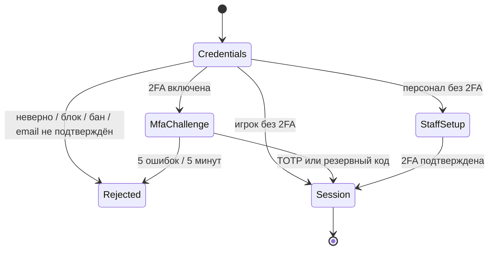

# Design: P04 Идентификация и аккаунты

## Context

Фаза строит учётные записи Duskmarch, сессии, 2FA, баны и полномочия персонала (мотивация — [proposal.md](proposal.md)). Ограничения из [ARCHITECTURE.md](../../../docs/ARCHITECTURE.md):

- **ADR-001:** `packages/domain` и `packages/protocol` изоморфны и не зависят от Node.js; серверный код — в `apps/api` и `packages/db`.
- **ADR-009:** email + пароль (`argon2id`), подтверждение email, TOTP, OAuth (Discord, Google), Access JWT `EdDSA` 15 минут, refresh в `httpOnly` cookie; уровни `player`, `helper`, `moderator`, `game-master`, `administrator`, `owner`.
- **ADR-011:** детерминированные тесты на инъецируемых часах (`GameClock`, `FakeClock`).
- **ADR-012:** OWASP ASVS L2, аудит действий персонала.

Ревизия по CONCEPT §6: иерархия из семи уровней чужой игры и права с её терминами заменены собственными шестью уровнями и разрешениями, привязанными к понятиям Duskmarch (наблюдение, патчи мира из P03, маяки, профиль правил из P01). Геоданные входов удалены. Всё остальное — общие практики безопасности, не связанные с чужой игрой.

## Goals / Non-Goals

**Goals:**
- Все пять capabilities с проверкой сценариев тестами.
- Чистая проверка прав, общая для API и игрового сервера.
- Бизнес-логика на портах: unit-тесты без сети, интеграционные — на локальных PostgreSQL, Valkey и NATS.

**Non-Goals:**
- Игровые билеты (P05), подключение к миру (P06), экраны клиента (P09), консоль персонала (P29), античит (P31), юридические тексты (P36).
- Отдельный сервис идентификации: модуль живёт в `apps/api`.

## Decisions

### D-01. Пароли — argon2id и выравнивание времени
- `@node-rs/argon2`: `m = 19456 KiB`, `t = 2`, `p = 1` (минимум OWASP), в тестах `m = 1024`, `t = 1`. Параметры — в конфигурации; при входе со старыми параметрами хэш пересчитывается.
- Пароль нормализуется NFC без обрезки пробелов; длина 12–128 символов; запрещены совпадение с email или его локальной частью и пароли из встроенного словаря распространённых паролей (`common-passwords.ts`, собственный список).
- Для несуществующего email (вход) и дубликата (регистрация) выполняется проверка заранее вычисленного холостого хэша.
- Отвергнуто: `bcrypt` (предел 72 байта), `PBKDF2` (слаб против GPU).

### D-02. Access JWT EdDSA и opaque refresh с семействами
- JWT подписывается Ed25519 через `node:crypto` (`sign(null, …)`), без сторонней библиотеки. Заголовок `{ alg: 'EdDSA', typ: 'JWT', kid }`. Утверждения: `iss`, `aud`, `sub` (id аккаунта), `sid`, `jti`, `iat`, `exp = iat + 900`, `acl` (назначенный уровень), `eacl` (эффективный уровень), `mfa`, `ver = 1`; для ограниченного токена персонала без 2FA — `scope: 'tfa_setup'`.
- Ключи: `IDENTITY_JWT_KEYS` — JSON-массив `{ kid, privateKeyPem, retiredAt? }`; подписывает первый неотозванный, проверяют все, `GET /.well-known/jwks.json` публикует открытые ключи, включая выведенные из оборота менее 24 часов назад. В разработке без переменной ключ генерируется при старте.
- Refresh: 32 байта CSPRNG в `base64url`, cookie `dm_refresh` (`HttpOnly`, `SameSite=Lax`, `Path=/api/v1/auth`, `Secure` вне разработки). В БД — только SHA-256. Строка `refresh_tokens` принадлежит сессии (`auth_sessions` = семейство): `active → rotated | revoked`. Срок 30 суток со скольжением, предел семейства 90 суток.
- Повторное предъявление `rotated`/`revoked` токена отзывает всю сессию, пишет событие безопасности и письмо.
- Немедленный отзыв: `sid` заносится в ключ-значение `identity:revoked-sid:<sid>` на 900 с; бан — `identity:banned:<accountId>` до `expiresAt`. Охранник API проверяет подпись локально и читает оба ключа одним запросом.
- Отвергнуто: `HS256` (общий секрет пришлось бы раздавать игровому серверу), refresh в `localStorage` (XSS).

### D-03. Анти-перечисление и OAuth без автослияния
- Регистрация, повторная отправка, запрос сброса и смена email отвечают одинаковым `202`.
- OAuth 2.0 Authorization Code + PKCE `S256`. `state` и `code_verifier` хранятся в ключ-значение на 10 минут и привязаны к cookie `dm_oauth` (случайный идентификатор транзакции). Провайдеры описаны таблицей `{ authorizeUrl, tokenUrl, userInfoUrl, scopes, map(profile) }`; адреса переопределяются конфигурацией, что позволяет тестировать на локальном поддельном сервере.
- Email провайдера, совпавший с существующим аккаунтом без привязки, даёт `409 AUTH_OAUTH_ACCOUNT_LINK_REQUIRED`; новый пользователь получает `oauthOnboardingToken` на 10 минут для принятия документов.

### D-04. TOTP: AES-256-GCM и защита от повтора
- Секрет 20 байт, Base32 без `=`; RFC 6238 SHA-1, 6 цифр, шаг 30 с, окно ±1. Реализация на `node:crypto` с векторами RFC 4226/6238.
- Шифрование AES-256-GCM, IV 12 байт, AAD `dm:totp:v1:<accountId>`; хранятся шифротекст, IV, тег и версия ключа. Ключи — `IDENTITY_TOTP_KEYS` (JSON `{ version: base64-ключ }`), текущий — `IDENTITY_TOTP_KEY_VERSION`.
- Повтор: принятый шаг сохраняется условным обновлением `last_used_step < :step`.
- Резервные коды: 10 × `XXXX-XXXX` (Crockford Base32, 40 бит), хранится `HMAC-SHA256(pepper, accountId:code)`, сравнение `timingSafeEqual`.

### D-05. Права в `packages/domain`
- Уровни уже определены в `catalog/social.ts` (`ACCESS_LEVELS`, `hasAccess`). Модуль `access` добавляет `PERMISSIONS` (таблица минимальных уровней), `permissionsOf(level)`, `evaluateAccess(ctx, permission)`, `canActOn(actor, target)`, `canAssign(actor, target, next)`, `canSetEffective(max, next)`.
- Аккаунт хранит `access_level` и `effective_level` (`effective ≤ access`). API проверяет назначенный уровень, игровой сервер — эффективный.
- Защита последнего `owner`: понижение или бан `owner` выполняется в транзакции с `pg_advisory_xact_lock` и проверкой, что активных `owner` не меньше двух.

### D-06. Порты и реализации
- `IdentityStore` — все чтения и записи таблиц identity плюс `transaction(fn)`. Реализации: `MemoryIdentityStore` (unit-тесты; транзакция — снимок и откат при исключении) и `DrizzleIdentityStore` (PostgreSQL).
- `KeyValue` — `get`, `set(ttl)`, `del`, `incr(ttl)`, `take` (атомарное чтение с удалением). Реализации: `MemoryKeyValue` на инъецируемых часах и `ValkeyKeyValue`.
- `MailTransport` — `log` (разработка, тесты) и `smtp` (`nodemailer`). `EventPublisher` — NATS (`identity.account.*`) или память.
- Сервисы получают часы `GameClock` и источник случайности `Entropy` (`randomBytes`); тесты подменяют оба.

### D-07. Outbox для писем и событий
- Таблица `identity_outbox` (`kind: email | event`, `payload`, `attempts`, `next_attempt_at`, `status: pending | done | dead`). Запись создаётся в той же транзакции, что и изменение состояния.
- Диспетчер (`OutboxDispatcher`) выбирает пакет `FOR UPDATE SKIP LOCKED`, отправляет, при ошибке откладывает на 30 с, 2 мин, 10 мин, 30 мин; после 5 попыток — `dead`.
- Ключи немедленного отзыва и бана пишутся синхронно после коммита, события в NATS — через outbox (at-least-once, `eventId` для идемпотентности).

### D-08. Ограничение частоты и перебора
- Счётчики фиксированного окна в ключ-значение: время берётся из инъецируемых часов, ключ — `identity:rl:<policy>:<bucket>:<subject>`, по email — SHA-256 канонического адреса.
- Политики: регистрация 5/15 мин и 20/24 ч на IP; повторная отправка и сброс 1/60 с и 5/24 ч на email; вход — 5 неудач/15 мин на email → блок 15 мин, повторный блок за 24 ч → 60 мин; 20 неудач/15 мин на IP; challenge 2FA — 5 попыток.

### D-09. Идентификаторы, журналы, CSRF
- Первичные ключи — UUIDv7 (`uuidv7(clock, entropy)`), не раскрывают объём базы и сохраняют локальность индексов.
- `security_events`, `access_audit_log`, `tos_acceptances` защищены триггером `BEFORE UPDATE OR DELETE`, кроме роли обслуживания; это проверяет интеграционный тест.
- Cookie-эндпоинты проверяют `Origin` (или origin `Referer`) по `IDENTITY_TRUSTED_ORIGINS`; чувствительные операции требуют подтверждения пароля или TOTP за последние 10 минут (`auth_sessions.reauth_at`).

## Architecture & Contracts

### Пакеты

| Пакет | Содержимое |
|---|---|
| `domain/src/access` | разрешения, `evaluateAccess`, иерархия |
| `protocol/src/identity` | коды ошибок и HTTP-статусы, TypeBox-схемы запросов и ответов, утверждения JWT, события |
| `db/src/schema/identity.ts` | таблицы и миграция `0001_identity.sql` |
| `config/src/env/server/schemas` | переменные `IDENTITY_*`, `MAIL_*`, `OAUTH_*` |
| `apps/api/src/identity` | криптография, порты и реализации, сервисы, контроллеры, охранники, outbox, CLI |

### Модель данных

| Таблица | Ключевые поля |
|---|---|
| `accounts` | `id`, `email` (уникален среди не `expired`), `password_hash?`, `status` (`pending_verification`, `active`, `expired`), `access_level`, `effective_level`, `email_verified_at`, `created_at` |
| `tos_acceptances` | `account_id`, `tos_version`, `privacy_version`, `ip`, `user_agent`, `accepted_at` |
| `email_tokens` | `id`, `account_id`, `purpose` (`verify`, `reset`, `change`), `token_hash`, `new_email?`, `expires_at`, `used_at` |
| `auth_sessions` | `id` (`sid`), `account_id`, `created_at`, `last_used_at`, `family_expires_at`, `revoked_at`, `revoke_reason`, `mfa`, `reauth_at`, `ip`, `user_agent` |
| `refresh_tokens` | `id`, `session_id`, `token_hash`, `status`, `expires_at`, `created_at` |
| `oauth_identities` | `provider`, `provider_user_id` (уникальная пара), `account_id`, `email` |
| `totp_enrollments` | `account_id`, `status` (`pending`, `enabled`), `ciphertext`, `iv`, `tag`, `key_version`, `last_used_step`, `setup_expires_at`, `enabled_at` |
| `backup_codes` | `id`, `account_id`, `code_hash`, `used_at` |
| `account_bans` | `id`, `account_id`, `issued_by`, `reason`, `expires_at?`, `lifted_at?`, `lifted_by?`, `lift_reason?` |
| `security_events` | `id`, `account_id?`, `type`, `outcome`, `reason_code`, `ip`, `user_agent`, `at` |
| `access_audit_log` | `id`, `actor_id`, `target_id?`, `action`, `outcome`, `before`, `after`, `reason`, `ip`, `user_agent`, `at` |
| `identity_outbox` | `id`, `kind`, `payload`, `status`, `attempts`, `next_attempt_at` |

### REST (`/api/v1`)

| Метод и путь | Capability |
|---|---|
| `POST /auth/register`, `POST /auth/verify-email`, `POST /auth/verify-email/resend`, `GET /auth/documents` | регистрация |
| `POST /auth/login`, `POST /auth/refresh`, `POST /auth/logout`, `POST /auth/logout-all`, `GET /.well-known/jwks.json` | аутентификация |
| `GET /auth/oauth/:provider/start`, `GET /auth/oauth/:provider/callback`, `POST /auth/oauth/onboard`, `POST /account/oauth/:provider/link`, `DELETE /account/oauth/:provider` | OAuth |
| `POST /auth/mfa/verify`, `GET/POST /account/2fa…` (`setup`, `confirm`, `backup-codes`, `disable`) | 2FA |
| `POST /auth/password-reset/request`, `POST /auth/password-reset/confirm`, `POST /account/password`, `POST /account/email/change-request`, `POST /account/email/change-confirm`, `POST /account/reauth`, `GET /account/sessions`, `DELETE /account/sessions/:sid`, `GET /account/security-events` | безопасность |
| `GET /staff/accounts/:id`, `POST /staff/accounts/:id/bans`, `POST /staff/bans/:id/lift`, `POST /staff/accounts/:id/sessions/revoke`, `POST /staff/accounts/:id/2fa/reset`, `POST /staff/accounts/:id/access-level`, `POST /staff/effective-level`, `GET /staff/audit` | персонал |

Ошибки — `{ error: { code, message, details? } }` со статусом из таблицы `IDENTITY_ERRORS` в `packages/protocol`.

### События NATS
`identity.account.banned`, `identity.account.unbanned`, `identity.account.sessions_revoked`, `identity.account.access_level_changed`, `identity.account.effective_level_changed`. Полезная нагрузка — TypeBox-схемы с `eventId`, `accountId`, `occurredAt`. Игровой сервер (P06) по ним кикает с кодами `4103 WS_CLOSE_BANNED` и `4123 WS_CLOSE_SESSION_REVOKED` из реестра протокола.

### Вход

## Risks / Trade-offs

- **Нагрузка argon2id на CPU** → общий хост 8 ГБ: параметры минимума OWASP, ограничение частоты до хэширования.
- **Хранилище в памяти расходится с PostgreSQL** → один набор контрактных тестов прогоняется на обеих реализациях.
- **Утечка ключей JWT или TOTP** → ключи только из секретных файлов в production (проверка P00), версия ключа в каждой записи.
- **Письма теряются при падении** → outbox в той же транзакции, повторные попытки.

## Migration Plan

Миграция `0001_identity.sql` добавляет таблицы и триггеры, существующие данные не меняются. Первый `owner` создаётся командой `pnpm --filter @duskmarch/api identity:bootstrap-owner --email …`, которая отказывает, если `owner` уже есть. Откат — удаление таблиц identity (данных игроков до P05 нет).

## Open Questions

Нет: провайдеры OAuth и параметры приняты в ADR-009, тексты документов — заглушки версий до P36.
