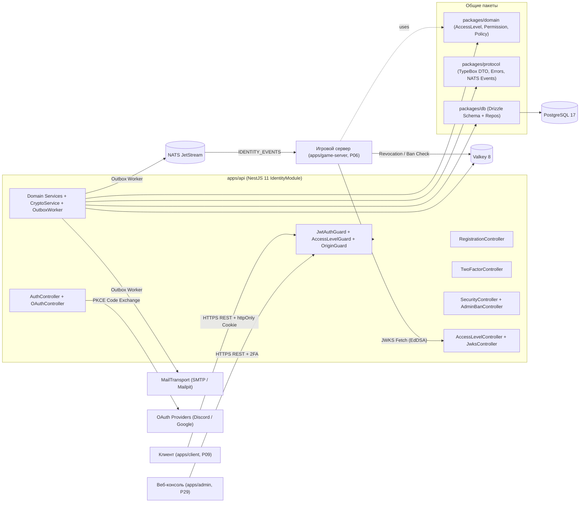
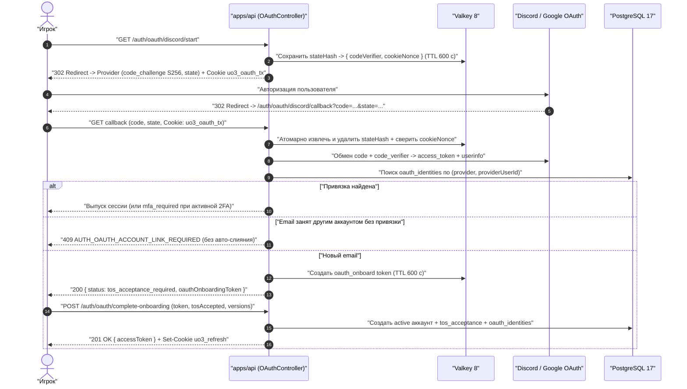
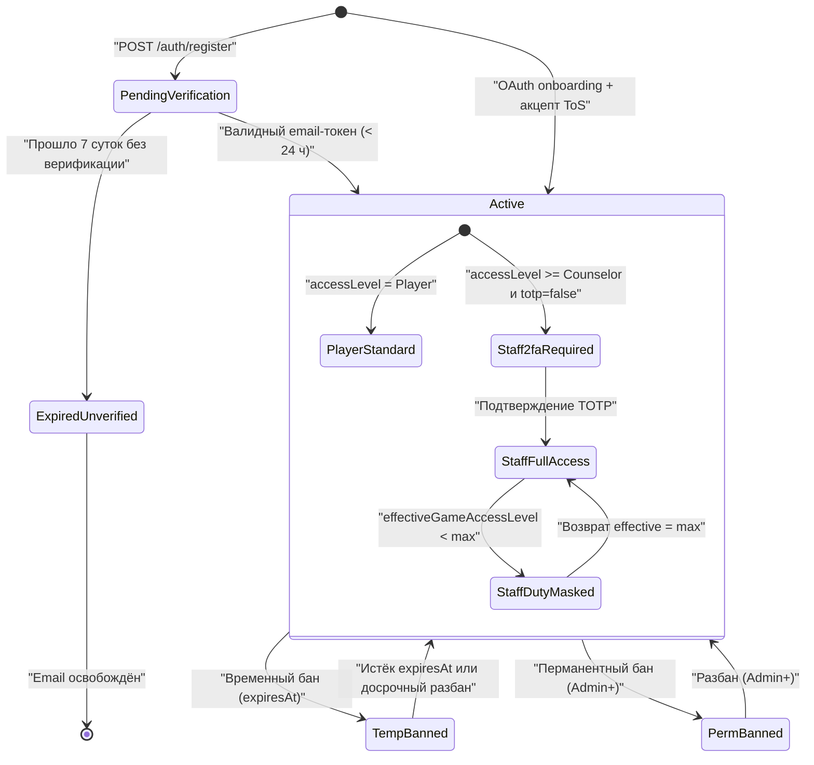

# Design: P04 Идентификация и аккаунты

## Context

Фаза P04 реализует сквозную подсистему идентификации, аутентификации, двухфакторной защиты, безопасности учётных записей и ролевой модели персонала для проекта UO3 (мотивация и продуктовый скоуп — см. [proposal.md](proposal.md)).

Архитектурные ограничения, унаследованные из [docs/ARCHITECTURE.md](../../../docs/ARCHITECTURE.md):
- **ADR-001 (Монорепо):** строгое разделение зависимостей между `apps/api`, `apps/game-server`, `apps/client` и изоморфными пакетами (`packages/domain`, `packages/protocol`). Клиент не импортирует серверный код; `packages/domain` и `packages/protocol` не имеют побочных эффектов.
- **ADR-009 (Identity и доступ):** аккаунты email + пароль (`argon2id`), подтверждение email, опциональная TOTP 2FA, OAuth (Discord, Google), Access JWT (`EdDSA`, 15 мин) + ротируемый refresh-токен в `httpOnly` cookie, 7 канонических уровней доступа UO (`Player`, `Counselor`, `GameMaster`, `Seer`, `Administrator`, `Developer`, `Owner`).
- **ADR-011 (Тестирование):** детерминированное тестирование через инъецируемые часы `Clock` и сидируемый RNG из P01 (`domain/deterministic-runtime`), отсутствие сетевых зависимостей в unit/integration тестах.
- **ADR-012 (Безопасность):** соответствие OWASP ASVS L2 для HTTP API, защита от перебора, перечисления аккаунтов, CSRF, компрометации токенов, аудит привилегированных операций.
- **Зависимости:** P01 поставляет базовое перечисление `AccessLevel` и абстракции часов/RNG; P00 поставляет инфраструктуру PostgreSQL 17, Valkey 8, NATS JetStream, `packages/config` и `packages/db`. Потребители P04 — фазы P05 (шарды, game tickets, персонажи), P06 (игровой сервер Colyseus), P09 (экран входа и настроек клиента) и P29 (инструменты персонала).

## Goals / Non-Goals

**Goals:**
- Создать авторитативный, горизонтально масштабируемый модуль `IdentityModule` в `apps/api` (NestJS 11 + TypeBox + OpenAPI 3.1) с полным покрытием всех 5 capabilities P04.
- Обеспечить офлайн-верификацию Access JWT (`EdDSA` через JWKS) и мгновенное применение критичных отзывов (бан, отзыв сессий, понижение роли) в `apps/api` и `apps/game-server` за счёт Valkey + NATS JetStream.
- Вынести иерархию ролей, матрицу разрешений и чистый оценщик политик `evaluateAccessPolicy` в `packages/domain`, чтобы HTTP API и будущий `apps/game-server` (P06/P29) использовали идентичную логику авторизации.
- Исключить блокировку защитных операций (бан, смена пароля, отзыв сессий) при сбоях SMTP или брокера сообщений за счёт паттерна Transactional Outbox.
- Сделать все временные, криптографические (кроме production CSPRNG) и внешние (SMTP, Discord/Google OAuth) зависимости инъецируемыми для 100% детерминированных тестов.

**Non-Goals:**
- Реализация выпуска и потребления одноразовых `game ticket` Colyseus — выполняется в P05 (`shard/game-tickets`) поверх аутентифицированного контекста и проверки банов из P04.
- Пользовательский UI регистрации/входа/2FA в `apps/client` — выполняется в P09; P04 предоставляет строгую OpenAPI-спецификацию и TypeBox-схемы в `packages/protocol`.
- Внутриигровые GM-команды (`[add`, `[tele`, `[props`) и веб-консоль `apps/admin` — выполняются в P29.
- WebAuthn / Passkeys и аппаратные ключи безопасности — сознательно отложены за пределы MVP, но архитектура факторов аутентификации оставляет точку расширения.
- Юридический контент ToS/Privacy и процессы GDPR-экспорта/удаления данных — реализуются в P36; P04 фиксирует только версионированный факт акцепта.

## Decisions

### D-01. Хэширование паролей — Argon2id (OWASP ASVS L2) и выравнивание времени
- **Выбор:** использовать `argon2id` с параметрами по умолчанию `memoryCost = 65536` (64 MiB), `timeCost = 3`, `parallelism = 1`, случайная соль 16 байт, длина выхода 32 байта (формат PHC string `$argon2id$v=19$m=65536,t=3,p=1$...`). Все параметры конфигурируются через `packages/config` (с пониженными параметрами `m=4096, t=1` в профиле unit-тестов для скорости CI) с поддержкой прозрачного re-hash при успешном входе, если параметры устарели. Перед хэшированием пароль проходит Unicode NFC-нормализацию без обрезки пробелов. При отсутствии аккаунта (логин) или наличии дубликата (регистрация) выполняется холостая операция `verify` над предрасчитанным dummy-хэшем с теми же параметрами.
- **Обоснование:** `argon2id` — рекомендация ADR-009 и OWASP Password Storage Cheat Sheet, устойчив как к GPU/ASIC (memory-hard), так и к side-channel атакам. Выравнивание времени через dummy-verify устраняет timing-oracle для перечисления зарегистрированных email.
- **Отвергнутые альтернативы:**
  - `bcrypt` — ограничение длины пароля в 72 байта конфликтует с политикой длинных парольных фраз до 128 Unicode-символов (требование OWASP ASVS L2).
  - `PBKDF2-SHA256` — слабая устойчивость к перебору на GPU.
  - `scrypt` — хуже поддерживается стандартизированной строкой параметров и уступает `argon2id` по балансу стойкости к side-channel.

### D-02. Гибридная модель сессий — EdDSA Access JWT (15 мин) + ротируемые opaque Refresh-токены с Token Family
- **Выбор:**
  - **Access JWT:** алгоритм `EdDSA` (Ed25519), TTL ровно 900 секунд, заголовок `{ alg: "EdDSA", typ: "JWT", kid }`, публичные ключи доступны на `GET /.well-known/jwks.json`. Ротация ключей поддерживается через массив активных ключей в конфигурации (1 ключ для подписи, до 3 ключей для верификации; старый ключ хранится в JWKS ≥ 24 ч).
  - **Refresh-токен:** непрозрачная (opaque) 256-битная криптографическая строка (`base64url`), передаётся только в cookie `uo3_refresh` (`HttpOnly`, `SameSite=Lax`, `Path=/api/v1/auth`, `Secure` в HTTPS). В PostgreSQL (`auth_sessions` / `refresh_tokens`) хранится исключительно `SHA-256(token)`. Токены группируются по `token_family_id`; при каждой ротации старая запись помечается `status = 'rotated'`, `replaced_by_id = newId`, а новая запись наследует `token_family_id` и `family_expires_at` (90 суток от первичного входа).
  - **Немедленный отзыв:** при logout, logout-all, reuse detection, смене/сбросе пароля, бане или понижении роли в Valkey записываются ключи `identity:revoked_sid:<sid>` (TTL = 900 с) и/или `identity:account_min_ver:<accountId>` (TTL = 900 с) и `identity:banned:<accountId>` (TTL до `expiresAt` или постоянный с refresh). Guard API проверяет подпись JWT локально, затем делает один конвейерный (pipelined `MGET`) запрос в Valkey по 3 ключам (< 1 мс p99).
- **Обоснование:** Ed25519 даёт компактные подписи (64 байта), высокую скорость верификации и отсутствие атак на подбор параметров RSA. Opaque refresh-токен в БД позволяет реализовать детерминированное детектирование повторного использования (reuse detection) и полный контроль над списком устройств. Тонкий слой Valkey закрывает классическую слабость stateless JWT (окно жизни 15 мин после бана/выхода).
- **Отвергнутые альтернативы:**
  - `HS256` (симметричный секрет) — потребовал бы раздавать общий секрет подписи в `apps/game-server` и другие сервисы, расширяя периметр компрометации.
  - Полностью stateful session cookie на каждый запрос — потребовало бы сетевого обращения к хранилищу сессий для извлечения всех claims и усложнило бы будущую интеграцию с Colyseus/WebSocket и API-шлюзами.
  - Хранение Refresh-токена в `localStorage` — уязвимо к XSS-эксфильтрации (нарушает OWASP ASVS L2).

### D-03. Анти-перечисление аккаунтов и запрет автоматического слияния OAuth по email
- **Выбор:** эндпоинты `POST /auth/register`, `POST /auth/verify-email/resend`, `POST /auth/password-reset/request` и `POST /account/email/change-request` всегда возвращают единый нейтральный HTTP `202 Accepted` независимо от того, существует ли email в базе (кроме явных ошибок синтаксиса/политики пароля/ToS/rate-limit). В потоке OAuth 2.0 (Discord/Google) используется обязательный `PKCE (S256)` и одноразовый `state` в Valkey (TTL 10 мин), привязанный к `httpOnly` cookie `uo3_oauth_tx` (защита от login-CSRF). Если OAuth возвращает email существующего аккаунта без привязанной пары `(provider, providerUserId)`, система **не выполняет** автоматическое слияние, а возвращает `409 Conflict` (`AUTH_OAUTH_ACCOUNT_LINK_REQUIRED`). Новый OAuth-пользователь получает временный `oauthOnboardingToken` (TTL 10 мин) для явного подтверждения актуальных версий ToS и Privacy Policy.
- **Обоснование:** автоматическое слияние OAuth по email подвержено атаке Pre-Account Takeover (злоумышленник заранее регистрирует аккаунт на чужой email или использует неподтверждённый/перехваченный провайдер). Принудительная привязка из аутентифицированной сессии полностью закрывает этот класс уязвимостей.
- **Отвергнутые альтернативы:**
  - Возврат `409 Email already registered` при регистрации — позволяет тривиально собирать базу игроков шарда для фишинга и credential stuffing.
  - Автоматическая привязка OAuth при `email_verified = true` от провайдера — сохраняет риск обхода 2FA или перехвата при расхождении политик верификации внешних провайдеров.

### D-04. Конвертное шифрование секретов TOTP (AES-256-GCM) и строгий anti-replay
- **Выбор:** секрет TOTP (20 байт CSPRNG, кодируемый в Base32 для `otpauth://`) шифруется на уровне приложения алгоритмом `AES-256-GCM` со случайным 12-байтным IV, тегом аутентификации 16 байт и дополнительными аутентифицированными данными `AAD = "uo3:totp:v1:" + accountId` (привязка шифротекста к конкретному аккаунту исключает перестановку строк в БД). В БД сохраняются `secret_ciphertext`, `secret_iv`, `secret_tag` и `encryption_key_version` для бесшовной ротации мастер-ключа. Проверка кода (RFC 6238, HMAC-SHA1, 6 цифр, шаг 30 с, окно `[-1, 0, +1]`) сравнивает вычисленный шаг `matchedStep` с `last_used_step` атомарным условным обновлением `UPDATE totp_enrollments SET last_used_step = :step WHERE account_id = :id AND (last_used_step IS NULL OR last_used_step < :step)`, гарантируя невозможность повторного использования кода даже при параллельных гонках запросов. Резервные коды (10 штук, формат `XXXX-XXXX`, алфавит Crockford Base32 без неоднозначных символов `I/L/O/U`, 40 бит энтропии на код) хранятся в `backup_codes` в виде хэшей `HMAC-SHA256(pepper, accountId + ":" + normalizedCode)` (или с отдельной солью + `scrypt`/`argon2id`; выбран индивидуально посоленный `HMAC-SHA256` с серверным перцем `TOTP_BACKUP_PEPPER` и константным сравнением `timingSafeEqual` по активным кодам аккаунта — при 40 битах энтропии и строгом лимите 5 попыток на challenge + серверном перце подбор невозможен, а проверка 10 кодов занимает < 0.2 мс вместо 10×Argon2id = 1.5 с!).
- **Обоснование:** шифрование TOTP-секретов с AAD защищает от утечки при компрометации дампа PostgreSQL. Атомарный `UPDATE ... WHERE last_used_step < :step` в PostgreSQL исключает race-condition replay без распределённых блокировок.
- **Отвергнутые альтернативы:**
  - Хранение TOTP-секретов в открытом виде — полная компрометация 2FA всех аккаунтов и персонала при утечке бэкапа БД.
  - Хэширование 10 резервных кодов через Argon2id без идентификатора кода — привело бы к 10 последовательным вычислениям Argon2id (~1–2 с CPU) на каждую неудачную попытку ввода резервного кода (вектор DoS).

### D-05. Единая изоморфная матрица RBAC в `packages/domain` и разделение `maxAccessLevel` / `effectiveGameAccessLevel`
- **Выбор:** переиспользовать каноническое перечисление `AccessLevel` из P01 (`Player = 0`, `Counselor = 1`, `GameMaster = 2`, `Seer = 3`, `Administrator = 4`, `Developer = 5`, `Owner = 6`). В `packages/domain` разместить перечисление `Permission`, константную матрицу `ACCESS_LEVEL_PERMISSIONS: Readonly<Record<AccessLevel, ReadonlySet<Permission>>>` и чистые функции `evaluateAccessPolicy(ctx, requirement)`, `canActOnTarget(actorLevel, targetLevel)`, `canAssignAccessLevel(actorLevel, targetCurrentLevel, newLevel)`.
  На аккаунте хранятся два поля: `access_level` (назначенный максимум `maxAccessLevel`) и `effective_game_access_level` (по умолчанию равен `access_level`, может быть понижен самим сотрудником до любого значения `<= access_level`, вплоть до `Player`). Для HTTP API используется `access_level`, для внутриигровых команд и отображения статуса в игре (P06/P29) — `effective_game_access_level` (но всегда с инвариантом `effective <= max`). Для защиты последнего `Owner` операции понижения или бана аккаунта уровня `Owner` захватывают транзакционную рекомендательную блокировку PostgreSQL `pg_advisory_xact_lock(OWNER_INVARIANT_LOCK_KEY)` и проверяют `COUNT(*) >= 2` активных незаблокированных `Owner`.
- **Обоснование:** единый чистый модуль в `packages/domain` исключает рассинхронизацию правил доступа между NestJS API и игровым сервером Colyseus. Разделение `max` / `effective` воспроизводит классическую механику UO/ServUO (staff duty toggle) и снижает риск случайных ошибок GM во время игры/тестирования. Advisory lock полностью исключает гонку при одновременном понижении двух последних `Owner`.
- **Отвергнутые альтернативы:**
  - Хранение произвольных кастомных ролей в таблицах БД — избыточная сложность, противоречащая канонической иерархии UO в ADR-009.
  - Раздельная реализация проверок прав в `apps/api` и `apps/game-server` — высокий риск расхождений и уязвимостей эскалации привилегий.

### D-06. Немедленное распространение критичных изменений (Valkey + NATS JetStream)
- **Выбор:** при наложении бана, досрочном разбане, отзыве сессий, изменении `access_level` или `effective_game_access_level`:
  1. Транзакция PostgreSQL фиксирует изменение состояния и вставляет событие в таблицу `identity_outbox`.
  2. Сразу после commit API синхронно обновляет кэш быстрого пути в Valkey (`identity:revoked_sid:*`, `identity:banned:*`, `identity:acl:*`).
  3. Воркер Transactional Outbox публикует типизированное событие в поток NATS JetStream `IDENTITY_EVENTS` (subjects `identity.account.banned`, `identity.account.unbanned`, `identity.account.sessions_revoked`, `identity.account.access_level_changed`, `identity.account.effective_level_changed`).
  4. `apps/game-server` (в P06) подписывается на `IDENTITY_EVENTS` (durable consumer) для немедленного кика забаненного/разлогиненного игрока и обновления `effectiveGameAccessLevel` онлайн-сессии без разрыва соединения.
- **Обоснование:** комбинация синхронного Valkey-кэша и гарантированной доставки через Outbox → NATS JetStream обеспечивает и мгновенный (< 5 мс) отказ в API, и надёжное (at-least-once с идемпотентным `eventId`) отключение активной игровой сессии в Colyseus.
- **Отвергнутые альтернативы:**
  - Прямой вызов NATS без Outbox — при сбое сети между commit БД и `nats.publish` игровой сервер никогда не узнает о бане.
  - Polling базы данных игровым сервером — создаёт лишнюю нагрузку на PostgreSQL и задержку реакции до десятков секунд.

### D-07. Transactional Outbox для email-уведомлений и межсервисных событий
- **Выбор:** создать таблицу `identity_outbox` с типами задач `email` и `nats_event`, статусами `pending`, `processing`, `completed`, `dead_letter`, полями `attempts`, `next_attempt_at`, `payload_json` и `idempotency_key`. Фоновый воркер в `apps/api` выбирает пакеты через `SELECT ... FOR UPDATE SKIP LOCKED`, отправляет письма через абстракцию `MailTransport` (SMTP в prod, локальный Mailpit в dev, `FakeMailTransport` в тестах) и события в NATS JetStream. При ошибке доставки используется экспоненциальная задержка (`30 с`, `2 мин`, `10 мин`, `30 мин`, `2 ч`), максимум 5 попыток, после чего запись переходит в `dead_letter` с инкрементом метрики алертинга.
- **Обоснование:** HTTP-ответы безопасности (`register`, `change-password`, `ban`, `logout-all`) остаются быстрыми и не падают при временной недоступности SMTP-релея; гарантируется сохранность писем и событий при рестартах `apps/api`.
- **Отвергнутые альтернативы:**
  - Синхронная отправка SMTP внутри HTTP-контроллера — увеличивает p99 на 500–3000 мс и ломает критичные операции (например, бан нарушителя) при сбое почтовика.
  - Отдельный брокер задач (BullMQ) — добавляет лишнюю сущность без транзакционной связки с PostgreSQL (dual-write problem).

### D-08. Атомарная защита от перебора и rate-limiting в Valkey с детерминированными часами
- **Выбор:** реализовать `RateLimitService` и `BruteForceGuardService` поверх Valkey 8 с использованием атомарных Lua-скриптов (скользящее окно на `ZSET` / фиксированные бакеты с `PEXPIRE`) и передачей текущего времени `clock.nowMs()` параметром скрипта (а не `redis.call('TIME')`), что делает логику полностью управляемой через `FakeClock` из P01 в интеграционных тестах. Ключи по аккаунту используют `SHA-256(canonicalEmail)` (отсутствие PII в ключах Valkey). Политики:
  - Регистрация: 5/15 мин и 20/24 ч на IP.
  - Повторная верификация и сброс пароля: 1/60 с и 5/24 ч на `emailHash` + 15/15 мин на IP.
  - Логин: 5 неудач/15 мин на `emailHash` → блокировка 15 мин (при повторном срабатывании в течение 24 ч → эскалация до 60 мин); 20 неудач/15 мин на IP.
  - MFA challenge: строго ≤ 5 ошибок (хранится в Valkey-записи challenge с TTL 300 с).
- **Обоснование:** Lua-скрипты исключают TOCTOU-гонки при параллельных атаках, а передача `nowMs` из инъецируемых часов позволяет тестировать 15-минутные, 60-минутные и 24-часовые окна за миллисекунды.
- **Отвергнутые альтернативы:**
  - Встроенный in-memory `@nestjs/throttler` — не работает при горизонтальном масштабировании нескольких реплик `apps/api`.
  - Использование серверного времени Valkey внутри Lua — ломает детерминированные тесты с `FakeClock`.

### D-09. UUIDv7, неизменяемость журналов и CSRF-защита cookie-эндпоинтов
- **Выбор:** использовать UUIDv7 (генерация с инъецируемыми часами и CSPRNG/SeededRNG) для первичных ключей всех таблиц identity (`accounts`, `auth_sessions`, `login_history`, `access_level_audit_logs`, `account_bans`). На таблицах `login_history`, `access_level_audit_logs` и `account_tos_acceptances` устанавливаются PostgreSQL-триггеры `BEFORE UPDATE OR DELETE`, запрещающие изменение записей (append-only, за исключением планового удаления просроченных партиций/записей по retention-политике через специальную роль обслуживания). Мутирующие cookie-эндпоинты (`/auth/refresh`, `/auth/logout`) защищаются `OriginValidationGuard`: сверка заголовка `Origin` (или origin из `Referer`, если `Origin` отсутствует) с белым списком `IDENTITY_TRUSTED_ORIGINS`.
- **Обоснование:** UUIDv7 не раскрывает объём пользовательской базы (в отличие от `BIGSERIAL`), сохраняя при этом монотонную локальность B-tree индексов PostgreSQL. Append-only триггеры гарантируют целостность криминалистических журналов на уровне СУБД. Проверка `Origin` в паре с `SameSite=Lax` соответствует OWASP CSRF Prevention Cheat Sheet без избыточного double-submit cookie.
- **Отвергнутые альтернативы:**
  - `UUIDv4` — случайная вставка вызывает фрагментацию B-tree индексов на высоконагруженных таблицах `login_history` и `auth_sessions`.
  - Автоинкрементный `BIGINT` — утечка бизнес-метрик и перебор идентификаторов.

---

## Architecture & Contracts

### Топология и границы модулей



### Распределение ответственности по пакетам монорепозитория

| Пакет / Приложение | Модули и экспортируемые артефакты |
|---|---|
| `packages/domain` | `identity/types.ts` (`AccountId`, `SessionId`, `AccountStatus`, `GameAccessContext`, `AccessDecision`), `identity/permissions.ts` (`Permission` enum, `ACCESS_LEVEL_PERMISSIONS` матрица), `identity/access-policy.ts` (`compareAccessLevel`, `hasPermission`, `canActOnTarget`, `canAssignAccessLevel`, `evaluateAccessPolicy`). |
| `packages/protocol` | `identity/errors.ts` (реестр кодов `REG_*`, `AUTH_*`, `TFA_*`, `SEC_*`, `RBAC_*`, формат `ApiErrorResponse`), `identity/jwt.ts` (`AccessTokenPayload` TypeBox-схема, `JwksDocument`), `identity/rest-dto.ts` (TypeBox-схемы запросов и ответов всех HTTP-эндпоинтов), `identity/events.ts` (TypeBox-схемы NATS-событий `identity.account.*`). |
| `packages/db` | `schema/identity.ts` (12 таблиц Drizzle + индексы + SQL-миграции с append-only триггерами), `repositories/identity/*` (`AccountRepository`, `SessionRepository`, `TotpRepository`, `BanRepository`, `LoginHistoryRepository`, `AccessAuditRepository`, `OutboxRepository`). |
| `packages/config` | `identity.config.ts` — валидация env: `IDENTITY_JWT_ISSUER`, `IDENTITY_JWT_AUDIENCE`, `IDENTITY_JWT_SIGNING_KEYS_JSON` (Ed25519 keyset), `IDENTITY_ARGON2_*`, `IDENTITY_TOTP_ENCRYPTION_KEYS_JSON`, `IDENTITY_TOTP_BACKUP_PEPPER`, `IDENTITY_OAUTH_DISCORD_*`, `IDENTITY_OAUTH_GOOGLE_*`, `IDENTITY_TRUSTED_ORIGINS`, `IDENTITY_TOS_VERSION`, `IDENTITY_PRIVACY_VERSION`, `IDENTITY_COOKIE_*`, `IDENTITY_MAIL_*`, `IDENTITY_DISPOSABLE_DOMAINS_FILE`. |
| `packages/test-kit` | `identity/fake-mail-transport.ts`, `identity/mock-oauth-provider.ts`, `identity/totp-test-helper.ts` (работает от `Clock`), `identity/account-fixtures.ts`, `identity/in-memory-valkey-helper.ts`. |
| `apps/api` | `src/modules/identity/`: `IdentityModule`, контроллеры (`RegistrationController`, `AuthController`, `OAuthController`, `TwoFactorController`, `AccountSecurityController`, `StaffAccountController`, `AccessLevelController`, `JwksController`), сервисы (`RegistrationService`, `PasswordPolicyService`, `AuthService`, `TokenService`, `OAuthService`, `TwoFactorService`, `BruteForceService`, `AccountSecurityService`, `BanService`, `AccessLevelService`, `OutboxDispatcherService`, `UnverifiedCleanupJob`), guards (`JwtAuthGuard`, `AccessLevelGuard`, `OriginValidationGuard`, `RecentAuthGuard`, `Staff2faEnforcementGuard`), декораторы (`@CurrentAccount()`, `@RequireAccessLevel()`, `@RequirePermissions()`, `@RequireRecentAuth()`). |

### Модель данных (PostgreSQL 17 / Drizzle ORM)

Все временные метки хранятся в `timestamptz` (UTC). Первичные ключи — `uuid` (UUIDv7).

1. **`accounts`**
   - `id uuid PK`
   - `email varchar(254) NOT NULL` (оригинальный очищенный email для писем)
   - `email_canonical varchar(254) NOT NULL` (lowercase trimmed; частичный уникальный индекс `UNIQUE (email_canonical) WHERE status <> 'expired_unverified'`)
   - `password_hash text NULL` (PHC Argon2id; `NULL` допускается только для OAuth-only аккаунтов)
   - `status varchar(32) NOT NULL` (`pending_verification` | `active` | `expired_unverified`)
   - `access_level smallint NOT NULL DEFAULT 0` (0..6, `CHECK (access_level BETWEEN 0 AND 6)`)
   - `effective_game_access_level smallint NOT NULL DEFAULT 0` (`CHECK (effective_game_access_level BETWEEN 0 AND access_level)`)
   - `token_version integer NOT NULL DEFAULT 1` (инкрементируется при глобальном отзыве/понижении прав)
   - `totp_enabled boolean NOT NULL DEFAULT false`
   - `email_verified_at timestamptz NULL`
   - `last_login_at timestamptz NULL`
   - `created_at timestamptz NOT NULL`, `updated_at timestamptz NOT NULL`
   - Индексы: `idx_accounts_email_canonical_active`, `idx_accounts_status_created` (для очистки просроченных регистраций > 7 суток), `idx_accounts_access_level` (для быстрого подсчёта активных `Owner`).

2. **`account_tos_acceptances`** (append-only триггер)
   - `id uuid PK`, `account_id uuid NOT NULL FK -> accounts(id) ON DELETE CASCADE`
   - `tos_version varchar(64) NOT NULL`, `privacy_version varchar(64) NOT NULL`
   - `accepted_at timestamptz NOT NULL`, `ip_address inet NOT NULL`, `user_agent varchar(512) NOT NULL`
   - Индекс: `idx_tos_account_accepted (account_id, accepted_at DESC)`.

3. **`email_verification_tokens`**
   - `id uuid PK`, `account_id uuid NOT NULL FK -> accounts(id) ON DELETE CASCADE`
   - `token_hash char(64) NOT NULL UNIQUE` (SHA-256 hex)
   - `expires_at timestamptz NOT NULL` (TTL 24 ч)
   - `consumed_at timestamptz NULL`, `revoked_at timestamptz NULL`, `created_at timestamptz NOT NULL`
   - Индекс: `idx_email_verif_account_active (account_id) WHERE consumed_at IS NULL AND revoked_at IS NULL`.

4. **`oauth_identities`**
   - `id uuid PK`, `account_id uuid NOT NULL FK -> accounts(id) ON DELETE CASCADE`
   - `provider varchar(32) NOT NULL` (`discord` | `google`)
   - `provider_user_id varchar(128) NOT NULL`
   - `provider_email varchar(254) NULL`, `provider_username varchar(128) NULL`
   - `linked_at timestamptz NOT NULL`, `last_used_at timestamptz NULL`
   - Уникальные ограничения: `UNIQUE (provider, provider_user_id)` и `UNIQUE (account_id, provider)`.

5. **`auth_sessions`** (семейства сессий и текущие Refresh-токены)
   - `id uuid PK` (`sid` в JWT)
   - `account_id uuid NOT NULL FK -> accounts(id) ON DELETE CASCADE`
   - `token_family_id uuid NOT NULL`
   - `mfa_verified boolean NOT NULL DEFAULT false`
   - `auth_method varchar(32) NOT NULL` (`password` | `oauth_discord` | `oauth_google`)
   - `ip_address inet NOT NULL`, `user_agent varchar(512) NOT NULL`, `device_label varchar(128) NOT NULL`
   - `created_at timestamptz NOT NULL`, `last_used_at timestamptz NOT NULL`
   - `family_expires_at timestamptz NOT NULL` (`created_at + 90 days`)
   - `revoked_at timestamptz NULL`, `revoke_reason varchar(64) NULL`
   - Индексы: `idx_sessions_account_active (account_id, last_used_at ASC) WHERE revoked_at IS NULL`, `idx_sessions_family (token_family_id)`.

6. **`refresh_tokens`** (история ротации внутри семейства для reuse detection)
   - `id uuid PK`, `session_id uuid NOT NULL FK -> auth_sessions(id) ON DELETE CASCADE`
   - `token_family_id uuid NOT NULL`, `token_hash char(64) NOT NULL UNIQUE`
   - `status varchar(24) NOT NULL` (`active` | `rotated` | `revoked`)
   - `replaced_by_id uuid NULL FK -> refresh_tokens(id)`
   - `expires_at timestamptz NOT NULL` (sliding 30 суток, не позже `family_expires_at`)
   - `created_at timestamptz NOT NULL`, `rotated_at timestamptz NULL`
   - Индекс: `idx_refresh_session_status (session_id, status)`.

7. **`totp_enrollments`**
   - `account_id uuid PK FK -> accounts(id) ON DELETE CASCADE`
   - `status varchar(24) NOT NULL` (`pending` | `enabled`)
   - `secret_ciphertext bytea NOT NULL`, `secret_iv bytea NOT NULL`, `secret_tag bytea NOT NULL`
   - `encryption_key_version smallint NOT NULL`
   - `setup_token_hash char(64) NULL`, `setup_expires_at timestamptz NULL`
   - `last_used_step bigint NULL` (номер 30-секундного интервала RFC 6238)
   - `enabled_at timestamptz NULL`, `updated_at timestamptz NOT NULL`

8. **`backup_codes`**
   - `id uuid PK`, `account_id uuid NOT NULL FK -> accounts(id) ON DELETE CASCADE`
   - `code_hash char(64) NOT NULL`, `batch_id uuid NOT NULL`
   - `used_at timestamptz NULL`, `created_at timestamptz NOT NULL`
   - Индекс: `idx_backup_codes_account_unused (account_id) WHERE used_at IS NULL`.

9. **`password_reset_tokens`** и **`email_change_requests`**
   - `password_reset_tokens`: `id uuid PK`, `account_id uuid FK`, `token_hash char(64) UNIQUE`, `expires_at timestamptz` (+30 мин), `consumed_at timestamptz NULL`, `revoked_at timestamptz NULL`, `requested_ip inet`, `created_at timestamptz`.
   - `email_change_requests`: `id uuid PK`, `account_id uuid FK`, `new_email varchar(254)`, `new_email_canonical varchar(254)`, `token_hash char(64) UNIQUE`, `expires_at timestamptz` (+2 ч), `consumed_at timestamptz NULL`, `revoked_at timestamptz NULL`, `created_at timestamptz`.

10. **`account_bans`**
    - `id uuid PK`, `account_id uuid NOT NULL FK -> accounts(id) ON DELETE CASCADE`
    - `issued_by uuid NOT NULL FK -> accounts(id)`, `issuer_access_level smallint NOT NULL`
    - `reason text NOT NULL` (`CHECK (char_length(reason) BETWEEN 10 AND 1000)`)
    - `public_reason varchar(500) NOT NULL`
    - `is_permanent boolean NOT NULL`
    - `expires_at timestamptz NULL` (`CHECK ((is_permanent AND expires_at IS NULL) OR (NOT is_permanent AND expires_at IS NOT NULL))`)
    - `is_active boolean NOT NULL DEFAULT true`
    - `lifted_by uuid NULL FK -> accounts(id)`, `lifted_at timestamptz NULL`, `lift_reason text NULL`
    - `created_at timestamptz NOT NULL`
    - Индекс: `idx_bans_account_active (account_id) WHERE is_active = true`.

11. **`login_history`** (append-only триггер; retention ≥ 365 суток)
    - `id uuid PK`, `account_id uuid NOT NULL FK -> accounts(id) ON DELETE CASCADE`
    - `event_type varchar(48) NOT NULL` (`login_success`, `login_failed`, `mfa_success`, `mfa_failed`, `backup_code_used`, `token_reuse_detected`, `password_changed`, `password_reset`, `email_changed`, `totp_enabled`, `totp_disabled`, `account_banned`, `account_unbanned`, `session_revoked`)
    - `outcome varchar(16) NOT NULL` (`success` | `failure` | `blocked`)
    - `reason_code varchar(64) NULL`
    - `ip_address inet NOT NULL`, `user_agent varchar(512) NOT NULL`, `session_id uuid NULL`
    - `created_at timestamptz NOT NULL`
    - Индекс: `idx_login_history_account_created (account_id, created_at DESC, id DESC)`.

12. **`access_level_audit_logs`** (append-only триггер) и **`identity_outbox`**
    - `access_level_audit_logs`: `id uuid PK`, `actor_account_id uuid NOT NULL`, `actor_access_level smallint NOT NULL`, `target_account_id uuid NULL`, `action varchar(64) NOT NULL` (`access_level_changed`, `effective_level_toggled`, `account_banned`, `account_unbanned`, `tfa_admin_reset`, `sessions_force_revoked`, `access_denied`), `previous_value jsonb NULL`, `new_value jsonb NULL`, `reason text NULL`, `ip_address inet NOT NULL`, `correlation_id varchar(64) NOT NULL`, `created_at timestamptz NOT NULL`. Индексы по `(created_at DESC, id DESC)`, `(actor_account_id, created_at DESC)`, `(target_account_id, created_at DESC)`.
    - `identity_outbox`: `id uuid PK`, `kind varchar(16)` (`email` | `nats_event`), `topic varchar(128)`, `idempotency_key varchar(128) UNIQUE`, `payload jsonb NOT NULL`, `status varchar(24)`, `attempts smallint DEFAULT 0`, `next_attempt_at timestamptz NOT NULL`, `last_error text NULL`, `created_at timestamptz NOT NULL`, `processed_at timestamptz NULL`. Индекс: `idx_outbox_pending (next_attempt_at ASC) WHERE status = 'pending'`.

### Ключи Valkey 8

| Ключ | Тип / Значение | TTL | Назначение |
|---|---|---|---|
| `identity:revoked_sid:<sid>` | string `"1"` | оставшийся TTL JWT (≤ 900 с) | Немедленный отзыв Access JWT конкретной сессии |
| `identity:min_ver:<accountId>` | integer `tokenVersion` | 900 с | Немедленный массовый отзыв всех JWT аккаунта при logout-all / бане / понижении роли |
| `identity:banned:<accountId>` | JSON `{ banId, publicReason, expiresAt }` | `min(expiresAt - now, 86400)` или 3600 с (lazy refresh) | Быстрая проверка активного бана без запроса в PostgreSQL |
| `identity:mfa_challenge:<hash>` | JSON `{ accountId, authMethod, attempts, ip, ua }` | 300 с (5 мин) | Одноразовый challenge 2FA (лимит 5 ошибок) |
| `identity:oauth_tx:<stateHash>` | JSON `{ provider, mode, codeVerifier, cookieNonce, accountId? }` | 600 с (10 мин) | PKCE + state + привязка cookie инициатора OAuth |
| `identity:oauth_onboard:<hash>` | JSON `{ provider, providerUserId, email, username }` | 600 с (10 мин) | Промежуточный токен для принятия ToS при OAuth-регистрации |
| `identity:recent_auth:<sid>` | timestamp `verifiedAtMs` | 600 с (10 мин) | Маркер свежей переаутентификации (step-up auth) |
| `identity:bf:acc:<emailHash>` | ZSET/Hash (счётчик ошибок + lockoutUntil + strikeCount) | 24 ч | Защита от перебора по аккаунту (5/15 мин → 15 мин / 60 мин) |
| `identity:bf:ip:<ip>` | ZSET таймстампов ошибок | 15 мин | Защита от перебора по IP (20/15 мин) |
| `identity:rl:<bucket>:<key>` | ZSET таймстампов запросов | окно правила | Ограничения регистрации (5/15 мин, 20/24 ч) и писем (1/60 с, 5/24 ч) |

### REST API, JWT и NATS-контракты (`packages/protocol`)

#### Формат Access JWT (`EdDSA`)
```json
{
  "iss": "https://api.uo3.local",
  "aud": ["uo3-api", "uo3-game-server"],
  "sub": "019a9b3c-...",
  "sid": "019a9b3d-...",
  "jti": "019a9b3e-...",
  "iat": 1795070000,
  "exp": 1795070900,
  "acl": 2,
  "egacl": 2,
  "mfa": true,
  "scope": "full",
  "ver": 3
}
```
Поле `scope` принимает значения `"full"` или `"staff_2fa_setup_required"` (ограниченный токен для персонала без настроенной 2FA; действует только на `POST /api/v1/auth/2fa/totp/setup`, `POST /api/v1/auth/2fa/totp/confirm` и `POST /api/v1/auth/logout`).

#### Матрица основных HTTP-эндпоинтов (`/api/v1`)
- **Публичные / Регистрация / JWKS:**
  - `GET /.well-known/jwks.json` — публичный набор ключей Ed25519 (Cache-Control: `public, max-age=300`).
  - `GET /api/v1/auth/policies` — актуальные версии `tosVersion`, `privacyVersion`, требования к паролю, доступные OAuth-провайдеры.
  - `POST /api/v1/auth/register` — регистрация (`202 Accepted`).
  - `POST /api/v1/auth/verify-email` — подтверждение токена (`200 OK`).
  - `POST /api/v1/auth/verify-email/resend` — повторная отправка (`202 Accepted`).
- **Аутентификация / OAuth / Сессии:**
  - `POST /api/v1/auth/login` — вход по email+пароль (`200 OK`: токены или `mfa_required` или `staff_2fa_setup_required`).
  - `POST /api/v1/auth/login/mfa` — завершение входа по TOTP или резервному коду (`200 OK`).
  - `POST /api/v1/auth/refresh` — ротация Refresh-токена из cookie (`OriginValidationGuard`, `200 OK`).
  - `POST /api/v1/auth/logout` — выход текущей сессии (`OriginValidationGuard`, `204 No Content`).
  - `POST /api/v1/auth/logout-all` — отзыв всех сессий (`keepCurrent?: boolean`, `200 OK`).
  - `GET /api/v1/auth/oauth/:provider/start` — старт OAuth (`discord` | `google`, редирект + `uo3_oauth_tx` cookie).
  - `GET /api/v1/auth/oauth/:provider/callback` — завершение OAuth.
  - `POST /api/v1/auth/oauth/complete-onboarding` — завершение OAuth-регистрации с принятием ToS.
  - `POST /api/v1/account/oauth/:provider/link` и `DELETE /api/v1/account/oauth/:provider` — привязка/отвязка провайдера.
- **2FA (TOTP и резервные коды):**
  - `GET /api/v1/account/2fa/status` — метаданные 2FA.
  - `POST /api/v1/auth/2fa/totp/setup` — инициация TOTP (`setupToken`, `otpauthUri`).
  - `POST /api/v1/auth/2fa/totp/confirm` — подтверждение TOTP, возврат 10 резервных кодов.
  - `POST /api/v1/account/2fa/backup-codes/regenerate` — перевыпуск 10 кодов.
  - `POST /api/v1/account/2fa/disable` — отключение 2FA (только `Player`).
- **Безопасность аккаунта:**
  - `POST /api/v1/auth/password-reset/request` и `POST /api/v1/auth/password-reset/confirm`.
  - `POST /api/v1/account/password/change` и `POST /api/v1/account/password/set` (для OAuth-only).
  - `POST /api/v1/account/email/change-request` и `POST /api/v1/auth/email-change/confirm`.
  - `GET /api/v1/account/sessions` и `DELETE /api/v1/account/sessions/:sessionId`.
  - `GET /api/v1/account/security-history` (курсорная пагинация, 90 суток, `limit <= 100`).
- **Персонал и уровни доступа:**
  - `POST /api/v1/staff/effective-access-level` — переключение `effectiveGameAccessLevel` (`Counselor+`).
  - `GET /api/v1/admin/accounts/:accountId` — инспекция аккаунта (`account.inspect`, `GameMaster+`).
  - `POST /api/v1/admin/accounts/:accountId/bans` — наложение бана (`account.ban.temp` / `account.ban.permanent`).
  - `DELETE /api/v1/admin/accounts/:accountId/bans/:banId` — досрочный разбан (`account.ban.lift`, `Administrator+`).
  - `POST /api/v1/admin/accounts/:accountId/2fa/reset` — административный сброс 2FA (`account.tfa.reset`, `Administrator+`).
  - `POST /api/v1/admin/accounts/:accountId/sessions/revoke-all` — принудительный отзыв сессий (`Administrator+`).
  - `PATCH /api/v1/admin/accounts/:accountId/access-level` — смена роли (`account.access_level.assign`, `Administrator+`, свежий TOTP).
  - `GET /api/v1/admin/audit/access` — журнал аудита доступа (`audit.access.read`, `Administrator+`).

#### Матрица разрешений `ACCESS_LEVEL_PERMISSIONS` (`packages/domain`)

| Разрешение | Player (0) | Counselor (1) | GameMaster (2) | Seer (3) | Administrator (4) | Developer (5) | Owner (6) |
|---|:---:|:---:|:---:|:---:|:---:|:---:|:---:|
| `help.pages.handle` | — | ✓ | ✓ | ✓ | ✓ | ✓ | ✓ |
| `game.teleport.self` | — | ✓ | ✓ | ✓ | ✓ | ✓ | ✓ |
| `game.staff.duty_toggle` | — | ✓ | ✓ | ✓ | ✓ | ✓ | ✓ |
| `account.inspect` | — | — | ✓ | ✓ | ✓ | ✓ | ✓ |
| `account.ban.temp` (≤ 30 д) | — | — | ✓ | ✓ | ✓ | ✓ | ✓ |
| `game.entity.inspect` | — | — | ✓ | ✓ | ✓ | ✓ | ✓ |
| `game.world.decorate` | — | — | — | ✓ | ✓ | ✓ | ✓ |
| `game.events.manage` | — | — | — | ✓ | ✓ | ✓ | ✓ |
| `account.ban.permanent` | — | — | — | — | ✓ | ✓ | ✓ |
| `account.ban.lift` | — | — | — | — | ✓ | ✓ | ✓ |
| `account.tfa.reset` | — | — | — | — | ✓ | ✓ | ✓ |
| `account.sessions.force_revoke` | — | — | — | — | ✓ | ✓ | ✓ |
| `account.access_level.assign` | — | — | — | — | ✓ (≤ Seer) | ✓ (≤ Admin) | ✓ (≤ Owner) |
| `audit.access.read` | — | — | — | — | ✓ | ✓ | ✓ |
| `shard.config.manage` | — | — | — | — | ✓ | ✓ | ✓ |
| `content.hot_reload` | — | — | — | — | — | ✓ | ✓ |
| `system.keys.rotate` | — | — | — | — | — | — | ✓ |

#### События NATS JetStream (stream `IDENTITY_EVENTS`)
Каждое событие содержит общую обёртку `{ eventId: uuid, schemaVersion: 1, occurredAt: isoUtc, correlationId: string, payload: ... }`:
- `identity.account.banned`: `{ accountId, banId, publicReason, isPermanent, expiresAt, issuedBy }`
- `identity.account.unbanned`: `{ accountId, banId, liftedBy }`
- `identity.account.sessions_revoked`: `{ accountId, sessionIds: string[] | "all", tokenVersion, reason }`
- `identity.account.access_level_changed`: `{ accountId, previousLevel, newLevel, effectiveGameLevel, tokenVersion, changedBy, changedAt }`
- `identity.account.effective_level_changed`: `{ accountId, maxAccessLevel, effectiveGameLevel }`

### Диаграммы потоков и состояний

#### 1. Поток входа с 2FA, ротации Refresh-токена и Reuse Detection

```mermaid
sequenceDiagram
  autonumber
  actor User as "Игрок (Браузер)"
  participant API as "apps/api (Auth/2FA)"
  participant VK as "Valkey 8"
  participant PG as "PostgreSQL 17"

  User->>API: "POST /auth/login (email, password)"
  API->>VK: "Проверка brute-force (emailHash, IP)"
  API->>PG: "Поиск аккаунта + Argon2id verify"
  API->>VK: "Создать mfa_challenge (TTL 300 с, max 5 попыток)"
  API-->>User: "200 OK { status: mfa_required, mfaChallengeToken }"

  User->>API: "POST /auth/login/mfa (mfaChallengeToken, totpCode)"
  API->>VK: "Проверить и инкрементировать challenge"
  API->>PG: "Расшифровать TOTP (AES-256-GCM) + UPDATE last_used_step < step"
  API->>PG: "Создать auth_sessions + refresh_tokens (R1, family F1)"
  API-->>User: "200 OK { accessToken (EdDSA, 15м) } + Set-Cookie uo3_refresh=R1"

  Note over User,PG: "Плановая ротация токена"
  User->>API: "POST /auth/refresh (Cookie: R1, Origin)"
  API->>PG: "Транзакция: R1 -> rotated, создать R2 (family F1)"
  API-->>User: "200 OK { newAccessToken } + Set-Cookie uo3_refresh=R2"

  Note over User,PG: "Повторное предъявление украденного R1"
  User->>API: "POST /auth/refresh (Cookie: R1)"
  API->>PG: "R1 имеет status=rotated -> отозвать всю family F1 и R2"
  API->>VK: "Записать identity:revoked_sid:<sid> (TTL 900 с)"
  API->>PG: "Запись login_history + identity_outbox (email alert)"
  API-->>User: "401 AUTH_TOKEN_REUSE_DETECTED + Clear-Cookie"
```



#### 2. Поток OAuth 2.0 (PKCE + Cookie-bound State + защита от Pre-Account Takeover)



#### 3. Конечный автомат учётной записи и привилегий персонала



### Контракт интеграции для `apps/game-server` (P06) и `apps/api` (P05)

1. **Для P05 (`shard/game-tickets` и `characters/*`):** контроллеры P05 используют `JwtAuthGuard`, `Staff2faEnforcementGuard` и `@CurrentAccount()`, получая типизированный `AuthenticatedAccountContext { accountId, sessionId, accessLevel, effectiveGameAccessLevel, mfaVerified, tokenVersion }`. Выпуск game ticket требует `scope === "full"` и отсутствия активного бана.
2. **Для P06 (`apps/game-server`):** игровой сервер кэширует публичные ключи `GET /.well-known/jwks.json`, подписывается на NATS-поток `IDENTITY_EVENTS` и импортирует из `packages/domain` функцию `evaluateAccessPolicy`. При получении `identity.account.banned` или `identity.account.sessions_revoked` активное соединение Colyseus закрывается с кодом причины; при `identity.account.access_level_changed` или `effective_level_changed` обновляется игровой контекст прав игрока в реальном времени.

## Risks / Trade-offs

- **[Увеличение задержки логина и регистрации из-за Argon2id (64 MiB, t=3)]** → На типовом CPU одно хэширование занимает 40–90 мс. Митигация: вынести операции `argon2` в отдельный пул worker threads Node.js (`piscina` / libuv threadpool с ограничением конкурентности `UV_THREADPOOL_SIZE` + семафор), чтобы предотвратить блокировку event loop и исчерпание RAM при всплесках трафика; агрессивный rate-limit на входе в Valkey отсекает флуд до вычисления хэша.
- **[Гонка параллельных запросов `/auth/refresh` из нескольких вкладок браузера]** → При строгом reuse detection две вкладки, одновременно отправившие один и тот же `R1`, могут вызвать ложный отзыв семейства. Митигация: сериализация refresh в клиенте (BroadcastChannel / Web Locks API в P09) + документация контракта single-flight refresh в OpenAPI; на сервере — строгая транзакция `SELECT ... FOR UPDATE` на записи `refresh_tokens` и чёткий код `AUTH_TOKEN_REUSE_DETECTED`.
- **[Временная недоступность Valkey для проверки отзывов и brute-force]** → Падение кэша не должно открывать дыру для забаненных аккаунтов или неограниченного перебора. Митигация: политика **fail-closed** (HTTP `503 Service Unavailable`, `SYS_AUTH_STORE_UNAVAILABLE`) для чувствительных мутирующих и привилегированных эндпоинтов при потере связи с Valkey, мониторинг доступности Valkey (P33) и репликация Valkey Sentinel в production.
- **[Задержка доставки писем верификации и уведомлений безопасности]** → Сбой внешнего SMTP-провайдера может задержать регистрацию или предупреждения. Митигация: Transactional Outbox с экспоненциальными повторами (5 попыток), мониторинг глубины очереди и dead-letter записей, изоляция критичных действий (бан, сброс пароля) от SMTP.
- **[Утечка мастер-ключа шифрования TOTP или приватного ключа Ed25519]** → Компрометация ключей ставит под угрозу подпись токенов и 2FA. Митигация: хранение ключей только в менеджере секретов/переменных окружения (не в репозитории и не в БД), версионирование `kid` и `encryption_key_version`, регламент плановой и экстренной ротации ключей (с `system.keys.rotate` только у `Owner`).
- **[Рассинхронизация часов клиента с сервером при проверке TOTP]** → Телефон игрока может спешить/отставать на 15–30 секунд. Митигация: допустимое окно верификации `[-1, 0, +1]` (±30 секунд по RFC 6238) в сочетании со строгим монотонным `last_used_step`, что сохраняет удобство без ослабления защиты от повтора.
- **[Конфликт email при смене почты без утечки существования чужого аккаунта]** → Пользователь, случайно указавший чужой занятый email, получает нейтральный `202 Accepted` и не получает письмо на чужой ящик. Митигация: на чужой адрес отправляется нейтральное предупреждение, а в UI (P09) отображается инструкция проверить почту или убедиться в корректности адреса, что соответствует OWASP ASVS L2.
- **[Блокировка доступа персонала при утере устройства 2FA единственным Owner]** → Если единственный `Owner` потеряет телефон и резервные коды, обычный API-сброс недоступен из-за иерархии. Митигация: документированная аварийная CLI-процедура `apps/api` (break-glass recovery), требующая прямого доступа к инфраструктуре/БД, с обязательной записью в `access_level_audit_logs` и политикой иметь ≥ 2 аккаунта `Owner` в production.

## Migration Plan

1. **Миграции БД (`packages/db`):** применить новые аддитивные миграции Drizzle, создающие 12 таблиц подсистемы identity, частичные уникальные индексы, `CHECK`-ограничения и SQL-триггеры `prevent_audit_mutation` на `account_tos_acceptances`, `login_history` и `access_level_audit_logs`. Миграции полностью аддитивны и не затрагивают существующие таблицы.
2. **Конфигурация и ключи (`packages/config`):** сгенерировать начальную пару ключей Ed25519 (`kid = "ed25519-v1"`), 256-битный ключ шифрования TOTP (`keyVersion = 1`) и `TOTP_BACKUP_PEPPER`; настроить локальные/staging OAuth-приложения Discord/Google (в dev/CI включается встроенный mock-провайдер и Mailpit).
3. **Bootstrap первичного `Owner`:** добавить идемпотентную CLI-команду bootstrap (`pnpm --filter @uo3/api identity:bootstrap-owner`), создающую стартовый аккаунт `Owner` из секретов окружения только при отсутствии `Owner` в БД (с обязательной настройкой 2FA при первом входе).
4. **Развёртывание `apps/api`:** выкатить `IdentityModule` с активным `OutboxDispatcherService` и фоновой задачей очистки `pending_verification` > 7 суток; проверить доступность `GET /.well-known/jwks.json` и генерацию OpenAPI-схемы.
5. **Процедуры плановой ротации:**
   - *Ed25519 JWKS:* добавить новый ключ (`kid-2`) в массив публичных ключей, переключить подпись на `kid-2`, оставить `kid-1` в JWKS минимум на 24 часа, затем удалить `kid-1`.
   - *TOTP AES-256-GCM:* добавить ключ `v2` в конфигурацию, переключить шифрование новых записей на `v2` и выполнить фоновую миграцию перешифровки строк с `encryption_key_version = 1`.
6. **Откат:** поскольку P04 — первая фаза, вводящая таблицы учётных записей (до запуска P05/P06 в production), откат сводится к остановке воркера `OutboxDispatcherService`, откату релиза `apps/api` и, при необходимости в не-production среде, применению down-миграции таблиц identity. В production после появления реальных пользователей схемы identity откатываются только через forward-fix миграции.

## Open Questions

Блокирующих архитектурных вопросов, влияющих на спецификации, модель данных или декомпозицию задач P04, **нет**.

Отложимые вопросы, не влияющие на контракт P04:
- Выбор конкретного коммерческого SMTP/transactional email-провайдера (Postmark, AWS SES, Resend и т.п.) для production — решается в P33/P36; P04 изолирован за интерфейсом `MailTransport`.
- Подключение офлайн-базы GeoIP (например, MaxMind GeoLite2) для отображения города/страны рядом с IP в истории входов и письмах — может быть добавлено как опциональный декоратор без изменения схемы БД и контрактов P04.
- Добавление WebAuthn / Passkeys как альтернативного второго фактора или passwordless-метода — возможно в пост-MVP итерации без ломки `auth_sessions` и `mfa_verified`.
