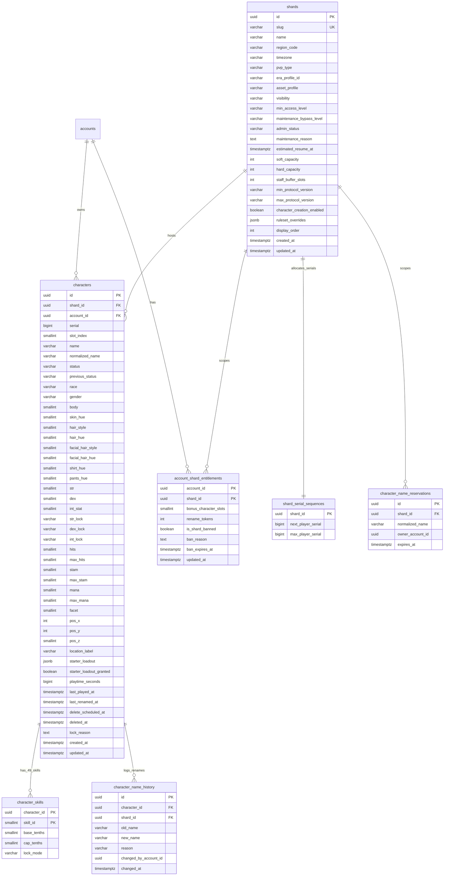
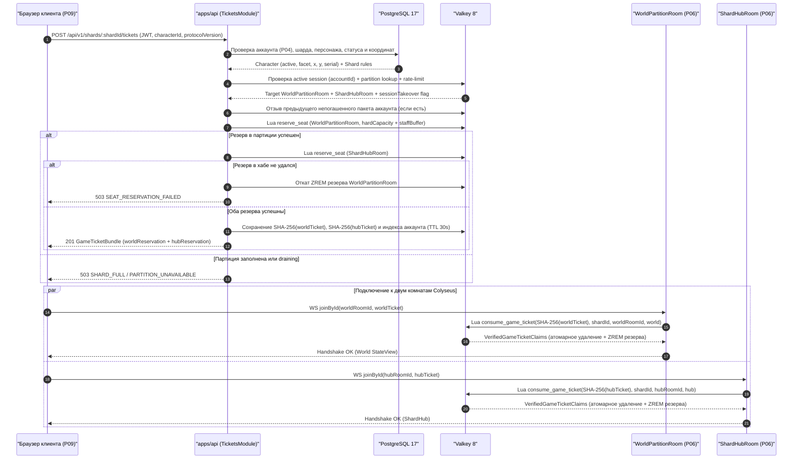
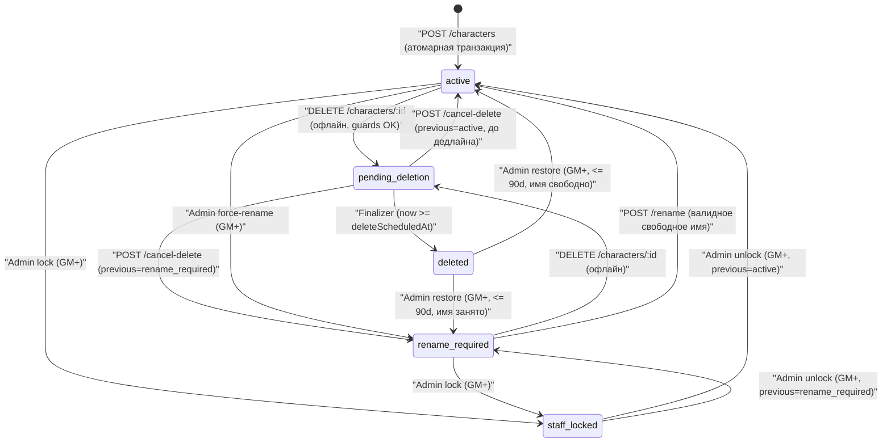

# Design: P05 Шарды и персонажи

## Context

Мотивация и границы скоупа фазы зафиксированы в [proposal.md](proposal.md), нормативные требования — в четырёх спецификациях `specs/{shard,characters}/*/spec.md`.

Фаза P05 реализуется поверх фундамента P00, доменной модели и профиля эпохи UO:R из P01 (`Serial`, `Point3D`, `Facet`, `Body`, `Hue`, `Layer`, `AccessLevel`, `RulesetProfile`, инъецируемые часы) и подсистемы аккаунтов P04 (таблица `accounts`, EdDSA Access JWT, статус глобального бана, роли `AccessLevel`). Вся логика REST API живёт в `apps/api` (NestJS 11 + TypeBox + OpenAPI), персистентность — в PostgreSQL 17 через Drizzle ORM (`packages/db`), оперативное состояние, heartbeat, тикеты и резервирование мест — в Valkey 8, межсервисные уведомления — в NATS JetStream. Игровой сервер `apps/game-server` (Colyseus 0.16, P06) на данном этапе ещё не запускается как runtime-хост, однако P05 обязан зафиксировать и протестировать точный контракт верификации тикетов и формат heartbeat/сессий, который P06 подключит в `WorldPartitionRoom.onAuth` и `ShardHubRoom.onAuth`.

Проектирование строго следует ADR-001..ADR-013 из `docs/ARCHITECTURE.md`: сервер авторитарен (ADR-012), общие формулы и валидаторы находятся в изоморфном `packages/rules`, контракты сообщений — в `packages/protocol`, данные контента — в `packages/content` (YAML + JSON Schema), без проприетарных ассетов UO (ADR-002 — обязательная поддержка `synthetic_dev` шарда).

## Goals / Non-Goals

**Goals:**
- Обеспечить p95 ответа `GET /api/v1/shards` ≤ 50 мс с условным кэшированием (`ETag`) и контролируемой деградацией при недоступности Valkey.
- Гарантировать криптографически стойкую (≥ 256 бит) одноразовую аутентификацию входа в обе комнаты Colyseus (`WorldPartitionRoom` и `ShardHubRoom`) с TTL ≤ 60 с (по умолчанию 30 с), хранением только SHA-256 хэшей и мгновенным отзывом.
- Заложить партиционно-ориентированную маршрутизацию тикетов, работающую с 1 партицией на фасет в MVP (P06) и без изменений масштабируемую до нескольких партиций в P32 (ADR-007).
- Гарантировать отсутствие гонок (race conditions) при проверке квот слотов, уникальности имени на шарде, аллокации 32-битных серийников мобайлов и погашении тикетов.
- Реализовать каноническое создание персонажей UO:R (пул статов 80, виталы `50 + floor(STR/2)` / `DEX` / `INT`, вес `40 + floor(3.5 * STR)`, 49 навыков в десятых долях, пул 100.0, палитры внешности, стартовые города и дескриптор стартового набора) полностью на базе `RulesetProfile`.
- Обеспечить обратимое отложенное удаление персонажей с защитой от угона аккаунта (72 ч для развитых, 10 мин для новичков), анти-снайпинг имён (24 ч) и расширяемые предохранители удаления для P23/P26.

**Non-Goals:**
- Реализация React-экранов выбора шарда и создания персонажа (P09) — P05 поставляет REST API, OpenAPI-схему и изоморфные валидаторы `packages/rules`.
- Реализация Colyseus-комнат `WorldPartitionRoom`/`ShardHubRoom` и 5-минутной задержки выхода в мире (P06) — P05 поставляет библиотечный верификатор тикетов и контракты Valkey/NATS.
- Материализация реальных игровых `Item` с серийниками `0x40000000+` из стартового набора (P13) — P05 сохраняет детерминированный дескриптор `starterLoadout`.
- Живой рост статов/навыков, анти-макро и регенерация виталов (P15).

## Decisions

### D1. Двухуровневый каталог шардов: PostgreSQL + Valkey Heartbeat Aggregation (ADR-005, ADR-008)
- **Выбор:** Статическая и административная конфигурация шардов (`shards`) хранится в PostgreSQL 17. Игровые узлы (`apps/game-server`, P06) каждые 5 с обновляют ключи heartbeat и реестр партиций в Valkey с TTL 15 с. `ShardsDirectoryService` кэширует таблицу `shards` в памяти процесса на 5 с (с инвалидацией через NATS-событие `uo3.shard.*.config.updated`), считывает живые ключи из Valkey одним пайплайном (`MGET`/`HGETALL`), агрегирует `onlineCount`, `reservedSeats`, `tickP99Ms` и вычисляет эффективный статус (`online` / `degraded` / `offline` / `maintenance` / `draining`), формируя слабый `ETag`.
- **Обоснование:** Исключает постоянные `UPDATE` в PostgreSQL, гарантирует автоматический переход в `offline` через 15 с при падении узла без фоновых кронов и укладывается в p95 ≤ 50 мс даже при 1000 RPS на каталог.
- **Отвергнутые альтернативы:**
  - *Запись онлайна в PostgreSQL каждые 5 с:* избыточная нагрузка на WAL и вакуум, ложные статусы `online` при падении воркера.
  - *Прямой HTTP-опрос игровых серверов из `apps/api`:* сильная связанность, каскадные таймауты и рост задержки `GET /api/v1/shards` пропорционально числу узлов.

### D2. Двухтокенный пакет тикетов (`worldTicket` + `hubTicket`) и атомарный Lua-скрипт верификации (ADR-005, ADR-009, ADR-012)
- **Выбор:** Один запрос `POST /api/v1/shards/:shardId/tickets` выпускает `GameTicketBundle` с двумя криптографически независимыми токенами (`32` байта CSPRNG → base64url, 43 символа): один для `WorldPartitionRoom`, второй для `ShardHubRoom`. В Valkey под ключом `uo3:ticket:{sha256}` хранится JSON-пейлоад (без сырого токена) с TTL 30 с (настраиваемо 10–60 с). Погашение выполняется атомарным Lua-скриптом `consume_game_ticket.lua`, который в одной операции проверяет наличие ключа, совпадение `(shardId, roomId, roomType)`, сверяет эпохи отзыва (`uo3:revoke:*`) и немедленно удаляет ключ (`DEL`), фиксируя погашение резерва.
- **Обоснование:** Клиент держит два независимых WebSocket-подключения (ADR-005). Раздельные одноразовые токены исключают гонку двойного использования одного токена двумя комнатами и предотвращают подмену типа комнаты. Хранение только SHA-256 хэша защищает от компрометации через дампы/логи Valkey.
- **Отвергнутые альтернативы:**
  - *Stateless EdDSA JWT в качестве game ticket:* не обеспечивает строгую одноразовость без серверного реестра погашенных `jti` и не даёт мгновенного отзыва, что делает stateless-подход бессмысленным.
  - *Единый токен для обеих комнат с счётчиком использований = 2:* позволяет предъявить токен дважды в одну и ту же комнату при гонке и усложняет аудит.

### D3. Партиционно-ориентированная маршрутизация тикетов и резервирование мест (ADR-007)
- **Выбор:** В Valkey ведётся хэш `uo3:shard:{shardId}:partitions`, где каждая активная партиция публикует прямоугольник границ `(facet, minX, minY, maxX, maxY)`, `roomId`, `processId`, `wsUrl`, `hardCapacity`, `staffBuffer`, `online`, `draining`. При выпуске тикета `PartitionRouterService` ищет партицию, покрывающую `(character.facet, character.x, character.y)`. Резервирование мест выполняется атомарно через Lua-скрипт `reserve_seat.lua` в ZSET `uo3:shard:{shardId}:room:{roomId}:resv` (score = `expiresAtMs`, с автоочисткой истёкших записей `ZREMRANGEBYSCORE` на каждой операции) и синхронизируется с Colyseus seat reservation протоколом (`sessionId` генерируется заранее и проверяется в `onAuth`). При сбое второго резерва (хаба) выполняется немедленный `ZREM` первого резерва (партиции).
- **Обоснование:** В MVP (P06) каждая партиция покрывает весь фасет `0..7167 × 0..4095`, а в P32 добавление нескольких партиций на фасет происходит исключительно на стороне `apps/game-server` без изменения API и контракта тикетов. ZSET с `ZREMRANGEBYSCORE` гарантирует точный подсчёт `reservedSeats` и освобождение слотов при таймауте за O(log N) без утечек памяти.
- **Отвергнутые альтернативы:**
  - *Хардкод 1 комнаты на фасет в `apps/api`:* потребовал бы ломающего рефакторинга в P32.
  - *Прямой синхронный HTTP RPC в Colyseus MatchMaker без Valkey-резерва:* теряет единый учёт квоты шарда и не защищает от накопления слотов одним аккаунтом.

### D4. Разделение 32-битного пространства серийников мобайлов и транзакционная сериализация квот (ADR-006, ADR-008)
- **Выбор:** Канонический диапазон серийников мобайлов `0x00000001..0x3FFFFFFF` (ADR-006) делится на два непересекающихся поддиапазона на каждый шард:
  - `0x00000001..0x1FFFFFFF` (~536 млн) — персистентные персонажи игроков, монотонно выделяются в PostgreSQL через таблицу `shard_serial_sequences` (`UPDATE ... SET next_serial = next_serial + 1 RETURNING next_serial - 1`);
  - `0x20000000..0x3FFFFFFF` (~536 млн) — NPC и существа, выделяемые `apps/game-server` (P06/P19) батчами или в памяти без конфликта с `apps/api`.
  Создание персонажа выполняется в одной PostgreSQL-транзакции с транзакционной рекомендательной блокировкой `pg_advisory_xact_lock(hashtextextended(account_id || ':' || shard_id, 0))`, что сериализует проверку `maxSlots`, выбор минимального свободного `slot_index` и вставку.
- **Обоснование:** Полностью устраняет конкуренцию за генератор серийников между `apps/api` и симуляцией спавнов в `apps/game-server`, а `pg_advisory_xact_lock` закрывает гонку параллельных `POST /characters` при проверке квоты слотов без блокировки всей таблицы `characters`.
- **Отвергнутые альтернативы:**
  - *Единый PostgreSQL `SEQUENCE` для всех мобайлов (игроков и NPC):* создал бы узкое место и зависимость `apps/game-server` от БД при каждом спавне монстра.
  - *Глобальный `SERIALIZABLE` уровень изоляции на всю таблицу:* частые ретраи транзакций под нагрузкой старта нового шарда.

### D5. Двухступенчатое отложенное удаление, 90-дневные надгробия и предохранители удаления (ADR-008, ADR-012)
- **Выбор:** Запрос `DELETE` переводит персонажа в `pending_deletion` с сохранением `previous_status` (`active` | `rename_required`) и `delete_scheduled_at` (`+600 с` при `playtime_seconds < 3600 && total_skill_tenths <= 1500`, иначе `+259200 с`). Фоновый обработчик `CharacterDeletionFinalizer` запускается каждые 30 с (или по триггеру) с выборкой `SELECT ... FROM characters WHERE status = 'pending_deletion' AND delete_scheduled_at <= now() FOR UPDATE SKIP LOCKED LIMIT 100`, что безопасно при нескольких репликах `apps/api`. При финализации статус переходит в `deleted`, `slot_index` обнуляется (`NULL`), создаётся 24-часовая запись в `character_name_reservations` (для развитых персонажей), а серийник навсегда закрепляется за записью. Для интеграции будущих фаз (P23 дома, P26 гильдии) вводится NestJS multi-provider интерфейс `CHARACTER_DELETION_GUARDS`.
- **Обоснование:** Защищает игроков от необратимой потери развитых персонажей при компрометации аккаунта, сохраняет трассируемость серийников в `item_ledger` (P08) и позволяет GM восстановить персонажа в течение 90 дней.
- **Отвергнутые альтернативы:**
  - *Физический `DELETE FROM characters`:* нарушает ссылочную целостность журнала предметов (ADR-008) и делает невозможным расследование инцидентов и восстановление.
  - *Классическое правило UO «запрет удаления моложе 7 дней»:* фрустрирующий UX при ошибке в создании нового персонажа и поощрение создания твинк-аккаунтов.

### D6. Каноническая валидация имён и анти-гомоглиф нормализация в `packages/rules` (ADR-001, ADR-012)
- **Выбор:** Правила имени вынесены в чистую изоморфную функцию `validateCharacterName(raw, policy, dictionaries)` в `packages/rules`:
  1. Проверка отсутствия ведущих/хвостовых пробелов, управляющих и zero-width символов (`\p{Cf}`, `\p{Cc}`).
  2. Строгий формат ASCII UO: длина 2..16, допустимы `[A-Za-z]`, одиночный пробел `' '`, `'` и `-`; начало и конец строго `[A-Za-z]`; запрет подряд идущих небуквенных символов (`[ '-]{2,}`).
  3. Вычисление `normalizedName = raw.toLowerCase()` (уникальный индекс `UNIQUE (shard_id, normalized_name) WHERE status != 'deleted'`).
  4. Сверка со словарями из `packages/content` (служебные префиксы как отдельные слова или начало строки: `gm`, `admin`, `administrator`, `seer`, `counselor`, `developer`, `owner`, `staff`, `system`; имена лора UO; список запрещённой лексики с проверкой скелета без разделителей).
- **Обоснование:** Исключает визуальную подделку имён (homoglyph/impersonation), гарантирует 100% совпадение проверок между UI клиента (P09) и сервером (`apps/api`), а частичный уникальный индекс в PostgreSQL делает дубликаты невозможными на уровне СУБД.
- **Отвергнутые альтернативы:**
  - *Разрешение произвольного Unicode на этапе MVP:* открывает атаки спуфинга имён персонала (кириллическая `А` вместо латинской `A`) и проблемы совместимости с классическими ASCII/cliloc шрифтами UO.

### D7. Хранение 49 навыков UO:R в фиксированной точке (`smallint` десятые доли) (ADR-010)
- **Выбор:** При создании персонажа таблица `character_skills` предзаполняется всеми 49 навыками эпохи UO:R (идентификаторы из `packages/domain`). Значения хранятся как `smallint` в десятых долях (`0..1000`, где `500` = `50.0`, сумма пула = `1000` = `100.0`, кап шарда = `7000` = `700.0`), `lock_mode` = `'up'`.
- **Обоснование:** Полностью соответствует модели RunUO/ServUO (`BaseFixedPoint`), устраняет ошибки округления чисел с плавающей точкой и гарантирует P15 готовую полную матрицу навыков без проверок на `undefined`.
- **Отвергнутые альтернативы:**
  - *`NUMERIC(4,1)` или `REAL`:* лишние преобразования строк в JS/Drizzle или погрешности float.
  - *JSONB-мапа вместо реляционной таблицы:* сложнее индексировать, валидировать ограничения на уровне БД и обновлять точечно при росте навыков в P08/P15.

### D8. Декларативный `starterLoadout` JSONB вместо прямой зависимости на движок предметов (P13)
- **Выбор:** Чистая функция `buildStarterLoadout(input, rulesetProfile, contentTables)` в `packages/rules` формирует неизменяемый JSON-объект `StarterLoadoutV1` (базовая одежда с `shirtHue`/`pantsHue`, обувь, рюкзак, кинжал, стартовое золото и профильные newbie-предметы для каждого стартового навыка ≥ `300` десятых) и сохраняет его в `characters.starter_loadout` с `starter_loadout_granted = false`. При первом входе персонажа в мир P06/P13 атомарно материализует предметы и выставляет `starter_loadout_granted = true`.
- **Обоснование:** Строго соблюдает границы фаз дорожной карты (P05 не зависит от P13), гарантирует идемпотентность выдачи стартового лута (игрок никогда не получит стартовый набор дважды) и позволяет P09 сразу рисовать превью одежды персонажа в ростере.
- **Отвергнутые альтернативы:**
  - *Создание записей в таблице `items` прямо в P05:* создало бы циклическую или преждевременную зависимость на схему мира P08 и модель предметов P13.

## Architecture & Contracts

### 1. Структура модулей и пакетов

| Пакет / приложение | Модули и ключевые файлы | Ответственность |
|---|---|---|
| `packages/db` | `src/schema/shards.ts`, `src/schema/characters.ts`, `src/migrations/0005_p05_shards_and_characters.sql` | Схемы Drizzle ORM, частичные уникальные индексы, миграции, типы строк БД |
| `packages/protocol` | `src/p05/shard-directory.schema.ts`, `src/p05/game-tickets.schema.ts`, `src/p05/character-roster.schema.ts`, `src/p05/character-creation.schema.ts`, `src/p05/errors.ts`, `src/p05/ticket-claims.ts` | TypeBox-схемы REST DTO, скомпилированные валидаторы, контракт `VerifiedGameTicketClaims`, каталог кодов ошибок |
| `packages/rules` | `src/character/name-validator.ts`, `src/character/stat-formulas.ts`, `src/character/skill-allocation.ts`, `src/character/appearance-validator.ts`, `src/character/starter-loadout.ts`, `src/character/deletion-policy.ts`, `src/shard/shard-status.ts` | Чистые детерминированные формулы и валидаторы UO:R, общие для `apps/api` и `apps/client` (P09) |
| `packages/content` | `data/creation/professions.yaml`, `data/creation/starting-cities.yaml`, `data/creation/starter-kits.yaml`, `data/creation/name-blocklists.yaml`, `schemas/creation/*.schema.json` | YAML-контент профессий, городов (UO:R и `synthetic_dev`), наборов новичка и словарей имён с JSON Schema |
| `apps/api` | `src/modules/shards/*` (`ShardsModule`, `ShardsController`, `AdminShardsController`, `ShardsDirectoryService`, `ShardHeartbeatReader`, `PartitionRouterService`) | Каталог шардов, агрегация heartbeat, административное управление шардами |
| `apps/api` | `src/modules/tickets/*` (`TicketsModule`, `TicketsController`, `GameTicketsService`, `SeatReservationService`, `TicketRevocationService`, `GameTicketVerifier` [экспортируемый контракт для P06]) | Выдача, резервирование мест, отзыв и верификация игровых тикетов |
| `apps/api` | `src/modules/characters/*` (`CharactersModule`, `CharactersController`, `AdminCharactersController`, `CharacterRosterService`, `CharacterCreationService`, `CharacterRenameService`, `CharacterDeletionFinalizer`, `CHARACTER_DELETION_GUARDS`) | Ростер, создание, валидация имени, отложенное удаление, переименование, операции персонала |
| `packages/test-kit` | `src/factories/shard.factory.ts`, `src/factories/character.factory.ts`, `src/fakes/fake-heartbeat-publisher.ts` | Фабрики и фикстуры для unit, контрактных и интеграционных тестов |

### 2. Модель данных PostgreSQL 17 (Drizzle ORM)



**Ключевые ограничения и индексы PostgreSQL:**
- `shards`:
  - `UNIQUE (slug)`
  - `CHECK (pvp_type IN ('renaissance_split', 'felucca_only', 'trammel_only', 'siege_perilous'))`
  - `CHECK (visibility IN ('public', 'unlisted', 'staff_only', 'beta_whitelist'))`
  - `CHECK (admin_status IN ('normal', 'maintenance', 'draining', 'archived'))`
  - `CHECK (hard_capacity >= soft_capacity AND hard_capacity > 0 AND staff_buffer_slots >= 0)`
- `shard_serial_sequences`:
  - Инициализируется при создании шарда: `next_player_serial = 1`, `max_player_serial = 536870911` (`0x1FFFFFFF`).
  - `CHECK (next_player_serial >= 1 AND next_player_serial <= max_player_serial + 1)`.
- `characters`:
  - `UNIQUE (shard_id, serial)` — абсолютная уникальность серийника на шарде навсегда (включая `deleted`).
  - `CREATE UNIQUE INDEX idx_characters_unique_active_name ON characters (shard_id, normalized_name) WHERE status != 'deleted'` — атомарная уникальность имени без регистра.
  - `CREATE UNIQUE INDEX idx_characters_unique_slot ON characters (account_id, shard_id, slot_index) WHERE status != 'deleted'` — гарантия уникальности слота.
  - `CREATE INDEX idx_characters_pending_deletion ON characters (delete_scheduled_at) WHERE status = 'pending_deletion'` — быстрый скан для `CharacterDeletionFinalizer`.
  - `CREATE INDEX idx_characters_account_shard_created ON characters (account_id, shard_id, created_at DESC)` — быстрый подсчёт суточного лимита `maxCreationsPer24h`.
  - `CHECK (status IN ('active', 'pending_deletion', 'rename_required', 'staff_locked', 'deleted'))`.
  - `CHECK ((status = 'deleted' AND slot_index IS NULL) OR (status != 'deleted' AND slot_index BETWEEN 0 AND 6))`.
  - `CHECK (serial BETWEEN 1 AND 536870911)`.
- `character_name_reservations`:
  - `CREATE UNIQUE INDEX idx_name_resv_shard_name ON character_name_reservations (shard_id, normalized_name)`.
  - `CREATE INDEX idx_name_resv_expires ON character_name_reservations (expires_at)` (периодическая очистка истёкших записей).

### 3. Ключи Valkey 8, атомарные Lua-скрипты и события NATS

#### Схема ключей Valkey 8

| Ключ | Тип | TTL | Владелец записи / чтения | Назначение |
|---|---|---|---|---|
| `uo3:shard:{shardId}:hb:{nodeId}` | String (JSON) | 15 с | Пишет P06 (каждые 5 с) / читает P05 | Heartbeat игрового узла: `{ nodeId, shardId, onlineCount, tickP99Ms, draining, updatedAtMs }` |
| `uo3:shard:{shardId}:partitions` | Hash (`partitionId` → JSON) | 20 с (обновляется с hb) | Пишет P06 / читает P05 | Реестр активных партиций: `{ partitionId, facet, minX, minY, maxX, maxY, roomId, wsUrl, hardCapacity, staffBuffer, onlineCount, draining, updatedAtMs }` |
| `uo3:shard:{shardId}:hub` | String (JSON) | 20 с | Пишет P06 / читает P05 | Активная комната хаба: `{ roomId, wsUrl, onlineCount, draining, updatedAtMs }` |
| `uo3:shard:{shardId}:room:{roomId}:resv` | ZSET (`bundleId:sessionId` → `expiresAtMs`) | TTL + 60 с | Пишет/читает P05, удаляет P06 при join | Активные резервы мест комнаты с автоочисткой истёкших по score |
| `uo3:ticket:{sha256}` | String (JSON) | 10–60 с (деф. 30 с) | Пишет P05 / удаляет Lua P06 | Полезная нагрузка тикета (только по SHA-256 хэшу, без сырого токена) |
| `uo3:shard:{shardId}:acct_ticket:{accountId}` | String (JSON) | 10–60 с | Пишет/удаляет P05 | Индекс текущего непогашенного пакета `{ bundleId, worldHash, hubHash, worldRoomId, hubRoomId, worldSessionId, hubSessionId }` для атомарной замены и отзыва |
| `uo3:shard:{shardId}:session:{accountId}` | String (JSON) | Обновляется P06 | Пишет P06 / читает P05 | Живая игровая сессия или окно 5-мин выхода: `{ characterId, characterSerial, worldRoomId, state: 'online' \| 'logout_delay', updatedAtMs }` |
| `uo3:revoke:account:{accountId}` | String (epoch ms) | 120 с | Пишет P04/P05 / читает Lua | Метка времени отзыва всех тикетов аккаунта |
| `uo3:revoke:char:{characterId}` | String (epoch ms) | 120 с | Пишет P05 / читает Lua | Метка времени отзыва тикетов персонажа |
| `uo3:revoke:shard:{shardId}` | String (epoch ms) | 120 с | Пишет P05 / читает Lua | Метка времени отзыва тикетов `Player` при `maintenance` |
| `uo3:idemp:char_create:{accountId}:{shardId}:{keyHash}` | String (JSON) | 300 с | Пишет/читает P05 | Кэш идемпотентности создания персонажа `{ payloadHash, statusCode, responseBody }` |
| `uo3:rl:{scope}:{accountId}` | String / ZSET | 60 с | Пишет/читает P05 | Скользящие окна rate-limit (тикеты 10/мин, `validate-name` 30/мин) |

#### Атомарный Lua-скрипт верификации тикета (`consume_game_ticket.lua`)
Принимает: `KEYS[1] = uo3:ticket:{sha256}`, `ARGV[1] = shardId`, `ARGV[2] = roomId`, `ARGV[3] = roomType`, `ARGV[4] = nowMs`.
1. Считывает JSON по `KEYS[1]`; если отсутствует — возвращает `ERR_NOT_FOUND`.
2. Парсит JSON и проверяет `payload.shardId == ARGV[1]`, `payload.roomId == ARGV[2]`, `payload.roomType == ARGV[3]`, `payload.expiresAtMs > tonumber(ARGV[4])`. При несоответствии — **не удаляет чужой ключ** (защита от DoS-перебора, но при несовпадении `roomType` с валидным ключом удаляет его как скомпрометированный) и возвращает `ERR_MISMATCH`.
3. Сверяет `payload.issuedAtMs` с эпохами отзыва `uo3:revoke:account:{accountId}`, `uo3:revoke:char:{characterId}` и (для `accessLevel == 'Player'`) `uo3:revoke:shard:{shardId}`. Если эпоха отзыва ≥ `issuedAtMs` — удаляет `KEYS[1]` и возвращает `ERR_REVOKED`.
4. Атомарно удаляет `KEYS[1]` (`DEL`), удаляет запись резерва из `uo3:shard:{shardId}:room:{roomId}:resv` (`ZREM`) и возвращает JSON `payload`.

#### События NATS JetStream (поток `UO3_SHARD_EVENTS`)
- `uo3.shard.{shardId}.config.updated` — инвалидация in-memory кэша каталога на всех репликах `apps/api`.
- `uo3.shard.{shardId}.status.changed` — переход шарда в `maintenance` / `draining` / `normal` (подписка `apps/game-server` в P06 для оповещения игроков и отключения новых входов).
- `uo3.shard.{shardId}.character.force_rename` — уведомление `apps/game-server` при принудительном переименовании (пометка сессии / кик с сообщением).
- `uo3.shard.{shardId}.character.locked` — уведомление `apps/game-server` о немедленном кике заблокированного персонажа.
- `uo3.audit.events` — структурированные события аудита (`shard.created`, `shard.updated`, `shard.status_changed`, `character.force_rename`, `character.locked`, `character.unlocked`, `character.restored`, `ticket.security_violation`) для потребителя P29.

### 4. Потоки взаимодействия и конечные автоматы (Mermaid)

#### Поток выдачи пакета тикетов и верификации в `onAuth`



#### Конечный автомат жизненного цикла персонажа



### 5. REST API, TypeBox-контракты и коды ошибок (`packages/protocol`)

#### Каталог REST-эндпоинтов `apps/api`

| Метод и путь | Доступ | Назначение | Коды ответа |
|---|---|---|---|
| `GET /api/v1/shards` | Public / Optional JWT | Список доступных шардов + персональный контекст при JWT + `ETag` | `200`, `304`, `400`, `401` |
| `GET /api/v1/shards/:shardId` | Public / Optional JWT | Детальная карточка шарда и правила эпохи | `200`, `401`, `404` |
| `POST /api/v1/admin/shards` | `Administrator+` | Регистрация нового шарда и инициализация `shard_serial_sequences` | `201`, `400`, `403`, `409` |
| `PATCH /api/v1/admin/shards/:shardId` | `Administrator+` | Обновление правил, вместимости, видимости, баннеров | `200`, `403`, `404`, `409` |
| `POST /api/v1/admin/shards/:shardId/status` | `Administrator+` | Переключение `normal` / `maintenance` / `draining` / `archived` | `200`, `403`, `404`, `409` |
| `POST /api/v1/shards/:shardId/tickets` | Authenticated JWT | Выдача `GameTicketBundle` (`worldReservation` + `hubReservation`) | `201`, `400`, `403`, `404`, `409`, `426`, `429`, `503` |
| `GET /api/v1/shards/:shardId/characters` | Authenticated JWT | Список персонажей аккаунта на шарде + квота слотов | `200`, `401`, `404` |
| `GET /api/v1/shards/:shardId/character-creation-options` | Public / Optional JWT | Опции создания персонажа (профессии, палитры, города, лимиты) | `200`, `404` |
| `POST /api/v1/shards/:shardId/characters/validate-name` | Authenticated JWT | Предварительная проверка формата, словарей и доступности имени | `200`, `400`, `404`, `429` |
| `POST /api/v1/shards/:shardId/characters` | Authenticated JWT | Атомарное создание персонажа (`Idempotency-Key` опционально) | `201`, `400`, `403`, `404`, `409`, `422`, `429` |
| `DELETE /api/v1/shards/:shardId/characters/:characterId` | Authenticated JWT | Инициация отложенного удаления (`pending_deletion`) | `200`, `404`, `409` |
| `POST /api/v1/shards/:shardId/characters/:characterId/cancel-delete` | Authenticated JWT | Отмена отложенного удаления до `deleteScheduledAt` | `200`, `404`, `409` |
| `POST /api/v1/shards/:shardId/characters/:characterId/rename` | Authenticated JWT | Переименование офлайн-персонажа (обязательное или по политике) | `200`, `403`, `404`, `409`, `422`, `429` |
| `POST /api/v1/admin/shards/:shardId/characters/:characterId/force-rename` | `GameMaster+` | Принудительное переименование (`rename_required`) | `200`, `403`, `404`, `409` |
| `POST /api/v1/admin/shards/:shardId/characters/:characterId/lock` | `GameMaster+` | Блокировка / разблокировка (`staff_locked`) | `200`, `403`, `404`, `409` |
| `POST /api/v1/admin/shards/:shardId/characters/:characterId/restore` | `GameMaster+` | Восстановление `deleted` надгробия (≤ 90 дней) | `200`, `403`, `404`, `409`, `410` |

#### Контракт `VerifiedGameTicketClaims` (TypeBox, используется в P06 `onAuth`)
```ts
// packages/protocol/src/p05/ticket-claims.ts (контрактная структура)
type VerifiedGameTicketClaims = {
  bundleId: string;           // UUIDv7
  ticketPurpose: 'initial_login' | 'partition_handoff' | 'facet_transfer';
  roomType: 'world' | 'hub';
  shardId: string;            // UUID
  roomId: string;             // Colyseus roomId
  sessionId: string;          // Предварительно зарезервированный sessionId
  accountId: string;          // UUID аккаунта (из P04)
  characterId: string;        // UUID персонажа
  characterSerial: number;    // uint32 (0x00000001..0x1FFFFFFF)
  accessLevel: AccessLevel;   // Доверенный уровень доступа из БД
  protocolVersion: string;    // Проверенный semver клиента
  sessionTakeover: boolean;   // true при переподключении того же персонажа
  spawnRecoveryApplied: boolean; // true при восстановлении битых координат
  issuedAtMs: number;
  expiresAtMs: number;
};
```

#### Сводный каталог кодов ошибок P05
- Шарды: `SHARD_NOT_FOUND` (404), `SHARD_OFFLINE` (503), `SHARD_FULL` (503), `SHARD_IN_MAINTENANCE` (503), `SHARD_DRAINING` (503), `SHARD_TELEMETRY_UNAVAILABLE` (503), `SHARD_ACCOUNT_BANNED` (403), `SHARD_MUTATION_REQUIRES_MAINTENANCE` (409), `SHARD_CHARACTER_CREATION_DISABLED` (403), `INVALID_PROTOCOL_VERSION_HEADER` (400), `PROTOCOL_VERSION_UNSUPPORTED` (426).
- Тикеты: `TICKET_INVALID_OR_EXPIRED` (401 / WS close `4101` `WS_CLOSE_INVALID_TICKET`), `PARTITION_UNAVAILABLE` (503), `SEAT_RESERVATION_FAILED` (503), `TICKET_RATE_LIMITED` (429), `ACCOUNT_ALREADY_IN_WORLD` (409).
- Ростер и создание: `CHARACTER_NOT_FOUND` (404), `CHARACTER_SLOT_LIMIT_REACHED` (409), `CHARACTER_CREATION_RATE_LIMITED` (429), `CHARACTER_CURRENTLY_ONLINE` (409), `CHARACTER_PENDING_DELETION` (409), `CHARACTER_NOT_PENDING_DELETION` (409), `CHARACTER_RENAME_REQUIRED` (409), `CHARACTER_LOCKED` (409), `CHARACTER_DELETION_BLOCKED` (409), `CHARACTER_RENAME_COOLDOWN_ACTIVE` (429), `CHARACTER_RENAME_DISABLED` (403), `CHARACTER_RESTORE_WINDOW_EXPIRED` (410), `INVALID_CHARACTER_NAME` (422), `CHARACTER_NAME_FORBIDDEN` (422), `CHARACTER_NAME_TAKEN` (409), `CHARACTER_NAME_RESERVED` (409), `NAME_VALIDATION_RATE_LIMITED` (429), `INVALID_STAT_ALLOCATION` (422), `INVALID_SKILL_ALLOCATION` (422), `INVALID_APPEARANCE` (422), `INVALID_STARTING_CITY` (422), `UNSUPPORTED_RACE_FOR_SHARD_ERA` (422), `IDEMPOTENCY_KEY_PAYLOAD_MISMATCH` (422), `FORBIDDEN_INSUFFICIENT_ACCESS_LEVEL` (403).

### 6. Алгоритмы и канонические формулы UO:R (`packages/rules` & `packages/content`)

#### Вычисление эффективного статуса шарда (`computeShardEffectiveState`)
1. Если `adminStatus === 'archived'` → эффективный статус `archived` (скрыт от игроков).
2. Если `adminStatus === 'maintenance'` → `maintenance` (вход только `AccessLevel >= maintenanceBypassLevel`).
3. Если Valkey недоступен → `degraded`, `onlineCount = null`, `loadTier = null`, `canEnter = false` (`SHARD_TELEMETRY_UNAVAILABLE`).
4. Фильтруются свежие heartbeat (`nowMs - updatedAtMs <= 15_000`). Если их нет → `offline`, `onlineCount = 0`, `canEnter = false` (`SHARD_OFFLINE`).
5. Если `adminStatus === 'draining'` или все партиции помечены `draining: true` → `draining` (`canEnter = false` для `Player`).
6. Если любая активная партиция сообщает `tickP99Ms > 45` в ≥ 2 последовательных интервалах → `degraded`, иначе `online`.
7. Расчёт `loadRatio = (onlineCount + reservedSeats) / hardCapacity`: `< 0.5` → `low`, `< 0.8` → `medium`, `< 1.0` → `high`, `>= 1.0` → `full`.

#### Формулы создания персонажа UO:R (по умолчанию, настраиваются в `RulesetProfile`)
- **Статы:** `str, dex, int ∈ Z ∩ [10, 60]`, `str + dex + int === 80`.
- **Производные виталы и вес (из `docs/ARCHITECTURE.md` раздел 5):**
  - `maxHits = 50 + Math.floor(str / 2)`
  - `maxStam = dex`
  - `maxMana = int`
  - `maxWeight = 40 + Math.floor(3.5 * str)`
- **Навыки (49 навыков UO:R):**
  - Режим `advanced`: 2–3 различных навыка ∉ `disallowedStartingSkills` (`['stealth', 'remove_trap']`), каждый `0..500` десятых, `Σ valueTenths === 1000`.
  - Пресеты профессий (`packages/content/data/creation/professions.yaml`):

| `professionId` | STR / DEX / INT | Стартовые навыки (в десятых) |
|---|---|---|
| `warrior` | 45 / 25 / 10 | `swordsmanship: 400`, `tactics: 300`, `healing: 300` |
| `mage` | 25 / 10 / 45 | `magery: 500`, `meditation: 300`, `eval_int: 200` |
| `blacksmith` | 45 / 25 / 10 | `blacksmithy: 500`, `mining: 300`, `tinkering: 200` |
| `bard` | 25 / 35 / 20 | `musicianship: 400`, `provocation: 300`, `peacemaking: 300` |
| `ranger` | 30 / 40 / 10 | `archery: 400`, `tactics: 300`, `tracking: 300` |
| `tamer` | 30 / 25 / 25 | `animal_taming: 400`, `animal_lore: 300`, `veterinary: 300` |

- **Палитры внешности UO:R:**
  - `male` → `body = 400` (`0x0190`); `female` → `body = 401` (`0x0191`).
  - `skinHue`: `1002..1058` (`0x03EA..0x0422`).
  - `hairStyle`: `{0, 8251, 8252, 8253, 8260, 8261, 8262, 8263, 8264, 8265, 8266}` (`0x203B..0x203D`, `0x2044..0x204A`).
  - `facialHairStyle` (только `male`): `{0, 8254, 8255, 8256, 8257, 8267, 8268, 8269}` (`0x203E..0x2041`, `0x204B..0x204D`); для `female` строго `0`.
  - `hairHue`, `facialHairHue`: `1102..1149` (`0x044E..0x047D`) при ненулевом стиле, строго `0` при стиле `0`.
  - `shirtHue`, `pantsHue`: `2..1001` (`0x0002..0x03E9`).
- **Стартовые города (`packages/content/data/creation/starting-cities.yaml`):**
  - UO:R: `britain` `(1496, 1628, 10)`, `moonglow` `(4406, 1045, 0)`, `minoc` `(2459, 545, 0)`, `trinsic` `(1823, 2821, 0)`, `yew` `(633, 858, 0)`, `jhelom` `(1378, 3817, 0)`, `skara_brae` `(618, 2234, 0)`, `vesper` `(2771, 976, 0)`. Фасет определяется правилом шарда: `trammel` (1) для `renaissance_split` и `trammel_only`, `felucca` (0) для `felucca_only` и `siege_perilous`.
  - Синтетический мир (`assetProfile === 'synthetic_dev'`, ADR-002): `synthetic_haven` `(128, 128, 0)` в активном дефолтном фасете.
- **Стартовый набор (`StarterLoadoutV1`):**
  - Базовый комплект (не дублируется): рюкзак, рубашка (`shirtHue`), штаны/юбка по полу (`pantsHue`), сапоги, кинжал, свеча, `startingGold` (по умолчанию 100 золота, настраивается в `RulesetProfile`).
  - Профильные предметы добавляются детерминированно для каждого стартового навыка с `valueTenths >= 300` (сортировка по `skillId`, дедупликация по `itemTemplateId`, флаг `newbied: true`).

## Risks / Trade-offs

- **[Рассинхронизация резерва мест между `apps/api` и `apps/game-server` при сетевом разделении]** → Резерв хранится в общем Valkey с коротким TTL (30 с + 5 с буфер автоочистки ZSET), а при успешном входе P06 снимает резерв через тот же Lua-скрипт; даже при падении сети слот гарантированно освобождается через ≤ 35 с.
- **[Гонка между блокировкой аккаунта/персонажа и уже выданным тикетом в 30-секундном окне]** → Два уровня защиты: немедленное удаление активного пакета по индексу `acct_ticket` плюс проверка монотонных эпох отзыва `uo3:revoke:*` внутри атомарного Lua-скрипта верификации.
- **[Дрейф системных часов между репликами `apps/api` и `apps/game-server`]** → Все проверки TTL в Lua-скриптах используют `redis.call('TIME')` (единое время сервера Valkey), а в `packages/rules` и тестах применяются инъецируемые часы из P01.
- **[Исчерпание пула резерваций и DoS слотов через массовый выпуск тикетов]** → Инвариант «максимум 1 непогашенный пакет на пару (аккаунт, шард)» с атомарным отзывом предыдущего + rate-limit 10 запросов/мин на аккаунт + отдельный буфер слотов персонала (+50).
- **[Конфликт одновременных запросов создания персонажей одного аккаунта или с одним именем]** → Сериализация по паре `(accountId, shardId)` через `pg_advisory_xact_lock`, частичный `UNIQUE`-индекс имени в PostgreSQL и поддержка `Idempotency-Key` (300 с) для безопасных клиентских ретраев.
- **[Рост таблицы `character_name_reservations` и забытые `pending_deletion` при сбое планировщика]** → Периодическая очистка истёкших резерваций по индексу `expires_at`, идемпотентный `FOR UPDATE SKIP LOCKED` батч в `CharacterDeletionFinalizer` каждые 30 с + проверка `expires_at > now()` прямо в SQL-запросах валидации имени.
- **[Блокировка развития P06/P13 при изменении структуры `starterLoadout` или `VerifiedGameTicketClaims`]** → Явное поле `schemaVersion` (`1`) в JSONB `starterLoadout`, версионированные TypeBox-схемы в `packages/protocol` и контрактные тесты сериализации/десериализации.
- **[Утечка информации о существовании чужих персонажей или скрытых шардов (IDOR / Enumeration)]** → Все пользовательские запросы строго скоупятся по `(accountId, shardId)` и возвращают унифицированный `404` (`CHARACTER_NOT_FOUND` / `SHARD_NOT_FOUND`) без различий между «не существует» и «нет доступа».

## Migration Plan

1. **Миграция БД (`packages/db`):**
   - Добавить Drizzle-схемы и сгенерировать аддитивную SQL-миграцию `0005_p05_shards_and_characters.sql` (только `CREATE TABLE` и `CREATE INDEX`, без изменения существующих таблиц P04, кроме `FOREIGN KEY (account_id) REFERENCES accounts(id)`).
   - Проверить обратимость миграции (`down`-скрипт удаления новых таблиц в обратном порядке зависимостей) в CI-прогоне против чистого PostgreSQL 17.
2. **Начальный seed и профили разработки:**
   - Добавить идемпотентный seed-скрипт `packages/db/src/seeds/p05-dev-shards.ts`, создающий два локальных шарда для разработки/CI: `dev-synthetic` (`asset_profile: 'synthetic_dev'`, `pvp_type: 'renaissance_split'`, `visibility: 'public'`) и `dev-siege` (`asset_profile: 'synthetic_dev'`, `pvp_type: 'siege_perilous'`, `visibility: 'public'`).
3. **Загрузка Lua-скриптов и контента:**
   - При старте `apps/api` выполняется валидация YAML-файлов `packages/content/data/creation/*` по JSON Schema (fail-fast) и предзагрузка SHA1-скриптов `consume_game_ticket.lua` и `reserve_seat.lua` в Valkey (`SCRIPT LOAD`).
4. **Порядок развёртывания и откат:**
   - Деплой обратно совместим с P04 (добавляются только новые маршруты `/api/v1/shards/*`, `/api/v1/admin/shards/*`).
   - В случае отката: остановить реплики `apps/api` новой версии, откатить билд к P04; новые таблицы PostgreSQL и ключи `uo3:*` в Valkey не влияют на работу P04 и при необходимости могут быть очищены откатной миграцией до открытия продакшен-трафика.

## Open Questions

Блокирующих архитектурных или геймдизайнерских вопросов нет — все контракты, формулы, лимиты и схемы данных зафиксированы. Отложенные эксплуатационные детали, не влияющие на спецификации и задачи P05:
- Формат управления списком приглашений для шардов с политикой `visibility: "beta_whitelist"` (в P05 достаточно проверки наличия записи в `account_shard_entitlements` / белого списка; полноценный UI инвайтов и волн доступа реализуется в **P36 `launch/beta-program`**).
- Возможное включение альтернативных алфавитов (например, кириллических имён) на отдельных региональных шардах через флаг политики именования — при необходимости добавляется расширением `packages/rules` после ввода локализации шрифтов в **P30/P34**.
