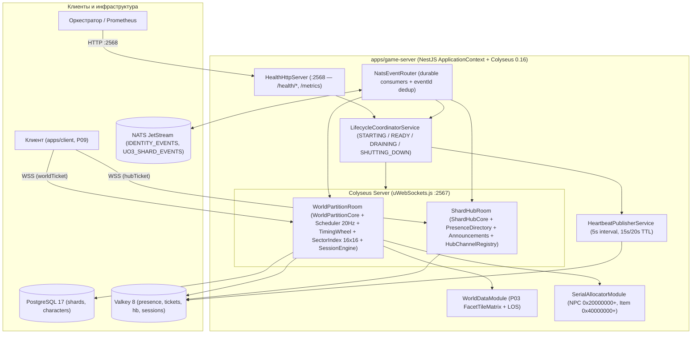
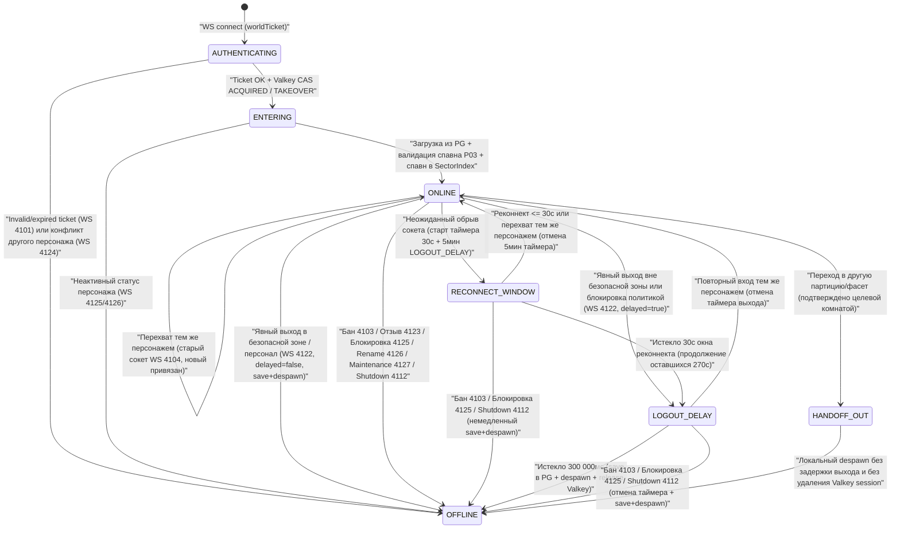
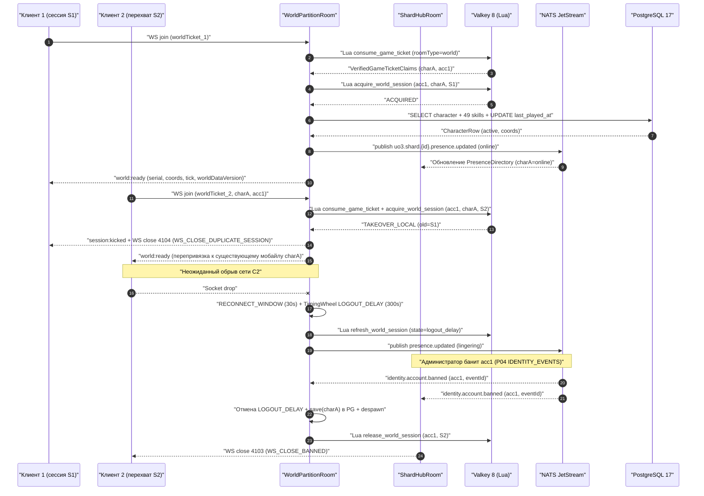

# Design: P06 Среда выполнения игрового сервера

## Context

Фаза **P06 (`p06-game-server-runtime`)** реализует авторитарную среду выполнения игрового сервера `apps/game-server` и детерминированный тестовый харнес для всех последующих фаз вех M1–M5 (мотивация и границы скоупа — см. [proposal.md](proposal.md); нормативные контракты поведения — см. `specs/runtime/*/spec.md`).

Проектирование строго опирается на зафиксированные архитектурные решения ([docs/ARCHITECTURE.md](../../../docs/ARCHITECTURE.md)) и контракты завершённых фаз P00–P05:
- **ADR-001 / P00:** монорепозиторий pnpm 9 + Turborepo 2 + строгий ESM, контролируемый граф зависимостей (`@uo3/domain` — 0 runtime deps; `@uo3/rules` — изоморфный, только `@uo3/domain`, без `node:*`; `@uo3/protocol` — изоморфный, только `@uo3/domain`; `@uo3/test-kit` — dev-only; `apps/game-server` — серверный потребитель всех общих пакетов).
- **ADR-002 / P02:** разработка и CI работают на процедурном синтетическом мире и CC0-заглушках без проприетарных файлов UO.
- **ADR-005:** клиент держит два WebSocket-соединения — `WorldPartitionRoom` и `ShardHubRoom`; сервер построен на NestJS 11 + Colyseus 0.16 (`uWebSockets.js` transport, `@colyseus/schema` v3, Valkey presence/driver); сообщения валидируются TypeBox.
- **ADR-006:** сущности `Mobile` (`0x00000001..0x3FFFFFFF`) и `Item` (`0x40000000..0x7FFFFFFF`), пространственный индекс секторов `16×16`, фиксированный тик `20 Гц` (`50 мс`), иерархическое колесо таймеров, инъецируемые часы и сидируемый ГПСЧ (`GameClock` + `Xoshiro128PlusPlusRng` из P01).
- **ADR-007:** прямоугольные партиции фасета, кратные секторам `16×16` (в MVP — 1 партиция на фасет; задел для P32 — многопартиционность и handoff).
- **ADR-008 / ADR-009 / ADR-012:** сервер авторитарен, вход только по одноразовому тикету P05 (`consume_game_ticket.lua`), мгновенная реакция на `IDENTITY_EVENTS` (P04) и `UO3_SHARD_EVENTS` (P05), каноническая 5-минутная задержка выхода UO:R (`300 000 мс`) вне безопасных зон.
- **Стыки с P03:** `WorldDataModule`, `WorldDataRegistryService`, `FacetTileMatrix`, `resolveSurfaces`, `DynamicTileProvider` и `worldDataVersion`.
- **Стыки с P05:** таблицы `shards`, `characters`, `character_skills`, разделение серийников мобайлов (игроки `0x00000001..0x1FFFFFFF` в PG, NPC `0x20000000..0x3FFFFFFF` в `apps/game-server`), Valkey-ключи `uo3:shard:{shardId}:hb:{nodeId}`, `partitions`, `hub`, `room:{roomId}:resv`, `session:{accountId}` и контракт `VerifiedGameTicketClaims`.

## Goals / Non-Goals

**Goals:**
- Запустить устойчивый production-ready каркас `apps/game-server` (NestJS 11 ApplicationContext + Colyseus 0.16 + `uWebSockets.js`), способный держать `≥ 500` игроков на одну партицию в MVP при `tickP99Ms ≤ 30 мс` и масштабироваться ролями `all | partition | hub` в P32.
- Вынести всё чистое детерминированное ядро симуляции (колесо таймеров, планировщик 20 Гц, секторный индекс `16×16`, ядро партиции, конечный автомат сессий, ядро хаба) в изоморфный слой без I/O, автоматически защищённый ESLint-гейтом детерминизма из P01.
- Гарантировать `O(1)` амортизированные операции для `≥ 1 000 000` таймеров, `O(1)` обновление секторов и их активации/деактивации, zero-allocation чтение динамических тайлов для P03 LOS/коллизий и отсутствие `O(N²)` рассылки присутствия в хабе.
- Обеспечить атомарную защиту от дубликатов сессий на шарде (включая гонки между процессами) и полную точность канонической механики выхода UO:R (30 с реконнект + 5 мин `LOGOUT_DELAY` / мгновенный выход в безопасной зоне и для персонала).
- Поставить в `packages/test-kit` быстрый (`≤ 200 мс` старт), полностью детерминированный `SimulationTestHarness` с виртуальными клиентами, снапшотами, SHA-256 отпечатком состояния и активным детектором нарушений детерминизма для всех фаз P07–P35.

**Non-Goals:**
- Реализация полного каталога игровых команд `intents`, `StateView` AOI-фильтрации и дельта-репликации полей мобайлов/предметов (выполняется в P07 поверх хуков `ingress` и `POST_TICK` P06).
- Реализация реляционного хранилища предметов/NPC, 60-секундного фонового dirty-flush, критических транзакций и `item_ledger` (выполняется в P08 поверх портов `PartitionEntityLoader`, `DirtyTracker`, `WorldFlushHook` и `SerialLeaseProvider`).
- Реализация шагового движения, контейнеров/рюкзаков, материализации `starterLoadout`, боя, ИИ существ, домов, регионов и чата/пати/гильдий (P12–P26).
- Реализация многопартиционной ghost-репликации пограничных полос через NATS (P32 — в P06 закладываются границы партиций, `NODE_ROLE` и хук `HANDOFF_OUT`).

## Decisions

### D1. Разделение на чистое ядро симуляции (`packages/rules/src/simulation/*`) и серверные адаптеры (`apps/game-server`)
- **Выбор:** Вся детерминированная логика среды выполнения без сетевого и файлового I/O — `HierarchicalTimingWheel`, `SimulationScheduler`, `SectorSpatialIndex`, `SectorDynamicTileProvider`, `WorldPartitionCore`, `SessionLifecycleEngine`, `ShardHubCore` — размещается в `packages/rules/src/simulation/*` (зависит строго от `@uo3/domain` и существующего `packages/rules/src/world/*`). Приложение `apps/game-server` реализует тонкую оболочку NestJS + Colyseus + Valkey + NATS + PostgreSQL поверх этого ядра, а `packages/test-kit` оборачивает точно то же ядро в `SimulationTestHarness`.
- **Обоснование:** Строго соблюдает DAG монорепозитория из P00 (не требует нового пакета вне утверждённых 9 пакетов и позволяет `packages/test-kit` тестировать реальное боевое ядро без импорта `apps/game-server`). Кроме того, `packages/rules` уже защищён статическим ESLint-правилом из P01, запрещающим `Date.now`, `Math.random`, `node:*` и `process.env` — детерминизм ядра гарантируется на этапе сборки и CI!
- **Отвергнутые альтернативы:**
  - *Размещение ядра симуляции прямо внутри `apps/game-server`:* нарушило бы DAG (пакет `packages/test-kit` не может импортировать `apps/*`) и лишило бы другие пакеты доступа к `SimulationTestHarness`.
  - *Создание 10-го пакета `packages/simulation`:* противоречит зафиксированной матрице пакетов в `docs/ARCHITECTURE.md` §3.1 и P00 `check-workspace-manifests`.
- **Соответствие ADR:** ADR-001, ADR-006, ADR-011.

### D2. Гибридный хост NestJS 11 ApplicationContext + Colyseus 0.16 (`uWebSockets.js`) + выделенный порт Health/Metrics
- **Выбор:** Точка входа `apps/game-server/src/main.ts` поднимает standalone `NestFactory.createApplicationContext(GameServerAppModule)` без NestJS HTTP-адаптера. Внутри `ColyseusHostService` создаётся Colyseus `Server` с транспортом `@colyseus/uwebsockets-transport` (на `GAME_PORT`, по умолчанию `2567`), `@colyseus/redis-presence` и `@colyseus/redis-driver`, подключёнными к Valkey 8. Внедрение NestJS-сервисов в Colyseus-комнаты выполняется через детерминированный `RoomDependencyBridge` (фабричные опции при `matchMaker.defineRoom` + DI-контейнер по `shardId`), избегая глобальных синглтонов. Внутренние пробы `/health/live`, `/health/startup`, `/health/ready` и `/metrics` обслуживаются лёгким встроенным `node:http` сервером на отдельном приватном порту `GAME_HEALTH_PORT` (`2568`), недоступном с внешнего балансировщика игроков. Поддерживается флаг `NODE_ROLE` (`all` | `partition` | `hub`).
- **Обоснование:** `uWebSockets.js` обеспечивает минимальную задержку и расход памяти на тысячи WebSocket-соединений (ADR-005), но несовместим со стандартным NestJS Express/Fastify HTTP-сервером на том же порту без сложных прокси. Выделение внутреннего `node:http` сервера для проб Kubernetes/Prometheus изолирует административную телеметрию от игрового трафика и позволяет отдавать `/health/ready = 503` во время `DRAINING` даже при открытом игровом порте.
- **Отвергнутые альтернативы:**
  - *Express + `@colyseus/ws-transport`:* выше потребление ОЗУ и CPU при ≥ 2 000 подключениях, противоречит выбору `uWebSockets.js` в ADR-005.
  - *Передача NestJS-зависимостей через глобальную переменную модуля:* ломает параллельный запуск нескольких `GameServerTestHost` в интеграционных тестах.
- **Соответствие ADR:** ADR-005, Стек (§2).

### D3. Четырёхуровневое иерархическое колесо таймеров (`HierarchicalTimingWheel`) с интрузивным пулом слотов
- **Выбор:** Реализовать 4-уровневое иерархическое колесо (Varghese & Lauck) с базовым шагом `1` тик (`50 мс`):
  - **Уровень L0:** `256` слотов × `1` тик (`50 мс`) = `12.8 с` (шаги, удары, каст заклинаний, реген).
  - **Уровень L1:** `64` слота × `256` тиков (`12.8 с`) = `819.2 с` (~`13.65 мин` — преступник 2 мин, выход 5 мин, спавнеры).
  - **Уровень L2:** `64` слота × `16 384` тика (`13.65 мин`) = `52 428.8 с` (~`14.56 ч` — распад предметов 60 мин, short-term murder 8 ч).
  - **Уровень L3:** `64` слота × `1 048 576` тиков (`14.56 ч`) = `3 355 443.2 с` (~`38.84 сут` — long-term murder 40 ч, распад домов IDOC 5–15 сут).
  - **Overflow:** отсортированный по `dueTick` список для крайне редких таймеров > `38.84` суток.
  Узлы таймеров хранятся в интрузивном двусвязном списке с переиспользуемым пулом индексов (`slotIndex` + 21-битный счётчик `generation` упакованы в числовой `TimerHandle` с безопасной проверкой устаревшего дескриптора). Каждая ячейка L0 и очередь срабатывания разделяют 3 класса приоритетов: `critical` (выход, боевые/сессионные таймеры), `normal` (стандартные игровые события), `deferred` (фоновая уборка, decay, несрочный ИИ). Постановка таймера с `delay = 0` изнутри колбэка принудительно назначает `dueTick = currentTick + 1`.
- **Обоснование:** `448` ячеек на все 4 уровня занимают пренебрежимо мало памяти, покрывают весь спектр игровых таймеров UO:R от `50 мс` до `38.8` суток за `O(1)` амортизированно на вставку, отмену и тик, без перебалансировки двоичной кучи `O(log N)` на миллионе таймеров и без давления на GC V8.
- **Отвергнутые альтернативы:**
  - *`setTimeout` / `setInterval` Node.js:* недетерминированы, не синхронизированы с тиком `50 мс`, огромные накладные расходы при 100k+ таймерах.
  - *Двоичная min-heap:* `O(log N)` на вставку/удаление и `O(N)` или дополнительная хеш-таблица индексов для отмены; хуже по кэш-локальности и стабильности задержек при массовом распаде предметов.
- **Соответствие ADR:** ADR-006.

### D4. Фиксированный цикл 20 Гц с 6 фазами, защитой от спирали смерти и квотированием бюджета
- **Выбор:** `SimulationScheduler` поддерживает два драйвера: `RealtimeTickDriver` (использует `SystemGameClock.latch()` + адаптивный `setTimeout` до следующего дедлайна тика с коррекцией дрейфа) и `ManualTickDriver` (для `SimulationTestHarness`). В одном проходе выполняется не более `5` догоняющих тиков (`maxTickDeltaMs = 250 мс` из P01); избыток отбрасывается с событием `scheduler.drift`. Каждый тик проходит 6 фаз: `LATCH` → `INGRESS` (дренирование до `2 000` команд в порядке `(enqueuedTick, sessionOrder, sequence)`) → `TIMERS` (`critical` и `normal` полностью; `deferred` в пределах бюджета `10 мс` с переносом остатка на `currentTick + 1`) → `SYSTEMS` (сортировка `(priority ASC, registrationOrder ASC)`) → `POST_TICK` (хук репликации P07) → `TELEMETRY` (кольцевой буфер последних `200` длительностей тика для расчёта `tickP99Ms` без аллокаций). Переход в `degraded` при `10` последовательных тиках `> 50 мс` или `tickP99Ms > 45 мс`; возврат в `healthy` после стабилизации `tickP99Ms <= 35 мс` в течение `100` тиков (`5 с`).
- **Обоснование:** Чёткое разделение фаз гарантирует, что клиентские намерения, срабатывания таймеров и подсистемы никогда не конкурируют в недетерминированном порядке, а квота `10 мс` для `deferred` защищает критичный геймплей от лаг-спайков при массовом распаде предметов или пробуждении спавнеров.
- **Отвергнутые альтернативы:**
  - *`setInterval(fn, 50)` с переменным `dt`:* разрушает детерминизм формул и вызывает лавинообразное наслоение тиков при паузе GC.
  - *Выполнение всех созревших таймеров без приоритетов и квот:* массовое событие (например, распад 5 000 предметов после осады) способно заблокировать тик на сотни миллисекунд.
- **Соответствие ADR:** ADR-006, ADR-011.

### D5. Пространственный индекс секторов `16×16`, инкрементальная активация и zero-alloc `SectorDynamicTileProvider`
- **Выбор:** `SectorSpatialIndex` строит плотный плоский массив `SectorCell[]` размером `sectorWidth × sectorHeight` (индексируемый напрямую как `(sx - originSectorX) * sectorHeight + (sy - originSectorY)` и доступный по `packSectorKey(sx, sy)` из P01). Каждая ячейка `SectorCell` содержит 4 коллекции: `mobiles: Set<MobileSerial>`, `players: Set<MobileSerial>`, `worldItems: Set<ItemSerial>`, `multis: Set<ItemSerial>`, а также целочисленный счётчик `activePlayerRefs: number` (число игроков в квадрате `5×5` секторов радиусом `2` вокруг данного сектора).
  При входе игрока в сектор `(sx, sy)` инкрементируется `activePlayerRefs` для всех секторов в `[sx-2..sx+2] × [sy-2..sy+2]`: переход `0 → 1` мгновенно порождает событие `sector.activated`. При перемещении игрока из `(oldSx, oldSy)` в `(newSx, newSy)` обновляется только разность двух квадратов (обычно всего `5` секторов при ортогональном шаге!); переход `1 → 0` порождает `sector.deactivated`.
  Для точечных запросов на клетке `(x, y)` и адаптера `SectorDynamicTileProvider` (контракт P03) внутри сектора ведётся легковесный разреженный индекс по упакованному локальному смещению клетки `((y & 15) << 4) | (x & 15)` (только для непустых клеток `worldItems` и `multis`), что обеспечивает zero-allocation обход `forEachDynamicTile` за `O(k)` без перебора всех предметов сектора `16×16`.
- **Обоснование:** Плоский массив секторов для полного фасета `7168×4096` (`448 × 256 = 114 688` секторов) занимает ~2–4 МБ при ленивой инициализации пустых ячеек, даёт `O(1)` доступ без хеш-коллизий, устраняет необходимость ежетикового сканирования карты для сна/пробуждения секторов (P19) и ускоряет LOS/коллизии P03 на плотных участках (банки, дома).
- **Отвергнутые альтернативы:**
  - *QuadTree / R-Tree:* избыточны для равномерной тайловой сетки с фиксированным радиусом AOI 18–31 тайлов и создают перебалансировку при постоянном движении сотен мобайлов.
  - *Перебор всех предметов сектора `16×16` в `forEachDynamicTile`:* на загруженных площадях (500 предметов в секторе) замедлял бы каждый шаг 3D DDA LOS в 50+ раз.
- **Соответствие ADR:** ADR-006, ADR-007.

### D6. Атомарный конечный автомат сессий с Valkey Lua CAS и межпроцессным вытеснением по NATS
- **Выбор:** `SessionLifecycleEngine` управляет локальной сессией в `WorldPartitionRoom` (состояния: `ONLINE`, `RECONNECT_WINDOW`, `LOGOUT_DELAY`, `HANDOFF_OUT`, `OFFLINE`), а распределённое владение единственной сессией аккаунта на шарде закрепляется в Valkey-ключе `uo3:shard:{shardId}:session:{accountId}` через три атомарных Lua-скрипта:
  - `acquire_world_session.lua`: если ключа нет — создаёт запись и возвращает `ACQUIRED`; если ключ есть с тем же `characterId` — атомарно перезаписывает владельца и возвращает `TAKEOVER_LOCAL` (тот же `roomId`) или `TAKEOVER_REMOTE` (другой `roomId`/`nodeId` с прежними `nodeId`, `worldRoomId`, `sessionId`); если ключ есть с **другим** `characterId` — не трогает ключ и возвращает `CONFLICT_OTHER_CHARACTER` → WS `4124` (`WS_CLOSE_ACCOUNT_ALREADY_IN_WORLD`).
  - `refresh_world_session.lua`: продлевает TTL ключа (`90 с`, обновляется каждые `15 с`) и обновляет `state` (`online` | `logout_delay`) только при совпадении `sessionId`.
  - `release_world_session.lua`: удаляет ключ строго при совпадении `sessionId` (CAS-удаление исключает затирание новой сессии после перехвата!).
  При `TAKEOVER_REMOTE` (сценарий перехода/рассинхронизации узлов) новая комната отправляет NATS-команду `uo3.shard.{shardId}.session.evict` прежней комнате и ожидает подтверждения сохранения (или таймаута `3 с`) перед спавном мобайла.
  Окно реконнекта (`30 с`) и каноническая задержка выхода (`300 000 мс`) запускаются **одновременно** в момент обрыва связи на колесе таймеров партиции: при истечении `30 с` отзывается только токен реконнекта, а мобайл продолжает дожидаться оставшихся `270 с` (суммарно ровно 5 минут UO:R, а не 5 мин 30 с!).
- **Обоснование:** Lua CAS полностью закрывает TOCTOU-гонки при одновременном входе с двух вкладок и не позволяет игрокам обходить 5-минутную задержку выхода переключением на твинка. Одновременный старт 30-секундного реконнекта и 5-минутного таймера выхода точно соответствует канону UO:R (персонаж исчезает ровно через 5 минут после разрыва).
- **Отвергнутые альтернативы:**
  - *Последовательный запуск 5-минутного таймера ПОСЛЕ истечения 30 с реконнекта:* увеличивал бы фактическое время пребывания в мире до 5 мин 30 с.
  - *Хранение статуса активной сессии только в памяти Colyseus-комнаты:* не защищает от входа вторым персонажем в другую партицию/фасет (например, один на Felucca, второй на Trammel).
- **Соответствие ADR:** ADR-005, ADR-009, ADR-012.

### D7. Масштабируемая `ShardHubRoom` без `O(N²)` рассылки присутствия и с иерархией скрытности
- **Выбор:** В `ShardHubState` (`@colyseus/schema` v3) клиентам реплицируются только компактные общешардовые поля: `shardStatus`, `visibleOnlineCount` (обновляется троттлингом ≤ 1 раз/с), `motd`, `stickyAnnouncements` (до 20 непросроченных записей, отфильтрованных по `scope`). Полный реестр присутствия (`PresenceDirectory` в `ShardHubCore`) живёт на сервере и синхронизируется с партициями через NATS-события `uo3.shard.{shardId}.presence.updated` + фоновая сверка раз в `10 с` против живого Valkey-реестра `uo3:shard:{shardId}:partitions` (осиротевшие записи упавшей партиции вычищаются через `20 с`). Скрытность персонала (`isHiddenStaff = true`, доступно только при `effectiveAccessLevel >= Counselor`) проверяется через функцию иерархии из P04: наблюдатель видит скрытого сотрудника тогда и только тогда, когда `observerAccessLevel >= targetEffectiveAccessLevel`. Для P26 предоставляется `HubChannelRegistry` (регистрация TypeBox-валидируемых типов клиентских сообщений и подписок на изменения присутствия конкретных `characterId`).
- **Обоснование:** При `2 000` онлайн-игроков репликация полного списка присутствия всем клиентам создала бы `4 000 000` обновлений на волну логинов и утечку информации о скрытом персонале. Таргетированные запросы + агрегированный счётчик сохраняют `O(1)` трафик на клиента и готовы к P26 (списки друзей, гильдии, пати).
- **Отвергнутые альтернативы:**
  - *Репликация `MapSchema<PresenceEntry>` всех игроков шарда в `ShardHubState`:* квадратичный сетевой трафик, несоблюдение скрытности персонала на уровне состояния и нарушение бюджета трафика.
- **Соответствие ADR:** ADR-005, ADR-009, ADR-012.

### D8. Детерминированный `SimulationTestHarness` в `packages/test-kit` с отпечатком SHA-256 и ловушкой недетерминизма
- **Выбор:** Создать в `packages/test-kit/src/simulation/*` комплексный headless-харнес, собирающий 1+ `WorldPartitionCore`, `ShardHubCore`, `SimulationScheduler(ManualTickDriver)`, `HierarchicalTimingWheel`, синтетический `FacetTileMatrix` (P02/P03), `FakeGameClock`, `Xoshiro128PlusPlusRng`, `InMemorySerialLeaseProvider`, `FakeTicketVerifier`, `InMemoryValkeySessionStore` и `InMemoryNatsBus`.
  Ключевые инженерные механизмы харнеса:
  1. **Канонический SHA-256 отпечаток состояния (`computeStateDigest()`):** сериализует в канонический JSON (переиспользуя изоморфный `canonicalJson` + `sha256` из P01 `packages/rules`!) детерминированный срез: `tick`, `clockNowMs`, `rngState`, `partitions[]` (отсортированные по `partitionId`: `entities` по `serial`, `sectorOccupancy`, `activeSectors`, `pendingTimers` по `(dueTick, priority, insertionSeq)`, `sessions` по `accountId`), `hubPresence` по `characterId` и `stickyAnnouncements`.
  2. **Снапшоты и откат (`captureSnapshot()` / `restoreSnapshot()`):** глубокое клонирование сериализуемого состояния часов, ГПСЧ, сущностей, сессий и таймеров (с реестром именованных обработчиков таймеров, либо восстановлением дескрипторов колбэков по ID) для ветвления сценариев.
  3. **Ловушка недетерминизма (`DeterminismGuard`):** в строгом режиме на время выполнения `tick()` временно подменяет `Date.now`, `Math.random` и `performance.now` (только для кода вне служебного замера самого планировщика) бросающим прокси `HARNESS_DETERMINISM_VIOLATION` с восстановлением в `finally`.
- **Обоснование:** Даёт всем фазам P07–P35 мгновенные (< 200 мс), 100% воспроизводимые тесты сложных многоминутных сценариев (5-минутный выход, 60-минутный распад, 8-часовой распад убийств, многошаговые бои) и немедленно ловит случайные вкрапления `Date.now()` / `Math.random()` в PR будущих фаз.
- **Отвергнутые альтернативы:**
  - *Использовать только интеграционные тесты с реальным Colyseus + Docker PG/Valkey/NATS:* медленно (секунды на тест), нестабильно на таймингах (flaky) и невозможно промотать 40 игровых часов за 5 миллисекунд.
- **Соответствие ADR:** ADR-006, ADR-011.

### D9. Двухэтапный Graceful Shutdown и согласование `GameServerEnvSchema` с P00/P03/P05
- **Выбор:** Зафиксировать конечный автомат хоста `STARTING → READY → DRAINING → SHUTTING_DOWN → STOPPED` с двумя раздельными таймерами: `SHUTDOWN_DRAIN_MS` (по умолчанию `15 000 мс` в dev, `60 000 мс` в prod, `0 мс` в unit-тестах) и `SHUTDOWN_HARD_TIMEOUT_MS` (по умолчанию `30 000 мс`). Во время `DRAINING` рассылаются ступенчатые объявления `shutdown_countdown` (T-60s, T-30s, T-10s..1s) и обновляется `draining: true` в Valkey. По истечении `DRAINING` (или при повторном `SIGTERM`/`SIGINT`) планировщики доводят текущий тик до фазы `TELEMETRY`, останавливаются, вызываются все зарегистрированные `WorldFlushHook` (в P06 — пакетное сохранение `characters` в PG; в P08 — полный flush грязных сущностей мира), сокеты закрываются кодом `4112`, удаляются Valkey-ключи узла/партиций/хаба и закрываются пулы NATS/Valkey/PG.
  В `packages/config` схема `GameServerEnvSchema` (введённая каркасом P00) эволюционно расширяется параметрами P06, а устаревшее поле-заглушка `TICKET_SIGNING_SECRET` из P00 переводится в опциональное (deprecated, не используется, так как P05 утвердил одноразовые 256-битные тикеты через Valkey Lua `consume_game_ticket.lua` без общего симметричного секрета!).
- **Обоснование:** Двухэтапное завершение предотвращает потерю игрового прогресса и «висящие» в Valkey мёртвые партиции при rolling-обновлениях Kubernetes, а явное согласование `GameServerEnvSchema` устраняет стыковое расхождение между P00 и P05 до начала написания кода.
- **Отвергнутые альтернативы:**
  - *Мгновенное закрытие сокетов по `SIGTERM` без дренажа и обратного отсчёта:* игроки теряют контекст боя/торговли и воспринимают плановый деплой как крэш сервера.
- **Соответствие ADR:** ADR-008, ADR-012.

---

## Architecture & Contracts

### 1. Структура модулей монорепозитория

| Пакет / приложение | Модули и ключевые файлы | Ответственность |
|---|---|---|
| `packages/protocol` | `src/errors/ws-close-codes.ts` | Единый модуль `WsCloseCode` (`4100..4199` по реестру `docs/PROTOCOL_REGISTRY.md`, включая признак реконнекта); P06 вводит модуль со всеми кодами реестра, P07 и последующие фазы только используют его. |
| `packages/domain` | `src/runtime/errors.ts`, `src/runtime/types.ts` | Перечисления `RuntimeErrorCode`, `HostLifecycleState`, `NodeRole`, `TickPhase`, `TimerPriority`, `TimerHandle`, `PartitionState`, `PartitionDescriptor`, `EntityLocationState`, `SessionLifecycleState`, `DisconnectReason`, `PresenceStatus`, `AnnouncementSeverity`, `AnnouncementScope`, `AnnouncementDisplayMode`. |
| `packages/rules` | `src/simulation/hierarchical-timing-wheel.ts`, `src/simulation/simulation-scheduler.ts`, `src/simulation/sector-spatial-index.ts`, `src/simulation/sector-dynamic-tile-provider.ts`, `src/simulation/world-partition-core.ts`, `src/simulation/behaviour-registry.ts`, `src/simulation/session-lifecycle-engine.ts`, `src/simulation/shard-hub-core.ts`, `src/simulation/state-digest.ts` | Чистое детерминированное ядро симуляции (0 I/O, только `@uo3/domain` + `rules/world` + `rules/digest`): 4-уровневое колесо таймеров, планировщик 20 Гц с бюджетами и квотами, секторный индекс `16×16` с инкрементальной активацией, адаптер `DynamicTileProvider` (P03), реестр сущностей/поведений/dirty-hook, КА сессий UO:R, ядро присутствия/объявлений хаба и канонический SHA-256 дайджест состояния. |
| `packages/protocol` | `src/p06/messages.schema.ts`, `src/p06/nats-events.schema.ts`, `src/p06/valkey.schema.ts`, `src/p06/ws-codes.ts`, `src/p06/index.ts` | TypeBox-схемы сообщений клиент↔сервер (`world:ready`, `session:logout_request`, `session:kicked`, `session:takeover_notice`, `hub:motd`, `hub:announcement`, `hub:presence_summary`), NATS-событий (`presence.updated`, `hub.announce`, `session.evict`), Valkey-структур (`NodeHeartbeatPayload`, `PartitionRegistryPayload`, `HubRegistryPayload`, `ActiveWorldSessionPayload`) и кодов закрытия WS. |
| `packages/config` | `src/env/game-server.schema.ts` (расширение `GameServerEnvSchema` из P00) | Типизированная валидация env `apps/game-server` (роль узла, партиции, тайминги heartbeat/shutdown/reconnect/logout/idle, бюджеты тика, вместимость, лимиты хаба). |
| `packages/test-kit` | `src/simulation/simulation-harness.ts`, `src/simulation/virtual-client.ts`, `src/simulation/in-memory-adapters.ts`, `src/simulation/determinism-guard.ts`, `src/simulation/trace-recorder.ts`, `src/simulation/entity-factories.ts` | Полноценный `SimulationTestHarness` (`createSimulationHarness`), `VirtualPlayerClient`, `InMemoryValkeySessionStore`, `InMemoryNatsBus`, `FakeTicketVerifier`, снапшоты/откат, запись и diff трасс, `DeterminismGuard` и фабрики сущностей/зон/событий. |
| `apps/game-server` | `src/main.ts`, `src/host/*`, `src/infra/*`, `src/rooms/world-partition/*`, `src/rooms/shard-hub/*`, `src/testing/game-server-test-host.ts` | NestJS 11 `GameServerAppModule`, `ColyseusHostService` (`uWebSockets.js` + Valkey presence/driver), `LifecycleCoordinatorService`, `HealthHttpServer`, `HeartbeatPublisherService`, `ValkeyService` + Lua-скрипты, `NatsConsumerService` (P04/P05 + дедупликация `eventId`), `CharacterPersistenceService`, `SerialAllocatorModule`, `WorldPartitionRoom` (+ `WorldPartitionState`), `ShardHubRoom` (+ `ShardHubState`, `AnnouncementService`, `PresenceSyncService`), `GameServerTestHost`. |

### 2. Топология узла `apps/game-server` (Mermaid)



### 3. Конечный автомат игровой сессии персонажа (Mermaid)



### 4. Сквозная последовательность: вход, перехват дубля, обрыв и бан (Mermaid)



### 5. Модели данных, схемы Colyseus, протокол и Valkey Lua-скрипты

#### 5.1. Минимальные схемы состояния Colyseus (`@colyseus/schema` v3)
Полные поля сущностей и `StateView` AOI добавляются в P07; в P06 комнаты фиксируют стабильную корневую оболочку:
```ts
// apps/game-server/src/rooms/world-partition/world-partition.state.ts
class WorldPartitionState extends Schema {
  @type('string') shardId!: string;
  @type('string') partitionId!: string;
  @type('uint8') facetId!: number;
  @type('string') worldDataVersion!: string;   // контракт P03
  @type('string') rulesetDigest!: string;      // контракт P01
  @type('uint32') serverTick!: number;
  @type('uint16') onlineCount!: number;
  // Точка расширения P07: @view() @type({ map: ReplicatedMobileSchema }) mobiles ...
}

// apps/game-server/src/rooms/shard-hub/shard-hub.state.ts
class StickyAnnouncementSchema extends Schema {
  @type('string') id!: string;
  @type('string') severity!: string;           // info | warning | critical | maintenance | shutdown_countdown
  @type('string') displayMode!: string;        // chat | banner | both
  @type('string') text!: string;
  @type('string') i18nKey!: string;
  @type('string') scope!: string;              // all | facet | staff_only
  @type('int16') targetFacet!: number;         // -1 для all/staff_only
  @type('float64') issuedAtMs!: number;
  @type('float64') expiresAtMs!: number;
}

class ShardHubState extends Schema {
  @type('string') shardId!: string;
  @type('string') shardStatus!: string;        // normal | draining | maintenance
  @type('uint32') visibleOnlineCount!: number; // троттлинг <= 1 Гц, без скрытого персонала
  @type('string') motd!: string;
  @type([StickyAnnouncementSchema]) stickyAnnouncements = new ArraySchema<StickyAnnouncementSchema>();
}
```

#### 5.2. Сообщения протокола (`packages/protocol/src/p06/*`, TypeBox)
Каждое сообщение P06 имеет `uint16`-опкод строго из блока P06 `0x0020..0x003F` нормативного реестра `docs/PROTOCOL_REGISTRY.md` (`0x002C..0x003F` — резерв P06); строковые имена ниже — символьные имена каталога P07. После подключения каталога и рукопожатия P07 сообщение `world:ready` отправляется только после `session.welcome` (`0x0002`).

| Опкод | Имя | Направление |
|---|---|---|
| `0x0020` | `world:ready` (SessionReady) | WorldPartitionRoom → Client |
| `0x0021` | `session:logout_request` (SafeLogout) | Client → WorldPartitionRoom |
| `0x0022` | `session:logout_ack` | WorldPartitionRoom → Client |
| `0x0023` | `session:kicked` | Room → Client |
| `0x0024` | `session:access_updated` | Room → Client |
| `0x0025` | `session:heartbeat` | Client → WorldPartitionRoom |
| `0x0026` | `session:takeover_notice` | WorldPartitionRoom → Client |
| `0x0027` | `hub:motd` | ShardHubRoom → Client |
| `0x0028` | `hub:announcement` (SystemBroadcast) | ShardHubRoom → Client |
| `0x0029` | `hub:presence_summary` (Presence) | ShardHubRoom → Client |
| `0x002A` | `hub:announce_request` | Client → ShardHubRoom |
| `0x002B` | `hub:staff_stealth_toggle` | Client → ShardHubRoom |

- **WorldPartitionRoom → Client:**
  - `world:ready`: `{ serial, characterId, facet, x, y, z, direction, currentTick, tickMs, worldDataVersion, rulesetDigest, reconnectToken, safeSpawnApplied }`
  - `session:logout_ack`: `{ delayed: boolean, delayMs: number, reason?: string }`
  - `session:kicked`: `{ closeCode: number, code: string, message: string, retryable: boolean }`
  - `session:access_updated`: `{ accessLevel: number, effectiveAccessLevel: number }`
- **Client → WorldPartitionRoom:**
  - `session:logout_request`: `{}` (проверяет `SafeLogoutZoneProvider` + `LogoutDelayPolicyProvider`)
  - `session:heartbeat`: `{ clientTimeMs: number }` (сбрасывает таймер бездействия `idle` до появления полного пинга в P07)
- **ShardHubRoom → Client:**
  - `hub:motd`: `{ shardName: string, text: string, updatedAtMs: number }`
  - `hub:announcement`: `{ id, severity, displayMode, text, clilocId?, i18nKey?, params?, scope, targetFacet?, issuedAtMs, expiresAtMs?, sticky: boolean }`
  - `hub:presence_summary`: `{ visibleOnlineCount: number, selfStatus: 'online' | 'away' | 'lingering', facet: number, partitionId: string, hiddenStaff: boolean }`
- **Client → ShardHubRoom:**
  - `hub:announce_request` (требует `effectiveAccessLevel >= GameMaster`): `{ severity, displayMode, text (1..512), scope, targetFacet?, ttlMs?, sticky? }`
  - `hub:staff_stealth_toggle` (требует `effectiveAccessLevel >= Counselor`): `{ hidden: boolean }`

#### 5.3. Коды закрытия WebSocket, используемые P06 (подмножество `docs/PROTOCOL_REGISTRY.md` §2)

Числовые значения, имена констант и поведение реконнекта нормативно задаются реестром протокола; P06 не вводит собственных номеров. Поле `retryable` сообщения `session:kicked` MUST совпадать с колонкой «Реконнект» (`да`/`перенаправление` → `true`, `нет` → `false`).

| Код | Константа (реестр) | Реконнект | Применение в P06 |
|---|---|---|---|
| `4101` | `WS_CLOSE_INVALID_TICKET` | да | Невалидный, просроченный, повторный тикет, неверный `roomType` или невалидный токен реконнекта |
| `4103` | `WS_CLOSE_BANNED` | нет | Аккаунт заблокирован (получено событие из `IDENTITY_EVENTS`) |
| `4104` | `WS_CLOSE_DUPLICATE_SESSION` | нет | Старое подключение вытеснено новым подключением того же персонажа (мир) или того же аккаунта (хаб) |
| `4106` | `WS_CLOSE_PARTITION_FULL` | да | Достигнут предел `hardCapacity` (для неперсонала) |
| `4109` | `WS_CLOSE_IDLE_TIMEOUT` | нет | Отключение обычного игрока по таймауту бездействия |
| `4112` | `WS_CLOSE_SERVER_SHUTDOWN` | да | Плановая остановка / рестарт игрового узла |
| `4113` | `WS_CLOSE_INTERNAL_ERROR` | да | Изолированная внутренняя ошибка обработки сессии |
| `4116` | `WS_CLOSE_PARTITION_DRAINING` | перенаправление | Узел или шард в режиме `draining`, новые входы на этот узел закрыты |
| `4122` | `WS_CLOSE_LOGOUT_COMPLETE` | нет | Штатный выход игрока (мгновенный или с переходом в `LOGOUT_DELAY`) |
| `4123` | `WS_CLOSE_SESSION_REVOKED` | нет | Сессии аккаунта отозваны (смена пароля / logout-all) |
| `4124` | `WS_CLOSE_ACCOUNT_ALREADY_IN_WORLD` | нет | Другой персонаж этого аккаунта уже находится в мире или в `LOGOUT_DELAY` |
| `4125` | `WS_CLOSE_CHARACTER_LOCKED` | нет | Персонаж заблокирован персоналом (`staff_locked`) или в `pending_deletion` |
| `4126` | `WS_CLOSE_CHARACTER_FORCE_RENAME` | нет | Персонаж переведён в `rename_required` |
| `4127` | `WS_CLOSE_SHARD_MAINTENANCE` | нет | Шард в режиме обслуживания, уровень доступа ниже `maintenanceBypassLevel` |
| `4128` | `WS_CLOSE_PARTITION_NOT_READY` | да | Комната партиции ещё в состоянии `LOADING` |

Коды `4100` (`WS_CLOSE_PROTOCOL_ERROR`), `4119` (`WS_CLOSE_STATE_DESYNC`), `4129`/`4130` и прочие сетевые коды применяются транспортным уровнем P07.

#### 5.4. События NATS JetStream и ключи/Lua-скрипты Valkey 8

- **Входящие NATS-потоки (durable consumers, окно дедупликации `eventId` в памяти = `10 000` последних ID / 10 мин):**
  - `IDENTITY_EVENTS` (P04): `identity.account.banned`, `identity.account.unbanned`, `identity.account.sessions_revoked`, `identity.account.access_level_changed`, `identity.account.effective_level_changed`.
  - `UO3_SHARD_EVENTS` (P05): `uo3.shard.{shardId}.status.changed`, `uo3.shard.{shardId}.character.force_rename`, `uo3.shard.{shardId}.character.locked`.
- **Исходящие/внутренние NATS-темы P06 (в потоке `UO3_SHARD_EVENTS` и `uo3.audit.events`):**
  - `uo3.shard.{shardId}.presence.updated`: `{ eventId, accountId, characterId, characterSerial, characterName, facet, partitionId, worldRoomId, status: 'online' | 'away' | 'lingering' | 'offline', accessLevel, effectiveAccessLevel, hiddenStaff, occurredAtMs }`.
  - `uo3.shard.{shardId}.hub.announce`: `{ eventId, issuerAccountId, issuerAccessLevel, announcement }` (позволяет `apps/api` / P29 / хосту публиковать объявления в хаб).
  - `uo3.shard.{shardId}.session.evict`: `{ eventId, targetNodeId, targetRoomId, accountId, characterId, replacedBySessionId, reason }`.
  - `uo3.audit.events`: `hub.announcement_published`, `session.spawn_recovery_applied`, `host.shutdown_initiated`, `host.shutdown_flush_failed`.
- **Ключи Valkey 8 (полное соответствие таблице из P05 `design.md`):**
  - `uo3:shard:{shardId}:hb:{nodeId}` (TTL 15 с, пишется каждые 5 с)
  - `uo3:shard:{shardId}:partitions` (Hash, TTL 20 с, пишется каждые 5 с)
  - `uo3:shard:{shardId}:hub` (String JSON, TTL 20 с, пишется каждые 5 с)
  - `uo3:shard:{shardId}:session:{accountId}` (String JSON, TTL 90 с, продлевается каждые 15 с):
    `{ characterId, characterSerial, worldRoomId, nodeId, sessionId, state: 'online' | 'logout_delay', updatedAtMs }`
  - **Lua `acquire_world_session.lua`**: принимает `KEYS[1] = sessionKey`, `ARGV = [accountId, characterId, characterSerial, worldRoomId, nodeId, sessionId, nowMs, ttlSec]`. Читает текущий JSON: если `nil` → `SET ... EX ttlSec`, возвращает `["ACQUIRED"]`. Если `cur.characterId == characterId` → `SET ... EX ttlSec`, возвращает `["TAKEOVER", cur.nodeId, cur.worldRoomId, cur.sessionId, cur.state]`. Иначе → ничего не меняет, возвращает `["CONFLICT", cur.characterId, cur.state]`.
  - **Lua `release_world_session.lua`**: удаляет `KEYS[1]` только если `cur.sessionId == ARGV[1]` (возвращает `1` или `0`).
  - **Lua `refresh_world_session.lua`**: обновляет `state`, `updatedAtMs` и `EX ttlSec` только если `cur.sessionId == ARGV[1]`.

#### 5.5. Конфигурация `GameServerEnvSchema` (`packages/config`)

| Переменная | Тип / по умолчанию | Описание |
|---|---|---|
| `SHARD_ID` | `string` (UUID или slug dev) | Идентификатор обслуживаемого шарда |
| `NODE_ID` | `string` (по умолчанию `hostname-pid`) | Уникальный ID узла для Valkey heartbeat |
| `NODE_ROLE` | `'all' \| 'partition' \| 'hub'` (`'all'`) | Роль процесса в кластере |
| `GAME_HOST` / `GAME_PORT` | `'0.0.0.0'` / `2567` | Адрес и порт WebSocket Colyseus (`uWebSockets.js`) |
| `GAME_PUBLIC_WS_URL` | `string` (`ws://localhost:2567`) | Публичный WS URL, публикуемый в Valkey для P05 |
| `GAME_HEALTH_PORT` | `number` (`2568`) | Внутренний HTTP-порт `/health/*` и `/metrics` |
| `PARTITIONS_CONFIG_JSON` | `string` (опционально) | Явный список партиций `{ partitionId, facetId, minX, minY, maxX, maxY, hardCapacity, staffBuffer }` (по умолчанию — по 1 партиции на каждый активный фасет `RulesetProfile`) |
| `HEARTBEAT_INTERVAL_MS` | `number` (`5000`) | Интервал публикации heartbeat и реестра комнат |
| `HEARTBEAT_TTL_SEC` | `number` (`15`) | TTL ключа heartbeat узла (реестр комнат = `TTL + 5` = 20 с) |
| `SHUTDOWN_DRAIN_MS` | `number` (`15000`) | Длительность фазы дренажа и обратного отсчёта |
| `SHUTDOWN_HARD_TIMEOUT_MS` | `number` (`30000`) | Жёсткий таймаут фазы `SHUTTING_DOWN` после дренажа |
| `TICK_BUDGET_WARN_MS` | `number` (`35`) | Порог предупреждения длительности тика (70% от 50 мс) |
| `DEFERRED_WORK_BUDGET_MS` | `number` (`10`) | Квота низкоприоритетных таймеров на один тик |
| `RECONNECT_WINDOW_MS` | `number` (`30000`) | Краткосрочное окно переподключения при обрыве сокета |
| `IDLE_TIMEOUT_MS` | `number` (`1800000`) | Таймаут бездействия обычных игроков (30 мин; `0` = выключено) |
| `MAX_PARTITION_PLAYERS` | `number` (`500`) | `hardCapacity` одной партиции по умолчанию |
| `STAFF_BUFFER_SLOTS` | `number` (`20`) | Выделенный буфер слотов для персонала (`Counselor+`) |
| `HUB_MOTD_TEXT` | `string` | Начальное сообщение дня шарда |
| `HUB_MAX_ANNOUNCEMENT_HISTORY` | `number` (`20`) | Ёмкость кольцевого буфера закреплённых объявлений |
| `TICKET_SIGNING_SECRET` | `string` (optional, deprecated) | Оставлено опциональным для обратной совместимости с P00; верификация тикетов выполняется через Valkey Lua P05 |

### 6. Ключевые алгоритмы и формулы

1. **Адресация и каскадирование 4-уровневого `HierarchicalTimingWheel`:**
   - Пусть `delta = dueTick - currentTick` (`delta >= 1` гарантировано; при `delayMs = 0` внутри тика `delta = 1`, иначе `delta = Math.max(1, Math.ceil(delayMs / tickMs))`).
   - Границы уровней (битовые маски):
     - `L0`: `delta < 256` → `slot = dueTick & 0xFF` (`2^8`).
     - `L1`: `delta < 16 384` (`2^14`) → `slot = (dueTick >>> 8) & 0x3F` (`2^6`).
     - `L2`: `delta < 1 048 576` (`2^20`) → `slot = (dueTick >>> 14) & 0x3F`.
     - `L3`: `delta < 67 108 864` (`2^26`, `~38.84` суток) → `slot = (dueTick >>> 20) & 0x3F`.
     - `Overflow`: `delta >= 67 108 864` → вставка в отсортированный массив `overflow[]`.
   - При продвижении `currentTick++`:
     - Если `(currentTick & 0xFF) === 0`, каскадно перераспределяем слот `L1[(currentTick >>> 8) & 0x3F]` в `L0`.
     - Если `(currentTick & 0x3FFF) === 0`, каскадно перераспределяем `L2[(currentTick >>> 14) & 0x3F]` в `L1`/`L0`.
     - Если `(currentTick & 0xFFFFF) === 0`, каскадно перераспределяем `L3[(currentTick >>> 20) & 0x3F]` в `L2`/`L1`/`L0`, а также подтягиваем созревшие элементы из `overflow` (`dueTick - currentTick < 67 108 864`).
   - Упаковка дескриптора: `handle = ((generation & 0x1FFFFF) * 4294967296) + (slotId >>> 0)` (безопасно умещается в 53-битное точное целое JS `Number.MAX_SAFE_INTEGER`, обеспечивая 2 097 151 поколение на каждый из 4 млрд индексов слота!).
2. **Инкрементальная активация секторов (`activationRadiusSectors = 2`):**
   - Для игрока в секторе `(sx, sy)` активная окрестность `N(sx, sy) = [max(minSx, sx-2)..min(maxSx, sx+2)] × [max(minSy, sy-2)..min(maxSy, sy+2)]`.
   - При переходе `(sx1, sy1) → (sx2, sy2)`: для каждого `c ∈ N(sx2, sy2) \ N(sx1, sy1)` выполнить `if (++cell.activePlayerRefs === 1) emit('sector.activated', c)`; для каждого `c ∈ N(sx1, sy1) \ N(sx2, sy2)` выполнить `if (--cell.activePlayerRefs === 0) emit('sector.deactivated', c)`. Порядок обхода ячеек строго возрастающий по `(sx, sy)` для детерминизма событий.
3. **Безопасная коррекция точки спавна при входе персонажа:**
   - Вызываем `resolveSurfaces(facet, x, y, z, ...)` из P03 (с подключённым `SectorDynamicTileProvider`). Если точка внутри границ партиции и имеет валидную опору с вертикальным зазором `PersonHeight = 16`, спавн разрешён в `(x, y, resolvedZ)`.
   - Иначе выполняем детерминированный спиральный поиск по расширяющимся квадратам радиусом `r = 1..16` вокруг `(x, y)` (в пределах партиции). Если проходимая клетка не найдена (или выставлен `spawnRecoveryApplied`), переносим персонажа в каноническую безопасную точку восстановления партиции/города и пишем событие аудита `session.spawn_recovery_applied`.

## Risks / Trade-offs

- **[Утечка `Date.now` / `Math.random` в будущих игровых подсистемах]** → В `packages/rules` действует статический ESLint-запрет из P01, а в `SimulationTestHarness` включён runtime `DeterminismGuard`, немедленно валящий тест с `HARNESS_DETERMINISM_VIOLATION` при любом несанкционированном вызове.
- **[Потеря связи `apps/game-server` с Valkey во время работы]** → Временные сбои Valkey не останавливают запущенный цикл симуляции 20 Гц в памяти; `/health/ready` переходит в `503` после 3 неудачных heartbeat, а при восстановлении Valkey heartbeat и активные сессии автоматически републикуются в следующем 5-секундном цикле.
- **[Рассинхронизация присутствия в `ShardHubRoom` после аварийного `SIGKILL` узла партиции]** → `PresenceSyncService` раз в `10 с` сверяет `partitionId` записей присутствия с живым Valkey-хэшем `uo3:shard:{shardId}:partitions` и автоматически вычищает записи исчезнувших партиций после истечения 20-секундного TTL.
- **[Гонка между завершением 5-минутного `LOGOUT_DELAY` и одновременным повторным входом того же персонажа]** → Срабатывание таймера `LOGOUT_DELAY` и вход нового клиента выполняются строго последовательно внутри одного тика/очереди комнаты, а освобождение ключа в Valkey выполняется через CAS `release_world_session.lua` с проверкой `sessionId` (устаревший деспавн не может удалить ключ новой сессии).
- **[Пиковые всплески срабатывания таймеров (например, массовый decay после ивента)]** → Разделение приоритетов колеса (`critical` / `normal` / `deferred`) и квота `10 мс` на `deferred` гарантируют, что низкоприоритетная уборка размажется на несколько тиков, не вызывая скачков пинга у игроков.
- **[Конфликт зависимостей `uWebSockets.js` в CI/Docker разных архитектур (amd64/arm64)]** → Код `ColyseusHostService` инжектирует транспорт через фабрику, а в `packages/config` предусмотрен fallback-флаг `GAME_WS_TRANSPORT=uws|ws` для редких локальных сред без прекомпилированного бинарника `uWebSockets.js` (при обязательном `uws` в production и Docker-образах).
- **[Сбой записи в PostgreSQL во время `graceful shutdown`]** → Ошибки сохранения изолируются на уровне каждого персонажа (сбой одного не прерывает сохранение остальных), логируются с полным дампом состояния в структурированный аварийный журнал и переводят код выхода процесса в ненулевой для алертинга оператору.
- **[Рост памяти пула узлов колеса таймеров после разового пика в 1 млн таймеров]** → Колесо использует сегментированный чанк-пул (блоки по `4 096` узлов) с периодическим сжатием полностью пустых хвостовых чанков, предотвращая безвозвратное удержание памяти после нагрузочных спайков.

## Migration Plan

1. **Совместимость с P00–P05:**
   - Новые SQL-миграции PostgreSQL в P06 **не требуются** — `apps/game-server` читает и обновляет существующие таблицы P05 (`shards`, `characters`, `character_skills`), сохраняя полную совместимость с будущей схемой `world_items`/`world_mobiles` в P08.
   - В `packages/config` расширение `GameServerEnvSchema` задаёт безопасные значения по умолчанию для всех новых параметров и переводит `TICKET_SIGNING_SECRET` (из P00) в опциональное deprecated-поле, обновляя `.env.example` и проверку `pnpm check:env`.
   - Зависимости `@colyseus/*` и `@nestjs/core` добавляются строго в `apps/game-server/package.json` (не попадая в изоморфные пакеты `domain`/`rules`/`protocol`), проходя проверку лицензий SPDX (`check:licenses`) и границ пакетов (`dependency-cruiser`) из P00.
2. **Порядок развёртывания:**
   - Сначала обновляются общие пакеты (`domain` → `rules` → `protocol` → `config` → `test-kit`), проверяется `pnpm turbo run build typecheck lint test`.
   - Затем разворачивается `apps/game-server` рядом с работающим `apps/api` (P04/P05), валидируются Valkey-ключи heartbeat/partitions/hub (подхватываются `GET /api/v1/shards` из P05) и прохождение полного пути `POST /api/v1/shards/:id/tickets` → WS `WorldPartitionRoom` + `ShardHubRoom`.
3. **Стратегия отката:**
   - Поскольку БД-миграции не вносятся, откат узлов `apps/game-server` выполняется простым перезапуском предыдущего образа после штатного `SIGTERM`-дренажа; ключи Valkey имеют автоматический TTL 15–90 с и самоочищаются без ручного вмешательства.

## Open Questions

Блокирующих архитектурных вопросов нет — все ключевые решения (структура колеса таймеров, фазы тика, секторный индекс, Lua CAS сессий, коды закрытия WebSocket `4100..4199` (по реестру `docs/PROTOCOL_REGISTRY.md`), модель хаба и headless-харнес) зафиксированы.

Отложимые детали для последующих фаз:
- Точный формат бинарной сериализации дельт сущностей в `@colyseus/schema` `StateView` и приоритезация обновлений AOI при перегрузке канала — фиксируется в **P07 (`p07-netcode-and-replication`)**.
- Реализация PostgreSQL-адаптера `SerialLeaseProvider` (таблица `shard_serial_leases` для NPC/предметов) и пакетного 60-секундного `WorldFlushHook` — выполняется в **P08 (`p08-world-persistence`)** поверх портов, созданных в P06.
- Выбор между `WebTransport` и `uWebSockets.js` для многопартиционного кластера — вынесено в исследование **P32 (`p32-world-scaling`)** согласно ADR-005.
