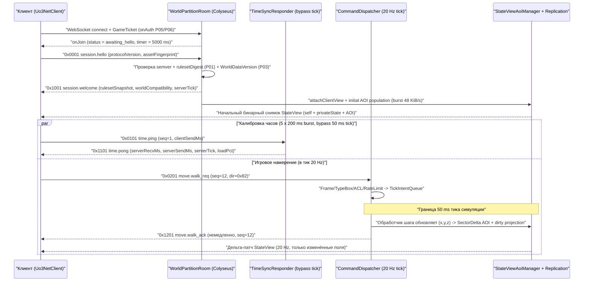
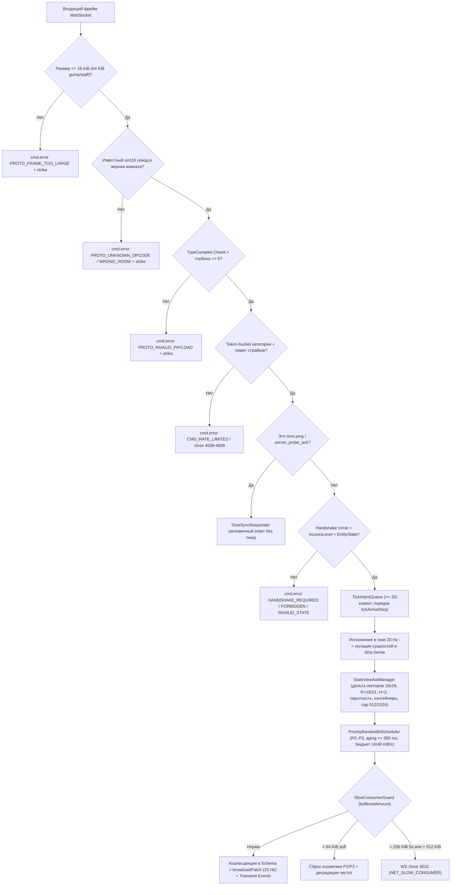
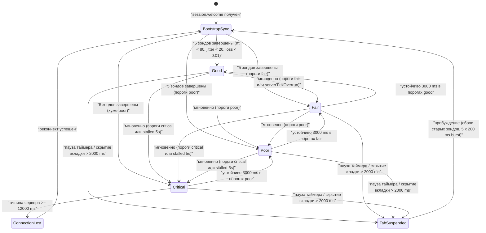

# Design: P07 Сетевой код и репликация

## Context

Фаза P07 проектирует сетевой слой обмена командами, управления областью интереса (AOI), репликации состояния и синхронизации времени поверх среды выполнения игрового сервера **P06** (`apps/game-server`: NestJS 11 + Colyseus 0.16 с `uWebSockets.js`, цикл симуляции `20 Гц` / `50 мс`, секторный пространственный индекс `16×16`, комнаты `WorldPartitionRoom` и `ShardHubRoom`). Мотивация и границы скоупа зафиксированы в [proposal.md](proposal.md).

Сетевой слой опирается на уже зафиксированные контракты предыдущих фаз:
- **P00:** граф зависимостей монорепозитория — `packages/protocol` является изоморфным пакетом слоя L2 и зависит только от `@uo3/domain` (плюс runtime-зависимости `@sinclair/typebox`, `@colyseus/schema`), не создавая циклов и кросс-L2 связей с `@uo3/rules`.
- **P01:** доменные типы (`Serial`, `Point3D`, `Direction` + бит бега `0x80`, `Layer`, `Body`, `Hue`, `Notoriety`, `AccessLevel`, `GameClock`, `GameTime`, `globalLightLevel` `0..26`) и профиль правил `ClientRulesetSnapshot` + SHA-256 `profileDigest`.
- **P03:** контракты `WorldDataVersionSchema`, `ClientAssetFingerprintSchema` и `WorldDataCompatibilitySchema` в `packages/protocol` и буфер среза партиции `≥ 32` тайлов.
- **P05:** `VerifiedGameTicketClaims` (`accountId`, `characterId`, `characterSerial`, `accessLevel`, `protocolVersion`, `roomType`, `sessionId`), проверенный в `onAuth` комнаты Colyseus (P06).

Ключевые ограничения из [docs/ARCHITECTURE.md](../../../docs/ARCHITECTURE.md):
- Целевая нагрузка: `≥ 2 000` игроков на шард (`500` на процесс-партицию в MVP), обработка команды `p99 ≤ 30 мс`, патчи `20 Гц` (`50 мс`), клиент `60 FPS` (ADR-005).
- Сервер абсолютно авторитарен; клиент передаёт только намерения (`intents`), скрытые мобайлы и чужие статы/контейнеры не утекают в сетевой поток (ADR-012).
- Канонические константы UO:R: сектор `16×16`, AOI `18` тайлов (настраиваемо до `24`), мульти `31` тайл, окно шагового движения `0..255` до `4` неподтверждённых шагов, речь `1 / 15 / 18` тайлов.

## Goals / Non-Goals

**Goals:**
- Создать единый, версионированный, самодокументируемый и предкомпилированный протокол `packages/protocol` (intents, transient events, коды ошибок, `@colyseus/schema` v3 state tree, изоморфная математика синхронизации часов).
- Гарантировать нулевую утечку скрытой информации (stealth/invisibility, чужие HP/мана/стамина/статы/вес/золото, чужие открытые контейнеры, приватные отношения нотореити) за счёт серверной фильтрации `StateView` и разделения публичных и приватных проекций.
- Обеспечить предсказуемый, ограниченный сетевой трафик (`≤ 16 KiB/s` устойчиво на клиента) и стабильность комнаты при толпе (`700+` мобайлов в зоне банка) и при медленных клиентах.
- Обеспечить субмиллисекундную точность RTT без квантования `50 мс` тиком, монотонную синхронизацию серверного времени без обратных скачков и воспроизводимый детерминизм для `SimulationTestHarness` (P06).
- Заложить чистые точки расширения для P08 (персистентность), P12 (движение), P13–P29 (геймплейные обработчики, предикаты видимости, контейнеры), P31 (античит) и P32 (пограничные ghost-сущности партиций).

**Non-Goals:**
- Реализация игровой логики шагов, коллизий, боя, магии, контейнеров, чата и гампов — в P07 реализуются только протокольные схемы, маршрутизация, валидация, точки расширения и тестовые заглушки (реализация логики в P12–P29).
- Визуальные React-компоненты индикаторов пинга, экранов обновления протокола и рендерер Three.js — в P07 в `apps/client` создаётся только headless-слой `src/netcode/*` и Zustand-сторы (UI в P09/P14, рендер в P10/P11).
- Межпроцессный транспорт ghost-сущностей через NATS JetStream и WebTransport — остаются за P32.

## Decisions

### D1. Компактные числовые `uint16` wire-опкоды + символьный реестр `namespace.action` + предкомпилированный TypeBox
- **Выбор:** Каждое сообщение протокола имеет каноническое символьное имя (`move.walk_req`, `world.double_click`, `time.ping`) и неизменяемый в рамках мажорной версии `uint16` wire-опкод (`0x0001..0x0FFF` — client intents, `0x1000..0x1FFF` — server immediate events/responses), сгруппированный по доменным диапазонам с шагом `0x0100`. Поверх встроенной бинарной сериализации Colyseus (MessagePack) каждый опкод валидируется предкомпилированным `TypeCompiler.Compile(schema)` с `additionalProperties: false` и проверкой глубины/размера сырого фрейма.
- **Обоснование:** Передача `uint16` вместо строки `"world.double_click"` экономит 14–26 байт на каждом высокочастотном кадре (`move.walk_req`, `time.ping`, `event.damage_number`), а предкомпилированный TypeBox проверяет структуру за ~1–3 мкс (укладываясь в бюджет `p99 ≤ 30 мс` при 500+ клиентах) и одновременно генерирует JSON Schema для контрактных тестов, документации и фаззера P31.
- **Отвергнутые альтернативы:**
  - *Строковые типы сообщений Colyseus (`"move.walk_req"`):* лишний сетевой трафик на 20 Гц и отсутствие жёсткого числового индекса для компактных метрик.
  - *Protobuf / FlatBuffers для пользовательских intents:* требует дополнительного кодогенерационного тулинга и уходит от зафиксированного в ADR-005 / стеке TypeBox.
  - *Динамическая рефлексия (`class-validator`):* на порядок медленнее `TypeCompiler` и создаёт лишние аллокации на горячем пути.
- **Соответствие ADR:** ADR-001, ADR-005, ADR-012.

### D2. Двухэтапное подключение: `onAuth` (тикет P05) + обязательное рукопожатие `session.hello` / `session.welcome`
- **Выбор:** Проверка одноразового тикета (`VerifiedGameTicketClaims`, P05) происходит в `onAuth` (P06) до выделения игрового слота; сразу после `onJoin` сессия переходит в состояние `awaiting_hello` с таймером `5 000 мс` (на колесе таймеров P06). Клиент обязан отправить `session.hello` с `protocolVersion`, `clientBuild`, `clientAssetFingerprint` (P03) и опциональным `knownRulesetDigest`. Сервер валидирует semver-совместимость, вызывает сверку `WorldDataVersionSchema` (P03), отправляет `session.welcome` с авторитарным `ClientRulesetSnapshot` + `rulesetDigest` (P01) + `worldDataVersion` + `serverTick` + `capabilities`, и только после этого переводит сессию в `active` и прикрепляет `StateView`.
- **Обоснование:** `onAuth` не должен перегружаться большим payload отпечатков карты/патчей и должен оставаться быстрым гейтом безопасности; явный `session.hello`/`session.welcome` позволяет вернуть структурированное предупреждение `PATCH_DIFF_WARNING` (отсутствующие кастомные патчи шарда) или подробную ошибку `PROTO_VERSION_UNSUPPORTED` / `PROTO_WORLD_DATA_INCOMPATIBLE` с подсказкой обновления до закрытия WebSocket кодом `4002`–`4004`.
- **Отвергнутые альтернативы:**
  - *Передача всех версий только в HTTP-заголовках тикета P05:* не защищает от расхождения версии карты между `apps/api` и конкретным подом `apps/game-server` во время rolling-деплоя.
  - *Немедленный стрим всего состояния комнаты до рукопожатия:* тратит трафик на несовместимых клиентов и позволяет старому клиенту упасть при декодировании новой схемы.
- **Соответствие ADR:** ADR-005, ADR-009, ADR-012.

### D3. Двухканальная модель доставки: `@colyseus/schema` v3 (20 Гц) + немедленный транзиентный канал
- **Выбор:** Непрерывное состояние сущностей (позиции, визуал, `hitsPercent`, экипировка, предметы, приватные статы, глобальное освещение) реплицируется через `@colyseus/schema` v3 + `StateView` с базовой частотой патчей `20 Гц` (`50 мс`). Разовые недолговечные события (`move.walk_ack`, `move.walk_deny`, `move.teleport_sync`, `event.damage_number`, `event.sound_effect`, `event.visual_effect`, `event.mobile_animation`, `event.overhead_text`, `event.system_message`, `state.notoriety_delta`) доставляются отдельным немедленным транзиентным каналом поверх того же WebSocket через `client.send(Opcode, payload)` с фильтрацией по тем же правилам AOI и скрытности.
- **Обоснование:** Хранение разовых событий (всплывающего урона, звуков, анимаций, подтверждений шагов) внутри полей схемы создаёт гонки перезаписи за `50 мс`, требует искусственных счётчиков версий и добавляет лишнюю задержку до `50 мс` к отклику шага. Немедленный канал обеспечивает минимальную задержку `move.walk_ack` и чистую семантику однократной доставки в порядке генерации.
- **Отвергнутые альтернативы:**
  - *Всё через `@colyseus/schema` (очереди событий в `ArraySchema`):* приводит к раздуванию снимка при входе нового наблюдателя и лишней задержке до одного тика.
  - *Полностью кастомная бинарная дельта-сериализация вместо `@colyseus/schema`:* нарушает ADR-005 и лишает проект готовой интеграции `StateView` в Colyseus 0.16.
- **Соответствие ADR:** ADR-005.

### D4. Строгое разделение доменных сущностей симуляции (P06) и проекций `@colyseus/schema` (`packages/protocol`)
- **Выбор:** Серверные объекты симуляции (`WorldMobile`, `WorldItem`, P06) НЕ наследуются от `Schema` Colyseus. Для каждой сущности, имеющей хотя бы одного наблюдателя (или активного владельца), `StateReplicationEngine` поддерживает легковесный объект-проекцию (`ReplicatedMobile`, `ReplicatedWorldItem`, `ReplicatedContainerItem`, `ReplicatedPlayerPrivateState`), синхронизируемый из dirty-битов сущности перед фазой кодирования патча. Проекции для неактивных/ненаблюдаемых сущностей освобождаются с возвратом в объектный пул (zero-GC churn).
- **Обоснование:** В мире UO живут сотни тысяч предметов и десятки тысяч NPC; хранение декораторов и change-tree `@colyseus/schema` для ненаблюдаемых сущностей в пустых секторах удваивало бы потребление RAM и связывало бы персистентность P08 с wire-форматом Colyseus. Пул проекций минимизирует память, изолирует P08 и позволяет применять коалесценцию и приоритизацию до мутации change-tree схемы.
- **Отвергнутые альтернативы:**
  - *Наследование `WorldMobile extends Schema`:* жёстко связывает домен, симуляцию и персистентность с библиотекой Colyseus, усложняет тестирование и держит change-tree на сотнях тысяч ненаблюдаемых предметов.
- **Соответствие ADR:** ADR-005, ADR-006, ADR-008.

### D5. Попарная (viewer-relative) нотореити через приватные дельта-переопределения
- **Выбор:** В публичном `ReplicatedMobile` хранится только `baseNotoriety: uint8` (`Innocent`, `Criminal`, `Murderer`, `Invulnerable`). Все попарные отношения, зависящие от пары `(observer, target)` — `Ally` (согильдиец/альянс/пати), `Enemy` (гильдейская война), `Attackable` (агрессор/свободная атака) — вычисляются провайдером отношений (подключается в P17/P26, в P07 реализован интерфейс `NotorietyRelationProvider` и тестовая реализация) и передаются конкретному наблюдателю через `ReplicatedPlayerPrivateState.notorietyOverrides` (или компактную приватную дельту `state.notoriety_delta`), синхронизированную с жизненным циклом AOI `enter`/`update`/`leave`.
- **Обоснование:** В UO:R цвет имени одного и того же персонажа разный для разных зрителей. `@colyseus/schema` `StateView` фильтрует видимость целого объекта, но разделяет значения его полей между всеми зрителями. Выделение попарных переопределений в приватный слой гарантирует 100% аутентичность UO:R без клонирования `ReplicatedMobile` под каждого зрителя и без утечки дипломатических/агрессорских связей посторонним.
- **Отвергнутые альтернативы:**
  - *Хранить список врагов/агрессоров в публичном `ReplicatedMobile`:* грубая утечка игровой информации (любой клиент видел бы, кто кому агрессор).
  - *Отдельный экземпляр `ReplicatedMobile` на каждого зрителя:* квадратичный рост памяти `O(N^2)` в толпе у банка Британии.
- **Соответствие ADR:** ADR-005, ADR-010, ADR-012.

### D6. Инкрементальный секторный AOI-менеджер (`16×16`) поверх `StateView` с гистерезисом и `VisibilityEntitySource`
- **Выбор:** `StateViewAoiManager` подписывает каждую активную клиентскую сессию на прямоугольник секторов `16×16` из `SectorGrid` (P06), покрывающий `R_max + H` (`31 + 2 = 33` тайла, т.е. квадрат максимум `5×5` или `6×6` секторов). При движении наблюдателя вычисляются только `enteredSectors` и `leftSectors`; внутри граничных секторов применяется точная проверка Чебышёва с раздельными порогами входа (`R`: `18` / `31`) и выхода (`R + H`: `20` / `33`). Дополнительно работают: (а) жёсткий фильтр скрытности/невидимости (`Hidden`/`AccessLevel`/активное обнаружение), (б) реестр предикатов видимости (`VisibilityPredicate`, включая призраков), (в) отдельный `ContainerVisibilityTracker` для открытых контейнеров с проверкой дистанции `≤ 2` тайлов, (г) детерминированный ограничитель плотности (`512` мобайлов, `1 024` предметов) с приоритетной очередью и (д) интерфейс `VisibilityEntitySource`, объединяющий локальный `SectorGrid` и read-only слой пограничных ghost-сущностей (буфер `≥ 32` тайлов для P32).
- **Обоснование:** Обеспечивает сложность `O(сущностей в локальных секторах)` вместо `O(сущностей в мире)`, полностью исключает мерцание спрайтов на кромке AOI, исключает wallhack/radar-утечки скрытых воров и GM, а также избавляет от переписывания AOI в P32.
- **Отвергнутые альтернативы:**
  - *Полный пересчёт AOI всех клиентов каждый тик по всем сущностям:* не масштабируется до 500–2000 игроков.
  - *Передача скрытых мобайлов с флагом `isHidden = true` и скрытие их на клиенте:* фатальная дыра безопасности (ADR-012), тривиально обходимая в браузере.
- **Соответствие ADR:** ADR-005, ADR-006, ADR-007, ADR-012.

### D7. Четырёхуровневый планировщик приоритетов (`P0..P3`), коалесценция и `SlowConsumerGuard`
- **Выбор:** Перед вызовом `broadcastPatch()` в конце каждого `50 мс` тика `StateReplicationEngine` прогоняет список грязных сущностей через `PriorityBandwidthScheduler`:
  - `P0` (`20 Гц`, без деградации): собственный персонаж, `ReplicatedPlayerPrivateState`, входы/выходы в `≤ 8` тайлах.
  - `P1` (`20 Гц → 10 Гц`): чужие мобайлы `≤ 12` тайлов, активные боевые/групповые/гильдейские цели.
  - `P2` (`10 Гц → 5 Гц`): мобайлы `13..18` тайлов, предметы мира `≤ 12` тайлов.
  - `P3` (`4 Гц → 2 Гц`): предметы мира `13..18` тайлов, фоновые обновления мульти/метаданных.
  Каждой отложенной грязной сущности начисляется возраст голодания; при достижении `500 мс` её эффективный приоритет принудительно повышается до `P0` (starvation protection). Дополнительно для каждого клиента ведутся скользящие счётчики байт (`1 с` и `10 с`) относительно бюджетов (`16 KiB/s` steady / `48 KiB/s` burst на 2 с после входа или телепорта / `64 KiB/s` ceiling) и инспекция `ws.getBufferedAmount()` (`64 KiB` soft / `256 KiB` hard за `5 с` / `512 KiB` instant disconnect `4010`).
  **Ключевая тонкость с общими проекциями `@colyseus/schema`:** поскольку поля одного `ReplicatedMobile` общие для всех наблюдателей, частотная деградация для сущности выбирается по **высшему** запрошенному приоритету среди её текущих наблюдателей (близкий наблюдатель получает `20 Гц`, а удалённые наблюдатели с перегруженным буфером защищаются поклиентской фильтрацией транзиентных событий, поклиентским бюджетом `StateView.add` на новых входах, а при превышении лимитов — адаптивным уменьшением эффективного `clientAoiCap` / поклиентским `SlowConsumerGuard`). Это сохраняет общие проекции `O(1)` по памяти и одновременно защищает каждый отдельный WebSocket-канал!
- **Обоснование:** Сочетает минимальную память общих `@colyseus/schema`-проекций с реальной защитой канала каждого клиента от перегрузки в толпе и от DoS медленными сокетами.
- **Отвергнутые альтернативы:**
  - *Безусловная отправка всех грязных полей всех сущностей на 20 Гц без бюджета:* при 300+ активных сущностях в AOI трафик взлетает выше 100 KiB/s на клиента и забивает мобильные/слабые каналы.
  - *Отдельная копия схемы на каждого клиента для независимого троттлинга полей:* разрушает память и CPU-бюджет кодирования патчей.
- **Соответствие ADR:** ADR-005, ADR-012.

### D8. Немедленный `time.ping`/`time.pong` в обход тика, статистический фильтр и верифицируемый серверный RTT
- **Выбор:** Обработка `time.ping` перехватывается на уровне сетевого адаптера комнаты (`TimeSyncResponder`) синхронно при приёме фрейма — минуя 50 мс очередь тика — после проверки размера, TypeBox-схемы и rate-limit (`2/с`, burst `6`). Сервер читает `GameClock.nowMonotonicMs()` (P01), фиксирует `serverRecvMs`, `serverTick`, `serverTickStartMs`, `serverTickLoadPct`, `serverTickOverrun`, `serverSendMs` и немедленно шлёт `time.pong`. На клиенте чистый изоморфный `ClockSyncEstimator` (в `packages/protocol`) поддерживает burst `5 × 200 мс` при старте/пробуждении, адаптивный период `1 / 2 / 5 с`, окно `16` замеров с отсевом верхних `25%` выбросов, EWMA (`α = 0.2` для RTT, `α = 0.125` для jitter), монотонное подтягивание `slew ≤ 2%` (до `5%` при `151..500 мс`, hard snap при `> 500 мс`), расчёт `interpolationDelayMs = clamp(100 + 2 * jitterMs, 100, 300)` и классификатор `good/fair/poor/critical` с гистерезисом повышения `3 000 мс`. Для серверной оценки `sessionRttMs` (для допусков движения P12) сервер периодически вкладывает одноразовый `serverProbeNonce` в `time.pong` / `session.heartbeat_challenge` и измеряет интервал от собственной отправки до возврата эха на сервере (потолок `500 мс`), полностью игнорируя клиентские часы.
- **Обоснование:** Обход тика убирает `0..50 мс` искусственной пилы из RTT; монотонное подтягивание исключает сбои анимаций и кулдаунов; серверный nonce-RTT защищает от подделки высокого пинга читерами для расширения анти-спидхак окон в P12.
- **Отвергнутые альтернативы:**
  - *Обработка `time.ping` внутри 20 Гц тика:* вносит `25 мс` среднего смещения и до `50 мс` ложного джиттера.
  - *Доверие клиентскому `reportedRttMs` на сервере:* уязвимость античита (ADR-012).
- **Соответствие ADR:** ADR-005, ADR-011, ADR-012.

### D9. Headless клиентский транспортный SDK и реактивные Zustand-сторы в `apps/client`
- **Выбор:** В `apps/client/src/netcode/*` реализуется независимый от React/Three.js транспортный слой (`Uo3NetClient`), управляющий двумя параллельными соединениями Colyseus (`WorldPartitionRoom` + `ShardHubRoom`), рукопожатием, типизированным `sendIntent` с корреляцией `requestId`, подпиской на атомарные транзакции патчей `@colyseus/schema`, транзиентной шиной событий и `ClockSyncController`. Наружу для P09–P14 выставляются три Zustand-стора с иммутабельными срезами: `useNetcodeSessionStore`, `useReplicatedWorldStore` и `useConnectionQualityStore`. Тот же базовый протокольный транспортный клиент (без браузерного `document.visibilityState`) переиспользуется в `apps/bot-client`.
- **Обоснование:** Позволяет рендереру (P10/P11), движению (P12) и React UI (P09/P14) читать состояние из не-React и React кода с минимальными ре-рендерами (стек Zustand 5 в ADR) и тестировать полный стек в Node.js без браузера.
- **Отвергнутые альтернативы:**
  - *Хранить экземпляры Colyseus `Room` напрямую в React Context:* провоцирует лишние ре-рендеры на 20 Гц и усложняет доступ из императивного цикла Three.js (ADR-003).
- **Соответствие ADR:** ADR-001, ADR-003, ADR-004, ADR-005.

## Architecture & Contracts

### 1. Структура модулей и пакетов монорепозитория

| Пакет / Приложение | Модули и файлы | Ответственность |
|---|---|---|
| `packages/protocol` | `src/version/protocol-version.ts`, `src/version/compatibility.ts` | Semver `PROTOCOL_VERSION`, `MIN_SUPPORTED_PROTOCOL_VERSION`, проверка совместимости |
| `packages/protocol` | `src/opcodes/opcodes.ts`, `src/opcodes/catalog.ts` | Реестр `uint16` опкодов (`ClientOpcode`, `ServerOpcode`), метаданные комнаты, `minAccessLevel`, категории rate-limit, флагов состояния |
| `packages/protocol` | `src/errors/error-codes.ts`, `src/errors/ws-close-codes.ts`, `src/errors/error-envelope.schema.ts` | Реестр ошибок `PROTO_*`, `CMD_*`, `NET_*`, WebSocket close codes `4000..4019`, TypeBox-схема `CmdErrorSchema` |
| `packages/protocol` | `src/intents/*.schema.ts`, `src/events/*.schema.ts`, `src/validators/compiled-validators.ts` | TypeBox-схемы всех intents и transient events (`session`, `time`, `move`, `world`, `item`, `combat`, `skill`, `magic`, `social`, `gump`, `staff`, `client`), предкомпилированные `TypeCompiler`-валидаторы и проверка глубины/размера |
| `packages/protocol` | `src/state/world-partition.state.ts`, `src/state/shard-hub.state.ts`, `src/state/replicated-mobile.schema.ts`, `src/state/replicated-item.schema.ts`, `src/state/replicated-private.schema.ts`, `src/state/flags.ts` | Классы `@colyseus/schema` v3 (`@type`, `@view()`), битовые маски `MobileStatusFlag` и `WorldItemFlag`, вспомогательные кодеки |
| `packages/protocol` | `src/time/clock-sync-estimator.ts`, `src/time/quality-classifier.ts`, `src/time/interpolation-delay.ts` | Чистые изоморфные алгоритмы оценки RTT/jitter/offset, отсева выбросов, монотонного slewing, адаптивной интерполяции и 4-уровневой классификации качества связи |
| `packages/config` | `src/env/netcode-server.schema.ts`, `src/env/netcode-client.schema.ts` | TypeBox env-конфиги `NETCODE_*` (сервер) и `VITE_NETCODE_*` (клиент) |
| `packages/test-kit` | `src/netcode/simulated-link.ts`, `src/netcode/protocol-fixtures.ts`, `src/netcode/mock-state-view.ts` | Детерминированный симулятор сети (RTT, jitter, потери, переупорядочивание, сон вкладки) на `FakeGameClock` + `SeededRng`, фабрики валидных/битых intents, тестовые фикстуры |
| `apps/game-server` | `src/netcode/netcode.module.ts`, `src/netcode/handshake.service.ts` | NestJS-модуль `NetcodeModule`, двухэтапное рукопожатие (`session.hello` / `session.welcome`), сверка `rulesetDigest` и `WorldDataVersionSchema` |
| `apps/game-server` | `src/netcode/command-dispatcher.service.ts`, `src/netcode/intent-handler.registry.ts`, `src/netcode/rate-limiter.service.ts`, `src/netcode/tick-intent-queue.ts` | Валидация фреймов, token-bucket rate-limiter + strike-tracker, проверка `AccessLevel`/состояния, детерминированная очередь тика, реестр обработчиков для P12–P29 |
| `apps/game-server` | `src/netcode/aoi/state-view-aoi.manager.ts`, `src/netcode/aoi/visibility-predicates.ts`, `src/netcode/aoi/container-visibility.tracker.ts`, `src/netcode/aoi/visibility-entity-source.ts` | Инкрементальный секторный AOI (`16×16`) поверх `StateView`, гистерезис, скрытность/призраки, скоупированные контейнеры, лимит плотности `512/1024`, абстракция пограничных призраков P32 |
| `apps/game-server` | `src/netcode/replication/state-replication.engine.ts`, `src/netcode/replication/projection-pool.ts`, `src/netcode/replication/priority-bandwidth.scheduler.ts`, `src/netcode/replication/notoriety-delta.service.ts`, `src/netcode/replication/transient-event.dispatcher.ts`, `src/netcode/replication/slow-consumer.guard.ts` | Проекции симуляции в `@colyseus/schema`, коалесценция, приоритеты `P0..P3`, бюджет трафика, попарная нотореити, транзиентные события и контроль `bufferedAmount` |
| `apps/game-server` | `src/netcode/time/time-sync.responder.ts`, `src/netcode/time/server-rtt-tracker.ts`, `src/netcode/metrics/netcode.metrics.ts` | Немедленный ответчик `time.ping`/`time.pong`, серверная оценка RTT сессии без доверия клиенту, таймаут неактивности `30 с`, Prometheus-метрики |
| `apps/client` | `src/netcode/uo3-net-client.ts`, `src/netcode/clock-sync.controller.ts`, `src/netcode/state-bridge.ts`, `src/netcode/stores/*.store.ts` | Headless-клиент Colyseus (`WorldPartitionRoom` + `ShardHubRoom`), отправитель intents, контроллер зондов и детектор сна вкладки, атомарный мост патчей, Zustand-сторы |
| `apps/bot-client` | `src/protocol-client/headless-protocol-client.ts` | Минимальный Node-клиент протокола поверх `@uo3/protocol` для сквозных интеграционных и smoke-тестов P07 (основа для ботов P35) |

### 2. Каталог `uint16` опкодов, схемы сообщений и реестр ошибок (`packages/protocol`)

#### Распределение диапазонов опкодов (`uint16`)

| Диапазон | Направление | Пространство имён | Примеры канонических имён и опкодов | Комната | Категория rate-limit |
|---|---|---|---|---|---|
| `0x0001–0x00FF` | Client → Server | `session.*` | `0x0001 session.hello`, `0x0002 session.ack_ready`, `0x0003 session.logout_req` | `both` | `session` (`2/с`, burst `4`) |
| `0x0100–0x01FF` | Client → Server | `time.*` | `0x0101 time.ping`, `0x0102 time.server_probe_ack` | `both` | `time` (`2/с`, burst `6`, bypass tick) |
| `0x0200–0x02FF` | Client → Server | `move.*` | `0x0201 move.walk_req`, `0x0202 move.turn_req`, `0x0203 move.resync_req` | `world` | `move` (`12/с`, burst `6`) |
| `0x0300–0x03FF` | Client → Server | `world.*` | `0x0301 world.single_click`, `0x0302 world.double_click`, `0x0303 world.target_resp`, `0x0304 world.target_cancel` | `world` | `world` (`10/с`, burst `15`) |
| `0x0400–0x04FF` | Client → Server | `item.*` | `0x0401 item.pick_up`, `0x0402 item.drop_item`, `0x0403 item.equip_item`, `0x0404 item.open_container`, `0x0405 item.close_container` | `world` | `world` (`10/с`, burst `15`) |
| `0x0500–0x05FF` | Client → Server | `combat.*` | `0x0501 combat.set_war_mode`, `0x0502 combat.attack_req` | `world` | `combat` (`8/с`, burst `10`) |
| `0x0600–0x06FF` | Client → Server | `skill.*` | `0x0601 skill.use_skill`, `0x0602 skill.set_skill_lock`, `0x0603 skill.set_stat_lock` | `world` | `world` (`10/с`, burst `15`) |
| `0x0700–0x07FF` | Client → Server | `magic.*` | `0x0701 magic.cast_spell` | `world` | `combat` (`8/с`, burst `10`) |
| `0x0800–0x08FF` | Client → Server | `social.*` | `0x0801 social.speech_say` (`world`), `0x0802 social.emote` (`world`), `0x0810 social.hub_chat_send` (`hub`), `0x0811 social.party_action` (`hub`), `0x0812 social.guild_action` (`hub`) | `world` / `hub` | `social` (`3/с`, burst `5`) |
| `0x0900–0x09FF` | Client → Server | `gump.*` | `0x0901 gump.response` (до `64 KiB`), `0x0902 gump.close` | `world` | `gump` (`6/с`, burst `10`) |
| `0x0A00–0x0AFF` | Client → Server | `staff.*` | `0x0A01 staff.gm_command` (`minAccessLevel = Counselor`, до `64 KiB`) | `both` | `staff` (`10/с`, burst `20`) |
| `0x0B00–0x0BFF` | Client → Server | `client.*` | `0x0B01 client.set_aoi_preference`, `0x0B02 client.ping_report` (диагностика) | `world` | `client` (`2/с`, burst `4`) |
| `0x1000–0x10FF` | Server → Client | `session.*` / `cmd.*` | `0x1001 session.welcome`, `0x1002 cmd.error`, `0x1003 cmd.ok`, `0x1004 container.closed` | `both` | — |
| `0x1100–0x11FF` | Server → Client | `time.*` | `0x1101 time.pong`, `0x1102 time.server_probe` | `both` | — |
| `0x1200–0x12FF` | Server → Client | `move.*` | `0x1201 move.walk_ack`, `0x1202 move.walk_deny`, `0x1203 move.teleport_sync` | `world` | — |
| `0x1300–0x13FF` | Server → Client | `event.*` / `state.*` | `0x1301 event.damage_number`, `0x1302 event.sound_effect`, `0x1303 event.visual_effect`, `0x1304 event.mobile_animation`, `0x1305 event.overhead_text`, `0x1306 event.system_message`, `0x1307 state.notoriety_delta` | `world` | — |

#### Ключевые TypeBox-контракты сообщений (`packages/protocol`)

```ts
// Общий опциональный коррелятор для клиентских intents
const RequestIdField = Type.Optional(Type.Integer({ minimum: 1, maximum: 0xFFFFFFFF }));

// 0x0001 session.hello
export const SessionHelloSchema = Type.Object({
  requestId: RequestIdField,
  protocolVersion: Type.String({ pattern: "^\\d+\\.\\d+\\.\\d+$", maxLength: 24 }),
  clientBuild: Type.String({ minLength: 1, maxLength: 64 }),
  assetFingerprint: ClientAssetFingerprintSchema, // импорт из P03
  knownRulesetDigest: Type.Optional(Type.String({ pattern: "^[0-9a-f]{64}$" })),
  preferredUpdateRange: Type.Optional(Type.Integer({ minimum: 12, maximum: 24 })),
}, { additionalProperties: false });

// 0x1001 session.welcome
export const SessionWelcomeSchema = Type.Object({
  negotiatedProtocolVersion: Type.String(),
  serverProtocolVersion: Type.String(),
  rulesetSchemaVersion: Type.String(),
  rulesetDigest: Type.String({ pattern: "^[0-9a-f]{64}$" }),
  rulesetSnapshot: Type.Record(Type.String(), Type.Unknown()), // валидируется ClientRulesetSnapshotSchema на клиенте
  worldDataVersion: WorldDataVersionSchema, // из P03
  worldCompatibility: WorldDataCompatibilitySchema, // OK | PATCH_DIFF_WARNING + missingPatchIds
  serverTick: Type.Integer({ minimum: 0 }),
  tickIntervalMs: Type.Integer({ minimum: 20, maximum: 200 }),
  characterSerial: Type.Integer({ minimum: 1, maximum: 0x3FFFFFFF }),
  effectiveUpdateRange: Type.Integer({ minimum: 12, maximum: 24 }),
  effectiveMultiRange: Type.Integer({ minimum: 24, maximum: 36 }),
  enabledNamespaces: Type.Array(Type.String(), { maxItems: 32 }),
}, { additionalProperties: false });

// 0x0201 move.walk_req
export const MoveWalkReqSchema = Type.Object({
  requestId: RequestIdField,
  seq: Type.Integer({ minimum: 0, maximum: 255 }),
  direction: Type.Integer({ minimum: 0, maximum: 0x87 }), // дополнительная проверка: (dir & ~0x87) === 0
  clientMonotonicMs: Type.Number({ minimum: 0, maximum: 1e15 }),
}, { additionalProperties: false });

// 0x1201 move.walk_ack & 0x1202 move.walk_deny
export const MoveWalkAckSchema = Type.Object({
  seq: Type.Integer({ minimum: 0, maximum: 255 }),
  x: Type.Integer({ minimum: 0, maximum: 16383 }),
  y: Type.Integer({ minimum: 0, maximum: 16383 }),
  z: Type.Integer({ minimum: -128, maximum: 127 }),
  direction: Type.Integer({ minimum: 0, maximum: 0x87 }),
  stamina: Type.Integer({ minimum: 0, maximum: 65535 }),
  serverTick: Type.Integer({ minimum: 0 }),
}, { additionalProperties: false });

export const MoveWalkDenySchema = Type.Object({
  seq: Type.Integer({ minimum: 0, maximum: 255 }),
  x: Type.Integer({ minimum: 0, maximum: 16383 }),
  y: Type.Integer({ minimum: 0, maximum: 16383 }),
  z: Type.Integer({ minimum: -128, maximum: 127 }),
  direction: Type.Integer({ minimum: 0, maximum: 7 }),
  reasonCode: Type.String({ maxLength: 64 }),
  serverTick: Type.Integer({ minimum: 0 }),
}, { additionalProperties: false });

// 0x0101 time.ping & 0x1101 time.pong
export const TimePingSchema = Type.Object({
  seq: Type.Integer({ minimum: 1, maximum: 0xFFFFFFFF }),
  clientSendMs: Type.Number({ minimum: 0, maximum: 1e15 }),
}, { additionalProperties: false });

export const TimePongSchema = Type.Object({
  seq: Type.Integer({ minimum: 1, maximum: 0xFFFFFFFF }),
  clientSendMs: Type.Number({ minimum: 0, maximum: 1e15 }),
  serverRecvMs: Type.Number({ minimum: 0 }),
  serverSendMs: Type.Number({ minimum: 0 }),
  serverTick: Type.Integer({ minimum: 0 }),
  serverTickStartMs: Type.Number({ minimum: 0 }),
  tickIntervalMs: Type.Integer({ minimum: 20, maximum: 200 }),
  serverTickLoadPct: Type.Integer({ minimum: 0, maximum: 255 }),
  serverTickOverrun: Type.Boolean(),
  serverProbeNonce: Type.Optional(Type.Integer({ minimum: 1, maximum: 0xFFFFFFFF })),
}, { additionalProperties: false });

// 0x1002 cmd.error
export const CmdErrorSchema = Type.Object({
  requestId: RequestIdField,
  opcode: Type.Integer({ minimum: 0, maximum: 0xFFFF }),
  code: Type.String({ maxLength: 64 }),
  numericCode: Type.Integer({ minimum: 1000, maximum: 9999 }),
  retryable: Type.Boolean(),
  retryAfterMs: Type.Optional(Type.Integer({ minimum: 0, maximum: 600000 })),
  details: Type.Optional(Type.Record(Type.String(), Type.Union([Type.String(), Type.Number(), Type.Boolean()]))),
}, { additionalProperties: false });
```

#### Реестр кодов ошибок протокола и WebSocket close codes

| Символьный код | Числовой | WS Close | Retryable | Назначение |
|---|---|---|---|---|
| `PROTO_VERSION_UNSUPPORTED` | `4002` | `4002` | `false` | Несовместимый semver протокола клиента (`updateRequired = true`) |
| `PROTO_HANDSHAKE_TIMEOUT` | `4003` | `4003` | `true` | Отсутствует `session.hello` в течение `5 000 мс` |
| `PROTO_WORLD_DATA_INCOMPATIBLE` | `4004` | `4004` | `false` | Критическое несовпадение базовой карты/тайлдаты |
| `PROTO_HANDSHAKE_REQUIRED` | `4101` | — | `false` | Игровое намерение отправлено до завершения `session.welcome` |
| `PROTO_UNKNOWN_OPCODE` | `4102` | — | `false` | Неизвестный `uint16` код операции |
| `PROTO_WRONG_ROOM_TYPE` | `4103` | — | `false` | Намерение отправлено не в ту комнату (`world` vs `hub`) |
| `PROTO_INVALID_PAYLOAD` | `4104` | — | `false` | Нарушение TypeBox-схемы, глубины `> 6`, неизвестные поля |
| `PROTO_FRAME_TOO_LARGE` | `4105` | — | `false` | Превышение лимита фрейма (`16 KiB` / `64 KiB`) |
| `PROTO_RATE_LIMIT_EXCEEDED` | `4008` | `4008` | `true` | `≥ 50` отказов `CMD_RATE_LIMITED` за `10 с` (разрыв) |
| `PROTO_MALFORMED_FLOOD` | `4009` | `4009` | `false` | `≥ 20` битых/невалидных фреймов за `10 с` (разрыв) |
| `CMD_RATE_LIMITED` | `4290` | — | `true` | Превышен token-bucket категории (возвращается с `retryAfterMs`) |
| `CMD_QUEUE_OVERFLOW` | `4291` | — | `true` | Превышена очередь `32` намерений клиента в текущем тике |
| `CMD_WALK_WINDOW_EXCEEDED` | `4292` | — | `true` | Попытка отправить > `4` неподтверждённых шагов |
| `CMD_FORBIDDEN_ACCESS_LEVEL` | `4301` | — | `false` | Недостаточный `AccessLevel` для команды |
| `CMD_INVALID_ENTITY_STATE` | `4302` | — | `false` | Состояние персонажа (например, призрак) запрещает команду |
| `CMD_HANDLER_UNAVAILABLE` | `5010` | — | `false` | Подсистема (фаза) ещё не зарегистрировала обработчик |
| `CMD_INTERNAL_ERROR` | `5000` | — | `true` | Перехваченный внутренний сбой обработчика (без утечки стека) |
| `NET_SLOW_CONSUMER` | `4010` | `4010` | `true` | Переполнение исходящего буфера отправки (`> 256 KiB` 5 с или `> 512 KiB`) |
| `NET_HEARTBEAT_TIMEOUT` | `4011` | `4011` | `true` | Нет клиентской активности/пингов свыше `30 000 мс` |

### 3. Схемы состояния `@colyseus/schema` v3 (`packages/protocol/src/state/*`)

```ts
// Компактный видимый слой экипировки (9 байт на элемент в дельте)
export class ReplicatedEquippedLayer extends Schema {
  @type("uint8") layer: number = 0;        // Layer (P01)
  @type("uint16") itemId: number = 0;      // ItemID арта
  @type("uint16") hue: number = 0;         // 16-bit Hue с флагами Partial/Translucent
  @type("uint32") serial: number = 0;      // Serial предмета
}

// Публичная античит-проекция мобайла (~40–55 байт базового снимка)
export class ReplicatedMobile extends Schema {
  @type("uint32") serial: number = 0;
  @type("string") name: string = "";
  @type("uint16") body: number = 400;
  @type("uint16") hue: number = 0;
  @type("int16") x: number = 0;
  @type("int16") y: number = 0;
  @type("int8") z: number = 0;
  @type("uint8") direction: number = 0;          // 0..7 + 0x80 run flag
  @type("uint8") baseNotoriety: number = 1;      // Notoriety (1..7)
  @type("uint16") statusFlags: number = 0;       // bitmask MobileStatusFlag
  @type("uint8") hitsPercent: number = 100;      // 0..100 (никогда не exact HP чужих)
  @type("uint16") mountBody: number = 0;         // 0 = пешком
  @type("uint16") mountHue: number = 0;
  @type([ReplicatedEquippedLayer]) equipped = new ArraySchema<ReplicatedEquippedLayer>();
}

// Публичная проекция предмета на земле или мульти-объекта (~24 байта снимка)
export class ReplicatedWorldItem extends Schema {
  @type("uint32") serial: number = 0;
  @type("uint16") itemId: number = 0;
  @type("uint16") hue: number = 0;
  @type("uint32") amount: number = 1;
  @type("int16") x: number = 0;
  @type("int16") y: number = 0;
  @type("int8") z: number = 0;
  @type("uint8") directionOrLight: number = 0;
  @type("uint16") flags: number = 0;             // bitmask WorldItemFlag
  @type("uint16") multiId: number = 0;           // 0 = не мульти
  @type("uint16") multiRevision: number = 0;
}

// Скоупированная проекция предмета внутри открытого контейнера (~22 байта)
export class ReplicatedContainerItem extends Schema {
  @type("uint32") serial: number = 0;
  @type("uint32") containerSerial: number = 0;
  @type("uint16") itemId: number = 0;
  @type("uint16") hue: number = 0;
  @type("uint32") amount: number = 1;
  @type("uint16") gridX: number = 0;
  @type("uint16") gridY: number = 0;
  @type("uint8") flags: number = 0;
}

// Строго приватное состояние игрока (1:1, в StateView ТОЛЬКО владельца)
export class ReplicatedPlayerPrivateState extends Schema {
  @type("uint32") characterSerial: number = 0;
  @type("uint16") str: number = 0;
  @type("uint16") dex: number = 0;
  @type("uint16") int: number = 0;
  @type("uint16") hits: number = 0;
  @type("uint16") maxHits: number = 0;
  @type("uint16") stam: number = 0;
  @type("uint16") maxStam: number = 0;
  @type("uint16") mana: number = 0;
  @type("uint16") maxMana: number = 0;
  @type("uint16") weight: number = 0;
  @type("uint16") maxWeight: number = 0;
  @type("uint32") gold: number = 0;
  @type("uint16") armorRating: number = 0;
  @type("uint16") statCap: number = 225;
  @type("uint8") personalLightLevel: number = 0;
  @type("boolean") warMode: boolean = false;
  @type("uint32") criminalRemainingMs: number = 0;
  @type("uint16") murderCounts: number = 0;
  @type("uint32") backpackSerial: number = 0;
  @type("uint32") bankBoxSerial: number = 0;
  @type("uint32") activeTargetId: number = 0;    // 0 = нет активного курсора цели
  @type({ map: "uint8" }) notorietyOverrides = new MapSchema<number>(); // key = serialHex
}

// Корневое состояние WorldPartitionRoom
export class WorldPartitionState extends Schema {
  @type("string") shardId: string = "";
  @type("string") partitionId: string = "";
  @type("uint8") facetId: number = 0;
  @type("uint32") serverTick: number = 0;
  @type("uint32") gameTimeMinutes: number = 0;
  @type("uint8") globalLightLevel: number = 0;   // 0..26
  @type("uint8") season: number = 0;
  @type("string") protocolVersion: string = "";
  @type("string") worldDataVersion: string = "";
  @type("string") rulesetDigest: string = "";

  @view() @type({ map: ReplicatedMobile }) mobiles = new MapSchema<ReplicatedMobile>();
  @view() @type({ map: ReplicatedWorldItem }) worldItems = new MapSchema<ReplicatedWorldItem>();
  @view() @type({ map: ReplicatedContainerItem }) containerItems = new MapSchema<ReplicatedContainerItem>();
  @view() @type({ map: ReplicatedPlayerPrivateState }) privateStates = new MapSchema<ReplicatedPlayerPrivateState>();
}

// Корневое состояние ShardHubRoom (без мировых сущностей)
export class ShardHubState extends Schema {
  @type("string") shardId: string = "";
  @type("string") shardStatus: string = "online";
  @type("uint32") onlinePlayers: number = 0;
  @type("string") protocolVersion: string = "";
  @type("string") activeAnnouncement: string = "";
  @type("uint32") announcementRevision: number = 0;
}
```

**Битовые маски (`packages/protocol/src/state/flags.ts`):**
- `MobileStatusFlag` (`uint16`): `0x0001 WAR_MODE`, `0x0002 POISONED`, `0x0004 BLESSED`, `0x0008 PARALYZED`, `0x0010 MOUNTED`, `0x0020 DEAD_GHOST`, `0x0040 FEMALE`, `0x0080 YELLOW_HITS_BAR`, `0x0100 INVULNERABLE`, `0x0200 HIDDEN_SELF_OR_STAFF`, `0x0400 CRIMINAL_FLAG`, `0x0800 MEDITATING`.
- `WorldItemFlag` (`uint16`): `0x0001 MOVABLE`, `0x0002 LOCKED_DOWN`, `0x0004 SECURE`, `0x0008 IS_MULTI`, `0x0010 IS_CORPSE`, `0x0020 IS_CONTAINER`, `0x0040 IS_DOOR_OPEN`, `0x0080 LIGHT_SOURCE`.
- Ключи `MapSchema` кодируются компактной нижнерегистровой hex-строкой серийника без ведущих нулей (`serial.toString(16)`, 1–8 байт UTF-8), чтобы сэкономить 2–4 байта на каждый ключ по сравнению с `"0x40001234"`.

### 4. Диаграммы потоков и конечных автоматов

#### Диаграмма 1: Рукопожатие, немедленный `time.ping`/`time.pong` и цикл `move.walk_req` → патч 20 Гц



#### Диаграмма 2: Конвейер валидации, AOI-фильтрации и бюджетирования репликации



#### Диаграмма 3: Конечный автомат качества связи и синхронизации часов клиента



### 5. Точные алгоритмы и математические формулы

#### 5.1. Инкрементальный расчёт AOI с гистерезисом и детерминированным отбором плотности

1. **Определение радиуса и сектора подписки:**
   - Сектор координаты `(x, y)`: `sx = x >> 4`, `sy = y >> 4` (секторы `16×16` из P01/P06).
   - Для клиента с `R_std` (по умолчанию `18`), `R_multi` (`31`), гистерезисом `H` (`2`): внешний охват `R_outer = max(R_std, R_multi) + H` (`33`).
   - Подписанный прямоугольник секторов: `sx ∈ [(x - R_outer) >> 4, (x + R_outer) >> 4]`, `sy ∈ [(y - R_outer) >> 4, (y + R_outer) >> 4]` (ограниченный границами фасета и буфером партиции `≥ 32`).
2. **Условие видимости сущности `E` для наблюдателя `O`:**
   - `E.facetId === O.facetId`
   - `d = max(|E.x - O.x|, |E.y - O.y|)`
   - `R_in = E.isMulti ? R_multi : R_std`, `R_out = R_in + H`
   - Пространственный тест: если `E` уже в `O.visibleSet` → остаётся при `d <= R_out`, иначе входит при `d <= R_in`.
   - Правило скрытности (для мобайлов): если `E.hidden === true`, видимость разрешена **только** если `E.serial === O.serial` ИЛИ `(O.accessLevel >= AccessLevel.Counselor && O.accessLevel >= E.invisLevel)` ИЛИ `O.detectionGrants.has(E.serial)`.
   - Компонуемые предикаты: `for (const pred of predicates) if (!pred.canObserve(O, E)) return false`.
3. **Детерминированный ключ приоритета при переполнении (`count > cap`):**
   Для каждого кандидата вычисляется 64-битный (или лексикографический кортеж) ранг:
   `rank(O, E) = (tier, distanceChebyshev, -lastActivityTick, E.serial)`:
   - `tier = 0`: `E.serial === O.serial` (свой персонаж — никогда не вытесняется)
   - `tier = 1`: активная цель атаки / агрессор / атакующий наблюдателя
   - `tier = 2`: член группы / гильдии / питомец наблюдателя / персонал
   - `tier = 3`: остальные мобайлы (или предметы с флагом трупа/контейнера)
   - `tier = 4`: пассивные дальние NPC / декоративные предметы
   Чтобы исключить осцилляцию на границе `cap`, уже видимые сущности одного `tier` получают бонус удержания `-1` тайл к эффективному расстоянию при сравнении с новым кандидатом.

#### 5.2. Планировщик приоритетов, защита от голодания и бюджет трафика

- **Базовый интервал репликации (в тиках 50 мс) при нормальной и деградированной нагрузке:**
  - `P0`: `1` тик (`20 Гц`) → `1` тик (`20 Гц`)
  - `P1`: `1` тик (`20 Гц`) → `2` тика (`10 Гц`)
  - `P2`: `2` тика (`10 Гц`) → `4` тика (`5 Гц`)
  - `P3`: `5` тиков (`4 Гц`) → `10` тиков (`2 Гц`)
- **Защита от голодания:** для каждой грязной сущности хранится `firstDirtyTick`. Если `(currentTick - firstDirtyTick) * 50 >= 500` (`10` тиков), приоритет сущности повышается до `P0` на текущий тик.
- **Скользящий бюджет клиента:** кольцевой буфер `20` слотов (по `50 мс` = окно `1 с`) + агрегат за `10 с`.
  - В первые `2 000 мс` после `session.welcome` или `move.teleport_sync` активен `burstBudgetBytesPerSec = 49 152` (`48 KiB/s`), затем `steadyBudgetBytesPerSec = 16 384` (`16 KiB/s`), потолок `hardCeilingBytesPerSec = 65 536` (`64 KiB/s`).
  - Индекс давления клиента `pressure ∈ [0, 3]`:
    - `0` (норма): `bytes1s <= steady` и `bufferedAmount < 65 536`
    - `1` (лёгкая деградация): `bytes1s > steady` → деградация `P3`
    - `2` (умеренная деградация): `bytes1s > 1.5 * steady` или `bufferedAmount >= 65 536` → деградация `P2`/`P3` + сброс косметических `event.visual_effect`/`event.sound_effect`
    - `3` (критическое давление): `bufferedAmount >= 262 144` → старт таймера `slowConsumerTimerMs`; при `>= 5 000 мс` или `bufferedAmount >= 524 288` → `client.leave(4010, "NET_SLOW_CONSUMER")`.

#### 5.3. Математика синхронизации часов, RTT, джиттера и интерполяции (`packages/protocol/src/time/*`)

1. **Обработка валидного `time.pong` (время в монотонных миллисекундах):**
   - `t0 = clientSendMs`, `t1 = serverRecvMs`, `t2 = serverSendMs`, `t3 = clientRecvMs`.
   - Серверная задержка обработки: `serverProcMs = max(0, t2 - t1)`.
   - Чистый RTT: `rttMs = max(0, (t3 - t0) - serverProcMs)`.
   - Точечная оценка смещения (server - client): `rawOffsetMs = ((t1 - t0) + (t2 - t3)) / 2`.
2. **Фильтрация выбросов по окну последних `N = 16` замеров:**
   - Сортируем сэмплы окна по возрастанию `rttMs`.
   - При `count >= 4` отбрасываем верхние `floor(count * 0.25)` замеров (верхний квартиль спайков) и вычисляем медиану `medRtt` и `MAD = median(|rtt_i - medRtt|)`; дополнительно отбрасываем точки с `rtt_i > medRtt + max(20, 1.5 * MAD)`.
   - По оставшимся «чистым» замерам берём медиану `targetOffsetMs`.
3. **Сглаживание RTT и джиттера:**
   - Первый замер: `smoothedRttMs = rttMs`, `jitterMs = 0`.
   - Последующие: `deltaRtt = |rttMs - prevRttMs|`; `smoothedRttMs = 0.8 * smoothedRttMs + 0.2 * rttMs`; `jitterMs = 0.875 * jitterMs + 0.125 * deltaRtt` (RFC 3550 EWMA).
4. **Монотонное подтягивание смещения (`slew`):**
   - На каждом чтении `estimatedServerNowMs(clientNowMs)`:
     - `dt = max(0, clientNowMs - lastEvalClientMs)`
     - `error = targetOffsetMs - currentOffsetMs`
     - Если `|error| > 500`: `currentOffsetMs = targetOffsetMs` (жёсткий ресинк + событие `clock_resynced(deltaMs = error)`).
     - Иначе: `maxRate = |error| <= 150 ? 0.02 : 0.05`; `step = clamp(error, -dt * maxRate, dt * maxRate)`; `currentOffsetMs += step`.
     - Гарантия монотонности (при `maxRate <= 0.05`, `dt + step >= 0.95 * dt >= 0`): `estimated = max(lastEmittedServerMs, clientNowMs + currentOffsetMs)`.
5. **Оценка дробного тика и буфера интерполяции:**
   - `estimatedServerTick = lastServerTick + (estimatedServerNowMs - lastServerTickStartMs) / tickIntervalMs`.
   - Целевая задержка: `targetInterpMs = clamp(2 * tickIntervalMs + 2 * jitterMs, 100, 300)`.
   - При `targetInterpMs > currentInterpMs`: быстрая адаптация (`α = 0.35` на зонд).
   - При `targetInterpMs < currentInterpMs`: плавное сужение не быстрее `10 мс/с` (`maxDrop = (dt / 1000) * 10`).
6. **Серверный верифицируемый `sessionRttMs`:**
   - Раз в `5 с` (или в каждый 2-й `time.pong`) сервер добавляет одноразовый `serverProbeNonce` и сохраняет `sentAtMs = GameClock.nowMonotonicMs()`.
   - Клиент немедленно отвечает `0x0102 time.server_probe_ack(nonce)`.
   - Сервер вычисляет `measuredRtt = clamp(GameClock.nowMonotonicMs() - sentAtMs, 0, 500)` и обновляет `sessionSmoothedRttMs = 0.8 * sessionSmoothedRttMs + 0.2 * measuredRtt` (с аналогичным `sessionJitterMs`). Любой поддельный `nonce` или просроченный ответ (`> 3 000 мс`) игнорируется.

### 6. Конфигурация (`packages/config`) и метрики наблюдаемости

**Переменные окружения `NETCODE_*` (`@uo3/config/env/server`):**
- `NETCODE_HANDSHAKE_TIMEOUT_MS` (default `5000`), `NETCODE_IDLE_TIMEOUT_MS` (default `30000`)
- `NETCODE_MAX_FRAME_BYTES` (default `16384`), `NETCODE_MAX_EXTENDED_FRAME_BYTES` (default `65536`), `NETCODE_MAX_PAYLOAD_DEPTH` (default `6`)
- `NETCODE_MAX_INTENTS_PER_TICK` (default `32`), `NETCODE_MALFORMED_STRIKE_LIMIT` (default `20`), `NETCODE_RATE_LIMIT_KICK_THRESHOLD` (default `50`)
- `NETCODE_AOI_HYSTERESIS_TILES` (default `2`), `NETCODE_AOI_MAX_MOBILES` (default `512`), `NETCODE_AOI_MAX_ITEMS` (default `1024`), `NETCODE_CONTAINER_MAX_RANGE` (default `2`)
- `NETCODE_STEADY_BUDGET_BPS` (default `16384`), `NETCODE_BURST_BUDGET_BPS` (default `49152`), `NETCODE_HARD_CEILING_BPS` (default `65536`), `NETCODE_MAX_DEFERRAL_MS` (default `500`)
- `NETCODE_SLOW_SOFT_BYTES` (default `65536`), `NETCODE_SLOW_HARD_BYTES` (default `262144`), `NETCODE_SLOW_INSTANT_KICK_BYTES` (default `524288`), `NETCODE_SLOW_HARD_DURATION_MS` (default `5000`)

**Prometheus-метрики (`apps/game-server/src/netcode/metrics/netcode.metrics.ts`):**
- `uo3_netcode_intents_total{opcode, result}` (counter: `ok`, `invalid_payload`, `rate_limited`, `forbidden`, `unavailable`, `error`)
- `uo3_netcode_intent_validation_duration_ms` (histogram)
- `uo3_netcode_aoi_entities{room, kind}` (gauge: `mobiles`, `world_items`, `container_items`)
- `uo3_netcode_aoi_cap_evictions_total{room}` (counter)
- `uo3_netcode_replication_patch_bytes_total{room}` (counter) & `uo3_netcode_replication_patch_encode_ms{room}` (histogram)
- `uo3_netcode_replication_deferred_total{tier}` (counter) & `uo3_netcode_transient_dropped_total{reason}` (counter)
- `uo3_netcode_slow_consumer_kicks_total{room}` (counter)
- `uo3_netcode_session_rtt_ms` & `uo3_netcode_session_jitter_ms` (histograms)

## Risks / Trade-offs

- **[Общая мутация полей `ReplicatedMobile` в `@colyseus/schema` не позволяет задать разную частоту обновления одного и того же мобайла для двух разных зрителей]** → Частота обновления мобайла выбирается по наивысшему приоритету среди его наблюдателей, а индивидуальная защита перегруженных клиентов обеспечивается поклиентским бюджетом входа в `StateView`, сбросом косметических транзиентных событий и `SlowConsumerGuard`.
- **[Аллокации `ArraySchema` при обновлении `equipped` у мобайла в толпе]** → Мутации `equipped` выполняются диффом по `layer` на месте (обновляются только изменённые слои), а проекции `ReplicatedMobile`/`ReplicatedWorldItem` переиспользуются через объектный пул с очисткой при возврате.
- **[Непрерывная перестройка `notorietyOverrides` при быстром беге через толпу враждебной гильдии]** → В `notorietyOverrides` попадают исключительно сущности, чья попарная нотореити отличается от `baseNotoriety` (обычно 1–5% толпы); при выходе из AOI ключ немедленно удаляется, а изменения батчатся в рамках одного тика.
- **[Параллельная разработка P06 и P07 может дать мелкие расхождения в именах внутренних интерфейсов комнаты]** → P07 определяет минимальные адаптерные порты (`RuntimeRoomPort`, `SectorIndexPort`, `EntityRegistryPort`, `SimulationTickHook`), которые легко связываются с конкретными сервисами P06 тонким слоем адаптера в `NetcodeModule` без переписывания ядра P07.
- **[Задержка GC на клиенте или фоновый троттлинг таймеров браузера (Chrome/Safari background tabs)]** → Детектор сна вкладки (`dt > 2 000 мс` + `visibilitychange`) отбрасывает предсонные зонды без искажения `lossRatio` и `smoothedRttMs`, а сразу после пробуждения запускает быстрый `5 × 200 мс` burst.
- **[Атака «завышения пинга» со стороны читера для ослабления проверок движения P12]** → Серверная оценка `sessionRttMs` строится исключительно по серверным монотонным меткам времени через одноразовый `serverProbeNonce` и жёстко ограничена потолком `500 мс`.
- **[Высокая стоимость проверки глубины JSON/MsgPack и валидации на атаке огромными вложенными объектами]** → Первичная проверка `rawByteLength <= limit` выполняется до десериализации фрейма, а итеративный счётчик глубины `<= 6` и `TypeCompiler` завершаются fail-fast на первом нарушении и накручивают strike-счётчик до разрыва `4009`.
- **[Расширение каталога intents в фазах P12–P29 может нарушить обратную совместимость]** → Политика неизменяемости `uint16` опкодов и обязательных полей в рамках одной мажорной версии закрепляется автоматическим контрактным snapshot-тестом реестра опкодов и JSON Schema в CI.

## Migration Plan

1. **База данных:** P07 не добавляет и не изменяет таблицы PostgreSQL (нулевой риск миграций БД).
2. **Порядок внедрения модулей:**
   - Этап 1: `packages/protocol` (версии, опкоды, ошибки, TypeBox-схемы, `@colyseus/schema` v3 состояния, чистая математика `time-sync`) + `packages/config` + `packages/test-kit`.
   - Этап 2: `apps/game-server` (`NetcodeModule` поверх `WorldPartitionRoom`/`ShardHubRoom` из P06: рукопожатие, диспетчер команд, `StateViewAoiManager`, `StateReplicationEngine`, `TimeSyncResponder`, метрики).
   - Этап 3: `apps/client` (`src/netcode/*` headless SDK + Zustand-сторы) и `apps/bot-client` (протокольный клиент).
   - Этап 4: Сквозные интеграционные и стресс-тесты (симуляция толпы, скрытности, медленных сокетов, потерь сети и скачков часов).
3. **Обратная совместимость и откат:**
   - `PROTOCOL_VERSION` стартует с `"1.0.0"` (`MIN_SUPPORTED_PROTOCOL_VERSION = "1.0.0"`).
   - При последующем добавлении новых intents в P12–P29 минорная версия инкрементируется (`1.1.0`, `1.2.0`...), при этом старые клиенты совместимы на уровне существующих опкодов, а несовместимые изменения требуют bump мажорной версии с явным отказом `4002`.
   - Откат P07 безопасен и сводится к откату релиза `apps/game-server` и `apps/client` к P06, поскольку схема БД и форматы кэша P03/P05 не затрагиваются.

## Open Questions

Блокирующих архитектурных вопросов для реализации P07 нет; все контракты, опкоды, формулы, пороги и границы фаз зафиксированы. Отложимые детали, не влияющие на спецификации и план задач P07:
- Оценка альтернативного транспорта WebTransport (HTTP/3 datagrams для ненадёжных косметических событий) перенесена в **P32** согласно ADR-005.
- Тонкая калибровка порогов `NETCODE_STEADY_BUDGET_BPS` и `NETCODE_AOI_MAX_MOBILES` под реальный профиль трафика 2 000+ ботов будет выполнена в ходе нагрузочных прогонов **P35** (все параметры уже вынесены в `@uo3/config`).
