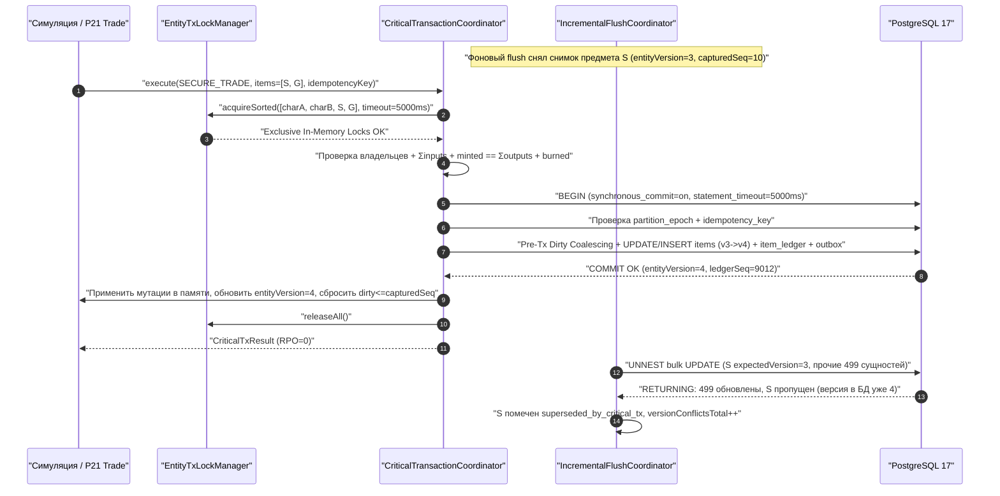
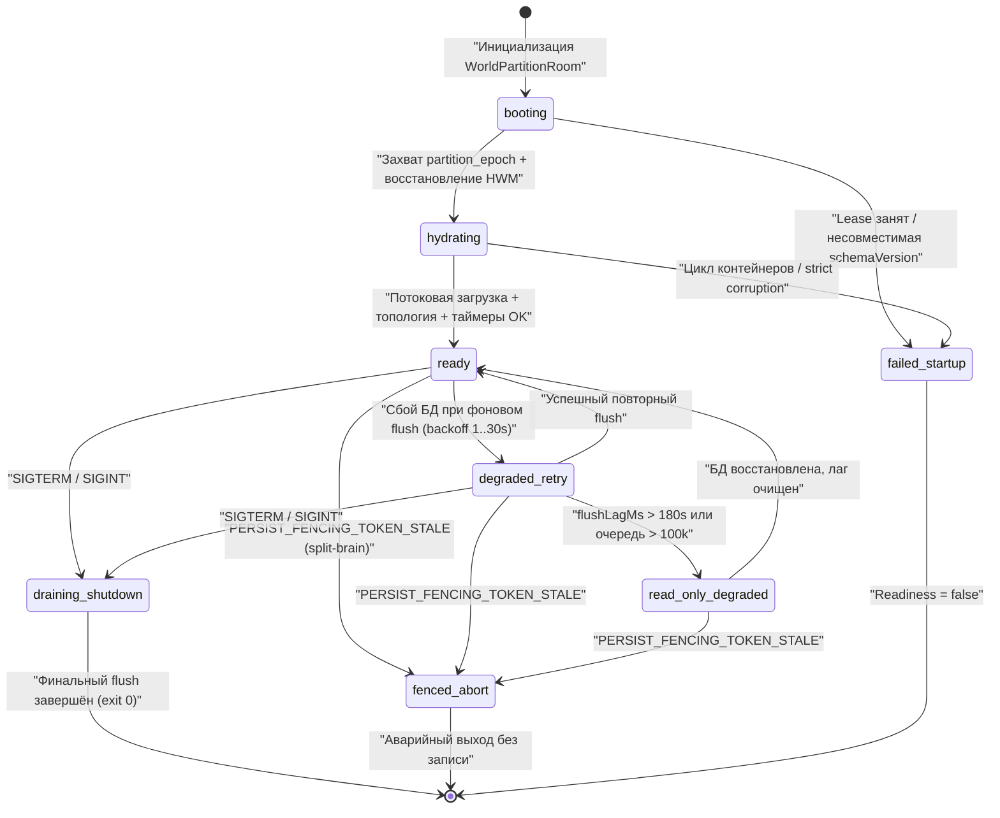
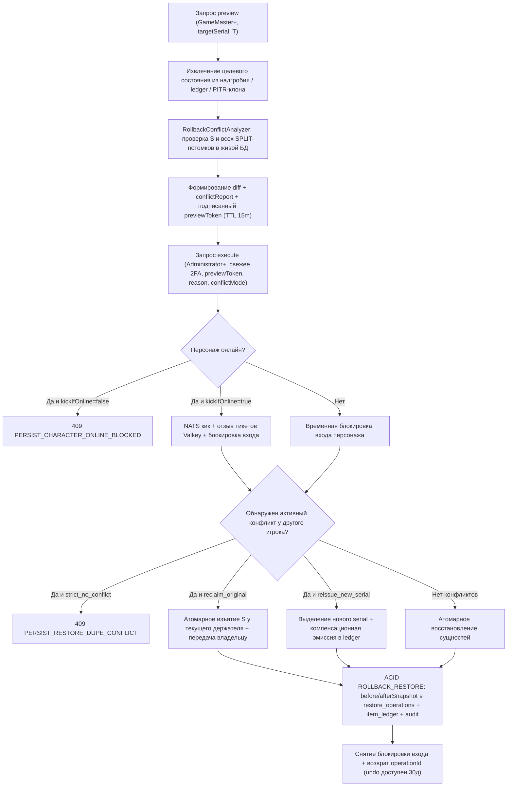

# Design: P08 Персистентность мира

## Context

Мотивация, место фазы в вехе **M1 «Первый шаг по Заре»** и границы скоупа зафиксированы в [proposal.md](proposal.md); нормативные требования и проверяемые сценарии — в четырёх спецификациях `specs/persistence/*/spec.md`.

Фаза **P08** надстраивается поверх фундамента монорепозитория (P00), доменных примитивов и контракта `SerialLeaseProvider` / `GameClock` / `SeededRng` / `RulesetProfile` (P01), версионирования данных статического мира `WorldDataVersionSchema` (P03), аккаунтов/RBAC/2FA/аудита (P04), таблиц `shards`, `characters`, `character_skills`, `shard_serial_sequences` и дескриптора `StarterLoadoutV1` (P05), среды выполнения `apps/game-server` с 20 Гц циклом, колесом таймеров и комнатами `WorldPartitionRoom` (P06) и протокола клиентских команд/репликации (P07).

Проектирование строго соответствует ADR-001..ADR-013 из [docs/ARCHITECTURE.md](../../../docs/ARCHITECTURE.md):
- **ADR-006 / ADR-007:** мир живёт в памяти `WorldPartitionRoom` по секторам `16×16` тайлов; хранение и загрузка изначально партиционно-ориентированы (`Rect2D` по `(facet, x, y)`), чтобы в MVP обслуживать 1 партицию на фасет (`7168×4096`), а в P32 без смены схемы БД масштабироваться на несколько партиций на фасет.
- **ADR-008:** PostgreSQL 17 — единственный источник истины при старте; инкрементальный фоновый flush каждые `60` с без пауз симуляции (`World is saving...` исключён); синхронные атомарные критические транзакции с RPO = 0; неизменяемый `item_ledger`; ежедневные снапшоты, WAL-архивация и PITR с RTO ≤ `15` мин.
- **ADR-012:** инвариант единственного владельца предмета, сохранение массы стаков (anti-dupe), строгий RBAC + свежее 2FA на операции восстановления и полный аудит действий персонала.

## Goals / Non-Goals

**Goals:**
- Обеспечить воспроизводимую потоковую гидратацию партиции (`100 000` сущностей ≤ `10` с, `500 000` ≤ `30` с) и on-demand загрузку входящего персонажа с экипировкой, рюкзаком и банком за p99 ≤ `50` мс.
- Исключить паузы симуляции 20 Гц при сохранении: ограничить время захвата дельт на тике `≤ 5` мс (p99 длительности тика `≤ 30` мс) при RPO некритичного состояния `≤ 60` с.
- Гарантировать RPO = 0 и полную атомарность всех критических операций (торговля, банк, вендоры, передача дома, выдача стартового набора, откаты и действия персонала) с одновременной записью в append-only `item_ledger`.
- Исключить split-brain перезаписи между процессами игрового сервера через монотонные эпохи владения партициями (`partition_epoch` fencing).
- Обеспечить проверенный автоматический PITR шарда за RTO ≤ `15` мин (900 с) и безопасный точечный откат отдельного персонажа или предмета с математическим запретом дублирования активных серийников.
- Обеспечить полную детерминированность тестов планирования flush, backoff, компенсации таймеров и версионных конфликтов через `FakeGameClock` (P01).

**Non-Goals:**
- Геймплейные механики перетаскивания предметов, расчёта веса/лимитов рюкзака (`125` предметов / `400` камней) и правил распада на земле — **P13**.
- Игровой цикл торговли, банка и вендоров — **P21** (P08 поставляет транзакционный движок `CriticalTransactionCoordinator` и типы операций).
- Поведенческие детекторы дюпа и периодическая аналитическая сверка экономики — **P31** (P08 поставляет append-only `item_ledger`, инварианты и быстрые запросы lineage).
- Реализация ghost-репликации границ партиций и протокола бесшовного handoff — **P32** (P08 поставляет партиционную выборку, `partition_epoch` и целевой flush перед handoff).
- Продакшен-чарты Helm, боевые Grafana-дашборды и PagerDuty-алерты — **P33** (P08 поставляет метрики OTel/Prometheus, конфиг-шаблоны pgBackRest/WAL и скрипты restore-drill).

## Decisions

### D1. Гибридная реляционно-JSONB модель мира с денормализацией `root_owner_serial` и жёсткими ограничениями БД (ADR-006, ADR-008, ADR-012)
- **Выбор:** Горячие индексируемые поля (серийник, тип размещения, координаты, `parent_serial`, `root_owner_serial`, `layer`, `item_id`, `hue`, `amount`, `flags`, `entity_version`, `schema_version`, `deleted_at`) хранятся в типизированных колонках PostgreSQL 17, а расширяемые компоненты поведения (`behaviours` будущих фаз P13–P27: прочность, заряды заклинаний, ключи, настройки спавнера) — в версионированном JSONB `components`. Для игроков используется существующая таблица `characters` + `character_skills` из P05 (обновляются координаты, статы, виталы, `playtime_seconds`, `starter_loadout_granted`), дополненная таблицей `character_world_state` (1:1) для мирового runtime-состояния (нотореити, счётчики убийств, таймер преступника, направление, `entity_version`, `components`). Для `world_items` поддерживается денормализованная колонка `root_owner_serial` (серийник корневого мобайла или мульти-объекта, либо `NULL` для наземных предметов), обновляемая синхронно при смене владельца.
- **Обоснование:** Индекс по `(shard_id, root_owner_serial) WHERE deleted_at IS NULL` позволяет загрузить **всё дерево владения персонажа** (экипировка + рюкзак + вложенные мешки глубиной до 10 + банковская ячейка) за **один индексный scan** без рекурсивного `WITH RECURSIVE`, укладываясь в p99 ≤ `50` мс даже при миллионах предметов в БД. Типизированные колонки позволяют на уровне СУБД принудительно гарантировать `CHECK (amount > 0)`, `UNIQUE (shard_id, serial)` и частичный `UNIQUE (shard_id, parent_serial, layer) WHERE location_kind = 'equipped' AND deleted_at IS NULL`.
- **Отвергнутые альтернативы:**
  - *Хранение мира целиком как бинарного блоба (как `.bin` сейвы в RunUO/ServUO):* требует остановки мира («World is saving...»), несовместимо с RPO = 0 для торговли, исключает SQL-поиск по предметам и точечный откат персонажа.
  - *Чистый `WITH RECURSIVE` без `root_owner_serial`:* деградирует при глубоких контейнерах и высокой конкурентности логинов (p99 > 150 мс).
  - *Складывание всех полей (включая координаты и владельца) в один JSONB-документ:* невозможность наложить строгие `UNIQUE`/`CHECK` инварианты единственного владельца и слота экипировки в СУБД.

### D2. Двухконтурная гидратация: потоковая загрузка мира партиции + ленивая on-demand загрузка игроков (ADR-006, ADR-007, ADR-008)
- **Выбор:** При старте `WorldPartitionRoom` потоково (keyset pagination по `(serial > lastSerial) ORDER BY serial ASC LIMIT 5000`) загружает только сущности партиции в `Rect2D` (`world_items` с `location_kind = 'world'`, `world_multis`, `world_mobiles` — персистентные NPC, а также все их дочерние предметы по `root_owner_serial IN (...)`). Офлайн-персонажи (`characters`) **не загружаются** при старте комнаты: их профиль, 49 навыков, `character_world_state` и дерево `world_items` (`root_owner_serial = character.serial`) загружаются в одной `REPEATABLE READ` транзакции в момент входа (`onJoin`) и выгружаются из памяти после завершения выхода (мгновенного в безопасной зоне или после 5-минутной задержки P06) и успешного целевого flush.
- **Обоснование:** На зрелом шарде могут существовать `100 000+` созданных персонажей при `2 000` онлайн; загрузка всех офлайн-персонажей в память привела бы к гигабайтам «мёртвого» хипа V8 и минутному старту. On-demand гидратация держит время старта предсказуемым (`100k` мировых сущностей ≤ `10` с, `500k` ≤ `30` с) и изолирует память пропорционально текущему онлайну.
- **Отвергнутые альтернативы:**
  - *Eager-загрузка всех персонажей и банков шарда в память при старте:* взрывной рост ОЗУ, дублирование персонажей между несколькими партициями в P32 и длительный простой при рестарте.
  - *Отказ от кэша в памяти (чтение БД на каждый тик):* несовместимо с ADR-006/ADR-008 и тиком 20 Гц.

### D3. Fencing-эпохи владения партициями в PostgreSQL (`partition_leases`) против split-brain (ADR-007, ADR-008, ADR-012)
- **Выбор:** Вводится таблица `partition_leases (shard_id, partition_id, partition_epoch, owner_node_id, lease_expires_at, facet, bounds_json)`. Перед гидратацией `PartitionFencingService` атомарно захватывает аренду (`INSERT ... ON CONFLICT DO UPDATE ... WHERE lease_expires_at <= now() OR owner_node_id = $node RETURNING partition_epoch`), инкрементируя `partition_epoch` на `+1`, и продлевает её каждые `5` с (TTL `15` с). Каждая SQL-транзакция фонового flush и каждая критическая транзакция партиции в самом начале проверяет `SELECT partition_epoch FROM partition_leases WHERE shard_id = $1 AND partition_id = $2 FOR KEY SHARE` и сравнивает с локальной эпохой процесса. При несовпадении транзакция немедленно откатывается с `PERSIST_FENCING_TOKEN_STALE`, а процесс переводит комнату в аварийную остановку, закрывая клиентские подключения кодом `4117` (`WS_CLOSE_EPOCH_FENCED`) из PROTOCOL_REGISTRY.
- **Обоснование:** Valkey-лок сам по себе не защищает PostgreSQL от «зомби-процесса», застрявшего в GC-паузе или сетевом разделении: старый процесс может проснуться и перезаписать свежие данные нового владельца. Проверка монотонной `partition_epoch` прямо внутри PostgreSQL-транзакции гарантирует строгую сериализуемость владения партицией и готова к мульти-партиционному P32 без доработок.
- **Отвергнутые альтернативы:**
  - *Распределённый Redlock только в Valkey:* небезопасен без fencing-токена на стороне хранилища данных (классическая проблема Kleppmann).
  - *PostgreSQL session-level `pg_advisory_lock` на выделенном TCP-соединении:* хрупок при использовании пула соединений (PgBouncer / connection pool recycle) и не даёт монотонного токена для аудита и критических транзакций на других соединениях пула.

### D4. Битовый Dirty-Tracking, микробатчевый Copy-on-Flush (`≤ 5` мс/тик) и защита от потерянных обновлений `changeSeq` (ADR-006, ADR-008)
- **Выбор:** Каждая персистентная сущность в памяти имеет `DirtyMeta { mask: number, changeSeq: number, entityVersion: number, firstDirtyAtMs: number }`. Мутации вызывают `dirtyTracker.mark(kind, serial, DirtyBit.POSITION)` за O(1) без аллокаций строк (индексированные `Map<Serial, DirtyEntry>` по категориям). При старте цикла flush (каждые `60 000` мс по `GameClock`) `IncrementalFlushCoordinator` переходит в фазу `capturing`: на каждом `50`-мс тике `WorldPartitionRoom` вызывает `captureSlice(budgetMs = 5)`, сериализуя неизменяемые DTO-снимки дельт и фиксируя `capturedChangeSeq = meta.changeSeq` в пределах `5` мс. Когда все грязные записи сняты, фоновый асинхронный воркер (вне синхронного тела тика) отправляет батчи в PostgreSQL. После `COMMIT` `acknowledgeFlushed()` сбрасывает dirty-бит **только** для сущностей, у которых `meta.changeSeq === capturedChangeSeq` (иначе сущность остаётся в очереди с актуальной маской), и обновляет `meta.entityVersion = committedVersion`.
- **Обоснование:** Полностью исключает лаг-спайки тика 20 Гц даже при `20 000–50 000` изменённых сущностей, гарантирует отсутствие потерянных обновлений (lost updates) в окне между снятием снимка и коммитом БД, а эфемерные поля (AOI, RTT, кадры анимации) физически не подключены к `DirtyBit`.
- **Отвергнутые альтернативы:**
  - *Синхронная сериализация всего мира в одном тике (как в классических эмуляторах UO):* блокирует event loop Node.js на 200–3000 мс, вызывая видимый «World is saving...» фриз и разрывы WebSocket.
  - *`structuredClone` всего графа мира в Worker Thread:* высокое пиковое потребление памяти (×2 хипа) и затраты на клонирование неизменённых 95% сущностей.

### D5. Пакетные `UNNEST` upsert-ы, топологическая сортировка и координация версий с критическими транзакциями (ADR-008)
- **Выбор:** Фоновый flush записывает дельты чанками по `500` строк (настраиваемо `50..2000`) с использованием параметризованных PostgreSQL `UNNEST(...)` bulk-запросов (Drizzle raw/typed SQL) вместо `N` одиночных `UPDATE`. Перед записью дельты сортируются в строгом порядке:
  1. `world_shard_state` & `world_timers`
  2. `characters` & `character_world_state` & `character_skills` (по `serial ASC`)
  3. `world_mobiles` (по `serial ASC`)
  4. `world_multis` (новые/обновляемые по `serial ASC`)
  5. `world_items`: сначала `CREATED` в топологическом порядке от корня к листьям (глубина `0 → 10`, внутри глубины `serial ASC`), затем `UPDATED` по `serial ASC`, затем `DELETED` (soft-delete) в обратном топологическом порядке от листьев к корню (`10 → 0`, `serial ASC`).
  Каждый `UPDATE` содержит предикат `WHERE entity_version = v.expected_version` и `SET entity_version = entity_version + 1`. Если строка не обновилась из-за того, что за время flush её уже обновила синхронная критическая транзакция (увеличив `entity_version`), `RETURNING serial, entity_version` выявляет пропущенные серийники; они безопасно помечаются как `superseded_by_critical_tx`, не откатывая батч.
- **Обоснование:** `UNNEST` сокращает число сетевых round-trip к PostgreSQL в 500× (flush `10 000` строк за ~120–250 мс), топологический порядок исключает нарушения FK на вставке/удалении контейнеров, а сортировка по `serial ASC` в комбинации с аналогичным порядком блокировок критических транзакций (D6) математически устраняет большинство deadlock (остаточные транзиентные `40P01`/`40001` повторяются до 3 раз).
- **Отвергнутые альтернативы:**
  - *Одиночные ORM `update()` в цикле:* `10 000` round-trip займут > 5–10 с и перегрузят пул соединений.
  - *Слепой `ON CONFLICT DO UPDATE` без проверки `entity_version`:* создал бы критическую уязвимость перезаписи результатов торговли/банка устаревшим фоновым снимком (классический источник дюпов!).

### D6. Синхронный `CriticalTransactionCoordinator` (RPO = 0) с in-memory блокировками по `serial ASC` и сворачиванием грязных дельт (ADR-008, ADR-012)
- **Выбор:** Все операции, где потеря или рассинхронизация недопустимы (`SECURE_TRADE`, `BANK_TRANSFER`, `VENDOR_BUY`, `VENDOR_SELL`, `PLAYER_VENDOR_PURCHASE`, `HOUSE_TRANSFER`, `STAFF_ITEM_*`, `STARTER_LOADOUT_GRANT`, `ROLLBACK_RESTORE`, `CHARACTER_ASSET_ARCHIVE`), проходят через `CriticalTransactionCoordinator.execute(plan)`:
  1. Проверка готовности (не `read_only_degraded`, валидная `partition_epoch`).
  2. Сбор всех затрагиваемых серийников (включая цепочку родительских контейнеров, если они не сохранены в БД), сортировка по `serial ASC` и атомарный захват in-memory блокировок в `EntityTxLockManager` (если хотя бы одна сущность заблокирована — немедленный отказ `PERSIST_ENTITY_TX_LOCKED`).
  3. Вычисление чистой валидации в `packages/rules`: проверка единственного владельца, уникальности источников, ацикличности/глубины контейнеров и уравнения сохранения массы стаков (`Σ inputs + Σ minted === Σ outputs + Σ burned`).
  4. Открытие PostgreSQL-транзакции с `SET LOCAL synchronous_commit = on`, `SET LOCAL lock_timeout = '3000ms'`, `SET LOCAL statement_timeout = '5000ms'`.
  5. Проверка `partition_epoch` и идемпотентности (`critical_transactions` по `idempotency_key` + `payload_hash`).
  6. **Pre-Tx Dirty Coalescing:** любые ещё не вставленные или грязные участвующие сущности сворачиваются и фиксируются в этой же транзакции вместе с целевой мутацией, инкрементируя `entity_version`.
  7. Запись событий в `item_ledger` (с инкрементом `ledger_seq`) и — для операций персонала/алертов — в `persistence_audit_outbox`.
  8. `COMMIT` → **только после подтверждения PostgreSQL** применяются изменения в памяти, обновляются `entityVersion`, сбрасываются dirty-флаги участвующих сущностей до `capturedChangeSeq` и освобождаются блокировки в `finally`.
- **Обоснование:** Строго гарантирует RPO = 0 (подтверждённая сделка переживёт `SIGKILL` через 1 мс), полностью закрывает гонки «выбросить/продать/передать один предмет одновременно», исключает ошибки отсутствия FK при торговле свежим лутом и делает дюп на уровне транзакционного слоя математически невозможным.
- **Отвергнутые альтернативы:**
  - *Оптимистичное применение в памяти с асинхронной записью торговли в фоне:* нарушает ADR-008 (RPO > 0) и открывает эксплуатацию краш-дюпов.
  - *Глобальная блокировка всей комнаты на время коммита БД (2–15 мс):* останавливала бы всех 500–2000 игроков партиции на каждую покупку у вендора.

### D7. Помесячно партиционированный append-only `item_ledger` с триггерами СУБД и трассировкой `source_item_serial` (ADR-008, ADR-012)
- **Выбор:** Таблица `item_ledger` создаётся с декларативным диапазонным партиционированием PostgreSQL 17 по `occurred_at` (1 партиция на календарный месяц, автоматическое предсоздание на +3 месяца вперёд). На таблицу и все дочерние партиции вешается триггер `BEFORE UPDATE OR DELETE`, безусловно выбрасывающий `EXCEPTION 'item_ledger is strictly append-only'` (аналогично append-only триггерам P04). Каждая запись получает монотонный шардовый `ledger_seq` и ссылку `source_item_serial` при разделении/слиянии стаков (`SPLIT`/`MERGE`), что позволяет рекурсивным запросом с ограничением глубины строить полное дерево происхождения любого предмета (provenance lineage) для P29 и P31. Помесячное партиционирование позволяет архивировать старые месяцы (например, > 12 месяцев) в холодное S3-хранилище через `DETACH PARTITION` без единого `DELETE` по строкам и без раздувания индексов.
- **Обоснование:** Обеспечивает p95 ≤ `200` мс на выборках по `item_serial`, `from_owner_serial`/`to_owner_serial` и `tx_id` даже при десятках миллионов записей, не требует дорогих `VACUUM` на гигантской таблице и криптографически/административно препятствует подделке истории даже при компрометации прикладного сервиса.
- **Отвергнутые альтернативы:**
  - *Обычная непартиционированная таблица с `DELETE WHERE occurred_at < ...`:* противоречит запрету `DELETE` (append-only) и вызывает деградацию B-tree индексов и bloat.
  - *Хранение `item_ledger` в NATS / Loki / Elasticsearch вместо PostgreSQL:* теряет атомарность коммита с мутацией `world_items` (возможны «призрачные» или пропущенные записи при краше между коммитом БД и отправкой события).

### D8. Непрерывная WAL-архивация (`archive_timeout <= 60` с) + шифрованные zstd-снапшоты (pgBackRest / S3) и автоматический Restore-Drill (ADR-008)
- **Выбор:** Уровень физического резервного копирования строится на стандартной связке **PostgreSQL 17 (`wal_level = replica`, `archive_mode = on`, `archive_timeout = 60`) + pgBackRest** (с zstd-сжатием, шифрованием AES-256-CBC/GCM по `encryption_key_id`, проверкой SHA-256 и выгрузкой в S3-совместимое хранилище; в dev/CI — локальный MinIO/файловый репозиторий через тот же интерфейс адаптера `BackupStorageAdapter`). Поверх этого `BackupOrchestratorService` (и CLI `scripts/persistence-backup.ts`, `scripts/persistence-pitr.ts`, `scripts/persistence-restore-drill.ts`) ведёт каталог метаданных в `backup_snapshots`, `world_checkpoints` и `named_restore_points` (с использованием `pg_create_restore_point(...)`). Автоматический `restore-drill` раз в 7 дней поднимает эфемерный контейнер/инстанс PG17 из последнего снапшота + WAL, запускает `WorldIntegrityVerifier` (проверка всех инвариантов мира и HWM), замеряет реальный RTO (гейт `≤ 900` с) и обновляет статус снапшота (`verified` / `failed`).
- **Обоснование:** `pg_dump` не даёт PITR с секундной точностью и не укладывается в RTO ≤ 15 мин на крупных базах; pgBackRest — промышленный стандарт для PG17 с параллельным восстановлением, дельта-бэкапами и встроенной верификацией страниц/контрольных сумм. Еженедельный автоматический restore-drill превращает RTO ≤ 15 мин из бумажного обещания в постоянно проверяемый факт.
- **Отвергнутые альтернативы:**
  - *Ежедневный `pg_dump` без WAL:* RPO до 24 часов, невозможность PITR, медленное однопоточное восстановление индексов.
  - *Только файловые снапшоты томов (EBS/CSI snapshots) без WAL-архивации:* отсутствие посекундного PITR между снапшотами и риск рассогласования при отсутствии `pg_backup_start`/`stop`.

### D9. Точечный откат персонажа/предмета через dry-run токен, анти-дюп резолвер и пред-откатный снимок `undo` (ADR-008, ADR-012)
- **Выбор:** Точечный откат выполняется строго в 2 шага:
  1. **Preview (dry-run, `GameMaster+`):** источник состояния на метку `T` берётся либо из локальных надгробий/`item_ledger` (для восстановления удалённого предмета), либо из временного изолированного read-only PITR-клона (для произвольного `T` персонажа). Вычисляется структурированный diff и запускается `RollbackConflictAnalyzer`, который проверяет серийник каждого восстанавливаемого предмета `S` и его `SPLIT`-потомков в живой БД: классифицирует каждый предмет как `safe_restore`, `active_on_same_owner`, `active_on_other_owner` или `split_descendants_active`. Генерируется короткоживущий (15 мин) подписанный `previewToken` (SHA-256 привязка к параметрам и `diffHash`).
  2. **Execute (`Administrator+` + свежее 2FA + `reason`):** проверяет `previewToken`; для персонажа отправляет NATS-команду кика/блокировки (с отзывом тикетов в Valkey через контракт P05 и ожиданием подтверждения выгрузки из `WorldPartitionRoom` до 10 с); применяет восстановление в одной критической транзакции `ROLLBACK_RESTORE` с политикой разрешения конфликтов (`strict_no_conflict` [дефолт — отказ `PERSIST_RESTORE_DUPE_CONFLICT`], `reclaim_original` [атомарное изъятие у текущего держателя] или `reissue_new_serial` [новый серийник + компенсационная запись в `item_ledger`]). В той же транзакции сохраняется `restore_operations` с полными `before_snapshot` и `after_snapshot` (хранение ≥ 30 дней), позволяющими выполнить `undo`.
- **Обоснование:** В MMORPG 95% инцидентов затрагивают 1–5 игроков (взлом аккаунта, баг квеста, случайное удаление), а не весь шард. Исключение дюпа при откате критично для экономики (иначе злоумышленник передаёт вещь сообщнику и просит GM откатить персонажа). Обязательный dry-run + `before_snapshot` защищают от человеческой ошибки персонала.
- **Отвергнутые альтернативы:**
  - *Откат всего шарда при взломе одного игрока:* массовая потеря прогресса тысяч честных игроков.
  - *Прямое восстановление записи предмета поверх живой БД без проверки `SPLIT`-потомков:* классический вектор дюпа через разделение стаков золота/реагентов перед запросом отката.

## Architecture & Contracts

### 1. Структура модулей и пакетов монорепозитория

| Пакет / приложение | Модули и ключевые файлы | Ответственность |
|---|---|---|
| `packages/db` | `src/schema/world-store.ts`, `src/schema/item-ledger.ts`, `src/schema/backup-restore.ts`, `src/migrations/0008_p08_world_persistence.sql`, `src/repositories/world-store.repository.ts`, `src/repositories/incremental-flush.repository.ts`, `src/repositories/critical-tx.repository.ts`, `src/repositories/item-ledger.repository.ts`, `src/repositories/backup-catalog.repository.ts` | Drizzle-схемы, SQL-миграция (триггеры append-only, частичные индексы, месячные партиции `item_ledger`), пакетные `UNNEST`-репозитории, запросы lineage и каталога бэкапов |
| `packages/config` | `src/env/persistence.schema.ts` (подключена в `GameServerEnvSchema`, `ApiEnvSchema`, `DbEnvSchema`) | Типизированная TypeBox-валидация параметров flush, батчей, среза тика, таймаутов tx, fencing TTL, WAL/pgBackRest/S3-хранилища и retention |
| `packages/protocol` | `src/p08/errors.ts`, `src/p08/critical-tx.schema.ts`, `src/p08/ledger.schema.ts`, `src/p08/persistence-admin.schema.ts`, `src/p08/backup-restore.schema.ts`, `src/p08/events.ts` | Каталог кодов ошибок `PERSIST_*`, TypeBox DTO REST API и NATS-событий, скомпилированные валидаторы, стабильные контракты для P13/P21/P23/P29/P31/P32 |
| `packages/rules` | `src/persistence/container-graph.ts`, `src/persistence/stack-conservation.ts`, `src/persistence/timer-downtime.ts`, `src/persistence/schema-upcaster.ts`, `src/persistence/rollback-conflict.ts` | Чистые детерминированные валидаторы (циклы/глубина ≤ 10, сохранение массы стаков, формулы компенсации таймеров при простое, пайплайн upcaster-ов, матрица анти-дюп конфликтов) |
| `apps/game-server` | `src/modules/persistence/`: `WorldPersistenceModule`, `PostgresSerialLeaseProvider`, `PartitionFencingService`, `WorldHydrationService`, `CharacterOnDemandLoader`, `DirtyTrackerService`, `IncrementalFlushCoordinator`, `EntityTxLockManager`, `CriticalTransactionCoordinator`, `ItemLedgerWriter`, `StarterLoadoutMaterializer`, `PersistenceHealthService`, `PersistenceOutboxDispatcher` | Полный runtime-слой персистентности в `apps/game-server`, интеграция с `WorldPartitionRoom`, циклом 20 Гц, колесом таймеров, graceful shutdown и NATS |
| `apps/api` | `src/modules/persistence-admin/`: `AdminPersistenceModule`, `AdminPersistenceController`, `AdminLedgerController`, `AdminBackupController`, `AdminRollbackController`, `BackupOrchestratorService`, `CharacterRollbackService`, `ItemRollbackService`, `PitrStagingCoordinator`, `PersistenceNatsClient` | Защищённый REST API персонала (RBAC + 2FA из P04): поиск по `item_ledger`, ручной flush, каталог снапшотов, named restore points, dry-run/execute/undo точечных откатов |
| `packages/test-kit` | `src/persistence/world-entity.factory.ts`, `src/persistence/fault-injecting-db.ts`, `src/persistence/in-memory-backup-storage.ts`, `src/persistence/pitr-harness.ts` | Фабрики глубоких деревьев контейнеров и 100k-датасетов, инжектор сбоев БД/deadlock/fencing split-brain, тестовый адаптер S3 и харнес проверки PITR/отката |
| `infra/` и `scripts/` | `infra/postgres/wal-archiving.conf`, `infra/pgbackrest/pgbackrest.conf.tmpl`, `scripts/persistence-backup.ts`, `scripts/persistence-pitr.ts`, `scripts/persistence-restore-drill.ts`, `scripts/persistence-reconcile.ts` | Конфигурация WAL-архивации PG17 и pgBackRest, CLI-оркестраторы снапшота, PITR, еженедельного restore-drill и post-PITR реконсиляции |

### 2. Модель данных PostgreSQL 17 (Drizzle ORM)

```mermaid
erDiagram
  shards ||--|| world_shard_state : "tracks_world_meta"
  shards ||--o{ shard_serial_leases : "leases_npc_and_item_blocks"
  shards ||--o{ partition_leases : "fences_partitions"
  shards ||--o{ world_mobiles : "hosts_npcs"
  shards ||--o{ world_items : "hosts_items"
  shards ||--o{ world_multis : "hosts_multis"
  shards ||--o{ world_timers : "schedules_timers"
  shards ||--o{ quarantined_entities : "isolates_orphans"
  shards ||--o{ critical_transactions : "records_acid_txs"
  shards ||--o{ item_ledger : "appends_provenance"
  shards ||--o{ world_checkpoints : "marks_checkpoints"
  shards ||--o{ backup_snapshots : "catalogs_backups"
  shards ||--o{ named_restore_points : "marks_restore_points"
  shards ||--o{ restore_operations : "logs_rollbacks"
  characters ||--|| character_world_state : "extends_runtime_state"
  world_items ||--o| world_multis : "extends_multi_item"
  critical_transactions ||--o{ item_ledger : "groups_entries"

  world_shard_state {
    uuid shard_id PK
    bigint world_epoch
    bigint last_checkpoint_seq
    bigint game_time_offset_ms
    bytea rng_root_state
    char ruleset_digest
    varchar world_data_version
    int schema_version
    timestamptz last_flush_at
    timestamptz last_shutdown_at
    timestamptz updated_at
  }

  shard_serial_leases {
    uuid shard_id PK
    varchar kind PK
    bigint high_water_mark
    bigint range_min
    bigint range_max
    int default_lease_size
    timestamptz updated_at
  }

  partition_leases {
    uuid shard_id PK
    varchar partition_id PK
    bigint partition_epoch
    varchar owner_node_id
    smallint facet
    int min_x
    int min_y
    int max_x
    int max_y
    timestamptz lease_expires_at
    timestamptz acquired_at
    timestamptz updated_at
  }

  character_world_state {
    uuid character_id PK
    uuid shard_id FK
    bigint character_serial UK
    smallint direction
    smallint notoriety_override
    boolean war_mode
    boolean is_ghost
    smallint short_murder_counts
    smallint long_murder_counts
    timestamptz criminal_until
    bigint mount_serial
    int schema_version
    bigint entity_version
    jsonb components
    timestamptz updated_at
  }

  world_mobiles {
    uuid shard_id PK
    bigint serial PK
    varchar template_id
    varchar name
    smallint body
    smallint hue
    smallint facet
    int pos_x
    int pos_y
    smallint pos_z
    smallint direction
    smallint str
    smallint dex
    smallint int_stat
    smallint hits
    smallint max_hits
    smallint stam
    smallint max_stam
    smallint mana
    smallint max_mana
    bigint owner_character_serial
    varchar ai_profile
    bigint flags
    int schema_version
    bigint entity_version
    jsonb components
    timestamptz deleted_at
    timestamptz created_at
    timestamptz updated_at
  }

  world_items {
    uuid shard_id PK
    bigint serial PK
    varchar template_id
    int item_id
    smallint hue
    int amount
    int weight_tenths
    varchar custom_name
    varchar location_kind
    bigint parent_serial
    bigint root_owner_serial
    smallint layer
    smallint facet
    int pos_x
    int pos_y
    smallint pos_z
    bigint flags
    timestamptz decay_at
    int schema_version
    bigint entity_version
    jsonb components
    timestamptz deleted_at
    timestamptz created_at
    timestamptz updated_at
  }

  world_multis {
    uuid shard_id PK
    bigint serial PK
    int multi_id
    varchar multi_kind
    bigint owner_account_id_hash
    bigint owner_character_serial
    smallint facet
    int pos_x
    int pos_y
    smallint pos_z
    int lockdown_count
    int secure_count
    int schema_version
    bigint entity_version
    jsonb components
    timestamptz deleted_at
    timestamptz updated_at
  }

  world_timers {
    uuid id PK
    uuid shard_id FK
    varchar partition_id
    varchar timer_kind
    bigint target_serial
    varchar downtime_policy
    timestamptz fire_at
    bigint remaining_ms
    jsonb payload
    bigint entity_version
    timestamptz created_at
    timestamptz updated_at
  }

  quarantined_entities {
    uuid id PK
    uuid shard_id FK
    bigint entity_serial
    varchar entity_kind
    bigint original_parent_serial
    varchar reason_code
    jsonb snapshot_json
    timestamptz quarantined_at
    timestamptz resolved_at
  }

  critical_transactions {
    uuid tx_id PK
    uuid shard_id FK
    varchar tx_type
    varchar idempotency_key
    char payload_hash
    varchar status
    uuid actor_account_id
    smallint actor_access_level
    varchar reason
    jsonb result_summary
    bigint game_tick
    timestamptz committed_at
  }

  item_ledger {
    uuid shard_id PK
    bigint ledger_seq PK
    timestamptz occurred_at PK
    uuid tx_id
    varchar tx_type
    varchar event_kind
    bigint item_serial
    bigint source_item_serial
    varchar template_id
    int amount_before
    int amount_after
    int amount_delta
    bigint from_owner_serial
    bigint to_owner_serial
    bigint from_parent_serial
    bigint to_parent_serial
    uuid actor_account_id
    bigint actor_serial
    smallint actor_access_level
    smallint facet
    int pos_x
    int pos_y
    smallint pos_z
    varchar reason_code
    bigint game_tick
    jsonb metadata
  }

  world_checkpoints {
    uuid shard_id PK
    bigint checkpoint_seq PK
    varchar trigger_kind
    pg_lsn wal_lsn
    int entities_flushed
    int duration_ms
    timestamptz completed_at
  }

  backup_snapshots {
    uuid id PK
    uuid shard_id FK
    varchar kind
    varchar status
    bigint checkpoint_seq
    pg_lsn wal_start_lsn
    pg_lsn wal_end_lsn
    varchar storage_uri
    bigint size_bytes
    char sha256_checksum
    varchar encryption_key_id
    int schema_version
    varchar verification_status
    int last_drill_rto_seconds
    timestamptz last_verified_at
    timestamptz retention_until
    timestamptz started_at
    timestamptz completed_at
  }

  named_restore_points {
    uuid id PK
    uuid shard_id FK
    varchar name UK
    pg_lsn wal_lsn
    bigint checkpoint_seq
    uuid created_by_account_id
    varchar reason
    timestamptz created_at
  }

  restore_operations {
    uuid id PK
    uuid shard_id FK
    varchar operation_kind
    varchar conflict_mode
    varchar status
    bigint target_serial
    timestamptz target_timestamp
    uuid tx_id
    uuid executed_by_account_id
    varchar reason
    jsonb before_snapshot
    jsonb after_snapshot
    uuid undone_by_operation_id
    timestamptz retention_until
    timestamptz created_at
  }
```



**Ключевые ограничения, индексы и триггеры PostgreSQL 17:**
- **`shard_serial_leases`:**
  - `CHECK (kind IN ('npc_mobile', 'item'))`.
  - Для `'npc_mobile'`: `range_min = 536870912` (`0x20000000`), `range_max = 1073741823` (`0x3FFFFFFF`) — строго не пересекается с `shard_serial_sequences` игроков P05 (`0x00000001..0x1FFFFFFF`).
  - Для `'item'`: `range_min = 1073741824` (`0x40000000`), `range_max = 2147483647` (`0x7FFFFFFF`).
  - `CHECK (high_water_mark >= range_min AND high_water_mark <= range_max + 1)`.
  - `CHECK (default_lease_size BETWEEN 256 AND 65536)`.
- **`world_items`:**
  - `PRIMARY KEY (shard_id, serial)` + `CHECK (serial BETWEEN 1073741824 AND 2147483647)` (абсолютная уникальность включая `deleted_at IS NOT NULL`).
  - `CHECK (amount >= 1)` и `CHECK (entity_version >= 1)` и `CHECK (schema_version >= 1)`.
  - `CHECK (location_kind IN ('world', 'container', 'equipped', 'bank', 'limbo'))`.
  - Инвариант размещения:
    - `CHECK ((location_kind = 'world' AND parent_serial IS NULL AND facet IS NOT NULL AND pos_x IS NOT NULL AND pos_y IS NOT NULL AND pos_z IS NOT NULL AND layer IS NULL) OR (location_kind = 'container' AND parent_serial IS NOT NULL AND parent_serial <> serial AND layer IS NULL) OR (location_kind = 'equipped' AND parent_serial IS NOT NULL AND layer IS NOT NULL) OR (location_kind = 'bank' AND parent_serial IS NOT NULL AND layer IS NULL) OR (location_kind = 'limbo' AND layer IS NULL))`.
  - Частичный уникальный индекс экипировки: `CREATE UNIQUE INDEX idx_world_items_unique_equipped_layer ON world_items (shard_id, parent_serial, layer) WHERE location_kind = 'equipped' AND deleted_at IS NULL`.
  - Индекс партиционной загрузки: `CREATE INDEX idx_world_items_partition_world ON world_items (shard_id, facet, pos_x, pos_y, serial) WHERE location_kind = 'world' AND deleted_at IS NULL`.
  - Индекс on-demand загрузки персонажа и контейнеров: `CREATE INDEX idx_world_items_root_owner ON world_items (shard_id, root_owner_serial, serial) WHERE deleted_at IS NULL AND root_owner_serial IS NOT NULL`.
  - Индекс распада: `CREATE INDEX idx_world_items_decay ON world_items (shard_id, decay_at) WHERE deleted_at IS NULL AND decay_at IS NOT NULL`.
- **`world_mobiles`:**
  - `PRIMARY KEY (shard_id, serial)` + `CHECK (serial BETWEEN 536870912 AND 1073741823)`.
  - `CREATE INDEX idx_world_mobiles_partition ON world_mobiles (shard_id, facet, pos_x, pos_y, serial) WHERE deleted_at IS NULL`.
- **`character_world_state`:**
  - `UNIQUE (shard_id, character_serial)`, `FOREIGN KEY (character_id) REFERENCES characters(id) ON DELETE RESTRICT`.
- **`critical_transactions`:**
  - `CREATE UNIQUE INDEX idx_critical_tx_idempotency ON critical_transactions (shard_id, idempotency_key) WHERE idempotency_key IS NOT NULL`.
  - Append-only триггер `trg_critical_transactions_no_mutate` (`BEFORE UPDATE OR DELETE`).
- **`item_ledger`:**
  - Декларативное партиционирование `PARTITION BY RANGE (occurred_at)` (помесячные партиции `item_ledger_YYYY_MM`).
  - Неблокирующая генерация монотонного `ledger_seq` через выделенный PostgreSQL `SEQUENCE` на шард (`item_ledger_seq` / `nextval(...)`, > 50k ops/s без строчной блокировки между параллельными транзакциями; документированные пробелы при откатах допустимы).
  - Append-only триггер `trg_item_ledger_append_only` (`BEFORE UPDATE OR DELETE FOR EACH ROW EXECUTE FUNCTION uo3_forbid_mutation()`).
  - Составные индексы на каждой партиции:
    - `idx_item_ledger_item_seq (shard_id, item_serial, ledger_seq DESC)`
    - `idx_item_ledger_source_item (shard_id, source_item_serial, ledger_seq DESC) WHERE source_item_serial IS NOT NULL`
    - `idx_item_ledger_from_owner (shard_id, from_owner_serial, occurred_at DESC) WHERE from_owner_serial IS NOT NULL`
    - `idx_item_ledger_to_owner (shard_id, to_owner_serial, occurred_at DESC) WHERE to_owner_serial IS NOT NULL`
    - `idx_item_ledger_actor_acct (shard_id, actor_account_id, occurred_at DESC) WHERE actor_account_id IS NOT NULL`
    - `idx_item_ledger_tx (shard_id, tx_id) WHERE tx_id IS NOT NULL`
- **`persistence_audit_outbox`:**
  - Транзакционный outbox (`id uuid PK`, `shard_id`, `subject`, `payload jsonb`, `created_at`, `published_at`), из которого `PersistenceOutboxDispatcher` доставляет события в NATS JetStream (`uo3.audit.events` / `UO3_PERSISTENCE_EVENTS`) с гарантией at-least-once и `Nats-Msg-Id = id` для дедупликации.

### 3. Потоки взаимодействия и конечные автоматы (Mermaid)

#### Поток 1. Критическая транзакция (RPO = 0) и координация версий с фоновым flush



#### Поток 2. Конечный автомат состояния персистентности партиции



#### Поток 3. Точечный откат персонажа / предмета с анти-дюп защитой



### 4. REST API, протокол (`packages/protocol`), NATS и конфигурация (`packages/config`)

#### Каталог REST-эндпоинтов `apps/api` (`AdminPersistenceModule`)

| Метод и путь | Доступ (P04) | 2FA | Назначение | Коды ответа |
|---|---|---|---|---|
| `GET /api/v1/admin/shards/:shardId/persistence/status` | `GameMaster+` | — | Статус персистентности, `flushLagMs`, `partitionEpoch`, `dirtyEntityCount`, режим `read_only_degraded` | `200`, `403`, `404` |
| `POST /api/v1/admin/shards/:shardId/persistence/flush` | `Administrator+` | Recent 2FA | Внеочередной flush мира (`force?: boolean`, cooldown `5` с) | `200`, `403`, `404`, `429`, `503` |
| `GET /api/v1/admin/shards/:shardId/persistence/ledger` | `GameMaster+` | — | Поиск в `item_ledger` по `characterSerial`, `accountId`, `txId`, `txType`, `from`/`to` с курсорной пагинацией | `200`, `400`, `403`, `404` |
| `GET /api/v1/admin/shards/:shardId/persistence/ledger/items/:itemSerial/lineage` | `GameMaster+` | — | Полный граф происхождения предмета и его `SPLIT`/`MERGE`-потомков (p95 ≤ `200` мс) | `200`, `403`, `404` |
| `GET /api/v1/admin/shards/:shardId/persistence/backups` | `GameMaster+` | — | Каталог снапшотов, статус `verification_status`, доступное окно PITR `[earliest, latest]` | `200`, `403`, `404` |
| `GET /api/v1/admin/shards/:shardId/persistence/backups/:backupId` | `GameMaster+` | — | Детали снапшота (без ключевого материала и PII) | `200`, `403`, `404` |
| `POST /api/v1/admin/shards/:shardId/persistence/backups` | `Administrator+` | Recent 2FA | Запуск внеочередного согласованного снапшота с `reason` | `202`, `400`, `403`, `409` |
| `POST /api/v1/admin/shards/:shardId/persistence/backups/:backupId/verify` | `Administrator+` | — | Ручной запуск restore-drill верификации снапшота | `202`, `403`, `404`, `409` |
| `POST /api/v1/admin/shards/:shardId/persistence/restore-points` | `Administrator+` | Recent 2FA | Создание именованной точки восстановления + flush | `201`, `400`, `403`, `409` |
| `POST /api/v1/admin/shards/:shardId/persistence/rollbacks/character/preview` | `GameMaster+` | — | Dry-run предпросмотр отката персонажа к `targetTimestamp`, возврат `diff`, `conflicts`, `previewToken` | `200`, `400`, `403`, `404`, `422` |
| `POST /api/v1/admin/shards/:shardId/persistence/rollbacks/character/execute` | `Administrator+` | Recent 2FA | Атомарное выполнение отката персонажа по `previewToken` и `reason` | `200`, `400`, `403`, `404`, `409`, `422` |
| `POST /api/v1/admin/shards/:shardId/persistence/rollbacks/item/preview` | `GameMaster+` | — | Dry-run предпросмотр восстановления/отката предмета с проверкой `SPLIT`-потомков | `200`, `400`, `403`, `404` |
| `POST /api/v1/admin/shards/:shardId/persistence/rollbacks/item/execute` | `Administrator+` | Recent 2FA | Выполнение восстановления предмета (`strict_no_conflict` \| `reclaim_original` \| `reissue_new_serial`) | `200`, `400`, `403`, `404`, `409` |
| `GET /api/v1/admin/shards/:shardId/persistence/restore-operations` | `GameMaster+` | — | История выполненных операций восстановления | `200`, `403`, `404` |
| `POST /api/v1/admin/shards/:shardId/persistence/restore-operations/:operationId/undo` | `Administrator+` | Recent 2FA | Отмена ошибочного отката из `before_snapshot` (в окне `30` дней) | `200`, `403`, `404`, `409`, `410` |

#### Контракт критической транзакции (`packages/protocol/src/p08/critical-tx.schema.ts`)
```ts
export type CriticalTxType =
  | 'SECURE_TRADE' | 'BANK_TRANSFER' | 'VENDOR_BUY' | 'VENDOR_SELL'
  | 'PLAYER_VENDOR_PURCHASE' | 'HOUSE_TRANSFER' | 'STAFF_ITEM_GRANT'
  | 'STAFF_ITEM_MODIFY' | 'STAFF_ITEM_DELETE' | 'STARTER_LOADOUT_GRANT'
  | 'ROLLBACK_RESTORE' | 'CHARACTER_ASSET_ARCHIVE';

export type LedgerEventKind =
  | 'CREATE' | 'TRANSFER' | 'SPLIT' | 'MERGE' | 'CONSUME'
  | 'DELETE' | 'DECAY' | 'MODIFY' | 'RESTORE' | 'QUARANTINE';

export interface CriticalTxRequest {
  txId: string;                     // UUIDv7
  shardId: string;
  partitionId: string;
  txType: CriticalTxType;
  idempotencyKey?: string;
  actorAccountId: string | null;
  actorSerial: number | null;
  actorAccessLevel: number;         // AccessLevel 0..6
  reason?: string;                  // Обязательно 8..500 для STAFF_* и ROLLBACK_RESTORE
  participatingSerials: number[];   // Сортируются по возрастанию при захвате блокировок
  stackTransfers: Array<{
    templateId: string;
    inputs: Array<{ serial: number; amount: number; expectedVersion: number; ownerSerial: number }>;
    outputs: Array<{ serial: number; amount: number; toOwnerSerial: number | null; toParentSerial: number | null }>;
    mintedAmount: number;
    burnedAmount: number;
  }>;
  mutations: EntityMutationOp[];
  ledgerEntries: LedgerDraftEntry[];
}
```

#### События и команды NATS JetStream (`UO3_PERSISTENCE_EVENTS` и `uo3.audit.events`)
- `uo3.shard.{shardId}.persistence.flush.request` (request-reply) — запуск внеочередного flush из `apps/api` или backup-оркестратора в активные партиции `apps/game-server`.
- `uo3.shard.{shardId}.persistence.character.quiesce` (request-reply) — немедленный кик онлайн-персонажа, финальный flush и выгрузка из памяти перед точечным откатом.
- `uo3.shard.{shardId}.persistence.degraded` / `.recovered` — уведомление `apps/api` и мониторинга о входе/выходе шарда из `read_only_degraded` и критических сбоях fencing/backup/conservation.
- `uo3.audit.events` — единый поток аудита для P29 (`persistence.manual_flush`, `persistence.staff_item_grant`, `persistence.staff_item_modify`, `persistence.staff_item_delete`, `persistence.backup_created`, `persistence.restore_point_created`, `persistence.character_rollback`, `persistence.item_rollback`, `persistence.rollback_undone`, `persistence.quarantine_detected`, `persistence.conservation_violation`).

#### Сводный каталог кодов ошибок P08 (`packages/protocol/src/p08/errors.ts`)
- World Store & Fencing: `PERSIST_SERIAL_COLLISION` (409), `PERSIST_VERSION_CONFLICT` (409), `PERSIST_OWNERSHIP_INVARIANT_VIOLATION` (422), `PERSIST_CONTAINER_CYCLE_DETECTED` (422), `PERSIST_CONTAINER_DEPTH_EXCEEDED` (422), `PERSIST_SERIAL_RANGE_EXHAUSTED` (507), `PERSIST_FENCING_TOKEN_STALE` (409), `PERSIST_PARTITION_LEASE_HELD` (409), `PERSIST_WORLD_LOAD_CORRUPTED` (500), `PERSIST_UNSUPPORTED_SCHEMA_VERSION` (500), `PERSIST_WORLD_NOT_READY` (503; для WebSocket-входа — код закрытия `4128` `WS_CLOSE_PARTITION_NOT_READY`), `PERSIST_CHARACTER_UNAVAILABLE` (404).
- Incremental Save: `PERSIST_HANDOFF_FLUSH_FAILED` (503), `PERSIST_SERVICE_DEGRADED` (503), `PERSIST_FLUSH_COOLDOWN_ACTIVE` (429).
- Critical Transactions: `PERSIST_ENTITY_TX_LOCKED` (409), `PERSIST_TX_IDEMPOTENCY_MISMATCH` (422), `PERSIST_CONSERVATION_VIOLATION` (422), `PERSIST_TX_TIMEOUT` (504), `PERSIST_TX_CONFLICT` (409), `PERSIST_TX_UNAVAILABLE` (503), `PERSIST_AUDIT_REASON_REQUIRED` (400).
- Backup & Restore: `PERSIST_PITR_WINDOW_UNAVAILABLE` (422), `PERSIST_RESTORE_POINT_EXISTS` (409), `PERSIST_ROLLBACK_PREVIEW_REQUIRED` (422), `PERSIST_CHARACTER_ONLINE_BLOCKED` (409), `PERSIST_RESTORE_DUPE_CONFLICT` (409), `PERSIST_ROLLBACK_UNDO_EXPIRED` (410), `PERSIST_RECONCILIATION_FAILED` (500).

#### Параметры конфигурации (`packages/config/src/env/persistence.schema.ts`)
- `PERSIST_FLUSH_INTERVAL_MS` (`10000..300000`, дефолт `60000`)
- `PERSIST_FLUSH_BATCH_SIZE` (`50..2000`, дефолт `500`)
- `PERSIST_CAPTURE_SLICE_MAX_MS` (`1..15`, дефолт `5`)
- `PERSIST_MAX_UNFLUSHED_WINDOW_MS` (`60000..900000`, дефолт `180000`)
- `PERSIST_DIRTY_QUEUE_WATERMARK` (`10000..500000`, дефолт `100000`)
- `PERSIST_SHUTDOWN_FLUSH_TIMEOUT_MS` (`5000..60000`, дефолт `25000`)
- `PERSIST_CRITICAL_TX_TIMEOUT_MS` (`1000..15000`, дефолт `5000`)
- `PERSIST_PARTITION_LEASE_TTL_MS` (`5000..60000`, дефолт `15000`)
- `PERSIST_PARTITION_HEARTBEAT_MS` (`1000..15000`, дефолт `5000`)
- `PERSIST_INTEGRITY_MODE` (`strict` | `quarantine`, дефолт `strict`)
- `PERSIST_SERIAL_LEASE_SIZE` (`256..65536`, дефолт `4096`)
- `PERSIST_BACKUP_S3_ENDPOINT`, `PERSIST_BACKUP_S3_BUCKET`, `PERSIST_BACKUP_ENCRYPTION_KEY_ID`, `PERSIST_BACKUP_ENCRYPTION_KEY` (`x-secret: true`), `PERSIST_PITR_RETENTION_DAYS` (≥ `14`, дефолт `14`), `PERSIST_RESTORE_UNDO_RETENTION_DAYS` (≥ `30`, дефолт `30`).

### 5. Ключевые алгоритмы и формулы (`packages/rules` & `apps/game-server`)

1. **Битовая маска Dirty-Tracking (`DirtyBit`):**
   ```text
   CREATED    = 1 << 0   // новая сущность (INSERT)
   POSITION   = 1 << 1   // facet, x, y, z, direction
   VITALS     = 1 << 2   // hits, stam, mana
   STATS      = 1 << 3   // str, dex, int, locks
   SKILLS     = 1 << 4   // грязные skill_id (массив/битовая маска 49 бит)
   APPEARANCE = 1 << 5   // body, hue, customName
   CONTAINER  = 1 << 6   // locationKind, parentSerial, rootOwnerSerial, layer, amount
   COMPONENTS = 1 << 7   // JSONB components, schemaVersion
   LIFECYCLE  = 1 << 8   // flags, decayAt, playtime, timers, starterLoadoutGranted
   DELETED    = 1 << 9   // soft-delete (deletedAt != null)
   // Оптимизация короткоживущей сущности:
   // если (mask & CREATED) && (mask & DELETED) && !participatedInCriticalTx -> схлопнуть (не писать в БД)
   ```
2. **Микробатчевый Copy-on-Flush в бюджете тика `50` мс:**
   - В начале `flush` курсор копирует snapshot ключей из `dirtyMap` в `pendingCaptureQueue`.
   - На каждом тике 20 Гц вызывается `captureSlice(deadline = perfNow() + maxCaptureSliceMs)`: цикл снимает иммутабельные DTO-дельты порциями по 32 сущности, проверяя `perfNow() < deadline`.
   - При исчерпании `pendingCaptureQueue` запускается асинхронный `writeBatchesToPostgres(capturedBatch)` без блокировки тика.
   - По завершении коммита для каждого успешно записанного `serial`:
     `if (dirty.changeSeq === item.capturedChangeSeq) dirtyMap.delete(serial); else dirty.mask &= ~DirtyBit.CREATED;`.
3. **Топологическое связывание контейнеров и проверка ацикличности (`packages/rules/src/persistence/container-graph.ts`):**
   - Проход 1: регистрация всех узлов в `Map<Serial, Node>`, проверка уникальности серийника.
   - Проход 2: для каждого `item` с `locationKind ∈ {'container', 'equipped', 'bank'}` проверка существования `parentSerial` (в `world_items` или среди мобайлов/мульти) и обход вверх к корню с `visited` (обнаружение цикла O(depth)) и счётчиком `depth <= 10`.
   - Вычисление эталонного `rootOwnerSerial` и сверка с сохранённым значением; при расхождении в `strict` — `PERSIST_WORLD_LOAD_CORRUPTED`.
4. **Уравнение сохранения массы стаков (`packages/rules/src/persistence/stack-conservation.ts`):**
   - Для каждого `templateId` в критической транзакции:
     `Σ_{i ∈ inputs} amount(i) + mintedAmount === Σ_{o ∈ outputs} amount(o) + burnedAmount`,
     где `mintedAmount > 0` разрешено только для транзакций-эмитентов (`VENDOR_BUY`, `STAFF_ITEM_GRANT`, `STARTER_LOADOUT_GRANT`, `ROLLBACK_RESTORE` с `reissue_new_serial`), а `burnedAmount > 0` — для стоков (`VENDOR_SELL`, `STAFF_ITEM_DELETE`, `CONSUME`, комиссии).
   - Проверка уникальности входных `serial` (`new Set(inputs.map(x => x.serial)).size === inputs.length`).
5. **Компенсация таймеров распада при простое (`packages/rules/src/persistence/timer-downtime.ts`):**
   - `downtimeMs = max(0, bootUtcMs - lastShutdownOrFlushUtcMs)`.
   - Для `downtimePolicy === 'pause_during_downtime'` (распад предметов `60` мин, распад домов/IDOC): `newFireAt = oldFireAt + downtimeMs`.
   - Для `downtimePolicy === 'staggered'` (спавнеры, рестоки): если `oldFireAt <= bootUtcMs`, слот назначается как `bootTick + floor(index / maxPerTick)` где `maxPerTick = 100` (равномерно по тикам `50` мс).
   - Для `downtimePolicy === 'fire_immediately_clamped'`: `newFireAt = max(oldFireAt, bootUtcMs)`.
6. **Расчёт экспоненциального backoff с детерминированным jitter (через `SeededRng`):**
   - `baseDelayMs = min(30_000, 1_000 * (2 ** min(attempt, 5)))`
   - `jitterMs = rng.nextInt(0, Math.floor(baseDelayMs * 0.25))`
   - `nextRetryAtMs = clock.nowMs() + min(30_000, baseDelayMs + jitterMs)` (итоговая задержка всегда в диапазоне `1..30` с).

## Risks / Trade-offs

- **[Устаревание денормализованного `root_owner_serial` при перемещении контейнера со 100 вложенными предметами]** → Любое перемещение контейнера между владельцами (например, передача заполненного мешка в торговле или помещении в банк) рекурсивно обновляет `root_owner_serial` для всего поддерева (глубина ≤ 10, максимум 125 предметов рюкзака) в той же транзакции; инвариант дополнительно проверяется при гидратации и в `WorldIntegrityVerifier`.
- **[Рост задержки критических транзакций из-за `synchronous_commit = on` под пиковой нагрузкой 2 000 игроков]** → При типичной экономике UO:R пиковая частота критических транзакций составляет 20–150 tx/с на шард, что для PostgreSQL 17 с group commit на NVMe даёт p99 < 10–15 мс; некритичные движения/бой/реген идут через 60-секундный батчевый flush и не нагружают синхронный WAL-флаш.
- **[Конкуренция за генерацию монотонного `ledger_seq` при параллельных критических транзакциях]** → Вместо блокирующей строчной таблицы-счётчика используется выделенный неблокирующий PostgreSQL `SEQUENCE` (`nextval(...)`), масштабирующийся свыше `50 000` ops/s без ожидания между транзакциями (монотонные пробелы при откатах допустимы и документированы, а `item_ledger` сохраняет строгий хронологический порядок фиксации).
- **[Длительность снятия снимка при внезапном массовом изменении > 50 000 сущностей (например, мировой ивент)]** → Микробатчевый слайсер с жёстким бюджетом `≤ 5` мс на тик гарантирует сохранение 20 Гц и p99 ≤ 30 мс; в худшем случае фаза захвата займёт ~20–40 тиков (1–2 с) без малейшего фриза у игроков.
- **[Split-brain между старым и новым подом `apps/game-server` при сетевой изоляции]** → Обязательная проверка `partition_epoch` в PostgreSQL внутри каждой записи flush и критической транзакции делает запись от старого узла невозможной на уровне СУБД и немедленно завершает зомби-процесс.
- **[Потенциальный вектор дюпа через точечный откат персонажа после передачи вещей сообщнику]** → `RollbackConflictAnalyzer` трассирует не только сам серийник `S`, но и всех его `SPLIT`-потомков по `item_ledger`; режим по умолчанию `strict_no_conflict` блокирует откат с `PERSIST_RESTORE_DUPE_CONFLICT`, вынуждая администратора осознанно выбрать `reclaim_original` (изъятие у сообщника) или аудируемый `reissue_new_serial`.
- **[Незаметное устаревание или порча бэкапов / деградация RTO > 15 мин по мере роста БД]** → Еженедельный автоматический `restore-drill` с фактическим восстановлением в изолированный экземпляр PG17, замером RTO и проверкой всех инвариантов целостности + алерты при любом отклонении.
- **[Перегрузка диска месячными партициями `item_ledger` при длительной жизни шарда]** → Автоматический планировщик предсоздаёт партиции на +3 месяца и позволяет безопасно отсоединять и архивировать в S3 партиции старше настроенного порога (по умолчанию 12 месяцев) через `DETACH PARTITION CONCURRENTLY`.

## Migration Plan

1. **Миграция схемы БД (`packages/db`):**
   - Добавить Drizzle-схемы (`world-store.ts`, `item-ledger.ts`, `backup-restore.ts`) и сгенерировать аддитивную SQL-миграцию `0008_p08_world_persistence.sql`.
   - Миграция создаёт все новые таблицы P08, частичные уникальные индексы, функцию `uo3_forbid_mutation()`, append-only триггеры на `item_ledger` и `critical_transactions`, начальные месячные партиции `item_ledger` (текущий + 3 месяца) и шардовый `SEQUENCE` для `ledger_seq`.
   - Таблицы P04 и P05 (`accounts`, `shards`, `characters`, `character_skills`, `shard_serial_sequences`) не изменяются ломающим образом (добавляется только внешний ключ `character_world_state.character_id -> characters.id`).
   - В CI проверяется чистый накат и откатная миграция `down` на пустой БД `uo3_test` PostgreSQL 17.
2. **Инициализация существующих шардов и конфигурация WAL:**
   - При первом старте `apps/game-server` после обновления `WorldHydrationService` идемпотентно создаёт `world_shard_state`, `shard_serial_leases` и записи `character_world_state` (лениво при первом входе уже существующих персонажей из P05).
   - В локальном Docker Compose (`infra/postgres/wal-archiving.conf`) включается WAL-архивация в локальный том/S3-совместимый контейнер для тестирования PITR и restore-drill в CI.
3. **Порядок развёртывания и откат:**
   - Порядок: (1) применить миграцию БД `0008` → (2) развернуть `apps/api` с `AdminPersistenceModule` → (3) планово перевести `apps/game-server` в draining, дождаться остановки, развернуть версию P08 с `WorldPersistenceModule` → (4) выполнить контрольный ручной снапшот и создать named restore point `post-p08-deploy`.
   - Откат кода на версию P07 возможен без потери таблиц P04/P05, однако после накопления боевых данных мира откат к in-memory режиму P07 не применяется — вместо него используется PITR к именованной точке `pre-p08-deploy` (создаётся оператором вручную через `SELECT pg_create_restore_point('pre-p08-deploy')` перед шагом (1), т.к. REST API точек восстановления появляется только вместе с P08) или исправленный релиз с сохранением `schema_version`.

## Open Questions

Блокирующих архитектурных или геймдизайнерских вопросов нет — все таблицы, инварианты, алгоритмы, коды ошибок и контракты межфазных стыков (P01, P03–P07, P13, P21, P23, P29, P31–P33) зафиксированы. Отложимые эксплуатационные параметры, не влияющие на спецификации и задачи P08:
- Выбор конкретного облачного KMS-провайдера (AWS KMS / GCP KMS / HashiCorp Vault Transit) для управления ключами `encryption_key_id` в продакшен-кластере — окончательно привязывается к инфраструктуре развёртывания в **P33 (`ops/deployment`)**, тогда как P08 фиксирует интерфейс `BackupKeyProvider` с локальным AES-256-GCM провайдером для dev/CI.
- Тонкая настройка белого списка шаблонов некритичных предметов для фонового `item_ledger` (какие расходники и реагенты журналировать агрегированно) — будет уточняться вместе с наполнением YAML-каталога предметов в **P13/P20/P30**.
