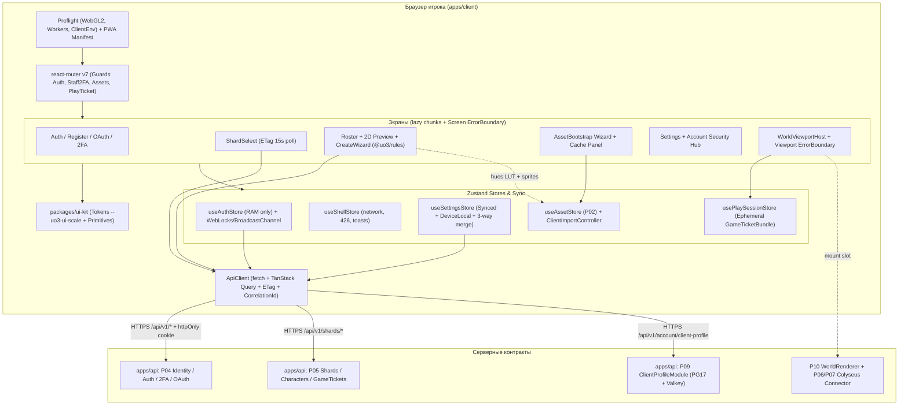
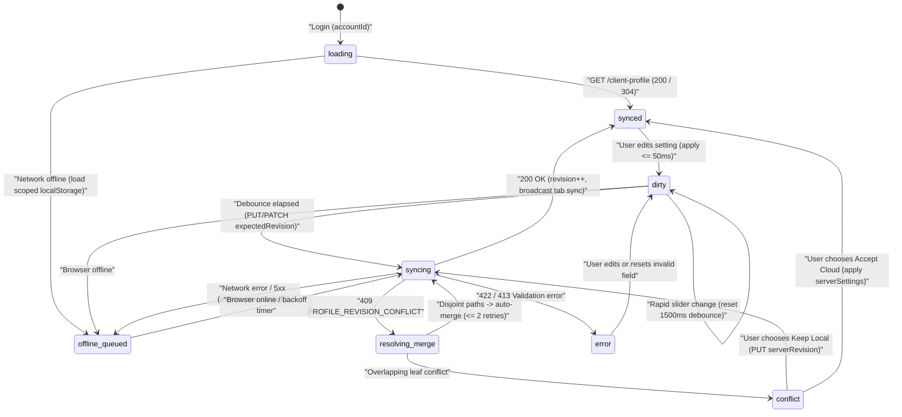

# Design: P09 Оболочка клиента

## Context

Фаза **P09 (`p09-client-shell`)** реализует пользовательскую веб-оболочку `apps/client` вехи **M1 «Шаг по Британии»**, объединяющую ранее зафиксированные серверные и клиентские подсистемы (мотивация и границы скоупа — см. [proposal.md](proposal.md), нормативные требования — в `specs/client/*/spec.md`).

На входе фазы зафиксированы следующие контракты:
- **P00 (`p00-monorepo-foundation`):** каркас `apps/client` (React 19 + Vite 6 + TypeScript strict ESM), `packages/ui-kit`, клиентский валидатор окружения `@uo3/config/env/client` (`ClientEnvSchema`), DAG-ограничения импортов (клиент не импортирует `@uo3/db`, `@uo3/config/env/server` и `node:*`) и реестр CC0-ассетов `assets/ASSET_MANIFEST.json`.
- **P01 (`p01-shared-domain-model`):** `AccessLevel` (0..6), `Body` (400/401), `Hue`, `FacetId`, `EraProfile`, `ClientRulesetSnapshot`, инъецируемый `Clock`.
- **P02 (`p02-uo-asset-formats-and-import`):** `ClientImportController`, `WebAssetCacheManager`, `useAssetStore`, пул Web Workers, OPFS/IndexedDB/Memory кэш, текстура `hues` LUT (`32×3001` RGBA8888), декодированные спрайты и `SyntheticVirtualDirectory` (CC0).
- **P03 (`p03-server-world-data`):** `WorldDataVersionSchema`, `ClientAssetFingerprintSchema`, `WorldDataCompatibilitySchema` в `packages/protocol`.
- **P04 (`p04-identity-and-accounts`):** REST API аутентификации, 2FA, OAuth 2.0 (PKCE), безопасности и ролей под `/api/v1/{auth,account,staff}/*`, Access JWT (`EdDSA`, 15 мин, `scope: "full" | "staff_2fa_setup_required"`), ротируемый `httpOnly` cookie `uo3_refresh` (`Path=/api/v1/auth`) со строгим reuse detection, `JwtAuthGuard` и `@CurrentAccount()`.
- **P05 (`p05-shards-and-characters`):** REST API шардов, тикетов (`GameTicketBundle` с `worldReservation` + `hubReservation`, TTL ≤ 60 с), ростера и создания персонажей, изоморфные валидаторы `packages/rules` и `StarterLoadoutV1`.

Проектирование строго следует ADR-001..ADR-013 из [docs/ARCHITECTURE.md](../../../docs/ARCHITECTURE.md): авторитарность сервера (ADR-012), модель «принеси свой клиент» без проприетарных ассетов в репозитории и трафике (ADR-002), WebGL2 как обязательный минимум с опциональным флагом WebGPU (ADR-003), React DOM-оверлей (ADR-004), отсутствие `eval`/inline-скриптов (ADR-012) и воспроизводимое тестирование в Vitest + Playwright SwiftShader (ADR-011).

## Goals / Non-Goals

**Goals:**
- Собрать сквозную маршрутизируемую SPA/PWA-оболочку `apps/client` с ленивой загрузкой экранов, трёхуровневыми Error Boundaries, pre-flight диагностикой WebGL2/Workers/конфига и точкой монтирования `WorldViewportHost` для P10–P12.
- Полностью исключить утечку Access JWT и `GameTicketBundle` в Web Storage/URL/логи и устранить гонку параллельных `POST /api/v1/auth/refresh` между вкладками браузера (риск, делегированный из P04).
- Реализовать полный UX аутентификации (email/пароль, OAuth, TOTP/резервные коды, принудительная 2FA персонала), выбора шарда (`ETag`/`304`, live polling), ростера (превью внешности поверх P02, отложенное удаление, переименование) и мастера создания персонажа UO:R с 100% совпадением формул с `@uo3/rules`.
- Реализовать мастер подключения и управления ассетами поверх `ClientImportController` / `useAssetStore` (P02) с быстрым тёплым стартом (`≤ 500 мс`), восстановлением разрешений папки и проверкой совместимости с профилем шарда и `WorldDataVersionSchema`.
- Построить версионированный профиль настроек (`ClientSettingsV1`) с мгновенным локальным применением (`≤ 50 мс`), облачной синхронизацией в PostgreSQL 17 (`account_client_profiles`), 3-way разрешением конфликтов, офлайн-очередью, межвкладочным `BroadcastChannel` (`≤ 100 мс`) и разделением облачных/локальных параметров устройства.

**Non-Goals:**
- Реализация бинарных парсеров UO, упаковщика атласов и OPFS-бэкендов — выполнено в **P02**.
- Подключение WebSocket Colyseus (`WorldPartitionRoom`/`ShardHubRoom`), репликация `StateView` и intents — **P06**, **P07**.
- Three.js-сцена карты, изометрическая камера, анимации мобайлов и клиентское предсказание шагов — **P10**, **P11**, **P12**.
- Декларативный движок серверных гампов (0xB0/0xDD), пейпердолл с drag-and-drop и язык макросов — **P13**, **P14**.
- Web Audio воспроизведение звуков/музыки — **P28** (P09 только хранит и синхронизирует настройки аудио).
- Service Worker с агрессивным кэшированием офлайн-бандлов/оркестрацией обновлений, сенсорный UI, полная WCAG-программа и cliloc-пайплайн локализации — **P30**, **P34**.

## Decisions

### D1. Маршрутизация на `react-router` v7 (Data Router) с декларативным конвейером охранников
- **Выбор:** использовать `react-router` v7 (библиотечный режим, `createBrowserRouter` в продакшене и `createMemoryRouter` в Vitest) с централизованной таблицей маршрутов (`apps/client/src/router/routes.tsx`), ленивыми модулями `lazy()` для тяжёлых экранов (мастер создания персонажа, мастер ассетов, настройки, игровой вьюпорт) и композируемыми layout-охранниками (`AuthGuard` → `Staff2faGuard` → `ShardContextGuard` → `PlaySessionGuard`). Все ссылки и редиректы строятся через строго типизированные фабрики путей (`AppRoutes.*`), а параметр `returnTo` проходит чистую функцию `sanitizeReturnTo`.
- **Обоснование:** `react-router` v7 (MIT) нативно совместим с React 19, не требует Vite-плагина кодогенерации файлов маршрутов, предоставляет встроенные per-route `ErrorBoundary` (что естественно реализует трёхуровневую изоляцию ошибок) и позволяет мгновенно тестировать весь граф переходов в памяти через `createMemoryRouter`.
- **Отвергнутые альтернативы:**
  - *`@tanstack/react-router`:* мощная типизация, но привносит файловую кодогенерацию маршрутов в Vite-сборку, усложняя инкрементальный CI и работу ИИ-агентов (ADR-013).
  - *Собственная стейт-машина поверх Zustand без URL:* ломает кнопки «Назад/Вперёд» браузера, глубокие ссылки `/verify-email`, `/reset-password`, `/oauth/callback` и естественное code-splitting чанков.
- **Соответствие ADR:** ADR-001, ADR-011, ADR-012.

### D2. Хранение Access JWT строго в RAM и межвкладочный Single-Flight Refresh (`Web Locks` + `BroadcastChannel`)
- **Выбор:** Access JWT, декодированные claims (`sub`, `sid`, `acl`, `egacl`, `mfa`, `scope`, `exp`) и `GameTicketBundle` хранятся исключительно в неперсистентных Zustand-сторах в оперативной памяти (`useAuthStore`, `usePlaySessionStore` — без `persist`-мидлвара). Координатор `AuthSessionCoordinator` синхронизирует обновление токена между всеми вкладками одного origin:
  1. Перед вызовом `POST /api/v1/auth/refresh` вкладка захватывает эксклюзивную блокировку `navigator.locks.request('uo3-auth-refresh', { mode: 'exclusive' })`.
  2. Внутри блокировки проверяет метку `lastRefreshAtMs` (полученную по `BroadcastChannel('uo3-auth-sync')` или в памяти): если другая вкладка обновила токен < 5 000 мс назад и передала свежий in-memory Access JWT, сетевой вызов пропускается.
  3. Иначе выполняется ровно один `POST /api/v1/auth/refresh` (`credentials: 'include'`), а результат (`TOKEN_UPDATED { accessToken, expiresAtMs, account }` или `SESSION_CLEARED { reason }`) мгновенно рассылается всем вкладкам по `BroadcastChannel`.
  4. Плановое упреждающее обновление планируется таймером за `60 000 мс` до `exp` (с случайным джиттером `0..3 000 мс`), когда вкладка активна. При отсутствии `navigator.locks` включается резервная координация через `BroadcastChannel`-элекцию лидера (таймаут ожидания ответа лидера `250 мс`).
- **Обоснование:** Прямо закрывает риск из P04 (`AUTH_TOKEN_REUSE_DETECTED` при одновременном обновлении cookie `uo3_refresh` из двух вкладок), соблюдает OWASP ASVS L2 (нулевой риск XSS-кражи долговременных токенов из `localStorage`) и обеспечивает распространение logout/бана между вкладками за `< 50 мс` (при целевом бюджете `≤ 500 мс`).
- **Отвергнутые альтернативы:**
  - *Хранение Access JWT в `sessionStorage`/`localStorage`:* прямое нарушение безопасности, расширяет окно эксфильтрации и не защищает от повторного использования при параллельном refresh.
  - *Независимый refresh в каждой вкладке с ретраем после 401:* на сервере P04 повторное предъявление ротированного refresh-токена **мгновенно отзывает всё семейство токенов** и разлогинивает пользователя.
- **Соответствие ADR:** ADR-009, ADR-012.

### D3. Единый Fetch-клиент (`ApiClient`), унификация префикса `/api/v1` и TanStack Query v5
- **Выбор:** Построить тонкий типизированный `ApiClient` поверх стандартного `fetch` (интегрированный с `TanStack Query v5`), который:
  - нормализует `VITE_API_BASE_URL` и гарантирует единый канонический префикс `/api/v1` для всех серверных маршрутов (унифицируя контроллеры P04 `/api/v1/*`, P05 `/v1/shards/*` → `/api/v1/shards/*` через глобальный префикс NestJS `/api` и новый `ClientProfileModule` `/api/v1/account/client-profile`);
  - добавляет к каждому запросу `credentials: 'include'`, `X-UO3-Protocol-Version: <semver>` и `X-Correlation-Id: <uuid>`;
  - поддерживает `ETag`-кэш в памяти (`Map<string, { etag: string; data: unknown }>`) для прозрачной обработки HTTP `304 Not Modified` на `GET /api/v1/shards` и `GET /api/v1/account/client-profile`;
  - перехватывает `401` (одна автоматическая попытка single-flight refresh + повтор исходного запроса, кроме `/auth/login`, `/auth/refresh`, `/auth/logout`) и `426` (`PROTOCOL_VERSION_UNSUPPORTED` → переводит `useShellStore.upgradeRequired` в блокирующий режим);
  - парсит ошибки в единый типизированный `ApiClientError(status, code, message, details, retryAfterSec, correlationId)` по схеме `ApiErrorResponse` из `packages/protocol`.
- **Обоснование:** Централизует заголовки, корреляцию, ретраи, `ETag` и обработку версионности в одной тестируемой точке; `TanStack Query v5` берёт на себя дедупликацию запросов, `refetchIntervalInBackground: false` (автопауза опроса шардов при скрытии вкладки) и инвалидацию ростера после мутаций.
- **Отвергнутые альтернативы:**
  - *Axios:* избыточная зависимость при наличии нативного `fetch` с `AbortSignal` и худшая эргономика в тестовом харнесе MSW/Vitest.
  - *Дублирование `fetch` по экранам:* неизбежно ведёт к пропускам `X-UO3-Protocol-Version`, гонкам refresh и несогласованной обработке `426`/`429`.
- **Соответствие ADR:** Стек (TanStack Query 5, TypeBox), ADR-005, ADR-012.

### D4. 2D Canvas-превью персонажа поверх декодированных ассетов P02 с деградированным SVG-силуэтом
- **Выбор:** Для отображения персонажа в ростере и мастере создания (`/characters`, `/characters/new`) реализовать лёгкий компонент `CharacterPreviewCanvas` (`128×192 px`, целочисленное масштабирование `imageSmoothingEnabled = false`). Когда `useAssetStore.status === 'ready'`, компонент запрашивает из кэша P02 бумажную куклу (слои тела 400/401, причёски `hairStyle`, бороды `facialHairStyle` и стартовой одежды из `StarterLoadoutV1` / выбранных `shirtHue`/`pantsHue`) и `hues` LUT (`32×3001` RGBA8888), выполняя быстрое композирование с перекраской (формула `PartialHue` из P02) в `ImageData` за `< 2 мс`. Если пак ассетов ещё не подключён (либо отсутствует конкретный спрайт), отображается чистый детерминированный CC0 SVG-силуэт с приблизительным подбором оттенков кожи/волос/одежды по палитровой карте.
- **Обоснование:** Даёт игроку аутентичную визуальную обратную связь при настройке внешности и выборе персонажа ещё до запуска 3D-рендерера P10/P11, не тратя дополнительный WebGL2-контекст браузера (у браузеров жёсткий лимит 8–16 активных WebGL-контекстов).
- **Отвергнутые альтернативы:**
  - *Запуск Three.js-сцены на экране создания персонажа:* нарушает порядок зависимостей дорожной карты (P09 выполняется до P10/P11) и замедляет загрузку экрана.
  - *Статичные предрендеренные PNG из UO:* категорически запрещено ADR-002.
- **Соответствие ADR:** ADR-002, ADR-003.

### D5. Контракт точки монтирования `WorldViewportHost` и эфемерного handoff `GameSessionConnector`
- **Выбор:** Зафиксировать в `packages/protocol` и `apps/client/src/play/` строго типизированный контракт передачи управления в игровой мир:
  - `WorldSessionBootstrapContext`: `{ shardId, shardSummary, characterId, characterSerial, characterName, ticketBundle: GameTicketBundle, assetPack: ActiveAssetPackInfo, rulesetSnapshot?: ClientRulesetSnapshot }`.
  - `GameSessionConnector`: интерфейс `{ connect(ctx, signal): Promise<void>; disconnect(reason?: string): Promise<void>; subscribe(listener): () => void; }` со состояниями `connecting | connected | reconnecting | disconnected | fatal_error`.
  - `WorldViewportHost`: компонент маршрута `/play/:shardId/:characterId`, оборачивающий монтируемый рендерер в `WorldViewportErrorBoundary`, отслеживающий `webglcontextlost` (сторожевой таймер восстановления `5 000 мс`), отображающий оверлей подключения с обратным отсчётом TTL тикета и кнопку безопасного возврата к выбору персонажа. В рамках P09 поставляется `StubWorldViewport` + `StubGameSessionConnector` (позволяющий проверить полный E2E-цикл вехи M1 до реализации P06/P10); в P10/P12 регистрируется боевой `<WorldCanvas />` без переписывания маршрутизации и охранников P09.
- **Обоснование:** Чистая инверсия зависимостей позволяет независимо завершить и протестировать P09 (который зависит только от P02 и P05) и разблокировать P10 без циклических ссылок и переделки оболочки.
- **Отвергнутые альтернативы:**
  - *Передача тикетов через URL query или `sessionStorage`:* грубая уязвимость (утечка одноразового токена входа в историю и логи).
  - *Жёсткая заглушка «Coming soon» без контракта handoff:* потребовала бы ломающего рефакторинга `/play/*` в P10 и P12.
- **Соответствие ADR:** ADR-005, ADR-009, ADR-012.

### D6. Персистентный профиль настроек (`account_client_profiles` в PG17) и 3-way разрешение конфликтов
- **Выбор:**
  - **Сервер (`packages/db` + `apps/api`):** аддитивная таблица `account_client_profiles` в PostgreSQL 17 (`account_id uuid PK FK -> accounts(id) ON DELETE CASCADE`, `schema_version smallint DEFAULT 1`, `revision integer DEFAULT 1`, `settings_json jsonb`, `updated_at timestamptz`, `updated_by_device varchar(128)`, `CHECK (octet_length(settings_json::text) <= 65536)`). Модуль `ClientProfileModule` в `apps/api` использует `JwtAuthGuard` + `scope === 'full'` (из P04), валидирует полезную нагрузку скомпилированной TypeBox-схемой (`additionalProperties: false` на каждом объекте), применяет атомарный оптимистичный `UPDATE ... WHERE account_id = $1 AND revision = $2 RETURNING *` и ограничивает мутации через Valkey sliding-window (`30 req / 60 s` на `accountId`, ключ `uo3:rl:profile:{accountId}`, с инъецируемым `Clock`).
  - **Клиент (`apps/client`):** `useSettingsStore` разделяет:
    1. *Облачный профиль аккаунта (`synced`)* — локально кэшируется в `localStorage` под ключом `uo3:settings:v1:acct:<accountId>` (для гостя — `uo3:settings:v1:guest`), содержит `baseRevision`, `baseSnapshot`, `current`, `pendingDirtyPaths` и `syncStatus`.
    2. *Локальные переопределения устройства (`deviceLocal`)* — хранятся строго в `uo3:device-settings:v1` и никогда не отправляются на сервер (`rendererBackend: 'webgl2' | 'webgpu_experimental'`, `localGraphicsPresetOverride`, `localFpsCapOverride`, `lastShardId`, `pwaPromptDismissedUntilMs`).
  - **Алгоритм 3-way слияния при `409 PROFILE_REVISION_CONFLICT`:** при получении снимка сервера `(serverRevision, serverSettings)` вычисляются множества изменённых листовых путей `L = diffPaths(baseSnapshot, current)` и `S = diffPaths(baseSnapshot, serverSettings)`. Если пересечение `conflicts = { p ∈ L ∩ S | current[p] !== serverSettings[p] }` пусто — клиент автоматически сливает правки (`merged = applyPaths(serverSettings, L, current)`) и повторяет `PUT` с `expectedRevision = serverRevision` (до 2 автоповторов). Если `conflicts` не пусто — переходит в `syncStatus = 'conflict'` и открывает модальное окно сравнения конфликтующих полей («Оставить локальные» / «Принять облачные»).
  - **Межвкладочная синхронизация:** `BroadcastChannel('uo3-settings-sync')` рассылает `{ accountId, scope: 'synced' | 'deviceLocal', revision, payload, sourceTabId }`; принимающие вкладки сверяют `accountId` и обновляют Zustand-стор за `< 20 мс` без запуска повторного debounce-запроса на сервер.
- **Обоснование:** Комбинация оптимистичной блокировки PostgreSQL и 3-way leaf merge исключает потерю настроек при игре с двух устройств, debounce `1 500 мс` снижает нагрузку на БД при движении ползунков, а разделение `synced`/`deviceLocal` решает классическую проблему «4K ПК против слабого ноутбука».
- **Отвергнутые альтернативы:**
  - *Last-Write-Wins (LWW) без проверки ревизии:* тихо затирает изменения, сделанные на другом устройстве или вкладке.
  - *Хранение настроек в JSON-колонке таблицы `accounts`:* смешивает высокочастотные клиентские мутации с критичной таблицей безопасности `accounts` (P04) и усиливает конкуренцию блокировок строк.
  - *Хранение всех настроек только в `localStorage`:* игрок теряет привязки клавиш, масштаб UI и аудио-предпочтения при входе из другого браузера.
- **Соответствие ADR:** ADR-008, ADR-012.

### D7. Фундамент `packages/ui-kit` и масштабируемые дизайн-токены
- **Выбор:** Реализовать в `packages/ui-kit` систему дизайн-токенов CSS Custom Properties (`--uo3-bg-*`, `--uo3-surface-*`, `--uo3-border-*`, `--uo3-accent-gold`, `--uo3-text-*`, `--uo3-status-*`, `--uo3-ui-scale`) в стиле тёмного классического пергамента/обсидиана UO и набор базовых доступных React 19 примитивов: `Button`, `Input`, `PasswordInput`, `Select`, `Checkbox`, `Slider`, `Toggle`, `Card`, `Badge`, `Modal`, `ConfirmDialog`, `Tabs`, `ProgressBar`, `StepIndicator`, `Skeleton`, `Banner`, `ToastViewport`, `KeybindCapture`. Корневой атрибут `--uo3-ui-scale` синхронизируется с `useSettingsStore.interface.uiScale` (`0.75..1.5`) и `interface.locale` (`ru` | `en`). Все примитивы поддерживают управление с клавиатуры (`Tab`, `Enter`, `Escape`, focus trap в `Modal`).
- **Обоснование:** Создаёт единый визуальный язык для `apps/client` и будущей консоли `apps/admin` (P29), соблюдает DAG P00 (`ui-kit` зависит только от `domain`, `protocol`, `config/env/client`) и не смешивается с декларативным движком серверных гампов P14.
- **Отвергнутые альтернативы:**
  - *Тяжёлая внешняя UI-библиотека (MUI / Ant Design):* избыточный размер бандла, несовместимый с эстетикой UO, и частые проблемы с жёстким CSP (`style-src 'unsafe-inline'` для runtime CSS-in-JS).
  - *Runtime CSS-in-JS (styled-components / Emotion):* требует ослабления CSP или сложного nonce-механизма; чистые CSS Modules + CSS Variables полностью совместимы со строгим CSP (ADR-012, P31).
- **Соответствие ADR:** ADR-001, ADR-004, ADR-012.

### D8. Тонкий слой мастера ассетов поверх P02 и валидация `WorldDataVersionSchema` (P03)
- **Выбор:** Экран `/assets` (`apps/client/src/features/assets/`) делегирует всё чтение, декодирование, упаковку и кэширование в `ClientImportController`, `WebAssetCacheManager` и `useAssetStore` из P02. P09 добавляет координатор `AssetBootstrapCoordinator`, отвечающий за:
  - фоновую проверку тёплого кэша OPFS при старте приложения (`≤ 500 мс`);
  - проверку статуса сохранённого `FileSystemDirectoryHandle` (`queryPermission({ mode: 'read' })`) и вызов `requestPermission` строго в обработчике пользовательского клика;
  - отображение прогресса (`≥ 4 Гц`), отмены (`AbortController`, `≤ 250 мс`) и полной панели `AssetDiagnostic[]` с жёстким фильтром санитизации путей;
  - чистую функцию `evaluateShardAssetCompatibility(activePack, shardMeta, worldDataVersion)` (использующую `WorldDataVersionSchema` из P03), возвращающую `{ status: 'compatible' | 'warn_version_drift' | 'incompatible', reasons[] }`.
- **Обоснование:** Исключает дублирование логики парсинга и кэширования с P02, гарантируя единый источник истины `useAssetStore` для P09, P10, P11, P14 и P28.
- **Отвергнутые альтернативы:**
  - *Отдельный стор состояния мастера ассетов в P09 с ручным копированием из P02:* приводит к рассинхронизации прогресса и утечкам состояния при переключении паков.
- **Соответствие ADR:** ADR-002.

### D9. PWA-манифест, CC0-иконки и явная граница с P34 (`client/offline-and-updates`)
- **Выбор:** Разместить статический `apps/client/public/manifest.webmanifest` (`name: "UO3 — Ultima Online Web"`, `short_name: "UO3"`, `start_url: "/"`, `scope: "/"`, `display: "standalone"`, `orientation: "any"`, `theme_color: "#12100e"`, `background_color: "#0b0a09"`, иконки `192×192`, `512×512`, `maskable-512×512` в `apps/client/public/icons/`). Все иконки генерируются процедурно (CC0-1.0, геометрическая эмблема без образов EA/UO) и регистрируются с SHA-256 в `assets/ASSET_MANIFEST.json` (требование P00). Перехватчик `usePwaInstallPrompt` сохраняет отложенное событие `beforeinstallprompt` и период скрытия баннера (`14 суток`) в `deviceLocal`. Сервис-воркер с кэшированием офлайн-бандлов и оркестрацией обновлений **не** реализуется в P09 (явно закреплён за **P34**); Vite-сборка гарантирует строгий CSP без `eval` и inline-скриптов в `index.html`.
- **Обоснование:** Выполняет все требования `client/app-shell` по PWA-манифесту и устанавливаемости, не залезая в чужую capability `client/offline-and-updates` (P34) и не создавая риск случайного кэширования приватных ответов API или бинарников UO.
- **Отвергнутые альтернативы:**
  - *Подключение `vite-plugin-pwa` с precaching уже в P09:* размывает границы P09 и P34 и создаёт проблемы со stale-кэшем во время активной разработки вех M1–M4.
- **Соответствие ADR:** ADR-002, ADR-012.

---

## Architecture & Contracts

### 1. Топология модулей в монорепозитории

| Пакет / приложение | Модули и ключевые файлы | Ответственность |
|---|---|---|
| `packages/protocol` | `src/p09/client-settings.schema.ts`, `src/p09/client-profile-dto.schema.ts`, `src/p09/play-handoff.ts`, `src/p09/errors.ts` | TypeBox-схемы `ClientSettingsV1`, `DeviceLocalSettingsV1`, DTO `/api/v1/account/client-profile`, мигратор схем `migrateClientSettings`, контракт `WorldSessionBootstrapContext` и коды ошибок `PROFILE_*`, `ERR_SHELL_*`, `ERR_SETTINGS_*` |
| `packages/db` | `src/schema/client-profiles.ts`, `src/migrations/0009_p09_account_client_profiles.sql`, `src/repositories/client-profile.repository.ts` | Drizzle-схема `account_client_profiles`, миграция с `CHECK`-ограничением 64 КиБ, атомарный оптимистичный репозиторий |
| `packages/config` | `src/env/client.ts` (расширение `ClientEnvSchema`), `src/env/server.ts` (параметры rate-limit `PROFILE_WRITE_RATE_LIMIT_PER_MIN`) | `VITE_CLIENT_PROTOCOL_VERSION`, `VITE_PWA_ENABLED`, `VITE_SYNTHETIC_PACK_URL` (строго без секретов) |
| `packages/ui-kit` | `src/tokens/theme.css`, `src/primitives/*` (`Button`, `Input`, `PasswordInput`, `Select`, `Checkbox`, `Slider`, `Toggle`, `Card`, `Badge`, `Modal`, `ConfirmDialog`, `Tabs`, `ProgressBar`, `StepIndicator`, `Skeleton`, `Banner`, `ToastViewport`, `KeybindCapture`) | Базовые дизайн-токены и доступные CSS Modules + React 19 примитивы оболочки |
| `apps/api` | `src/modules/client-profile/*` (`ClientProfileModule`, `ClientProfileController`, `ClientProfileService`, `ProfileRateLimitGuard`) | REST API `GET`/`PUT`/`PATCH`/`POST reset` `/api/v1/account/client-profile`, TypeBox-валидация, `ETag`/`304`, Valkey rate-limit, оптимистичная конкурентность `409` |
| `apps/client` | `src/app/*` (`App.tsx`, `boot.ts`, `preflight.ts`, `error-boundaries/*`, `diagnostics-sanitizer.ts`, `pwa/*`) | Точка входа, pre-flight WebGL2/Workers/env, 3-уровневые Error Boundaries, санитизатор отчётов, PWA-хук |
| `apps/client` | `src/router/*` (`routes.tsx`, `guards.tsx`, `return-to.ts`, `ShellLayout.tsx`) | Маршрутизация `react-router` v7, охранники доступа/2FA/ассетов/тикетов, валидация `returnTo`, навигационная шапка |
| `apps/client` | `src/net/*` (`api-client.ts`, `query-client.ts`, `auth-coordinator.ts`, `useAuthStore.ts`, `useShellStore.ts`, `i18n.ts`) | Fetch-клиент с `ETag`/`426`/`X-Correlation-Id`, TanStack Query, in-memory Auth store, Web Locks + `BroadcastChannel` refresh, минимальный каталог ключей RU/EN |
| `apps/client` | `src/features/auth/*` (`LoginPage`, `RegisterPage`, `VerifyEmailPage`, `ResetPasswordPage`, `OAuthCallbackPage`, `OAuthOnboardingPage`, `Staff2faSetupPage`, `MfaChallengeStep`, `TotpQrSvg`) | Все экраны аутентификации, OAuth и 2FA поверх P04 |
| `apps/client` | `src/features/shards/*` (`ShardSelectPage`, `ShardCard`, `ShardRulesDrawer`, `useShardsQuery`) | Каталог шардов с 15 с опросом/`ETag`, фильтрами, проверкой `canEnter` и совместимости пака |
| `apps/client` | `src/features/characters/*` (`CharacterRosterPage`, `CharacterCard`, `CharacterPreviewCanvas`, `DeleteCharacterModal`, `RenameCharacterModal`, `CharacterCreateWizard`, `AppearanceStep`, `StatsSkillsStep`, `StartingCityStep`, `EnterWorldController`) | Ростер, 2D-превью внешности поверх P02, отложенное удаление, переименование, мастер создания UO:R и выпуск `GameTicketBundle` |
| `apps/client` | `src/features/assets/*` (`AssetBootstrapPage`, `AssetBootstrapCoordinator`, `SourceSelector`, `DecodingProgressPanel`, `DiagnosticsPanel`, `ActivePackCard`, `CacheManagementPanel`, `compatibility.ts`) | Мастер подключения ассетов поверх P02, прогресс ≥ 4 Гц, восстановление доступа, проверка `WorldDataVersionSchema`, очистка кэша |
| `apps/client` | `src/features/settings/*` (`SettingsPage`, `useSettingsStore.ts`, `settings-sync.ts`, `three-way-merge.ts`, `GraphicsTab`, `AudioTab`, `GameplayInterfaceTab`, `ControlsTab`, `AccountSecurityTab`, `ConflictResolutionModal`, `ImportExportModal`) | Настройки клиента, локальный/облачный сплит, 3-way merge, офлайн-очередь, `BroadcastChannel`, привязки клавиш, экспорт/импорт и вкладка безопасности P04 |
| `apps/client` | `src/play/*` (`WorldViewportHost.tsx`, `usePlaySessionStore.ts`, `connector.ts`, `StubWorldViewport.tsx`) | Хост игрового вьюпорта, эфемерное хранилище тикетов, обработка `webglcontextlost`, точка расширения P10/P12 |
| `packages/test-kit` | `src/client-shell/*` (`settings.factory.ts`, `api-mocks.ts`, `playwright-helpers.ts`) | Детерминированные фабрики и хелперы MSW/Playwright (только `devDependencies`) |

### 2. Модель данных PostgreSQL 17 (`packages/db`) и Valkey 8

#### Таблица `account_client_profiles` (`0009_p09_account_client_profiles.sql`)
```sql
CREATE TABLE account_client_profiles (
  account_id        UUID PRIMARY KEY REFERENCES accounts(id) ON DELETE CASCADE,
  schema_version    SMALLINT NOT NULL DEFAULT 1 CHECK (schema_version >= 1),
  revision          INTEGER NOT NULL DEFAULT 1 CHECK (revision >= 1),
  settings_json     JSONB NOT NULL,
  updated_by_device VARCHAR(128) NULL,
  created_at        TIMESTAMPTZ NOT NULL DEFAULT NOW(),
  updated_at        TIMESTAMPTZ NOT NULL DEFAULT NOW(),
  CONSTRAINT chk_client_profile_size CHECK (octet_length(settings_json::text) <= 65536)
);

CREATE INDEX idx_account_client_profiles_updated_at
  ON account_client_profiles (updated_at DESC);
```

#### Ключ Valkey 8
| Ключ | Тип | TTL | Назначение |
|---|---|---|---|
| `uo3:rl:profile:{accountId}` | ZSET (таймстампы ms) | 60 с | Скользящее окно ограничения мутаций профиля (30 запросов / 60 с; время передаётся из `Clock`) |

### 3. TypeBox-схемы настроек и протокола (`packages/protocol`)

#### `ClientSettingsV1` (облачный синхронизируемый профиль, `additionalProperties: false` на каждом уровне)
```ts
type ClientSettingsV1 = {
  schemaVersion: 1;
  graphics: {
    qualityPreset: 'low' | 'medium' | 'high' | 'custom';
    defaultZoom: number;              // [0.5 .. 2.0], default 1.0
    pixelSnapping: boolean;           // default true (ADR-003)
    fpsCap: 30 | 60 | 120 | 0;        // 0 = uncapped, default 60
    hideRoofs: boolean;               // default true
    circleOfTransparency: boolean;    // default true
    transparencyRadiusPx: number;     // int [80 .. 300], default 160
    lightingQuality: 'classic' | 'smooth'; // default 'classic'
    showDiagnosticsOverlay: boolean;  // default false
  };
  audio: {
    masterVolume: number;             // int [0 .. 100], default 80
    sfxVolume: number;                // int [0 .. 100], default 80
    musicVolume: number;              // int [0 .. 100], default 60
    ambientVolume: number;            // int [0 .. 100], default 70
    muted: boolean;                   // default false
    muteWhenUnfocused: boolean;       // default true
  };
  gameplay: {
    alwaysRun: boolean;               // default false
    queueMovementSteps: boolean;      // default true
    smoothCameraFollow: boolean;      // default true
    confirmDestructiveActions: boolean; // default true
  };
  interface: {
    locale: 'ru' | 'en';              // default из браузера, fallback 'ru'
    uiScale: number;                  // [0.75 .. 1.5], шаг 0.05, default 1.0
    overheadNamesMode: 'always' | 'hover' | 'alt_hold'; // default 'hover'
    chatFontSizePx: number;           // int [12 .. 20], default 14
    chatTimestamps: boolean;          // default true
    tooltipDelayMs: number;           // int [0 .. 1000], default 300
  };
  controls: {
    bindings: Record<BaseControlAction, KeyChord>;
    // BaseControlAction: 'toggle_war_mode' | 'open_paperdoll' | 'open_backpack'
    //   | 'open_skills' | 'open_journal' | 'open_spellbook' | 'target_self'
    //   | 'target_last' | 'attack_last' | 'toggle_always_run' | 'zoom_in'
    //   | 'zoom_out' | 'zoom_reset' | 'open_settings'
    // KeyChord: нормализованная строка вида "Alt+P", "Tab", "Ctrl+Shift+J" (max 32 chars)
  };
  extensions?: {
    // Зарезервированные необязательные слоты для P14 (windowLayout, macros),
    // в P09 валидируются как пустой/ограниченный объект <= 16 KiB
    windowLayoutVersion?: number;
    macrosVersion?: number;
  };
};
```

#### `DeviceLocalSettingsV1` (никогда не отправляется на сервер)
```ts
type DeviceLocalSettingsV1 = {
  schemaVersion: 1;
  rendererBackend: 'webgl2' | 'webgpu_experimental'; // default 'webgl2'
  localQualityPresetOverride: 'inherit' | 'low' | 'medium' | 'high';
  localFpsCapOverride: 'inherit' | 30 | 60 | 120 | 0;
  lastSelectedShardId: string | null;
  pwaInstallDismissedUntilMs: number | null;
  allowMemoryOnlyAssetFallback: boolean;
};
```

#### REST-эндпоинты `ClientProfileModule` (`apps/api`) и стыковка с P04/P05

| Метод и путь | Доступ | Назначение | Коды ответа |
|---|---|---|---|
| `GET /api/v1/account/client-profile` | JWT (`scope = full`) | Получение облачного профиля (или канонического дефолта `revision: 1`), `ETag: "rev-<N>"` | `200`, `304`, `401`, `403` |
| `PUT /api/v1/account/client-profile` | JWT (`scope = full`) | Полная замена профиля с `expectedRevision` (или `If-Match`) | `200`, `401`, `403`, `409`, `413`, `422`, `429` |
| `PATCH /api/v1/account/client-profile` | JWT (`scope = full`) | Частичное обновление одной или нескольких категорий с `expectedRevision` | `200`, `401`, `403`, `409`, `413`, `422`, `429` |
| `POST /api/v1/account/client-profile/reset` | JWT (`scope = full`) | Сброс указанной категории (`category?`) или всего профиля с `expectedRevision` | `200`, `401`, `403`, `409`, `422`, `429` |

*Примечание по стыку префиксов API (P04/P05/P09):* в P04 маршруты указаны с префиксом `/api/v1/*` (включая `Set-Cookie: uo3_refresh; Path=/api/v1/auth`), а в P05 — `/v1/shards/*` как локальные пути контроллеров NestJS. При глобальном префиксе `app.setGlobalPrefix('api', { exclude: ['/.well-known/jwks.json', '/health', '/ready'] })` в `apps/api` все REST-маршруты унифицированы под `/api/v1/*`. `ApiClient` формирует запросы относительно origin/базового URL без дублирования `/api`.

#### Каталог кодов ошибок P09 (`packages/protocol/src/p09/errors.ts`)
- **Серверные (`PROFILE_*`):** `PROFILE_VALIDATION_FAILED` (422), `PROFILE_PAYLOAD_TOO_LARGE` (413), `PROFILE_REVISION_CONFLICT` (409, с полями `{ currentRevision, currentSettings, updatedAt }`), `PROFILE_RATE_LIMITED` (429 + `Retry-After`), `PROFILE_SCHEMA_UNSUPPORTED` (422).
- **Клиентские оболочки (`ERR_SHELL_*`, `ERR_SETTINGS_*`):** `ERR_SHELL_WEBGL2_UNAVAILABLE`, `ERR_SHELL_WORKERS_UNAVAILABLE`, `ERR_SHELL_CONFIG_INVALID`, `ERR_SHELL_CHUNK_LOAD_FAILED`, `ERR_SHELL_VIEWPORT_CRASH`, `ERR_SHELL_WEBGL_CONTEXT_LOST`, `ERR_SETTINGS_IMPORT_INVALID`, `ERR_SETTINGS_IMPORT_VERSION_UNSUPPORTED`, `ERR_ASSET_SHARD_INCOMPATIBLE`.

### 4. Диаграммы потоков и конечных автоматов (Mermaid)

#### Диаграмма 1: Архитектура оболочки клиента, сторов и интеграция с P02/P04/P05/P10



#### Диаграмма 2: Межвкладочный Single-Flight Refresh токена доступа (Web Locks + BroadcastChannel)

```mermaid
sequenceDiagram
  autonumber
  participant TabA as "Вкладка A (ApiClient)"
  participant TabB as "Вкладка B (ApiClient)"
  participant Lock as "Web Locks (uo3-auth-refresh)"
  participant BC as "BroadcastChannel (uo3-auth-sync)"
  participant API as "apps/api (P04 POST /api/v1/auth/refresh)"

  Note over TabA,TabB: "Access JWT истекает одновременно в двух вкладках"
  par Запрос блокировки обновления
    TabA->>Lock: "request exclusive (uo3-auth-refresh)"
    TabB->>Lock: "request exclusive (uo3-auth-refresh)"
  end

  Lock-->>TabA: "Блокировка выдана Вкладке A"
  TabA->>API: "POST /api/v1/auth/refresh (Cookie: uo3_refresh=R1)"
  API-->>TabA: "200 OK { accessToken: JWT2, exp } + Set-Cookie R2"
  TabA->>TabA: "Сохранить JWT2 в RAM (useAuthStore)"
  TabA->>BC: "postMessage TOKEN_UPDATED (JWT2, refreshedAtMs)"
  BC-->>TabB: "Обновить useAuthStore в RAM (JWT2, refreshedAtMs)"
  TabA->>Lock: "Освободить блокировку"

  Lock-->>TabB: "Блокировка выдана Вкладке B"
  TabB->>TabB: "Проверка: now - refreshedAtMs < 5000 ms -> сетевой refresh НЕ нужен"
  TabB->>Lock: "Освободить блокировку"
  Note over TabA,TabB: "Обе вкладки повторяют запросы с JWT2; 0 ошибок AUTH_TOKEN_REUSE_DETECTED"
```

#### Диаграмма 3: Конечный автомат синхронизации профиля настроек и разрешения конфликтов



### 5. Ключевые алгоритмы, правила и формулы

1. **Валидация безопасного `returnTo` (`sanitizeReturnTo`):**
   - Принимает `raw: string | null`. Если `raw === null` или длина `> 512` → `"/shards"`.
   - Декодирует ровно один раз (защита от двойного кодирования); отклоняет любые строки, не начинающиеся с одиночного `/`, содержащие `//`, `\`, управляющие символы `[\u0000-\u001F]`, схемы (`http:`, `https:`, `javascript:`, `data:`) или пути рекурсивного входа (`/login`, `/register`, `/oauth/callback`, `/2fa-setup`).
   - Проверяет `new URL(candidate, window.location.origin).origin === window.location.origin`; при успехе возвращает `pathname + search`, иначе `"/shards"`.

2. **Санитизация диагностических отчётов (`sanitizeDiagnosticPayload`):**
   - Перед отображением в UI ошибки или копированием в буфер обмена прогоняет строковые поля (message, stack, breadcrumb) через детерминированный пайплайн замен:
     - JWT/Bearer: `Bearer\s+[A-Za-z0-9\-_]+\.[A-Za-z0-9\-_]+\.[A-Za-z0-9\-_]+` и сырые трёхсекционные JWT → `[REDACTED_TOKEN]`.
     - Query-токены: `([?&](?:token|code|state|ticket|oauthOnboardingToken)=)[^&\s]+` → `$1[REDACTED]`.
     - Email: `[A-Za-z0-9._%+-]+@[A-Za-z0-9.-]+\.[A-Za-z]{2,}` → `[REDACTED_EMAIL]`.
     - Локальные пути ОС: Windows (`[A-Za-z]:\\[^\s"']+`) и POSIX (`/Users/[^\s"']+`, `/home/[^\s"']+`, `/mnt/[^\s"']+`) → `[REDACTED_PATH]` (сохраняя только базовое имя распознанного файла UO, если оно передано отдельно в `fileName`).

3. **Формулы мастера создания персонажа (импортируются из `@uo3/rules`, дублирование запрещено):**
   - `str, dex, int ∈ Z ∩ [10, 60]`, инвариант `str + dex + int === 80`.
   - `maxHits = 50 + Math.floor(str / 2)`, `maxStam = dex`, `maxMana = int`, `maxWeight = 40 + Math.floor(3.5 * str)`.
   - Навыки: 2–3 различных ID из 49 навыков UO:R (исключая `disallowedStartingSkills`), значения в десятых долях `0..500`, шаг UI `0.1` (`1` десятая) или `5.0` (ускоренный степпер), инвариант `Σ valueTenths === 1000`.
   - Палитры внешности: `male → 400`, `female → 401`; `skinHue ∈ [1002..1058]`; `hairHue, facialHairHue ∈ [1102..1149]` (или `0` при стиле `0`); для `female` принудительно `facialHairStyle = 0`, `facialHairHue = 0`; `shirtHue, pantsHue ∈ [2..1001]`.
   - Превью стартового набора вызывается напрямую из `buildStarterLoadout()` (`@uo3/rules`).

4. **Проверка совместимости пака ассетов с шардом (`evaluateShardAssetCompatibility`):**
   - Если `activePack === null` → `incompatible` (`ERR_ASSET_PACK_REQUIRED`).
   - Если `shard.assetProfile === 'synthetic_dev'` и `activePack.profile !== 'uo3-synthetic'` → `incompatible` (`ERR_ASSET_SHARD_INCOMPATIBLE`, требуется синтетический CC0-пак).
   - Если `shard.assetProfile === 'uo_classic_7'` и `activePack.profile === 'uo3-synthetic'` → `incompatible` (`ERR_ASSET_SHARD_INCOMPATIBLE`, требуется клиент UO Classic).
   - Проверка требуемых фасетов шарда (`felucca` → `id 0`, `trammel` → `id 1`) и размеров карты (`7168×4096` для `uo_classic_7`; при `6144×4096` legacy-паке — `incompatible` либо предупреждение по политике шарда).
   - При наличии `WorldDataVersion` от шарда (P03): сверка контрольной суммы `tileDataHash`/`mapHash`; при расхождении и мягкой политике шарда — `warn_version_drift`, при строгой — `incompatible`.

5. **Проверка зарезервированных системных клавиш (`ControlsTab`):**
   - Жёсткий чёрный список браузерных комбинаций, запрещённых для биндинга: `Ctrl+W`, `Ctrl+T`, `Ctrl+N`, `Ctrl+Shift+T`, `Ctrl+Shift+N`, `Ctrl+R`, `Ctrl+Shift+R`, `Ctrl+L`, `Ctrl+Tab`, `Alt+F4`, `F5`, `F11`, `F12`, `Meta+*`.
   - При попытке назначить занятый `KeyChord`: вычисление конфликтующего `BaseControlAction` за O(N) (`N <= 20`), показ inline-разрешения (`swap` / `unbind_previous` / `cancel`).

## Risks / Trade-offs

- **[Ложный отзыв семейства refresh-токенов (P04) в браузерах без `navigator.locks` или при заморозке вкладки ОС]** → Митигация: первичный путь использует эксклюзивную блокировку `navigator.locks` + `BroadcastChannel` передачу свежего Access JWT; в резервном режиме без Web Locks добавляется лидер-элекция по `BroadcastChannel` со случайным джиттером `50..200 мс`, а при получении `AUTH_TOKEN_REUSE_DETECTED` все вкладки синхронно и аккуратно переводятся на `/login` с понятным уведомлением.
- **[Рассинхронизация URL-префиксов между P04 (`/api/v1/*`) и P05 (`/v1/*`) при интеграции `apps/api`]** → Митигация: явно закрепляем в `design.md` и задачах контрактный тест единого префикса `/api/v1/*` в `apps/api` (глобальный префикс `/api` в NestJS `main.ts`) и нормализацию `VITE_API_BASE_URL` в `ApiClient`.
- **[Утечка Access JWT или `GameTicketBundle` через сторонние перехватчики ошибок, DevTools-снимки или URL]** → Митигация: сторы `useAuthStore` и `usePlaySessionStore` не используют `persist`, query-токены стираются `history.replaceState` до монтирования эффектов, а `sanitizeDiagnosticPayload` покрывается unit-тестами на утечку JWT, email и путей ОС.
- **[Потеря UX при отсутствии загруженных ассетов UO во время просмотра ростера/создания персонажа]** → Митигация: экраны `/shards`, `/characters` и `/characters/new` полностью работоспособны и без предзагруженного пака UO благодаря SVG-силуэту превью, а обязательный шлюз готовности/совместимости ассетов срабатывает с понятной подсказкой при нажатии «Войти в мир» (или при выборе несовместимого шарда).
- **[Конфликт одновременного редактирования настроек на двух устройствах или быстрый спам API при движении ползунков]** → Митигация: клиентский debounce `1 500 мс` + серверный rate-limit `30/мин` + оптимистичная проверка `revision` в PostgreSQL + автоматическое 3-way слияние непересекающихся категорий с ручным диалогом только при реальном конфликте одного и того же поля.
- **[Производительность рендеринга 2D-превью персонажа при быстром переборе оттенков кожи/одежды в мастере создания]** → Митигация: базовые слои бумажной куклы кэшируются в памяти компонента (декодирование 1 раз при смене пола/стиля), а смена `hue` перекрашивает только компактный `ImageData` (`128×192`, 24 576 пикселей) за `< 1.5 мс` с `requestAnimationFrame`-коалесценцией.
- **[Нестабильность Playwright E2E-тестов из-за WebGL2 в headless CI и сетевых таймингов]** → Митигация: запуск Chromium в CI с флагами `--use-gl=angle --use-angle=swiftshader` (ADR-011), использование исключительно синтетического CC0-пака (P02) и детерминированных моков/тестовой БД `uo3_test` без реальных внешних OAuth/SMTP-вызовов.
- **[Случайное попадание проприетарной иконки или логотипа UO в PWA-манифест]** → Митигация: все иконки `apps/client/public/icons/*` генерируются процедурно (CC0-1.0), регистрируются в `assets/ASSET_MANIFEST.json` и проходят обязательный CI-гейт `check:assets` из P00.

## Migration Plan

1. **Миграция базы данных (`packages/db`):**
   - Добавить Drizzle-схему `packages/db/src/schema/client-profiles.ts` и аддитивную миграцию `0009_p09_account_client_profiles.sql` (только `CREATE TABLE account_client_profiles` с FK на `accounts(id)` и `CREATE INDEX`). Существующие таблицы P04 и P05 не модифицируются.
   - Проверить обратимость (`down`-миграция) на тестовой БД `uo3_test`.
2. **Общие контракты и конфигурация (`packages/protocol`, `packages/config`, `packages/ui-kit`):**
   - Опубликовать схемы `ClientSettingsV1`, DTO `/api/v1/account/client-profile`, `WorldSessionBootstrapContext` и ошибки `PROFILE_*` в `packages/protocol`.
   - Расширить `ClientEnvSchema` в `@uo3/config/env/client` (`VITE_CLIENT_PROTOCOL_VERSION`, `VITE_PWA_ENABLED`), обновить `.env.example` и пройти `check:env` (P00).
   - Реализовать токены и примитивы `packages/ui-kit`.
3. **Серверная часть (`apps/api`):**
   - Подключить `ClientProfileModule` в `AppModule`, убедиться в унификации глобального префикса `/api` для модулей P04, P05 и P09, обновить OpenAPI-спецификацию.
4. **Клиентская оболочка (`apps/client`):**
   - Зарегистрировать CC0 PWA-иконки в `assets/ASSET_MANIFEST.json`, подключить `manifest.webmanifest`.
   - Развернуть маршрутизацию, HTTP/Auth-координатор, экраны Auth/Shards/Characters/Assets/Settings и `WorldViewportHost` (с `StubWorldViewport` до интеграции P10).
   - Добавить job Playwright E2E оболочки (в связке с `ci-required` из P00).
5. **Обратная совместимость и откат:**
   - Деплой `apps/api` полностью обратно совместим (только новые маршруты `/api/v1/account/client-profile`).
   - В случае отката `apps/client`: предыдущий статический билд откатывается на CDN, `account_client_profiles` в БД не ломает P04/P05, а клиентские локальные ключи версионированы (`uo3:settings:v1:*`) и безопасно игнорируются/мигрируются.

## Open Questions

Блокирующих архитектурных или геймдизайнерских вопросов для реализации P09 и разблокирования P10 **нет** — все схемы, маршруты, контракты handoff и алгоритмы синхронизации зафиксированы.

Отложимые детали для последующих фаз:
- **Детальная схема слота `extensions.windowLayout` и `extensions.macros` внутри `ClientSettingsV1`:** P09 фиксирует контейнер `extensions` (в рамках общего бюджета 64 КиБ) и версионный мигратор `migrateClientSettings`; конкретная грамматика раскладки игровых окон и скриптов макросов будет определена в **P14 (`p14-client-gump-ui`)**.
- **Офлайн-стратегии Service Worker (Stale-While-Revalidate статики, баннер фонового обновления версии клиента и `skipWaiting`):** сознательно отложены в **P34 (`p34-client-platform-quality` / `client/offline-and-updates`)**, при этом структура `manifest.webmanifest` и `usePwaInstallPrompt` в P09 полностью готовы к этому расширению.
