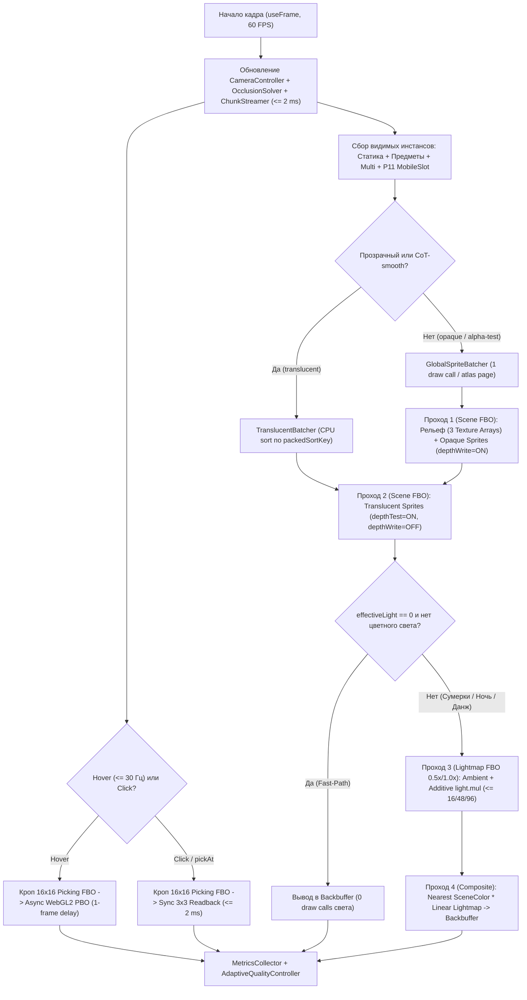
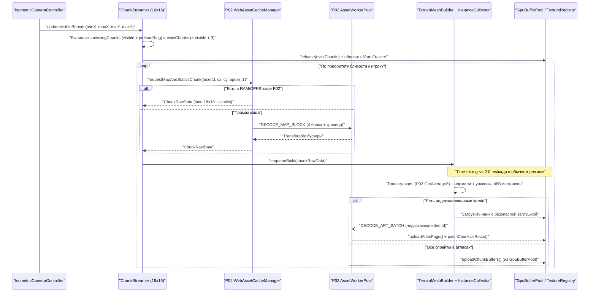
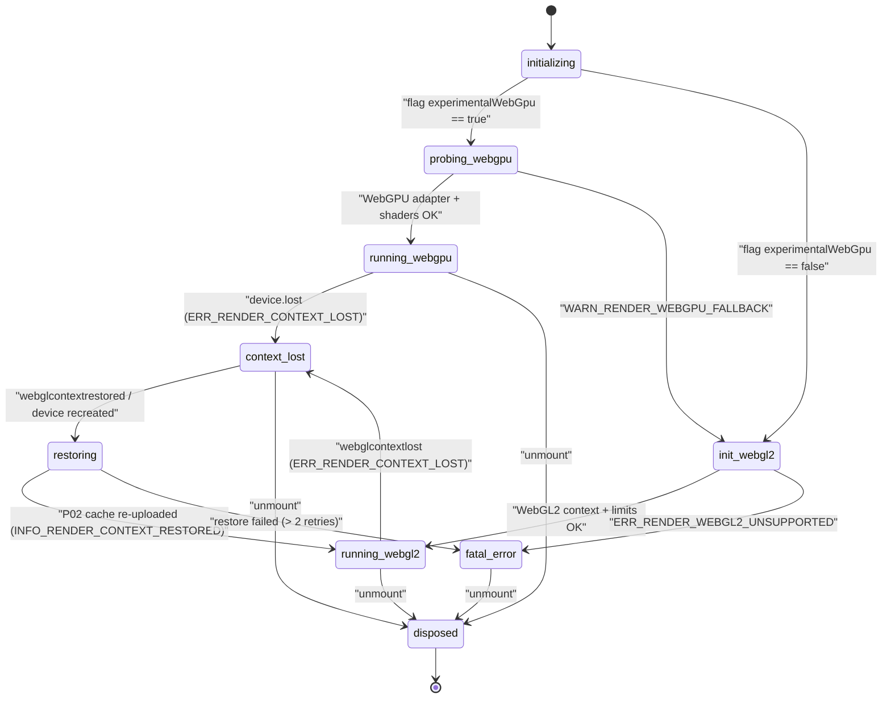

# Design: P10 Рендерер мира

## Context

Фаза **P10 Рендерер мира** реализует графическое ядро клиента `apps/client` в вехе **M1 «Первый шаг по Заре»** (мотивацию и границы см. в [proposal.md](proposal.md), поведенческие контракты — в `specs/render/*/spec.md`).

Проект опирается на уже зафиксированные контракты и архитектурные ограничения из [docs/ARCHITECTURE.md](../../../docs/ARCHITECTURE.md):
- **ADR-001 (Монорепозиторий):** клиент (`apps/client`) не импортирует серверный код; общие типы находятся в `packages/domain`, детерминированные чистые формулы (включая рельеф P03 и ключи сортировки UO) — в изоморфном `packages/rules`, парсеры форматов — в `packages/uo-formats`.
- **ADR-002 (Модель ассетов):** проприетарные файлы UO никогда не попадают в репозиторий; вся разработка, unit-тесты и Playwright-снимки визуальной регрессии выполняются на процедурном CC0-синтетическом мире из P02 (`packages/test-kit`), записанном в подлинные бинарные форматы MUL/UOP с эталонными ориентирами (`town_plaza`, `stairs_ramp`, `los_wall_window`, `roofed_building`, `water_bridge`, `dungeon_cave`, `house_plot`, `sea_dock`).
- **ADR-003 («2.5D в настоящем 3D»):** Three.js + `@react-three/fiber` (v9), ортографическая камера (`44×44 px` ромб, `Z = 4 px`, зум `0.5×–2×`, pixel-snapping), меш рельефа с высотами и нормалями, спрайты в `InstancedMesh` с texture arrays и MaxRects-атласами из P02, кодирование порядка отрисовки UO в depth-буфер (`< 300` draw calls), шейдерная перекраска `hues` по LUT `32×3001`, освещение `0..26` + аддитивный проход `light.mul`, скрытие крыш и круг прозрачности, GPU ID-буфер пикинга; WebGL2 обязателен, WebGPU — опциональный флаг.
- **ADR-004 / ADR-005:** React DOM-гампы располагаются поверх холста (P14); радиус AOI `18` тайлов (до `24`), радиус `multi` — `31` тайл; патчи состояния — `20 Гц`.
- **ADR-011 / ADR-012:** Playwright e2e с WebGL (SwiftShader) и визуальной регрессией; строгий CSP без `eval`.

На входе P10 уже доступны:
- **P01:** `Point3D`, `FacetId`, `Serial` (`Mobile < 0x40000000`, `Item 0x40000000..0x7FFFFFFF`), `Hue` (`0x3FFF`/`0x8000`/`0x4000`), 64-битный `TileFlag`, `LAYER_DRAW_ORDER`, `worldToIsoScreen`/`isoScreenToWorld`, `GameClock`, `computeGlobalLightLevel` (`0..26`), `PERSON_HEIGHT = 16`, `STEP_HEIGHT = 2`, `SECTOR_SIZE = 16`.
- **P02:** `useAssetStore`, `WebAssetCacheManager` (OPFS/IDB/LRU), `AssetWorkerPool` (`DECODE_MAP_BLOCK`, `DECODE_ART_BATCH`), Texture Arrays (`texmaps64`, `texmaps128`, `land44`), MaxRects RGBA8888-атласы (1 px экструзия), `hues` LUT `32×3001` RGBA8888, `light` R8-атлас, `tiledata`, `multi`.
- **P03:** изоморфные `getAverageZ`, `interpolateLandZ`, `isIgnoredLandTile` в `packages/rules/src/world/*` (`calcTileHeight` — из P01).
- **P09:** экран-контейнер игрового мира, готовый bootstrap ассетов, профиль настроек клиента и глобальная обработка фатальных ошибок.

## Goals / Non-Goals

**Goals:**
- Построить гибридный конвейер Three.js + R3F, где React управляет только жизненным циклом холста и подписками настроек, а горячий цикл `60 FPS` работает императивно с нулевыми React ре-рендерами и нулевыми аллокациями в куче.
- Гарантировать биективное монотонное кодирование канонического порядка отрисовки UO в стандартный 24-битный буфер глубины без z-fighting на картах до `7168×4096` и зарезервировать слоты для 24 слоёв экипировки мобайлов (P11).
- Удержать бюджет `< 300` draw calls (целевой `< 120` на типовой городской сцене), `60 FPS` в `1920×1080` на интегрированной графике (профиль `medium`), расход VRAM `≤ 384 МиБ` и time-slicing загрузок чанков `≤ 2 мс/кадр`.
- Обеспечить пиксельно-точный пикинг без просадок GPU-конвейера через `16×16` кроп-проход + асинхронный WebGL2 PBO-буфер при наведении и синхронный отклик `≤ 2 мс` при клике.
- Спроектировать чистые расширяемые контракты подключения для P11 (мобайлы и оверлеи), P12 (движение и камера), P13 (предметы), P14 (гампы и таргетинг), P23–P25 (дома/корабли/погода) и P28 (динамический свет и эффекты).

**Non-Goals:**
- Декодирование и скелетно-кадровая стейт-машина анимаций мобайлов, слоёв экипировки и оверлеев речи/здоровья (зона **P11**).
- Клиентское предсказание шагов, валидация движения и поиск пути A* (зона **P12**).
- Сетевые комнаты Colyseus и синхронизация StateView (зона **P07**; P10 читает данные через абстракцию `WorldRenderDataSource`).
- Логика перетаскивания предметов, контейнеров, React-гампов и курсоров целеуказания (зоны **P13–P14**).
- Серверные погодные частицы, перекраска сезонов и позиционный звук (зоны **P25**, **P28**).

## Decisions

### D1. Экранно-выровненная 2.5D ортографическая камера в Three.js с императивным горячим циклом
- **Выбор:** Холст монтируется декларативно через `@react-three/fiber` (`<Canvas orthographic frameloop="always" gl={{ antialias: false, alpha: false, depth: true, stencil: false, powerPreference: 'high-performance' }}>`), однако весь цикл кадра (`WorldRendererEngine.renderFrame`) выполняется императивно в едином `useFrame(..., 1)` с отключённым авторендером R3F (`gl.autoClear = false`) и прямым управлением проходами. Вместо 3D-камеры, повёрнутой на 45°/35.264° (где погрешности матриц портят 1:1 тексели спрайтов), используется **экранно-выровненная `OrthographicCamera`** в канонической логической системе пикселей UO:
  - `worldPlaneX = (wx - wy) * 22`
  - `worldPlaneY = -((wx + wy) * 22 - wz * 4)` (ось Y вверх в Three.js соответствует `-isoY`)
  - Ортографический фрустум: `left = camX - halfW`, `right = camX + halfW`, `top = camY + halfH`, `bottom = camY - halfH`, `near = 0`, `far = 1`, где `halfW = (viewportW / 2) / zoom`, `halfH = (viewportH / 2) / zoom`.
  - Pixel-snapping применяется к `(camX, camY)` с шагом `step = 1 / (zoom * effectiveDpr)`.
- **Обоснование:** Полностью исключает субпиксельный дрейф и диагональное мыло на спрайтах `44×44 px`, гарантирует 100 % совпадение с формулами `worldToIsoScreen`/`isoScreenToWorld` из P01 (`packages/domain`), при этом сохраняя настоящую 3D-геометрию вершинного смещения рельефа, аппаратный depth-буфер и полную экосистему Three.js/R3F (ADR-003).
- **Отвергнутые альтернативы:**
  - *Классическая 3D-камера под углом 45°/30° с billboard-спрайтами:* вызывает накопление ошибок округления на краях спрайтов, искажает соотношение `Z = 4 px` к `44×44 px` и усложняет точный `44×44` pixel-snapping.
  - *Декларативные React-компоненты `<mesh>` для каждого чанка/предмета:* создаёт реконсиляцию React при движении и обновлениях AOI 20 Гц, провоцируя микрофризы GC.

### D2. Биективное 23-битное монотонное кодирование порядка отрисовки UO в 24-битный буфер глубины
- **Выбор:** Вычисление канонического ключа сортировки UO выносится в чистый изоморфный модуль `packages/rules/src/render/draw-order.ts` (тестируемый в Node/Vitest без WebGL!). Ключ строится из скользящей относительной диагонали `relDiag = clamp((x + y) - baseDiag, 0, 255)`, высоты с порогом `sortZ = clamp(priorityZ + threshold + 128, 0, 259)` и детерминированного подслота `subSlot ∈ [0..125]`:
  - `packedSortKey = relDiag * 32_760 + sortZ * 126 + subSlot` (`0 .. 8_386_559`, строго `< 2^23 = 8_388_608`).
  - Преобразование в клип-пространство вершинного шейдера (`GL_LEQUAL`, меньше = ближе к камере):
    `z_ndc = 1.0 - float(packedSortKey) * (1.0 / 4194304.0)` (т.е. `1.0 - key * 2^-22`, диапазон `(-1.0, +1.0]`).
    После viewport-преобразования `depth01 = z_ndc * 0.5 + 0.5 = 1.0 - key * 2^-23`, что даёт шаг ровно `2.0` дискретные единицы в стандартном `24`-битном буфере глубины (`DEPTH_COMPONENT24`) и минимум `2` ULP в `float32` на всём отрезке `[-1, 1]`.
  - **Распределение `126` подслотов** по `invThreshold = 3 - threshold` (более высокий `invThreshold` = более высокий базовый `priorityZ` при равном `sortZ`, точный тай-брейкер ClassicUO!):
    - `threshold = 3` (`invT = 0`, слоты `0..15`, 16 слотов): мировые эффекты / оверлеи (P11/P28).
    - `threshold = 2` (`invT = 1`, слоты `16..79`, 64 слота): `16..27` статика (12 слотов), `28..35` компоненты `multi` (8 слотов), `36..47` динамические предметы включая `+1` дубль стопки (12 слотов), `48..79` **мобайл + маунт + 24 слоя экипировки `LAYER_DRAW_ORDER`** (32 слота для P11!).
    - `threshold = 1` (`invT = 2`, слоты `80..105`, 26 слотов): `80..91` статика (`Background` с `height > 0` или плоские `!Background`), `92..97` `multi`, `98..105` плоские динамические предметы и стопки.
    - `threshold = 0` (`invT = 3`, слоты `106..125`, 20 слотов): `106` земля (`Land`), `107..115` плоская фоновая статика (ковры, полы), `116..119` фоновые `multi`, `120..125` плоские фоновые предметы.
  - **База диагонали `baseDiag`** передаётся uniform-параметром `uBaseDiag = floor(camTileX + camTileY) - 128` в вершинный шейдер! В буферах чанка хранятся абсолютный `(x + y)` (как `float`/`int`) и упакованный `(sortZ * 126 + subSlot)`, поэтому при ходьбе на тысячи тайлов геометрия чанков **не пересобирается** при смене `baseDiag`.
  - **Полупрозрачный проход:** все объекты с `alpha < 1.0` (`Translucent`, `AlphaBlend`, затухающие кроны/крыши, CoT-стены в режиме `smooth`, призраки) отправляются в отдельный динамический `TranslucentBatcher`, сортируемый на CPU по возрастанию `packedSortKey` (`O(K log K)` для `K ≈ 50..400` спрайтов, `< 0.1 мс/кадр`) с `depthTest = true, depthWrite = false`.
- **Обоснование:** Математически гарантирует нулевой z-fighting и 100 % воспроизведение классического порядка UO при произвольном порядке батчинга непрозрачной геометрии (`InstancedMesh`), позволяя уложить весь кадр в `< 120` draw calls (при лимите `< 300`).
- **Отвергнутые альтернативы:**
  - *Полная CPU-сортировка всех 5 000+ спрайтов и отрисовка по одному с переключением текстур:* разрушает батчинг (> 1 000 draw calls) и нарушает ADR-003.
  - *Линейная глубина без упаковки `relDiag` (`x + y` напрямую на всю карту `7168×4096`):* требует `11 264 × 260 × 126 ≈ 3.69 × 10^8` уровней, что в 22 раза превышает точность 24-битного depth-буфера и вызывает массовый z-fighting.

### D3. Чанки `16×16` с 1-тайловым apron для нормалей, Texture Arrays для земли и инстансные батчи для спрайтов
- **Выбор:** Мир делится на чанки `16×16` тайлов (`2×2` блока UO = 1 пространственный сектор P01/P03). `ChunkStreamer` управляет жизненным циклом чанков:
  - Загрузка данных блока выполняется асинхронно через `AssetWorkerPool` (`DECODE_MAP_BLOCK` из P02) с чтением 1-тайлового поля (итого `18×18` высот вершин для чанка `16×16`), что позволяет вычислять нормали граничных вершин по формуле `normalize(vec3(zLeft - zRight, zTop - zBottom, 8.0))` **побитово идентично** между соседними чанками.
  - Рельеф чанка делится на 3 компактных саб-меша с разделяемыми материалами: `landFlatMesh` (`land44` Texture Array), `landTex64Mesh` (`texmaps64` Texture Array) и `landTex128Mesh` (`texmaps128` Texture Array). Диагональ каждого растянутого тайла выбирается строго по правилу `GetAverageZ` из P03 (`|zTop - zBottom| > |zLeft - zRight|` → `Left–Right`, иначе `Top–Bottom`); P03 не экспортирует отдельную функцию, поэтому P10 выносит это правило в чистую `getDiagonalSplit` рядом с `getAverageZ` в `packages/rules/src/world/elevation.ts`, а `getAverageZ` P03 переиспользует её. Игнорируемые тайлы (`isIgnoredLandTile` из P03) пропускаются.
  - Статика чанка группируется по `(atlasPageId)` в компактные `InstancedBufferGeometry`-пакеты (объединяемые на уровне видимого фрустума в **глобальные страничные инстанс-батчи `GlobalSpriteBatcher`** по одной `InstancedMesh` на страницу атласа! При 4–8 активных страницах атласа вся видимая статика, динамические предметы и `multi` рисуются за **4–8 draw calls суммарно** вместо `N_chunks × N_pages`!).
  - Потоковое кольцо: видимые чанки + кольцо предзагрузки `preloadRing` (`1` на low/medium, `2` на high) + радиус выгрузки с гистерезисом `evictRadius = visibleRadius + 3`. Построение и загрузка чанков ограничены бюджетом `≤ 2.0 мс/кадр` (приоритетная очередь по расстоянию Чебышёва от игрока). При смене фасета все чанки и буферы немедленно очищаются через `BufferPool.release()` / `dispose()`.
- **Обоснование:** Агрегация статических и динамических спрайтов по страницам атласа на уровне кадра радикально снижает число draw calls (с ~150–400 при по-чанковых draw calls до **~35–90 draw calls** даже на зуме `0.5×` в 4K!), а чанковый кэш инстанс-записей (плоские `Float32Array`/`Uint32Array`) делает сборку кадра простым `TypedArray.set()` (менее `0.4 мс` для `4 000` спрайтов).
- **Отвергнутые альтернативы:**
  - *Отдельный draw call на каждую пару `(чанк × страница атласа)`:* при 36 видимых чанках (на `0.5×` зуме) и 8 страницах атласа даёт `288+` draw calls только на статику, нарушая бюджет `< 300`.
  - *Крупные чанки `64×64`:* слишком долгая единовременная сборка (`> 10 мс` пик) и крупная гранулярность выгрузки.

### D4. Единый спрайтовый GLSL-шейдер: `hues` LUT `32×3001`, `PartialHue`, `Foliage`, `CoT` и подсветка
- **Выбор:** Все спрайты мира (статика, динамические предметы, компоненты `multi` и слоты мобайлов P11) используют единый `RawShaderMaterial` (GLSL ES 3.00 для WebGL2) с компактным `48`-байтным дескриптором инстанса (`12 × 32-bit` слотов в чередующемся `InstancedInterleavedBuffer`):
  - `aPosSize` (`vec4`: `isoX`, `isoY`, `width`, `height`) — 16 Б.
  - `aUvRect` (`vec4`: `u0`, `v0`, `u1`, `v1`, с учётом 1 px экструзии P02) — 16 Б.
  - `aMeta` (`uvec4` или 2×`vec4` packed: `absDiag`, `sortZAndSubSlot`, `hueAndFlags`, `pickIdAndFade`) — 16 Б (итого **48 байт/инстанс**, выровнено по 16 байт для GPU; 8 000 инстансов = всего `384 КиБ`!).
  - В фрагментном шейдере:
    1. Считывание `texColor` из страницы атласа (`NearestFilter` на кратном зуме / sharp-bilinear на дробном); `if (texColor.a < 0.5) discard;` (в непрозрачном проходе).
    2. Перекраска `hues`: если `hueId ∈ [1..3000]`, восстанавливаются `r5 = round(texColor.r * 31.0)`, `g5 = round(texColor.g * 31.0)`, `b5 = round(texColor.b * 31.0)`. При `partialHue` проверяется `r5 == g5 && g5 == b5`; иначе выбирается `texelFetch(uHuesLut, ivec2(int(r5), int(hueId)), 0)` (использование `texelFetch` вместо UV-интерполяции исключает любые ошибки округления индекса строки `1..3000`!).
    3. Круг прозрачности (`uCotEnabled`): если установлен бит `FLAG_COT_ELIGIBLE` и `vPackedSortKey > uPlayerSortKey`, вычисляется дистанция до `uCotCenterPx`: на профиле `low` применяется упорядоченный 4×4 Bayer dithering с `discard`, а на `medium`/`high` затронутые экземпляры перенаправляются в `TranslucentBatcher` для гладкого радиального перехода `smoothstep(R - 16.0, R, d)`.
    4. Подсветка наведения: если `vPickId == uHoveredPickId && uHoveredPickId != 0u`, итоговый цвет усиливается мягким акцентом `mix(color, color * 1.18 + vec3(0.04), uHighlightStrength)`.
  - Цветовое пространство рендерера фиксируется как pass-through без автоматического tone-mapping (`renderer.toneMapping = THREE.NoToneMapping`, текстуры атласов и `hues` LUT загружаются в линейном сквозном режиме без двойного sRGB-преобразования), гарантируя побитовое совпадение цветов днём (`≤ 1/255`).
- **Обоснование:** `texelFetch` в GLSL ES 3.00 даёт абсолютно точную адресацию таблицы `32×3001`, а выровненный 48-байтный формат инстанса обеспечивает минимальный трафик шины CPU→GPU и переиспользуется целиком в P11.
- **Отвергнутые альтернативы:**
  - *Отдельные материалы для каждого `hueId` или `partialHue`:* разрушает батчинг, плодит тысячи шейдерных программ.
  - *Стандартный `MeshStandardMaterial` Three.js с PBR/tone-mapping:* искажает оригинальную палитру UO и добавляет лишние инструкции шейдера.

### D5. Двухпроходный конвейер освещения (`light.mul` Lightmap + дневной fast-path)
- **Выбор:** Пайплайн использует два внеэкранных буфера (управляемых `RenderTargetPool`):
  1. `sceneColorTarget` (`RGBA8`, `NearestFilter`, `DEPTH_COMPONENT24`, разрешение `viewportW × viewportH × effectiveDpr`) — принимает проход 1 (непрозрачный рельеф + непрозрачные спрайты + P11 непрозрачные мобайлы) и проход 2 (отсортированный полупрозрачный проход).
  2. `lightmapTarget` (`RGBA8`, `LinearFilter`, без depth, разрешение `0.5×` на `low`/`medium` или `1.0×` на `high`) — очищается цветом окружающего освещения `effectiveAmbientRgb = ambientBrightness(effectiveLight) * phaseTint`, после чего в него аддитивно (`AdditiveBlending`: `GL_ONE, GL_ONE`) рисуются инстансные квады всех видимых источников света (до лимита профиля `16` / `48` / `96`, отсортированных по квадрату экранного расстояния от центра камеры), сэмплируя одноканальный R8-атлас `light.mul` из P02.
  3. **Композитный проход (Fullscreen Triangle):** сэмплирует `sceneColorTarget` через `texelFetch` / `NearestFilter` (нулевое размытие пиксель-арта!) и умножает на билинейно-интерполированный `lightmapTarget` с мягким ограничением `min(lightColor, vec3(1.0))`.
  4. **Дневной fast-path:** когда `effectiveLight === 0` и нет активных цветных специальных излучателей, `lightmapTarget` **не очищается и не рисуется** (0 draw calls на свет), а сцена рендерится напрямую в основной буфер холста (минус 1 fullscreen-проход и 1 копия кадра!).
- **Обоснование:** Полностью соответствует ADR-003 (глобальный свет `0..26`, персональный свет, аддитивные маски `light.mul`), даёт огромную экономию GPU-fillrate днём (когда проходит большая часть геймплея) и идеально гладкие ореолы факелов ночью при сохранении пиксельной резкости спрайтов.
- **Отвергнутые альтернативы:**
  - *Расчёт точечных источников света циклом в фрагментном шейдере каждого спрайта:* квадратично растёт по числу источников (`48–96` итераций на каждый пиксель 1080p) и не позволяет использовать аутентичные фигурные маски из `light.mul`.

### D6. Локально-связное поэтажное скрытие крыш (`RoofOcclusionSolver`) и затухание `Foliage`
- **Выбор:** При смене тайла игрока `(px, py, pz)` или изменении активных `multi` запускается детерминированный `RoofOcclusionSolver`:
  1. Проверяется столбец над `(px, py)` и 8 соседями `3×3` на наличие статических или `multi`-тайлов с флагами `Roof`, `Surface` или `Wall` и `tile.z >= pz + PERSON_HEIGHT (16)` (с приоритетом прямого перекрытия над `(px, py)`). Находится минимальное `cutZ`.
  2. Если `cutZ !== null` и `roofHidingEnabled`:
     - Если перекрывающий тайл принадлежит `multi` с серийником `S` — скрываются все компоненты и динамические предметы внутри AABB этого `multi` с `z >= cutZ`.
     - Иначе (статическое здание на карте) — выполняется ограниченный BFS-обход (максимум `256` связанных тайлов, `< 0.15 мс`) по смежным 4-соседним тайлам, имеющим статику с `Roof`/`Surface`/`Wall` на `z >= cutZ - 4`, формируя компактную битовую маску `hiddenFootprintSet` для данного здания.
     - При настройке `roofMode === 'global'` вместо `hiddenFootprintSet` используется глобальный порог `z >= cutZ` на весь вьюпорт.
  3. Плавность: `OcclusionFadeTracker` хранит интерполируемую непрозрачность (`0.0..1.0`, длительность `150 мс`) для недавно скрытых/открытых групп крыш и для связной кроны `Foliage` (BFS по `Foliage`-тайлам, пересекающим экранный прямоугольник игрока, целевая альфа `0.35`). На профиле `low` и в детерминированном режиме снимков длительность перехода равна `0 мс`.
- **Обоснование:** Решает главную визуальную проблему наивного `maxDrawZ` — скрытие крыш соседних зданий через улицу — оставаясь сверхбыстрым (`< 0.15 мс` только при смене тайла, не каждый кадр!) и корректно работая на многоэтажных зданиях (`roofed_building` из P02).
- **Отвергнутые альтернативы:**
  - *Глобальный `maxDrawZ` как единственный режим:* скрывает крыши всех домов на экране, когда игрок зашёл под козырёк одного магазина.
  - *Скрытие только тайлов строго с флагом `Roof`:* оставляет «висящие в воздухе» полы, стены и мебель второго этажа в многоэтажных домах.

### D7. Локальный `16×16` кроп-пикинг по GPU ID-буферу с асинхронным WebGL2 PBO и синхронным кликом
- **Выбор:** `GpuPickingSystem` использует миниатюрную цель рендеринга `16×16` пикселей (`RGBA8` + `DEPTH_COMPONENT24`, всего `1 КиБ` VRAM!) и смещённую ортографическую матрицу, охватывающую ровно `16×16` физических пикселей вокруг `(cursorPhysX, cursorPhysY)`.
  - **24-битное кодирование ID:** `pickId ∈ [1..16_777_214]` упаковывается в `RGB8` (`r = (id >> 16) & 0xFF`, `g = (id >> 8) & 0xFF`, `b = id & 0xFF`, `a = 255`); `0` = пустота (`kind = 'none'`). `PickingRegistry` хранит компактные параллельные массивы метаданных (переиспользуемые без аллокаций).
  - **Геометрический фильтр:** в проход пикинга отправляются только те 1–4 чанка, чей экранный AABB пересекает квадрат `16×16` вокруг курсора, плюс пересекающие динамические предметы, `multi` и слоты мобайлов (P11). Все скрытые крыши, затухшие `Foliage` и `NoDraw`-тайлы исключаются; CoT-шейдер применяет `if (cotVisibility < 0.25) discard;` с учётом смещения кропа `uCropOriginPx`!
  - **Два режима чтения:**
    - *Hover (`pointermove`):* не чаще `30 Гц` (и только если курсор сдвинулся или изменилась версия сцены) рендерится `16×16` кроп, запускается неблокирующий `gl.readPixels` в кольцевой буфер из `2` WebGL2 **Pixel Buffer Objects (`PIXEL_PACK_BUFFER`)** с `gl.fenceSync`; результат считывается через 1 кадр (`gl.clientWaitSync(..., 0)` — **0 мс блокировки CPU!**).
    - *Click / API (`pickAt(clientX, clientY)`):* выполняется немедленный рендер `16×16` кропа для точных координат и синхронный `readPixels` блока `3×3` (36 байт — `< 0.8 мс` на GPU/SwiftShader, гарантированно `≤ 2 мс`), обеспечивая 100 % свежесть цели и поддержку допуска `3×3` для тонких предметов (`mobile > item`).
  - **DOM-изоляция:** подписка на события проверяет `event.target === canvasElement`; при попадании курсора на любой DOM-элемент поверх холста (P14 гампы) или `pointerleave` состояние `hoveredTarget` мгновенно сбрасывается в `none`.
- **Обоснование:** Уменьшает fillrate пикинга в **8 100 раз** по сравнению с полноэкранным 1080p ID-буфером, устраняет просадки от `gl.readPixels` во время hover и гарантирует попиксельное совпадение с тем, что видит игрок (включая альфа-вырез спрайтов, глубину и круг прозрачности).
- **Отвергнутые альтернативы:**
  - *Полноэкранный `1920×1080` ID-буфер каждый кадр:* тратит `16+ МиБ` VRAM и удваивает нагрузку на растеризатор.
  - *CPU raycasting по AABB спрайтов:* не учитывает прозрачные края RLE-спрайтов, склоны рельефа, сложные перекрытия и круг прозрачности.

### D8. Абстракция графического бэкенда (WebGL2 по умолчанию, опциональный WebGPU) и восстановление контекста
- **Выбор:** Инициализация графического драйвера инкапсулирована в `RendererBackendFactory`:
  - По умолчанию создаётся WebGL2-контекст (с проверкой `MAX_TEXTURE_SIZE >= 2048`, `MAX_ARRAY_TEXTURE_LAYERS >= 256`). При отсутствии WebGL2 генерируется `RenderInitError('ERR_RENDER_WEBGL2_UNSUPPORTED')`, передаваемый в экран диагностики P09.
  - При `settings.experimentalWebGpu === true` выполняется проверка `navigator.gpu?.requestAdapter()` и попытка инициализации `WebGPURenderer` (Three.js r17x + TSL-эквиваленты шейдеров для земли, спрайтов, света и пикинга). Любая ошибка или таймаут (`3 000 мс`) перехватывается, логируется `WARN_RENDER_WEBGPU_FALLBACK` и прозрачно запускает WebGL2-бэкенд.
  - На холст навешиваются слушатели `webglcontextlost` (`event.preventDefault()`, перевод FSM в `context_lost`, пауза `useFrame`, безопасный возврат `kind = 'none'` в пикинге, событие `ERR_RENDER_CONTEXT_LOST`) и `webglcontextrestored` (пересоздание `RenderTargetPool`, повторная загрузка `hues` LUT, `light` atlas, `texmaps` Texture Arrays и активных страниц атласов из кэша P02 OPFS/RAM, пересборка активных чанков, событие `INFO_RENDER_CONTEXT_RESTORED`).
- **Обоснование:** Выполняет ADR-003 (WebGL2 обязателен, WebGPU опциональный флаг) без риска сломать стабильность у пользователей с проблемными драйверами WebGPU и делает клиент устойчивым к пробуждению ноутбука / сбросу TDR драйвера.
- **Отвергнутые альтернативы:**
  - *WebGPU как единственный бэкенд:* по-прежнему ограниченная поддержка в ряде Linux/Safari/VM-окружений и в CI SwiftShader.
  - *Перезагрузка страницы при `webglcontextlost`:* рвёт игровое соединение Colyseus и может привести к гибели персонажа в бою.

### D9. Контракты интеграции с P09, P11, P12, P13, P14, P23–P25, P28 и детерминированный режим CI
- **Выбор:** P10 не импортирует код P07/P11–P14, а предоставляет строгие TypeScript-интерфейсы и Zustand-сторы в `apps/client/src/renderer/contracts/`:
  - `WorldRenderDataSource`: адаптер данных мира (чтение блоков карты/статики через P02 `WebAssetCacheManager`, подписка на динамические `WorldItemRenderState`, `MultiRenderState`, `GlobalLightingState`, `ActiveFacetInfo`). В M1 подключаются `SyntheticWorldDataSource` (для standalone/CI) и сетевой адаптер из P07/P12.
  - `MobileRenderSlot` (для P11): регистрация анимированных мобайлов с массивом слоёв (тело, маунт, до 24 слоёв экипировки с порядком `LAYER_DRAW_ORDER` из P01), разделяющих тот же `GlobalSpriteBatcher`, `WorldDepthEncoder` (32 выделенных подслота!), `hues` LUT, `CoT` и `PickingRegistry` (`kind = 'mobile'`).
  - `CameraTargetProvider` (для P12): чтение субтайловой позиции `(x, y, z)`, флага телепортации и API `worldToScreen` / `screenToWorldPlane`.
  - `DynamicLightRegistry` (для P11/P28): регистрация временных источников света `(id, worldPos, lightId, colorRgb, intensity)`.
  - `RenderControlApi` (для P09/P14/Playwright): управление профилем качества, вьюпортом, пикингом `pickAt`, а также **детерминированным режимом снимков** (`enableDeterministicSnapshotMode({ fixedTimeMs, waitForChunksReady })`), гарантирующим `SSIM >= 0.99` в Playwright SwiftShader.
- **Обоснование:** Чистая инверсия зависимостей позволяет реализовывать и тестировать P10 полностью автономно на синтетическом мире P02, а затем подключать P11 и P12 без рефакторинга ядра рендерера.

---

## Architecture & Contracts

### 1. Структура модулей в монорепозитории

| Пакет / приложение | Модули | Ответственность |
|---|---|---|
| `packages/domain` | `src/render/types.ts`, `src/render/errors.ts` | Перечисления `RenderCategory` (`Land..Effect`), `QualityProfileId` (`low`/`medium`/`high`/`auto`), `RenderBackendKind` (`webgl2`/`webgpu`), типы `PickTarget`, `RenderErrorCode` (`ERR_RENDER_*`, `WARN_RENDER_*`, `INFO_RENDER_*`). |
| `packages/rules` | `src/render/draw-order.ts`, `src/render/lighting-curve.ts` | Изоморфные чистые формулы (без WebGL!): `computeSortThreshold`, `packWorldSortKey`, `encodeDepthNdc`, `computeAmbientBrightness`, `resolveEffectiveLightLevel`, `clampCircleOfTransparencyRadius`. |
| `packages/test-kit` | `src/render/scene-fixtures.ts` | Детерминированные сценарии и камеры для эталонных ориентиров синтетического мира P02 (`town_plaza`, `stairs_ramp`, `los_wall_window`, `roofed_building`, `water_bridge`, `dungeon_cave`, `house_plot`, `sea_dock`), генераторы стресс-сцен (40+ источников света, стопки предметов, 2-этажные дома). |
| `apps/client` | `src/renderer/contracts/*` | Контракты `WorldRenderDataSource`, `MobileRenderSlot`, `CameraTargetProvider`, `DynamicLightRegistry`, `RenderControlApi`, `RendererSettingsSnapshot`. |
| `apps/client` | `src/renderer/camera/*` | `IsometricCameraController`, `ViewportManager`, `PixelSnapper`, `FrustumTileBounds`, `CameraFollowSmoother`. |
| `apps/client` | `src/renderer/terrain/*` | `ChunkStreamer`, `ChunkCache` (гистерезис + LRU), `TerrainMeshBuilder` (1-тайловый apron, диагонали P03, нормали), `StaticInstanceCollector`, `DynamicItemLayer`, `MultiLayer`, `TileAnimationClock`. |
| `apps/client` | `src/renderer/batching/*` | `GlobalSpriteBatcher` (по страницам атласа), `TranslucentBatcher` (CPU-сортировка по `packedSortKey`), `GpuBufferPool`, `GpuTextureRegistry` (привязка P02 Texture Arrays, MaxRects-атласов, `hues` LUT, `light` R8). |
| `apps/client` | `src/renderer/shaders/*` | GLSL ES 3.00 шейдеры (`terrain.vert/frag`, `sprite.vert/frag`, `light.vert/frag`, `composite.vert/frag`, `picking.vert/frag`) и TSL-адаптеры для опционального WebGPU. |
| `apps/client` | `src/renderer/lighting/*` | `LightingController` (переходы `≤ 500 мс`, фазы суток), `LightCollector` (приоритетный лимит `16/48/96`), `LightmapPass`, `CompositePass`. |
| `apps/client` | `src/renderer/occlusion/*` | `RoofOcclusionSolver` (детекция + BFS / `multiSerial` / global `maxDrawZ`), `FoliageFadeController`, `CircleOfTransparencyController`. |
| `apps/client` | `src/renderer/picking/*` | `GpuPickingSystem` (`16×16` кроп + WebGL2 PBO + синхронный клик), `PickingRegistry`, `HoverHighlightController`, `DomOverlayPointerGuard`. |
| `apps/client` | `src/renderer/performance/*` | `QualityProfileManager`, `AdaptiveQualityController` (гистерезис `3 с` / `10 с`), `VramTracker`, `FrameTimeSlicingQueue`, `MetricsCollector`, `RenderDiagnosticsOverlay`. |
| `apps/client` | `src/renderer/core/*` | `WorldRendererEngine`, `RendererBackendFactory`, `ContextLossRecoveryManager`, React-обёртка `<WorldCanvas />`, Zustand-сторы (`useRendererSettingsStore`, `useRendererMetricsStore`, `usePickingStore`). |

### 2. Диаграмма 1: Многопроходный конвейер одного кадра



### 3. Диаграмма 2: Потоковая загрузка чанков и интеграция с кэшем ассетов P02



### 4. Диаграмма 3: Конечный автомат жизненного цикла рендерера, WebGPU fallback и Context Loss



### 5. Форматы буферов GPU, контракты и математические формулы

#### 5.1. Выровненный формат инстанса спрайта (`48` байт, `InstancedInterleavedBuffer`)

| Атрибут | Смещение | Тип GLSL | Поля и упаковка |
|---|---|---|---|
| `aPosSize` | `0..15` | `vec4` | `x = isoX`, `y = -isoY`, `z = widthPx`, `w = heightPx` |
| `aUvRect` | `16..31` | `vec4` | `x = u0`, `y = v0`, `z = u1`, `w = v1` (внутренний прямоугольник внутри 1 px экструзии P02) |
| `aDepthHue` | `32..39` | `uvec2` | `x`: `[31..16] absDiag (uint16)`, `[15..0] sortZ * 126 + subSlot (uint16)`; `y`: `[15..0] hueId (0..3000)`, `[16] partialHue`, `[17] cotEligible`, `[18] foliage`, `[19] flipX (для P11!)`, `[20..27] alphaByte (0..255)` |
| `aPickMeta` | `40..47` | `uvec2` | `x`: `pickId (0..16_777_214, 24-bit)`; `y`: зарезервировано (`highlightGroup` / `buildingId`) |

#### 5.2. Формат вершины рельефа (`32` байта на вершину, `4` вершины и `6` индексов на тайл)
- `aPosition` (`vec3`, 12 Б): `(isoX, -isoY, rawDepthMeta)` где `rawDepthMeta` кодирует `absDiag` и `landSortZ` тайла.
- `aNormal` (`vec3`, 12 Б): нормализованный вектор склона `(nx, ny, nz)`.
- `aTexCoordLayer` (`vec3` или `vec2 + float`, 12 Б → итого 36 Б, либо сжатые `int16` нормали → **28 Б/вершина**): `(u, v)` ∈ `[0, 1]` и `layerIndex` в Texture Array (`land44` / `texmaps64` / `texmaps128`) + `pickId` тайла (`uint32`, +4 Б = **32 Б/вершина**).
- **Расчёт VRAM на чанк `16×16`** (`256` тайлов земли, ~`400` статики):
  - Рельеф: `256 × 4 верш. × 32 Б + 256 × 6 × 2 Б = 35.8 КиБ`.
  - Статика CPU/GPU кэш: `400 × 48 Б = 19.2 КиБ`.
  - **Итого ~55 КиБ на чанк!** Даже при `100` активных чанках в кэше геометрия занимает всего **~5.5 МиБ**!
  - Основной бюджет VRAM (`medium ≤ 384 МиБ`): `hues` LUT (`0.38 МиБ`) + `light` atlas (`~2 МиБ`) + `texmaps`/`land44` Texture Arrays (`~64–96 МиБ`) + `8–12` MaxRects-атласов `2048×2048` RGBA8888 (`128–192 МиБ`) + Scene/Lightmap/Picking FBO (`~16 МиБ`) + геометрия (`~6 МиБ`) = **~216–312 МиБ**, с комфортным запасом ниже `384 МиБ`!

#### 5.3. Ключевые математические формулы

1. **Проекция камеры и обратное преобразование (`render/isometric-camera`):**
   ```text
   // Прямая проекция (логические пиксели окна)
   isoX = (wx - wy) * 22
   isoY = (wx + wy) * 22 - wz * 4
   sx   = viewportX + viewportW * 0.5 + (isoX - snappedCamIsoX) * zoom
   sy   = viewportY + viewportH * 0.5 + (isoY - snappedCamIsoY) * zoom

   // Обратная проекция на плоскость planeZ
   isoX = (sx - viewportX - viewportW * 0.5) / zoom + snappedCamIsoX
   isoY = (sy - viewportY - viewportH * 0.5) / zoom + snappedCamIsoY
   syAdj = isoY + planeZ * 4
   wx   = (syAdj + isoX) / 44
   wy   = (syAdj - isoX) / 44

   // Pixel-snapping
   snapStep = 1.0 / (zoom * effectiveDpr)
   snappedCamIsoX = Math.round(rawCamIsoX / snapStep) * snapStep
   snappedCamIsoY = Math.round(rawCamIsoY / snapStep) * snapStep
   ```

2. **Упаковка ключа сортировки и 24-битной глубины (`render/draw-order`):**
   ```text
   // Порог tiledata (ClassicUO)
   threshold:
     Land                       => 0
     Static/Multi/Item:
       Background && height==0  => 0
       Background && height>0   => 1
       !Background && height==0 => 1
       !Background && height>0  => 2
     Mobile                     => 2
     WorldEffect                => 3

   relDiag       = clamp((x + y) - baseDiag, 0, 255)
   sortZ         = clamp(priorityZ + threshold + 128, 0, 259)
   packedSortKey = relDiag * 32760 + sortZ * 126 + subSlot   // [0 .. 8_386_559]
   z_ndc         = 1.0 - float(packedSortKey) / 4194304.0    // (-1.0 .. +1.0], шаг 2^-22
   ```

3. **Кривая темноты UO (`0..26..30`) и направленное затенение склонов (`render/hue-and-lighting`):**
   ```text
   effectiveLight = clamp(globalLightLevel - personalLightLevel, 0, 30)
   // Перцептивно калиброванная кривая UO:R (0 -> 1.0, 13 -> ~0.64, 26 -> 0.08, 30 -> 0.02)
   t = effectiveLight / 26.0
   brightness = effectiveLight <= 26
     ? mix(1.0, 0.08, pow(t, 1.35))
     : mix(0.08, 0.02, (effectiveLight - 26.0) / 4.0)

   // Нормаль склона рельефа (sunDir = normalize(vec3(-0.6, -0.5, 0.624)))
   slopeShade = clamp(0.86 + 0.22 * dot(vNormal, uSunDir), 0.72, 1.08)
   ```

4. **Перекраска `hues` и `PartialHue` в GLSL ES 3.00:**
   ```glsl
   vec4 texColor = texture(uAtlas, vUv);
   if (texColor.a < 0.5) discard;
   vec3 rgb = texColor.rgb;
   if (vHueId > 0 && vHueId <= 3000) {
     int r5 = int(floor(rgb.r * 31.0 + 0.5));
     int g5 = int(floor(rgb.g * 31.0 + 0.5));
     int b5 = int(floor(rgb.b * 31.0 + 0.5));
     if (!vPartialHue || (r5 == g5 && g5 == b5)) {
       rgb = texelFetch(uHuesLut, ivec2(r5, vHueId), 0).rgb;
     }
   }
   ```

#### 5.4. Матрица профилей качества (`render/performance-budget`)

| Параметр | `low` | `medium` (по умолчанию) | `high` |
|---|---|---|---|
| Потолок `effectiveDpr` | `1.0` | `1.5` | `2.0` |
| Масштаб световой карты (`lightmapScale`) | `0.5×` | `0.5×` | `1.0×` |
| Лимит активных источников света (`maxLights`) | `16` | `48` | `96` |
| Анимация воды (`animatedWater`) | `false` | `true` | `true` |
| Режим круга прозрачности (`cotMode`) | `dither` | `smooth` | `smooth` |
| Плавное затухание крыш/крон (`smoothOcclusionFade`) | `false` (`0 мс`) | `true` (`150 мс`) | `true` (`150 мс`) |
| Кольцо предзагрузки чанков (`preloadRing`) | `1` | `1` | `2` |
| Целевой лимит draw calls (`targetDrawCalls`) | `≤ 150` | `≤ 250` | `< 300` |
| Бюджет VRAM (`vramBudgetMiB`) | `192 МиБ` | `384 МиБ` | `512 МиБ` |

#### 5.5. TypeScript-контракты интеграции (`apps/client/src/renderer/contracts/`)

```ts
export interface WorldRenderDataSource {
  readonly facetId: FacetId;
  readonly facetWidth: number;
  readonly facetHeight: number;
  readChunkRaw(chunkX: number, chunkY: number): Promise<ChunkRawData>;
  getDynamicItems(): ReadonlyMap<ItemSerial, WorldItemRenderState>;
  getMultis(): ReadonlyMap<ItemSerial, MultiRenderState>;
  getLightingState(): GlobalLightingState;
  subscribe(listener: (event: WorldRenderDeltaEvent) => void): () => void;
}

export interface MobileRenderSlot {
  upsertMobile(mobile: MobileRenderInput): void; // до 32 слоёв с layerOrder из LAYER_DRAW_ORDER (P01)
  removeMobile(serial: MobileSerial): void;
  getMobileScreenAnchor(serial: MobileSerial): { x: number; y: number; visible: boolean } | null;
}

export type PickTarget =
  | { readonly kind: 'none' }
  | { readonly kind: 'land'; readonly landId: number; readonly x: number; readonly y: number; readonly z: number }
  | { readonly kind: 'static'; readonly itemId: number; readonly x: number; readonly y: number; readonly z: number; readonly hue: number }
  | { readonly kind: 'item'; readonly serial: ItemSerial; readonly itemId: number; readonly x: number; readonly y: number; readonly z: number; readonly hue: number }
  | { readonly kind: 'multi'; readonly serial: ItemSerial; readonly multiId: number; readonly componentIndex: number; readonly itemId: number; readonly x: number; readonly y: number; readonly z: number }
  | { readonly kind: 'mobile'; readonly serial: MobileSerial; readonly x: number; readonly y: number; readonly z: number };

export interface RendererMetricsSnapshot {
  readonly fps: number;
  readonly frameTimeAvgMs: number;
  readonly frameTimeP50Ms: number;
  readonly frameTimeP95Ms: number;
  readonly frameTimeP99Ms: number;
  readonly cpuRenderMs: number;
  readonly drawCalls: number;
  readonly triangles: number;
  readonly instancedSprites: number;
  readonly activeChunks: number;
  readonly visibleLights: number;
  readonly vramEstimateBytes: number;
  readonly atlasPagesBound: number;
  readonly pickingReadbackMs: number;
  readonly backend: 'webgl2' | 'webgpu';
  readonly activeProfile: 'low' | 'medium' | 'high';
  readonly autoMode: boolean;
}
```

#### 5.6. Каталог структурированных кодов диагностики (`packages/domain`)
- Ошибки: `ERR_RENDER_WEBGL2_UNSUPPORTED`, `ERR_RENDER_CONTEXT_LOST`, `ERR_RENDER_SHADER_COMPILE`, `ERR_RENDER_ATLAS_LIMIT_EXCEEDED`, `ERR_RENDER_INVALID_FACET_BOUNDS`.
- Предупреждения: `WARN_RENDER_WEBGPU_FALLBACK`, `WARN_RENDER_DRAW_CALL_BUDGET`, `WARN_RENDER_VRAM_PRESSURE`, `WARN_RENDER_PICKING_DROPPED`, `WARN_RENDER_LIGHT_LIMIT_CLAMPED`, `WARN_RENDER_MISSING_LIGHT_MASK`.
- Информационные события: `INFO_RENDER_CONTEXT_RESTORED`, `INFO_RENDER_PROFILE_DOWNGRADED`, `INFO_RENDER_PROFILE_UPGRADED`.

---

## Risks / Trade-offs

- **[Расхождение диагонали триангуляции склонов между рендерером P10 и серверной физикой P03]** → Обе стороны импортируют единое правило диагонали (`getDiagonalSplit`, извлекаемое P10 из `GetAverageZ` P03) и `isIgnoredLandTile` из `packages/rules/src/world/*`, плюс контрактный тест проверяет побитовое совпадение высот на всех склонах синтетического мира.
- **[Конфликты глубины на крайне перегруженных тайлах (> 12 статических объектов на одной высоте Z) или экстремальных мониторах 8K при зуме 0.5×]** → Подслоты безопасно зажимаются внутри своей категории без пролива в соседнюю категорию, а для `relDiag` при ширине/высоте вьюпорта сверх `256` диагоналей включается защитный резерв через `DEPTH_COMPONENT32F` на offscreen Scene FBO.
- **[Ограниченная стабильность драйверов WebGPU и различия TSL/GLSL между браузерами]** → WebGL2 закреплён единственным обязательным продакшен-бэкендом; WebGPU изолирован за флагом настроек с таймаутом и автоматическим откатом `WARN_RENDER_WEBGPU_FALLBACK`, а в CI обязательны тесты на WebGL2 (SwiftShader).
- **[Блокировка GPU-конвейера при синхронном `gl.readPixels` на слабых драйверах или в SwiftShader]** → Hover-пикинг всегда использует локальный `16×16` кроп + WebGL2 PBO с отложенным чтением через 1 кадр (`0 мс` stall), а синхронный `readPixels` ограничен крошечным блоком `3×3` исключительно в момент клика или явного вызова `pickAt`.
- **[Рост фрагментации VRAM при частой смене фасетов и телепортациях]** → Чанковые вершинные и инстансные буферы переиспользуются через `GpuBufferPool`, `VramTracker` запускает проактивную выгрузку при `> 85 %` бюджета, а e2e-тест многократных телепортаций проверяет стабилизацию счётчиков буферов.
- **[Ложное скрытие крыш соседнего вплотную примыкающего здания при локальном BFS]** → Для `multi` (дома/корабли) изоляция строго привязана к `multiSerial`, а для статических городских зданий BFS ограничивается `256` связанными тайлами и разрывом высоты `|ΔZ| > 4`; при желании пользователь может переключить режим на классический глобальный `maxDrawZ`.
- **[Двойная гамма-коррекция текстур в Three.js r17x (`SRGBColorSpace` по умолчанию)]** → Явно фиксируется сквозной цветовой пайплайн (`NoToneMapping`, `LinearSRGB` для атласов и `hues` LUT), и контрактный пиксельный тест сверяет RGB-выход с декодированным эталоном P02 с допуском `≤ 1/255`.
- **[Флаковость визуальных регрессионных тестов из-за микроразличий растеризации GPU/SwiftShader]** → Все CI-снимки прогоняются в детерминированном режиме (фиксированный `GameClock`, отключённые переходы, фиксированный `1280×720`, DPR `1.0`, фиксированный флаг Chromium `--use-gl=angle --use-angle=swiftshader`) с метрикой структурного сходства `SSIM ≥ 0.99`.

---

## Migration Plan

Фаза P10 добавляет клиентский рендерер мира в `apps/client` и чистые формулы глубины/освещения в `packages/domain` и `packages/rules` без миграций PostgreSQL и без ломающих изменений протокола. Порядок внедрения:
1. Добавить общие типы, коды диагностики (`packages/domain/src/render/*`) и изоморфные формулы порядка отрисовки и кривой освещения (`packages/rules/src/render/*`) со 100 % покрытием unit-тестами.
2. Реализовать камеру, преобразования координат и pixel-snapping (`apps/client/src/renderer/camera/*`) и проверить их детерминированными unit-тестами.
3. Реализовать `GpuTextureRegistry` (связка с P02 OPFS/RAM кэшем), `TerrainMeshBuilder`, `ChunkStreamer`, `GlobalSpriteBatcher` и `TranslucentBatcher` на синтетическом мире P02.
4. Реализовать GLSL-шейдеры (`hues` LUT, `PartialHue`, `LightmapPass`, `CompositePass`), систему окклюзии (`RoofOcclusionSolver`, `FoliageFadeController`, `CircleOfTransparencyController`) и `GpuPickingSystem` (`16×16` кроп + PBO + клик).
5. Реализовать `QualityProfileManager`, `AdaptiveQualityController`, `VramTracker`, `ContextLossRecoveryManager`, опциональный WebGPU-адаптер и диагностический HUD; подключить `<WorldCanvas />` в игровой маршрут оболочки P09.
6. Зафиксировать эталонные визуальные снимки синтетического мира в Playwright (SwiftShader) и включить гейт `< 300` draw calls в CI.
7. **Обратная совместимость и откат:** все настройки рендерера имеют безопасные значения по умолчанию в профиле P09 (`medium`, `roofHiding = true`, `cotEnabled = false`, `experimentalWebGpu = false`). Откат экспериментального WebGPU выполняется простым сбросом флага настройки без влияния на WebGL2.

---

## Open Questions

Блокирующих архитектурных или геймдизайнерских вопросов для реализации P10 и разблокирования P11/P12 нет — все математические модели, форматы буферов, бюджеты и контракты расширений зафиксированы.

Отложимые детали для последующих фаз:
- **Продвижение WebGPU до бэкенда по умолчанию:** будет оценено в **P34 (`p34-client-platform-quality`)** после сбора полевой телеметрии стабильности драйверов браузеров и прохождения нагрузочных тестов P35; в P10 WebGPU остаётся строго опциональным флагом с fallback на WebGL2.
- **Сезонная подмена тайлов (весна/осень/зима/пустошь) и погодные частицы:** в P10 `TerrainMeshBuilder` и `StaticInstanceCollector` предусматривают чистую точку перехвата `tileIdRemapper?: (id: number) => number`, а сами сезонные таблицы и рендеринг дождя/снега реализуются в **P25 (`p25-world-regions-and-environment`)**.
- **Динамические отбрасываемые тени мобайлов и мягкие тени зданий:** базовый UO:R не требует динамических shadow maps; при желании простые овальные контактные тени под мобайлами могут быть добавлены опционально в **P11** в слоте ниже ног мобайла без изменения 24-битной схемы глубины P10.
