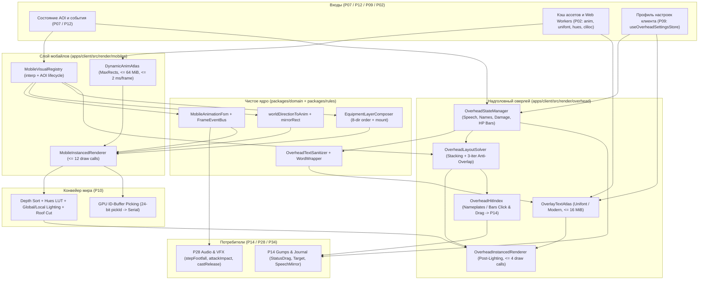
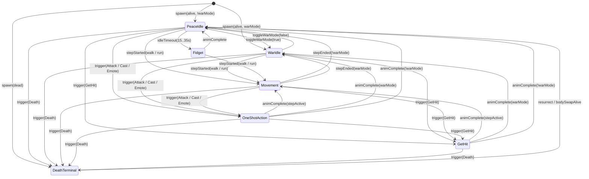
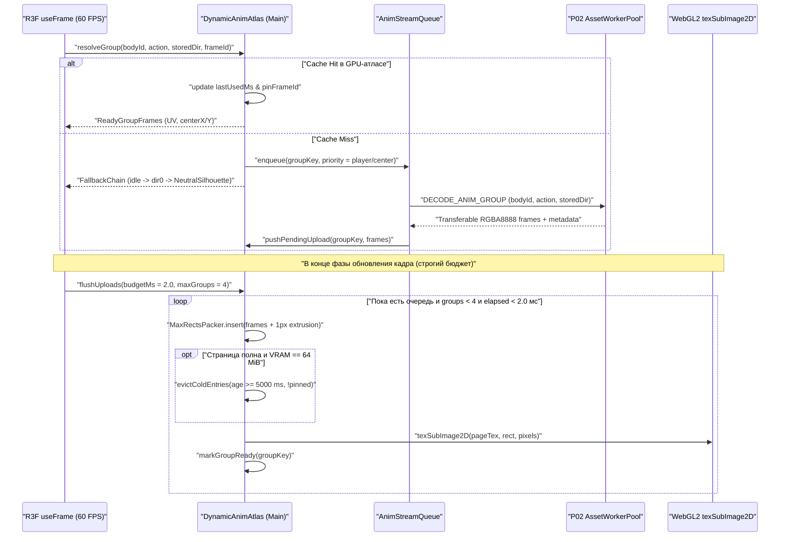

# Design: P11 Визуализация мобайлов

## Context

Фаза P11 реализует визуализацию мобайлов и внутримирового надголовного оверлея в рамках вехи **M1 «Первый шаг по Заре»**. Продуктовая мотивация и границы скоупа зафиксированы в [proposal.md](proposal.md), поведенческие контракты — в [specs/render/mobile-animation/spec.md](specs/render/mobile-animation/spec.md) и [specs/render/overhead-text-and-bars/spec.md](specs/render/overhead-text-and-bars/spec.md).

На входе фазы зафиксированы следующие опоры из предыдущих фаз и [docs/ARCHITECTURE.md](../../../docs/ARCHITECTURE.md):
- **ADR-001 (Монорепозиторий):** строгий TypeScript ESM, чистые изоморфные правила в `packages/domain` (0 зависимостей) и `packages/rules`, клиентская 3D/UI-реализация в `apps/client` без импорта серверного кода.
- **ADR-002 («Принеси свой клиент»):** все анимации и шрифты поступают из локально декодированного кэша P02 (`useAssetStore`, `AssetWorkerPool`, OPFS `anim-cache/<bodyId>.uo3bin`, `unifont*.mul`, `fonts.mul`, `hues` LUT `32×3001`, `cliloc`), а CI и визуальная регрессия работают на детерминированном синтетическом CC0-мире `packages/test-kit`.
- **ADR-003 (2.5D в настоящем 3D):** ортографическая изометрическая камера (`44×44 px`, `Z = 4 px`, зум `0.5×–2×`, pixel-snapping), кодирование порядка отрисовки UO в глубину, инстансированный батчинг (суммарный бюджет кадра `< 300 draw calls`, `60 FPS` в 1080p на интегрированной графике), фрагментный шейдер перекраски `hues` LUT (`PartialHue`/`Translucent`), проход глобального/локального освещения, скрытие крыш, круг прозрачности и GPU ID-буфер пикинга (P10).
- **ADR-004 (UI):** React DOM используется для гампов и окон (P14), но высокочастотные элементы внутри 2.5D-сцены не должны создавать 60 FPS DOM-рефлоу.
- **ADR-005 / ADR-012 (Сеть и авторитарность):** клиент только отображает авторитарное состояние репликации (`WorldPartitionRoom`, P07) и локальное предсказание шага (P12), никогда не додумывает скрытые виталы врагов или расшифровку речи призраков и защищается от визуального/текстового флуда.
- **ADR-010 / ADR-011 (UO:R и тестируемость):** канонические константы эпохи UO:R (`400/200/200/100 мс` шаг, `PersonHeight = 16`, `Notoriety 1..7`, `Layer 0x00..0x1D`, `Body 400..403/987`), полная детерминированность под `FakeGameClock` (P01) и воспроизводимость в Playwright SwiftShader.

## Goals / Non-Goals

**Goals:**
- Построить детерминированный, изоморфно тестируемый движок анимаций мобайлов (разрешение тел, `Direction → animDir`, конечный автомат приоритетов, композитор слоёв экипировки с направленным порядком, синхронизация всадника и маунта, события кадров для P28).
- Интегрировать спрайты мобайлов в инстансированный WebGL2-конвейер P10 с бюджетом `≤ 12 draw calls` и `≤ 3.5 мс` CPU для толпы из `150` персонажей по `8` слоёв, попиксельным пикингом, освещением и окклюзией этажей.
- Реализовать бесфризовую потоковую подгрузку анимаций из кэша P02 в динамический GPU-атлас с лимитом `64 МиБ` VRAM и бюджетом загрузки `≤ 2 мс` (`≤ 4` групп) на кадр.
- Построить единый WebGL2 инстансированный надголовный оверлей (речь, имена с `Notoriety` и `All-Names`, всплывающие числа урона, полоски здоровья) в `≤ 4 draw calls`, `≤ 1.5 мс` CPU и `0` DOM-рефлоу с двойной типографикой (`unifont.mul` + современный шрифт) и пространственным хит-тестингом.

**Non-Goals:**
- Изменение бинарных парсеров MUL/UOP или формата кэша OPFS (P02).
- Перепроектирование камеры, меша земли, базового шейдера освещения и расчёта крыш (P10 — P11 подключается к его расширяемым точкам регистрации батчей, источников света и пикинга).
- Алгоритмы предсказания шага, очереди `0..255` и валидации проходимости (P12 — P11 принимает уже рассчитанные дискретные и интерполированные шаги через адаптер-порт).
- Перетаскиваемые DOM-гампы `Paperdoll`, закрепляемые статус-бары, журнал чата и ввод речи (P14 — P11 экспортирует события клика/начала перетаскивания и зеркало речи).
- Воспроизведение аудио и визуальных частиц/снарядов (P28 — P11 предоставляет детерминированные хуки событий кадров и мировые якоря мобайлов).

## Decisions

### D1. Разделение чистого изоморфного ядра анимаций/правил и императивного WebGL2-рендерера
**Выбор:** Вся неграфическая логика P11 — отображение `Direction → animDir`, канонические таблицы действий и направленных порядков слоёв, таблица `MountItemId → MountBodyId`, конечный автомат `MobileAnimationFsm`, расчёт длительности речи и санитизатор текста — размещается в чистых модулях `packages/domain` (таблицы/типы) и `packages/rules` (формулы/FSM) без зависимостей от браузера и Three.js. В `apps/client` размещаются только императивные структуры кадра (`MobileVisualRegistry`, `DynamicAnimAtlas`, `MobileInstancedRenderer`, `OverheadOverlayController`, `OverheadInstancedRenderer`), обновляемые напрямую внутри `useFrame` Three.js/R3F без React `setState` на горячем пути.

**Обоснование:** Соблюдает ADR-001 и ADR-011: вся критическая игровая логика (приоритеты анимаций, зеркалирование 8 направлений, перекрытие слоёв робой, события `stepFootfall`/`attackImpact`, таймеры речи) покрывается быстрыми детерминированными unit-тестами в Vitest Node.js под `FakeGameClock` за миллисекунды, а React не тратит процессорное время на согласование дерева 60 раз в секунду для 150 движущихся персонажей.

**Отвергнутые альтернативы:**
- *Представление каждого мобайла и слоя как React-компонента `<MobileSprite />` внутри R3F:* создаёт `1 200+` React-волокон для толпы из 150 персонажей, вызывая всплески GC и просадку ниже 60 FPS при массовом входе/выходе из AOI.
- *Помещение всех таблиц слоёв и FSM внутрь `apps/client`:* усложняет переиспользование в `apps/bot-client`/симуляционных тестах и смешивает правила UO:R с WebGL-кодом.

### D2. Приоритетный конечный автомат `MobileAnimationFsm` с фазовой синхронизацией шага
**Выбор:** Каждый визуальный мобайл владеет экземпляром `MobileAnimationFsm` с 5 жёсткими уровнями приоритета:
`Tier 4 (Death)` > `Tier 3 (GetHit)` > `Tier 2 (OneShot: Attack / Cast / Emote)` > `Tier 1 (Movement: Walk / Run)` > `Tier 0 (BaseIdle: WarStand / PeaceStand / Fidget)`.
- В состоянии `Movement` прогресс анимации `phase ∈ [0, 1)` жёстко связан с прогрессом субтайловой интерполяции шага `stepProgress = clamp((nowMs - stepStartMs) / stepDurationMs, 0, 1)` (где `stepDurationMs` берётся из активного `RulesetProfile` через `calcStepDelayMs(isMounted, isRunning)` из P01 либо из явного серверного модификатора шага от P12). Благодаря этому цикл шага никогда не проскальзывает относительно земли («лунной походки» нет).
- В состоянии `OneShot` длительность кадра определяется формулой `frameMs = baseFrameMs * (1 + delayFactor)`, поддерживаются `repeatCount`, `reverse` и автоматический переход в нижележащее активное состояние (`Movement` или `BaseIdle`) на следующем кадре после завершения.
- Состояние `Death` терминально: замораживается на последнем кадре (`frameIndex = frameCount - 1`) и сбрасывается только событием `resurrect` / сменой тела на живое или удалением из AOI.
- Диспетчер `AnimationFrameEventBus` отслеживает пересечение нормированных порогов фазы (`stepFootfall` на `0.0` и `0.5`, `attackImpact` на `0.60`, `castRelease` на `1.0` последнего кадра, `deathFinished` на `1.0`) с защитой от повторного срабатывания и подавлением при прерывании более высоким приоритетом.

**Обоснование:** Полностью воспроизводит каноническое поведение ClassicUO/ServUO (пакеты `0x6E` / `0xE2`), гарантирует побитовую воспроизводимость под `FakeGameClock` и даёт P28 точные временные точки для синхронизации звука удара/шага с изображением.

**Отвергнутые альтернативы:**
- *Фиксированный FPS (например 10 FPS) для всех действий независимо от скорости шага:* приводит к рассинхронизации ног при беге верхом (`100 мс`) и перегруженной ходьбе (`600+ мс`).
- *Простая перезапись текущего действия любым последним событием:* позволяет `GetHit` или `Movement` прервать смертельную анимацию или оборвать свинг оружия случайным idle-пакетом.

### D3. Преобразование `worldDir → animDir` и попиксельно-точное зеркалирование вокруг `centerX`
**Выбор:** В домене P01 направления пронумерованы по часовой стрелке от мирового севера (`North=0`, `Right=1`, `East=2`, `Down=3`, `South=4`, `Left=5`, `West=6`, `Up=7`), тогда как в архивах `anim*.mul` / `AnimationFrame*.uop` (P02) направление `0` — это взгляд прямо вниз к камере (`Down=3`), а направления `5, 6, 7` хранятся как зеркальные копии `3, 2, 1`. Поэтому P11 вводит явную чистую функцию `worldDirectionToAnim(directionByte)`:
```text
worldDir  = directionByte & 0x07
isRunning = (directionByte & 0x80) !== 0
animDir   = (worldDir + 5) & 7
storedDir = animDir <= 4 ? animDir : 8 - animDir
flipX     = animDir > 4
```
При вычислении экранного прямоугольника спрайта относительно пиксельной точки опоры `(footX, footY)` учитывается асимметрия `centerX`:
- при `flipX === false`: `left = footX - centerX`, `right = left + width`;
- при `flipX === true`: `left = footX - (width - centerX)`, `right = left + width` (с инверсией `u0 ↔ u1` в шейдере).
Вертикальная позиция: `top = footY - (height + centerY)`, `bottom = top + height`. Финальные `(footX, footY)` округляются до целых пикселей `Math.round(...)` в соответствии с pixel-snapping ADR-003.

**Обоснование:** Большинство кадров атаки и удержания оружия имеют смещённый центр (`centerX ≠ width / 2`). Простой переворот UV без пересчёта `left` смещает персонажа вбок на `width - 2 * centerX` пикселей при повороте на восток/север, вызывая заметный рывок тела и рассинхрон слоёв экипировки. Указанная формула гарантирует, что точка опоры всех слоёв и маунта совпадает до 1 пикселя на всех 8 направлениях.

**Отвергнутые альтернативы:**
- *Использование `worldDir` напрямую как `animDir`:* разворачивает все спрайты на 135° относительно изометрической сетки UO.
- *Симметричное центрирование квада `left = footX - width / 2`:* ломает выравнивание оружия, щитов и всадника относительно базового тела.

### D4. Направленный композитор слоёв экипировки, правила перекрытия и связка `Rider + Mount`
**Выбор:** Композитор `EquipmentLayerComposer` строит упорядоченный список видимых слоёв для человеческого тела за `O(L)` (`L ≤ 22`, без аллокаций — запись в переиспользуемый scratch-массив):
1. Если `isGhostBody(bodyId)` (`402`/`403`) — отображается только тело призрака и саван (`OuterTorso`, если присутствует, либо встроенный саван тела) с `alpha = 0.60`, прижизненные слои брони/оружия пропускаются.
2. При наличии валидного слоя `Mount (0x19)` — первым слоем (индекс `0`) добавляется тело маунта `resolveMountBody(mountItem.itemId)` с оттенком `mountItem.hue` (поддержка флага `Translucent` для эфирных маунтов), а действия всадника автоматически транслируются таблицей `HUMAN_TO_MOUNTED_ACTION` (`walk→23`, `run→24`, `stand→25`, `attack1H→26`, `attackBow→27`, `attackCrossbow→28`, `slap→29`).
3. Вычисляется маска перекрытых слоёв: наличие `OuterTorso` (роба) скрывает `Shirt`, `InnerTorso`, `MiddleTorso`, `Waist`, `Arms`, `Pants` (если не установлен флаг прозрачной/открытой накидки); наличие `Helm` с флагом `hideHair` скрывает `Hair` (и `FacialHair` при закрытом забрале).
4. Оставшиеся слои сортируются строго по предвычисленной константной 8-направленной таблице `DIRECTIONAL_LAYER_ORDER[worldDir]` (адаптированной из ClassicUO/UO Classic), в которой `Cloak (0x14)` находится **перед телом (позади по глубине)** для направлений `East(2), Down(3), South(4), Left(5), Right(1)` и **после всех слоёв (поверх спины)** для направлений `Up(7), North(0), West(6)`.
5. Разрешение `animId` экипировки читает поле `ItemTileData.animId` из кэшированного `tiledata` (P02) и применяет `equipconv.def` / `body.def` при наличии (например, женская броня для тела `401` при наличии женского варианта).

**Обоснование:** Устраняет визуальные пробития рубашек сквозь робы, корректно отображает плащ со спины и спереди, сокращает число рисуемых инстансов в толпе на 25–35 % за счёт отсечения перекрытых внутренних слоёв и обеспечивает полную синхронность всадника и маунта.

**Отвергнутые альтернативы:**
- *Единый статический порядок слоёв для всех 8 направлений:* приводит к тому, что плащ либо всегда перекрывает лицо персонажа спереди, либо исчезает за телом со спины.
- *Предварительный композитинг всех слоёв персонажа в отдельную персональную текстуру (CPU bake):* при `150` персонажах × `8` направлениях × `5` действиях × `10` кадрах требует сотни мегабайт VRAM и частые ребейты при каждом снятии/надевании предмета.

### D5. Потоковый динамический GPU-атлас анимаций (`DynamicAnimAtlas`) с `MaxRects-BSSF` и LRU `64 МиБ`
**Выбор:** В отличие от статических чанков карты P10, количество уникальных комбинаций `(bodyId, action, storedDir)` в полном клиенте UO превышает 250 000 групп и не помещается в VRAM целиком. Поэтому `DynamicAnimAtlas` управляет пулом динамических WebGL2-текстур RGBA8888 (до `4` страниц `2048×2048` = `4 × 16 МиБ = 64 МиБ` по умолчанию, конфигурируемо профилем качества P10: Low `32 МиБ` / Medium `64 МиБ` / High `96 МиБ`):
- Ключ кэша группы: `groupKey = (bodyId << 11) | (action << 3) | storedDir` (32-битный integer, без строковых аллокаций).
- При промахе группа немедленно ставится в `AnimStreamQueue` с приоритетом `score = (isLocalPlayer ? 1000 : 0) + (isTarget ? 500 : 0) - screenDistPx`, а рендерер на время ожидания декодирования в воркере P02 (`DECODE_ANIM_GROUP`) немедленно применяет детерминированный fallback (`idle` → `dir 0` → `NeutralSilhouette`).
- Готовые буферы кадров из `AssetWorkerPool` (P02, `Transferable`) ставятся в очередь загрузки GPU `PendingUploadQueue`. В каждом кадре `useFrame` метод `flushUploads(budgetMs = 2.0, maxGroups = 4)` упаковывает кадры группы с помощью `MaxRectsPacker` (BSSF + `1 px` экструзия краёв) и выполняет частичную загрузку `gl.texSubImage2D` без пересоздания текстуры.
- Вытеснение: каждая группа хранит `lastUsedMs` и `pinFrameId`. При нехватке свободного прямоугольника на всех страницах запускается очистка страницы-кандидата (страница с наименьшей долей активных записей и без записей с `pinFrameId === currentFrameId` и `nowMs - lastUsedMs < 5000`); все оставшиеся горячие записи страницы компактно переупаковываются, а холодные вытесняются из GPU (оставаясь в OPFS-кэше P02 для мгновенной повторной подгрузки `< 5 мс`).
- Подписка на `webglcontextlost` / `webglcontextrestored`: очищает GPU-хэндлы, сбрасывает индекс загруженных страниц и автоматически перенаполняет только видимые группы из OPFS без перезагрузки клиента.

**Обоснование:** Удерживает VRAM в строгом бюджете 64 МиБ (включая интегрированные GPU и ноутбуки), полностью исключает статтеры при телепортации в переполненный город благодаря квоте `≤ 2 мс`/`≤ 4` групп за кадр и не дублирует парсинг P02.

**Отвергнутые альтернативы:**
- *Предварительная загрузка всех анимаций клиента при старте:* занимает > 600 МиБ VRAM и > 30 секунд старта.
- *Полная пересборка и перезаливка всей текстуры `2048×2048` (`texImage2D`) при добавлении каждого нового кадра:* вызывает 8–15 мс GPU-столлы при появлении каждого нового NPC/игрока.

### D6. Интеграция с P10: глубинный суб-ключ, инстансинг, освещение, окклюзия и попиксельный пикинг
**Выбор:** `MobileInstancedRenderer` использует единый `THREE.InstancedMesh` (или по одному на каждую активную страницу `DynamicAnimAtlas` — максимум `4` для непрозрачных слоёв + до `4` для полупрозрачных слоёв призраков/стелса/эфирных маунтов + `1` для силуэтов-заглушек = **теоретический максимум `9` draw calls**, с запасом укладывающийся в бюджет `≤ 12 draw calls`).
- **Кодирование глубины (согласовано с ADR-003 и P10):**
  Используется целочисленный ключ P10 (`packWorldSortKey` из `packages/rules/src/render/draw-order.ts`) без собственной float-схемы глубины:
  ```text
  relDiag       = clamp((tileX + tileY) - baseDiag, 0, 255)      // baseDiag — uniform P10
  sortZ         = clamp(tileZ + 2 + 128, 0, 259)                 // threshold мобайла = 2
  subSlot       = 48 + layerOrderIndex                           // 32 подслота мобайла P10: 48..79
  packedSortKey = relDiag * 32760 + sortZ * 126 + subSlot
  ```
  где `(tileX, tileY, tileZ)` — тайл сортировки интерполируемого мобайла (во время шага — тайл с большим `x + y` из пары «исходный/целевой», чтобы мобайл не «проваливался» за статику целевого тайла), а `layerOrderIndex ∈ [0..23]` строго возрастает от маунта к переднему плащу. Так все слои одного мобайла различаются минимум на `2` шага 24-битного буфера (гарантия P10), а мобайл корректно заходит за передние стены и выходит перед задними.
- **Шейдер `MobileSpriteShader`:** переиспользует общую GLSL-библиотеку P10 (`hues` LUT `32×3001`, `PartialHue` по `r5 == g5 && g5 == b5`, чтение буфера освещения `uLightMap` и `uGlobalLightLevel`, отсечение альфа-теста `alpha < 0.5` как в P10, круг прозрачности). Для полупрозрачных слоёв (`ghost`, `hidden`, `Translucent` hue/item) используется второй проход с `depthWrite = false`, `depthTest = true` и предсортировкой экземпляров от дальнего к ближнему.
- **Окклюзия этажей:** перед упаковкой мобайла в инстанс-буфер проверяется `occlusionCutZ` из P10 (`mobile.z >= roofCutZ && isUnderRoof(mobile.x, mobile.y)`). Отсечённый мобайл пропускается и помечается флагом `isOccluded = true`, который также скрывает его надголовный оверлей.
- **GPU ID-буфер пикинга:** отдельный легковесный проход пикинга P10 переиспользует те же инстанс-буферы мобайлов с `uPickPass = 1`, записывая 24-битный `pickId` из `PickingRegistry` P10 (в `RGB8`, разрешается в `kind = 'mobile'` с `Serial`) для каждого фрагмента с `texel.a ≥ 0.5` (включая маунта и экипировку, и даже полупрозрачных призраков/скрытых мобайлов, видимых клиенту!).
- **Источники света на мобайле:** если у мобайла экипирован предмет с `TileFlag.LightSource` (например, факел/фонарь в `OneHanded`/`TwoHanded`) или активен флаг `nightSight`/`lightRadius`, `MobileLightEmitterBridge` регистрирует динамическую точку света в менеджере источников света P10 с текущими интерполированными координатами `(x, y, z + 10)`.

**Обоснование:** Максимальное переиспользование шейдеров и проходов P10 исключает дублирование логики освещения и пикинга, обеспечивает единую визуальную картину мира и жёстко гарантирует бюджет `< 300 draw calls` и попиксельную точность клика.

**Отвергнутые альтернативы:**
- *Отдельный `THREE.Sprite` / `THREE.Mesh` на каждый слой каждого мобайла:* `150 × 8 = 1 200` draw calls, полностью разрушающие бюджет ADR-003.
- *Прямоугольный AABB-пикинг мобайлов на CPU:* не позволяет кликать сквозь прозрачные углы спрайта по предметам и другим персонажам в плотной толпе, противоречит ADR-003.

### D7. WebGL2 инстансированный надголовный оверлей (`OverheadOverlayRenderer`) с `OverlayTextAtlas`
**Выбор:** Весь надголовный слой (речь, имена, всплывающие числа урона, компактные полоски здоровья) рендерится **внутри WebGL2 в выделенном ортографическом экранно-пространственном проходе (`OverheadOverlayPass`) поверх финальной освещённой картинки мира** (post-lighting, unlit, без затенения глобальной темнотой):
- **Текстовый атлас (`OverlayTextAtlas`):** динамическая текстура `2048×2048` RGBA8888 (`16 МиБ` VRAM максимум, `MaxRects-BSSF`), куда каждая уникальная готовая текстовая карточка `(sanitizedText, fontMode, fontScale, colorKey, maxWidth, backdrop)` растеризуется ровно один раз и переиспользуется на каждом кадре. Истёкшие записи освобождаются по reference count + LRU; при переключении `fontMode` / `fontScale` / `DPR` атлас пересобирается лениво для активных элементов.
- **Пакетная отрисовка (`≤ 4 draw calls`):**
  1. `Draw Call 1`: инстансированный батч фоновых подложек и рамок полосок здоровья + заливки HP / шлейфа урона (`ghostHp`) / маркера репутации / мини-шкал стамины-маны (процедурный SDF/прямоугольный фрагментный шейдер без текстуры).
  2. `Draw Call 2`: инстансированный батч всех текстовых карточек из `OverlayTextAtlas` (страница 0 — речь, имена, числа урона, символьные маркеры `[P]`/`[!]`).
  3. `Draw Call 3–4` (резерв): при наличии всплывающих чисел поверх речи или опциональной второй страницы атласа на DPR=2 (при жёстком потолке `16 МиБ` используется 1 страница `2048×2048` = `16 МиБ`, поэтому на практике весь оверлей занимает ровно **2 draw calls**!).
- **Интеграция с React (ADR-004):** React-дерево отвечает только за панель настроек (P09) и постоянные окна-гампы (P14); при движении камеры или мобайлов React-состояние НЕ изменяется (`0` DOM-рефлоу). Для доступности (P34) и журнала (P14) публикуется событийный колбэк `onOverheadSpeechCommitted` (вызывается 1 раз в момент поступления сообщения, а не на 60 FPS).

**Обоснование:** 150 полосок + 60 имён + 64 реплики + 80 чисел урона = ~350 динамически движущихся визуальных элементов. Отрисовка их в DOM на 60 FPS вызывает постоянный Compositor/Layout overhead (`5–15 мс`), тогда как 2 инстансированных WebGL2 draw call выполняются за `< 0.2 мс` на GPU и `< 1.0 мс` на CPU, идеально синхронизированы с кадром камеры без расхождения в 1 кадр и напрямую рендерят растровый `unifont.mul`.

**Отвергнутые альтернативы:**
- *React DOM / CSS `transform: translate3d(...)` для каждого имени и полоски:* вызывает 350 DOM-обновлений за кадр, рассогласование на 1 кадр с WebGL-канвасом в Safari/Firefox, проблемы с аутентичным `unifont.mul` и деградацию FPS в толпе.
- *Оверлейный 2D `<canvas>` с перерисовкой `fillText` на каждом кадре:* перерисовка 150+ строк с обводкой через `strokeText` на CPU каждый кадр стоит `4–8 мс` на интегрированных системах.

### D8. Двойной растеризатор шрифтов (`UnifontRasterizer` + `ModernCanvasFontRasterizer`) и конвейер санитизации
**Выбор:** Перед любым переносом строк и кэшированием каждая входящая строка проходит детерминированный `OverheadTextSanitizer`:
1. Разрешение `cliloc` (если передан `clilocId` + `args`) через форматтер P02 с защитой глубины рекурсии `≤ 4`.
2. Удаление управляющих символов `[\u0000-\u001F\u007F]`, bidi-переопределений `[\u202A-\u202E\u2066-\u2069\u200E\u200F]` и нулевой ширины `[\u200B-\u200D\uFEFF]`.
3. Схлопывание повторных пробелов/переводов строк в одиночный пробел и усечение до `≤ 256` кодовых единиц UTF-16 (с защитой суррогатных пар).

После санитизации строка переносится по словам (`WordWrapper`) до ширины `maxWidthPx` (по умолчанию `200 px` на масштабе `1×`), ограничиваясь `maxLines = 4` (при переполнении — обрезка последней строки с добавлением `…`), и передаётся в выбранный растеризатор:
- **`UnifontRasterizer` (`mode = 'uo-classic'`):** читает 1-битные глифы из декодированного `unifont.mul` (или `fonts.mul` для legacy ASCII) из кэша P02 (латиница + кириллица `U+0400..U+04FF`), окрашивает их по выбранному `Hue` (через индекс `hues` LUT или RGB) и строит `1 px` чёрный контур 8-соседним дилатационным ядром на `Uint8ClampedArray`. При отсутствии глифа для редкого символа Unicode автоматически подставляет глиф из `OffscreenCanvas` резервного системного шрифта той же базовой линии.
- **`ModernCanvasFontRasterizer` (`mode = 'modern-crisp'`):** рендерит текст на переиспользуемый `OffscreenCanvas` (или скрытый `<canvas>` fallback) с учётом `fontScale ∈ [0.75..1.5]` и `devicePixelRatio ∈ [1..2]`, чётким чёрным контуром `lineJoin = 'round'` и опциональной полупрозрачной подложкой `rgba(0, 0, 0, 0.45)`.

**Обоснование:** Сохраняет аутентичную эстетику UO (включая русскую кириллицу в синтетическом паке P02 и оригинальных клиентах), при этом гарантирует комфортную читаемость на 4K/HiDPI-мониторах и абсолютную устойчивость к атакам подмены текста (bidi spoofing) и DoS на кэш глифов.

**Отвергнутые альтернативы:**
- *MSDF/SDF-атласы системных шрифтов:* требуют сложного препроцессинга для тысяч символов Unicode/кириллицы и не воспроизводят точный пиксельный силуэт растровых шрифтов UO `unifont.mul`.
- *Только `unifont.mul` без современного режима:* на экранах HiDPI 2×/4K и при зуме `0.5×` мелкий растровый шрифт 10–12 px утомляет зрение без масштабируемой альтернативы.

### D9. Детерминированный 2D-солвер стекинга/коллизий и пространственный хит-тест `OverheadHitIndex`
**Выбор:** В каждом кадре `OverheadLayoutSolver` выполняет строго ограниченный по времени `O(N log N)` проход раскладки для видимых не-окклюзированных мобайлов:
1. **Якоря:** для каждого видимого мобайла вычисляется `footAnchor = round(worldToScreen(interpPos))` и `headAnchor = (footAnchor.x, footAnchor.y - smoothedBodyHeadOffsetPx - mountOverheadOffsetPx)`. Для подавления покадрового «подпрыгивания» речи при ходьбе используется каноническая высота по паре `(bodyId, isMounted)` (либо скользящий максимум с гистерезисом `2 px`), а не сырой `frame.height` каждого кадра.
2. **Персональный стек:** сообщения речи одного мобайла складываются снизу вверх от `headAnchor.y - 4 px` с шагом `cardHeight + 2 px` (новейшее снизу, старшие выталкиваются вверх). Если над тем же мобайлом показано имя (hover / All-Names), имя размещается в выделенном слоте сразу над головой (`headAnchor.y - 4 px`), а стек речи стартует над именем с зазором `3 px`.
3. **Разрешение 2D-перекрытий между мобайлами:** все активные текстовые карточки (речь + All-Names) сортируются по приоритету `(isLocalPlayer, isTarget, isHovered, screenY desc, serial asc)` и прогоняются через детерминированный проход разведения AABB по оси Y (максимум `3` итерации, суммарный сдвиг любой карточки ограничен `≤ 120 px`, чтобы текст не улетал далеко от говорящего).
4. **Удержание во вьюпорте:** для мобайлов, чья проекция находится внутри вьюпорта, карточки речи и имён прижимаются к рамке `[8, viewportW - 8] × [8, viewportH - 8]`. Для мобайлов вне вьюпорта элементы не добавляются в батч.
5. **Хит-тест (`OverheadHitIndex`):** параллельно раскладке записываются AABB только интерактивных элементов (`All-Names` плашки и полоски здоровья). Речь и числа урона в `OverheadHitIndex` **никогда не попадают** (строгий click-through). При `pointerdown` / `pointermove` контроллер ввода проверяет `OverheadHitIndex` до GPU-пикинга сцены: клик по плашке имени передаёт `onMobileNameplateClick(serial)`, а смещение указателя на `≥ 6 px` при зажатой кнопке генерирует `onStatusBarDragStart(serial, screenPos)` для открепляемого статус-гампа P14.

**Обоснование:** Решает главную UX-проблему плотных городов и PvP-стычек UO (слипание реплик и имён в кашу) с детерминированным временем выполнения (`≤ 0.4 мс` для 200+ карточек) и безупречно интегрирует классическую механику UO «вытяни полоску здоровья из имени/мобайла» с будущей фазой P14.

**Отвергнутые альтернативы:**
- *Неограниченная физическая релаксация сил (force-directed layout):* непредсказуемое время сходимости, дрожание текста между кадрами и увод текста на пол-экрана от говорящего.
- *Отсутствие разрешения перекрытий:* в толпе у банка Британии имена All-Names и речь полностью нечитаемы.

---

## Architecture & Contracts

### Топология модулей в монорепозитории

| Пакет / приложение | Модуль | Ответственность |
|---|---|---|
| `packages/domain` | `src/visuals/layer-draw-order.ts` | Константная 8-направленная таблица `DIRECTIONAL_LAYER_ORDER`, маски перекрытия `ROBE_OCCLUDED_LAYERS` / `HELM_HIDE_HAIR`, `MountItemId → MountBodyId` (`CANONICAL_MOUNT_BODY_MAP`) |
| `packages/domain` | `src/visuals/mobile-status-flags.ts` | Битовая маска визуальных состояний `MobileVisualFlags` (`WarMode`, `Hidden`, `Poisoned`, `Paralyzed`, `Blessed`, `MortalStruck`, `Invulnerable`, `Dead`), канонические палитры `NOTORIETY_COLORS_HEX` и `DAMAGE_ROLE_COLORS_HEX` |
| `packages/rules` | `src/animation/direction-mapping.ts` | Чистая функция `worldDirectionToAnim()`, вычисление зеркального экранного прямоугольника `computeSpriteScreenRect()` |
| `packages/rules` | `src/animation/action-tables.ts` | Семантические действия `SemanticMobileAction`, таблицы индексов `HUMAN_ACTION_TABLE` (0..34), `MONSTER_ACTION_TABLE` (0..21), `ANIMAL_ACTION_TABLE` (0..12), трансляция `HUMAN_TO_MOUNTED_ACTION` |
| `packages/rules` | `src/animation/mobile-fsm.ts` | Изоморфный конечный автомат `MobileAnimationFsm`, приоритеты, фазовый аккумулятор, генератор событий `AnimationFrameEvent` |
| `packages/rules` | `src/overhead/speech-rules.ts` | Формула длительности речи `calcOverheadSpeechDurationMs()`, кривая всплытия урона `evalDamageFloatCurve()`, детерминированный `OverheadTextSanitizer` и `WordWrapper` |
| `packages/protocol` | `src/events/mobile-visual-events.ts` | TypeBox-схемы событий: `MobileActionEventSchema`, `MobileDamageNumberEventSchema`, `MobileOverheadSpeechEventSchema`, `MobileVisualDeltaSchema` и коды ошибок/предупреждений |
| `packages/test-kit` | `src/fixtures/mobile-visual-fixtures.ts` | Фабрики экипированных людей, всадников, монстров, призраков, генератор толпы из 150 мобайлов, headless-драйвер `FakeMobileVisualDriver` для Vitest и Playwright |
| `apps/client` | `src/render/mobiles/mobile-visual-registry.ts` | Реестр активных визуальных мобайлов, атомарный аппликатор дельт AOI, интерполятор позиции `(x, y, z)`, управление жизненным циклом и нулевой утечкой памяти |
| `apps/client` | `src/render/mobiles/body-and-mount-resolver.ts` | Разрешение `bodyconv.def`, `body.def`, `mobtypes.txt`, `AnimationSequence.uop`, `MountItemId`, каскадный fallback (`idle → dir 0 → silhouette`) |
| `apps/client` | `src/render/mobiles/equipment-composer.ts` | `EquipmentLayerComposer`: направленный порядок слоёв, перекрытие робой/шлемом/призраком, сборка списка `ResolvedRenderLayer` |
| `apps/client` | `src/render/mobiles/dynamic-anim-atlas.ts` | `DynamicAnimAtlas`, `AnimStreamQueue`, `PendingUploadQueue`, LRU-управление `64 МиБ` VRAM, `texSubImage2D` квота, обработка `webglcontextlost` |
| `apps/client` | `src/render/mobiles/mobile-instanced-renderer.ts` | `MobileInstancedRenderer`, упаковка 64-байтных GPU-экземпляров, интеграция с P10 depth/hues/lighting/roof-occlusion/picking, `MobileLightEmitterBridge`, LOD толпы |
| `apps/client` | `src/render/overhead/font-rasterizers.ts` | `UnifontRasterizer` (из `unifont*.mul`/`fonts.mul` P02 + `1 px` контур + fallback), `ModernCanvasFontRasterizer`, `OverlayTextAtlas` (`2048×2048` RGBA8888, `≤ 16 МиБ`) |
| `apps/client` | `src/render/overhead/overhead-state-manager.ts` | Очереди речи (`4`/мобайл, `64` глобально), дедупликация клик-меток (`200 мс`), всплывающие числа урона (`8`/мобайл, `80` глобально), трекер `ghostHp` шлейфа полосок |
| `apps/client` | `src/render/overhead/overhead-layout-solver.ts` | Расчёт стабилизированных `headAnchor`/`footAnchor`, вертикальный стекинг, 3-итерационный солвер коллизий, привязка к вьюпорту `8 px`, приоритизация `All-Names` (`≤ 60`) |
| `apps/client` | `src/render/overhead/overhead-instanced-renderer.ts` | `OverheadOverlayPass` (post-lighting WebGL2 инстансированные полоски + текст за `≤ 4 draw calls`), `OverheadHitIndex` (клик и `dragStart` ≥ 6 px для P14) |
| `apps/client` | `src/render/overhead/overhead-settings-store.ts` | Zustand-стор `useOverheadSettingsStore` (режим полосок, шрифт, масштаб `0.75..1.5`, All-Names, `colorblindCues`) + синхронизация с P09 `settings-profile` |

---

### Диаграмма 1: Сквозной конвейер визуализации мобайлов и надголовного оверлея



---

### Диаграмма 2: Конечный автомат действий мобайла (`MobileAnimationFsm`)



---

### Диаграмма 3: Потоковая подгрузка кадров, fallback-силуэт и квота загрузки в GPU-атлас



---

### Модели данных, схемы сообщений и буферы GPU

#### 1. Порт-адаптер состояния мобайла (`MobileVisualSnapshot` — мост к P07 Colyseus и P12 Prediction)
P11 не связывается напрямую со внутренними классами Colyseus, а принимает нормализованный снапшот и дельта-поток через порт `MobileVisualSourcePort`:

```ts
export interface EquippedLayerVisual {
  readonly layer: Layer;          // 0x01..0x19 (из P01)
  readonly itemId: ItemId;        // Graphic из tiledata
  readonly animId: number;        // Из ItemTileData.animId (0 если не рисуется на теле)
  readonly hue: Hue;              // uint16 с битами PartialHue (0x8000) и Translucent (0x4000)
  readonly isLightSource: boolean;// TileFlag.LightSource (факел/фонарь)
}

export interface MobileVisualSnapshot {
  readonly serial: MobileSerial;
  readonly isLocalPlayer: boolean;
  readonly bodyId: BodyId;
  readonly hue: Hue;
  readonly x: number;             // uint16 целевой тайл
  readonly y: number;             // uint16
  readonly z: number;             // int8
  readonly directionByte: number; // Direction (0..7) | Running (0x80)
  readonly stepDurationMs?: number; // Фактическая длительность текущего шага (P12), если движется
  readonly isTeleport?: boolean;  // true -> мгновенный снап без интерполяции
  readonly name: string;
  readonly guildTag?: string;     // Опц. [TAG] (P26)
  readonly titleTag?: string;     // Опц. [invul] / титул
  readonly notoriety: Notoriety;  // 1..7 (из P01)
  readonly visualFlags: number;   // Битовая маска MobileVisualFlags
  readonly hits: number;
  readonly maxHits: number;
  readonly stam?: number;         // Только для localPlayer / party (если реплицировано сервером)
  readonly maxStam?: number;
  readonly mana?: number;         // Только для localPlayer / party
  readonly maxMana?: number;
  readonly equipment: ReadonlyArray<EquippedLayerVisual>;
}
```

#### 2. TypeBox-схемы немедленных визуальных событий (`packages/protocol/src/events/mobile-visual-events.ts`)
Это **клиентские нормализованные визуальные события, а не сетевые сообщения**: P11 не вводит WS-опкодов (см. [PROTOCOL_REGISTRY.md](../../../docs/PROTOCOL_REGISTRY.md)). В P11 их производят `FakeMobileVisualDriver` (синтетические данные) и адаптер реплицированного состояния P07; сетевые адаптеры добавляют фазы-владельцы опкодов: удары/урон/лечение — P16 (`SwingEvent`, `DamageNumber`, блок `0x01A0..0x01CF`), базовая речь — P14 (`0x0150..0x017F`), каналы речи — P26 (`0x02F0..0x031F`). Входящие события валидируются скомпилированными TypeBox-валидаторами:

- **`MobileActionEventSchema`** (триггер разовой анимации — аналог пакетов UO `0x6E` / `0xE2`):
  - `type: 'mobile.action'`
  - `serial: uint32` (`MobileSerial`)
  - `action: SemanticMobileAction` (enum: `'attack1H' | 'attack2HDown' | 'attack2HWide' | 'attack2HJab' | 'attackBow' | 'attackCrossbow' | 'attackUnarmed' | 'castDirected' | 'castArea' | 'getHit' | 'dieBack' | 'dieForward' | 'bow' | 'salute' | 'eat' | 'mountSlap'`)
  - `repeatCount: integer (1..8, default 1)`
  - `reverse: boolean (default false)`
  - `delayFactor: integer (0..4, default 0)`
  - `serverTick: uint32`
- **`MobileDamageNumberEventSchema`** (числа урона/лечения и боевые исходы):
  - `type: 'mobile.damageNumber'`
  - `targetSerial: uint32`
  - `sourceSerial?: uint32` (опционально для раскраски «нанесено локальным игроком»)
  - `kind: 'damage' | 'heal' | 'poisonDamage' | 'miss' | 'parry' | 'resist' | 'immune'`
  - `amount: integer (0..65535)` (`0` допустимо только для `miss`/`parry`/`resist`/`immune`)
  - `isHeavy: boolean` (или вычисляется клиентом как `amount >= Math.ceil(maxHits * 0.25)`)
  - `serverTick: uint32`
- **`MobileOverheadSpeechEventSchema`** (речь и системные метки над мобайлом):
  - `type: 'mobile.overheadSpeech'`
  - `serial: uint32`
  - `speechType: 'regular' | 'whisper' | 'yell' | 'emote' | 'spell' | 'label' | 'guild' | 'party' | 'staff'`
  - `hue: uint16 (0..65535)`
  - `fontId: integer (0..9, default 3)`
  - `text?: string (maxLength: 512)` (обязательно либо `text`, либо `clilocId`)
  - `clilocId?: uint32`
  - `clilocArgs?: string (maxLength: 512)` (`\t`-разделённые аргументы)
  - `speakerName?: string (maxLength: 64)` (для зеркала журнала P14)
  - `serverTick: uint32`

Коды предупреждений и ошибок визуальной подсистемы (структурированная телеметрия, не прерывают рендер):
- `WARN_ANIM_MISSING_GROUP` — отсутствует группа `(bodyId, action, storedDir)`, сработал fallback.
- `WARN_MOUNT_UNKNOWN_ITEM` — неизвестный `itemId` в слое `Mount`, подставлена базовая лошадь.
- `WARN_ANIM_VRAM_PRESSURE` — сработало принудительное вытеснение в `DynamicAnimAtlas`.
- `WARN_OVERHEAD_TEXT_TRUNCATED` — входящая строка превысила `256` символов и была усечена.
- `WARN_OVERHEAD_FLOOD_EVICTED` — сработало вытеснение очереди речи (`> 4` / `> 64`) или урона (`> 8` / `> 80`).
- `ERR_MOBILE_VISUAL_INVALID_EVENT` — входящее событие не прошло TypeBox-валидацию (отбрасывается безопасно).

#### 3. Бинарный расклад буфера экземпляров `MobileInstancedBatch` (64 байта / спрайт)
Выравненный по `vec4` буфер для минимального числа атрибутов и быстрой записи в `Float32Array` без аллокаций:

| Атрибут шейдера | Тип GLSL | Байты | Содержимое |
|---|---|---|---|
| `aWorldRect` | `vec4` | 16 B | `(screenLeftPx, screenTopPx, widthPx, heightPx)` в экранно-изометрических координатах до камеры |
| `aUvRect` | `vec4` | 16 B | `(u0, v0, u1, v1)` на странице `DynamicAnimAtlas` (при `flipX = true` передаётся `(u1, v0, u0, v1)`) |
| `aDepthHueAlpha` | `vec4` | 16 B | `(absDiag, sortZ * 126 + subSlot, hueIndex | packedHueFlags << 16, alpha)` — ключ глубины в формате P10 (`packedHueFlags`: bit 0 = `PartialHue`, bit 1 = `Translucent`) |
| `aPickAndWorldZ` | `vec4` | 16 B | `(pickId24, reserved, worldLightU, worldLightV)` — `pickId` из `PickingRegistry` P10 для GPU ID-буфера и выборка карты освещения P10 |

#### 4. Бинарный расклад буфера экземпляров `OverheadBarBatch` (48 байт / полоска)
- `aBarRect (vec4)`: `(screenX, screenY, widthPx, heightPx)` — уже выровненные по целым пикселям.
- `aBarValues (vec4)`: `(hpRatio, ghostHpRatio, secondaryRatio1, secondaryRatio2)` (`stam`/`mana` для локального игрока, `-1` если скрыты).
- `aBarColors (vec4)`: упакованные `RGBA8` в `float`/`uint`: `(fillColorRgba, ghostColorRgba, notorietyBorderRgba, opacity)`.

#### 5. Zustand-стор настроек `useOverheadSettingsStore` (синхронизируется с P09)
```ts
export interface OverheadVisualSettings {
  healthBarMode: 'never' | 'damaged' | 'always';       // по умолчанию 'damaged'
  healthBarPosition: 'below-feet' | 'above-head';      // по умолчанию 'below-feet'
  showSelfResourceSubBars: boolean;                    // стамина + мана локального игрока, по умолчанию true
  fontMode: 'uo-classic' | 'modern-crisp';             // по умолчанию 'uo-classic'
  fontScale: number;                                   // 0.75..1.5, по умолчанию 1.0
  textBackdrop: boolean;                               // полупрозрачная подложка в modern-crisp, по умолчанию false
  speechMaxWidthPx: number;                            // 140..320, по умолчанию 200
  speechDurationMultiplier: number;                    // 0.75..1.5, по умолчанию 1.0
  showDamageNumbers: boolean;                          // по умолчанию true
  showOtherPlayersDamage: boolean;                     // по умолчанию true
  allNamesToggleMode: 'hold' | 'toggle';               // Ctrl+Shift, по умолчанию 'hold'
  colorblindCues: boolean;                             // маркеры [P], [!], по умолчанию false
}
```

---

### Точные алгоритмы, таблицы и формулы UO:Renaissance

#### 1. Таблица преобразования мировых направлений в пространство анимаций UO

| Мировое `Direction` (P01) | Шаг `(dx, dy)` | Экранное направление | `animDir = (d+5)&7` | `storedDir` (`0..4`) | `flipX` |
|---|---|---|---|---|---|
| `Down (3)` | `(+1, +1)` | ↓ вниз к камере | `0` | `0` | `false` |
| `South (4)` | `(0, +1)` | ↙ вниз-влево | `1` | `1` | `false` |
| `Left (5)` | `(-1, +1)` | ← влево | `2` | `2` | `false` |
| `West (6)` | `(-1, 0)` | ↖ вверх-влево | `3` | `3` | `false` |
| `Up (7)` | `(-1, -1)` | ↑ вверх от камеры | `4` | `4` | `false` |
| `North (0)` | `(0, -1)` | ↗ вверх-вправо | `5` | `3` | `true` |
| `Right (1)` | `(+1, -1)` | → вправо | `6` | `2` | `true` |
| `East (2)` | `(+1, 0)` | ↘ вниз-вправо | `7` | `1` | `true` |

#### 2. Канонические таблицы индексов действий (`Human`, `Monster`, `Animal`)

| Семантическое действие | `Human` (0..34) | `Human Mounted` | `Monster` (0..21) | `Animal` (0..12) |
|---|---|---|---|---|
| `walk` / `walkArmed` | `0` / `1` | `23` | `0` | `0` |
| `run` / `runArmed` | `2` / `3` | `24` | `0` | `1` |
| `stand` | `4` | `25` | `1` | `2` |
| `fidget1` / `fidget2` | `5` / `6` | `25` | `17` / `18` | `9` / `10` |
| `warStand1H` / `warStand2H` | `7` / `8` | `25` | `1` | `2` |
| `attack1H` / `attackUnarmed` | `9` / `31` | `26` | `4` | `5` |
| `attack2HDown` / `Wide` / `Jab` | `12` / `13` / `14` | `26` | `5` / `6` | `6` |
| `attackBow` / `attackCrossbow` | `18` / `19` | `27` / `28` | `4` | `5` |
| `castDirected` / `castArea` | `16` / `17` | `26` | `12` / `13` | `5` |
| `getHit` | `20` | `25` | `10` | `7` |
| `dieBack` / `dieForward` | `21` / `22` | `21` / `22` (спешен) | `2` / `3` | `8` / `12` |
| `bow` / `salute` / `eat` / `mountSlap` | `32` / `33` / `34` / `29` | `29` | `1` | `3` |

#### 3. Направленный порядок отрисовки слоёв экипировки (Human)
Базовая последовательность от дальнего к ближнему (индекс `0` рисуется первым / с минимальным `layerOrderIndex`):
- **Слой `0` (опционально):** `Mount (0x19)` — всегда позади/под всадником.
- **Слой `1` (только для направлений взгляда к камере `East=2, Down=3, South=4, Left=5, Right=1`):** `Cloak (0x14)`.
- **Слои тела и одежды (`2..18`):** `Body` → `Shirt (0x05)` → `Pants (0x04)` → `Shoes (0x03)` → `InnerLegs (0x18)` → `OuterLegs (0x17)` → `InnerTorso (0x0D)` → `Ring (0x08)` → `Talisman (0x09)` → `Bracelet (0x0E)` → `FacialHair (0x10)` → `MiddleTorso (0x11)` → `Earrings (0x12)` → `Arms (0x13)` → `Hair (0x0B)` → `Helm (0x06)` → `Gloves (0x07)` → `Neck (0x0A)` → `Waist (0x0C)` → `OuterTorso (0x16)`.
- **Слои оружия (`19..20`):**
  - Для направлений `North(0), Right(1), East(2), Down(3)`: `TwoHanded (0x02)` → `OneHanded (0x01)`.
  - Для направлений `South(4), Left(5), West(6), Up(7)`: `OneHanded (0x01)` → `TwoHanded (0x02)` (щит в левой руке перекрывает корпус при левостороннем ракурсе).
- **Слой `21` (только для направлений взгляда от камеры `Up=7, North=0, West=6`):** `Cloak (0x14)` поверх всей одежды и спины.

Правила маскировки перекрытых слоёв:
- Если присутствует `OuterTorso (0x16)` (роба/саван): скрываются `Shirt`, `InnerTorso`, `MiddleTorso`, `Waist`, `Arms`, `Pants`, `InnerLegs`, `OuterLegs`.
- Если присутствует `Helm (0x06)` с признаком закрытого шлема (`hideHair`): скрывается `Hair (0x0B)`.

#### 4. Каноническая таблица соответствия маунтов UO:R (`CANONICAL_MOUNT_BODY_MAP`)
Примеры фиксируемых базовых записей (расширяется полным списком UO:R из 25+ `MountItemId`, плюс fallback `0x00C8` — базовая лошадь):
- `0x3E9F` → `0x00C8` (Light Brown Horse), `0x3EA0` → `0x00E2` (Grey Horse), `0x3EA1` → `0x00E4` (Brown Horse), `0x3EA2` → `0x00CC` (Dark Brown Horse), `0x3EA3` → `0x00D2` (Desert Ostard), `0x3EA4` → `0x00DA` (Frenzied Ostard), `0x3EA5` → `0x00DB` (Forest Ostard), `0x3EA6` → `0x00DC` (Llama), `0x3EA7` → `0x0074` (Nightmare), `0x3EA8` → `0x0075` (Silver Steed), `0x3EA9` → `0x0072` (Nightmare Dark), `0x3EAA` → `0x0073` (Ethereal Horse — принудительный флаг `Translucent` при `hue = 0` или `0x4001`), `0x3EAB` → `0x00AA` (Ethereal Llama), `0x3EAC` → `0x00AB` (Ethereal Ostard), `0x3EAD` → `0x0084` (Kirin), `0x3EB2` → `0x0076` (War Horse Brittanian), `0x3EB3` → `0x0077` (War Horse Mage).
- Вертикальная поправка надголовного якоря при активном маунте: `mountOverheadOffsetPx = 14` (на зуме `1×`, масштабируется пропорционально зуму камеры).

#### 5. Формулы надголовного оверлея
- **Длительность жизни речи (мс):**
  ```text
  durationMs = clamp(Math.round((3000 + charCount * 50) * settings.speechDurationMultiplier), 3500, 10000)
  fadeAlpha  = remainingMs >= 500 ? 1.0 : clamp(remainingMs / 500, 0.0, 1.0)
  ```
- **Кривая всплытия чисел урона (`T = 1100 мс`, `fadeStart = 800 мс`):**
  ```text
  p       = clamp(elapsedMs / 1100, 0, 1)
  offsetY = -36 * (1 - Math.pow(1 - p, 3))             // easeOutCubic вверх
  fanSlot = burstIndex % 5                             // детерминированный веер [0, -1, +1, -2, +2]
  offsetX = FAN_OFFSETS_PX[fanSlot]                    // [0, -6, +6, -12, +12]
  alpha   = elapsedMs <= 800 ? 1.0 : clamp((1100 - elapsedMs) / 300, 0, 1)
  scale   = (isHeavy ? 1.25 : 1.0) * (p < 0.12 ? 0.85 + 0.30 * (p / 0.12) : 1.0) // лёгкий pop-in
  ```
- **Шлейф урона полоски здоровья (`ghostHpRatio`):**
  При падении `hpRatio < ghostHpRatio` фиксируется `ghostHoldUntil = nowMs + 60 мс`, далее линейное затухание к `hpRatio` со скоростью `delta / 300 мс` (при лечении `ghostHpRatio` мгновенно приравнивается к новому `hpRatio`).
- **Детерминированный 3-итерационный солвер перекрытий:**
  На каждой итерации `k ∈ [0..2]` проход по парам `(i, j)` отсортированных карточек с `i < j`: если AABB пересекаются (`overlapX > 0 && overlapY > 0`), более низкоприоритетная карточка `j` смещается вверх на `min(overlapY + 2, remainingNudgeBudget[j])`, где исходный `remainingNudgeBudget = 120 px`. Инвариант сходимости: не более `3` проходов, `O(N²)` только внутри вертикальной полосы сканирования (`sweep-and-prune` по `x`), что для `N ≤ 140` выполняется за `< 0.25 мс`.

---

## Risks / Trade-offs

- **[Переполнение динамического GPU-атласа в экстремально пёстрой толпе (100+ игроков в разной одежде)]** → На один экран обычно активно 40–80 уникальных групп `(bodyId, action, storedDir)` (т.к. многие игроки используют общие тела `400`/`401` и популярную броню). При исчерпании `64 МиБ` LRU вытесняет холодные группы (`≥ 5 000 мс`), активные группы текущего кадра закреплены (`pinFrameId`), а на High-профиле бюджет расширяется до `96 МиБ`.
- **[Расхождение направлений `anim.mul` между оригинальным клиентом UO и синтетическим миром P02]** → Единая формула `animDir = (worldDir + 5) & 7` фиксируется в `packages/rules` и проверяется контрактным тестом по всем 8 направлениям и на синтетическом паке P02 (где спрайты асимметричны для детекции зеркалирования), и на таблицах ClassicUO.
- **[Z-fighting между слоями экипировки или между всадником и стоящим рядом мобайлом]** → Подслоты мобайла P10 (`48 + layerOrderIndex`, `32` слота) в целочисленном ключе `packWorldSortKey` гарантируют строгое разделение по глубине в 24-битном Z-буфере на всём диапазоне зума `0.5×–2×`, что проверяется регрессионными снимками Playwright на зуме `0.5×`, `1.0×` и `2.0×`.
- **[Визуальный «поп-ин» нейтральных силуэтов при первом входе в многолюдную зону]** → Приоритетная очередь декодирования сначала обрабатывает локального игрока и центр экрана, прогретые базовые тела `400`/`401` предзагружаются при входе на шард, а OPFS-кэш P02 отдаёт ранее виденные группы за `< 5 мс` в пределах квоты `≤ 2 мс`/кадр.
- **[Задержка синхронизации между шагом P12 и фазой анимации при сетевых рывках/откатах]** → Прогресс шага вычисляется от фактического `stepDurationMs` и монотонности часов; при расхождении `> 1` тайла (откат/телепорт) выполняется немедленный snap без искусственной растяжки, исключающей «скольжение» по стенам.
- **[Низкая читаемость классического растрового `unifont.mul` на мониторах 4K/Retina или для пользователей со слабым зрением]** → Реализован переключаемый режим `modern-crisp` с DPR-растеризацией, масштабом `0.75×..1.5×`, опциональной полупрозрачной подложкой и символьными маркерами дальтонизма `[P]`/`[!]`, при сохранении аутентичного `uo-classic` по умолчанию.
- **[Bidi-атаки, экстремально длинные строки и спам-флуд в публичном чате города]** → Строгая санитизация и усечение до `256` символов до кэширования, перенос максимум на `4` строки, жёсткие квоты (`4` на мобайла / `64` глобально для речи, `8` / `80` для урона), дедупликация клик-меток (`200 мс`) и лимит `OverlayTextAtlas ≤ 16 МиБ` гарантируют стабильность клиента при любом флуде.
- **[Утечка информации о скрытых мобайлах, вражеской мане или верхних этажах через надголовный оверлей]** → Оверлей строго разделяет флаг `isOccluded` с P10, отбрасывает скрытые сущности, не рисует шкалы стамины/маны без реплицированных серверных данных и отображает речь призраков строго дословно от сервера (ADR-012).

## Migration Plan

Фаза P11 является чисто клиентско-изоморфным расширением (без миграций PostgreSQL и без ломающих изменений существующих REST/Colyseus контрактов). Рекомендуемый порядок внедрения и интеграции:

1. **Изоморфный фундамент (`packages/domain`, `packages/rules`, `packages/protocol`):** добавление таблиц слоёв/маунтов, `worldDirectionToAnim`, `MobileAnimationFsm`, формул речи/урона, санитизатора и TypeBox-схем событий с полным покрытием unit/property-тестами в Node.js.
2. **Фикстуры (`packages/test-kit`):** создание `FakeMobileVisualDriver` и сценариев толпы (150 мобайлов) поверх синтетического CC0-мира P02.
3. **Конвейер мобайлов (`apps/client/src/render/mobiles/*`):** `BodyAndMountResolver`, `EquipmentLayerComposer`, `DynamicAnimAtlas` с Web Worker стримингом, `MobileVisualRegistry` и `MobileInstancedRenderer`, подключённый к проходам depth/lighting/occlusion/picking P10.
4. **Надголовный оверлей (`apps/client/src/render/overhead/*`):** растеризаторы `Unifont`/`Modern`, `OverlayTextAtlas`, `OverheadStateManager`, `OverheadLayoutSolver`, `OverheadInstancedRenderer` и `OverheadHitIndex`, подключённые к профилю настроек P09.
5. **Сквозная верификация и визуальная регрессия:** прогон Playwright (WebGL SwiftShader) на синтетическом мире — проверка 8 направлений, зеркалирования, плаща, верховой езды, призрака/стелса/яда, пикинга, речи на кириллице, All-Names, чисел урона, полосок и стресс-теста 150 мобайлов.
6. **Обратная совместимость и откат:** новые TypeBox-события в `packages/protocol` являются строго аддитивными; в `apps/client` подсистема P11 подключается модульным слоем поверх P10 и может быть изолированно отключена флагом рендера в dev/диагностическом режиме без влияния на рендер рельефа и статики P10. Новые поля `OverheadVisualSettings` имеют безопасные значения по умолчанию при чтении старого профиля настроек P09.

## Open Questions

Блокирующих архитектурных или геймдизайнерских вопросов для реализации фазы P11 нет — все алгоритмы, формулы, таблицы, форматы буферов, лимиты и стыки со смежными фазами зафиксированы.

Отложимые улучшения для последующих фаз (не влияют на контракты и задачи P11):
- **Аппаратный WebGPU-бэкенд (экспериментальный флаг ADR-003):** в P11 шейдеры `MobileSpriteShader` и `OverheadOverlayPass` пишутся на стандартном GLSL WebGL2 (обязательный минимум ADR-003); при включении опционального WebGPU-рендерера Three.js в P34 те же буферы экземпляров и логика раскладки переносятся на TSL/WGSL без изменения спецификаций.
- **Кастомные серверные таблицы `equipconv.def` / расширенные тела пост-UO:R (Elves/Gargoyles):** архитектура `BodyAndMountResolver` и `EquipmentLayerComposer` уже принимает расширяемые таблицы из клиентских файлов P02; включение не-человеческих игровых рас (флаги `elvesEnabled`/`gargoylesEnabled` из P01) потребует лишь добавления таблиц смещений экипировки соответствующих рас в будущей фазе расширения эпохи.
- **Звуковые триггеры поверхности под ногами (`stepFootfall` + тип тайла земли):** P11 передаёт мировые координаты и `serial` в событии `stepFootfall`; сопоставление тайла поверхности (трава/камень/вода) с конкретным `soundId` выполняется в **P28 (`p28-audio-and-effects`)**.
