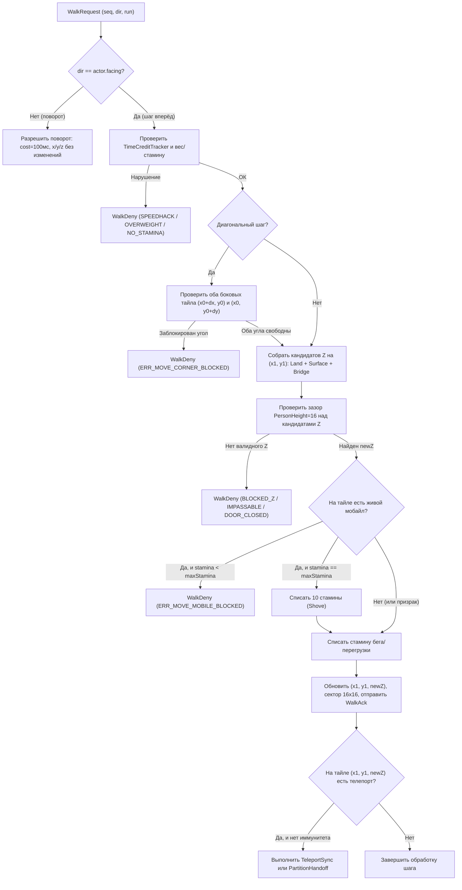
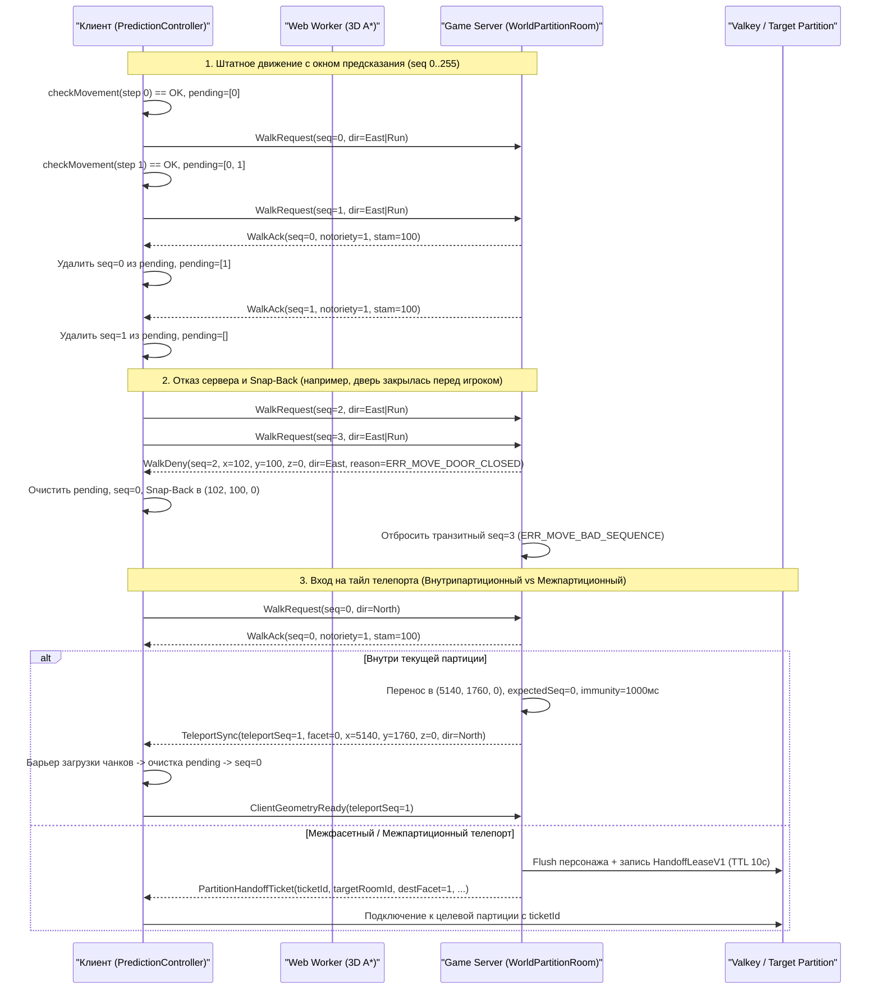

# Design: P12 Движение и навигация

## Context

Фаза P12 («Движение и навигация») соединяет геометрический движок мира (`@uo3/rules/src/world/*` из P03), авторитарный цикл симуляции 20 Гц (`WorldPartitionRoom` из P06), сетевой слой и видимость AOI (`@uo3/protocol` и `@colyseus/schema` v3 `StateView` из P07), изометрический рендерер чанков и камеру (`apps/client` из P10) и систему скелетных/спрайтовых анимаций мобайлов (`MobileAnimationController` из P11) в единый контур управления персонажем и перемещения NPC.

В классической Ultima Online: Renaissance (UO:R) движение основано на дискретной тайловой сетке с третьей координатой высоты `Z` (шаг `1 Z = 4 px` по вертикали на экране) и 8 направлениями `Direction (0..7)` с битовым флагом бега `0x80`. Несмотря на дискретность тайлов, игрок должен ощущать мгновенный отклик на удержание правой кнопки мыши (ПКМ) или клавиш движения без задержки на сетевой RTT, тогда как сервер обязан строго проверять каждый шаг на проходимость, высоту ступеней (`StepHeight = 2`), габарит персонажа (`PersonHeight = 16`), столкновения с дверями и мобайлами (`shove`), баланс стамины, перегрузку весом и соблюдение скоростных лимитов (`100..400` мс на шаг).

В соответствии с правилами репозитория и ADR-001..013:
- Все формулы проверки шага, расхода стамины, весовых порогов и 3D A* размещаются **строго в изоморфном пакете `@uo3/rules`**, не имеющем зависимостей от Node.js или браузерного DOM.
- Все перечисления, коды ошибок и чистые структуры данных размещаются в `@uo3/domain` (0 зависимостей).
- Сетевые пакеты (`WalkRequest`, `WalkAck`, `WalkDeny`, `TeleportSync`, `PartitionHandoffTicket`) типизируются через TypeBox и получают бинарные опкоды `uint16` в `@uo3/protocol`.
- Сервер остаётся единственным источником истины: клиент предсказывает до `4` шагов вперёд, но любое расхождение немедленно откатывается пакетом `WalkDeny` или `TeleportSync`.

## Goals / Non-Goals

### Goals
- Реализовать 100% детерминированный изоморфный алгоритм `checkMovement` в `@uo3/rules`, побитово одинаково работающий на сервере (Node 22) и клиенте (Main Thread + Web Worker).
- Обеспечить нулевую ощущаемую задержку ввода на клиенте при RTT до `200` мс за счёт окна из `4` неподтверждённых шагов (`seq 0..255`) и непрерывной линейной интерполяции координат рендера.
- Защитить сервер от спидхака и пакетного флуда через детерминированный кредитный буфер времени (`TimeCreditTracker`) с допуском сетевого джиттера `150` мс и карантином при систематических нарушениях.
- Реализовать каноническую модель усталости UO:R: порог веса `MaxWeight = 40 + floor(3.5 * STR)`, расход стамины при беге и перегрузке, проталкивание мобайлов (`shove`) за `10` стамины при `stamina == maxStamina`, пассивную регенерацию.
- Создать изоморфный 3D A* планировщик пути по графу поверхностей `(x, y, z)` с жёсткими бюджетами для серверных NPC (`1024` узла, `24` тайла) и клиентского Web Worker автопути (`2048` узлов, `48` тайлов).
- Реализовать систему статических и динамических телепортов с защитой от зацикливания (`teleportImmunity`), атомарным внутрипартиционным переносом (`TeleportSync`) и двухфазным межпартиционным/межфасетным хэндоффом (`PartitionHandoffTicket`).

### Non-Goals
- Боевые модификаторы движения (паралич, паутина, замедление от заклинаний, сброс таймера замаха оружия) — делегируются в P16 и P18 через интерфейс флагов состояния мобайла.
- Заклинания `Recall`, `Gate Travel`, `Teleport` и рунные книги — реализуются в P18 поверх создаваемого в P12 сервиса телепортации.
- Полноценный ИИ NPC (выбор целей, агро-таблицы, патрульные состояния) — реализуется в P19 поверх создаваемого в P12 планировщика 3D A*.
- Движение палуб кораблей и плавание мульти-структур — реализуется в P24.

## Decisions

### Decision 1: Изоморфное ядро `checkMovement` поверх `WorldCollisionQuery` и `DynamicTileProvider`
- **Выбор**: Разместить чистую функцию `checkMovement(ctx, actor, dir, run)` в `packages/rules/src/movement/check-movement.ts`. Входной контекст `MovementWorldView` объединяет статическую геометрию чанков из P03 (`SoA+CSR` тайлы ландшафта и статики) и интерфейс `DynamicMovementQuery` (двери, динамические предметы, мульти-структуры и мобайлы в целевом и смежных тайлах).
- **Обоснование**: Клиент обязан отсекать заведомо невалидные шаги (например, бег в стену) до отправки `WalkRequest`, чтобы не вызывать постоянные откаты `Snap-Back`. Использование одного и того же кода в `@uo3/rules` гарантирует отсутствие рассинхронизации на лестницах (`Bridge`), мостах, порогах зданий и береговых линиях.
- **Отвергнутые альтернативы**:
  - *Упрощённая 2D-проверка на клиенте и полная 3D-проверка на сервере*: отвергнуто, так как на любой многоэтажной постройке или мосту клиент будет предсказывать проваливание или упираться в фантомные препятствия.
  - *Передача клиенту только серверных ответов без локального предсказания*: отвергнуто, при пинге `80..150` мс управление становится неприемлемо вязким.

### Decision 2: Кольцевой протокол `seq (0..255)` с резервированием `0` для состояния после сброса
- **Выбор**: Использовать каноническую схему нумерации шагов UO: первый шаг после логина, `WalkDeny` или `TeleportSync` всегда отправляется с `seq = 0`. Последующие шаги инкрементируют счётчик `1..255`, а после `255` переходят в `1` (минуя `0`). Глубина окна неподтверждённых шагов `MAX_PENDING_STEPS = 4`.
- **Обоснование**: При длительности верхового бега `100` мс окно из `4` шагов перекрывает сетевой RTT до `400` мс. Резервирование `seq = 0` как маркера «чистого старта после ресинхронизации» позволяет серверу мгновенно и однозначно отбрасывать все летящие по сети устаревшие пакеты (`seq = 1..255`), которые клиент успел отправить до того, как получил `WalkDeny` или `TeleportSync`.
- **Отвергнутые альтернативы**:
  - *Монотонный `uint32` счётчик без сброса в 0*: усложняет восстановление после отказа, требуя явного поля `epoch` в каждом пакете шага и увеличивая размер заголовка наиболее частого пакета в игре.

### Decision 3: Серверный анти-спидхак на модели `TimeCreditTracker` (Leaky Bucket с окном джиттера)
- **Выбор**: Вместо проверки мгновенного интервала `now - lastStepAt >= interval` (которая ломается при любом TCP/WebSocket джиттере, когда два пакета приходят слитно), сервер хранит для каждого мобайла виртуальные часы доступности `nextMoveAllowedAtMs`.
  При приходе шага стоимостью `costMs` (`100`, `200` или `400` мс) в момент серверного монотонного времени `nowMs`:
  1. Если `nowMs - nextMoveAllowedAtMs > MAX_IDLE_CREDIT_MS (200 мс)`, то `nextMoveAllowedAtMs = nowMs` (сброс простоя, чтобы стоявший игрок не мог «выстрелить» пачкой накопленных шагов).
  2. Проверка допуска: если `nowMs + JITTER_ALLOWANCE_MS (150 мс) < nextMoveAllowedAtMs`, шаг отклоняется с `ERR_MOVE_SPEEDHACK`.
  3. При успехе: `nextMoveAllowedAtMs = nextMoveAllowedAtMs + costMs`.
- **Обоснование**: Такая схема абсолютно неуязвима для долгосрочного спидхака (средняя скорость движения математически не может превысить `1 / costMs` ни на доли процента), но при этом прощает сетевой джиттер до `150` мс без ложных `WalkDeny` у честных игроков.
- **Отвергнутые альтернативы**:
  - *Обработка не более 1 шага за серверный тик без учёта времени*: при тике 50 мс и джиттере два пакета верхового бега (по 100 мс) могут прийти в соседние тики, либо читер сможет двигаться со скоростью 20 тайлов/с (50 мс вместо 100 мс).

### Decision 4: Разделение логических координат тайла и непрерывных координат рендера на клиенте
- **Выбор**: В клиентском сторе (`apps/client/src/features/movement/prediction-store.ts`) состояние локального игрока разделяется на:
  - `authoritativePose: { x, y, z, dir }` — последняя подтверждённая сервером точка;
  - `predictedPose: { x, y, z, dir }` — голова очереди предсказания (дискретный тайл);
  - `pendingSteps: PendingStep[]` — кольцевой буфер до 4 шагов `{ seq, fromPose, toPose, run, startedAtMs, durationMs }`;
  - `visualInterpolator` — в `requestAnimationFrame` вычисляет плавные `(renderX, renderY, renderZ)` для `CameraTargetProvider` (P10) и слота мобайла (P11).
- **Обоснование**: Игровая логика (проверка дистанции, секторные запросы, отправка следующего шага) должна опираться на дискретный `predictedPose`, тогда как камера и спрайт не должны прыгать дискретно по 44 пикселя каждые 100–400 мс.
- **Отвергнутые альтернативы**:
  - *Движение в свободных float-координатах с последующим округлением к тайлам*: нарушает каноническую геометрию UO:R и приводит к постоянным расхождениям углов и диагоналей с сервером.

### Decision 5: Изоморфный 3D A* с плоским типизированным пулом памяти и бинарной кучей
- **Выбор**: Реализовать планировщик `findPathAStar` в `packages/rules/src/movement/pathfinding.ts` без аллокаций объектов в горячем цикле: узлы хранятся в предвыделенных `TypedArray` (`Int32Array` для координат и индексов родителей, `Uint32Array` для `g`, `f` и `generationId`), а открытый список — в плоской бинарной куче (`BinaryHeap`).На клиенте планировщик оборачивается в выделенный Web Worker (`pathfinding.worker.ts`), получающий актуальный срез `WorldCollisionQuery` и динамических объектов AOI.
- **Обоснование**: На сервере в одной партиции одновременно могут искать путь десятки NPC; zero-allocation пул с `generationId` (без `fill(0)` между вызовами) позволяет выполнять поиск на `1024` узла быстрее `0.4` мс, не вызывая пауз GC в цикле 20 Гц. На клиенте вынос в Web Worker гарантирует стабильные 60/120 FPS даже при прокладке сложного маршрута на `48` тайлов.
- **Отвергнутые альтернативы**:
  - *Использование сторонних JS-библиотек поиска пути (PathFinding.js и др.)*: они работают только с плоской 2D-сеткой, не поддерживают многоуровневые поверхности `Z` (мосты над водой, многоэтажные здания) и создают тысячи объектов на каждый вызов.
  - *Навигационные меши (NavMesh)*: избыточны для дискретной изометрической сетки UO с частыми динамическими изменениями (двери, стены огня, дома, мобайлы).

### Decision 6: Двухконтурная архитектура телепортов (In-Partition Fast Path vs Cross-Partition Handoff)
- **Выбор**:
  1. **Внутри одной партиции (`In-Partition Fast Path`)**: если целевая точка `(destFacetId, destX, destY, destZ)` обслуживается текущим `WorldPartitionRoom`, перенос выполняется синхронно внутри текущего тика симуляции. Сервер обновляет секторный индекс `16x16`, пересчитывает `StateView` AOI, выставляет `teleportImmunity`, сбрасывает `expectedSeq = 0` и отправляет пакет `TeleportSync`.
  2. **Между партициями или фасетами (`Cross-Partition Handoff`)**: если целевая точка принадлежит другому `WorldPartitionRoom`, исходная комната переводит сессию игрока в состояние `isTransferring = true`, выполняет синхронный flush состояния персонажа через координатор персистентности (P08), записывает в Valkey одноразовый тикет `handoff:<ticketId>` (TTL `10000` мс) с подписью и отправляет клиенту `PartitionHandoffTicket`. Клиент переключает транспорт `GameSessionConnector` (P09) на целевую комнату, передавая `ticketId` в `onAuth`.
- **Обоснование**: Большинство телепортов в UO (входы в подземелья, этажи башен, лестницы на том же фасете) находятся в пределах одной комнаты-партиции и должны отрабатывать мгновенно за 1 тик (50 мс) без переподключения WebSocket. В то же время переход между фасетами (`Felucca <-> Trammel`) или шардированными зонами требует строгого сохранения инвариантов RPO=0 и эпох владения (`partition_epoch` из P08).
- **Отвергнутые альтернативы**:
  - *Переподключение к комнате при любом телепорте*: создаёт лишнюю задержку `200..500` мс и нагрузку на БД при обычном входе в подземелье.

### Decision 7: Защита от зацикливания двусторонних телепортов (`TeleportImmunityState`)
- **Выбор**: При любом телепорте в состояние мобайла записывается `{ immunityUntilMs: nowMs + 1000, arrivalTile: { facetId, x, y, z }, hasSteppedOff: false }`. Триггер любого телепорта игнорирует мобайла, пока `nowMs < immunityUntilMs` ИЛИ `!hasSteppedOff` (флаг `hasSteppedOff` переключается в `true`, как только мобайл совершает первый успешный шаг на любой тайл, отличный от `arrivalTile`).
- **Обоснование**: В UO входы и выходы подземелий почти всегда являются симметричными двусторонними телепортами: тайл A переносит на тайл B, а тайл B переносит на тайл A. Комбинация таймера `1000` мс и обязательного схода с тайла `hasSteppedOff` полностью исключает пинг-понг между двумя телепортами даже при задержке пакетов.
- **Отвергнутые альтернативы**:
  - *Смещение точки приземления всегда на соседний тайл перед телепортом*: не всегда возможно в узких коридорах подземелий шириной в 1 тайл и ломает канонические координаты карт UO.

## Архитектура модулей и контракты данных

### Распределение ответственности по пакетам

| Пакет / Приложение | Модули фазы P12 | Ключевые экспорты и ответственность |
|---|---|---|
| `packages/domain` | `src/movement/*` | `MovementMode`, `MovementDenyReason` (`ERR_MOVE_*`), `DoorTraversalPolicy`, `PathfindingErrorCode` (`ERR_PATH_*`), `TeleportErrorCode` (`ERR_TELEPORT_*`), `TeleporterDefinition`, `TeleportImmunityState`, `MobileMovementState`. |
| `packages/rules` | `src/movement/*` | `checkMovement()`, `resolveStepIntervalMs()`, `calculateMaxWeight()`, `calculateStepStaminaDrain()`, `TimeCreditTracker`, `StaminaRegenTracker`, `findPathAStar()`, `AStarWorkspacePool`. |
| `packages/protocol` | `src/messages/movement.ts` | Опкоды `0x0101..0x0106`, TypeBox-схемы `WalkRequestSchema`, `WalkAckSchema`, `WalkDenySchema`, `TeleportSyncSchema`, `PartitionHandoffTicketSchema`, `ClientGeometryReadySchema`, бинарные кодеки. |
| `packages/content` | `src/schemas/teleporter.ts`, `data/teleporters/*.yaml` | JSON Schema и YAML-реестры статических телепортов (входы в подземелья, межфасетные порталы, тестовые телепорты синтетического фасета `200`), CLI-валидатор проходимости точек назначения. |
| `apps/game-server` | `src/movement/*` | `MovementIntentHandler`, `StaminaTickSystem`, `TeleporterTriggerSystem`, `PartitionHandoffService`, интеграция с `WorldPartitionRoom` и секторным индексом `16x16`. |
| `apps/client` | `src/features/movement/*` | `MovementInputController` (ПКМ-сектора, клавиатура, автобег), `PredictionController` (`seq 0..255`, окно 4 шага), `VisualMovementInterpolator`, `PathfindingWorkerClient` + `pathfinding.worker.ts`, `TeleportBarrierController`. |
| `apps/bot-client` | `src/behaviors/movement-bot.ts` | Генератор нагрузки: случайное блуждание, следование по маршрутам A*, переходы через телепорты, стресс-тест окна `seq`. |

### Контракты сетевого протокола (`@uo3/protocol`)

Все сообщения движения используют компактную структуру и регистрируются в общем реестре опкодов:

| Опкод | Имя сообщения | Направление | Поля TypeBox / Бинарный формат |
|---|---|---|---|
| `0x0101` | `WalkRequest` | Client -> Server | `seq: uint8 (0..255)`, `dir: uint8` (биты `0..2` — `Direction 0..7`, бит `7 (0x80)` — флаг `run`), `fastWalkKey?: uint32` |
| `0x0102` | `WalkAck` | Server -> Client | `seq: uint8 (0..255)`, `notoriety: uint8 (1..7)`, `stamina: uint16` |
| `0x0103` | `WalkDeny` | Server -> Client | `seq: uint8`, `x: uint16`, `y: uint16`, `z: int8`, `dir: uint8 (0..7)`, `stamina: uint16`, `reason: MovementDenyReason (uint8)` |
| `0x0104` | `TeleportSync` | Server -> Client | `teleportSeq: uint16`, `facetId: uint8`, `x: uint16`, `y: uint16`, `z: int8`, `dir: uint8 (0..7)`, `requiresBarrier: boolean` |
| `0x0105` | `PartitionHandoffTicket` | Server -> Client | `ticketId: string (UUID)`, `targetRoomId: string`, `targetEndpoint: string`, `destFacetId: uint8`, `destX: uint16`, `destY: uint16`, `destZ: int8`, `destDir: uint8`, `expiresAtMs: uint64` |
| `0x0106` | `ClientGeometryReady` | Client -> Server | `teleportSeq: uint16` (сигнал снятия клиентского барьера загрузки чанков после дальнего телепорта) |

### Коды ошибок движения, навигации и телепортации (`@uo3/domain`)

- **Валидация и тайминг (`MovementDenyReason`)**:
  - `ERR_MOVE_BAD_SEQUENCE (1)` — `seq` пакета не совпадает с ожидаемым на сервере.
  - `ERR_MOVE_OUT_OF_BOUNDS (2)` — выход за границы геометрии фасета.
  - `ERR_MOVE_IMPASSABLE (3)` — целевой тайл заблокирован ландшафтом или статикой (`Impassable` / `Wet`).
  - `ERR_MOVE_BLOCKED_Z (4)` — нет подходящей опорной поверхности в коридоре `[-16, +2]` или потолок ниже `newZ + 16`.
  - `ERR_MOVE_CORNER_BLOCKED (5)` — при диагональном шаге заблокирован один из смежных ортогональных тайлов.
  - `ERR_MOVE_DOOR_CLOSED (6)` — путь преграждает закрытая дверь (для живого персонажа).
  - `ERR_MOVE_MOBILE_BLOCKED (7)` — тайл занят другим живым мобайлом, а условия `shove` (`stamina == maxStamina`) не выполнены.
  - `ERR_MOVE_OVERWEIGHT (8)` — вес превышает `MaxWeight + 60` камней.
  - `ERR_MOVE_NO_STAMINA (9)` — `stamina == 0` при попытке бега или шага с перегрузкой.
  - `ERR_MOVE_SPEEDHACK (10)` — шаг пришёл раньше `nextMoveAllowedAtMs - jitterAllowanceMs` или активен карантин.
  - `ERR_MOVE_PARALYZED_OR_FROZEN (11)` — движение заблокировано эффектом состояния или активным барьером.
  - `ERR_MOVE_TRANSFERRING (12)` — персонаж находится в процессе межпартиционного переноса.
- **Поиск пути (`PathfindingErrorCode`)**:
  - `ERR_PATH_TOO_FAR` — расстояние Чебышёва превышает `maxRangeTiles` (`24` сервер / `48` клиент).
  - `ERR_PATH_UNREACHABLE` — открытый список исчерпан, путь к цели не существует.
  - `ERR_PATH_BUDGET_EXCEEDED` — достигнут лимит `maxExpandedNodes` (`1024` / `2048`) при `allowPartial = false`.
  - `ERR_PATH_BLOCKED` — маршрут прерван динамическим препятствием и повторная прокладка не удалась.
- **Телепортация (`TeleportErrorCode`)**:
  - `ERR_TELEPORT_DEST_BLOCKED` — целевой тайл и окрестность `scatterRadius` непроходимы.
  - `ERR_TELEPORT_MOUNT_FORBIDDEN` — телепорт запрещает проход верхом.
  - `ERR_TELEPORT_HANDOFF_EXPIRED` — истёк срок действия `PartitionHandoffTicket`.

### Схема состояния в Colyseus (`@colyseus/schema` v3) и БД (`@uo3/db`)

В `MobileSchema` (из P07) используются и обновляются поля:
- `x: uint16`, `y: uint16`, `z: int8`, `dir: uint8` (биты `0..2` — направление, бит `7` — флаг последнего шага бегом для выбора анимации `Walk`/`Run` удалёнными клиентами в P11);
- `stamina: uint16`, `maxStamina: uint16`;
- `isMounted: boolean`, `isDead: boolean`, `isHidden: boolean`;
- `moveSpeedMultiplier: uint8` (по умолчанию `100` = 1.0x, резерв для будущих эффектов P16/P18).

В PostgreSQL 17 (`@uo3/db`, таблица `characters` из P05/P08):
- При dirty-flush (каждые 60 с) и синхронном flush перед `PartitionHandoff` сохраняются актуальные `facet_id`, `x`, `y`, `z`, `dir`, `stamina`. Новых таблиц БД в P12 создавать не требуется: статические телепорты хранятся в `@uo3/content`, а динамические порталы существуют как сущности мира `world_items` (P08/P18). Для транзитных межпартиционных переходов используется Valkey-ключ `uo3:handoff:<ticketId>` с JSON-пейлоадом `HandoffLeaseV1` и TTL `10` секунд.

## Точные алгоритмы и математические формулы UO:R

### 1. Алгоритм `checkMovement` и расчёт `newZ`

Пусть мобайл находится в `(x0, y0, z0)` с направлением `facing0` и запрашивает движение в направлении `dir (0..7)` с флагом `run`.

1. **Проверка поворота на месте**:
   Если `dir !== facing0`, функция немедленно возвращает:
   `{ allowed: true, isTurnOnly: true, x: x0, y: y0, z: z0, dir, stepCostMs: 100, staminaCost: 0 }`.
2. **Вычисление целевых координат**:
   Смещение `(dx, dy)` по таблице направлений:
   - `0 (N): (0, -1)`, `1 (NE): (+1, -1)`, `2 (E): (+1, 0)`, `3 (SE): (+1, +1)`,
   - `4 (S): (0, +1)`, `5 (SW): (-1, +1)`, `6 (W): (-1, 0)`, `7 (NW): (-1, -1)`.
   Целевой тайл: `(x1, y1) = (x0 + dx, y0 + dy)`. Если `x1 < 0 || x1 >= facetWidth || y1 < 0 || y1 >= facetHeight` -> `ERR_MOVE_OUT_OF_BOUNDS`.
3. **Проверка диагональных углов**:
   Если `dx !== 0 && dy !== 0` (диагональ), вызывается проверка геометрической проходимости `checkTileSurface(x0 + dx, y0, z0)` и `checkTileSurface(x0, y0 + dy, z0)`. Оба боковых тайла должны иметь валидную опорную поверхность в коридоре `[z0 - 16, z0 + 2]` и свободный вертикальный зазор `PersonHeight = 16`. Иначе -> `ERR_MOVE_CORNER_BLOCKED`.
4. **Поиск опорной поверхности `newZ` на целевом тайле `(x1, y1)`**:
   Максимальная высота зашагивания: `maxClimbZ = z0 + StepHeight` (`z0 + 2`).
   Минимальная высота опоры при шаге: `minDropZ = z0 - 16` (или ниже при наличии наклонного спуска `Bridge`).
   Собираются все кандидаты поверхностей на `(x1, y1)`:
   - **Ландшафт (Land tile)**: если флаг тайла НЕ содержит `Impassable` (и не `Wet` для пешего наземного мобайла) и тайл не игнорируется (`Ignored`), берётся `landZ = GetAverageZ(x1, y1)`. Кандидат допустим, если `landZ <= maxClimbZ`.
   - **Статика, мульти и динамические предметы**:
     - Для объекта с флагом `Surface` и без `Bridge`: верхняя грань `topZ = item.z + item.calcHeight`. Кандидат допустим, если `topZ <= maxClimbZ`.
     - Для объекта с флагом `Bridge` (лестница/пандус): базовая точка `baseZ = item.z`, верхняя точка `topZ = item.z + item.calcHeight`. Кандидат допустим, если `baseZ <= maxClimbZ` (при этом итоговая высота подъёма равна `topZ`, что позволяет подниматься по ступеням с `height > 2`, если основание ступени находится не выше `z0 + 2`).
5. **Фильтрация кандидатов по вертикальному габариту (`PersonHeight = 16`)**:
   Для каждого кандидата `candZ` проверяется интервал `[candZ, candZ + 16)`:
   - В этом интервале не должно быть ни одного объекта с флагом `Impassable` (или `Surface` с `item.z + item.height > candZ` и `item.z < candZ + 16`), кроме:
     - закрытых дверей для призраков (`actor.isDead === true`), которые игнорируются;
     - если препятствием является закрытая дверь для живого персонажа — фиксируется причина `ERR_MOVE_DOOR_CLOSED`.
   Из всех прошедших проверку кандидатов выбирается максимальный `newZ <= maxClimbZ` (ближайший сверху к уровню ног). Если ни один кандидат не подошёл -> возвращается `ERR_MOVE_DOOR_CLOSED`, `ERR_MOVE_IMPASSABLE` или `ERR_MOVE_BLOCKED_Z`.
6. **Проверка коллизий с мобайлами и проталкивания (`Shove`)**:
   Ищутся все живые осязаемые мобайлы на `(x1, y1)` с пересечением по высоте `|other.z - newZ| < 16`.
   Если такие мобайлы есть и `actor` не является призраком (`!actor.isDead`) и не имеет `ignoreMobileCollisions`:
   - Если `actor.stamina === actor.maxStamina`, шаг разрешается со штрафом `shoveStaminaCost = 10` и флагом `shovedMobile = true`.
   - Иначе -> возвращается `ERR_MOVE_MOBILE_BLOCKED`.

### 2. Формулы таймингов, веса и стамины

1. **Длительность шага `stepIntervalMs`**:
   - Поворот на месте (`isTurnOnly = true`): `100` мс (2 тика симуляции).
   - Пешком ходьба (`!isMounted && !run`): `400` мс (8 тиков).
   - Пешком бег (`!isMounted && run`): `200` мс (4 тика).
   - Верхом ходьба (`isMounted && !run`): `200` мс (4 тика).
   - Верхом бег (`isMounted && run`): `100` мс (2 тика).
2. **Максимальный вес без перегрузки**:
   $$\text{MaxWeight} = 40 + \lfloor 3.5 \times \text{STR} \rfloor$$
   Порог полной остановки: $\text{HardWeightLimit} = \text{MaxWeight} + 60$.
   При $\text{totalWeight} > \text{HardWeightLimit}$ любой шаг на соседний тайл отклоняется с `ERR_MOVE_OVERWEIGHT`.
3. **Расход стамины за шаг**:
   Для каждого мобайла ведётся целочисленный аккумулятор усталости `fatigueAccumulator`:
   - Базовый прирост усталости за шаг:
     - Ходьба без перегрузки: `0`.
     - Пеший бег без перегрузки: `+3` за шаг (порог списания `48` -> ровно `1` стамина каждые `16` шагов).
     - Верховой бег без перегрузки: `+1` за шаг (порог списания `48` -> ровно `1` стамина каждые `48` шагов).
   - При перегрузке ($\Delta W = \text{totalWeight} - \text{MaxWeight} > 0$):
     - Если $\Delta W < 25$: аккумулятор увеличивается на `+16` за каждый шаг (списание `1` стамины каждые `3` шага).
     - Если $\Delta W \ge 25$: списывается напрямую $\Delta S_{\text{overweight}} = 1 + \lfloor \Delta W / 25 \rfloor$ единиц стамины за каждый шаг (для всадника делится на 3 с округлением вверх).
   - Прямой расход на `shove`: `+10` единиц стамины мгновенно.
4. **Пассивная регенерация стамины**:
   Базовый интервал: `5000` мс (`+1` стамина). Если мобайл делал шаг бегом за последние `1000` мс ИЛИ $\text{totalWeight} > \text{MaxWeight}$, эффективный интервал равен `10000` мс.

### 3. Последовательность сетевого взаимодействия (Предсказание, Snap-Back и Телепорт)

## Risks / Trade-offs

- **[Риск] Рассинхронизация состояния динамических объектов (дверей/предметов) между клиентом и сервером в момент предсказания шага** → *Митигация*: Клиентская проверка `checkMovement` опирается на локальное зеркало `StateView` AOI; если дверь закрылась за `20` мс до прихода пакета на сервер, сервер отправит `WalkDeny` с точными авторитарными координатами `(x, y, z, dir)`, а клиент мгновенно выполнит `Snap-Back` и сбросит `seq = 0`.
- **[Риск] Ложные срабатывания анти-спидхака при нестабильном Wi-Fi или мобильном интернете (пакеты приходят пачкой после паузы)** → *Митигация*: `TimeCreditTracker` допускает опережение графика до `jitterAllowanceMs = 150` мс и ограничивает накопление кредита при простое `maxIdleCreditMs = 200` мс; одиночное превышение вызывает только `WalkDeny`, а карантин на `1000` мс включается лишь при `> 5` нарушениях за `10` секунд.
- **[Риск] Высокая нагрузка на CPU сервера при одновременном поиске пути A* множеством NPC** → *Митигация*: Жёсткий лимит `maxExpandedNodes = 1024` и `maxRangeTiles = 24` на сервере, плюс переиспользуемый `AStarWorkspacePool` на `TypedArray` с `generationId` (0 аллокаций в куче V8, время расчёта `< 0.4` мс на запрос).
- **[Риск] Проваливание или шаги в пустоту сразу после далёкого телепорта до подгрузки геометрии чанков на клиенте** → *Митигация*: `TeleportBarrierController` на клиенте блокирует отправку новых `WalkRequest` после `TeleportSync` / `PartitionHandoff` до тех пор, пока сектор коллизий `16x16` вокруг точки назначения не загружен из OPFS/RAM (с защитным таймаутом `3000` мс).
- **[Риск] Зацикливание игрока между двумя двусторонними телепортами (вход/выход подземелья)** → *Митигация*: Двойное условие `TeleportImmunityState`: таймер `1000` мс И обязательный флаг `hasSteppedOff = true` (игрок должен хотя бы один раз сойти с целевого тайла телепорта).
- **[Риск] Джиттер камеры при дискретных шагах 44×44 px на мониторах 120/144 Гц** → *Митигация*: `VisualMovementInterpolator` обновляет мировые координаты рендера в каждом кадре `requestAnimationFrame` с бесшовной сшивкой фазы при переходе от шага `N` к шагу `N+1` в очереди `pendingSteps`.
- **[Риск] Утечка или зависание сессии при обрыве связи во время `PartitionHandoff`** → *Митигация*: Перед выдачей `PartitionHandoffTicket` исходная партиция синхронно сохраняет персонажа в PostgreSQL уже с новыми целевыми координатами (или фиксирует lease в Valkey с TTL `10` с); если клиент не завершит хэндофф, при следующем реконнекте он безопасно загрузится из БД без потери состояния и дублирования.

## Migration Plan

1. **Расширение домена и правил (`@uo3/domain`, `@uo3/rules`)**:
   - Добавить типы движения, коды ошибок и структуры телепортов в `@uo3/domain`.
   - Реализовать `checkMovement`, расчёт веса/стамины, `TimeCreditTracker` и `findPathAStar` в `@uo3/rules/src/movement/*` с полным покрытием property-based и unit-тестами на синтетических картах из `@uo3/test-kit`.
2. **Контракты протокола и контента (`@uo3/protocol`, `@uo3/content`)**:
   - Зарегистрировать опкоды `0x0101..0x0106` и схемы TypeBox в `@uo3/protocol`.
   - Добавить схему и YAML-реестр статических телепортов в `@uo3/content` (включая тестовые двусторонние порталы, лестницы и входы в подземелье на синтетическом фасете `200`).
3. **Серверная интеграция (`apps/game-server`)**:
   - Подключить `MovementIntentHandler` в `IntentHandlerRegistry` комнаты `WorldPartitionRoom`.
   - Подключить тиковую систему регенерации стамины, секторные триггеры телепортов и `PartitionHandoffService`.
4. **Клиентская интеграция и боты (`apps/client`, `apps/bot-client`)**:
   - Реализовать `MovementInputController`, `PredictionController`, `VisualMovementInterpolator`, Web Worker автопути и `TeleportBarrierController`, связав их с камерой (P10) и анимациями (P11).
   - Обновить `apps/bot-client` для нагрузочного тестирования движения и телепортов.

## Open Questions

- *Нужно ли в будущем разрешать частичное проталкивание (`shove`) с неполной стаминой за счёт зелий `Total Refresh` на ходу?* — В P12 реализуется строгое каноническое правило UO:R (`stamina == maxStamina` и списание `10` стамины); расходование зелий добавится в фазе алхимии и предметов (P13/P20).
- *Должен ли клиентский автопуть автоматически открывать незапертые двери при подходе к ним?* — В P12 планировщик A* умеет строить путь через незапертые двери при `doorPolicy = CanOpenUnlocked`, а автоматическая отправка интента открытия двери (`UseObject`) на расстоянии 1 тайла подключится после ввода интерактивных предметов в P13.
