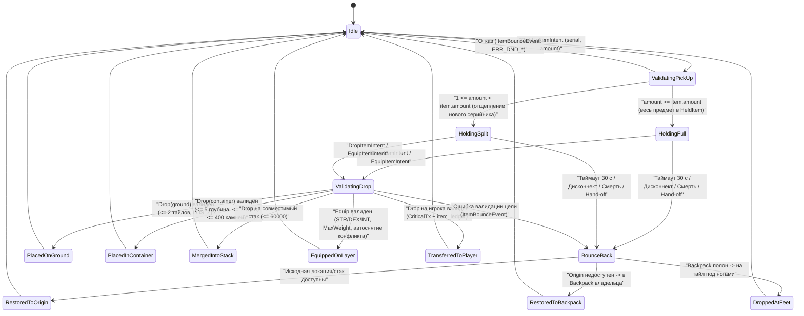
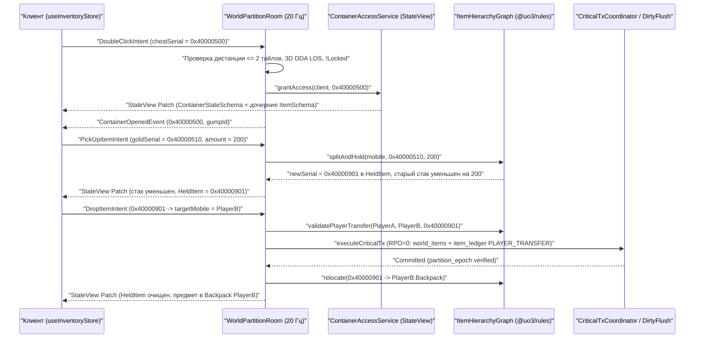

# Design: P13 Предметы и контейнеры

## Context

Фаза **P13 Предметы и контейнеры** (`p13-items-and-containers`) опирается на фундамент, заложенный в фазах P01–P12:
- **P01–P03 (`@uo3/domain`, `@uo3/rules`, `@uo3/uo-formats`)**: выделение серийных номеров предметов из диапазона `0x40000000..0x7FFFFFFF` через `SerialLeaseProvider` (блоками по 4096), битовые флаги `TileFlags` из `tiledata.mul` (`Stackable`, `Container`, `Wearable`, `Impassable`, `Surface`, `LightSource`, `Door`), пространственные запросы `GetAverageZ`, 3D DDA Line-of-Sight (LOS) и порт динамических препятствий `DynamicTileProvider`.
- **P05 и P08 (`@uo3/db`)**: контракт `StarterLoadoutV1` в таблице `characters`, таблицы состояния мира `world_items`, `world_item_containers`, неизменяемый журнал аудита `item_ledger`, координатор критических транзакций `CriticalTxCoordinator` (RPO=0), инкрементальный dirty-flush каждые 60 секунд и fencing-защита по `partition_epoch`.
- **P06 и P07 (`apps/game-server`, `@uo3/protocol`)**: 20 Гц цикл симуляции (тик 50 мс), иерархическое колесо таймеров (`HierarchicalTimerWheel`), реестр обработчиков намерений `IntentHandlerRegistry`, порт селективной видимости контейнеров `ContainerAccessGrantPort` поверх `@colyseus/schema` v3 `StateView`.
- **P10–P12 (`apps/client`)**: `WorldRenderDataSource` и `PickTarget` для хит-тестинга статических и динамических тайлов, 32-слотовый `MobileRenderSlot` для послойной отрисовки экипировки на спрайте мобиля и авторитарная геометрия координат персонажа.

В классической Ultima Online: Renaissance (UO:R) предметы представляют собой единую сущность, которая может менять локацию между тремя состояниями: лежать на земле (`World`), находиться внутри контейнера (`Container` на координатах сетки гампа `gridX, gridY`) или быть надетой на один из 24 слоёв мобиля (`MobileLayer`), а во время перетаскивания мышью — временно помещаться в транзитный слот удержания (`HeldItem`). Любая ошибка в атомарности переходов между этими локациями ведёт либо к потере предметов, либо к их клонированию (duplication exploit), либо к утечке приватного содержимого закрытых сундуков/рюкзаков через сетевой трафик.

## Goals / Non-Goals

### Goals
1. **Единая каноническая модель предмета (`ItemEntity`)**: строгое инвариантное дерево владения (`World | Container | MobileLayer | Held`), где каждый предмет в любой момент времени имеет ровно одного родителя.
2. **Изоморфная математика UO:R в `@uo3/rules`**: детерминированный расчёт веса в десятых долях камня (`unitWeightTenths`), грузоподъёмности `40 + floor(3.5 * STR)`, лимитов контейнера (`125` предметов / `400` камней), глубины вложенности `<= 5` и матрицы конфликтов 24 слоёв экипировки.
3. **Авторитарный конечный автомат Drag-and-Drop**: двухфазный протокол `PickUp -> Holding -> Drop / Equip | BounceBack` с таймаутом удержания `30` с, защитой от гонок в однопоточном тике 20 Гц и гарантированным возвратом предмета при обрыве связи или миграции между партициями.
4. **Приватная селективная репликация контейнеров**: передача дочерних предметов контейнера в клиентский `@colyseus/schema` `StateView` строго при наличии активного гранта в `ContainerAccessGrantPort` и автоматический отзыв при выходе из радиуса `2` тайлов.
5. **Интеграция с геометрией мира и хранилищем**: мгновенное обновление `DynamicTileProvider` при появлении/удалении предметов с флагами `Impassable`/`Surface`/`Door`, двухфазный распад трупов (`7 + 7` мин), 60-минутный распад предметов на земле и выборочная запись в `item_ledger` через `CriticalTxCoordinator` (RPO=0).

### Non-Goals
- Вёрстка окон гампов контейнеров, куклы персонажа (`Paperdoll Gump`), ползунка разделения стака и контекстных меню в React/WebGL — выполняется в **P14** поверх headless-стора `useInventoryStore`.
- Боевой расчёт урона оружия, поглощения урона по зонам брони и расхода стрел/реагентов — выполняется в **P16** и **P17**.
- Криминальный флаг за мародёрство чужого синего трупа и навыки `Stealing` / `Snooping` — выполняются в **P15** и **P20**.
- Окно защищённого обмена между двумя игроками (`Secure Trade Window`) и NPC-вендоры/банкиры — выполняются в **P21**.
- Домовые команды закрепления мебели (`I wish to lock this down`) и система безопасности домов — выполняются в **P23**.

## Decisions

### Решение 1: Инвариант единственного владельца (Discriminated Location Union) и двунаправленный индекс дерева предметов
- **Выбор**: В памяти комнаты партиции (`WorldPartitionRoom`) все предметы хранятся в плоской хеш-таблице `Map<ItemSerial, ItemNode>`, где позиция предмета задана дискриминированным объединением `ItemLocation`:
  - ` WORLD`: `{ kind: 'world', facetId: number, x: number, y: number, z: number }`
  - `CONTAINER`: `{ kind: 'container', parentSerial: ItemSerial, gridX: number, gridY: number }`
  - `LAYER`: `{ kind: 'layer', mobileSerial: MobileSerial, layer: EquipmentLayer }`
  - `HELD`: `{ kind: 'held', mobileSerial: MobileSerial, origin: ItemOriginSnapshot, heldSinceTick: number }`
  Смена локации выполняется исключительно через единый мутатор `ItemHierarchyGraph.relocate(itemSerial, nextLocation)`, который в одной синхронной операции отвязывает предмет от старого индекса (секторной сетки `16x16`, `childrenSet` контейнера или `equippedMap` мобиля), пересчитывает агрегированный вес и счётчик предметов вверх по цепочке предков (до 5 уровней) и привязывает к новому родителю.
- **Обоснование**: Плоский реестр с инвариантным мутатором исключает ситуацию, когда предмет числится одновременно в двух контейнерах или остаётся висеть в секторном индексе после подъёма в руку. Поскольку максимальная глубина контейнеров ограничена константой `MAX_CONTAINER_DEPTH = 5`, пересчёт суммарного веса `subtreeWeightTenths` и количества предметов `subtreeItemCount` при любой вставке/удалении выполняется за `O(depth) <= 5` операций без полного обхода дерева.
- **Отвергнутые альтернативы**:
  - *Хранение вложенных массивов объектов внутри самих контейнеров*: усложняет поиск предмета по `ItemSerial` за `O(1)` и создаёт риск рассинхронизации ссылок при сериализации.
  - *Ленивый пересчёт веса дерева при каждой проверке лимита*: приводит к `O(N)` обходу до 125 предметов на каждый `DropItemIntent`.

### Решение 2: Двухфазный серверный автомат перетаскивания (`HeldItem` State Machine) с `OriginSnapshot` и `BounceBack`
- **Выбор**: Перетаскивание моделируется явно на сервере как состояние слота `mobile.heldItem` (не более 1 предмета на персонажа). При `PickUpItemIntent(serial, amount)`:
  1. Проверяются инварианты: персонаж жив, `mobile.heldItem === null`, соблюдён rate-limit (`>= 250` мс с прошлого захвата), предмет достижим (`<= 2` тайлов и 3D DDA LOS для земли/внешнего контейнера, либо принадлежит персонажу), `movable === true && !lockedDown`.
  2. Снимается слепок исходного положения `ItemOriginSnapshot` (`world`, `container` или `layer`, включая `sourceStackSerial` при отщеплении части стака).
  3. Если `1 <= amount < item.amount` и предмет `Stackable`, исходный стак уменьшается на `amount`, а из `SerialLeaseProvider` выделяется новый серийник для отщеплённого стака, который сразу помещается в `HELD`. Иначе весь предмет переводится в `HELD`.
  4. В колесе таймеров регистрируется таймер `HOLD_TIMEOUT_MS = 30000` (600 тиков по 50 мс).
  5. При любой ошибке `DropItemIntent` / `EquipItemIntent`, истечении 30 с, смерти, дисконнекте или начале миграции между партициями вызывается `executeBounceBack(mobile)`:
     - Попытка 1: вернуть в `origin` (если исходный стак `sourceStackSerial` ещё существует и доступен — слить обратно и освободить временный серийник; если исходный контейнер/слой доступен и проходит по лимитам — вернуть туда).
     - Попытка 2: положить в собственный `Backpack` (`layer = 0x15`) персонажа с автоукладкой.
     - Попытка 3 (безусловный фоллбэк): сбросить на тайл земли `(mobile.x, mobile.y, mobile.z)` под ногами персонажа с запуском таймера распада 60 минут.
- **Обоснование**: Соответствует каноническому протоколу UO:R (`0x07 PickUp` -> `0x08 Drop` / `0x13 Equip` -> `0x27 Reject/Bounce`). Сервер всегда знает, какой предмет находится «в руке» игрока, что предотвращает подмену серийника в `DropItemIntent` и гарантирует, что предмет никогда не зависнет в воздухе при обрыве WebSocket.
- **Отвергнутые альтернативы**:
  - *Чисто клиентский Drag-and-Drop (отправка одной команды `MoveItem(from, to)` только при отпускании кнопки мыши)*: нарушает механику UO:R, где поднятый с земли предмет немедленно исчезает с земли для остальных игроков в момент захвата (`PickUp`), а не в момент сброса (`Drop`).

### Решение 3: Селективная репликация контейнеров через `ContainerAccessGrantPort` и `@colyseus/schema` `StateView`
- **Выбор**: Предметы в локации `WORLD` синхронизируются через пространственный AOI сектора (радиус 18 тайлов). Видимые слои экипировки `0x01..0x18` синхронизируются как компактный массив `EquippedLayerSchema` внутри схемы мобиля. Содержимое любого контейнера (`ContainerStateSchema` и его дочерние `ItemSchema`) помечается в `@colyseus/schema` v3 фильтрацией `StateView` и добавляется в `client.view` только через `ContainerAccessGrantPort`:
  - Собственный `Backpack` (`0x15`) добавляется в `StateView` владельца автоматически при спавне.
  - Внешний или вложенный контейнер добавляется в `StateView` клиента только при успешном `DoubleClickIntent` (дистанция Чебышёва до корневого объекта `<= 2` тайлов, наличие 3D DDA LOS, `Locked === false`).
  - На каждом шаге движения персонажа (хук P12) и при перемещении/удалении самого контейнера сервер проверяет активные гранты наблюдателей: если расстояние до корня превысило `2` тайла или контейнер перемещён в чужой рюкзак, грант немедленно отзывается, а элементы удаляются из `StateView` клиента.
- **Обоснование**: Исключает читы вида «рентген сундуков и чужих рюкзаков» (packet sniffing): клиент физически не получает по сети байты содержимого закрытых или далёких контейнеров.
- **Отвергнутые альтернативы**:
  - *Репликация всех предметов всех контейнеров в AOI с фильтрацией только на UI*: грубое нарушение безопасности (ADR-004, сервер авторитарен и не раскрывает скрытое состояние).

### Решение 4: Арифметика веса в десятых долях камня (`unitWeightTenths`) с потолочным округлением стака
- **Выбор**: Вес одного предмета в шаблонах и БД задаётся целым числом десятых долей камня `unitWeightTenths: uint16` (1 камень = 10 десятых; для сверхлёгких предметов вроде монет поддерживается `weightNumerator` / `weightDenominator`, по умолчанию `unitWeightTenths / 10`). Вес стака из `amount` штук в десятых долях равен `stackWeightTenths = unitWeightTenths * amount`, а вес стака в целых камнях — `stackStones = Math.ceil(stackWeightTenths / 10)`. Суммарный вес контейнера и общая нагрузка персонажа вычисляются путём суммирования `stackWeightTenths` всех предметов с последующим `Math.ceil(totalWeightTenths / 10)`.
- **Обоснование**: В UO:R реагенты, стрелы, перья и бинты весят `0.1` камня за штуку (`unitWeightTenths = 1`). Хранение веса в целых десятых долях полностью устраняет ошибки IEEE 754 floating-point между клиентом и сервером, сохраняя 100% детерминизм в `@uo3/rules`.
- **Отвергнутые альтернативы**:
  - *Числа с плавающей запятой `float64`*: приводят к расхождениям вида `0.1 * 3 = 0.30000000000000004`, из-за чего `Math.ceil` даёт лишний камень веса.

### Решение 5: Каноническая таблица 24 слоёв экипировки, матрица совместимости рук и взвешенный расчёт Armor Rating
- **Выбор**: В `@uo3/domain` фиксируется перечисление `EquipmentLayer` (`0x01..0x1D`), разделённое на три категории:
  1. **Боевые и видимые слои (`0x01..0x18`, кроме `0x0B`, `0x10`, `0x15`)**: управляются игроком через `PickUp` / `Equip`.
  2. **Косметические/системные видимые слои (`0x0B` Hair, `0x10` FacialHair, `0x15` Backpack, `0x19` Mount)**: реплицируются в AOI, но защищены от ручного снятия (`ERR_EQUIP_PROTECTED_LAYER`).
  3. **Скрытые системные слои (`0x1A..0x1C` Vendor boxes, `0x1D` BankBox)**: никогда не реплицируются в общий AOI и защищены от ручного снятия.
  Для слоёв рук (`0x01` OneHanded и `0x02` TwoHanded) вводится чистая функция `resolveHandSlotConflict(currentlyEquipped, incomingItem)`:
  - Слой `0x02` делится на подтипы `TwoHandedWeapon` (луки, алебарды, посохи, факелы/фонари со свойством щитового слота) и `Shield` (щиты, свечи/факелы с флагом `allowWithOneHanded`).
  - `OneHanded (0x01)` совместим с `Shield (0x02)`, но конфликтует с `TwoHandedWeapon (0x02)`.
  - При надевании конфликтующего предмета сервер пытается атомарно снять мешающие предметы с `0x01` и/или `0x02` в `Backpack` персонажа; если в рюкзаке нет места (`125` предметов или `400` камней), вся операция отклоняется.
- **Обоснование**: Точно воспроизводит правила экипировки UO:R (возможность носить меч + щит, но невозможность держать алебарду + щит) и обеспечивает атомарное освобождение рук для подготовки к касту заклинаний (P17).
- **Отвергнутые альтернативы**:
  - *Требовать от клиента предварительной отправки отдельного `PickUp` + `Drop` перед надеванием новой вещи*: увеличивает RTT-задержку переодевания в 2 раза и ломает UX при перетаскивании предмета прямо на куклу персонажа (`Paperdoll`).

### Решение 6: Разделение персистентности на RPO=0 (`CriticalTxCoordinator` + `item_ledger`) и 60-секундный Dirty-Flush
- **Выбор**: Мутации предметов классифицируются по уровню критичности:
  - **Критические операции (RPO=0 через `CriticalTxCoordinator` с записью в `item_ledger`)**:
    1. Первичная материализация `StarterLoadoutV1` при первом входе персонажа.
    2. Прямая передача предмета между двумя разными персонажами (`PLAYER_TRANSFER`).
    3. Любое перемещение предмета в/из `BankBox` (`BANK_DEPOSIT` / `BANK_WITHDRAW`).
    4. Создание или удаление предметов персоналом (`GM_SPAWN` / `GM_DELETE`) и уничтожение предметов с флагом `Newbie`/`Blessed`.
  - **Обычные операции (In-Memory Dirty Flag + 60s Batch Flush)**:
    1. Перекладывание предметов внутри собственного рюкзака, переодевание экипировки, разделение/слияние стаков у одного владельца.
    2. Сброс предмета на землю, подъём обычного предмета с земли, распад мусора и трупов по таймеру.
    3. Изменение `durabilityCurrent` на единицу.
- **Обоснование**: Соответствует ADR-007 и контракту P08. Запись в PostgreSQL каждого перекладывания яблока в рюкзаке заблокировала бы 20 Гц цикл симуляции, тогда как межперсонажные передачи и операции с банком требуют строгой защиты от дюпов при падении ноды (`RPO=0`).
- **Отвергнутые альтернативы**:
  - *Синхронный SQL-коммит на каждый `DropItemIntent`*: не выдерживает бюджет тика 50 мс при 500+ игроках в партиции.

### Решение 7: Интеграция предметов мира с `DynamicTileProvider` и двухфазным колесом таймеров распада
- **Выбор**:
  1. Каждый предмет, попадающий в локацию `WORLD`, проверяется на наличие геометрических флагов `TileData`: `Impassable`, `Surface`, `Bridge`, `Door`. Если хотя бы один флаг установлен, предмет регистрируется в `DynamicTileProvider` сектора (`registerDynamicTile(facetId, x, y, itemTileSpan)`), немедленно влияя на `CheckMovement` (P12) и 3D DDA LOS (P03). При подъёме или удалении предмета запись синхронно удаляется из `DynamicTileProvider`.
  2. Таймеры распада регистрируются в `HierarchicalTimerWheel` (P06):
     - Обычный предмет (`movable && !lockedDown`): `3600` с (`72000` тиков).
     - Контейнер-труп (`graphicId === 0x2006`): Фаза 1 — `420` с (`8400` тиков) до установки флага `CorpseBones` (визуальный переход в кости); Фаза 2 — ещё `420` с до полного каскадного удаления контейнера и оставшегося лута.
- **Обоснование**: Обеспечивает мгновенную реакцию физического мира (закрытая дверь или выброшенный блокирующий сундук сразу перекрывают проход и LOS в том же тике) и автоматическую очистку мира от мусора за `O(1)` на тик благодаря иерархическому колесу таймеров.
- **Отвергнутые альтернативы**:
  - *Периодическое сканирование всех предметов мира раз в минуту для проверки `decayAt`*: создаёт пиковые паузы GC и CPU при десятках тысяч предметов на земле.

## Архитектура модулей и контракты данных

### Распределение ответственности по пакетам

| Пакет / Приложение | Модули и ответственность в P13 |
|---|---|
| `packages/domain` | Перечисления `EquipmentLayer` (`0x01..0x1D`), `ItemLocationKind`, `ItemDynamicFlags` (`Movable`, `Newbie`, `LockedDown`, `Locked`, `CorpseBones`), `BounceReason`, коды ошибок `ERR_ITEM_*`, `ERR_CONTAINER_*`, `ERR_DND_*`, `ERR_EQUIP_*`, константы лимитов UO:R (`MAX_STACK_AMOUNT = 60000`, `MAX_CONTAINER_ITEMS = 125`, `MAX_CONTAINER_WEIGHT_STONES = 400`, `MAX_CONTAINER_DEPTH = 5`, `HOLD_TIMEOUT_MS = 30000`, `DECAY_GROUND_SECONDS = 3600`, `CORPSE_BONE_DELAY_SECONDS = 420`). |
| `packages/rules` | Чистые модули `items/weight.ts` (`calculateStackWeightTenths`, `calculateMaxCarryWeight`), `items/stacking.ts` (`canStackItems`, `mergeStackAmounts`), `items/containers.ts` (`validateContainerInsertion`, `autoPlaceInContainerGrid`), `items/equipment.ts` (`resolveHandSlotConflict`, `calculateEquipmentModifiers`, `canEquipItem`), `items/labels.ts` (`formatSingleClickLabel`), `items/drag-state-machine.ts` (`ItemDragStateMachine`), интеграция с `DynamicTileProvider`. |
| `packages/content` | JSON Schema `item-template.schema.json`, базовый каталог `content/items/*.yaml` (оружие, броня, одежда, контейнеры, золото, факелы, ключи, расходники) и валидатор соответствия `StarterLoadoutV1` шаблонам каталога. |
| `packages/protocol` | Опкоды `uint16` и TypeBox-схемы намерений клиента и событий сервера (`0x0130..0x014F`), схемы `@colyseus/schema` v3 (`WorldItemSchema`, `ContainerItemSchema`, `ContainerStateSchema`, `EquippedLayerSchema`, `HeldItemSchema`). |
| `packages/db` | Репозиторий `WorldItemRepository` поверх таблиц `world_items`, `world_item_containers`, `item_ledger` (P08): пакетная загрузка дерева предметов персонажа и сектора, транзакция материализации `StarterLoadoutV1`, запись критических операций через `CriticalTxCoordinator`. |
| `apps/game-server` | `ItemSimulationService`, `ContainerAccessService` (реализация `ContainerAccessGrantPort`), `EquipmentService`, `ItemDecayScheduler`, обработчики в `IntentHandlerRegistry`, хуки дистанции при шаге персонажа (P12) и hand-off между партициями. |
| `apps/client` | Headless Zustand-стор `useInventoryStore` (содержимое открытых контейнеров, экипировка, слот `heldItem`, оптимистичный курсор перетаскивания с откатом по `ItemBounceEvent`), адаптер наземных предметов для `WorldRenderDataSource` и `PickTarget` (P10), подача `EquippedLayerSchema` в `MobileRenderSlot` (P11). |

### Канонические математические формулы UO:R

1. **Вес стака и контейнера**:
   $$\text{stackWeightTenths}(u, a) = u \cdot a, \quad \text{stackStones}(u, a) = \left\lceil \frac{u \cdot a}{10} \right\rceil$$
   $$\text{subtreeStones}(C) = \left\lceil \frac{\sum_{i \in \text{descendants}(C)} u_i \cdot a_i}{10} \right\rceil$$
   где $u \in \mathbb{N}_0$ — удельный вес `unitWeightTenths` в десятых долях камня, $a \in [1, 60000]$ — количество `amount`.

2. **Максимальная грузоподъёмность персонажа (`MaxWeight`)**:
   $$\text{MaxWeight}(\text{STR}_{\text{eff}}) = 40 + \lfloor 3.5 \cdot \text{STR}_{\text{eff}} \rfloor \text{ (камней)}$$
   Переносимый вес персонажа $\text{CarriedStones}$ равен сумме весов всех предметов на слоях `0x01..0x18` (включая собственный вес сумки `Backpack` и всего её поддерева), но **не включает** вес `BankBox` (`0x1D`).

3. **Взвешенный рейтинг брони (`Armor Rating`) по зонам тела**:
   Каждый элемент брони на слое имеет базовый рейтинг $\text{AR}_{\text{base}}$ и текущую долю целостности $d = \frac{\text{durabilityCurrent}}{\text{durabilityMax}}$ (при $\text{durabilityMax} = 0$ полагается $d = 1$). Вклад зоны с весовым коэффициентом $w_{\text{zone}}$ (Грудь `0x0D`/`0x11`: $0.35$, Ноги `0x04`/`0x18`: $0.22$, Руки `0x13`: $0.14$, Голова `0x06`: $0.15$, Шея `0x0A`: $0.07$, Кисти `0x07`: $0.07$):
   $$\text{AR}_{\text{piece}} = \lfloor \text{AR}_{\text{base}} \cdot d \rfloor, \quad \text{AR}_{\text{total}} = \text{round}\left(\sum_{z \in \text{zones}} \text{AR}_{\text{piece}}(z) \cdot w_z\right) + \text{AR}_{\text{shield}}$$

4. **Автоукладка в сетке контейнера (`autoPlaceInContainerGrid`)**:
   Для контейнера с прямоугольником рабочей области $[X_{\min}, X_{\max}] \times [Y_{\min}, Y_{\max}]$ и шагом сетки $S = 16$ пикселей выбирается первая свободная точка $(x, y)$ в порядке лексикографического обхода строк ($y = Y_{\min}, Y_{\min}+S, \dots$; $x = X_{\min}, X_{\min}+S, \dots$), на расстоянии Манхэттена $\ge 8$ пикселей от уже занятых узлов; если все узлы сетки заняты, выбирается детерминированная точка со смещением $(k \bmod 8) \cdot 4$ внутри границ.

### Таблица 24 канонических слоёв экипировки (`EquipmentLayer`)

| Код (`hex`) | Имя слоя | Видим в AOI / Paperdoll | Ручное снятие/надевание | Правила конфликтов и назначения |
|---|---|---|---|---|
| `0x01` | `OneHanded` | Да | Да | Одноручное оружие, инструменты, жезлы; конфликтует с двуручным не-щитом на `0x02` |
| `0x02` | `TwoHanded` | Да | Да | Двуручное оружие, луки, щиты, факелы/фонари; щит совместим с `0x01` |
| `0x03` | `Shoes` | Да | Да | Обувь (сандалии, сапоги) |
| `0x04` | `Pants` | Да | Да | Штаны и нижняя броня ног |
| `0x05` | `Shirt` | Да | Да | Рубашки |
| `0x06` | `Helm` | Да | Да | Шлемы, шляпы, капюшоны |
| `0x07` | `Gloves` | Да | Да | Перчатки и латные рукавицы |
| `0x08` | `Ring` | Да | Да | Кольца |
| `0x09` | `Talisman` | Да | Да | Талисманы / резервный слот |
| `0x0A` | `Neck` | Да | Да | Горжеты, ожерелья, амулеты |
| `0x0B` | `Hair` | Да | **Нет** (`PROTECTED`) | Причёска персонажа |
| `0x0C` | `Waist` | Да | Да | Пояса и полупередники (`Half Apron`) |
| `0x0D` | `InnerTorso` | Да | Да | Нагрудная броня (кольчуга, кираса, кожаный нагрудник) |
| `0x0E` | `Bracelet` | Да | Да | Браслеты |
| `0x10` | `FacialHair` | Да | **Нет** (`PROTECTED`) | Борода и усы |
| `0x11` | `MiddleTorso` | Да | Да | Сюрвейки (`Surcoat`), туники, полные передники (`Full Apron`), дублеты |
| `0x12` | `Earrings` | Да | Да | Серьги |
| `0x13` | `Arms` | Да | Да | Наручи и наплечники |
| `0x14` | `Cloak` | Да | Да | Плащи |
| `0x15` | `Backpack` | Да | **Нет** (`SYSTEM`) | Системный рюкзак персонажа |
| `0x16` | `OuterTorso` | Да | Да | Робы и платья (перекрывают визуально торс) |
| `0x17` | `OuterLegs` | Да | Да | Юбки и килты |
| `0x18` | `InnerLegs` | Да | Да | Набедренные латы / поножи |
| `0x19` | `Mount` | Да | **Нет** (`PROTECTED`) | Виртуальный предмет ездового животного |
| `0x1A..0x1C` | `ShopBuy/Resale/Sell` | Нет | **Нет** (`SYSTEM`) | Системные контейнеры ассортимента NPC-вендоров (P21) |
| `0x1D` | `BankBox` | Нет | **Нет** (`SYSTEM`) | Системный банковский ящик персонажа (P21) |

### Сетевой протокол (`@uo3/protocol`)

#### Намерения клиента (`Client -> Server`) и события сервера (`Server -> Client`)

| Опкод (`uint16`) | Направление | Имя сообщения | Поля TypeBox-схемы |
|---|---|---|---|
| `0x0130` | `C -> S` | `PickUpItemIntent` | `{ itemSerial: uint32, amount: uint16 }` |
| `0x0131` | `C -> S` | `DropItemIntent` | `{ itemSerial: uint32, targetKind: 'ground' \| 'container' \| 'mobile', x?: int16, y?: int16, z?: int8, targetSerial?: uint32, gridX?: int16, gridY?: int16 }` |
| `0x0132` | `C -> S` | `EquipItemIntent` | `{ itemSerial: uint32, targetMobileSerial?: uint32, layerHint?: uint8 }` |
| `0x0133` | `C -> S` | `SingleClickIntent` | `{ targetSerial: uint32 }` |
| `0x0134` | `C -> S` | `DoubleClickIntent` | `{ targetSerial: uint32 }` |
| `0x0135` | `C -> S` | `CloseContainerIntent` | `{ containerSerial: uint32 }` |
| `0x0140` | `S -> C` | `ItemBounceEvent` | `{ itemSerial: uint32, reasonCode: string, restoredLocationKind: 'world' \| 'container' \| 'layer' }` |
| `0x0141` | `S -> C` | `ContainerOpenedEvent` | `{ containerSerial: uint32, gumpId: uint16, bounds: { minX: uint16, minY: uint16, maxX: uint16, maxY: uint16 } }` |
| `0x0142` | `S -> C` | `ContainerClosedEvent` | `{ containerSerial: uint32, reason: 'user' \| 'out_of_range' \| 'destroyed' \| 'access_revoked' }` |
| `0x0143` | `S -> C` | `SingleClickLabelEvent` | `{ targetSerial: uint32, text: string, hue: uint16 }` |
| `0x0144` | `S -> C` | `ItemBrokenEvent` | `{ itemSerial: uint32, templateId: string, layer: uint8 }` |

### Диаграмма 1: Конечный автомат перетаскивания предмета (`ItemDragStateMachine`)

### Диаграмма 2: Последовательность открытия контейнера, перетаскивания и селективной репликации `StateView`

## Risks / Trade-offs

- **[Риск дублирования предметов (dupe) при параллельном захвате или падении ноды во время передачи]** → Все операции над предметами в партиции выполняются строго последовательно в однопоточном тике 20 Гц с проверкой `ItemLocation`; межперсонажные передачи и операции с банком фиксируются синхронно через `CriticalTxCoordinator` (RPO=0) с `partition_epoch` fencing и записью в `item_ledger`, а при миграции между партициями `HeldItem` принудительно сбрасывается через `BounceBack` до сериализации.
- **[Риск утечки содержимого закрытых контейнеров и чужих рюкзаков через сетевой протокол]** → Дочерние предметы контейнера никогда не включаются в глобальный стейт комнаты; они добавляются только в индивидуальный `@colyseus/schema` `StateView` через `ContainerAccessGrantPort` после проверки дистанции `<= 2` тайлов, 3D DDA LOS и флага `Locked = false`.
- **[Риск деградации тика 50 мс при пересчёте веса глубоко вложенных контейнеров]** → Максимальная глубина вложенности жёстко ограничена `MAX_CONTAINER_DEPTH = 5`, а каждый узел контейнера кэширует `subtreeItemCount` и `subtreeWeightTenths`, обновляемые инкрементально за `O(depth) <= 5` шагов при любом перемещении.
- **[Риск потери серийных номеров при частом разделении и обратном слиянии стаков]** → При отщеплении части стака новый серийник берётся из локального буфера `SerialLeaseProvider` (блок 4096 в памяти без обращения к БД); при слиянии со стаком поглощённый экземпляр немедленно помечается удалённым и очищается из индекса.
- **[Риск застревания персонажа при сбросе непроходимого предмета (`Impassable`) себе под ноги]** → Сброс предмета с флагом `Impassable` на тайл, который уже занят любым мобилем (включая самого игрока), отклоняется валидатором геометрии `DropItemIntent` с возвратом через `BounceBack`.
- **[Риск переполнения памяти партиции тысячами выброшенных на землю предметов]** → Каждый подвижный предмет на земле обязательно регистрируется в `HierarchicalTimerWheel` на распад через `3600` с (`O(1)` на тик), а контейнеры-трупы полностью очищаются вместе с невостребованным содержимым через `840` с (`7 + 7` мин).
- **[Риск спама пакетами `PickUp`/`Drop` для создания нагрузки на сервер и БД]** → Вводится токен-бакет на персонажа (интервал `>= 250` мс между захватами, не более `3` циклов в секунду), а внутриинвентарные перестановки не вызывают синхронного обращения к PostgreSQL, накапливаясь для 60-секундного dirty-flush.

## Migration Plan

1. **Расширение `@uo3/domain` и `@uo3/content`**: добавление перечислений слоёв экипировки, флагов предметов, кодов ошибок `ERR_ITEM_*` / `ERR_CONTAINER_*` / `ERR_DND_*` / `ERR_EQUIP_*` и YAML-каталога базовых шаблонов предметов с валидацией `StarterLoadoutV1`.
2. **Изоморфная логика в `@uo3/rules`**: реализация чистых функций веса, стаков, контейнеров, автоукладки, слоёв экипировки, текстовых меток и `ItemDragStateMachine`, покрытых детерминированными unit-тестами.
3. **Протокол и схемы в `@uo3/protocol`**: регистрация опкодов `0x0130..0x0144` и схем `@colyseus/schema` v3 с поддержкой `StateView`.
4. **Адаптеры БД в `@uo3/db`**: подключение `WorldItemRepository` к таблицам `world_items`, `world_item_containers` и `item_ledger` (созданным в P08), реализация транзакции идемпотентной материализации `StarterLoadoutV1`.
5. **Серверная интеграция в `apps/game-server`**: подключение сервисов предметов, `ContainerAccessGrantPort`, `DynamicTileProvider` и колеса таймеров распада к `WorldPartitionRoom` и хукам движения P12.
6. **Клиентская интеграция в `apps/client`**: подключение `useInventoryStore`, рендеринга наземных предметов в `WorldRenderDataSource` (P10) и слоёв экипировки в `MobileRenderSlot` (P11).

## Open Questions

- **Визуальные гампы нестандартных контейнеров (бочки, шкафы, комоды, трупы монстров)**: в P13 сопоставление `graphicId -> gumpId` и границы прямоугольника `(minX, minY, maxX, maxY)` задаются таблицей шаблонов в `@uo3/content`; финальная калибровка пивотов и текстур гампов выполняется в P14.
- **Специальные магические свойства и идентификация предметов (`Item Identification`)**: в P13 закладывается расширяемое поле `customProps` и флаг `identified`, а формула навыка `Item ID` и магические аффиксы будут активированы в P15/P19.
