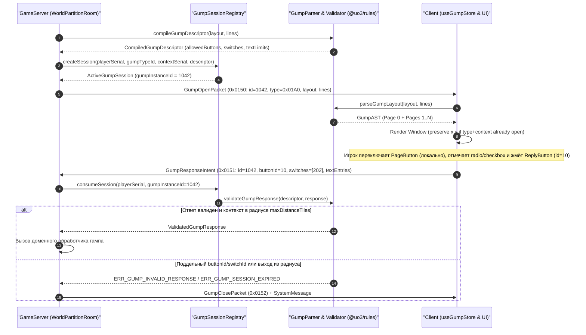
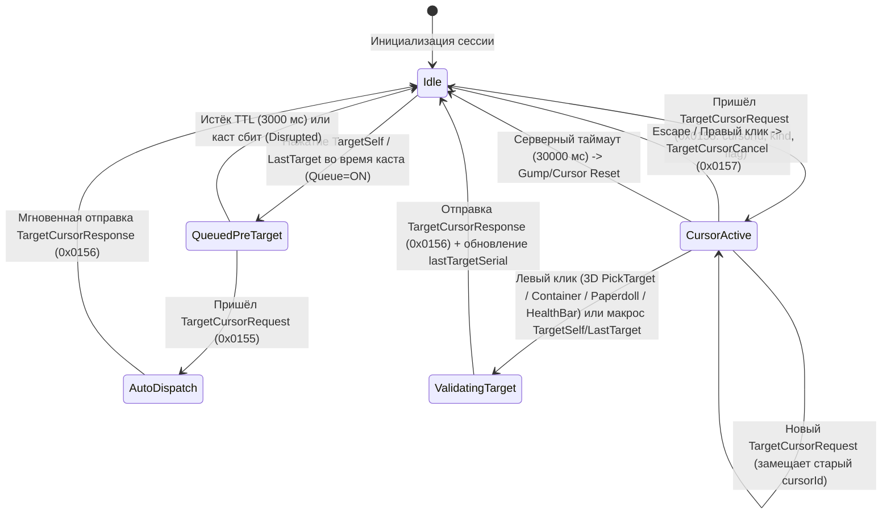
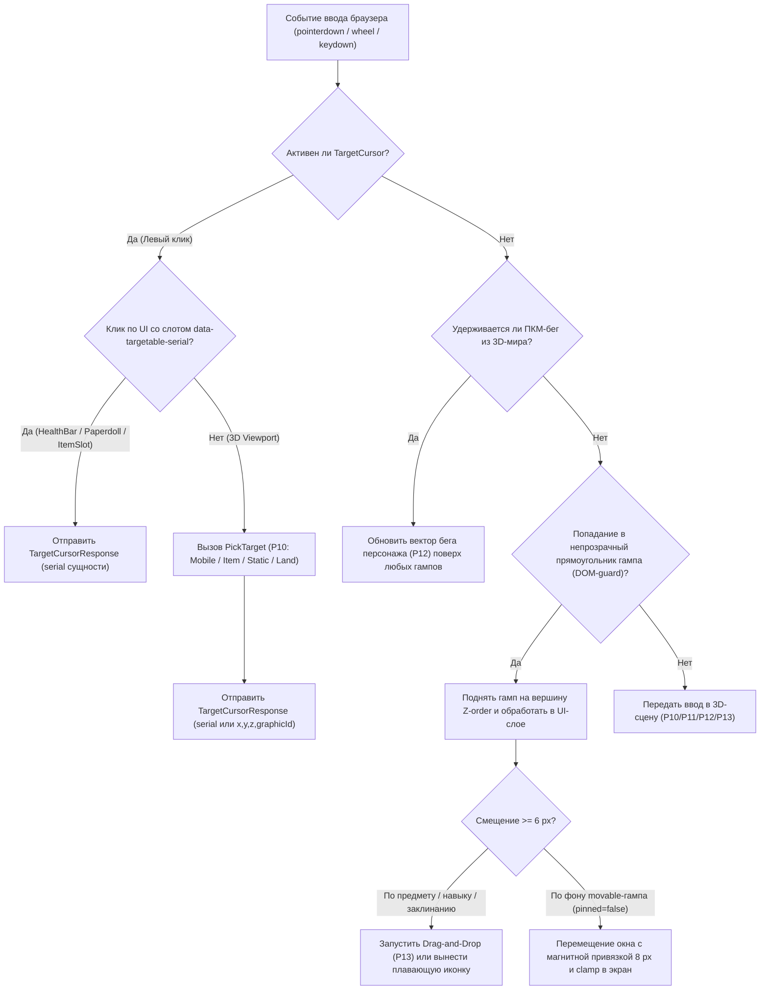

# Design: P14 Интерфейс гампов

## Context

Фаза **P14 (`p14-client-gump-ui`)** создаёт канонический пользовательский интерфейс Ultima Online эпохи UO:Renaissance поверх уже реализованных систем клиента и сервера:
- **P01 / P02 (`@uo3/domain`, `@uo3/uo-formats`)**: предоставляют парсеры `gumpart.mul`/`gumpidx.mul`, `art.mul` (иконки предметов для `tilepic`), `fonts.mul`, `cliloc.*`, палитры `hues.mul` (LUT `32×3001`), а также OPFS-кэш атласов и синтетические CC0-заглушки для работы без проприетарных ассетов.
- **P05 / P08 (`@uo3/db`)**: содержат схему персонажа (`STR`, `DEX`, `INT`, `Hits`, `Stam`, `Mana`, 49 навыков в десятых долях со статусами замков) и персистентные предметы мира (включая `Spellbook` с 64-битной маской заклинаний).
- **P07 (`@uo3/protocol`)**: определяет бинарно-типизированный транспорт намерений (`IntentHandlerRegistry`), синхронизацию `StateView` через `@colyseus/schema` v3 и базовый клиентский Zustand-контур.
- **P09 (`@uo3/ui-kit`, `apps/api`)**: предоставляет дизайн-систему клиента и таблицу `account_client_profiles` (`ClientSettingsV1` JSONB) для сохранения пользовательских настроек.
- **P10 / P11 / P12 / P13 (`apps/client`, `apps/game-server`)**: обеспечили 3D-вьюпорт (`screenToWorld`, `PickTarget`, `DOM-guard`), рендеринг мобилов с надголовным текстом (`overheadSpeech`) и жестом вытягивания (`dragStart >= 6 px`), авторитарное движение (включая бег по зажатию правой кнопки мыши) и систему контейнеров/инвентаря с drag-and-drop экипировкой.

В классической UO интерфейс делится на два класса окон:
1. **Клиентские системные гампы** (`Paperdoll`, `Status Bar`, `Mobile Health Bar`, `Journal`, `Skills`, `Spellbook`, `Options / Macros`), которые отображают реактивное состояние из `StateView` и локальных сторов клиента, отправляя собственное намерение `SpeechIntent`, а намерения `SetStatLockIntent`, `SetSkillLockIntent`, `UseSkillIntent` (P15), `ToggleWarModeIntent` (P16) и каст (P18) — через клиентский порт `CharacterUiIntentPort`.
2. **Серверно-декларативные гампы** (`Server Gumps`), которые сервер открывает динамически для диалогов NPC, меню ремёсел (P20), управления домами (P23), гильдийных камней (P26), контекстных меню и инструментов GM (P29). Сервер отправляет декларативную строку разметки и таблицу строк, а клиент рендерит окно и возвращает структурированный ответ (`GumpResponseIntent`).

Сквозными механизмами, связывающими все окна и 3D-сцену, выступают **система целеуказания (`TargetCursor`)**, **интерпретатор макросов и горячих клавиш** и **менеджер оконной раскладки (`WindowLayoutManager`)**.

## Goals / Non-Goals

### Goals
- Реализовать безопасный, не использующий `eval` или `innerHTML` парсер и рендерер серверных декларативных гампов с серверной валидацией схемы каждого ответа (`ActiveGumpSession`).
- Обеспечить каноническую послойную отрисовку окна пейпердолла (19 видимых слоёв экипировки с окраской через `hues` LUT), полный и компактный статус-бар с замками `STR/DEX/INT` и открепляемые полоски здоровья мобилов (`MobileHealthBar`).
- Построить высокопроизводительный виртуализированный журнал событий (кольцевой буфер на `1000` записей, вкладки фильтрации, поиск, `cliloc`-форматирование) и речевой ввод с поддержкой режимов `Regular` (15 тайлов), `Whisper` (1 тайл), `Yell` (18 тайлов) и `Emote` (15 тайлов).
- Реализовать окно 49 навыков (с режимами `Real`/`Modified`, капом `700.0`, замками `Up/Down/Locked` и выносными кнопками) и гамп книги заклинаний на 8 кругов (64 заклинания по битовой маске `uint64`, детали реагентов/маны и плавающие иконки).
- Создать детерминированный конечный автомат курсоров целеуказания (`TargetCursor`) со сквозным пикингом по 3D-миру, контейнерам, пейпердоллу и полоскам здоровья, очередью предвыбора `TargetQueue` и слотами `LastTarget` / `TargetSelf` / `NextTarget`.
- Реализовать интерпретатор макросов и горячих клавиш с программируемыми паузами, комплектами переодевания `Dress/Undress` и клиентским троттлингом под серверные кулдауны.
- Обеспечить управление раскладкой окон (`uiScale 1.0..2.0`, pixel-snapping, магнитная привязка `8 px`, `Fullscreen`/`Framed Viewport`, `DOM-guard` и персистентность в `localStorage` + `account_client_profiles`).

### Non-Goals
- Реализация серверных формул прокачки навыков и ремесленных рецептов (делегировано в P15 и P20).
- Расчёт боевого урона, таймеров замаха оружия и проверок попадания (делегировано в P16).
- Вычисление правил криминального статуса, кармы и смены флагов ноториети (делегировано в P17; P14 только отображает `notoriety` из `StateView`).
- Исполнение боевых и утилитарных эффектов заклинаний на сервере (делегировано в P18; P14 отвечает за UI книги заклинаний, отправку `CastSpellIntent` и выбор цели).
- Окно обмена между игроками (`Secure Trade`) и витрины NPC-вендоров (делегировано в P21).

## Decisions

### Decision 1: Серверно-авторитарные сессии гампов со скомпилированной схемой (`CompiledGumpDescriptor`)
- **Выбор**: При открытии серверного гампа (`GumpOpenPacket`, опкод `0x0150`) игровой сервер регистрирует в памяти `GumpSessionRegistry` запись `ActiveGumpSession`, содержащую `gumpInstanceId` (`uint32`), `gumpTypeId` (`uint16`), `contextSerial` (`uint32`), ограничения контекста (`maxDistanceTiles`, `aliveOnly`, `expiresAtTick`) и скомпилированные множества разрешённых интерактивных элементов: `allowedReplyButtons: ReadonlySet<number>`, `allowedSwitches: ReadonlySet<number>`, `radioGroups: ReadonlyMap<number, ReadonlySet<number>>`, `textEntryLimits: ReadonlyMap<number, number>`.
- **Обоснование**: В классических эмуляторах UO уязвимости дюпа и обхода проверок часто возникали из-за того, что клиент присылал произвольный `buttonId` или `switchId`, который не присутствовал на текущей странице гампа. Хранение `CompiledGumpDescriptor` на сервере позволяет централизованно в `GumpResponseValidator` (`packages/rules`) отсекать любые поддельные кнопки, невалидные комбинации радиокнопок и строки, превышающие `maxChars`, ещё до вызова прикладного обработчика.
- **Отвергнутые альтернативы**:
  - *Доверять `buttonId` от клиента и проверять условия вручную в каждом обработчике гампа* — отвергнуто: приводит к дублированию проверок безопасности в десятках гампов P15–P29.
  - *Передавать клиенту React/JS-код гампа* — отвергнуто: нарушает безопасность, увеличивает бандл и противоречит декларативной модели UO.

### Decision 2: Чистый AST-парсер разметки гампов и безопасное подмножество `htmlgump`
- **Выбор**: Разметка серверного гампа передаётся в каноническом формате директив `{ cmd arg1 arg2 ... }` и массива строк `lines: string[]`. Изоморфный парсер `parseGumpLayout(layout, lines)` в `packages/domain` / `packages/rules` за один проход (`O(N)`, лимит `<= 512` команд на гамп) строит типизированный AST `GumpNode[]`, разбитый по страницам (`page 0` — фон, `page 1..K` — вкладки). Для узла `htmlgump` используется собственный токенизатор безопасных тегов (`<BASEFONT>`, `<CENTER>`, `<LEFT>`, `<RIGHT>`, `<B>`, `<I>`, `<U>`, `<BR>`, `<COLOR>`, `<A HREF>`), который рендерит React-узлы без `dangerouslySetInnerHTML`.
- **Обоснование**: Гарантирует 100% защиту от XSS при отображении пользовательского текста (например, книг, досок объявлений, профилей персонажей и гильдийных описаний) и позволяет валидировать разметку как на сервере (при сборке гампа в `test-kit`), так и на клиенте.
- **Отвергнутые альтернативы**:
  - *Использование DOMParser + санитизатора HTML (`DOMPurify`)* — отвергнуто: избыточная зависимость, несовместимая с headless-окружением `packages/rules` и `apps/bot-client`, и не поддерживающая специфичные теги UO (`<BASEFONT COLOR=#...>`, индексы палитр `hues`).

### Decision 3: Гибридный рендеринг гампов и пейпердолла (React UI-оболочка + Canvas2D/WebGL2 композитор слоёв)
- **Выбор**: Оконный каркас, фокус ввода, виртуализация списков и обработка кликов строятся на React 19 + `@uo3/ui-kit`, тогда как составная пиксельная графика (`Paperdoll` из 19 слоёв с `hue`-окраской, 9-slice фоны `resizepic` и тайловые подложки `gumppictiled`) отрисовывается через легковесный общий `GumpAtlasRenderer` (Canvas2D / OffscreenCanvas с `image-rendering: pixelated`), читающий декодированные спрайты и LUT `hues` из OPFS-кэша P02.
- **Обоснование**: Отрисовка 19 наложенных слоёв экипировки пейпердолла с индивидуальным попиксельным применением палитры `hue` (`32`-цветовая таблица яркости UO:R) через отдельные DOM `` элементы потребовала бы генерации десятков временных DataURL или сложных SVG-фильтров. Canvas-композитор с кэшированием по ключу `(gumpArtId, hue, flip)` выполняет композитинг всего пейпердолла за `< 0.4 мс` и перерисовывается только при изменении надетых предметов.
- **Отвергнутые альтернативы**:
  - *Рендеринг всех гампов внутри основного WebGL2 Canvas 3D-мира* — отвергнуто: усложняет текстовый ввод (IME, буфер обмена, выделение текста в журнале), доступность и вёрстку таблиц навыков.

### Decision 4: Кольцевой буфер журнала и гибридная доставка речи (AOI Speech + Cliloc System Channel)
- **Выбор**: В `apps/client` журнал хранится в кольцевом буфере фиксированной ёмкости (`MAX_JOURNAL_ENTRIES = 1000`) вне дерева React-состояния с подпиской через `useSyncExternalStore` и окном виртуализации видимых строк (рендерятся только `20..35` видимых в окне строк). На сервере `SpeechRouter` вычисляет дистанцию Чебышёва $\max(|x_1 - x_2|, |y_1 - y_2|)$ в текущем и соседних секторах `16×16`:
  - `WHISPER` (префикс `; `): радиус `<= 1` тайл;
  - `REGULAR` и `EMOTE` (префикс `: `): радиус `<= 15` тайлов;
  - `YELL` (префикс `! `): радиус `<= 18` тайлов.
  Пакет `ServerSpeechEvent` (`0x0154`) доставляется только подходящим получателям и на клиенте одновременно диспатчится в `overheadSpeech` (P11) и в `JournalStore`.
- **Обоснование**: Исключает утечку памяти при многочасовых сессиях и предотвращает перехват шёпота (`Whisper`) модифицированным клиентом на расстоянии более 1 тайла, так как фильтрация выполняется на сервере до отправки пакета в сокет.
- **Отвергнутые альтернативы**:
  - *Рассылка всей речи всем клиентам в AOI (18 тайлов) с фильтрацией шёпота на клиенте* — отвергнуто: нарушает правило авторитарности сервера и позволяет сторонним снифферам читать чужой шёпот.

### Decision 5: Единый конвейер целеуказания (`TargetCursor`) поверх 3D-пикинга и 2D-гампов
- **Выбор**: Когда активен `TargetCursor` (серверный `cursorId` или локальный `SetLastTarget`), менеджер ввода перехватывает событие `pointerdown (button = 0)` на уровне захвата (`capture phase`) перед стандартными обработчиками гампов и 3D-сцены:
  1. Если клик пришёлся на UI-элемент с атрибутом `data-targetable-serial` (слот предмета в контейнере P13, предмет на пейпердолле, силуэт куклы или `MobileHealthBar`), цель резолвится мгновенно по этому `serial`.
  2. Если клик пришёлся на свободную область 3D-вьюпорта (`DOM-guard` пропускает луч), вызывается `PickTarget` из P10, возвращающий либо динамическую сущность (`mobile` / `ground item`), либо статический тайл (`staticTileId`, `x, y, z`), либо геометрию ландшафта (`land`, `x, y, z`).
  3. При включённой опции `TargetQueue` вызов `TargetSelf` / `LastTarget` без активного серверного курсора сохраняет намерение в одноэлементный буфер (`TTL = 3000 мс`), который автоматически дренируется в момент получения `TargetCursorRequest` (`0x0155`).
- **Обоснование**: Обеспечивает классический для ветеранов UO:R соревновательный UX (мгновенный таргетинг по вытянутым полоскам здоровья и предвыбор цели во время чтения заклинания) при строгой серверной проверке `cursorId`, `targetKind`, дистанции и 3D DDA LOS.
- **Отвергнутые альтернативы**:
  - *Раздельные режимы таргетинга для 3D-сцены и UI-окон* — отвергнуто: приводит к рассинхронизации курсора при переносе мыши между 3D-миром и открытым рюкзаком/полоской здоровья.

### Decision 6: Кооперативный планировщик макросов с клиентским троттлингом и очередью `Dress/Undress`
- **Выбор**: Исполнитель макросов (`MacroRunner`) работает как детерминированный конечный автомат, привязанный к кадровому циклу клиента, с одним активным слотом выполнения. Команды, порождающие сетевые намерения (`UseSkill`, `CastSpell`, `UseItem`, `Lift/Equip`), проверяются по локальным часам кулдаунов (`nextActionAllowedAt`, минимум `250 мс` между пакетами действий и `600 мс` между шагами перемещения предметов в `Dress/Undress`).
- **Обоснование**: Защищает игрока от случайного срабатывания серверного анти-флуд лимитера (и дисконнекта за спам пакетами при зажатой клавише) и делает переодевание комплектов брони/оружия надёжным при сетевом пинге до `150 мс`.
- **Отвергнутые альтернативы**:
  - *Отправка всего макроса или комплекта `Dress` одним пакетным массивом на сервер* — отвергнуто: меняет игровой баланс UO:R (где переодевание нескольких вещей занимает реальное время по `~600 мс` на предмет, а не происходит мгновенно за 1 тик).

### Decision 7: Двухуровневая персистентность раскладки окон и профилей макросов
- **Выбор**: Состояние раскладки (`WindowLayoutStateV1`) и макросов (`MacroProfileV1`) сохраняется в разрезе `(accountId, shardId, characterId)` синхронно в `localStorage` / `OPFS` при каждом завершении перетаскивания или редактирования и асинхронно (с дебаунсом `2000 мс` и при `beforeunload`) синхронизируется по REST/WS в расширенное JSONB-поле `ClientSettingsV1` таблицы `account_client_profiles` (введённой в P09). Координаты окон хранятся как в абсолютных пикселях при базовом разрешении, так и с якорями привязки (`anchorX: left|center|right`, `anchorY: top|center|bottom`) для автоматического пересчёта при смене разрешения экрана.
- **Обоснование**: Локальный кэш даёт мгновенное (`0 мс`) восстановление интерфейса при F5, а серверный профиль в PostgreSQL 17 позволяет сохранять раскладку полосок здоровья, иконок заклинаний и горячих клавиш при входе с другого браузера или устройства.
- **Отвергнутые альтернативы**:
  - *Хранение раскладки только в `localStorage`* — отвергнуто: потеря раскладки из 20+ иконок заклинаний и 40 макросов при очистке кэша браузера критически ухудшает UX в MMORPG.

## Архитектура модулей и распределение ответственности

| Пакет / Приложение | Модули фазы P14 | Ответственность |
|---|---|---|
| `packages/domain` | `gump/*`, `paperdoll/*`, `speech/*`, `targeting/*`, `macros/*`, `layout/*` | Чистые типы AST разметки гампа, таблица 19 слоёв пейпердолла, режимы речи, перечисление 49 навыков и 64 заклинаний (8 кругов), типы `TargetKind`/`TargetFlags`, состояния замков `LockState`, модели шагов макроса и оконной раскладки. 0 внешних зависимостей. |
| `packages/rules` | `ui/gump-parser.ts`, `ui/gump-validator.ts`, `ui/speech-range.ts`, `ui/target-validator.ts`, `ui/spellbook-rules.ts` | Изоморфный парсер разметки `{ cmd ... }`, компилятор `CompiledGumpDescriptor`, валидатор `validateGumpResponse`, расчёт дистанции слышимости речи (1/15/18 тайлов), проверка битовой маски `spellBitmask` (`uint64`) и калькулятор характеристик статус-бара. |
| `packages/protocol` | `messages/gump.ts`, `messages/targeting.ts`, `messages/speech.ts`, `messages/character-ui.ts` | Опкоды `0x0150..0x0159` (блок P14 `0x0150..0x017F`), TypeBox-схемы пакетов открытия/закрытия/ответа гампа, запросов/ответов `TargetCursor`, речевых пакетов и профиля персонажа; намерения замков, навыков, каста и `WarMode` — из блоков P15/P16/P18. |
| `packages/ui-kit` | `gump-primitives/*`, `paperdoll/*`, `health-bar/*`, `journal/*`, `spellbook/*`, `cursors/*` | Визуальные примитивы `ResizePic9Slice`, `GumpSprite`, `CheckerTrans`, `HtmlGumpView`, `PaperdollCanvas`, `MobileHealthBarWidget`, `VirtualJournalList`, `SpellbookSpread`, `CursorOverlay` и CC0-заглушки всех системных гампов. |
| `packages/db` | `schema/client-profiles.ts` | Расширение JSONB-схемы `ClientSettingsV1` в `account_client_profiles` разделами `characterLayouts` и `characterMacros` с миграцией и TypeBox-валидацией. |
| `apps/game-server` | `ui/gump-session.registry.ts`, `ui/target-cursor.manager.ts`, `ui/speech.router.ts`, `ui/character-ui.handlers.ts` | Серверный реестр открытых гампов (с автозакрытием по дистанции и смерти), менеджер активных курсоров цели с таймаутами `30 с`, маршрутизатор речи по секторам `16×16` и обработчик профиля персонажа (обработчики замков, навыков, каста и `War/Peace` — в P15/P16/P18). |
| `apps/client` | `features/gumps/*`, `features/paperdoll/*`, `features/journal/*`, `features/skills-spells/*`, `features/macros/*`, `features/targeting/*`, `features/layout/*` | Zustand-сторы (`useGumpStore`, `useTargetStore`, `useJournalStore`, `useMacroStore`, `useLayoutStore`), интеграция с `PickTarget` и `DOM-guard` (P10), `overheadSpeech` (P11) и drag-and-drop экипировки (P13). |
| `apps/bot-client` | `behaviors/gump-responder.ts`, `behaviors/target-responder.ts`, `behaviors/speech-driver.ts` | Headless-драйверы для автоматического прохождения серверных гампов, ответа на `TargetCursorRequest` и генерации речевого трафика в нагрузочных и интеграционных тестах. |

## Модели данных, схемы протокола и коды ошибок

### 1. Таблица 19 видимых слоёв экипировки пейпердолла (`packages/domain/src/paperdoll/layers.ts`)

Канонический порядок отрисовки слоёв на силуэте куклы (от нижнего к верхнему после базового тела `Body 400/401`):

| Приоритет рендера | Код слоя (`EquipLayer`) | Название слоя | Описание |
|---|---|---|---|
| 1 | `0x05` (`5`) | `Shirt` | Рубашка |
| 2 | `0x04` (`4`) | `Pants` | Штаны / короткие брюки |
| 3 | `0x03` (`3`) | `Shoes` | Обувь / сапоги |
| 4 | `0x0D` (`13`) | `InnerTorso` | Внутренняя броня торса (кольчуга / нагрудник) |
| 5 | `0x13` (`19`) | `Arms` | Наручи / рукава брони |
| 6 | `0x07` (`7`) | `Gloves` | Перчатки / латные рукавицы |
| 7 | `0x08` (`8`) | `Ring` | Кольцо |
| 8 | `0x09` (`9`) | `Talisman` | Талисман |
| 9 | `0x0A` (`10`) | `Neck` | Горжетка / ожерелье |
| 10 | `0x10` (`16`) | `FacialHair` | Борода / усы (для мужских персонажей) |
| 11 | `0x0C` (`12`) | `Waist` | Пояс / передник (`HalfApron`) |
| 12 | `0x17` (`23`) | `OuterLegs` | Юбка / килт |
| 13 | `0x18` (`24`) | `InnerLegs` | Поножи брони |
| 14 | `0x11` (`17`) | `MiddleTorso` | Сюрко / туника / дублет (`Surcoat`, `Tunic`) |
| 15 | `0x16` (`22`) | `OuterTorso` | Роба / платье (`Robe`, `Dress`) |
| 16 | `0x0B` (`11`) | `Hair` | Волосы (скрываются или обрезаются под закрытым шлемом) |
| 17 | `0x14` (`20`) | `Cloak` | Плащ |
| 18 | `0x06` (`6`) | `Helm` | Шлем / шляпа |
| 19 | `0x0E` (`14`) | `Bracelet` / `Earrings` (`0x12`) | Браслет и серьги |
| 20 | `0x01` (`1`) / `0x02` (`2`) | `OneHanded` / `TwoHanded` | Оружие в правой руке, двуручное оружие, щит или книга заклинаний |

### 2. Формулы характеристик статус-бара и магии UO:R (`packages/rules`)

- **Производные параметры персонажа**:
  $$\text{MaxHits} = 50 + \left\lfloor \frac{\text{STR}}{2} \right\rfloor, \quad \text{MaxStam} = \text{DEX}, \quad \text{MaxMana} = \text{INT}$$
  $$\text{MaxWeight} = 40 + \lfloor 3.5 \times \text{STR} \rfloor \text{ камней}, \quad \text{StatCap} = 225, \quad \text{SkillCap} = 700.0 \text{ (7000 десятых)}$$
- **Ширина заполнения полоски здоровья (`MobileHealthBar`)**:
  $$\text{fillPercent} = \text{clamp}\left(\left\lfloor \frac{\text{Hits}}{\max(1, \text{MaxHits})} \times 25 \right\rfloor \times 4,\ 0,\ 100\right)$$
  (дискретизация с шагом `4%`, исключающая утечку точного числа HP чужого мобила и лишние сетевые патчи).
- **Книга заклинаний (`Spellbook`)**:
  - 8 кругов магии по 8 заклинаний (`spellId = 1..64`, индекс бита `bitIndex = spellId - 1`).
  - Проверка наличия заклинания в 64-битной маске `spellBitmask` (`bigint` или пара `[low32, high32]`):
    $$\text{hasSpell}(\text{mask}, \text{spellId}) = \left(\text{mask} \ \& \ (1\text{n} \ll \text{BigInt}(\text{spellId} - 1))\right) \neq 0\text{n}$$
  - Расход маны по кругам `1..8`: `MANA_COST_BY_CIRCLE = [4, 6, 9, 11, 14, 20, 40, 50]`.

### 3. Схемы пакетов `@uo3/protocol` (uint16 опкоды `0x0150..0x0159`, блок P14 `0x0150..0x017F`)

```typescript
// Блок опкодов P14 по docs/PROTOCOL_REGISTRY.md: 0x0150..0x017F (используются 0x0150..0x0159)
export const P14_OPCODES = {
  GUMP_OPEN_PACKET:            0x0150, // Server -> Client: открытие/обновление серверного гампа
  GUMP_RESPONSE_INTENT:        0x0151, // Client -> Server: ответ игрока на гамп (кнопка, чекбоксы, текст)
  GUMP_CLOSE_PACKET:           0x0152, // Server -> Client: принудительное закрытие гампа с причиной
  SPEECH_INTENT:               0x0153, // Client -> Server: отправка речи (Regular/Whisper/Yell/Emote)
  SERVER_SPEECH_EVENT:         0x0154, // Server -> Client: реплика мобила или локализованное сообщение cliloc
  TARGET_CURSOR_REQUEST:       0x0155, // Server -> Client: запрос активации курсора целеуказания
  TARGET_CURSOR_RESPONSE:      0x0156, // Client -> Server: выбранная цель (serial или координаты тайла)
  TARGET_CURSOR_CANCEL:        0x0157, // Bidirectional: отмена активного курсора целеуказания
  CHARACTER_PROFILE_INTENT:    0x0158, // Client -> Server: запрос или обновление текста биографии профиля
  CHARACTER_PROFILE_PACKET:    0x0159, // Server -> Client: содержимое текстового профиля персонажа
} as const;
```

**Намерения, принадлежащие другим фазам.** P14 НЕ определяет опкоды и серверные обработчики замков статов/навыков, активации навыков, каста и режима War/Peace: опкоды этих намерений принадлежат фазам-владельцам по `docs/PROTOCOL_REGISTRY.md`: `UseSkillIntent` `0x0190`, `SetSkillLockIntent` `0x0191`, `SetStatLockIntent` `0x0192` (P15), `ToggleWarModeIntent` `0x01A0` (P16), каст `CastSpell` и состояние книги `SpellbookContentEvent` (блок P18 `0x01F0..0x021F`). P14 реализует только клиентский порт `CharacterUiIntentPort` (`setStatLock`, `setSkillLock`, `useSkill`, `castSpell`, `toggleWarMode`) с валидацией диапазонов на клиенте и тестовым двойником сервера; привязку порта к сети выполняют фазы-владельцы (P15/P16/P18), что не создаёт зависимости P14 от более поздних фаз.

Ключевые структуры сообщений (TypeBox):
- **`GumpOpenPacket` (`0x0150`)**:
  - `gumpInstanceId: uint32`, `gumpTypeId: uint16`, `contextSerial: uint32`, `x: int16`, `y: int16`,
  - `flags: uint8` (`bit 0 = closable`, `bit 1 = movable`, `bit 2 = disposable`, `bit 3 = modal`),
  - `layout: string` (до `16384` байт), `lines: string[]` (до `256` строк по `512` символов).
- **`GumpResponseIntent` (`0x0151`)**:
  - `gumpInstanceId: uint32`, `gumpTypeId: uint16`, `buttonId: uint32` (`0` = закрытие без действия),
  - `switches: uint32[]` (до `64` идентификаторов отмеченных `checkbox`/`radio`),
  - `textEntries: Array<{ entryId: uint16; text: string }>` (до `16` полей по `255` символов).
- **`TargetCursorRequest` (`0x0155`)**:
  - `cursorId: uint32`, `targetKind: 0 | 1` (`0 = OBJECT_ONLY`, `1 = GROUND_OR_OBJECT`),
  - `cursorFlag: 0 | 1 | 2` (`0 = NEUTRAL`, `1 = HARMFUL`, `2 = BENEFICIAL`), `timeoutMs: uint16` (`30000`).
- **`TargetCursorResponseIntent` (`0x0156`)**:
  - `cursorId: uint32`, `targetKind: 0 | 1`, `targetSerial: uint32` (`0` для земли/статики),
  - `x: uint16`, `y: uint16`, `z: int8`, `graphicId: uint16`.
- **`SpeechIntent` (`0x0153`) & `ServerSpeechEvent` (`0x0154`)**:
  - `mode: 'REGULAR' | 'WHISPER' | 'YELL' | 'EMOTE' | 'SYSTEM' | 'COMBAT'`,
  - `speechHue: uint16` (`2..1001`, дефолт `0x03B2`), `fontId: uint8` (`3`), `text: string` (`1..128` символов),
  - для `ServerSpeechEvent` дополнительно: `speakerSerial: uint32`, `speakerName: string`, `clilocId?: uint32`, `clilocArgs?: string[]`.

### 4. Расширение схемы `ClientSettingsV1` в `packages/db` (`account_client_profiles`)

В JSONB-профиль `ClientSettingsV1` добавляются типизированные секции с ключом `${shardId}:${characterId}`:
- `characterLayouts: Record<string, WindowLayoutStateV1>` — глобальный `uiScale` (`1.0..2.0`), режим `viewportMode` (`'fullscreen' | 'framed'`), прямоугольник `viewportFrame`, массив дескрипторов окон (`windowId`, `x`, `y`, `width`, `height`, `zOrder`, `minimized`, `compact`, `pinned`), откреплённые `floatingIcons` (заклинания и навыки) и `pinnedHealthBars`.
- `characterMacros: Record<string, MacroProfileV1>` — до `64` привязок (`keyCode`, `modifiers`, `wheelDir`, `steps: MacroStepV1[]` до `16` шагов), до `8` пресетов `dressPresets` и настройки `targetQueueEnabled`.

### 5. Каталог кодов ошибок фазы P14

| Код ошибки | Подсистема | Условие возникновения |
|---|---|---|
| `ERR_GUMP_MALFORMED_LAYOUT` | `ui/gump-framework` | Неизвестная директива разметки, незакрытая скобка `{ ... }` или выход индекса строки за границы `lines`. |
| `ERR_GUMP_INVALID_RESPONSE` | `ui/gump-framework` | В ответе передан `buttonId`, `switchId` или `entryId`, отсутствующий в `CompiledGumpDescriptor`, либо нарушен лимит длины текста. |
| `ERR_GUMP_SESSION_EXPIRED` | `ui/gump-framework` | Сессия `gumpInstanceId` уже закрыта, истекла по таймауту, персонаж отошёл дальше `maxDistanceTiles` или погиб. |
| `ERR_PAPERDOLL_READ_ONLY` | `ui/paperdoll-and-status` | Попытка снять или надеть предмет в окне чужого пейпердолла (`targetMobileSerial != selfSerial`). |
| `ERR_INVALID_LOCK_TARGET` / `ERR_INVALID_LOCK_STATE` | `ui/paperdoll-and-status`, `ui/skills-and-spellbook-windows` | Коды P15: стат вне `STR/DEX/INT`, `skillId` вне `0..48` или состояние вне `0..2`; клиентский порт отсекает такие значения локально, серверную проверку выполняет P15. |
| `ERR_SPEECH_RATE_LIMITED` | `ui/journal-and-chat` | Превышена квота отправки речевых сообщений (`> 4` пакетов за `2 с`). |
| `ERR_SPEECH_EMPTY_OR_TOO_LONG` | `ui/journal-and-chat` | Пустая строка после удаления префикса/управляющих символов или длина `> 128` символов. |
| `ERR_SKILL_NOT_ACTIVE` | `ui/skills-and-spellbook-windows` | Попытка вызвать `UseSkillIntent` для пассивного навыка (`isActive = false`). |
| `ERR_SPELL_NOT_IN_BOOK` | `ui/skills-and-spellbook-windows` | Вызов `CastSpellIntent` для `spellId`, чей бит не установлен ни в одной доступной книге заклинаний персонажа. |
| `ERR_MACRO_TARGET_UNAVAILABLE` | `ui/macros-and-hotkeys` | Вызов `LastObject`, `LastTarget` или `NextTarget`, когда целевая сущность отсутствует в AOI/инвентаре. |
| `ERR_MACRO_COOLDOWN_ACTIVE` | `ui/macros-and-hotkeys` | Подавление повторного шага макроса клиентским троттлером до истечения минимального интервала (`250 мс` / `600 мс`). |
| `ERR_TARGET_CURSOR_MISMATCH` | `ui/targeting-and-cursors` | Ответ `TargetCursorResponseIntent` содержит устаревший, чужой или уже закрытый `cursorId`. |
| `ERR_TARGET_INVALID_TYPE` | `ui/targeting-and-cursors` | Выбрана земля/статика (`targetSerial = 0`) при курсоре `OBJECT_ONLY`, либо несовместимый тип сущности. |
| `ERR_TARGET_OUT_OF_RANGE` | `ui/targeting-and-cursors` | Выбранная цель находится за пределами максимальной дистанции действия навыка или заклинания. |
| `ERR_TARGET_NO_LOS` | `ui/targeting-and-cursors` | Между персонажем и выбранной целью отсутствует прямая видимость по алгоритму 3D DDA LOS (P03). |
| `ERR_LAYOUT_SCHEMA_FALLBACK` | `ui/window-layout` | Повреждённый JSON или невалидные координаты раскладки в локальном кэше (выполнен автоматический откат к дефолтной схеме). |

## Диаграммы архитектуры и потоков данных

### 1. Жизненный цикл серверного гампа и валидации ответа



### 2. Конечный автомат целеуказания (`TargetCursor`) и очереди `TargetQueue`



### 3. Архитектура оконного менеджера и маршрутизации ввода (`DOM-guard`)



## Risks / Trade-offs

- **[Риск: Просадка FPS при открытии 20+ полосок здоровья и большого журнала на 1000 строк]** → *Митигация*: Журнал использует строгую виртуализацию строк (в DOM находятся не более `35` элементов) и кольцевой буфер вне React-стэка; полоски здоровья подписываются точечно на `StateView` конкретного `serial` с дискретизацией ширины `Hits` шагом `4%`, исключающей лишние ререндеры.
- **[Риск: Подмена `buttonId`, `switchId` или `cursorId` через модифицированный клиент или пакетный инжектор]** → *Митигация*: Сервер никогда не выполняет действие по «сырому» номеру кнопки: `GumpSessionRegistry` сверяет ответ со скомпилированным `CompiledGumpDescriptor` одноразовой сессии, а `TargetCursorManager` проверяет монотонность `cursorId`, тип цели, дистанцию и 3D DDA LOS.
- **[Риск: Спам сетевыми пакетами при зажатии клавиши макроса или быстром переодевании `Dress`]** → *Митигация*: Клиентский `MacroRunner` реализует жёсткий локальный троттлинг (`>= 250 мс` для навыков/заклинаний, `>= 600 мс` между шагами перемещения предметов в очереди `Dress/Undress`) и подавляет события `keydown.repeat`, синхронизируясь с серверным rate-limiter.
- **[Риск: Размытие классической пиксельной графики гампов при масштабировании `125%..200%` и на экранах Retina/HiDPI]** → *Митигация*: Все текстуры гампов и Canvas-композитор пейпердолла рендерятся с `image-rendering: pixelated` (`nearest-neighbor`), а координаты окон привязываются к физическим пикселям через `Math.round(coord * dpr) / dpr`.
- **[Риск: Случайные клики по 3D-миру сквозь открытые окна или прерывание бега при наведении мыши на гамп]** → *Митигация*: Каждое окно регистрирует свою геометрию в `DOM-guard` (P10), блокируя проваливание левых кликов и колеса прокрутки в 3D-сцену, но при этом активная сессия бега правой кнопкой мыши (захваченная в 3D-мире) сохраняет `pointer capture` до отпускания ПКМ.
- **[Риск: Потеря окон за пределами экрана при уменьшении окна браузера или переходе с 4K-монитора на ноутбук]** → *Митигация*: При каждом событии `resize` и при загрузке раскладки выполняется алгоритм `clampWindowToViewport`, гарантирующий сохранение видимой зоны захвата `>= 32×32 px` для каждого окна, а также предусмотрена горячая клавиша аварийного сброса `Ctrl+Shift+Backspace`.
- **[Риск: Отсутствие проприетарных файлов `gumpart.mul` в CI и у новых разработчиков]** → *Митигация*: Все системные окна (`Paperdoll`, `Status`, `Journal`, `Skills`, `Spellbook`, `HealthBar`, `Cursors`, базовые `resizepic` и кнопки) имеют встроенные векторно-пиксельные CC0-заглушки в `@uo3/ui-kit` с идентичными метриками и точками привязки.

## Migration Plan

1. **Этап 1 (Домен, правила и протокол)**: добавить типы и AST-модели в `packages/domain`, парсер и валидаторы гампов/речи/таргетинга в `packages/rules` и опкоды `0x0150..0x0159` в `packages/protocol`.
2. **Этап 2 (База данных и профили)**: расширить схему `ClientSettingsV1` в `packages/db` секциями `characterLayouts` и `characterMacros` с обратной совместимостью для существующих профилей P09.
3. **Этап 3 (Серверные менеджеры)**: внедрить `GumpSessionRegistry`, `TargetCursorManager`, `SpeechRouter` и обработчики замков статов/навыков в `apps/game-server`.
4. **Этап 4 (Примитивы `@uo3/ui-kit` и клиентские подсистемы)**: реализовать рендерер серверных гампов, пейпердолл, статус-бар, полоски здоровья, журнал, окно навыков, книгу заклинаний, курсоры целеуказания, макросы и менеджер раскладки в `apps/client`.
5. **Этап 5 (Headless-боты и сквозная верификация)**: обновить `apps/bot-client` драйверами ответов на гампы и курсоры цели, прогнать контрактные и E2E-тесты на синтетическом мире и CC0-заглушках.

## Open Questions

- *Кастомизация цветовых тем системных гампов (классическая серая каменная тема UO:R vs тёмная полупрозрачная тема)*: в P14 реализуется каноническая тема UO:R + поддержка директивы `checkertrans`; переключаемые скины рамок отложены до фазы полировки клиента P34.
- *Голосовые макросы и фильтр нежелательной лексики в публичных каналах*: локальный список игнорирования (`Ignore List` по `serial` в журнале) поддерживается на уровне клиентского фильтра, а серверная модерация и межпартиционные каналы чата (`Party`, `Guild`, `Alliance`) будут развёрнуты в P26 и P29.
