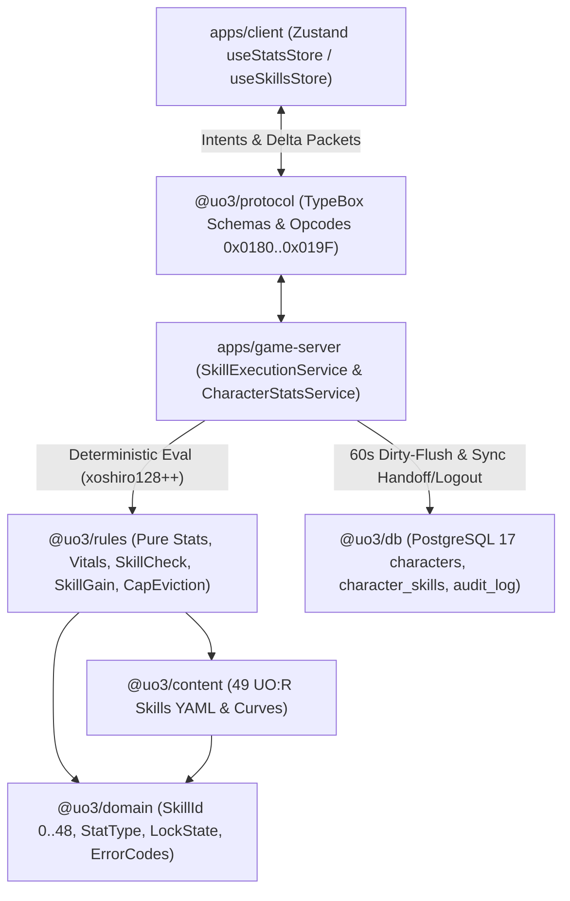
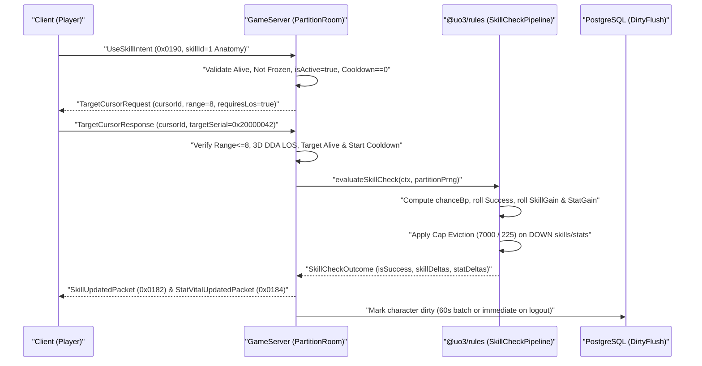

# Design: P15 Статы и навыки

## Context

Фаза P15 (`p15-stats-and-skills`) связывает базовую пространственную и предметную симуляцию мира (P06–P14) с прикладными игровыми механиками Ultima Online: Renaissance (P16–P27). К началу P15 в системе уже существуют:
- таблицы `characters` и `character_skills` в PostgreSQL 17, созданные в P05 для хранения стартового шаблона при создании персонажа;
- детерминированный серверный цикл 20 Гц (`50` мс на тик), иерархическое колесо таймеров и партиционный PRNG `xoshiro128++` в `@uo3/rules` и `apps/game-server` (P01, P06);
- сетевой конвейер намерений (`IntentHandlerRegistry`) и дифференциальная синхронизация `@colyseus/schema` v3 `StateView` с разделением AOI и приватного состояния владельца (P07);
- координатор персистентности с 60-секундным циклом `dirty-flush` и синхронным сбросом при handoff/логауте (P08);
- авторитарная проверка шагов и скоростей движения `400/200/100` мс (P12), расчёт суммарного веса предметов в контейнерах и на слотах экипировки (P13), а также клиентский протокол резервации курсора цели и базовые гампы (P14).

В P15 необходимо превратить статические записи статов и 49 навыков в живую, математически строгую и устойчивую к эксплойтам систему:
1. Вычислять базовые (`10..100`) и эффективные (`1..150`) характеристики `STR`, `DEX`, `INT`, производные показатели `Hits`, `Stam`, `Mana`, `MaxWeight`, пассивную регенерацию и расход выносливости при движении и перегрузе.
2. Задать полный канонический реестр 49 навыков UO:R (`SkillId 0..48`) в десятых долях (`0..1000`), реализовать конвейер активации навыков, глобального кулдауна, таргетинга (дистанция + 3D DDA LOS), расчёта шанса успеха в базисных пунктах (`0..10000`) и делегирования эффектов в будущие доменные модули.
3. Реализовать кривую вероятности прироста навыков и побочного роста характеристик с анти-макро защитой по пространственным блокам `8x8` и целям, а также детерминированным аккумулятором прогресса (`pityAccumulatorBp`) против экстремальных серий неудач PRNG.
4. Обеспечить атомарное соблюдение индивидуальных потолков (`100` для стата, `1000` десятых для навыка) и суммарных капов (`225` для статов, `7000` десятых = `700.0` для навыков) с механизмом блокировок (`UP`, `DOWN`, `LOCKED`) и вытеснением навыков/статов в статусе `DOWN`.

## Goals / Non-Goals

### Goals
- **Полный целочисленный детерминизм**: все формулы виталов, аккумуляторы регенерации, шансы успеха (`chanceBp`), шансы прироста (`gainChanceBp`) и операции с капами работают строго в целых числах (десятые доли `0..1000` и базисные пункты `0..10000`) без `float`-дрейфа между клиентом и сервером.
- **Изоморфное ядро в `@uo3/rules`**: чистые функции расчёта статов, виталов, проверки навыков, прироста и атомарного вытеснения живут в `packages/rules/src/stats/*` и `packages/rules/src/skills/*` и покрываются быстрыми property-based и replay-тестами без поднятия БД и сети.
- **Информационная безопасность AOI**: точные значения `STR`, `DEX`, `INT`, `Hits`/`MaxHits`, `Stam`/`MaxStam`, `Mana`/`MaxMana` и 49 навыков передаются ТОЛЬКО владельцу персонажа; внешние наблюдатели в радиусе 18 тайлов видят исключительно `HitsPercent` (`0..100`) и публичный титул в Paperdoll/Profile.
- **Единая точка входа для P16–P20**: все последующие фазы (бой, магия, крафт, приручение, барды, воровство) вызывают единый конвейер `SkillCheckPipeline` вместо дублирования формул броска и прокачки.
- **Встроенная анти-макро и анти-абьюз защита**: стационарные макросы в одном блоке `8x8` или на одном `Serial` цели затухают без блокировки честного игрового процесса.

### Non-Goals
- Реализация прикладных боевых формул урона, скорости замаха оружия и парирования (выполняется в **P16**).
- Реализация книги заклинаний, расхода реагентов, кругов магии `1..8` и активного баффа `Meditation` (выполняется в **P17**).
- Реализация таблиц ресурсов, рецептов крафта и мини-игр `Mining` / `Lumberjacking` / `Fishing` (выполняется в **P18**).
- Реализация полноценного окна навыков с drag-and-drop макро-кнопками активных навыков и Paperdoll UI (выполняется в **P27**).

## Decisions

### Decision 1: Целочисленная арифметика десятых долей и базисных пунктов (ADR-004, ADR-006)
- **Выбор**:
  - Все значения навыков хранятся и обрабатываются в десятых долях (`1` очко навыка = `10` десятых; диапазон `0..1000`, суммарный кап `7000`, эффективный диапазон с баффами `0..1200`).
  - Все вероятности успеха (`chanceBp`) и прироста (`gainChanceBp`) вычисляются в базисных пунктах (`0..10000`, где `100` bp = `1.00%`, `1` bp = `0.01%`).
  - Бросок PRNG выполняется вызовом `prng.nextInt(0, 10000)` (`0..9999`), проверка успешна при `roll < thresholdBp`.
- **Обоснование**: Использование `IEEE 754 float` для `0.1` приводит к ошибкам округления (`69.9 + 0.1 = 70.00000000000001`), расхождениям при суммировании 49 навыков относительно капа `700.0` и недетерминизму между движками при сериализации. Целочисленные десятые доли и базисные пункты полностью устраняют погрешность и идеально ложатся на `SMALLINT` в PostgreSQL и `uint16` в сетевом протоколе.
- **Отвергнутые альтернативы**:
  - *Хранение `float32`/`float64` с `Math.round(x * 10) / 10`*: требует защитного округления на каждом шаге и усложняет проверку инварианта `SUM(value) <= 700.0` в SQL.

### Decision 2: Тиковые целочисленные аккумуляторы регенерации и шаговый учёт выносливости
- **Выбор**:
  - Для каждого живого персонажа в памяти партиции поддерживается структура `VitalRegenState` с тремя аккумуляторами в миллисекундах (`hitsElapsedMs`, `stamElapsedMs`, `manaElapsedMs`), увеличиваемыми на `50` мс на каждом серверном тике 20 Гц.
  - Интервалы регенерации (в мс на `+1` ед.):
    - `HitsPeriodMs = isPoisoned || isBleeding || isDead ? Infinity : 10000` (базовый UO:R темп 1 ед. за 10 с).
    - `StamPeriodMs = isRunning || isOverweight ? 10000 : 5000` (единый контракт с P12 `movement/movement-timing`; формула вынесена в общий модуль `packages/rules`, а не дублируется).
    - `ManaPeriodMs = max(1000, 7000 - Math.floor(effectiveInt / 30) * 1000)` (базовый темп до модификаторов `Meditation` из P22).
  - Когда `elapsedMs >= periodMs`, начисляется `Math.floor(elapsedMs / periodMs)` единиц витала (с зажатием до `Max`), а в аккумуляторе остаётся `elapsedMs % periodMs`. Если витал уже равен `Max`, аккумулятор держится на `0`.
  - Расход выносливости при движении НЕ переопределяется: используется `calculateStepStaminaDrain` из P12 (`1 Stam` за `16` шагов бегом пешком / `48` верхом, доп. `1 + floor((CurrentWeight - MaxWeight) / 25)` за шаг в перегрузе, блок при `CurrentWeight > MaxWeight + 60` или `Stam == 0` в перегрузе), которому P15 поставляет `MaxWeight` и пул `Stam`. Коды отказа — `ERR_MOVE_*` из P12.
- **Обоснование**: Аккумулятор в миллисекундах работает за $O(1)$ на тик, не создаёт отдельные таймеры в колесе таймеров на каждую единицу регенерации для тысяч мобов и корректно пересчитывает прогресс при динамическом изменении `EffectiveDEX` или `EffectiveINT` посреди цикла.
- **Отвергнутые альтернативы**:
  - *Индивидуальные задачи в `HierarchicalTimerWheel` на каждый тик регенерации каждого персонажа*: создаёт лишний churn перепланирования таймеров при каждом баффе/дебаффе характеристик.

### Decision 3: Двухуровневая модель модификаторов характеристик и навыков (`StatSkillModifierLedger`)
- **Выбор**:
  - Вводится структура `ModifierEntry`: `{ sourceKey: string; kind: 'stat' | 'skill'; targetId: number; delta: number; expiresAtTick: number | null }`.
  - `sourceKey` имеет иерархический формат, например `"spell:bless"`, `"spell:strength"`, `"potion:agility"`, `"equip:slot:ring"`. Повторное наложение с тем же `sourceKey` и `targetId` перезаписывает существующую запись (без бесконечного стакинга одинаковых заклинаний).
  - Истечение временных модификаторов (`expiresAtTick !== null`) регистрируется в партиционном `HierarchicalTimerWheel` (P06).
  - При любом изменении списка модификаторов вызывается `recomputeCharacterDerivedState(state)`, который пересчитывает `EffectiveSTR/DEX/INT`, `MaxHits/MaxStam/MaxMana/MaxWeight`, зажимает текущие `Hits/Stam/Mana` сверху и выставляет битовую маску изменённых полей для сетевой дельты.
- **Обоснование**: Обеспечивает единый контракт для экипировки (P13), зелий и заклинаний (P17), проклятий и болезней (P25) без риска «зависших» бонусов после снятия предмета или окончания баффа.
- **Отвергнутые альтернативы**:
  - *Прямое прибавление и вычитание `+10` / `-10` из поля `effectiveStr`*: подвержено дрейфу при перезаписи баффа другой силы или при гонке снятия эффекта.

### Decision 4: Конвейер проверки навыков `SkillCheckPipeline` и гибридный PRNG + `pityAccumulatorBp`
- **Выбор**:
  - Любая проверка навыка (прямое нажатие кнопки активного навыка в P15 или вызов из боя/магии/крафта в P16–P20) проходит через чистую функцию `evaluateSkillCheck(ctx, prng)`:
    1. Вычисление `EffectiveValue = clamp(BaseValue + TempBonusTenths, 0, 1200)`.
    2. Вычисление `chanceBp = clamp(floor((EffectiveValue - minSkillTenths) * 10000 / max(1, maxSkillTenths - minSkillTenths)), 0, 10000)`.
    3. Бросок успеха `successRoll = prng.nextInt(0, 10000)`, `isSuccess = successRoll < chanceBp`.
    4. Если `chanceBp > 0 && chanceBp < 10000` (нетривиальное и возможное действие), запускается расчёт прироста:
       - Колоколообразный фактор сложности:
         $$\text{difficultyFactorBp} = \left\lfloor \frac{4 \cdot \text{chanceBp} \cdot (10000 - \text{chanceBp})}{10000} \right\rfloor \in [1, 10000]$$
       - Базовый шанс от уровня навыка (квадратичное убывание от `BaseValue`):
         $$\text{levelFactorBp} = \text{baseCurveBp}(\text{BaseValue}) = \max\left(15, \left\lfloor \frac{2500 \cdot (1000 - \text{BaseValue})^2}{1000000} \right\rfloor + 15\right)$$
       - При провале (`!isSuccess`): если `BaseValue >= 800`, множитель провала равен `0`; иначе умножается на `failGainFactorBp / 10000`.
       - Умножение на анти-макро коэффициент `antiMacroFactorBp` (`10000`, `5000`, `2500` или `0`).
       - Итоговый `gainChanceBp = max(antiMacroFactorBp > 0 ? 1 : 0, floor(levelFactorBp * difficultyFactorBp * failFactor * antiMacroFactor)).`
    5. Если навык в статусе `UP` и `BaseValue < 1000` и есть резерв капа:
       - Выполняется бросок `gainRoll = prng.nextInt(0, 10000)`.
       - Если `gainRoll < gainChanceBp` ИЛИ `pityAccumulatorBp + gainChanceBp >= 10000`, начисляется прирост (`1` десятая при `BaseValue >= 100`, либо `prng.nextInt(1, 6)` десятых при `BaseValue < 100` с зажатием до `100`), а `pityAccumulatorBp` сбрасывается в `0`.
       - Иначе `pityAccumulatorBp += gainChanceBp`.
- **Обоснование**: Классическая формула UO:R поощряет выполнение задач с шансом успеха около 50% и делает прокачку с 90.0 до 100.0 долгосрочной целью, а детерминированный `pityAccumulatorBp` гарантирует отсутствие статистических выбросов (когда игрок при шансе 5% делает 100 попыток без единого прироста).
- **Отвергнутые альтернативы**:
  - *Чисто детерминированный счётчик опыта без PRNG*: разрушает классическое ощущение UO:R, где прирост может случиться на первой же сложной попытке.
  - *Чистый PRNG без `pityAccumulatorBp`*: на высоких уровнях (`95.0..100.0`) создаёт экстремальную дисперсию (`5x` от математического ожидания) у части игроков.

### Decision 5: Кольцевой буфер анти-макро защиты по ключу `(SkillId, Block8x8, TargetBucket)`
- **Выбор**:
  - Для каждого активного персонажа в памяти сервера хранится компактная таблица `AntiMacroTracker` (до 64 слотов с LRU-вытеснением).
  - Ключ контекста: `contextHash = hash(skillId, Math.floor(x / 8), Math.floor(y / 8), targetSerial ?? 0)`.
  - Запись хранит `windowStartTick`, `attemptCount` и `lastAttemptTick`. Если `currentTick - windowStartTick > 6000` тиков (`300` секунд), окно сбрасывается (`attemptCount = 1`).
  - При `attemptCount <= 15` множитель равен `10000` (`100%`), при `16..20` — `5000` (`50%`), при `21..25` — `2500` (`25%`), при `> 25` — `0` (`0%`).
- **Обоснование**: Блок `8x8` тайлов совпадает с каноническим пространственным блоком карты UO из P01/P03. Компактный in-memory трекер из 64 слотов занимает менее 2 КБ на игрока, не требует запросов к БД/Valkey и эффективно пресекает AFK-макросы в одной точке или на одной кукле/цели.
- **Отвергнутые альтернативы**:
  - *Капчи или модальные окна проверки присутствия*: нарушают погружение и запрещены гайдлайнами UX.

### Decision 6: Детерминированный алгоритм атомарного вытеснения для капов 7000 и 225
- **Выбор**:
  - Когда навык `gainingSkillId` (`lockState == UP`) должен вырасти на `delta` (`1..5` десятых), вычисляется `freeCap = 7000 - totalSkillTenths` и требуемое вытеснение `overflow = max(0, delta - freeCap)`.
  - Если `overflow > 0`:
    1. Собирается упорядоченный по возрастанию `SkillId` список кандидатов-доноров: `s.skillId !== gainingSkillId && s.lockState === LockState.DOWN && s.baseTenths > 0`.
    2. Проверяется `sum(donor.baseTenths) >= overflow`. Если сумма меньше `overflow`, прирост полностью отменяется (all-or-nothing) и возвращается `ERR_SKILL_CAP_REACHED`.
    3. Если резерва достаточно, `overflow` последовательно списывается с кандидатов в порядке возрастания `SkillId`, а `gainingSkillId` увеличивается на `delta` в одной атомарной операции памяти и одной транзакции при flush.
  - Аналогичный алгоритм применяется для характеристик при капе `225` (`STR = 0`, `DEX = 1`, `INT = 2` в порядке приоритета вытеснения среди статов со статусом `DOWN` и значением `> 10`).
- **Обоснование**: Порядок по возрастанию `SkillId` полностью детерминирован, исключает зависимость от порядка строк в SQL-выборке и гарантирует сохранение инварианта `totalSkillTenths <= 7000` даже при многоочковом приросте (`delta = 2..5`) на границе капа.
- **Отвергнутые альтернативы**:
  - *Случайный выбор навыка `DOWN` для снижения*: создаёт непредсказуемое поведение для игрока, когда у него открыто несколько навыков `DOWN`.

### Decision 7: Разделение публичного AOI `StateView` и приватных пакетов статов и навыков
- **Выбор**:
  - В публичной схеме сущности моба/игрока `MobileSchema` (`@colyseus/schema`, видимой всем в AOI 18 тайлов) присутствует только `hitsPercent: uint8` (`0..100`) и `title: string` (для запроса профиля/Paperdoll).
  - Полный массив 49 навыков передаётся владельцу при входе в партицию пакетом `SkillsSnapshotPacket` (`0x0181`), а далее синхронизируется точечными дельта-пакетами `SkillUpdatedPacket` (`0x0182`) и `SkillLockUpdatedPacket` (`0x0183`).
  - Полное состояние характеристик и виталов владельца (`STR/DEX/INT` base & effective, `Hits/MaxHits`, `Stam/MaxStam`, `Mana/MaxMana`, `Weight/MaxWeight`, `StatLocks`) синхронизируется через приватный `PlayerPrivateStatsSchema` в `@colyseus/schema` `StateView` владельца и пакет `StatVitalUpdatedPacket` (`0x0184`).
- **Обоснование**: Исключает утечку билда противника (маны, выносливости, силы и навыков) через инспекцию сетевого трафика WebSocket и минимизирует размер широковещательных патчей в AOI при частых тиках регенерации.
- **Отвергнутые альтернативы**:
  - *Размещение `mana`, `stam` и 49 навыков в публичной `MobileSchema`*: позволяет чит-клиентам видеть точную ману и билд соперников в PvP и раздувает трафик AOI в десятки раз.

---

## Архитектура модулей и поток данных

### Последовательность использования целевого активного навыка и расчёта прироста

---

## Модели данных и сетевые контракты

### 1. Канонический реестр 49 навыков UO:R (`packages/domain` & `packages/content`)

Все 49 навыков нумеруются строго от `0` до `48` (`SkillId`):
`0: Alchemy`, `1: Anatomy`, `2: AnimalLore`, `3: ItemIdentification`, `4: ArmsLore`, `5: Parrying`, `6: Begging`, `7: Blacksmithy`, `8: BowcraftFletching`, `9: Peacemaking`, `10: Camping`, `11: Carpentry`, `12: Cartography`, `13: Cooking`, `14: DetectingHidden`, `15: Discordance`, `16: EvaluatingIntelligence`, `17: Healing`, `18: Fishing`, `19: Forensics`, `20: Herding`, `21: Hiding`, `22: Provocation`, `23: Inscription`, `24: Lockpicking`, `25: Magery`, `26: ResistingSpells`, `27: Tactics`, `28: Snooping`, `29: Musicianship`, `30: Poisoning`, `31: Archery`, `32: SpiritSpeak`, `33: Stealing`, `34: Tailoring`, `35: AnimalTaming`, `36: TasteIdentification`, `37: Tinkering`, `38: Tracking`, `39: Veterinary`, `40: Swordsmanship`, `41: MaceFighting`, `42: Fencing`, `43: Wrestling`, `44: Lumberjacking`, `45: Mining`, `46: Meditation`, `47: Stealth`, `48: RemoveTrap`.

Каждый элемент в `packages/content/data/skills.yaml` содержит:
- `id: 0..48`, `key: string`, `nameRu: string`, `nameEn: string`, `title: string` (например, `"Swordsman"`, `"Mage"`, `"Blacksmith"`).
- `category: 'combat' | 'magic' | 'crafting' | 'gathering' | 'bard' | 'wilderness' | 'thievery' | 'lore'`.
- `isActive: boolean` (доступен ли для прямого вызова через `UseSkillIntent`).
- `cooldownMs: number` (`1000..10000` мс для активных навыков, `0` для пассивных).
- `targetMode: 'none' | 'mobile' | 'item' | 'ground_or_item'`, `maxRangeTiles: number` (`0..15`), `requiresLos: boolean`.
- `statWeights: { str: number; dex: number; int: number }` (целые веса `0..100`, определяющие вклад в побочный рост характеристик).
- `defaultDifficulty: { minTenths: number; maxTenths: number; failGainFactorBp: number }`.

### 2. Схема PostgreSQL 17 (`packages/db`)

Расширение таблиц `characters` и `character_skills` (из P05) и таблица аудита:
- В таблице `characters`:
  - `str_base SMALLINT NOT NULL CHECK (str_base BETWEEN 10 AND 100)`
  - `dex_base SMALLINT NOT NULL CHECK (dex_base BETWEEN 10 AND 100)`
  - `int_base SMALLINT NOT NULL CHECK (int_base BETWEEN 10 AND 100)`
  - `str_lock SMALLINT NOT NULL DEFAULT 0 CHECK (str_lock IN (0, 1, 2))`
  - `dex_lock SMALLINT NOT NULL DEFAULT 0 CHECK (dex_lock IN (0, 1, 2))`
  - `int_lock SMALLINT NOT NULL DEFAULT 0 CHECK (int_lock IN (0, 1, 2))`
  - `hits_current SMALLINT NOT NULL CHECK (hits_current >= 0)`
  - `stam_current SMALLINT NOT NULL CHECK (stam_current >= 0)`
  - `mana_current SMALLINT NOT NULL CHECK (mana_current >= 0)`
  - `CONSTRAINT chk_character_stat_cap CHECK (str_base + dex_base + int_base <= 225)`
- В таблице `character_skills`:
  - `character_id UUID NOT NULL REFERENCES characters(id) ON DELETE CASCADE`
  - `skill_id SMALLINT NOT NULL CHECK (skill_id BETWEEN 0 AND 48)`
  - `value_tenths SMALLINT NOT NULL DEFAULT 0 CHECK (value_tenths BETWEEN 0 AND 1000)`
  - `lock_state SMALLINT NOT NULL DEFAULT 0 CHECK (lock_state IN (0, 1, 2))`
  - `PRIMARY KEY (character_id, skill_id)`
- Новая таблица `staff_stat_skill_audit_log`:
  - `id BIGSERIAL PRIMARY KEY`, `actor_account_id UUID NOT NULL`, `target_character_id UUID NOT NULL`, `target_kind VARCHAR(16) NOT NULL` (`'stat' | 'skill'`), `target_key SMALLINT NOT NULL`, `old_value SMALLINT NOT NULL`, `new_value SMALLINT NOT NULL`, `allow_cap_override BOOLEAN NOT NULL DEFAULT FALSE`, `reason TEXT NOT NULL`, `created_at TIMESTAMPTZ NOT NULL DEFAULT NOW()`.

### 3. Протокол сообщений (`packages/protocol`)

Опкоды диапазона `0x0180..0x019F`:
- **Клиентские намерения (Client -> Server)**:
  - `0x0190 UseSkillIntent`: `{ skillId: uint8, targetSerial?: uint32 }`
  - `0x0191 SetSkillLockIntent`: `{ skillId: uint8, lockState: uint8 }` (`0 = UP, 1 = DOWN, 2 = LOCKED`)
  - `0x0192 SetStatLockIntent`: `{ statType: uint8, lockState: uint8 }` (`0 = STR, 1 = DEX, 2 = INT`)
- **Серверные пакеты (Server -> Client)**:
  - `0x0181 SkillsSnapshotPacket`: `{ totalCapTenths: uint16, skills: Array<{ skillId: uint8, baseTenths: uint16, effectiveTenths: uint16, lockState: uint8 }> }`
  - `0x0182 SkillUpdatedPacket`: `{ skillId: uint8, baseTenths: uint16, effectiveTenths: uint16, lockState: uint8, totalSkillTenths: uint16, gainSource?: 'prng' | 'pity' | 'eviction' | 'admin' | 'modifier' }`
  - `0x0183 SkillLockUpdatedPacket`: `{ skillId: uint8, lockState: uint8 }`
  - `0x0184 StatVitalUpdatedPacket`: `{ strBase: uint8, strEff: uint8, dexBase: uint8, dexEff: uint8, intBase: uint8, intEff: uint8, strLock: uint8, dexLock: uint8, intLock: uint8, hits: uint16, maxHits: uint16, stam: uint16, maxStam: uint16, mana: uint16, maxMana: uint16, weight: uint16, maxWeight: uint16, title: string }`
  - `0x0185 SkillCooldownPacket`: `{ skillId: uint8, remainingMs: uint16 }`
- **Коды ошибок (`ERR_*`)**:
  - `ERR_INVALID_SKILL_ID`, `ERR_SKILL_NOT_USABLE`, `ERR_SKILL_COOLDOWN`, `ERR_SKILL_INTERRUPTED`, `ERR_SKILL_CAP_REACHED`, `ERR_INVALID_LOCK_TARGET`, `ERR_INVALID_LOCK_STATE`, `ERR_TARGET_INVALID`, `ERR_TARGET_TIMEOUT`, `ERR_OUT_OF_RANGE`, `ERR_NO_LOS`, `ERR_CAP_EXCEEDED`, `ERR_RATE_LIMITED`.

---

## Risks / Trade-offs

- **[Риск] Лавинообразный сетевой трафик от тиковой регенерации виталов (20 Гц)** → *Митигация*: Регенерация начисляет целочисленные единицы раз в `1000..10000` мс; сетевая дельта отправляется ТОЛЬКО когда целочисленное значение `Hits`, `Stam` или `Mana` фактически изменилось, а публичный `HitsPercent` обновляется в AOI только при изменении целого процента `floor(Hits * 100 / MaxHits)`.
- **[Риск] Гонка записи `character_skills` при переходе между партициями (handoff)** → *Митигация*: При handoff (P08/P32) исходная партиция выполняет синхронный flush грязных статов и навыков с проверкой `partition_epoch` до передачи владения сущностью новой комнате.
- **[Риск] Нарушение суммарного капа `7000` при ускоренном старте (`delta = 2..5`) вблизи потолка** → *Митигация*: Алгоритм вытеснения предварительно проверяет суммарный резерв `freeCap + sum(downSkills)` для полного `delta` (или уменьшает `delta` до доступного резерва `>= 1`) и применяет списание с нескольких `DOWN`-доноров атомарно.
- **[Риск] Обход анти-макро фильтра путём циклического шагания между двумя соседними тайлами** → *Митигация*: Пространственная привязка анти-макро использует блок `8x8` тайлов и дополнительно отслеживает `targetSerial`, поэтому шагание на 1–2 тайла внутри блока или работа по одной и той же кукле попадает в один и тот же бакет затухания.
- **[Риск] Спам пакетами `SetSkillLockIntent` / `SetStatLockIntent`** → *Митигация*: В `IntentHandlerRegistry` применяется токен-бакет `20` запросов/с на сессию; изменения блокировок мутируют память за $O(1)$ и батчатся в стандартный 60-секундный `dirty-flush` без синхронного SQL-запроса на каждый клик.
- **[Риск] Фрустрация игроков от отсутствия обратной связи при достижении капа 700.0 без навыков `DOWN`** → *Митигация*: Сервер отправляет информативный код `ERR_SKILL_CAP_REACHED` с троттлингом 1 раз в 10 секунд, который отображается в системном журнале клиента с подсказкой переключить ненужный навык в статус `DOWN`.

## Migration Plan

1. **Миграция схемы БД (`@uo3/db`)**:
   - Добавить проверочные ограничения `chk_character_stat_cap` (`str_base + dex_base + int_base <= 225`), колонки блокировок статов `str_lock`, `dex_lock`, `int_lock` (по умолчанию `0 = UP`) и таблицу `staff_stat_skill_audit_log`.
   - Для существующих тестовых персонажей из P05 убедиться, что все 49 строк в `character_skills` присутствуют и имеют `lock_state = 0`.
2. **Внедрение контента и правил (`@uo3/domain`, `@uo3/content`, `@uo3/rules`)**:
   - Загрузить и провалидировать YAML-реестр 49 навыков UO:R.
   - Включить чистые модули расчёта статов, виталов, регенерации, проверки и прироста навыков.
3. **Интеграция на сервере и клиенте (`@uo3/protocol`, `apps/game-server`, `apps/client`)**:
   - Подключить тиковый обработчик регенерации и шаговый расход выносливости к движению из P12 и весу из P13.
   - Зарегистрировать обработчики намерений `0x0190..0x0192` и клиентские Zustand-сторы `useStatsStore` / `useSkillsStore`.

## Open Questions

- *Балансировка множителей скорости прокачки для разных типов шардов (классический UO:R x1 против тестового/сезонного ускоренного шарда)*: решено вынести глобальный множитель `shardSkillGainRateMultiplier` (по умолчанию `1.0`) в конфигурацию шарда `@uo3/content`, не меняя базовые формулы ядра.
- *Влияние голода/сытости на скорость прироста статов и навыков*: в соответствии с ROADMAP механика еды и сытости остаётся нейтральной (`modifier = 0`) до подключения фазы расходников и выживания, но точка расширения в `EffectiveValue` заложена уже в P15.
