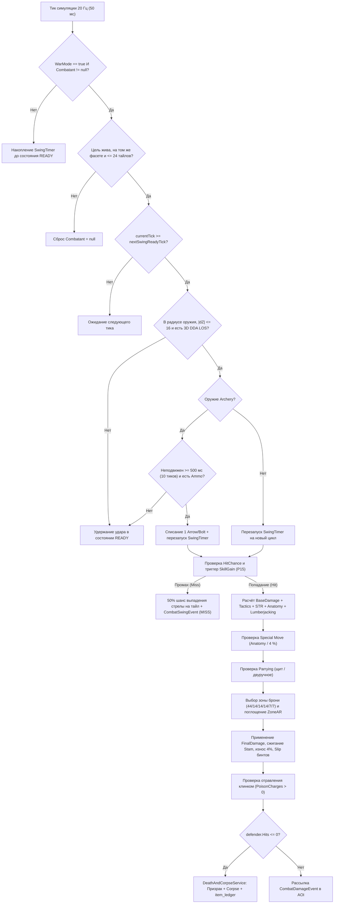
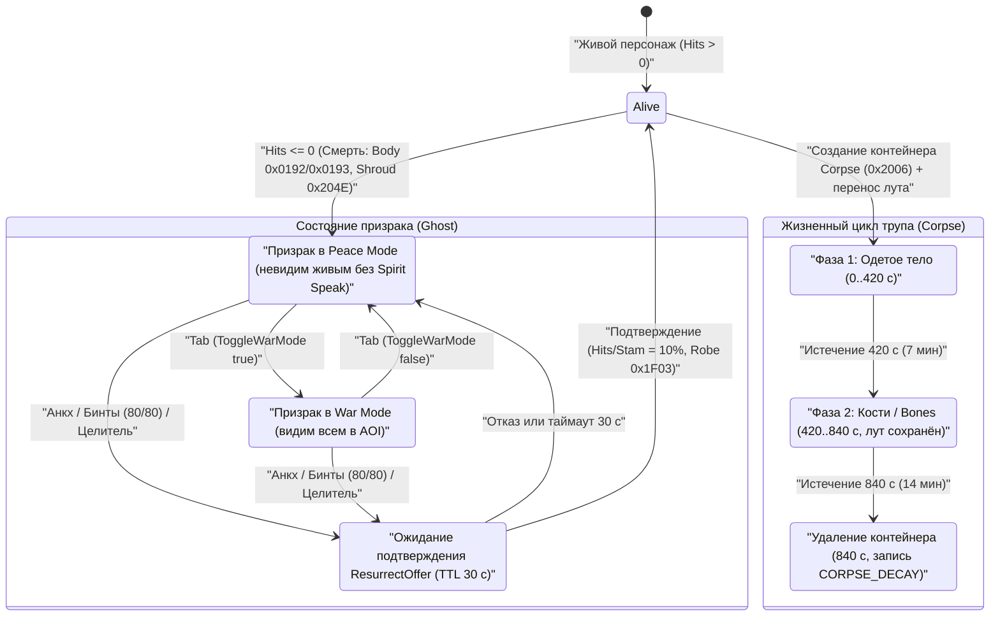

# Design: P16 Бой

## Context

Фаза P16 (`p16-combat`) опирается на уже заложенный фундамент ядра симуляции 20 Гц (P06), геометрического 3D DDA Line-of-Sight (P03), сетевого протокола и AOI `StateView` (P07), персистентности мира и `item_ledger` (P08), анимаций и визуальных событий мобилей (P11), физического движения и выносливости (P12), инвентаря и контейнеров (P13), слотов экипировки и куклы персонажа (P14), а также модели 49 навыков, первичных/вторичных характеристик и пассивной регенерации (P15).

В каноне **Ultima Online: Renaissance (UO:R)** бой строится вокруг позиционирования, управления выносливостью (`Stam`), тайминга замаха (`Swing Timer`), тактического переключения целей без потери заряженного удара, выбора оружия под профильный навык и своевременной перевязки бинтами (`Bandages`). Вся боевая логика обязана выполняться строго авторитарно на сервере в рамках детерминированного тика 50 мс (20 Гц), используя сидируемый ГСЧ `xoshiro128++` из `@uo3/rules`, чтобы любой бой можно было побитово воспроизвести в `SimulationTestHarness`.

## Goals / Non-Goals

### Goals
- Реализовать чистую изоморфную библиотеку боевой математики UO:R в `packages/rules/src/combat/*` без внешних зависимостей от БД и сети.
- Обеспечить авторитарное управление боевым режимом (`War/Peace`), активной целью (`Combatant`), матрицей боевой вовлечённости (`AggressorMatrix`, TTL 120 с) и автоатакой на тике 20 Гц.
- Реализовать точный расчёт `SwingTimer` в тиках 50 мс по формуле UO:R `15000 / ((Stam + 100) × WeaponSpeed)` с, шанс попадания по боевым навыкам, рукопашный бой (`Wrestling`), стрельбу с задержкой остановки 500 мс и расходом боеприпасов, а также специальные удары двуручного оружия UO:R (`Concussion`, `Crushing`, `Paralyzing Blow`).
- Внедрить полный конвейер физического урона (`BaseDice` → `Tactics` → `STR`/`Anatomy`/`Lumberjacking` → `Parrying` → `ZoneAR` → `FinalDamage`), сжигание `Stam` и деградацию прочности экипировки с разрушением при `0 HP`.
- Реализовать механику перевязки бинтами (`Healing`/`Veterinary`) с системой штрафов «соскользнувших пальцев» (`Slips`), снятием яда и воскрешением, а также 5 уровней яда (`Lesser`..`Lethal`) и отравленное оружие.
- Реализовать атомарный жизненный цикл смерти, превращения в призрака (`0x0192`/`0x0193`), двухфазного контейнера трупа (`Corpse` 420 с → `Bones` 420 с), сохранения `Blessed`/`Newbied` вещей и воскрешения через алтари, целителей и бинты.

### Non-Goals
- Расчёт репутации (`Notoriety`), криминального флага, счётчиков убийств и вызова гвардов (`Guards`) — делегируется в **P17** через порт `ICombatLegalityPolicy` и события `CombatAggressionRecorded`.
- Боевая и исцеляющая магия (`Magery`), резист заклинаний (`Resisting Spells`) и магическое воскрешение — реализуются в **P18**.
- Боевой ИИ монстров, таблицы агро и генерация PVM-лута — реализуются в **P19**.
- Ремонт повреждённого оружия и доспехов на наковальне и крафт зелий — реализуются в **P20**.

## Decisions

### D1. Изоморфный конвейер боевой математики в `@uo3/rules` и оркестратор в `apps/game-server`
- **Выбор:** Разделить боевую подсистему на два слоя:
  1. Чистые детерминированные функции в `packages/rules/src/combat/*` (`computeSwingDelayTicks`, `computeHitChance`, `resolvePhysicalDamage`, `rollHitLocationZone`, `resolveParry`, `resolveSpecialMove`, `computeBandageDurationTicks`, `computeBandageHeal`, `computePoisonTickDamage`, `partitionDeathInventory`), принимающие неизменяемые снимки статов/навыков и экземпляр `SeededRng` (`xoshiro128++`).
  2. Состоятельный серверный оркестратор `CombatOrchestratorService` в `apps/game-server/src/combat/*`, управляющий таймерами в иерархическом колесе P06, мутацией `MobileEntity`/`ItemEntity`, вызовами `SkillGainOrchestrator` (P15) и записью в `item_ledger` (P08).
- **Обоснование:** Соответствует ADR-003 и жёсткому правилу размещения общих формул в `packages/rules`. Позволяет тестировать весь баланс UO:R миллионами итераций за секунды в unit-тестах без поднятия Colyseus и PostgreSQL.
- **Отвергнутые альтернативы:** Размещение формул непосредственно в методах `WorldPartitionRoom` или `MobileEntity` — нарушает изоморфность и усложняет проверку инвариантов.

### D2. Дискретизация `SwingTimer` в тиках 50 мс и сохранение заряда замаха
- **Выбор:** Вычислять длительность замаха по канонической формуле UO:R (секунды `15000 / ((Stam + 100) × WeaponSpeed)`), переведённой в тики 50 мс с округлением вверх и нижним порогом 1.25 с:
  $$\text{SwingDelayTicks} = \max\left(25, \left\lceil \frac{300000}{(\text{Stam} + 100) \times \text{WeaponSpeed}} \right\rceil\right)$$
  Пример: катана (`WeaponSpeed = 46`) при `Stam = 100` — 33 тика (1650 мс); алебарда (`25`) при `Stam = 100` — 60 тиков (3000 мс).
  Таймер замаха (`nextSwingReadyTick`) тикает непрерывно даже во время движения или в режиме `Peace`. При достижении `currentTick >= nextSwingReadyTick` удар переходит в состояние `READY` (заряжен) и срабатывает в первый же тик, когда выполнены условия: `WarMode == true`, `Combatant != null`, дистанция в пределах `WeaponRange`, `|ΔZ| <= 16` и прямая 3D DDA LOS. При переключении `Combatant` на новую цель прогресс таймера сохраняется, но накладывается минимальный анти-инстахит порог `nextSwingReadyTick = max(nextSwingReadyTick, currentTick + 5)` (250 мс). При смене оружия в руках `nextSwingReadyTick` пересчитывается заново от текущего тика.
- **Обоснование:** В точности воспроизводит тактическую глубину UO:R (возможность «зарядить» удар алебардой на бегу и нанести его в момент сближения), исключая при этом эксплойт мгновенного переключения на случайного прохожего без паузы.
- **Отвергнутые альтернативы:** Сброс `SwingTimer` до нуля при каждом шаге или при каждом ретаргете — делает тяжёлое оружие ближнего боя неиграбельным против подвижных целей.

### D3. Конечный автомат стрельбы (`Archery`) с таймером неподвижности `StandingDelay`
- **Выбор:** Для оружия с `skill == 'Archery'` ввести дополнительное условие готовности выстрела: `ticksSinceLastMove = currentTick - lastMoveConfirmedTick >= 10` (500 мс неподвижности после последнего шага P12). Расход 1 стрелы (`0x0F3F`) или 1 болта (`0x1BFB`) выполняется непосредственно в тик разрешения выстрела перед броском `HitChance`. При отсутствии боеприпасов в корневом рюкзаке или колчане выстрел блокируется с отправкой `ERR_COMBAT_NO_AMMO` (троттлинг уведомления 1 раз в 2 с) и откладыванием проверки на 10 тиков. При промахе с вероятностью 50 % снаряд создаётся/добавляется в стек на тайле цели `(target.x, target.y, target.z)`; при попадании в NPC с вероятностью 50 % снаряд добавляется в инвентарь NPC (и переходит в его труп при смерти).
- **Обоснование:** Каноническое правило UO:R предотвращает бесконечный кайтинг на бегу из лука без остановки и обеспечивает естественный кругооборот боеприпасов в PVM.
- **Отвергнутые альтернативы:** Списание стрелы в начале замаха — приводит к потере боеприпасов при отмене атаки или сближении до выстрела.

### D4. Взвешенная зональная модель брони (`HitLocationZone`), деградация `AR` и парирование
- **Выбор:** При каждом успешном попадании (`Hit`) пропускать урон через строгую последовательность этапов:
  1. **Базовый бросок и масштабирование навыков:**
     $$\text{Base} = \text{roll}(XdY) + Z$$
     $$\text{TacticsMult} = \frac{\text{Tactics} + 50.0}{100.0}$$
     $$\text{BonusPct} = \lfloor \text{STR} \times 0.2 \rfloor + \text{AnatBonus} + \text{LumberBonus}$$
     где $\text{AnatBonus} = 30$ при $\text{Anatomy} = 100.0$, иначе $\lfloor \text{Anatomy} \times 0.2 \rfloor$; аналогично $\text{LumberBonus}$ для подтипа `Axe`.
     $$\text{RawDamage} = \left\lfloor \text{Base} \times \text{TacticsMult} \times \frac{100 + \text{BonusPct}}{100} \right\rfloor$$
  2. **Особый удар (`Crushing Blow`):** если сработал `Crushing Blow`, $\text{RawDamage} = \lfloor \text{RawDamage} \times 1.5 \rfloor$.
  3. **Парирование (`Parrying`):**
     - Со щитом: шанс $\lfloor \text{Parrying} / 2 \rfloor\%$, поглощение $\text{ParryAbsorb} = \lfloor \text{ShieldAR} \times (50 + \text{Parrying} / 2) / 100 \rfloor$ (для `Archery` делится на 2).
     - С двуручным оружием ближнего боя без щита: шанс $\lfloor \text{Parrying} / 4 \rfloor\%$, поглощение $\lfloor \text{WeaponBaseAR} \times \text{Parrying} / 200 \rfloor$.
     - $\text{PostParryDamage} = \max(0, \text{RawDamage} - \text{ParryAbsorb})$.
  4. **Выбор зоны попадания и поглощение бронёй:**
     Бросок `0..99` выбирает зону: `Body` (`0..43`, вес 0.44), `Arms` (`44..57`, вес 0.14), `Head` (`58..71`, вес 0.14), `Legs` (`72..85`, вес 0.14), `Neck` (`86..92`, вес 0.07), `Hands` (`93..99`, вес 0.07).
     Эффективный рейтинг предмета в зоне: $\text{ZoneAR} = \lfloor \text{BaseItemAR} \times \text{CurrentHP} / \text{MaxHP} \rfloor$.
     Поглощение бронёй: $\text{ArmorAbsorb} = \text{randomInt}(\lfloor \text{ZoneAR} / 2 \rfloor, \text{ZoneAR})$.
  5. **Финальный урон:** если $\text{PostParryDamage} - \text{ArmorAbsorb} \le 0$, то $\text{FinalDamage} = 0$, иначе:
     $$\text{FinalDamage} = \max\left(1, \left\lfloor \frac{\text{PostParryDamage} - \text{ArmorAbsorb}}{2} \right\rfloor\right)$$
- **Обоснование:** Зональная модель делает осмысленным каждый отдельный элемент доспеха (шлем, горжет, перчатки), а масштабирование от `CurrentHP / MaxHP` создаёт прямой спрос на ремонт у кузнецов в P20.
- **Отвергнутые альтернативы:** Единый плоский `TotalAR` для всех попаданий — обесценивает мелкие элементы доспеха (горжет и перчатки).

### D5. Пассивные специальные удары двуручного оружия UO:R от навыка `Anatomy`
- **Выбор:** При попадании двуручным оружием ближнего боя с `FinalDamage >= 1` проверять шанс особого удара $P_{\text{spec}} = \lfloor \text{Anatomy} / 4 \rfloor\%$ (0 % при `Anatomy < 4.0`, до 25 % при `100.0`):
  - `CONCUSSION_BLOW` (двуручные мечи и топоры/алебарды): накладывает эффект `ConcussionEffect` на 30 с (600 тиков), временно снижающий эффективный `INT` и `MaxMana`/`CurrentMana` цели вдвое; повторное срабатывание во время активного эффекта только обновляет таймер 30 с.
  - `CRUSHING_BLOW` (двуручное дробящее: `War Hammer`, `Quarter Staff`, `Black Staff`): требует `attacker.Stam >= 60`, списывает `10 Stam` и умножает урон на `1.5`.
  - `PARALYZING_BLOW` (двуручные копья: `Spear`, `Short Spear`, `Pitchfork`): накладывает `ParalyzeEffect` на 80 тиков (4.0 с) для игроков и 160 тиков (8.0 с) для NPC. Любой входящий урон `>= 1` немедленно снимает паралич, а после окончания или снятия паралича цель получает иммунитет `ParalyzeImmunityUntilTick = currentTick + 120` (6.0 с) к повторному парализующему удару.
- **Обоснование:** Каноническая механика UO:R, балансирующая отсутствие щита у двуручного оружия и предотвращающая бесконечный стан-лок копьём благодаря 6-секундному окну иммунитета.
- **Отвергнутые альтернативы:** Ручная активация спец-ударов кнопками за ману (модель Age of Shadows) — противоречит эпохе UO:Renaissance (ADR-001).

### D6. Сессии перевязки бинтами (`BandageSession`) со счётчиком `Slips` и тики яда в колесе таймеров
- **Выбор:** Хранить на мобиле максимум одну активную структуру `BandageSession` (`healerSerial`, `patientSerial`, `startedAtTick`, `finishAtTick`, `slipsCount`, `mode: 'HEAL' | 'CURE' | 'RESURRECT'`).
  - Длительность на себя: $\max(80, 220 - 20 \times \lfloor \text{DEX} / 20 \rfloor)$ тиков ($4.0..11.0$ с).
  - Длительность на союзника/питомца: $\max(40, 80 - 20 \times \lfloor \text{DEX} / 60 \rfloor)$ тиков ($2.0..4.0$ с).
  - Длительность воскрешения: $200$ тиков ($10.0$ с) или $100$ тиков ($5.0$ с) при $\text{DEX} \ge 100$.
  - Входящий урон $\ge 26$ мгновенно обрывает сессию. Входящий урон $5..25$ увеличивает `slipsCount += 1`, сдвигает `finishAtTick += 15` (+0.75 с) и снижает итоговый множитель лечения на $15\%$ за каждый `Slip`; при `slipsCount >= 4` перевязка срывается.
  - Для ядов (`PoisonLevel 0..4`) регистрировать периодический таймер в иерархическом колесе P06 с параметрами из таблицы ниже. Пока `poisonState != null`, хук `canRegenerateHits(mobile)` в P15 возвращает `false`.
- **Обоснование:** Тайминг самоперевязки и перевязки напарника (кросс-хил за 2–3 с) — основа группового PvP и PvE в UO:R.
- **Отвергнутые альтернативы:** Мгновенное лечение бинтами с кулдауном или срыв перевязки от любого урона в 1 единицу — разрушает баланс против быстрого оружия (`Kryss`, `Katana`).

### D7. Атомарная транзакция смерти, двухфазный контейнер трупа (`Corpse` → `Bones`) и аудит `item_ledger`
- **Выбор:** При `Hits <= 0` выполнять атомарный переход `DeathAndCorpseService.executeDeath(victim, killer, reason)` внутри текущего тика:
  1. Очистить `Combatant`, активную `BandageSession`, `PoisonState`, временные дебаффы (`Concussion`, `Paralyze`) и сбросить `Combatant` у всех мобилей в AOI, целившихся в погибшего.
  2. Разделить предметы экипировки и корневого рюкзака через чистую функцию `partitionDeathInventory(items)`:
     - Предметы с `isBlessed || isNewbied || isBoundToCharacter` остаются у игрока (экипированные blessed/newbied вещи перемещаются в корневой рюкзак призрака, чтобы освободить слоты куклы под саван).
     - Все остальные предметы переносятся в новый контейнер `Corpse` (`ItemID = 0x2006`, `corpsePhase = 1`, `decayPhase1At = now + 420s`, `decayPhase2At = now + 840s`) с сохранением карты `equippedLayersSnapshot: Record<EquipLayer, Serial>` для рендера одетого трупа и пакетной записью `DEATH_DROP_TO_CORPSE` в `item_ledger` (P08).
  3. Перевести игрока в `isDead = true`, `Body = (gender == FEMALE ? 0x0193 : 0x0192)`, создать в слоте `OuterTorso (Layer 0x16)` временный `Death Shroud` (`0x204E`, `isTransientShroud = true`).
  4. По истечении 420 с перевести труп в `corpsePhase = 2` (`Bones`, `ItemID = 0x0ECA..0x0ED2`), сбросив `equippedLayersSnapshot`, но сохранив все предметы внутри контейнера ещё на 420 с.
- **Обоснование:** Обеспечивает нулевую потерю или дублирование предметов при смерти (интеграция с `item_ledger` P08) и канонический 14-минутный цикл спасения своего лута.
- **Отвергнутые альтернативы:** Удаление предметов сразу через 7 минут — слишком жёсткое окно для возврата призрака из подземелий.

### D8. Серверная фильтрация видимости и речи призрака и порты интеграции P17/P18
- **Выбор:**
  - В фильтре видимости AOI `StateView` (P07) живой наблюдатель видит призрака только тогда, когда `ghost.warMode == true` ИЛИ у наблюдателя активен бафф `spiritSpeakActiveUntilTick > currentTick` ИЛИ наблюдатель сам мёртв (`viewer.isDead == true`) ИЛИ имеет `AccessLevel >= Counselor`.
  - В конвейере чата речь призрака трансформируется детерминированным фильтром `transformGhostSpeech(text)`: каждая буква заменяется на `o` или `O`, пробелы сохраняются (`"Help me"` → `"Oooo oo"`), для всех живых получателей без активного `Spirit Speak`.
  - Ввести интерфейс `ICombatLegalityPolicy` (`canAttack(attacker, defender)`, `onHarmfulAction(attacker, defender)`, `onBeneficialAction(actor, target)`, `onMobileKilled(killer, victim)`). В P16 используется реализация по умолчанию `DefaultCombatLegalityPolicy`, записывающая `AggressorRecord` (TTL 120 с); в P17 она заменяется на `NotorietyAndCriminalPolicy`.
- **Обоснование:** Исключает утечку координат скрытого призрака на клиент (анти-чит) и позволяет подключить криминальную систему P17 без переписывания ядра P16.
- **Отвергнутые альтернативы:** Скрытие призрака только на уровне рендера клиента — позволяет чит-клиентам видеть призраков-разведчиков в `Peace Mode`.

## Архитектура модулей и поток управления

### Структура пакетов и сервисов
- **`packages/domain/src/combat/*`:**
  - `types.ts`: `WeaponSkillType`, `HitLocationZone`, `SpecialMoveType`, `PoisonLevel`, `CorpsePhase`, `ResurrectionSource`, `CombatOutcome`, `AggressorRecord`, `CombatResolutionRecord`.
  - `errors.ts`: коды `ERR_COMBAT_*`.
- **`packages/rules/src/combat/*`:**
  - `swing-timer.ts`: расчёт тиков замаха и анти-ретаргет клемпинг.
  - `hit-chance.ts`: формула шанса попадания по оружейным навыкам и `Wrestling`.
  - `damage-pipeline.ts`: кубики оружия, бонусы `Tactics`, `STR`, `Anatomy`, `Lumberjacking`.
  - `parrying.ts`: шанс и объём блока щитом и двуручным оружием.
  - `armor-zones.ts`: взвешенный выбор зоны (44/14/14/14/7/7), масштабирование `ZoneAR` от прочности, поглощение и сводный `TotalAR`.
  - `special-moves.ts`: триггеры и длительности `Concussion Blow`, `Crushing Blow`, `Paralyzing Blow`.
  - `durability.ts`: 4 % шанс износа, удвоение износа брони от `Mace Fighting`, разрушение предмета.
  - `bandages.ts`: длительность перевязки, штрафы `Slip`, формула лечения, шансы `Cure` и `Resurrect`.
  - `poison.ts`: таблица 5 уровней яда, шанс отравления клинком от `Poisoning`, правила замещения яда.
  - `death-loot.ts`: разбиение инвентаря на сохраняемый у призрака и переносимый в труп, фильтр речи `oOoOOooOO`.
- **`apps/game-server/src/combat/*`:**
  - `CombatOrchestratorService`: тиковый цикл проверки дистанции, 3D LOS, `StandingDelay` и запуска удара.
  - `AggressorTrackerService`: двунаправленная матрица `AggressorRecord` с TTL 120 с (2400 тиков).
  - `BandageSessionManager`: жизненный цикл перевязки и перехват входящего урона для начисления `Slips`.
  - `PoisonTickProcessor`: обработка периодических тиков яда в колесе таймеров P06.
  - `DeathAndCorpseService`: атомарная смерть, управление распадом трупов (`Corpse` → `Bones` → удаление), диалоги воскрешения (`Ankh`, `Bandage`, `Healer`).

### Диаграмма 1: Конвейер боевого тика и разрешения удара

### Диаграмма 2: Жизненный цикл смерти, трупа и воскрешения

## Модели данных, таблицы спецификаций и сетевой протокол

### 1. Таблицы боевых параметров UO:R

#### Таблица зон попадания и весов `Armor Rating (AR)`
| Зона (`HitLocationZone`) | Слот экипировки (`EquipLayer`) | Диапазон броска `0..99` | Вероятность / Вес в `TotalAR` |
|---|---|---|---|
| `BODY` (Грудь/Торс) | `InnerTorso (0x0D)` / `OuterTorso (0x16)` | `0..43` | **44 %** (`0.44`) |
| `ARMS` (Руки/Плечи) | `Arms (0x13)` | `44..57` | **14 %** (`0.14`) |
| `HEAD` (Голова) | `Helm (0x06)` | `58..71` | **14 %** (`0.14`) |
| `LEGS` (Ноги/Бёдра) | `Pants (0x04)` / `OuterLegs (0x18)` | `72..85` | **14 %** (`0.14`) |
| `NECK` (Шея) | `Neck (0x0A)` | `86..92` | **7 %** (`0.07`) |
| `HANDS` (Кисти) | `Gloves (0x07)` | `93..99` | **7 %** (`0.07`) |

Сводный `TotalAR`, отображаемый в окне статуса (P15):
$$\text{TotalAR} = \left\lfloor \sum_{z \in \text{Zones}} (\text{ZoneAR}_z \times \text{Weight}_z) \right\rfloor + \left\lfloor \frac{\text{ShieldAR} \times \text{Parrying}}{200} \right\rfloor$$

#### Таблица уровней яда (`PoisonLevel`)
| Уровень | Код | Интервал тика | Число тиков | Длительность | Формула урона за тик | Сложность снятия (`CurePenalty`) |
|---|---|---|---|---|---|---|
| `0` | `LESSER` | `2.0 с` (40 тиков) | `15` | `30 с` | `max(2, floor(CurrentHits * 0.04))` | `0 %` |
| `1` | `REGULAR` | `3.0 с` (60 тиков) | `10` | `30 с` | `max(4, floor(CurrentHits * 0.06))` | `15 %` |
| `2` | `GREATER` | `4.0 с` (80 тиков) | `10` | `40 с` | `max(6, floor(CurrentHits * 0.09))` | `30 %` |
| `3` | `DEADLY` | `5.0 с` (100 тиков) | `8` | `40 с` | `max(10, floor(CurrentHits * 0.14))` | `45 %` |
| `4` | `LETHAL` | `5.0 с` (100 тиков) | `10` | `50 с` | `max(16, floor(CurrentHits * 0.22))` | `60 %` |

### 2. Схема PostgreSQL 17 (`packages/db`)
- **Расширение таблицы `world_mobiles` / `characters`:**
  - `is_dead BOOLEAN NOT NULL DEFAULT FALSE`
  - `war_mode BOOLEAN NOT NULL DEFAULT FALSE`
  - `poison_level SMALLINT NULL` (`0..4` или `NULL`)
  - `poison_ticks_remaining SMALLINT NOT NULL DEFAULT 0`
  - `poison_applier_serial INTEGER NULL`
- **Новая таблица `world_corpses`:**
  - `corpse_serial INTEGER PRIMARY KEY` (диапазон предметов `0x40000000..0x7FFFFFFF`, ссылка на контейнер в `world_items`)
  - `owner_serial INTEGER NOT NULL`
  - `killer_serial INTEGER NULL`
  - `facet_id SMALLINT NOT NULL`, `x SMALLINT NOT NULL`, `y SMALLINT NOT NULL`, `z SMALLINT NOT NULL`
  - `original_body SMALLINT NOT NULL`, `skin_hue SMALLINT NOT NULL`, `direction SMALLINT NOT NULL`
  - `corpse_phase SMALLINT NOT NULL DEFAULT 1` (`1` = тело, `2` = кости)
  - `equipped_layers_snapshot JSONB NOT NULL DEFAULT '{}'` (карта `layer -> itemSerial/graphic/hue` на момент смерти)
  - `aggressor_serials JSONB NOT NULL DEFAULT '[]'` (список серийников для проверки правомерности лута в P17)
  - `phase2_at TIMESTAMPTZ NOT NULL`, `expires_at TIMESTAMPTZ NOT NULL`, `created_at TIMESTAMPTZ NOT NULL DEFAULT NOW()`

### 3. Схема состояния Colyseus (`@colyseus/schema` v3 в `packages/protocol`)
- В `MobileSchema` добавляются/активируются поля:
  - `@type('boolean') warMode: boolean = false` (публичное в AOI)
  - `@type('boolean') isDead: boolean = false` (публичное в AOI)
  - `@type('int8') poisonLevel: number = -1` (`-1` = здоров, `0..4` = уровень яда; публичное в AOI для зелёного хитбара)
  - `@type('uint32') combatantSerial: number = 0` (фильтруется через `@view()` только владельцу персонажа)
  - `@type('uint16') armorRating: number = 0` (в `PlayerPrivateStatusSchema`)
  - `@type('uint16') weaponDamageMin: number = 1`, `@type('uint16') weaponDamageMax: number = 8` (в `PlayerPrivateStatusSchema`)
- В `ItemSchema` для контейнеров трупов (`ItemID == 0x2006` или костей):
  - `@type('uint8') corpsePhase: number = 0` (`1` = тело, `2` = кости)
  - `@type('uint16') corpseOriginalBody: number = 0`

### 4. Сообщения протокола (`packages/protocol`, опкоды `0x01A0..0x01CF`)
- **Клиент → Сервер (Intents):**
  - `0x01A0 ToggleWarModeIntent`: `{ warMode: boolean }`
  - `0x01A1 AttackRequestIntent`: `{ targetSerial: uint32 }`
  - `0x01A2 UseBandageIntent`: `{ bandageSerial: uint32, targetSerial: uint32 }`
  - `0x01A3 ResurrectResponseIntent`: `{ offerId: string, accept: boolean }`
  - `0x01A4 LootAllOwnCorpseIntent`: `{ corpseSerial: uint32 }`
- **Сервер → Клиент (Events):**
  - `0x01B0 CombatTargetChangedEvent`: `{ combatantSerial: uint32, reason: 'SELECTED' | 'AUTO_DEFENSE' | 'CLEARED' | 'TARGET_DEAD' | 'OUT_OF_RANGE' }`
  - `0x01B1 CombatSwingEvent`: `{ attackerSerial: uint32, defenderSerial: uint32, actionAnimId: uint16, soundId: uint16, projectileGraphicId: uint16, outcome: 'HIT' | 'MISS' | 'PARRIED' }`
  - `0x01B2 CombatDamageEvent`: `{ targetSerial: uint32, attackerSerial: uint32, damageAmount: uint16, hitZone: uint8, parried: boolean, remainingHitsPct: uint8 }`
  - `0x01B3 SpecialMoveEvent`: `{ attackerSerial: uint32, targetSerial: uint32, moveType: 'CONCUSSION' | 'CRUSHING' | 'PARALYZING', durationMs: uint16 }`
  - `0x01B4 BandageProgressEvent`: `{ healerSerial: uint32, targetSerial: uint32, state: 'STARTED' | 'SLIPPED' | 'COMPLETED' | 'INTERRUPTED', durationMs: uint16, slipsCount: uint8, healedAmount: uint16, curedPoison: boolean, resurrected: boolean }`
  - `0x01B5 PoisonStateEvent`: `{ mobileSerial: uint32, poisonLevel: int8, ticksRemaining: uint8, reason: 'APPLIED' | 'TICK' | 'CURED' | 'EXPIRED' }`
  - `0x01B6 MobileDeathEvent`: `{ victimSerial: uint32, killerSerial: uint32, corpseSerial: uint32, x: uint16, y: uint16, z: int8, deathAnimId: uint16, soundId: uint16 }`
  - `0x01B7 ResurrectOfferEvent`: `{ offerId: string, sourceType: 'ANKH' | 'BANDAGE' | 'HEALER' | 'SPELL', healerName: string, expiresAtMs: uint64, restoredHitsPct: uint8 }`
  - `0x01B8 EquipmentDurabilityEvent`: `{ itemSerial: uint32, currentHp: uint16, maxHp: uint16, destroyed: boolean }`

### 5. Коды ошибок (`CombatErrorCode`)
- `ERR_COMBAT_WARMODE_COOLDOWN` — превышена частота переключения `War/Peace` (< 250 мс).
- `ERR_COMBAT_IN_WAR_MODE` — мирное действие заблокировано активным боевым режимом.
- `ERR_COMBAT_ACTOR_DEAD` — действие недоступно в состоянии призрака.
- `ERR_COMBAT_INVALID_TARGET` — цель мертва, не является мобилем или совпадает с атакующим.
- `ERR_COMBAT_TARGET_OUT_OF_RANGE` — цель далее 18 тайлов (выбор атаки) или далее 2 тайлов (перевязка).
- `ERR_COMBAT_NO_LOS` — отсутствует прямая 3D линия видимости до цели.
- `ERR_COMBAT_ILLEGAL_ATTACK` — атака запрещена политикой безопасности/фракции (`ICombatLegalityPolicy`).
- `ERR_COMBAT_NO_AMMO` — в рюкзаке отсутствуют стрелы (`Arrow`) или болты (`Bolt`).
- `ERR_COMBAT_BANDAGE_BUSY` — персонаж уже выполняет активную перевязку.
- `ERR_COMBAT_BANDAGE_INTERRUPTED` — перевязка сорвана тяжёлым уроном (`>= 26`), 4 срывами пальцев или разрывом дистанции (`> 2` тайлов).
- `ERR_COMBAT_SKILL_TOO_LOW` — недостаточно навыков `Healing`/`Veterinary` и `Anatomy` для снятия яда (`< 60/60`) или воскрешения (`< 80/80`).
- `ERR_COMBAT_WEAPON_CANNOT_BE_POISONED` — попытка отравить оружие, не относящееся к режущему/колющему (`Swordsmanship`/`Fencing`).
- `ERR_COMBAT_ITEM_DESTROYED` — предмет экипировки полностью разрушен из-за падения прочности до `0`.
- `ERR_COMBAT_RESURRECT_EXPIRED` — предложение воскрешения истекло (30 с) или призрак отошёл от алтаря/целителя.

## Risks / Trade-offs

- **[Эксплойт мгновенного удара при быстром переключении целей (Insta-hit Retarget)]** → Митигация: при смене `Combatant` прогресс таймера замаха не сбрасывается полностью, но остаток времени до удара принудительно зажимается снизу `max(remainingTicks, 5)` (250 мс), а сам ретаргет лимитирован кулдауном 150 мс (3 тика).
- **[Рассинхронизация или дюп предметов при смерти и создании контейнера трупа]** → Митигация: перенос предметов из слотов экипировки и рюкзака в `Corpse` выполняется в одной синхронной операции памяти тика с обязательной пакетной записью `DEATH_DROP_TO_CORPSE` в `item_ledger` и внеочередным сохранением строки `world_corpses` в PostgreSQL.
- **[Использование невидимых призраков в качестве разведчиков (Ghost Scouting)]** → Митигация: призрак передвигается только со скоростью пешего шага (400 мс/тайл), а в `Peace Mode` исключается из `StateView` живых игроков на сервере; для того чтобы быть видимым или взаимодействовать с миром, призрак обязан включить `War Mode`, демаскируя себя.
- **[Бесконечный стан-лок двуручным копьём (`Paralyzing Blow`)]** → Митигация: любой входящий урон `>= 1` мгновенно снимает паралич, а после завершения или снятия паралича на цель накладывается 6-секундный иммунитет (`120` тиков) к повторному `Paralyzing Blow`.
- **[Нагрузка на процессор от проверок 3D DDA LOS на каждом тике 20 Гц для всех сражающихся]** → Митигация: проверка 3D DDA LOS вызывается только тогда, когда `currentTick >= nextSwingReadyTick` (удар заряжен) и дистанция Чебышёва уже находится в пределах `WeaponRange` (1..10 тайлов), а результат кэшируется до смены координат `(x, y, z)` атакующего или цели.
- **[Засорение мира тысячами выпавших стрел и неразобранных трупов NPC]** → Митигация: выпавшие при промахе стрелы автоматически объединяются в существующий стек на тайле в радиусе 1 тайла, а трупы NPC имеют сокращённый цикл распада 300 с (5 минут) вместо 840 с у игроков.
- **[Преждевременное обесценивание брони без системы ремонта до фазы P20]** → Митигация: шанс потери 1 ед. прочности зафиксирован на каноническом уровне 4 % за попадание (в среднем 1000–1250 пропущенных ударов на элемент доспеха с `40–50 HP`), а в стартовых городах доступен базовый NPC-кузнец для починки до выхода полного крафта в P20.
- **[Перегрузка эфира пакетами урона и анимаций в массовых боях]** → Митигация: события `CombatSwingEvent` и `CombatDamageEvent` имеют компактную бинарную/TypeBox сериализацию и рассылаются строго подписчикам сектора AOI (18 тайлов).

## Migration Plan

1. **Слой домена и контента (`@uo3/domain`, `@uo3/content`):** добавить типы боевых состояний, зон брони, уровней яда, особых ударов и расширить YAML-каталоги оружия, доспехов и бинтов/боеприпасов.
2. **Изоморфное ядро правил (`@uo3/rules`):** реализовать и покрыть детерминированными unit-тестами все 10 модулей в `packages/rules/src/combat/*`.
3. **База данных и протокол (`@uo3/db`, `@uo3/protocol`):** накатить миграцию Drizzle для `world_corpses` и боевых колонок `world_mobiles`, зарегистрировать опкоды `0x01A0..0x01B8` и обновить `MobileSchema`/`ItemSchema`.
4. **Игровой сервер (`apps/game-server`):** подключить `CombatOrchestratorService`, `BandageSessionManager`, `PoisonTickProcessor` и `DeathAndCorpseService` к тику `WorldPartitionRoom` и связать с `SkillGainOrchestrator` (P15) и `item_ledger` (P08).
5. **Клиент и боты (`apps/client`, `packages/ui-kit`, `apps/bot-client`):** внедрить управление `War/Peace` (`Tab`), индикацию цели и зелёных/красных хитбаров, эффект экрана призрака, гамп воскрешения и сценарии боевых дуэлей в `bot-client`.

## Open Questions

- *Нужно ли в фазе P26 (Гильдии и фракции) вводить временный `Stat Loss` при воскрешении для участников фракционных войн (`Faction Stat Loss`), сохраняя `Stat Loss = 0` для всех остальных игроков?* — Решение отложено до фазы **P26**; в `ResurrectOfferEvent` и `DeathAndCorpseService` предусмотрен расширяемый хук `IResurrectionPenaltyPolicy`.
- *Должен ли яд уровня `Lethal (Level 4)` быть доступен игрокам через алхимию в P20, или остаться эксклюзивным для боссов-монстров в P19?* — В P16 движок поддерживает все 5 уровней (`0..4`), при этом оружие игроков ограничивается уровнями `0..3` (`Lesser`..`Deadly`), а `Level 4 (Lethal)` резервируется для P19.
