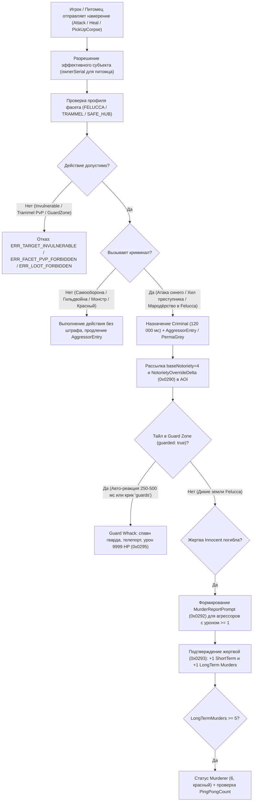
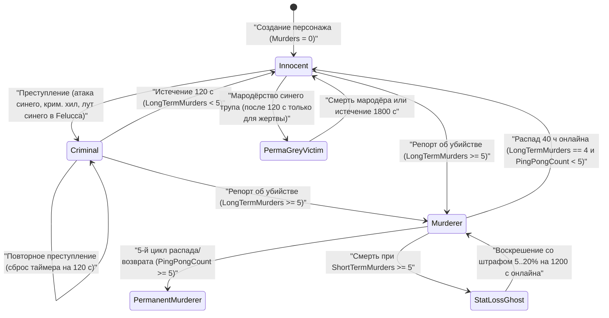

# Design: P17 Нотореити и PvP

## Context

Фаза P16 реализовала детерминированный боевой цикл UO:R (`@uo3/rules/combat`): шаги замаха по 250 мс, расчёт шанса попадания, базовые кубики оружия, бонусы Tactics/Anatomy/STR/Lumberjacking, парирование щитом, распределение по 6 зонам брони (`44/14/14/14/7/7`), перевязку бинтами со `Slips`, 5 уровней яда, смерть с созданием контейнера трупа `0x2006` и базовый контракт `ICombatLegalityPolicy` с черновым `AggressorRecord` (TTL 120 с). Ранее фаза P07 заложила порты `NotorietyRelationProvider` (для индивидуальной фильтрации/окраски сущностей в Colyseus `@colyseus/schema` v3 `StateView`) и `ContainerAccessGrantPort` (для авторизации доступа к контейнерам в P13), а фаза P12 ввела проверку коллизий и проталкивания (`shove` за 10 стамины).

В Ultima Online: Renaissance правовой статус персонажа (Notoriety) не является исключительно глобальным свойством сущности: один и тот же игрок в один и тот же тик может быть **синим** (`Innocent = 1`) для случайного прохожего, **серым** (`CanBeAttacked = 3`) для жертвы, которую он атаковал полторы минуты назад (или чей труп он ограбил), **зелёным** (`Ally = 2`) для согильдийца и **оранжевым** (`Enemy = 5`) для члена враждебной гильдии. Кроме того, мир UO:R разделён на два фундаментальных набора правил фасетов: открытое неконсенсусное PvP на фасете **Felucca** (`facetId = 0`) и консенсусное PvP с защитой от нежелательных атак, AoE-заклинаний и мародёрства на фасете **Trammel** (`facetId = 1`). Внутри городов обоих фасетов действуют охраняемые зоны (`Guard Zones`), где стража мгновенно казнит преступников (`Criminal = 4`) и убийц (`Murderer = 6`, `LongTermMurders >= 5`) при совершении преступления или по голосовой команде `"guards"` из потока речи `SpeechRouter` (P14).

Настоящий документ фиксирует архитектуру подсистемы нотореити и PvP, обеспечивающую детерминизм в `@uo3/rules`, нулевые аллокации на горячем пути рассылки AOI-патчей 20 Гц и строгий аудит мародёрства в `item_ledger` (P08).

## Goals / Non-Goals

### Goals
- Реализовать чистый изоморфный модуль `@uo3/rules/pvp` для вычисления относительной нотореити (`1..7`), проверки легальности вредоносных и благоприятных действий, учёта агрессоров/защитников, распада счётчиков убийств и проверки прав доступа к трупам.
- Обеспечить эффективную доставку относительной нотореити каждому наблюдателю в AOI (радиус 18–24 тайла) без дублирования полного состояния мобила в `@colyseus/schema` v3.
- Реализовать точный жизненный цикл преступника (`120 000` мс) и двух счётчиков убийств (`ShortTermMurders` с распадом 8 ч = `28 800` с онлайна и `LongTermMurders` с распадом 40 ч = `144 000` с онлайна, порог `>= 5`), включая защиту от пинг-понга (`PingPongCount >= 5`) и временный штраф `StatLoss` (5%..20% на 20 минут онлайна при воскрешении с `ShortTermMurders >= 5`).
- Интегрировать гео-индекс охраняемых регионов (`Guard Zones`) с `SpeechRouter` (P14) и боевым циклом (P16) для автоматической и голосовой реакции стражи (`Guard Whack`).
- Разделить правила фасетов `FELUCCA_RULESET`, `TRAMMEL_RULESET` и `SAFE_HUB_RULESET` для прямых атак, AoE-выборок, коллизий движения (P12), межфасетных переходов и лутинга трупов (P13).
- Записывать все операции изъятия предметов из чужих трупов игроков в `item_ledger` (P08) с флагом криминализации.

### Non-Goals
- Реализация конкретных заклинаний и магических AoE-формул (выполняется в P18 поверх предоставляемых в P17 функций `evaluateHarmfulActionLegality`, `evaluateBeneficialActionEffects` и `filterAoeTargetsByFacetRuleset`).
- Карма, слава (`Karma / Fame`), титулы и поведение диких NPC/монстров (выполняется в P19).
- Приручение животных и команды управления питомцами (выполняется в P20; в P17 реализуется только разрешение `ownerSerial` при вычислении нотореити и ответственности за атаку).
- Управление гильдиями, объявление войн и фракции (выполняется в P26; в P17 используется абстрактный порт `IGuildAndPartyRelationPort`).
- Навык `Stealing` и механика воровства из рюкзаков живых игроков (выполняется в P27; в P17 закладывается сам механизм персонального и глобального `PermaGrey`).

## Decisions

### Decision 1: Двухуровневая модель синхронизации нотореити (Base Schema + Per-Viewer Override Packet)
- **Выбор**: В `@colyseus/schema` (`MobileSchema`) хранится публичный базовый статус `baseNotoriety: uint8` (`Innocent = 1`, `CanBeAttacked = 3`, `Criminal = 4`, `Murderer = 6`, `Invulnerable = 7`), одинаковый для 95% наблюдателей в AOI. Персональные переопределения для конкретного наблюдателя (`Ally = 2`, `Enemy = 5`, либо персональный `CanBeAttacked = 3` по записи `AggressorEntry` или `PermaGrey`) доставляются легковесным бинарным пакетом `NotorietyOverrideDeltaPacket (0x0290)` при входе в AOI или при изменении пары отношений `viewer <-> target`.
- **Обоснование**: Если хранить цвет каждого мобила для каждого наблюдателя внутри Colyseus `StateView`, потребуется $O(N^2)$ клонов состояния при 50 игроках в одном секторе. Разделение на глобальный `baseNotoriety` в схеме и точечный `NotorietyOverrideDeltaPacket` для пар с активной агрессией/гильдией снижает сетевой трафик и нагрузку на CPU до $O(N + E)$, где $E$ — число активных парных конфликтов в секторе.
- **Отвергнутые альтернативы**: Полная отправка индивидуального пакета нотореити на каждый чих для всех $N \times N$ пар в AOI (избыточный трафик); вычисление всех правил агрессии на клиенте (нарушает серверную авторитарность и раскрывает приватные списки агрессоров чужих игроков).

### Decision 2: Чистый детерминированный пайплайн приоритетов нотореити в `@uo3/rules`
- **Выбор**: Функция `computeRelativeNotoriety(viewer, target, ctx)` в `@uo3/rules/src/pvp/notoriety.ts` не имеет побочных эффектов и проверяет статус строго в каноническом порядке UO:R:
  1. Если `target.isInvulnerable` (вендор, банкир, вызванный гвард, персонал с `AccessLevel >= 1` в режиме неуязвимости) $\rightarrow$ `7 (Invulnerable)`.
  2. Если `target` — управляемый питомец/призыв (`target.ownerSerial != null`), базовые проверки делегируются владельцу `owner` (с сохранением прямых агрессий против самого питомца).
  3. Если `target.longTermMurders >= 5` или `target.isPermanentMurderer` или `target.npcAlignment === 'evil'` $\rightarrow$ `6 (Murderer)`.
  4. Если `ctx.relations.areAllies(viewer.serial, effectiveTarget.serial)` (одна группа или союзная гильдия) $\rightarrow$ `2 (Ally)`.
  5. Если `ctx.relations.areEnemies(viewer.serial, effectiveTarget.serial)` (активная гильдейская война или дуэль) $\rightarrow$ `5 (Enemy)`.
  6. Если `effectiveTarget.criminalRemainingMs > 0` $\rightarrow$ `4 (Criminal)`.
  7. Если `effectiveTarget.isGlobalPermaGrey` или `ctx.aggressors.hasActiveAggression(effectiveTarget.serial, viewer.serial)` или `ctx.permaGrey.isPermaGreyFor(effectiveTarget.serial, viewer.serial)` или `target.npcAlignment === 'neutral_animal'` $\rightarrow$ `3 (CanBeAttacked)`.
  8. Иначе $\rightarrow$ `1 (Innocent)`.
- **Обоснование**: Строгий порядок гарантирует, что красный убийца (`Murderer = 6`) всегда виден красным даже для собственной гильдии (правило UO:R: `Murderer` приоритетнее `Ally`), а преступник (`Criminal = 4`) остаётся зелёным (`Ally = 2`) или оранжевым (`Enemy = 5`) для участников своей/враждебной гильдии, но серым для всех нейтральных наблюдателей и городской стражи.
- **Отвергнутые альтернативы**: Использование битовых масок вместо упорядоченного дерева решений (усложняет доказательство корректности при пересечении флагов гильдии, криминала и убийцы).

### Decision 3: Двунаправленный индекс агрессии и граф соучастия в убийстве
- **Выбор**: В памяти `WorldPartitionRoom` (и в чистом стейте симуляции `@uo3/rules`) поддерживается структура `AggressionLedger`, индексируемая по `attackerSerial -> Map<defenderSerial, AggressorEntry>` и обратно `defenderSerial -> Set<attackerSerial>`. Запись `AggressorEntry` содержит `startedAtTick`, `expiresAtTick` (`currentTick + 2400`), `wasUnprovoked: boolean` и `unprovokedDamageDealt: uint32`.
  - Когда A атакует B:
    - Если B уже является `Criminal (4)`, `Murderer (6)`, `Enemy (5)`, `CanBeAttacked (3)` для A или уже числится агрессором `B -> A`, то действие A **законно** (`wasUnprovoked = false`); существующая запись `B -> A` продлевается на 2400 тиков (120 с).
    - Иначе (A атакует невинного B без права на самооборону) действие A **неправомерно**: создаётся/обновляется запись `AggressorEntry(attacker=A, defender=B, wasUnprovoked=true)`, а A получает `criminalRemainingMs = 120000`.
- **Обоснование**: Разделение флага `wasUnprovoked` и накопленного урона `unprovokedDamageDealt` позволяет в момент смерти невинного игрока B за $O(K)$ (где $K$ — число атакующих B) отобрать ровно тех агрессоров, которые начали неправомерную атаку за последние 120 с и нанесли $\ge 1$ HP урона, исключив тех, кто лишь защищался от самого B.
- **Отвергнутые альтернативы**: Определение убийцы только по последнему удару (`lastHitSerial`) — позволяет группе ПК избегать счётчиков убийств, добивая жертву слабым персонажем или монстром.

### Decision 4: Тиковый распад счётчиков убийств по онлайн-времени и анти-пинг-понг
- **Выбор**: Распад `ShortTermMurders` (1 очко за `28 800` с = 8 ч) и `LongTermMurders` (1 очко за `144 000` с = 40 ч) привязан к секундному тику активной онлайн-сессии персонажа (каждые 20 тиков симуляции по 50 мс инкрементируются `shortTermDecayElapsedSec` и `longTermDecayElapsedSec`, только если соответствующий счётчик $> 0$).
  - При переходе `LongTermMurders` сверху вниз с `5` на `4` инкрементируется `pingPongCount`.
  - Если `pingPongCount >= 5` и игрок вновь получает `LongTermMurders >= 5`, выставляется персистентный флаг `isPermanentMurderer = true`, после чего персонаж остаётся красным навсегда.
- **Обоснование**: Каноническая механика UO:R предотвращает эксплойт, при котором ПК-игрок держит ровно 4–5 убийств, совершает одно убийство, отсиживается в онлайне до 4 убийств и снова безнаказанно заходит в охраняемые города синим персонажем.
- **Отвергнутые альтернативы**: Распад по реальному календарному времени (`wall-clock timestamp`) в офлайне — противоречит канону UO:R и правилам `docs/ARCHITECTURE.md` («40 ч игрового онлайна»).

### Decision 5: Модификатор Stat Loss через слой временных дебаффов P15
- **Выбор**: Когда призрак с `ShortTermMurders >= 5` выбирает немедленное воскрешение со штрафом, `CriminalMurderService` вычисляет процент штрафа:
  $$\text{penaltyPct} = \min\left(20,\; 5 + (\text{ShortTermMurders} - 5) \times 3\right)$$
  На персонажа накладывается системный модификатор `STAT_LOSS_DEBUFF` длительностью `1200` секунд (20 минут активного онлайна), который в конвейере статов и навыков P15 уменьшает эффективные базовые характеристики (`STR`, `DEX`, `INT`, минимум до 10) и все 49 навыков (в десятых долях, минимум до 0) по формуле:
  $$\text{effectiveValue} = \left\lfloor \frac{\text{baseValue} \times (100 - \text{penaltyPct})}{100} \right\rfloor$$
- **Обоснование**: Использование временного мультипликативного модификатора вместо перманентного списания набранных очков навыков (`baseTenths`) сохраняет каноническое сдерживание красных убийц от бездумных суицидальных атак (`ShortTermMurders >= 5`), но не разрушает многомесячный прогресс персонажа необратимо при случайном дисконнекте.
- **Отвергнутые альтернативы**: Необратимое удаление 20% базовых навыков при каждой смерти — приводило в классическом UO к тому, что игроки оставляли персонажа призраком на 40 часов в макросе вместо игры.

### Decision 6: Пространственный индекс Guard Zones и реактивный Guard Whack
- **Выбор**: Регионы из `@uo3/content` (`guard-zones.yaml`) компилируются при старте партиции в плоский сетчатый индекс по секторам `16×16` тайлов (`SectorGuardMask`). Каждый сектор хранит битовую маску тайлов `guarded` или список перекрывающих AABB.
  - Проверка `isTileGuarded(facetId, x, y, z)` выполняется за $O(1)$ по битовой маске сектора.
  - `GuardZoneService` подписывается на два источника триггеров:
    1. **Речевой триггер**: событие из `SpeechRouter` (P14), если `normalizedText` содержит слово `\bguards\b`, говорящий жив, кулдаун `lastGuardCallTick` ($\ge 40$ тиков = 2000 мс) прошёл, и в радиусе речи (`15` тайлов для `Regular`, `18` тайлов для `Yell`) есть нарушитель, при этом либо говорящий, либо нарушитель стоит на тайле `guarded: true`.
    2. **Авто-триггер**: событие `CriminalActionCommitted` или вход `Murderer (6)` в радиус агро патрульного NPC на тайле `guarded: true` (с задержкой реакции 5–10 тиков = 250–500 мс).
  - При срабатывании вызывается `executeGuardWhack(offender)`: спавнится временный NPC-гвард (`Invulnerable = 7`, TTL 15 000 мс), телепортируется на свободный соседний тайл Чебышёва $\le 1$ от нарушителя, рассылается пакет `GuardInterventionEventPacket (0x0295)` и наносится неблокируемый абсолютный урон `max(offender.currentHits, 9999)`.
- **Обоснование**: Битовая маска на уровне сектора `16×16` (`256` бит = четыре `uint64`) занимает 32 байта на сектор и позволяет проверять статус `guarded` на каждом шаге `WalkRequest` (P12) и каждом ударе (P16) за единицы наносекунд без аллокаций.
- **Отвергнутые альтернативы**: Полноценный поиск пути гвардом через 3D A* (P12) с обычными ударами мечом — нарушает канон UO:R (`Instant Guard Whack`) и позволяет преступникам убегать от стражи на лошади (100 мс/шаг).

### Decision 7: Профили правил фасетов (Facet Rulesets) как стратегия в `@uo3/rules`
- **Выбор**: Каждый фасет (`0 = Felucca`, `1 = Trammel`, `200..254 = Synthetic`) сопоставляется с иммутабельным дескриптором `FacetRulesetConfig` (`FELUCCA_RULESET`, `TRAMMEL_RULESET`, `SAFE_HUB_RULESET`):

| Параметр правила | `FELUCCA_RULESET` | `TRAMMEL_RULESET` | `SAFE_HUB_RULESET` |
| :--- | :--- | :--- | :--- |
| Неконсенсусное PvP (Игрок $\rightarrow$ Игрок/Питомец) | Разрешено (с криминалом) | Запрещено (`ERR_FACET_PVP_FORBIDDEN`) | Запрещено (`ERR_GUARDZONE_PROTECTED`) |
| Гильдейские войны и дуэли (`Enemy = 5`) | Разрешено (без криминала) | Разрешено (без криминала) | Запрещено (`ERR_GUARDZONE_PROTECTED`) |
| Выборка AoE по нейтральным игрокам | Поражает всех + криминализирует | Исключает неконсенсусных игроков | Блокирует AoE |
| Коллизия с живым гуманоидом (`shove`) | `10` стамины или `maxStam`, иначе блок | `0` стамины (свободный проход при $<2$ мобов) | `0` стамины |
| Вход для `Murderer (6)` или в PvP-бою | Разрешён | Запрещён (`ERR_FACET_TRAVEL_BLOCKED`) | Запрещён (`ERR_FACET_TRAVEL_BLOCKED`) |
| Чужой лут трупа `Innocent (1)` (0..420 с) | Разрешён + `Criminal (4)` + `PermaGrey` | Запрещён (`ERR_LOOT_FORBIDDEN`) | Запрещён (`ERR_LOOT_FORBIDDEN`) |
| Чужой лут костей `Innocent (1)` (420..840 с) | Разрешён (без криминала) | Запрещён (`ERR_LOOT_FORBIDDEN`) | Запрещён (`ERR_LOOT_FORBIDDEN`) |

- **Обоснование**: Декларативная таблица профилей позволяет использовать единый код боевой системы (P16), движения (P12) и контейнеров (P13) на всех фасетах, а также тестировать как Felucca-, так и Trammel-сценарии на синтетических фасетах `200..254` в `@uo3/test-kit`.
- **Отвергнутые альтернативы**: Жёсткие проверки `if (facetId === 0)` в коде боевых и двигательных сервисов — ломает расширяемость для ивентовых и тестовых фасетов.

### Decision 8: Авторизация лутинга трупов через `ContainerAccessGrantPort` и запись в `item_ledger`
- **Выбор**: Сервис `CorpseLootingGuardService` подключается к `ContainerAccessGrantPort` (P07/P13) для контейнеров трупов (`graphicId = 0x2006`).
  - **Открытие трупа (`DoubleClick / OpenContainer`)**: разрешено всем в радиусе 2 тайлов и LOS (осмотр содержимого никогда не делает игрока преступником).
  - **Изъятие предмета (`PickUpFromContainer`)**: вызывается чистая функция `evaluateCorpseLootAccess(looter, corpseSnapshot, facetRuleset, currentTick)`:
    1. Если `corpseSnapshot.isMonsterCorpse`: первые `120 000` мс (2400 тиков) доступ имеют только участники из `topDamagers` (вклад $\ge 15\%$ HP) и их сопартийцы (`Ally`); другим возвращается `ERR_LOOT_FORBIDDEN`. После 120 с — доступ открыт всем без штрафа.
    2. Если `corpseSnapshot.corpseNotoriety` равен `3`, `4` или `6` (серый или красный труп): доступ открыт всем без штрафа.
    3. Если `corpseSnapshot.corpseNotoriety === 1` (синий труп):
       - Если `looter.serial === corpseSnapshot.ownerSerial` или `Ally(2)` или `Enemy(5)` или `corpseSnapshot.lawfulKillers.includes(looter.serial)` $\rightarrow$ `ALLOWED_LAWFUL`.
       - Иначе, если `facetRuleset === 'TRAMMEL_RULESET'` или `'SAFE_HUB_RULESET'` $\rightarrow$ `DENIED (ERR_LOOT_FORBIDDEN)`.
       - Иначе (`FELUCCA_RULESET`), если труп уже в фазе костей (`ageMs >= 420000`) $\rightarrow$ `ALLOWED_LAWFUL`.
       - Иначе (`FELUCCA_RULESET`, фаза свежего трупа `< 420000` мс) $\rightarrow$ `ALLOWED_CRIMINAL`: мародёр получает `Criminal (4)` на 120 000 мс, записывается в `corpseSnapshot.corpseLooters`, получает персональный `PermaGrey` для владельца трупа до смерти мародёра (или на 1800 с), а операция фиксируется в `item_ledger` с `event_type = 'CORPSE_LOOT'` и `triggered_criminal = true`.
- **Обоснование**: Разделение фазы просмотра (`OpenContainer`) и фазы изъятия (`PickUp`) в точности воспроизводит механику UO:R, а запись в `item_ledger` (P08) даёт персоналу полную картину при разборе жалоб на эксплойты лута.
- **Отвергнутые альтернативы**: Блокировка самого открытия гампа чужого трупа в Felucca — лишает игроков возможности осмотреть труп перед принятием решения о криминальном мародёрстве.

## Архитектура модулей и поток взаимодействия

### Диаграмма потока проверки действия, криминализации и реакции стражи



### Диаграмма жизненного цикла правового статуса персонажа



## Модели данных и сетевой протокол

### 1. Схема базы данных PostgreSQL 17 (`@uo3/db`)

Таблица `character_pvp_states` (1:1 с таблицей `characters` из P05, сохраняется при `dirty-flush` каждые 60 с, логауте и `PartitionHandoff`):

```typescript
// packages/db/src/schema/character-pvp-states.ts
export const characterPvpStates = pgTable('character_pvp_states', {
  characterId: uuid('character_id').primaryKey().references(() => characters.id, { onDelete: 'cascade' }),
  criminalRemainingMs: integer('criminal_remaining_ms').notNull().default(0),
  shortTermMurders: integer('short_term_murders').notNull().default(0),
  longTermMurders: integer('long_term_murders').notNull().default(0),
  shortTermDecayElapsedSec: integer('short_term_decay_elapsed_sec').notNull().default(0),
  longTermDecayElapsedSec: integer('long_term_decay_elapsed_sec').notNull().default(0),
  pingPongCount: integer('ping_pong_count').notNull().default(0),
  isPermanentMurderer: boolean('is_permanent_murderer').notNull().default(false),
  statLossPenaltyPct: smallint('stat_loss_penalty_pct').notNull().default(0),
  statLossRemainingSec: integer('stat_loss_remaining_sec').notNull().default(0),
  isGlobalPermaGrey: boolean('is_global_perma_grey').notNull().default(false),
  updatedAt: timestamp('updated_at', { withTimezone: true }).notNull().defaultNow(),
});

// Таблица аудита репортов об убийствах
export const murderReports = pgTable('murder_reports', {
  id: uuid('id').defaultRandom().primaryKey(),
  victimCharacterId: uuid('victim_character_id').notNull(),
  killerCharacterId: uuid('killer_character_id').notNull(),
  facetId: smallint('facet_id').notNull(),
  killX: smallint('kill_x').notNull(),
  killY: smallint('kill_y').notNull(),
  damageDealt: integer('damage_dealt').notNull(),
  resultingLongTermMurders: integer('resulting_long_term_murders').notNull(),
  reportedAt: timestamp('reported_at', { withTimezone: true }).notNull().defaultNow(),
});
```

### 2. Пакеты и опкоды `@uo3/protocol` (`0x0290..0x0298`)

Все пакеты валидируются схемами TypeBox и регистрируются в `IntentHandlerRegistry` (P07):

| Опкод | Направление | Имя пакета | Поля TypeBox / Назначение |
| :--- | :--- | :--- | :--- |
| `0x0290` | `S -> C` | `NotorietyOverrideDeltaPacket` | `{ entries: Array<{ targetSerial: uint32, notoriety: uint8 (1..7) }> }` — персональные переопределения цвета в AOI для наблюдателя. |
| `0x0291` | `S -> C` | `CriminalStatusSyncPacket` | `{ criminalRemainingMs: uint32, shortTermMurders: uint16, longTermMurders: uint16, shortTermDecayRemSec: uint32, longTermDecayRemSec: uint32, statLossPct: uint8, statLossRemSec: uint16, inGuardZone: boolean }` — личный статус игрока. |
| `0x0292` | `S -> C` | `MurderReportPromptPacket` | `{ reportId: string, expiresAtMs: uint64, killers: Array<{ killerSerial: uint32, killerName: string, damageDealt: uint16 }> }` — открытие гампа репорта об убийстве (окно 60 000 мс). |
| `0x0293` | `C -> S` | `MurderReportSubmitPacket` | `{ reportId: string, reportedKillerSerials: Array<uint32> }` — подтверждение жертвой выбранных убийц для начисления счётчиков. |
| `0x0294` | `S -> C` | `GuardZoneTransitionPacket` | `{ regionId: string, regionNameCliloc: uint32, isGuarded: boolean, facetRuleset: uint8 }` — уведомление о пересечении границы охраняемой зоны. |
| `0x0295` | `S -> C` | `GuardInterventionEventPacket` | `{ guardSerial: uint32, offenderSerial: uint32, targetX: uint16, targetY: uint16, targetZ: int8, damage: uint32 }` — визуальный эффект телепорта гварда, молнии и летального удара (`Guard Whack`). |
| `0x0296` | `S -> C` | `PvpLegalityRejectPacket` | `{ errorCode: string, targetSerial: uint32, actionType: uint8 }` — отказ в атаке/хиле/луте/переходе (`ERR_TARGET_INVULNERABLE`, `ERR_FACET_PVP_FORBIDDEN`, `ERR_GUARDZONE_PROTECTED`, `ERR_CRIMINAL_RESTRICTED`, `ERR_GUARDS_NO_OFFENDER`, `ERR_FACET_TRAVEL_BLOCKED`, `ERR_LOOT_FORBIDDEN`). |
| `0x0297` | `C -> S` | `CriminalActionConfirmTogglePacket` | `{ confirmHarmfulOnInnocent: boolean, confirmCriminalHeal: boolean, confirmCriminalLoot: boolean }` — клиентская настройка предохранителя от случайного криминала. |

### 3. Палитра цветов нотореити в клиенте (`apps/client` / `@uo3/ui-kit`)

| Код | Константа `@uo3/domain` | Индекс Hue (MUL/LUT) | RGB-приближение (UI) | Описание для наблюдателя |
| :--- | :--- | :--- | :--- | :--- |
| `1` | `NotorietyColor.Innocent` | `0x0059` (89) | `#3B82F6` (Синий) | Невинный игрок или мирный городской NPC. |
| `2` | `NotorietyColor.Ally` | `0x003F` (63) | `#22C55E` (Зелёный) | Член вашей группы или союзной гильдии. |
| `3` | `NotorietyColor.CanBeAttacked` | `0x03B2` (946) | `#9CA3AF` (Серый) | Свободно атакуем (агрессор, `PermaGrey`, дикое животное), но не преступник для стражи. |
| `4` | `NotorietyColor.Criminal` | `0x03B2` (946) | `#9CA3AF` (Серый) | Преступник (глобальный таймер 120 с); казнится стражей в охраняемой зоне. |
| `5` | `NotorietyColor.Enemy` | `0x0090` (144) | `#F97316` (Оранжевый) | Противник по официальной гильдейской войне или дуэли. |
| `6` | `NotorietyColor.Murderer` | `0x0022` (34) | `#EF4444` (Красный) | Убийца (`LongTermMurders >= 5`) или враждебный монстр. |
| `7` | `NotorietyColor.Invulnerable` | `0x0035` (53) | `#EAB308` (Жёлтый) | Неуязвимый NPC (вендор, банкир, стражник) или GM. |

## Risks / Trade-offs

- **[Шторм пакетов `NotorietyOverrideDeltaPacket` в массовых PvP-сражениях]** $\rightarrow$ Митигация: глобальные смены статуса (`Innocent -> Criminal -> Murderer`) передаются одним байтом `baseNotoriety` в общей схеме Colyseus `MobileSchema`. Индивидуальный пакет `0x0290` отправляется только тем двум игрокам, между которыми возникла персональная запись `AggressorEntry` или `PermaGrey`, с батчингом до конца текущего 50-мс тика.
- **[Эксплойт обхода репорта об убийстве через добивание монстром или падением]** $\rightarrow$ Митигация: список кандидатов на репорт об убийстве формируется по всем записям `AggressorEntry(wasUnprovoked = true, unprovokedDamageDealt >= 1)` за последние 120 с независимо от того, кто именно нанёс финальный 1 HP урона (другой игрок, монстр или тик яда).
- **[Эксплойт «синего хилера» (Blue Healer), лечащего красного убийцу из безопасности]** $\rightarrow$ Митигация: любое благоприятное действие на `Criminal (4)`, `Murderer (6)` или активного агрессора немедленно переводит самого лекаря в статус `Criminal (4)` на 120 с, делая его легальной мишенью для всех игроков и городской стражи, а в Trammel вмешательство извне в чужой бой блокируется с `ERR_FACET_PVP_FORBIDDEN`.
- **[Злоупотребление спамом команды `"guards"` в чате]** $\rightarrow$ Митигация: жёсткий серверный троттлинг 1 вызов на 2000 мс (40 тиков) на персонажа, проверка только живых говорящих и $O(1)$ фильтрация по секторной битовой маске `SectorGuardMask`.
- **[Потеря прогресса отмывания убийств при краше или перезапуске партиции]** $\rightarrow$ Митигация: `shortTermDecayElapsedSec` и `longTermDecayElapsedSec` входят в стандартный 60-секундный `dirty-flush` (P08) и пакет `PartitionHandoffTicket` (P12/P32), поэтому максимальная потеря при аварийном сбое не превышает 60 секунд из 40 часов.
- **[Случайное получение статуса преступника из-за мисклика в клиенте]** $\rightarrow$ Митигация: в `ClientSettingsV1` (P09) и пакете `0x0297` предусмотрены флаги подтверждения криминальной атаки, криминального лечения и криминального мародёрства синего трупа с модальным предупреждением на клиенте.

## Migration Plan

1. **Схема БД (`@uo3/db`)**: добавить Drizzle-миграцию для создания таблиц `character_pvp_states` и `murder_reports`. Для всех существующих персонажей в dev/test БД инициализировать запись по умолчанию (`Murders = 0`, `criminalRemainingMs = 0`).
2. **Контракты `@uo3/domain` и `@uo3/rules`**: заменить временную заглушку `ICombatLegalityPolicy` из P16 на полнофункциональный `PvpLegalityAndNotorietyEngine`, сохранив обратную совместимость существующих unit-тестов P16 (по умолчанию синтетический боевой харнесс P16 работает в профиле `FELUCCA_RULESET` вне охраняемой зоны).
3. **Интеграция с `P12` (Движение) и `P13` (Контейнеры)**: подключить проверку `FacetRulesetConfig.shoveStaminaCost` в `checkMovement` (P12) и `CorpseLootingGuardService` в `ContainerAccessGrantPort` (P13).
4. **Клиент (`apps/client`)**: подключить палитру 7 цветов нотореити к рендереру имён и контуров мобилов (P11), гампам `Paperdoll`/`HealthBar` (P14) и зарегистрировать гамп `MurderReportGump` (`0x0292/0x0293`).

## Open Questions

- Должен ли размер штрафа `StatLoss` иметь опцию мгновенного выкупа за золото у NPC-целителя на кастомных шардах? *(Отложено до P21 «Деньги, банки и NPC-торговля»; в P17 параметр `allowStatLossBribe` заложен в конфигурацию шарда со значением `false` по умолчанию по канону UO:R).*
- Требуется ли визуальный индикатор оставшихся секунд криминального таймера на HUD клиента? *(Решается настройкой клиента `showCriminalCountdownHud: true` в `ClientSettingsV1`, данные уже передаются в `CriminalStatusSyncPacket 0x0291`).*
