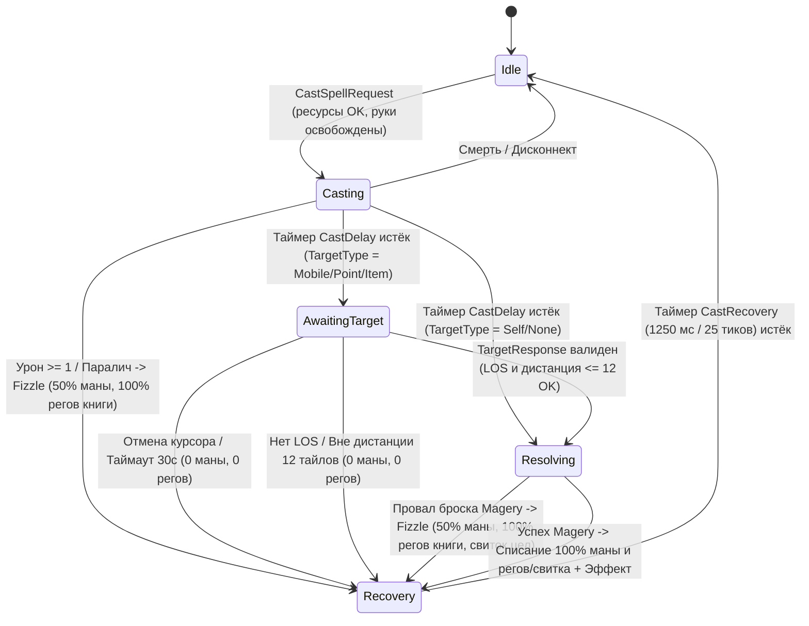
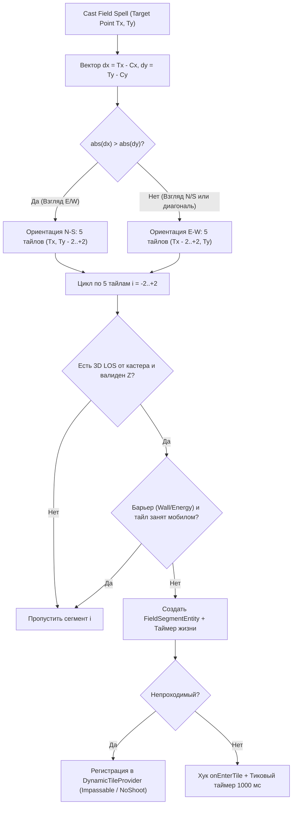
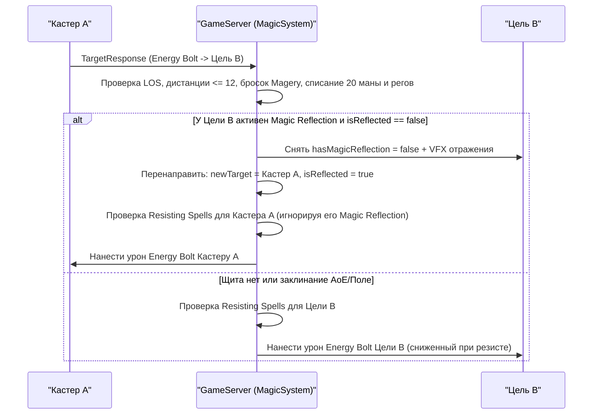

# Design: P18 Магия

## Context

Фаза **P18 (`p18-magic`)** вводит систему классической магии эпохи **Ultima Online: Renaissance (UO:R)** поверх уже спроектированных подсистем:
- ядра детерминированной тиковой симуляции `20 Гц` (`50 мс`) и иерархического колеса таймеров (P06);
- пространственного индекса секторов `16×16`, 3D DDA линии видимости (LOS) и `DynamicTileProvider` (P03);
- валидации движения `checkMovement` и синхронизации телепортации `TeleportSync` / `PartitionHandoffTicket` (P12);
- дерева контейнеров, стаков предметов (`<= 60000`), слоёв экипировки `OneHanded` (`0x01`) / `TwoHanded` (`0x02`) и трупов `world_corpses` (P13);
- серверного менеджера курсора прицеливания `TargetCursorManager` (таймаут 30 с), `GumpSessionRegistry` и `SpeechRouter` (P14);
- характеристик `STR`/`DEX`/`INT`, виталов (`Hits`, `Stam`, `Mana`) и универсального конвейера проверки и прокачки навыков `SkillCheck`/`SkillGain` для `Magery` (`skillId 25`), `Evaluating Intelligence` (`skillId 16`), `Resisting Spells` (`skillId 26`), `Meditation` (`skillId 46`), `Inscription` (`skillId 23`) и `Poisoning` (`skillId 30`) (P15);
- боевого конвейера `CombatSystem`, таймера замаха `SwingTimer`, хука прерывания каста при `FinalDamage >= 1`, `ICombatLegalityPolicy`, `AggressorRecord` и окна воскрешения `ResurrectOfferEvent` (P16).

В UO:R магия — это строго детерминированная система с фиксированными задержками чтения по кругам (`CastDelay`), заморозкой движения во время чтения (`Casting`), свободным перемещением с готовым курсором цели (`AwaitingTarget`), паузой восстановления (`CastRecovery`), комбинациями отложенного взрыва (`Explosion -> Energy Bolt`), тактическими полями `5×1` и одноразовым отражением направленных заклинаний (`Magic Reflection`). Вся логика должна быть на 100% серверно-авторитарной, а чистые формулы и конечный автомат — изоморфными в `@uo3/rules`.

## Goals / Non-Goals

### Goals
- Реализовать детерминированный конечный автомат чтения заклинаний (`SpellcastingStateMachine`) в `@uo3/rules` с точными таймингами UO:R (шаг тика 50 мс), автоэкипировкой рук, проверкой маны/реагентов/свитков, расчётом физзла и прерыванием от урона.
- Описать декларативный каталог всех 64 канонических заклинаний 8 кругов (`spellId 1..64`) в `@uo3/content` и чистые резолверы всех категорий эффектов в `@uo3/rules`.
- Реализовать модели и сетевой протокол для `Spellbook` (64-битная маска `uint64`), `SpellScroll`, `RecallRune` и `Runebook` (16 слотов, заряды, руна по умолчанию, статус `Blessed`).
- Интегрировать магические поля `5×1` и порталы `Moongate` (`Gate Travel`) с `DynamicTileProvider`, `checkMovement` и межпартиционным переносом.
- Реализовать систему призыва контролируемых существ (с бюджетом `controlSlots <= 5`) и автономных духов (`Blade Spirits`, `Energy Vortex`), а также заклинания развеивания (`Dispel`, `Dispel Field`, `Mass Dispel`).
- Реализовать формулы `Resisting Spells` и одноразовый щит `Magic Reflection` с защитой от бесконечного отражения (`isReflected`).

### Non-Goals
- Полная логика расчёта репутации, флагов `Criminal`/`Murderer`, кармы/славы и городских гвардов (делегируется в порт `ICombatLegalityPolicy`, реализуемый в **P17**).
- Полноценный AI монстров-магов и приручение животных (реализуется в **P19**; в P18 создаются только контроллеры призванных существ и автономных духов).
- Крафт свитков, книг заклинаний и рунбук навыком `Inscription` (реализуется в **P20**).
- Проверка прав доступа приватных домов, бан-листов и флагов `Public/Private House` (делегируется в порт `IRegionSpellPolicy`, расширяемый в **P23**).

## Decisions

### Decision 1: Двухэтапная валидация ресурсов и отложенное списание (Two-Phase Resource Commit)
- **Выбор**: На этапе `startCast` сервер проверяет наличие маны, реагентов (для книги) или свитка (для каста со свитка), но **не списывает** их. Фактическое атомарное списание выполняется в момент перехода к разрешению (`Resolving` — после истечения `CastDelay` и выбора цели в `TargetCursorManager`). При физзле по броску `Magery` или прерывании уроном во время `Casting` списываются 100% реагентов книги и `floor(manaCost / 2)` маны, но свиток сохраняется.
- **Обоснование**: Это каноническое поведение UO:R. Если списывать ресурсы при старте каста, отмена курсора цели игроком (`Esc`) потребует сложного возврата реагентов в рюкзак (который к тому моменту может быть переполнен). Повторная проверка при резолве предотвращает эксплойт выбрасывания реагентов/свитка на землю во время открытого курсора прицеливания (`ERR_RESOURCES_DEPLETED`).
- **Отвергнутые альтернативы**: Списание маны и реагентов в момент `startCast` с возвратом при отмене таргета (уязвимо к дюпу/потере предметов при переполнении рюкзака).

### Decision 2: Конечный автомат каста с разделением фаз `Casting` (заморозка шагов) и `AwaitingTarget` (свободный бег)
- **Выбор**: Конечный автомат `SpellCastState` мобила содержит состояния `Idle`, `Casting`, `AwaitingTarget`, `Resolving`, `Recovery`.
  - В фазе `Casting` (`CastDelay = 500 + 250 * circle` мс, т.е. `15..50` тиков для кругов `1..8`, и `80..100` тиков для призывов) мобил **заморожен**: `MovementHandler` отклоняет `WalkRequest` с `ERR_CASTING_FROZEN`, а получение любого `FinalDamage >= 1` срывает каст (`ERR_SPELL_INTERRUPTED`).
  - По завершении `Casting` для заклинаний с `TargetType = Self | None` переход идёт сразу в `Resolving`, а для направленных (`Mobile | Point | Item`) открывается курсор `TargetCursorManager` (P14) и мобил переходит в `AwaitingTarget` (до `30 000` мс). В фазе `AwaitingTarget` мобил **может свободно бегать**, а входящий урон **не сбивает** готовый курсор („pre-casting“ в UO:R).
  - После `Resolving` (или физзла/отмены) наступает `Recovery` на `1250` мс (`25` тиков), когда движение разрешено, но старт нового каста заблокирован (`ERR_SPELL_RECOVERY`).
- **Обоснование**: Механика pre-cast (прочитать заклинание на месте, затем выбежать из-за угла с готовым прицелом и разрядить `Explosion + Energy Bolt`) — основа боевой динамики UO:R.
- **Отвергнутые альтернативы**: Открытие курсора цели до начала чтения (модель AOS/современных ММО) — нарушает канон UO:R и ломает тактику pre-cast.

### Decision 3: Декларативный каталог 64 заклинаний и модульная таблица резолверов
- **Выбор**: Все 64 заклинания описываются в `packages/content/data/spells.yaml` (валидируемом TypeBox/JSON Schema) и компилируются в неизменяемую таблицу `SPELL_CATALOG: Readonly<Record<SpellId, SpellDefinition>>`. Исполняемая логика разделена на 10 чистых семейств резолверов в `packages/rules/src/magic/resolvers/*`:
  1. `DirectDamageResolver` (`Magic Arrow`, `Harm`, `Fireball`, `Lightning`, `Mind Blast`, `Energy Bolt`, `Flame Strike`).
  2. `DelayedAndAoEDamageResolver` (`Explosion` с таймером 40 тиков, `Chain Lightning`, `Meteor Swarm`, `Earthquake`).
  3. `HealAndCureResolver` (`Heal`, `Greater Heal`, `Cure`, `Arch Cure`, `Resurrection`).
  4. `StatAndArmorBuffResolver` (`Clumsy`, `Feeblemind`, `Weaken`, `Curse`, `Agility`, `Cunning`, `Strength`, `Bless`, `Reactive Armor`, `Protection`, `Arch Protection`, `Magic Reflection`, `Incognito`, `Polymorph`).
  5. `ControlAndManaResolver` (`Poison`, `Paralyze`, `Mana Drain`, `Mana Vampire`).
  6. `UtilityAndContainerResolver` (`Create Food`, `Night Sight`, `Magic Trap`, `Magic Untrap`, `Magic Lock`, `Unlock`, `Telekinesis`, `Invisibility`, `Reveal`).
  7. `TravelAndRuneResolver` (`Teleport`, `Recall`, `Mark`, `Gate Travel`).
  8. `FieldPlacementResolver` (`Wall of Stone`, `Fire Field`, `Poison Field`, `Paralyze Field`, `Energy Field`).
  9. `SummonResolver` (`Blade Spirits`, `Summon Creature`, `Energy Vortex`, `Summon Daemon`, `Air/Earth/Fire/Water Elemental`).
  10. `DispelResolver` (`Dispel Field`, `Dispel`, `Mass Dispel`).
- **Обоснование**: Разделение данных (`@uo3/content`) и 10 детерминированных резолверов (`@uo3/rules`) исключает гигантский `switch (spellId)` на 64 ветки в одном файле, позволяет тестировать каждое семейство изолированно на сидируемом `xoshiro128++` и гарантирует отсутствие расхождений между клиентом и сервером.
- **Отвергнутые альтернативы**: Скриптование каждого заклинания отдельным файлом на сервере `apps/game-server` — нарушает правило ADR о размещении всех формул в `@uo3/rules`.

### Decision 4: Представление `Spellbook`, `RecallRune` и `Runebook` в БД и памяти
- **Выбор**:
  - `Spellbook` хранит выученные заклинания в `bigint` (64-битная маска `spellsBitmask`, где бит `spellId - 1` отвечает за заклинание `1..64`). В памяти и сетевом протоколе маска передаётся как пара `uint32` (`low32`, `high32`) либо строка hex/BigInt, что исключает потерю точности `Number.MAX_SAFE_INTEGER` (53 бита) в JSON/JS.
  - `RecallRune` хранит структуру `RuneProperties`: `{ isMarked: boolean, facetId: number, x: number, y: number, z: number, description: string }`.
  - `Runebook` хранит массив до 16 элементов `RunebookEntry` (`slotIndex 0..15`, `facetId`, `x`, `y`, `z`, `description`), `defaultSlot: number` (`-1..15`), `charges: number` и `maxCharges: number` (`5..10`).
  - В PostgreSQL (`packages/db`) эти данные хранятся в типизированном столбце `magic_props_jsonb` (с индексированной валидацией схемы) таблицы `world_items` и синхронно участвуют в dirty-flush (P08). При смерти персонажа `Spellbook` и `Runebook` в инвентаре игрока помечаются `isBlessed = true` и не переносятся в `world_corpses`.
- **Обоснование**: Использование двух `uint32` (`maskLow`, `maskHigh`) в бинарной схеме Colyseus/протоколе полностью решает проблему 53-битного ограничения `number` в JavaScript без накладных расходов строк.
- **Отвергнутые альтернативы**: Хранение каждого вписанного заклинания отдельной строкой в дочерней таблице БД `spellbook_spells` — создаёт до 64 лишних строк на каждую книгу в мире.

### Decision 5: Интеграция магических полей `5×1` и порталов `Moongate` с `DynamicTileProvider`
- **Выбор**: Каждый сегмент поля (`FieldSegmentEntity`) и портал (`MoongateEntity`) создаётся как временная серверная сущность мира с `expiresAtTick` в колесе таймеров P06.
  - Ориентация поля `5×1`: вычисляется вектор `(dx = targetX - casterX, dy = targetY - casterY)`. Если `abs(dx) > abs(dy)` (взгляд Запад-Восток), линия из 5 тайлов строится перпендикулярно вдоль оси Север-Юг `(targetX, targetY + offset)` для `offset in [-2..2]`; иначе — вдоль оси Запад-Восток `(targetX + offset, targetY)`.
  - Для каждого из 5 кандидатов проверяется 3D LOS от глаз заклинателя и допустимая высота поверхности (`GetAverageZ`). Если тайл не виден или для барьеров (`Wall of Stone`, `Energy Field`) занят живым мобилом, этот сегмент пропускается, а остальные спавнятся.
  - Непроходимые сегменты (`Wall of Stone` с `Impassable | NoShoot`, `Energy Field` с `Impassable`) регистрируются в `DynamicTileProvider` (P03), благодаря чему `checkMovement` (P12) и 3D DDA LOS автоматически учитывают их без дублирования кода.
  - Проходимые сегменты (`Fire/Poison/Paralyze Field`) подписываются на хук `onMobileEnterTile` (срабатывает мгновенно при шаге на тайл) и имеют периодический таймер `20` тиков (`1000` мс) для всех мобилов, стоящих на тайле сегмента.
- **Обоснование**: Единый источник правды о коллизиях через `DynamicTileProvider` гарантирует, что ни клиентский предиктор шагов, ни серверный A* поиск пути (P12/P19), ни проверка LOS не смогут пройти сквозь `Wall of Stone`.
- **Отвергнутые альтернативы**: Проверка полей отдельным списком вне `DynamicTileProvider` — привела бы к рассинхронизации клиентского предсказания шагов (`WalkDeny` при попытке пройти сквозь стену).

### Decision 6: Конвейер `Magic Reflection` и `Resisting Spells`
- **Выбор**: Для любого направленного враждебного заклинания (`TargetType = Mobile`, `Harmful = true`) разрешение проходит строгий двухступенчатый фильтр:
  1. **Этап отражения (`Magic Reflection`)**: Если на цели `hasMagicReflection == true` и флаг контекста заклинания `isReflected == false`, щит цели снимается (`hasMagicReflection = false`), в AOI отправляется визуальный/звуковой эффект отражения, а `caster` и `target` меняются местами с установкой `isReflected = true`. Так как у отражённого заклинания `isReflected == true`, повторное отражение от щита исходного кастера невозможно (защита от бесконечного цикла).
  2. **Этап сопротивления (`Resisting Spells`)**: Для фактического получателя эффекта (исходной цели или отражённого кастера) при `spell.isResistable == true` вычисляется `resistChanceBp` и вызывается конвейер `SkillCheck` / `SkillGain` (P15).
- **Обоснование**: Чёткий порядок `Reflection -> Resistance -> Damage/Effect` соответствует механике UO:R: при отражении заклинания проверка `Resisting Spells` (и шанс прокачки резиста) должна выполняться уже для того мага, в которого заклинание вернулось, с использованием `Magery` и `EvalInt` исходного кастера.
- **Отвергнутые альтернативы**: Проверка `Resisting Spells` до проверки `Magic Reflection` — ошибочно расходовала бы проверку навыка на цель, которая отразила заклинание.

### Decision 7: Бюджет слотов контроля (`controlSlots <= 5`) и автономный выбор целей духов
- **Выбор**: Каждый персонаж имеет счётчик `controlSlotsUsed` (`0..5`, максимум `MAX_CONTROL_SLOTS = 5`).
  - Контролируемые призывы (`Summon Creature` = 1..2 слота, `Air/Earth/Fire/Water Elemental` = 2 слота, `Summon Daemon` = 4 слота) привязываются к `ownerSerial = caster.serial`, увеличивают `controlSlotsUsed` и управляются голосовыми командами (`"All Kill"`, `"All Follow"`, `"All Guard"`, `"All Stop"`, `"All Stay"`).
  - Автономные духи (`Blade Spirits` = 1 слот, `Energy Vortex` = 1 слот) также занимают 1 слот контроля и хранят `ownerSerial` (для криминальной атрибуции и `Dispel`), но имеют флаг `isAutonomousSpirit = true`: они не принимают голосовых команд и каждые `10` тиков (`500` мс) выбирают ближайшую цель в радиусе 8 тайлов с максимальным весом `score = target.str + target.tacticsTenths / 10` (`Blade Spirits`) или `score = target.int + target.mageryTenths / 10` (`Energy Vortex`).
- **Обоснование**: Занятие 1 слота контроля духами `Blade Spirits` / `Energy Vortex` предотвращает спам десятков вихрей одним магом, а детерминированная формула весов воспроизводит фирменное поведение UO:R (вихри охотятся на магов, лезвия — на воинов).
- **Отвергнутые альтернативы**: Полное отсутствие `ownerSerial` у автономных духов — сделало бы невозможным определение виновника криминальной атаки при касте вихря на невинного игрока в городе.

## Архитектура модулей и распределение ответственности

| Пакет / Приложение | Модули P18 и их ответственность |
|---|---|
| `packages/domain` | `magic/types.ts`: `SpellId` (`1..64`), `SpellCircle` (`1..8`), `ReagentId` (8 видов), `SpellTargetType`, `SpellAlignment` (`Harmful`, `Beneficial`, `Neutral`), `CastPhase`, `CastSourceType` (`Spellbook`, `Scroll`, `RunebookCharge`), `FieldType`, `SummonArchetypeId`, `RuneEntry`, коды ошибок `ERR_SPELL_*`. |
| `packages/content` | `data/spells.yaml` (все 64 заклинания с кругом, маной, битовой маской реагентов, мантрой, флагами `isResistable`, `isReflectable`, `baseDamageDice`), `data/summons.yaml` (параметры 7 типов призывов и 12 форм `Polymorph`), TypeBox-схемы валидации контента. |
| `packages/rules` | `magic/cast-state-machine.ts`, `magic/formulas.ts` (шанс `Magery`, `EvalInt`, `Resisting Spells`, длительности, радиусы), `magic/field-geometry.ts` (расчёт 5 тайлов поля), `magic/resolvers/*` (10 семейств резолверов для 64 заклинаний), `magic/spirit-target-selector.ts`. |
| `packages/protocol` | Опкоды `0x01F0..0x021F`, TypeBox-схемы клиентских интентов и серверных событий магии, расширение Colyseus `MobileStateSchema` полями `castPhase`, `activeSpellId`, `hasMagicReflection`, `controlSlotsUsed`, `polymorphBodyId`. |
| `packages/db` | Расширение схемы `world_items` (`magic_props_jsonb` для `Spellbook`, `RecallRune`, `Runebook`) и сохранение активных долгоживущих баффов/таймеров при выходе персонажа. |
| `apps/game-server` | `MagicSystem` в 20 Гц цикле `WorldPartitionRoom`, обработчики интентов `0x01F0..0x01F6`, интеграция с `CombatSystem.onDamageDealt` (прерывание каста), `DynamicTileProvider` (поля/порталы), `TargetCursorManager` (P14) и `PartitionHandoffService` (для `Recall`/`Gate Travel` между партициями). |
| `apps/client` / `packages/ui-kit` | `SpellbookGump` (8 вкладок кругов, индекс, 64 страницы, выносные мини-иконки заклинаний на экран), `RunebookGump` (16 вкладок рун, индикатор зарядов, кнопки `Recall`/`Gate`/`Default`/`Drop`), визуализация летящих снарядов, молний, полей 5×1 и порталов `Moongate`. |

## Математические формулы и канонические таблицы UO:R

### 1. Параметры 8 кругов магии

| Круг (`circle`) | Номера `spellId` | Стоимость маны (`manaCost`) | `CastDelay` (обычные), мс / тики | `minSkill` (книга), десятые | `maxSkill` (книга), десятые | `minSkill` (свиток), десятые | `maxSkill` (свиток), десятые | Базовый кубик прямого урона |
|---|---|---|---|---|---|---|---|---|
| **1** | `1..8` | `4` | `750` мс (15 тиков) | `-200` (-20.0) | `250` (25.0) | `-450` | `0` | `1d4 + 1` (`2..5`) |
| **2** | `9..16` | `6` | `1000` мс (20 тиков) | `-75` (-7.5) | `375` (37.5) | `-325` | `125` | `1d6 + 2` (`3..8`) |
| **3** | `17..24` | `9` | `1250` мс (25 тиков) | `50` (5.0) | `500` (50.0) | `-200` | `250` | `1d8 + 4` (`5..12`) |
| **4** | `25..32` | `11` | `1500` мс (30 тиков) | `175` (17.5) | `625` (62.5) | `-75` | `375` | `1d10 + 6` (`7..16`) |
| **5** | `33..40` | `14` | `1750` мс (35 тиков) | `300` (30.0) | `750` (75.0) | `50` | `500` | `clamp((INTc - INTt)/2, 1, 45)` |
| **6** | `41..48` | `20` | `2000` мс (40 тиков) | `425` (42.5) | `875` (87.5) | `175` | `625` | `3d8 + 10` (`13..34`) |
| **7** | `49..56` | `40` | `2250` мс (45 тиков) | `550` (55.0) | `1000` (100.0) | `300` | `750` | `4d8 + 14` (`18..46`) |
| **8** | `57..64` | `50` | `2500` мс (50 тиков) | `675` (67.5) | `1125` (112.5) | `425` | `875` | `clamp(Hits/2, 10, 75)` |

- **Шанс успеха чтения заклинания (`chanceBp`, `0..10000`)**:
  $$\text{chanceBp} = \text{clamp}\left(\left\lfloor \frac{(\text{mageryTenths} - \text{minSkill}) \times 10000}{450} \right\rfloor, 0, 10000\right)$$
- **Пауза восстановления (`CastRecovery`)**: `1250` мс (`25` тиков по 50 мс).
- **Длительность каста заклинаний призыва**: `Blade Spirits`, `Summon Creature` (круг 5) — `4000` мс (`80` тиков); `Energy Vortex`, `Summon Daemon`, `Air/Earth/Fire/Water Elemental` (круг 8) — `5000` мс (`100` тиков).

### 2. Полный реестр 64 заклинаний и 8 базовых реагентов

Базовые реагенты (битовая маска 8 бит):
- `0x01` `BlackPearl` (BP), `0x02` `Bloodmoss` (BM), `0x04` `Garlic` (GA), `0x08` `Ginseng` (GI), `0x10` `MandrakeRoot` (MR), `0x20` `Nightshade` (NS), `0x40` `SpidersSilk` (SS), `0x80` `SulfurousAsh` (SA).

| Круг | ID | Название | Мантра | Реагенты | Цель | Резолвер и ключевые параметры |
|---|---|---|---|---|---|---|
| **1** | 1 | `Clumsy` | `Uus Jux` | BM, NS | Mobile | `-DEX` на `1 + floor(Magery/100)` на `floor(Magery*1.2)` с |
| **1** | 2 | `Create Food` | `In Mani Ylem` | GA, GI, MR | Self | Спавн 1 случайного продукта питания в рюкзак |
| **1** | 3 | `Feeblemind` | `Rel Wis` | GI, NS | Mobile | `-INT` на `1 + floor(Magery/100)` на `floor(Magery*1.2)` с |
| **1** | 4 | `Heal` | `In Mani` | GA, GI, SS | Mobile | `+Hits`: `floor(Magery/100) + rand(1..3)` (блок при яде) |
| **1** | 5 | `Magic Arrow` | `In Por Ylem` | SA | Mobile | Прямой урон 1 круга (`2..5`), снаряд `0x36E4` |
| **1** | 6 | `Night Sight` | `In Lor` | SA, SS | Mobile | Персональный уровень света `0` на `floor(Magery*1.2)` мин |
| **1** | 7 | `Reactive Armor` | `Flam Sanct` | GA, SS, SA | Self | Пул поглощения физ. урона `25 + floor(Inscription/20)` |
| **1** | 8 | `Weaken` | `Des Mani` | GA, NS | Mobile | `-STR` на `1 + floor(Magery/100)` на `floor(Magery*1.2)` с |
| **2** | 9 | `Agility` | `Ex Uus` | BM, MR | Mobile | `+DEX` на `1 + floor(Magery/100)` на `floor(Magery*1.2)` с |
| **2** | 10 | `Cunning` | `Uus Wis` | MR, NS | Mobile | `+INT` на `1 + floor(Magery/100)` на `floor(Magery*1.2)` с |
| **2** | 11 | `Cure` | `An Nox` | GA, GI | Mobile | Снятие яда с шансом `10000 + Magery*7.5 - Level*1750` bp |
| **2** | 12 | `Harm` | `An Mani` | NS, SS | Mobile | Прямой урон 2 круга (`100%` на 1т, `50%` на 2т, `25%` на `>=3`т) |
| **2** | 13 | `Magic Trap` | `In Jux` | GA, SS, SA | Item | Ловушка на контейнер (`1..5` урона при открытии) |
| **2** | 14 | `Magic Untrap` | `An Jux` | BM, SA | Item | Снятие `Magic Trap` с контейнера |
| **2** | 15 | `Protection` | `Uus Sanct` | GA, GI, SA | Self | `+AR`, штраф к `Resisting Spells` на `floor(Magery*1.2)` с |
| **2** | 16 | `Strength` | `Uus Mani` | MR, NS | Mobile | `+STR` на `1 + floor(Magery/100)` на `floor(Magery*1.2)` с |
| **3** | 17 | `Bless` | `Rel Sanct` | GA, MR | Mobile | `+STR, +DEX, +INT` на `1 + floor(Magery/100)` |
| **3** | 18 | `Fireball` | `Vas Flam` | BP | Mobile | Прямой урон 3 круга (`5..12`), снаряд `0x36D4` |
| **3** | 19 | `Magic Lock` | `An Por` | BM, GA, SA | Item | Запирание незапертого сундука (`magicLocked = true`) |
| **3** | 20 | `Poison` | `In Nox` | NS | Mobile | Наложение яда `1..4` по `Magery + Poisoning` и дистанции |
| **3** | 21 | `Telekinesis` | `Ort Por Ylem` | BM, MR | Item | Дистанционное открытие/активация контейнера (взрыв ловушки) |
| **3** | 22 | `Teleport` | `Rel Por` | BM, MR | Point | Прыжок на проходимый тайл `<= 11` тайлов с LOS |
| **3** | 23 | `Unlock` | `Ex Por` | BM, SA | Item | Отпирание магического или простого замка (`lockLevel <= 20`) |
| **3** | 24 | `Wall of Stone` | `In Sanct Ylem` | BM, GA | Point | Поле `5×1` `Impassable | NoShoot` на `10 + floor(Magery/10)` с |
| **4** | 25 | `Arch Cure` | `Vas An Nox` | GA, GI, MR | Point | Массовое снятие яда в радиусе 2 тайлов |
| **4** | 26 | `Arch Protection` | `Vas Uus Sanct` | GA, GI, MR, SA | Point | Массовый `Protection` в радиусе 3 тайлов |
| **4** | 27 | `Curse` | `Des Sanct` | GA, NS, SA | Mobile | `-STR, -DEX, -INT` на `1 + floor(Magery/100)` |
| **4** | 28 | `Fire Field` | `In Flam Grav` | BP, SS, SA | Point | Поле `5×1`, `2` урона при входе и каждые `1000` мс |
| **4** | 29 | `Greater Heal` | `In Vas Mani` | GA, GI, MR, SS | Mobile | `+Hits`: `floor(Magery*0.4) + rand(1..10)` (блок при яде) |
| **4** | 30 | `Lightning` | `Por Ort Grav` | MR, SA | Mobile | Мгновенный урон 4 круга (`7..16`) с эффектом молнии |
| **4** | 31 | `Mana Drain` | `Ort Rel` | BP, MR, SS | Mobile | Сжигание до `floor((Magery - Resist)/10)` маны (0 при резисте) |
| **4** | 32 | `Recall` | `Kal Ort Por` | BP, BM, MR | Item | Телепортация к точке `RecallRune` или `Runebook` |
| **5** | 33 | `Blade Spirits` | `In Jux Hur Ylem` | BP, MR, NS | Point | Автономный дух (1 слот) на `120` с, цель по `STR + Tactics` |
| **5** | 34 | `Dispel Field` | `An Grav` | BP, GA, SS, SA | Item | Удаление 1 сегмента поля или портала `Moongate` |
| **5** | 35 | `Incognito` | `Kal In Ex` | BM, GA, NS | Self | Временное случайное имя и внешность на `floor(Magery*1.2)` с |
| **5** | 36 | `Magic Reflection` | `In Jux Sanct` | GA, MR, SS | Self | Одноразовый щит отражения направленной магии (КД 30 с) |
| **5** | 37 | `Mind Blast` | `Por Corp Wis` | BP, MR, NS, SA | Mobile | Урон `clamp(floor((casterInt - targetInt)/2), 1, 45)` |
| **5** | 38 | `Paralyze` | `An Ex Por` | GA, MR, SS | Mobile | Паралич на `floor(Magery*0.3)` с до получения урона `>= 1` |
| **5** | 39 | `Poison Field` | `In Nox Grav` | BP, NS, SS | Point | Поле `5×1`, наложение яда `1..3` при входе и каждые `1000` мс |
| **5** | 40 | `Summon Creature` | `Kal Xen` | BM, MR, SS | Self | Призыв случайного зверя (1..2 слота) на `floor(Magery*2.4)` с |
| **6** | 41 | `Dispel` | `An Ort` | GA, MR, SA | Mobile | Уничтожение призванного существа (`isSummoned = true`) |
| **6** | 42 | `Energy Bolt` | `Corp Por` | BP, NS | Mobile | Прямой урон 6 круга (`13..34`), снаряд `0x36FE` |
| **6** | 43 | `Explosion` | `Vas Ort Flam` | BM, MR | Mobile | Отложенный на `2000` мс (40 тиков) урон 6 круга (`13..34`) |
| **6** | 44 | `Invisibility` | `An Lor Xen` | BM, NS | Mobile | Скрытие цели на `floor(Magery*1.2)` с |
| **6** | 45 | `Mark` | `Kal Por Ylem` | BP, BM, MR | Item | Запись координат заклинателя в `RecallRune` |
| **6** | 46 | `Mass Curse` | `Vas Des Sanct` | GA, MR, NS, SA | Point | Массовый `Curse` в радиусе 2 тайлов |
| **6** | 47 | `Paralyze Field` | `In Ex Grav` | BP, GI, SS | Point | Поле `5×1`, паралич на `2 + floor(Magery/100)` с |
| **6** | 48 | `Reveal` | `Wis Quas` | BM, SA | Point | Раскрытие невидимых/скрытых в радиусе `1 + floor(Magery/200)` |
| **7** | 49 | `Chain Lightning` | `Vas Ort Grav` | BP, BM, MR, SA | Point | AoE урон 7 круга в радиусе 3 тайлов (делится между целями) |
| **7** | 50 | `Energy Field` | `In Sanct Grav` | BP, MR, SS, SA | Point | Поле `5×1` `Impassable` на `15 + floor(Magery/5)` с |
| **7** | 51 | `Flame Strike` | `Kal Vas Flam` | SS, SA | Mobile | Прямой урон 7 круга (`18..46`), столб огня `0x3709` |
| **7** | 52 | `Gate Travel` | `Vas Rel Por` | BP, MR, SA | Item | Двусторонний портал `Moongate` на `30 000` мс |
| **7** | 53 | `Mana Vampire` | `Ort Sanct` | BP, BM, MR, SS | Mobile | Перекачка до `floor((Magery - Resist)/10)` маны от цели к магу |
| **7** | 54 | `Mass Dispel` | `Vas An Ort` | BP, GA, MR, SA | Point | Массовый `Dispel` призывов в радиусе 8 тайлов |
| **7** | 55 | `Meteor Swarm` | `Flam Kal Des Ylem` | BM, MR, SS, SA | Point | AoE урон 7 круга в радиусе 3 тайлов с проверкой LOS |
| **7** | 56 | `Polymorph` | `Vas Ylem Rel` | BM, MR, SS | Self | Смена `bodyId` из списка форм + флаг `Criminal` |
| **8** | 57 | `Earthquake` | `In Vas Por` | BM, GI, MR, SA | Self | AoE вокруг кастера (`1+floor(Magery/150)`т): `clamp(Hits/2, 10, 75)` |
| **8** | 58 | `Energy Vortex` | `Vas Corp Por` | BP, BM, MR, NS | Point | Автономный дух (1 слот) на `90` с, цель по `INT + Magery` |
| **8** | 59 | `Resurrection` | `An Corp` | BM, GA, GI | Mobile | Воскрешение призрака на дистанции `<= 1` тайл (`Magery >= 800`) |
| **8** | 60 | `Air Elemental` | `Kal Vas Xen Hur` | BM, MR, SS | Self | Призыв контролируемого `Air Elemental` (2 слота) |
| **8** | 61 | `Summon Daemon` | `Kal Vas Xen Corp` | BM, MR, SS, SA | Self | Призыв контролируемого `Daemon` (4 слота, штраф кармы) |
| **8** | 62 | `Earth Elemental` | `Kal Vas Xen Ylem` | BM, MR, SS | Self | Призыв контролируемого `Earth Elemental` (2 слота) |
| **8** | 63 | `Fire Elemental` | `Kal Vas Xen Flam` | BM, MR, SS, SA | Self | Призыв контролируемого `Fire Elemental` (2 слота) |
| **8** | 64 | `Water Elemental` | `Kal Vas Xen An Flam` | BM, MR, SS | Self | Призыв контролируемого `Water Elemental` (2 слота) |

### 3. Формулы урона, `Evaluating Intelligence` и `Resisting Spells`

1. **Вероятность сопротивления заклинанию (`resistChanceBp`, `0..10000`)**:
   $$\text{branch}_1 = \text{resistTenths}$$
   $$\text{branch}_2 = \text{resistTenths} \times 5 - (\text{mageryTenths} - 200) - \text{circle} \times 250$$
   (эквивалент канонической формулы UO:R `max(Resist/5, Resist - ((Magery - 20)/5 + circle*5)) / 2` в процентах, переведённой в десятые навыка и bp).
   $$\text{resistChanceBp} = \text{clamp}(\max(\text{branch}_1, \text{branch}_2), 0, 10000)$$
2. **Итоговый прямой магический урон (`FinalSpellDamage`)**:
   - Пусть `baseRoll` — бросок кубиков круга заклинания.
   - Коэффициент масштабирования `Evaluating Intelligence` пробивает пассивную защиту `Resisting Spells`:
     $$\text{skillFactorBp} = \begin{cases} 10000 + \lfloor \frac{(\text{evalIntTenths} - \text{resistTenths}) \times 10000}{5000} \rfloor, & \text{если } \text{evalIntTenths} \ge \text{resistTenths} \\ 10000 - \lfloor \frac{(\text{resistTenths} - \text{evalIntTenths}) \times 10000}{2000} \rfloor, & \text{иначе} \end{cases}$$
   - Если проверка `Resisting Spells` (`rand(0..9999) < resistChanceBp`) **успешна**, урон дополнительно умножается на `0.5` (`50%` снижение).
   - Итоговый урон: `FinalSpellDamage = max(1, floor(baseRoll * skillFactorBp / 10000 * (isResisted ? 0.5 : 1.0)))`.

## Сетевой протокол (`@uo3/protocol`) и модели данных

### Опкоды сообщений P18 (`0x01F0..0x021F`)

| Опкод | Направление | Имя сообщения | Поля TypeBox | Описание |
|---|---|---|---|---|
| `0x01F0` | `C -> S` | `CastSpellRequest` | `spellId: uint8 (1..64)`, `sourceType: uint8 (0=Book, 1=Scroll, 2=Macro)`, `sourceSerial?: uint32`, `polymorphFormId?: uint16` | Запрос чтения заклинания из книги, со свитка или макроса |
| `0x01F1` | `S -> C` | `SpellCastStartedEvent` | `casterSerial: uint32`, `spellId: uint8`, `circle: uint8`, `castDurationMs: uint16`, `mantra: string` | Старт фазы `Casting` в AOI (мантра + анимация) |
| `0x01F2` | `S -> C` | `SpellCastFizzledEvent` | `casterSerial: uint32`, `spellId: uint8`, `reasonCode: string` | Срыв заклинания (физзл по `Magery` или прерывание уроном) |
| `0x01F3` | `S -> C` | `SpellEffectResolvedEvent` | `casterSerial: uint32`, `targetSerial?: uint32`, `targetX: uint16`, `targetY: uint16`, `targetZ: int8`, `spellId: uint8`, `effectGraphicId: uint16`, `soundId: uint16`, `isReflected: boolean`, `isResisted: boolean` | Визуальный эффект, снаряд или отражение заклинания в AOI |
| `0x01F4` | `S -> C` | `SpellbookContentEvent` | `bookSerial: uint32`, `maskLow: uint32`, `maskHigh: uint32`, `spellCount: uint8` | Содержимое открытой книги заклинаний (64 бита) |
| `0x01F5` | `C -> S` | `RunebookActionRequest` | `runebookSerial: uint32`, `action: uint8 (0=UseCharge, 1=CastRecall, 2=CastGate, 3=SetDefault, 4=DropRune, 5=RenameBook)`, `slotIndex?: uint8 (0..15)`, `newTitle?: string` | Действие игрока в гампе `Runebook` |
| `0x01F6` | `S -> C` | `RunebookContentEvent` | `runebookSerial: uint32`, `title: string`, `charges: uint8`, `maxCharges: uint8`, `defaultSlot: int8`, `entries: Array<RunebookEntryDto>` | Полное состояние открытой `Runebook` (до 16 рун) |
| `0x01F7` | `C -> S` | `RenameRuneRequest` | `runeSerial: uint32`, `description: string (maxLength 40)` | Переименование помеченной `RecallRune` владельцем |
| `0x01F8` | `S -> C` | `FieldSegmentSpawnedEvent` | `segmentSerial: uint32`, `fieldType: uint8`, `x: uint16`, `y: uint16`, `z: int8`, `graphicId: uint16`, `expiresAtTick: uint32` | Появление сегмента поля `5×1` или портала `Moongate` |
| `0x01F9` | `S -> C` | `BuffStateUpdatedEvent` | `mobileSerial: uint32`, `activeBuffsMask: uint32`, `reactiveArmorPool: uint16`, `hasMagicReflection: boolean` | Обновление активных магических баффов/дебаффов мобила |

### Схема хранения магических свойств предметов в PostgreSQL (`packages/db`)

В таблице `world_items` (P08/P13) колонка `custom_props` (`JSONB`) типизируется дискриминированным объединением `ItemMagicPropsV1`:
- Для `Spellbook`: `{ kind: 'spellbook', maskLow: number, maskHigh: number }`.
- Для `RecallRune`: `{ kind: 'recall_rune', isMarked: boolean, facetId: number, x: number, y: number, z: number, description: string }`.
- Для `Runebook`: `{ kind: 'runebook', title: string, charges: number, maxCharges: number, defaultSlot: number, entries: Array<{ slot: number, facetId: number, x: number, y: number, z: number, description: string }> }`.
- Для контейнеров с ловушкой/замком: `{ kind: 'container_magic', isMagicTrapped: boolean, trapCreatorSerial: number, trapPower: number, isMagicLocked: boolean }`.

## Risks / Trade-offs

- **[Риск] Потеря точности 64-битной маски `Spellbook` в JavaScript JSON/Number** → **Митигация**: В сетевом протоколе, схемах Colyseus и JSONB маска книги заклинаний хранится и передаётся как пара беззнаковых 32-битных целых `maskLow` (заклинания `1..32`) и `maskHigh` (заклинания `33..64`), а в `@uo3/rules` преобразуется в `bigint` через `(BigInt(maskHigh) << 32n) | BigInt(maskLow)`.
- **[Риск] Бесконечный цикл отражения при дуэли двух магов с активным `Magic Reflection`** → **Митигация**: Контекст разрешения заклинания `SpellResolutionContext` содержит булев флаг `isReflected`. Первое срабатывание щита устанавливает `isReflected = true`, после чего повторная проверка щита на исходном заклинателе пропускается.
- **[Риск] Застревание игроков внутри внезапно созданной стены `Wall of Stone` или `Energy Field`** → **Митигация**: При размещении непроходимых полей (`Wall of Stone`, `Energy Field`) резолвер проверяет наличие живых мобилов на каждом из 5 тайлов и пропускает занятые тайлы (`ERR_FIELD_TILE_OCCUPIED`). Если мобил всё же оказался на тайле барьера (например, при респавне), правило `checkMovement` разрешает шаг **из** непроходимого тайла наружу, блокируя только вход **на** него.
- **[Риск] Эксплойт прокачки `Resisting Spells` и `Magery` в собственном `Fire Field` на макросе** → **Митигация**: Проверка прироста `Resisting Spells` интегрирована с анти-макро системой блоков `8×8` из P15: повторные тики поля в одном блоке `8×8` быстро исчерпывают бюджет прироста блока, не мешая самому расчёту сопротивления урону.
- **[Риск] Межпартиционная гонка при проходе группы (игрок + призванные существа) через портал `Moongate`** → **Митигация**: При шаге владельца в `Moongate`, ведущий в другую партицию, сервер формирует единый `PartitionHandoffTicket` (P12/P32), включающий сериализованные состояния всех контролируемых саммонов владельца в радиусе 3 тайлов.
- **[Риск] Эксплойт освобождения рук в переполненный рюкзак для каста с оружием в руках** → **Митигация**: Автоэкипировка рук при старте каста проверяет лимит рюкзака (`< 125` предметов и вес) до перевода в фазу `Casting`; если снять оружие/щит в рюкзак невозможно, каст немедленно отклоняется с `ERR_HANDS_BUSY`.
- **[Риск] Нагрузка на тик 20 Гц при одновременном существовании сотен сегментов полей и призывов** → **Митигация**: Сегменты полей не опрашивают весь мир на каждом тике; они используют пространственный индекс секторов `16×16` и срабатывают по событию `onMobileEnterTile` плюс один групповой таймер `1000` мс на всё поле из 5 сегментов в иерархическом колесе таймеров P06.
- **[Риск] Десинхронизация отложенного взрыва `Explosion` при телепортации или смерти цели за 2000 мс** → **Митигация**: Таймер детонации `Explosion` хранит `targetSerial` и `casterSerial`; при срабатывании через 40 тиков сервер проверяет, что цель жива, не в режиме неуязвимости и находится в том же фасете/партиции.

## Migration Plan

1. Добавить доменные типы магии и коды ошибок в `packages/domain`.
2. Опубликовать каталог 64 заклинаний `spells.yaml` и архетипы призывов `summons.yaml` в `packages/content` с валидацией схем при сборке.
3. Реализовать чистый конечный автомат каста, математические формулы, геометрию полей 5×1 и 10 семейств резолверов в `packages/rules/src/magic/*`, покрыв их детерминированными unit-тестами.
4. Расширить `packages/protocol` опкодами `0x01F0..0x01F9` и `packages/db` поддержкой `ItemMagicPropsV1` для `Spellbook`, `RecallRune` и `Runebook`.
5. Встроить `MagicSystem` в 20 Гц цикл `apps/game-server`, связав его с `CombatSystem`, `DynamicTileProvider`, `TargetCursorManager` и `TeleportSync`.
6. Реализовать `SpellbookGump`, `RunebookGump` и рендеринг эффектов заклинаний/полей в `packages/ui-kit` и `apps/client`.

## Open Questions

- Должен ли автономный дух `Energy Vortex` иметь небольшой шанс (`~10%`) атаковать самого призывателя, даже если рядом есть вражеские цели с меньшим `INT + Magery`? *(Решение по умолчанию для P18: строго детерминированный выбор цели с максимальным `INT + Magery` в радиусе 8 тайлов с LOS, что делает поведение предсказуемым в киберспортивном PvP).*
- Требуется ли визуальное отображение оставшихся секунд баффов (`Bless`, `Protection`, `Paralyze`) в клиентском HUD? *(Решение по умолчанию для P18: в `BuffStateUpdatedEvent` передаётся битовая маска активных баффов; точные числа таймеров скрыты на клиенте по канону классического UO:R, но могут быть включены флагом шарда в P29).*
