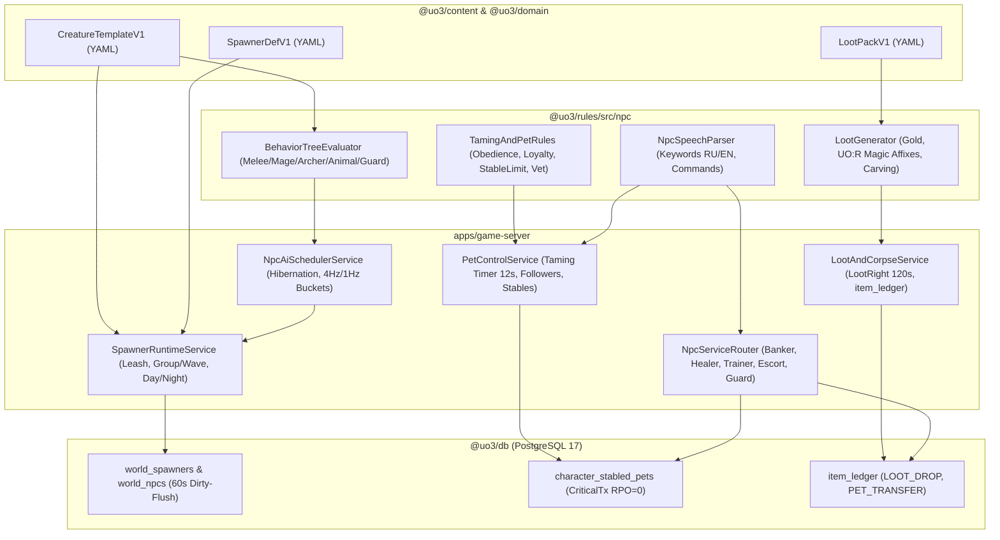
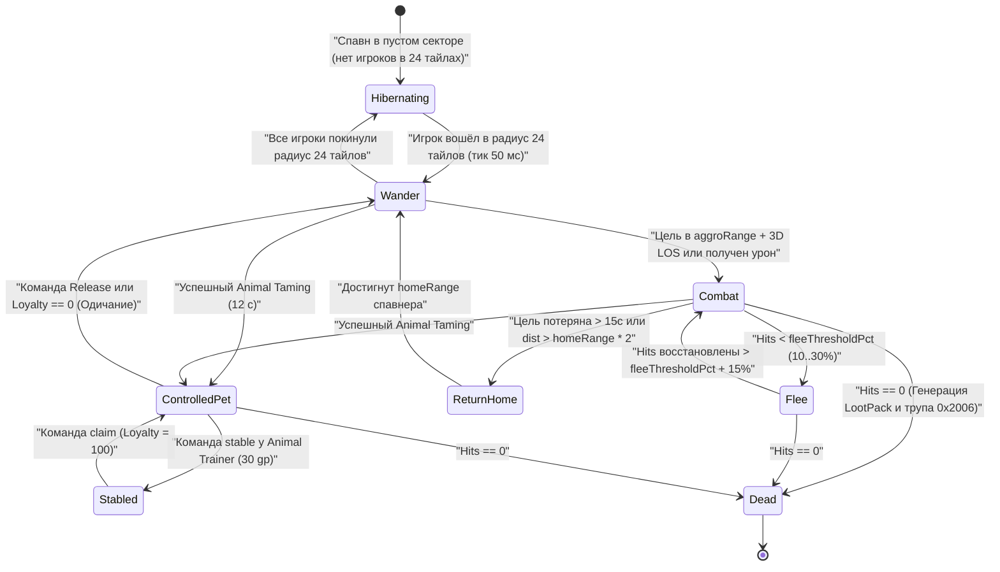

# Design: P19 NPC, ИИ и существа

## Context

Фаза P19 опирается на уже зафиксированные фундаментальные подсистемы UO3:
- **Изоморфная модель мира и симуляция (P01, P03, P06)**: серверный тик 20 Гц (`50 мс`), иерархическое колесо таймеров (`HierarchicalTimerWheel`), сектора `16×16` тайлов, проверка 3D DDA линии видимости (`checkLineOfSight`), генератор `xoshiro128++` и пул серийных номеров NPC `0x20000000..0x3FFFFFFF`.
- **Перемещение и навигация (P12)**: `checkMovement` (`PersonHeight=16`, `StepHeight=2`, проверка водных/сухопутных флагов) и детерминированный поиск пути `findPathAStar` с настраиваемым бюджетом посещённых узлов.
- **Предметы, контейнеры и персистентность (P08, P13)**: дерево контейнеров, трупы `0x2006` (`world_corpses`), банковский сейф `BankBox` (слой `0x1D`), токен доступа `ContainerAccessGrantPort`, координатор критических транзакций `CriticalTxCoordinator` (RPO=0) с журналом `item_ledger` и инкрементальный 60-секундный dirty-flush мира в PostgreSQL 17.
- **Интерфейс, речь и навыки (P14, P15)**: `SpeechRouter` (дальности 1/15/18 тайлов), `TargetCursorManager`, `GumpSessionRegistry`, реестр 49 навыков в десятых долях процента (`0..1000`, суммарный кап `7000`) и конвейер проверки навыков `SkillCheckPipeline`.
- **Бой, репутация и магия (P16, P17, P18)**: `SwingTimer` (шаги `250 мс`), зональная броня (`44/14/14/14/7/7%`), 5 уровней яда, перевязка бинтами, `ResurrectOfferEvent`, `AggressorRecord` (TTL `120 с`), карма/слава (`-15000..+15000`), криминальный статус и каст заклинаний 1..8 кругов.

Задача P19 — спроектировать и специфицировать полный стек NPC и существ так, чтобы в одной партиции одновременно существовали до 15 000–25 000 NPC (дикая фауна, подземелья, городские сервисы, питомцы игроков) при бюджете ИИ не более `8–10 мс` на 50-миллисекундный серверный тик.

## Goals / Non-Goals

### Goals
- Специфицировать декларативный YAML/JSON-каталог существ (`CreatureTemplateV1`) и таблиц лута (`LootPackV1`) в `@uo3/content` с полной валидацией при сборке и старте сервера.
- Обеспечить чистую детерминированную логику принятия решений ИИ (`BehaviorTree` + `Utility/FSM`) в `@uo3/rules/npc`, отделённую от сетевого транспорта и БД.
- Ввести секторную гибернацию (`Hibernating`), двухчастотное расписание тиков ИИ (`4 Гц` в бою, `1 Гц` в покое) и квотирование 3D A* поиска пути для гарантии времени тика `< 50 мс`.
- Реализовать канонические для UO:Renaissance механики спавнеров (`SpawnerNode`, `GroupSpawn`, `WaveSpawn`, суточные окна), генерации лута и магических аффиксов (`Ruin..Vanquishing`, `Accurate..Supremely Accurate`, `Defense..Invulnerability`, `Durable..Indestructible`), разделки трупов (`Carving`) и прав мародёрства (`LootRight`).
- Реализовать полный цикл `Animal Taming`, `Animal Lore` и `Veterinary`: 12-секундное приручение, 5 слотов контроля, шкалу лояльности `0..100`, голосовые команды, передачу питомцев и сервис стойл (`Animal Trainer`).
- Реализовать городские и странствующие сервисы NPC: банкир (открытие сейфа `0x1D`; баланс и чеки — порт `IBankingService`, реализуемый в P21), целители (`Lawful`/`Evil`), учителя навыков (до `30.0%`), эскорт-миссии и ИИ стражника, исполняющий приказы `pvp/guard-zones` (P17).

### Non-Goals
- Торговля с NPC-вендорами (`buy`/`sell` витрины, инфляция/запасы) и вендоры игроков на домах — относятся к фазе **P21**.
- Бардовские навыки контроля толпы (`Provocation`, `Peacemaking`, `Discordance`) — относятся к фазе **P22** (в P19 закладываются только хуки переопределения цели `forcedTargetSerial` и подавления агрессии `pacifiedUntilTick`).
- Морские битвы на кораблях и рыбалка глубоководных спрутов — относятся к фазам **P20** и **P24**.
- Чемпионские спавны с алтарями черепов и мировыми боссами — относятся к фазе **P30**.

## Decisions

### Decision 1: Чистое функциональное ядро дерева поведения в `@uo3/rules` и разделение `NpcBrainState` / `NpcRuntime`
- **Выбор**: Вся логика принятия решений ИИ оформляется в пакете `@uo3/rules/src/npc/ai/*` как чистые детерминированные функции `evaluateNpcTick(snapshot, brainState, worldQuery, rng): NpcAiDecision`. Мутации мира (шаг, удар, начало каста, реплика, телепорт стражника) возвращаются в виде структуры `NpcAiAction[]` и исполняются `NpcAiSchedulerService` в `apps/game-server`.
- **Обоснование**: Соответствует ADR-003 (изоморфное ядро правил) и позволяет тестировать сложные боевые сценарии ИИ (кайт лучника, самоисцеление мага, снятие паралича `Magic Arrow`, переключение агро, бегство при низком HP) в `@uo3/test-kit` с фейковыми часами без поднятия Colyseus и PostgreSQL.
- **Отвергнутые альтернативы**:
  - *ООП-иерархия классов `BaseCreature -> Monster -> Dragon` внутри `apps/game-server`* — создаёт жёсткую связность с сетевым слоем и БД, затрудняет композицию поведений (например, прирученный дракон-маг против дикого дракона-мага) и нарушает чистоту `@uo3/rules`.

### Decision 2: Секторная гибернация и бюджетированный планировщик тиков ИИ (4 Гц / 1 Гц)
- **Выбор**:
  1. Сектора `16×16` отслеживают счётчик присутствия игроков в радиусе `24 тайлов` (`activeObserverCount`). Если `activeObserverCount == 0` и у NPC в секторе нет флага `isPet`, `isInCombat` или `isReturningHome`, NPC переводится в `Hibernating` и полностью исключается из очередей тиков.
  2. Активные NPC распределяются по `20` бакетам серверного цикла (по `serial % 20`):
     - В состоянии `Combat` или `Flee` NPC тикает каждые `5` серверных тиков (`250 мс`, `4 Гц`), что синхронизировано с шагом `SwingTimer` (`250 мс`) и скоростью бега.
     - В состоянии `Wander` или `ReturnHome` NPC тикает каждые `20` серверных тиков (`1000 мс`, `1 Гц`).
  3. На один серверный тик партиции выделяется жёсткий глобальный бюджет поиска пути A*: не более `32` вызовов `findPathAStar` (с лимитом `256 узлов` на вызов). Если квота тика исчерпана, NPC делает жадный локальный шаг по направлению к цели (`greedyStepTowards`) и переносит полный A* на свой следующий бакет.
- **Обоснование**: В мире UO:R около 85–90% спавнов находятся в секторах, где в данный момент нет игроков. Гибернация снижает постоянную нагрузку ИИ в 10 раз, а бакетирование и квота A* защищают 50-мс бюджет тика даже при массовом скоплении монстров в подземелье.
- **Отвергнутые альтернативы**:
  - *Тик каждого NPC на каждом серверном тике 20 Гц* — приводит к лишним проверкам LOS и поискам пути в 5–20 раз чаще, чем физическая скорость шага NPC (`200..400 мс`).
  - *Вынос ИИ в отдельные рабочие потоки (Worker Threads)* — требует дорогостоящей синхронизации копии карты, динамических тайлов и состояний всех мобилов на каждом тике.

### Decision 3: Композиция поведения питомца через декоратор `ControlledPetBehavior`
- **Выбор**: При приручении существа его базовый боевой архетип (`Melee`, `Mage`, `Archer`, `Animal`) сохраняется для выполнения боя, но оборачивается приоритетным верхним узлом `ControlledPetBehavior`, управляемым состоянием приказа владельца (`Follow`, `Kill`, `Guard`, `Stay`, `Stop`, `Friend`).
- **Обоснование**: Прирученный дракон (`Mage`) или кошмар (`Melee/Mage`) в бою по команде `All Kill` должен использовать свои родные заклинания, дыхание огнём и мили-атаки, но выбирать цели и двигаться строго по командам хозяина, а не по дикому `aggroRange`.
- **Отвергнутые альтернативы**:
  - *Полная замена дерева поведения на единый `PetAI`* — привела бы к потере уникальных способностей и магии прирученных существ.

### Decision 4: Персистентность спавнеров, диких NPC и питомцев (Dirty-Flush 60с vs RPO=0)
- **Выбор**:
  - Конфигурация и рантайм-состояние спавнеров (`world_spawners`) и живых неприрученных NPC с изменённым состоянием сохраняются в рамках стандартного 60-секундного инкрементального `dirty-flush` партиции (P08).
  - Сдача питомца в стойло (`stable`), получение из стойла (`claim`), передача питомца другому игроку (`Transfer`)и платное обучение навыкам проходят через `CriticalTxCoordinator` (RPO=0) или атомарную транзакцию БД с защитой от дублирования при крэше партиции.
- **Обоснование**: Потеря 30 секунд блуждания дикого орка при аварийном перезапуске партиции незаметна для игроков, тогда как дюп дракона при `Transfer`/`Stable` или дюп банковского чека на 1 000 000 золотых критичен для экономики шарда (ADR-008).
- **Отвергнутые альтернативы**:
  - *Синхронная запись в БД каждого спавна и каждой смерти дикого монстра* — создаёт избыточную нагрузку IOPS на PostgreSQL при интенсивном фарме подземелий.

### Decision 5: Каноническая трёхосевая модель магических аффиксов UO:Renaissance
- **Выбор**: Генератор лута `LootGenerator` создаёт магическую экипировку строго по правилам эпохи UO:R (до Age of Shadows):
  - Для оружия разыгрываются 3 независимые оси: `AccuracyLevel` (`0..5` -> `+5..+25 Tactics`), `DamageLevel` (`0..5` -> `Ruin +1`, `Might +3`, `Force +5`, `Power +7`, `Vanquishing +9`) и `DurabilityLevel` (`0..5` -> `+10..+50 maxHP`).
  - Для брони и щитов разыгрываются 2 оси: `ProtectionLevel` (`0..5` -> `Defense +5`, `Guarding +10`, `Hardening +15`, `Fortification +20`, `Invulnerability +25 AR`) и `DurabilityLevel` (`0..5` -> `+10..+50 maxHP`).
  - Свойства сериализуются в типизированную структуру `MagicItemPropertiesV1` внутри экземпляра предмета и напрямую читаются формулами `@uo3/rules/combat` (P16).
- **Обоснование**: Полная верность канону UO:R, прозрачная интеграция с уже реализованными в P16 формулами `HitChance`, `BaseDamage` и зонального `AR`.
- **Отвергнутые альтернативы**:
  - *Случайный пул произвольных AoS-модификаторов (Hit Leech, Faster Cast Recovery, Elemental Resists)* — нарушает баланс и спецификацию эпохи UO:Renaissance.

### Decision 6: Двуязычный детерминированный парсер речи NPC и дублирование через Context Menu
- **Выбор**: `NpcSpeechParser` в `@uo3/rules/npc` нормализует входящую строку речи (нижний регистр, удаление пунктуации) и сопоставляет её с каноническими английскими (`"bank"`, `"balance"`, `"check 50000"`, `"stable"`, `"claim"`, `"train"`, `"guards"`, `"all kill"`, `"destination"`, `"i will take thee"`) и русскими (`"банк"`, `"баланс"`, `"чек 50000"`, `"стойло"`, `"забрать"`, `"обучи"`, `"стража"`, `"все фас"`, `"куда"`, `"провожу"`) паттернами. Все сервисные функции одновременно доступны через пакет контекстного меню (`0x0220`/`0x0221`).
- **Обоснование**: Сохраняет классическую атмосферу голосового управления UO:R для ветеранов и одновременно даёт удобный UI-доступ через контекстное меню для современных игроков.
- **Отвергнутые альтернативы**:
  - *Использование LLM или нечёткого NLP на сервере для диалогов NPC* — недетерминированно, дорого по латентности и нарушает предсказуемость команд в бою.

### Decision 7: Банкир P19 открывает сейф, финансовые операции — через порт `IBankingService`
- **Выбор**: P19 реализует только распознавание `"bank"` и выдачу/отзыв доступа к `BankBox` (`0x1D`). Команды `"balance"`, `"withdraw"`, `"check"` и обналичивание `BankCheck` маршрутизируются в порт `IBankingService`, реализация которого поставляется capability `economy/currency-and-banking` (P21); реализация по умолчанию отвечает `ERR_SERVICE_UNAVAILABLE`.
- **Обоснование**: Реестр capability закрепляет золото, банк и чеки за P21; дублирование правил чеков в P19 приводило к расхождениям (учёт чеков в балансе, коды `ERR_BANK_BOX_FULL` vs `ERR_BANK_CAPACITY_EXCEEDED`).
- **Отвергнутые альтернативы**:
  - *Полная реализация чеков в P19* — нарушает принцип «одна capability — одна фаза» и создаёт два источника правды.

## Архитектура модулей и распределение ответственности

### Конечный автомат и жизненный цикл ИИ и питомца

## Модели данных и схемы персистентности (`@uo3/db`)

### 1. Таблица `world_spawners`
Хранит конфигурацию и текущее состояние узлов-спавнеров партиции:
- `spawner_id` (`varchar(96)`, PK) — уникальный идентификатор спавнера (из шаблона карты или созданный GM).
- `shard_id` (`varchar(32)`, NOT NULL), `facet_id` (`smallint`, NOT NULL), `x` (`smallint`), `y` (`smallint`), `z` (`smallint`).
- `entries_json` (`jsonb`, NOT NULL) — массив `{ templateId: string, weight: number, maxSubCount?: number }`.
- `max_count` (`smallint`, NOT NULL, `1..64`), `spawn_radius` (`smallint`, NOT NULL, `0..32`), `home_range` (`smallint`, NOT NULL, `1..64`).
- `min_delay_sec` (`integer`, NOT NULL), `max_delay_sec` (`integer`, NOT NULL).
- `spawn_mode` (`varchar(16)`, NOT NULL) — `'standard' | 'group' | 'wave'`.
- `active_time_window` (`varchar(16)`, NOT NULL, default `'always'`) — `'always' | 'day_only' | 'night_only'`.
- `is_paused` (`boolean`, NOT NULL, default `false`).
- `runtime_state_json` (`jsonb`, NOT NULL) — `{ activeNpcSerials: number[], pendingTimersDueMs: number[], currentWaveIndex: number, waveKillCount: number, lastWaveKillAtMs: number }`.
- `updated_at` (`timestamptz`, NOT NULL).
- Индексы: `(shard_id, facet_id, x, y)`.

### 2. Таблица `world_npcs`
Хранит активных NPC в мире (диких монстров, привязанных к спавнерам, и активных питомцев рядом с владельцами):
- `npc_serial` (`integer`, PK) — серийный номер `0x20000000..0x3FFFFFFF`.
- `shard_id` (`varchar(32)`, NOT NULL), `template_id` (`varchar(64)`, NOT NULL), `spawner_id` (`varchar(96)`, NULL).
- `owner_character_id` (`uuid`, NULL, FK -> `characters.id`) — заполнен для прирученных питомцев.
- `facet_id` (`smallint`), `x` (`smallint`), `y` (`smallint`), `z` (`smallint`), `direction` (`smallint`).
- `custom_name` (`varchar(64)`, NULL), `body_id` (`smallint`), `hue` (`smallint`).
- `stats_vitals_json` (`jsonb`, NOT NULL) — `{ str, dex, int, hits, maxHits, stam, maxStam, mana, maxMana }`.
- `skills_json` (`jsonb`, NOT NULL) — карта `skillId -> valueTenths`.
- `pet_state_json` (`jsonb`, NULL) — `{ controlSlots: number, loyalty: number, currentOrder: string, guardTargetSerial?: number, friendCharacterIds: string[], previousOwnerIds: string[], minTamingSkillTenths: number, lastLoyaltyDecayAtMs: number }`.
- `updated_at` (`timestamptz`, NOT NULL).
- Индексы: `(shard_id, facet_id)`, `(owner_character_id)`, `(spawner_id)`.

### 3. Таблица `character_stabled_pets`
Хранит питомцев, сданных игроками в стойла `Animal Trainer` (транзакции RPO=0):
- `stabled_pet_id` (`uuid`, PK).
- `shard_id` (`varchar(32)`, NOT NULL), `owner_character_id` (`uuid`, NOT NULL, FK -> `characters.id`).
- `npc_serial` (`integer`, UNIQUE, NOT NULL) — зарезервированный серийник питомца.
- `template_id` (`varchar(64)`, NOT NULL), `custom_name` (`varchar(64)`, NOT NULL).
- `control_slots` (`smallint`, NOT NULL), `min_taming_skill_tenths` (`smallint`, NOT NULL).
- `snapshot_json` (`jsonb`, NOT NULL) — полный снимок статов, навыков, оттенка `hue` и истории владельцев `previousOwnerIds`.
- `stabled_at` (`timestamptz`, NOT NULL).
- Индекс: `(owner_character_id, stabled_at)`.

## Сетевой протокол и схемы синхронизации (`@uo3/protocol`)

### Поля Colyseus Schema (`MobileSchema` и `PlayerPrivateStateSchema`)
- В `MobileSchema` добавляются/уточняются синхронизируемые в AOI поля:
  - `templateId: string` (пусто для игроков, код шаблона для NPC).
  - `notorietyFlag: uint8` (`1=Innocent/Blue`, `2=Ally/Green`, `3=Aggressor/Gray`, `4=Criminal/Gray`, `5=Enemy/Orange`, `6=Murderer/Red`, `7=Invulnerable/Yellow`).
  - `ownerSerial: uint32` (`0` для диких NPC, серийник владельца для питомцев, фильтрация `@view()` или публично для отображения тега `[Tame]`).
- В `PlayerPrivateStateSchema` добавляются поля:
  - `followersCurrent: uint8` (`0..5`).
  - `followersMax: uint8` (по умолчанию `5`).

### Опкоды сообщений `@uo3/protocol` (диапазон `0x0220..0x023F`)

| Опкод | Имя сообщения | Направление | Поля TypeBox-схемы | Назначение |
|---|---|---|---|---|
| `0x0220` | `ContextMenuRequest` | C -> S | `{ targetSerial: uint32 }` | Запрос контекстного меню при клике на NPC или себя |
| `0x0221` | `ContextMenuResponse` | S -> C | `{ targetSerial: uint32, entries: Array<{ entryId: uint16, clilocOrLabelId: string, enabled: boolean }> }` | Список доступных пунктов контекстного меню |
| `0x0222` | `ContextMenuSelect` | C -> S | `{ targetSerial: uint32, entryId: uint16 }` | Выбор пункта контекстного меню игроком |
| `0x0223` | `PetCommandIntent` | C -> S | `{ petSerial: uint32, command: 'follow' \| 'kill' \| 'guard' \| 'stay' \| 'stop' \| 'drop' \| 'friend' \| 'transfer' \| 'release', targetSerial?: uint32 }` | Прямая команда одному или всем питомцам (`petSerial=0` для `All`) |
| `0x0224` | `PetRenameIntent` | C -> S | `{ petSerial: uint32, newName: string (1..16 ASCII/Cyrillic) }` | Переименование собственного питомца в карточке статуса |
| `0x0225` | `PetStatusNotification` | S -> C | `{ petSerial: uint32, loyalty: uint8, loyaltyLabel: string, controlSlots: uint8, currentOrder: string }` | Обновление статуса лояльности и приказа питомца |
| `0x0226` | `PetTransferConfirmGump` | S <-> C | `{ transferId: string, petSerial: uint32, petName: string, templateId: string, fromSerial: uint32, accepted?: boolean }` | Двустороннее подтверждение передачи питомца (`Transfer`) |
| `0x0227` | `StableClaimListGump` | S <-> C | `{ trainerSerial: uint32, pets: Array<{ stabledPetId: string, name: string, templateId: string, controlSlots: uint8 }>, selectedPetId?: string }` | Выбор питомца при команде `"claim"` без точного имени |
| `0x0228` | `SkillTrainQuoteEvent` | S -> C | `{ trainerSerial: uint32, trainableSkills: Array<{ skillId: uint8, maxTeachTenths: uint16, currentTenths: uint16, costGoldMax: uint16 }> }` | Информация о доступном обучении навыкам у NPC |
| `0x0229` | `SpawnerAdminCommand` | C -> S | `{ spawnerId: string, action: 'pause' \| 'resume' \| 'respawn_now' \| 'despawn_all' \| 'update_config', configPatch?: object }` | Административное управление спавнером (`AccessLevel >= 2`) |
| `0x022A` | `NpcServiceErrorEvent` | S -> C | `{ npcSerial: uint32, errorCode: string, messageKey: string }` | Стандартизированный отказ сервиса NPC (`ERR_*`) |

### Коды ошибок фазы P19
- `ERR_CREATURE_TEMPLATE_INVALID` — ошибка валидации YAML-шаблона существа.
- `ERR_LOOT_NOT_AUTHORIZED` — попытка забрать чужой лут в зоне со строгой PvE-защитой до истечения 120 секунд.
- `ERR_CORPSE_ALREADY_CARVED` — повторная попытка разделать уже разделанный труп (`isCarved=true`).
- `ERR_TAMING_INTERRUPTED` — прерывание приручения из-за потери 3D LOS, выхода за 7 тайлов или нанесения урона существу.
- `ERR_TAMING_SKILL_TOO_LOW` — текущий навык `Animal Taming` ниже `minTamingSkill` экземпляра существа.
- `ERR_FOLLOWER_SLOTS_EXCEEDED` — недостаточно свободных слотов контроля (`followersCurrent + controlSlots > 5`).
- `ERR_PET_CONTAINER_NOT_EMPTY` — попытка сдать в стойло вьючное животное с предметами в сумке.
- `ERR_STABLE_CAPACITY_FULL` / `ERR_STABLE_LIMIT_REACHED` — превышен лимит стойла (`2..5` мест) или слотов контроля при получении.
- `ERR_SERVICE_UNAVAILABLE` — финансовая команда банкира при порте `IBankingService` по умолчанию (до P21).
- `ERR_HEALER_REFUSED_KARMA` — отказ законопослушного целителя воскрешать преступника или убийцу.
- `ERR_ESCORT_COOLDOWN_OR_BUSY` — у игрока уже есть активный эскорт или не истёк 5-минутный кулдаун.
- `ERR_TARGET_INVULNERABLE` — попытка атаковать или обокрасть неуязвимого сервисного NPC (`invulnerable=true`).

## Точные алгоритмы и математические формулы UO:R

### 1. Приручение (`Animal Taming`) и послушание (`Obedience`)
1. **Эффективный порог приручения экземпляра**:
   $$\text{EffectiveMinTamingTenths} = \text{BaseMinTamingTenths} + 48 \times \min(5, |\text{previousOwnerIds}|)$$
2. **Шанс успешного приручения после 12 секунд (4 тика речи по 3 с)**:
   $$\text{ChanceBp} = \text{clamp}\left(200 + (\text{TamingTenths} - \text{EffectiveMinTamingTenths}) \times 20,\ 50,\ 9500\right)$$
   Если `ownerId` игрока уже присутствует в `previousOwnerIds`, приручение при успехе не вызывает `trySkillGain` (`gain = 0`).
3. **Шанс послушания при команде (`ObedienceCheck`)**:
   $$\text{ControlSkillTenths} = \lfloor 0.70 \times \text{TamingTenths} + 0.30 \times \text{AnimalLoreTenths} \rfloor$$
   $$\text{BaseObedienceBp} = 7000 + (\text{ControlSkillTenths} - \text{EffectiveMinTamingTenths}) \times 15$$
   $$\text{LoyaltyModBp} = (\text{Loyalty} - 50) \times 20$$
   $$\text{ObedienceChanceBp} = \text{clamp}(\text{BaseObedienceBp} + \text{LoyaltyModBp},\ 1000,\ 9900)$$
   Для мирных животных с `EffectiveMinTamingTenths <= 291` (`29.1%`) шанс послушания при `Loyalty >= 20` всегда равен `10000 bp` (`100%`).

### 2. Лимит мест в стойле (`Stable Capacity`)
$$\text{TamerSkillSumTenths} = \text{TamingTenths} + \text{AnimalLoreTenths} + \text{VeterinaryTenths}$$
- `< 1600` (`< 160.0%`) -> `2 места`
- `1600..1999` (`160.0..199.9%`) -> `3 места`
- `2000..2399` (`200.0..239.9%`) -> `4 места`
- `>= 2400` (`>= 240.0%`) -> `5 мест`

### 3. Лечение питомцев бинтами (`Veterinary`)
- **Длительность перевязки животного**:
  $$T_{\text{vetMs}} = 2000 + \max\left(0, \left\lfloor \frac{100 - \text{DEX}}{20} \right\rfloor\right) \times 500\text{ мс}$$
- **Объём исцеления хитов**:
  $$\text{HealMin} = \left\lfloor \frac{\text{AnimalLoreTenths}}{50} + \frac{\text{VeterinaryTenths}}{50} \right\rfloor + 3$$
  $$\text{HealMax} = \left\lfloor \frac{\text{AnimalLoreTenths}}{50} + \frac{\text{VeterinaryTenths}}{20} \right\rfloor + 10$$
  Каждый полученный питомцем удар во время перевязки (`Slip`) снижает итоговое исцеление на `20%` (но не ниже `20%` от исходного броска).
- **Снятие яда с питомца**: доступно при `VeterinaryTenths >= 600` и `AnimalLoreTenths >= 600` с шансом:
  $$\text{CureChanceBp} = \text{clamp}\left(3500 + (\text{VeterinaryTenths} - 600) \times 15 - \text{PoisonLevel} \times 800,\ 1000,\ 9800\right)$$

### 4. Расчёт магических аффиксов оружия и брони UO:R
- **Оружие**:
  - `DamageLevel` $d \in \{1..5\}$: бонус плоского урона $\Delta D \in \{+1, +3, +5, +7, +9\}$.
  - `AccuracyLevel` $a \in \{1..5\}$: бонус к навыку `Tactics` $\Delta T = a \times 50\text{ десятых}$ (`+5.0%..+25.0%`).
  - `DurabilityLevel` $u \in \{1..5\}$: бонус максимальной прочности $\Delta HP = u \times 10$ (`+10..+50`).
- **Броня и щиты**:
  - `ProtectionLevel` $p \in \{1..5\}$: бонус к базовому `ArmorRating` комплекта $\Delta AR = p \times 5$ (`+5..+25 AR`), масштабируемый весом зоны (`Chest 44%`, `Arms 14%`, `Legs 14%`, `Head 14%`, `Neck 7%`, `Hands 7%`).
  - `DurabilityLevel` $u \in \{1..5\}$: $\Delta HP = u \times 10$.

### 5. Пересчёт кармы и славы при убийстве существа
Для каждого атакующего $i$ с долей урона $w_i = \frac{\text{damage}_i}{\text{totalDamage}} \ge 0.05$:
- Если слава существа $F_{\text{mob}} > 0$:
  $$\Delta F_i = \max\left(1, \left\lfloor \frac{w_i \times F_{\text{mob}}}{10 + \lfloor F_{\text{player}, i} / 1000 \rfloor^2} \right\rfloor\right)$$
- Если карма существа $K_{\text{mob}} < 0$ (убийство злого монстра повышает карму игрока, но не выше $|K_{\text{mob}}|$):
  $$\Delta K_i = \begin{cases} \max\left(1, \left\lfloor \frac{w_i \times |K_{\text{mob}}|}{10 + \lfloor \max(0, K_{\text{player}, i}) / 1000 \rfloor^2} \right\rfloor\right), & \text{если } K_{\text{player}, i} < |K_{\text{mob}}| \\ 0, & \text{иначе} \end{cases}$$

## Risks / Trade-offs

- **[Риск: Всплеск времени тика при одновременном пробуждении большого сектора подземелья]** → **Митигация**: При выходе сектора из `Hibernating` новые NPC распределяются по 20 бакетам (`serial % 20`) равномерно, поэтому их первый тик ИИ и запросы A* размазываются по всему 250–1000 мс окну, а глобальный лимит `32 A* запроса на тик` гарантирует отсутствие фриза симуляции.
- **[Риск: Дюп питомца при одновременном вызове `stable` и `Transfer` или при падении партиции]** → **Митигация**: Любой переход питомца между активным миром и таблицей `character_stabled_pets` выполняется под in-memory mutex по `npc_serial` и фиксируется через `CriticalTxCoordinator` (RPO=0) до подтверждения операции клиенту.
- **[Риск: Эксплойт бесконечной прокачки `Animal Taming` через приручение и отпускание одного животного]** → **Митигация**: Список `previousOwnerIds` сохраняется в состоянии экземпляра NPC; если `characterId` уже присутствует в `previousOwnerIds`, проверка прироста навыка блокируется, а для других игроков порог `minTamingSkill` растёт на `+4.8` за каждого владельца.
- **[Риск: Бесконечный фарм одежды и оружия со спавнов городских NPC и стражников]** → **Митигация**: Вся базовая униформа и оружие гуманоидных NPC в шаблонах помечается `movable=false` и гарантированно уничтожается до генерации контейнера трупа `0x2006`.
- **[Риск: Застревание монстров за динамическими препятствиями или дверями при преследовании]** → **Митигация**: Таймер отсутствия прогресса сближения (`3000 мс`) переключает NPC на ближайшую достижимую цель или переводит его в состояние `ReturnHome` с возвратом к спавнеру.
- **[Риск: Спам ключевыми словами речи (`"bank"`, `"guards"`, `"train"`) для перегрузки парсера]** → **Митигация**: `NpcServiceRouter` использует существующий rate-limiter `SpeechRouter` (P14) и дополнительно вводит пер-игровой кулдаун сервисных команд `500 мс` (для `"ResurrectOffer"` — `30 с`).

## Migration Plan

1. **Этап 1 (Домен и Контент)**: Добавление типов в `@uo3/domain` и YAML-каталогов существ, таблиц `LootPack` и спавнеров синтетического мира в `@uo3/content` с JSON Schema валидацией в CI.
2. **Этап 2 (Чистые правила `@uo3/rules`)**: Реализация генератора NPC, деревьев поведения ИИ, генератора лута и магических аффиксов UO:R, формул приручения/ветеринарии и парсера речи с покрытием детерминированными unit-тестами на `@uo3/test-kit`.
3. **Этап 3 (БД и Протокол)**: Добавление Drizzle-миграции (`world_spawners`, `world_npcs`, `character_stabled_pets`), обновление `MobileSchema`/`PlayerPrivateStateSchema` и регистрация опкодов `0x0220..0x022A` в `@uo3/protocol`.
4. **Этап 4 (Игровой сервер)**: Внедрение `NpcAiSchedulerService`, `SpawnerRuntimeService`, `LootAndCorpseService`, `PetControlService` и `NpcServiceRouter` в `WorldPartitionRoom`.
5. **Этап 5 (Клиент и UI)**: Подключение контекстного меню NPC/питомцев, отображения `Followers X/5`, гампа выбора питомца из стойла, квоты обучения навыкам и тултипов магических аффиксов UO:R в `apps/client`.

## Open Questions

- *Настройка весов таблиц лута для редких крафтовых декоративных предметов подземелий (Rare Dungeon Drops)*: конкретные шансы для декоративных раритетов будут откалиброваны в фазе **P30 (Мировые события и боссы)** без изменения структуры `LootPackV1`.
- *Поведение наёмных NPC-телохранителей за ежедневную плату (`Hireling Mercenaries`)*: архитектура `ControlledPetBehavior` уже поддерживает слоты контроля, а экономика найма за золото в день будет подключена вместе с наёмными вендорами в **P21**.
