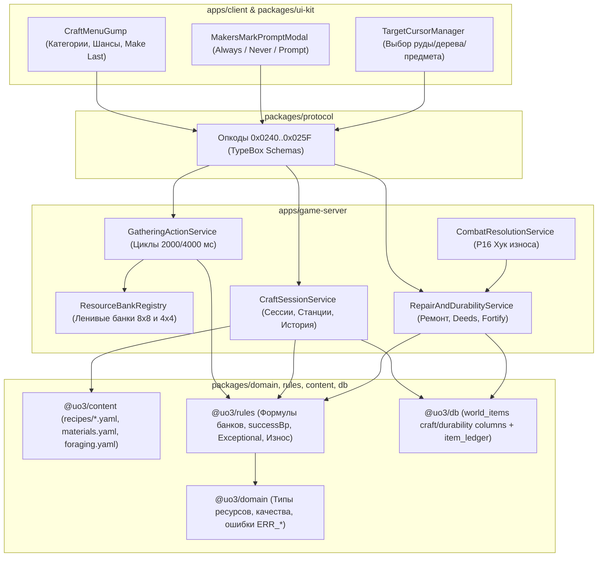
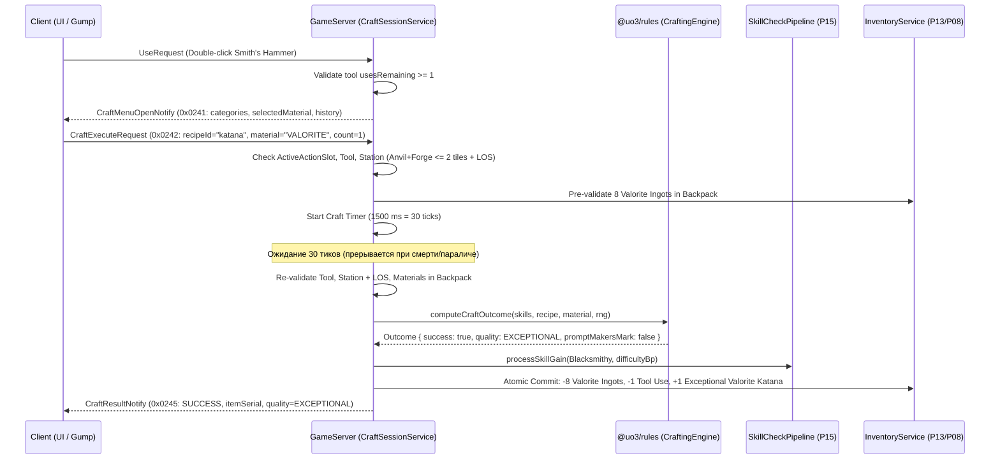

# Design: P20 Сбор ресурсов и крафт

## Context

Фаза P20 (`p20-gathering-and-crafting`) вводит производственный контур Ultima Online: Renaissance (UO:R), связывающий статический и динамический мир (P03), модель предметов и контейнеров (P13), систему гампов и курсора цели (P14), конвейер проверки и прироста 49 навыков с анти-макро защитой (P15) и боевую систему (P16).

Ключевые инженерные вызовы фазы:
1. **Масштабируемость пространственных банков ресурсов:** на фасете `7168×4096` тайлов насчитывается `896 × 512 = 458 752` блока `8×8` тайлов и миллионы статических деревьев/водных тайлов. Хранить состояние всех банков в БД или оперативной памяти невозможно — требуется ленивая (lazy) детерминированная генерация с хранением в памяти партиции только модифицированных (неполных) банков.
2. **Абсолютная защита от дюпа и гонок состояний (Race Conditions):** операции крафта, переплавки (`Smelt`), раскроя ткани/кожи и розлива зелий в бочонки (`Potion Keg`) манипулируют стаками предметов, зарядами инструментов и весом рюкзака. Любое расхождение между проверкой при старте таймера и списанием при завершении не должно приводить к дублированию ресурсов.
3. **Изоморфность формул и декларативность каталога:** более 250 рецептов по 8 ремесленным навыкам должны быть описаны в `@uo3/content` (YAML + JSON Schema), а формулы шанса успеха `successBp`, шанса `Exceptional`, бонусов цветных материалов и стоимости ремонта должны исполняться в `@uo3/rules` одинаково для сервера (авторитарный бросок) и для UI-гампа (отображение точных процентов игроку).
4. **Интеграция прочности с боевым тиком 20 Гц:** проверки износа оружия, брони и щитов выполняются на каждый успешный удар в P16 без деградации производительности цикла симуляции.

## Goals / Non-Goals

### Goals
- Реализовать детерминированные пространственные банки ресурсов (`8×8` для руды и рыбы, `4×4` для леса, таймеры для овец/ульев/трупов) с ленивым выделением памяти только под активные истощаемые узлы.
- Реализовать полный цикл добычи и первичной переработки: 9 видов руды UO:R -> слитки на горне; брёвна -> доски; рыба и глубоководные трофеи (`SOS`, карты) -> стейки; хлопок/шерсть -> прялка -> ткацкий станок -> рулоны ткани -> бинты; шкуры (из разделки трупов P19) -> кожа.
- Построить универсальный движок ремесленных сессий (`CraftSessionService`) с проверкой рабочих станций, расчётом `successBp`, `exceptionalBp`, частичной потерей сырья при провале, клеймом мастера (`Maker's Mark`) и историей `Make Last`.
- Описать в `@uo3/content` и реализовать в `@uo3/rules` + `apps/game-server` каталог рецептов и спец-операций для `Blacksmithy` (включая `Smelt Item`), `Tailoring` (со сдачей ярдов ткани), `Carpentry` (с генерацией замков/ключей и `Add-on Deeds`), `Tinkering` (`Potion Keg`, ловушки на сундуки), `Bowcraft & Fletching` (пакетная сборка стрел/болтов), `Alchemy` (розлив в бутылки и кеги), `Inscription` (проверка `Spellbook` и списание маны), `Cooking` и `Cartography`.
- Внедрить полную модель прочности (`hitPoints`, `maxHitPoints`, `initialMaxHitPoints`), боевой износ в P16, ремонт на станциях со штрафом `-1 maxHitPoints`, контракты `Repair Service Deeds`, укрепление `Powder of Fortifying` и оценку через `Arms Lore`.

### Non-Goals
- Торговля ресурсами и изделиями с NPC-вендорами (делегировано в P21); заказы `Bulk Order Deeds` — механика после эпохи UO:R, вне скоупа ROADMAP.
- Установка дидов крупных станций и мебели (`Add-on Deeds`) в домах игроков (делегировано в P23).
- Рыбалка с борта корабля в движении и подъём затонувших сундуков по координатам `SOS` (делегировано в P24).

## Decisions

### Decision 1: Ленивые детерминированные банки ресурсов (`Lazy Deterministic Resource Banks`)
- **Выбор:** Параметры любого ресурсного узла (тип руды/дерева и максимальная ёмкость `maxUnits` в диапазоне `10..30`) вычисляются чистой функцией `computeResourceBankSpec(facetId, bankKind, gridX, gridY, worldSeed)` в `@uo3/rules` на основе `xxHash32` / `Murmur3` от координат блока и глобального сида шарда. В оперативной памяти `WorldPartitionRoom` (`ResourceBankRegistry`) хранится `Map<BankKey64, ActiveResourceBankState>` **только** для тех банков, где `remainingUnits < maxUnits`. Как только истекает таймер респавна (`respawnAtTick`, 600..1200 с от первого изъятия), запись удаляется из `Map`, возвращая банк в дефолтное полное состояние с нулевым потреблением памяти.
- **Обоснование:** Обеспечивает `O(1)` доступ и `O(K)` расход памяти (где `K` — число активно разрабатываемых игроками жил в последние 10–20 минут, обычно `< 5 000` записей по 24 байта на весь шард), не требуя чтения/записи миллионов строк в PostgreSQL.
- **Отвергнутые альтернативы:**
  - *Хранение всех банков `8×8` в таблице PostgreSQL:* создаёт миллионы строк и лишний I/O на каждый удар киркой.
  - *Чисто случайный выбор типа руды на каждый удар киркой:* противоречит канону UO:R, где конкретная жила `8×8` стабильно даёт определённый цветной металл, который рудокопы разведывают и наносят на рунные книги.

### Decision 2: Fallback цветной жилы и таблица 9 металлов UO:R
- **Выбор:** Каждый рудный банк `8×8` детерминированно привязан к одному из 9 металлов по весовой таблице редкости. Если навык `Mining` игрока ниже `minMiningTenths` жилы этого блока, игрок не получает ошибку, а автоматически добывает из этого же банка базовую железную руду (`Iron Ore`, порог `0.0`), расходуя общий счётчик `remainingUnits` блока.

| Материал (`MaterialId`) | Порог `Mining` / `Smithy` | Вес жилы (bp) | Оттенок (`Hue`) | Бонус комплекта `AR` | Бонус прочности (`durabilityBonusBp`) |
| :--- | :---: | :---: | :---: | :---: | :---: |
| `IRON` | `0.0` (0) | 4900 | `0x0000` | `+0` | `+0` (0%) |
| `DULL_COPPER` | `65.0` (650) | 1200 | `0x0973` | `+2` | `+3000` (+30%) |
| `SHADOW_IRON` | `70.0` (700) | 1000 | `0x0966` | `+3` | `+5000` (+50%) |
| `COPPER` | `75.0` (750) | 800 | `0x096D` | `+4` | `+1000` (+10%) |
| `BRONZE` | `80.0` (800) | 650 | `0x0972` | `+5` | `+2000` (+20%) |
| `GOLD` | `85.0` (850) | 500 | `0x08A5` | `+6` | `-1000` (-10%) |
| `AGAPITE` | `90.0` (900) | 400 | `0x0979` | `+7` | `+2000` (+20%) |
| `VERITE` | `95.0` (950) | 330 | `0x089F` | `+8` | `+3500` (+35%) |
| `VALORITE` | `99.0` (990) | 220 | `0x08AB` | `+10` | `+5000` (+50%) |

- **Обоснование:** Полностью соответствует механике UO:R: начинающий шахтёр может копать в любой точке пещеры (получая железо), а грандмастер извлекает редкую руду из разведанных жил.

### Decision 3: Двухфазный конвейер ремесленного действия (Start Validation -> Timer -> Atomic Commit)
- **Выбор:** Любая операция добычи или крафта разделяется на две фазы, управляемые `ActiveActionSlot` персонажа (не более 1 активного слота на персонажа):
  1. **Фаза `Start` (тик $T_0$):** проверка состояния персонажа (жив, не в касте, слот свободен), валидация инструмента (`usesRemaining >= 1`, находится в рюкзаке/руке), проверка дистанции `≤ 2` тайлов и 3D LOS до рабочей станции (по статическим тайлам P03 и динамическим предметам P13), проверка навыков (`skill >= minSkill`) и предварительная проверка наличия всех материалов в рюкзаке. При успехе регистрируется таймер в иерархическом колесе таймеров P06 (`1500` мс = 30 тиков для крафта, `2000` мс = 40 тиков для руды/леса, `4000` мс = 80 тиков для рыбалки).
  2. **Фаза `Commit` (тик $T_0 + \Delta T$):** повторная полная проверка всех инвариантов (инструмент, станция + LOS, материалы в рюкзаке). Если хотя бы один инвариант нарушен (игрок отошёл от наковальни или переложил слитки), операция отменяется без списания. Иначе в рамках одного синхронного тика выполняются: бросок PRNG (`xoshiro128++`), вызов конвейера прироста навыка P15, атомарное списание материалов/маны/заряда инструмента и создание результирующего предмета в рюкзаке (или под ногами при перевесе).
- **Обоснование:** Исключает классические эксплойты UO, когда во время задержки крафта игрок выбрасывал дорогие цветные слитки на землю или передавал их напарнику.
- **Отвергнутые альтернативы:**
  - *Списание материалов в начале таймера с возвратом при отмене:* создаёт риск потери предметов при дисконнекте или перезапуске партиции и усложняет логику возврата стаков.

### Decision 4: Единые изоморфные формулы шанса, качества и ремонта в `@uo3/rules`
- **Выбор:** Все математические вычисления реализуются в `@uo3/rules/src/crafting/*` в целочисленной арифметике (десятые доли навыка `0..1000` и базисные пункты `0..10000`):
  - **Шанс успеха рецепта (`successBp`):**
    $$\text{successBp} = \text{clamp}\left(\left\lfloor \frac{(\text{skillTenths} - \text{minSkillTenths}) \times 10000 + \frac{\Delta}{2}}{\max(1, \text{maxSkillTenths} - \text{minSkillTenths})} \right\rfloor, 0, 10000\right)$$
    Для многонавыковых рецептов: $\text{totalSuccessBp} = \min_{i}(\text{successBp}_i)$.
  - **Шанс качества `Exceptional` (`exceptionalBp` при успешном создании):**
    При $\text{skillTenths} < 650$: $\text{exceptionalBp} = 0$.
    При $\text{skillTenths} \ge 650$:
    $$\text{exceptionalBp} = \text{clamp}\left((\text{skillTenths} - 600) \times 20 - \left\lfloor \frac{\text{minSkillTenths}}{2} \right\rfloor, 0, 8000\right)$$
    При $\text{skillTenths} < 500$ и невыпадении `Exceptional` разыгрывается шанс низкого качества `lowQualityBp = clamp((500 - skillTenths) * 20, 0, 1000)`.
  - **Модификаторы качества на изделии:**
    - `Exceptional` оружие: `+4` к базовому урону (равняется `+20%` тактического модификатора в P16), `+20%` к `maxHitPoints`.
    - `Exceptional` броня/щит: `+15%` к базовому `AR` (минимум `+2 AR` на элемент), `+20%` к `maxHitPoints`.
    - `Exceptional` инструмент / `Runebook`: `+50%` к начальному числу зарядов `usesRemaining` (`+4` максимальных заряда для `Runebook`).
    - `Low` качество: `-10%` к базовому урону / `AR`, `-20%` к `maxHitPoints`.
  - **Инициализация прочности (`initialMaxHitPoints`):**
    $$\text{initialMaxHp} = \max\left(1, \left\lfloor \frac{\text{baseRollHp} \times (10000 + \text{materialDurabilityBonusBp} + \text{qualityDurabilityBonusBp})}{10000} \right\rfloor\right)$$
  - **Переплавка предмета (`Smelt Item` в `Blacksmithy`):**
    Для предмета с `isPlayerCrafted == true`:
    $$\text{returnedIngots} = \max\left(1, \left\lfloor \frac{\text{recipeIngotCost} \times (3500 + 3 \times \text{miningTenths})}{10000} \right\rfloor\right)$$
    Для предмета из лута NPC (`isPlayerCrafted == false`): $\text{returnedIngots} = 1$.
  - **Ремонт предмета (`Repair`):**
    Пусть $\text{deficitHp} = \text{maxHitPoints} - \text{hitPoints} > 0$.
    Стоимость в единицах базового материала: $\text{materialCost} = \max(1, \lceil \text{deficitHp} / 15 \rceil)$.
    Шанс успешного ремонта:
    $$\text{repairSuccessBp} = \text{clamp}(5000 + (\text{skillTenths} - \text{deficitHp} \times 10) \times 10, 500, 9900)$$
    При успехе: $\text{maxHitPoints} \leftarrow \text{maxHitPoints} - 1$, $\text{hitPoints} \leftarrow \text{maxHitPoints}$.
    При провале: $\text{maxHitPoints} \leftarrow \max(0, \text{maxHitPoints} - 2)$, $\text{hitPoints} \leftarrow \max(0, \text{hitPoints} - 2)$. Если $\text{maxHitPoints} == 0$, предмет разрушается.
- **Обоснование:** Полная детерминированность, отсутствие погрешностей `IEEE 754 float`, прозрачность отображения шансов в UI.

### Decision 5: Универсальная обработка ткани (`Cloth Normalization`) и бочонков зелий (`Potion Keg`)
- **Выбор:**
  - В `Tailoring` единицей измерения ткани является **1 ярд** (`Cut Cloth` / `Folded Cloth`). Один рулон `Bolt of Cloth` эквивалентен `50` ярдам того же `hue`. При списании $N$ ярдов ткани `MaterialConsumer` сначала списывает стаки `Cut Cloth` подходящего цвета, а если их не хватает — разматывает `Bolt of Cloth`, списывая недостающий остаток и помещая сдачу $(50 - \text{remainder})$ в виде `Cut Cloth` того же `hue` обратно в рюкзак.
  - В `Alchemy` предмет `Potion Keg` хранит в своих динамических свойствах `kegPotionDefId: string | null` и `kegHeldCount: number` (`0..100`). Вес бочонка вычисляется динамически: $\text{weightTenths} = 200 + \text{kegHeldCount} \times 8$ (от `20.0` камней пустой до `100.0` камней полный). При варке зелья алхимиком сервер проверяет сначала наличие `Empty Bottle`, а при её отсутствии ищет в рюкзаке `Potion Keg` с `kegPotionDefId == recipeOutputDefId` и `kegHeldCount < 100`, наливая сваренную дозу напрямую в бочонок. Двойной клик по непустому `Potion Keg` при наличии `Empty Bottle` в рюкзаке переливает 1 дозу обратно в бутылку.
- **Обоснование:** Избавляет игроков от рутинного ручного разрезания каждого рулона ткани перед шитьём и переливания сотен бутылок по одной при прокачке алхимии, сохраняя канонический баланс веса и ресурсов UO:R.

### Decision 6: Интеграция боевого износа в конвейер урона P16
- **Выбор:** В `CombatResolutionService` (P16) на этапе `afterDamageApplied` вызывается чистая функция `evaluateCombatDurabilityLoss(rng, weaponState, hitArmorPieceState, parriedShieldState, isMaceWeapon)` из `@uo3/rules`:
  - **Оружие атакующего:** при попадании (`hit == true`) бросок `rng.nextInt(10000) < 2500` (25%), затем второй бросок `< 5000` (50%) — списание `1 HP` (итоговая вероятность 12.5% на удар).
  - **Щит защитника:** при успешном парировании бросок `< 2500` (25%) — списание `1 HP` (`2 HP` против дробящего оружия `Mace Fighting`).
  - **Броня защитника (в поражённой зоне 44/14/14/14/7/7):** при `finalDamage >= 1` бросок `< 2500` (25%) — списание `1 HP` (`2 HP` против `Mace Fighting`).
  - При переходе порога $\text{hitPoints} \le \max(3, \lfloor \text{maxHitPoints} \times 0.10 \rfloor)$ отправляется предупреждение `ItemDurabilityWarningNotify`. При $\text{hitPoints} == 0$ предмет немедленно удаляется через `ItemLifecycleService.destroyItem(serial, 'BROKEN_IN_COMBAT')`, вызывая пересчёт `AR`, скорости замаха и визуального снапшота `MobileVisualSnapshot`.
- **Обоснование:** Строгая изоляция формулы в `@uo3/rules` позволяет тестировать кривую износа на тысячах ударов в unit-тестах за миллисекунды.

## Архитектура модулей и распределение ответственности

## Жизненный цикл сессии крафта и добычи

## Модели данных и сетевой протокол

### 1. Расширение модели предметов в `@uo3/db` (`world_items`)
В таблицу `world_items` (P08/P13) и in-memory структуру `ItemEntity` добавляются/используются типизированные поля ремесла и прочности:
- `material_id` (`varchar(32)`, default `'IRON'` / `'REGULAR_LEATHER'` / `'OAK_WOOD'`) — идентификатор материала из `materials.yaml`.
- `quality` (`smallint`, `0 = LOW`, `1 = REGULAR`, `2 = EXCEPTIONAL`).
- `hit_points` (`smallint`, `0..255`) — текущая прочность предмета (`0` для неразрушимых предметов с `max_hit_points = 0`).
- `max_hit_points` (`smallint`, `0..255`) — текущая максимальная прочность (уменьшается при ремонтах, увеличивается `Powder of Fortifying`).
- `initial_max_hp` (`smallint`, `0..255`) — исходная максимальная прочность при создании (для расчёта потолка `150%` при укреплении).
- `uses_remaining` (`smallint`, `0..1000`) — оставшиеся заряды для инструментов, порошка укрепления, бочонков.
- `crafter_serial` (`integer`, nullable) — серийный номер создателя предмета (`0x00000001..0x1FFFFFFF`).
- `crafter_name` (`varchar(32)`, nullable) — имя мастера (заполняется при `hasMakersMark = true`).
- `is_player_crafted` (`boolean`, default `false`) — флаг предмета, созданного игроком (влияет на формулу возврата слитков при `Smelt Item`).
- `custom_state` (`jsonb`, nullable) — специализированные атрибуты:
  - для `Potion Keg`: `{ "potionDefId": "potion_greater_heal", "heldCount": 46 }`;
  - для запираемых сундуков и ловушек: `{ "lockId": "uuid", "lockLevel": 75, "trapType": "EXPLOSION", "trapPower": 80 }`;
  - для `Repair Service Deed`: `{ "craftSkillId": 7, "skillTenths": 1000, "authorName": "Waylan" }`;
  - для карт `Cartography`: `{ "facetId": 0, "centerX": 1420, "centerY": 1690, "radius": 256 }`.

### 2. Опкоды и схемы `@uo3/protocol` (`0x0240..0x025F`)
- `0x0240 GatherResourceStartNotify` (S->C): `{ actionKind: 'MINING' | 'LUMBER' | 'FISHING' | 'SPINNING', targetX: uint16, targetY: uint16, durationMs: uint16 }`
- `0x0241 CraftMenuOpenNotify` (S->C): `{ sessionId: uint32, toolSerial: uint32, skillId: uint8, usesRemaining: uint16, selectedMaterialId: string, makersMarkMode: 'ALWAYS' | 'NEVER' | 'PROMPT', recentRecipeIds: string[], categories: CraftCategoryView[] }`
- `0x0242 CraftExecuteRequest` (C->S): `{ sessionId: uint32, recipeId: string, batchCount: uint8 (1..100), makeLast: boolean }`
- `0x0243 CraftConfigUpdateRequest` (C->S): `{ sessionId: uint32, selectedMaterialId?: string, makersMarkMode?: 'ALWAYS' | 'NEVER' | 'PROMPT' }`
- `0x0244 CraftSpecialActionRequest` (C->S): `{ sessionId: uint32, action: 'SMELT_ITEM' | 'REPAIR_ITEM' | 'CREATE_REPAIR_DEED', targetItemSerial?: uint32 }`
- `0x0245 CraftResultNotify` (S->C): `{ sessionId: uint32, status: 'SUCCESS' | 'FAILURE' | 'ABORTED', errorCode?: string, createdItemSerial?: uint32, quality?: 'LOW' | 'REGULAR' | 'EXCEPTIONAL', usesRemaining: uint16 }`
- `0x0246 MakersMarkPromptNotify` (S->C): `{ promptId: uint32, itemSerial: uint32, itemName: string, timeoutMs: 30000 }`
- `0x0247 MakersMarkPromptResponse` (C->S): `{ promptId: uint32, applyMark: boolean }`
- `0x0248 ItemDurabilityWarningNotify` (S->C): `{ itemSerial: uint32, equipLayer: uint8, hitPoints: uint8, maxHitPoints: uint8, destroyed: boolean }`
- `0x0249 ArmsLoreInspectionNotify` (S->C): `{ itemSerial: uint32, conditionGrade: uint8 (0..9), hitPoints?: uint8, maxHitPoints?: uint8, materialId?: string, ratingValue: uint16, poisonLevel?: uint8, poisonCharges?: uint8 }`

### 3. Канонические коды ошибок (`packages/domain`)
- Добыча: `ERR_RESOURCE_DEPLETED`, `ERR_INVALID_GATHER_TARGET`, `ERR_GATHER_OUT_OF_RANGE`, `ERR_GATHER_NO_LOS`, `ERR_GATHER_TOOL_REQUIRED`, `ERR_GATHER_INTERRUPTED`, `ERR_SMELT_FAILED`, `ERR_SHEEP_NOT_READY`.
- Крафт: `ERR_CRAFT_BUSY`, `ERR_TOOL_WORN_OUT`, `ERR_STATION_REQUIRED`, `ERR_SKILL_TOO_LOW`, `ERR_MATERIAL_SKILL_TOO_LOW`, `ERR_INSUFFICIENT_MATERIALS`, `ERR_INSUFFICIENT_MANA`, `ERR_SPELL_NOT_IN_SPELLBOOK`, `ERR_KEG_MISMATCH_OR_FULL`, `ERR_CONTAINER_ALREADY_TRAPPED`.
- Ремонт и прочность: `ERR_REPAIR_NOT_NEEDED`, `ERR_REPAIR_WRONG_SKILL`, `ERR_ITEM_NOT_REPAIRABLE`, `ERR_ITEM_DESTROYED_ON_REPAIR`, `ERR_FORTIFY_AT_CAP`, `ERR_INVALID_SMELT_TARGET`.

## Risks / Trade-offs

- **[Риск] Эксплойт бесконечного прироста навыка через циклическую переплавку (`Craft -> Smelt -> Craft`)** → **Митигация:** переплавка `Smelt Item` возвращает максимум `35%..65%` затраченных слитков (никогда не 100%) и сама по себе не даёт прироста `Blacksmithy` или `Mining`, что делает цикл строго убыточным по металлу.
- **[Риск] Макро-боты, выкапывающие одну пещеру 24/7** → **Митигация:** сочетание конечной ёмкости банка `8×8` (10..30 единиц с кулдауном 10..20 минут) и пространственного анти-макро фильтра P15 по блокам `8×8` вынуждает персонажа перемещаться по миру для добычи и прокачки.
- **[Риск] Переполнение рюкзака (125 предметов) при создании сотен стрел, зелий или досок** → **Митигация:** стрелы, болты, древки, доски и жареная еда обрабатываются пакетно в один стакуемый предмет (`stackCount <= 60000`), а для зелий поддерживается прямая варка в `Potion Keg` (до 100 доз в 1 слоте предмета). При превышении лимита веса или слотов рюкзака созданный предмет безопасно сбрасывается на землю в тайле мастера.
- **[Риск] Зависание сессии крафта при ожидании ответа на модальный запрос `Maker's Mark` в режиме `Prompt`** → **Митигация:** предмет создаётся и помещается в рюкзак сразу по завершении таймера `1500` мс с `hasMakersMark = false`, а модальный запрос с таймаутом 30 с лишь дописывает `crafterName` и `hasMakersMark = true` при положительном ответе владельца, не блокируя инвентарь.
- **[Риск] Потеря состояния истощённых банков ресурсов при плановом рестарте партиции** → **Митигация:** поскольку максимальное время восстановления любого банка составляет 1200 секунд (20 минут), при штатном handoff/drain партиции (P32) компактный снапшот активных банков `ResourceBankRegistry` сериализуется в Valkey с TTL 1200 с.
- **[Риск] Высокая частота dirty-обновлений БД от снижения `hitPoints` брони/оружия в каждом бою** → **Митигация:** изменение `hitPoints` помечает предмет в in-memory `DirtyEntitySet` и сбрасывается в PostgreSQL батчем в рамках стандартного 60-секундного инкрементального flush-цикла (P08); немедленная запись в `item_ledger` происходит только при полном разрушении предмета (`hitPoints == 0`).

## Migration Plan

1. Добавить в `@uo3/domain` перечисления материалов, качества, типов банков ресурсов, станций и кодов ошибок `ERR_*`.
2. Реализовать в `@uo3/rules` детерминированный хеш банков ресурсов, формулы добычи, выплавки, шанса крафта `successBp`, качества `Exceptional`, переплавки `Smelt Item`, ремонта и боевого износа с 100% покрытием unit-тестами.
3. Создать и провалидировать JSON Schema и YAML-каталоги в `@uo3/content`: `materials.yaml`, `foraging.yaml` и `recipes/*.yaml` для всех 8 ремесленных направлений.
4. Расширить схемы `@uo3/protocol` опкодами `0x0240..0x0249` и миграцию Drizzle в `@uo3/db` для атрибутов крафта и прочности в `world_items`.
5. Реализовать в `apps/game-server` сервисы `ResourceBankService`, `GatheringActionService`, `CraftSessionService`, `RepairAndDurabilityService` и подключить хук боевого износа к `CombatResolutionService` (P16).
6. Реализовать в `@uo3/ui-kit` и `apps/client` гамп `CraftMenuGump`, диалог клейма мастера, отображение качества/автора/прочности в тултипах и отчёт `Arms Lore`.

## Open Questions

- *Балансировка весов редких пород дерева (цветная древесина сверх базового `Oak`/`Pine`):* в базовом каноне UO:R вся древесина едина (`Logs` / `Boards`), но схема `WoodMaterialId` в `@uo3/domain` и `materials.yaml` закладывается расширяемой, чтобы при необходимости включить цветные породы (`Ash`, `Yew`, `Heartwood`) через конфиг без изменения кода.
- *Точные пороги специальных заказов `Bulk Order Deeds` (BOD):* структура рецептов в `@uo3/content` уже содержит флаг `bodEligible: boolean`, генераторы заказов не входят ни в одну фазу ROADMAP (механика после UO:R) и могут быть добавлены флагом эпохи.
