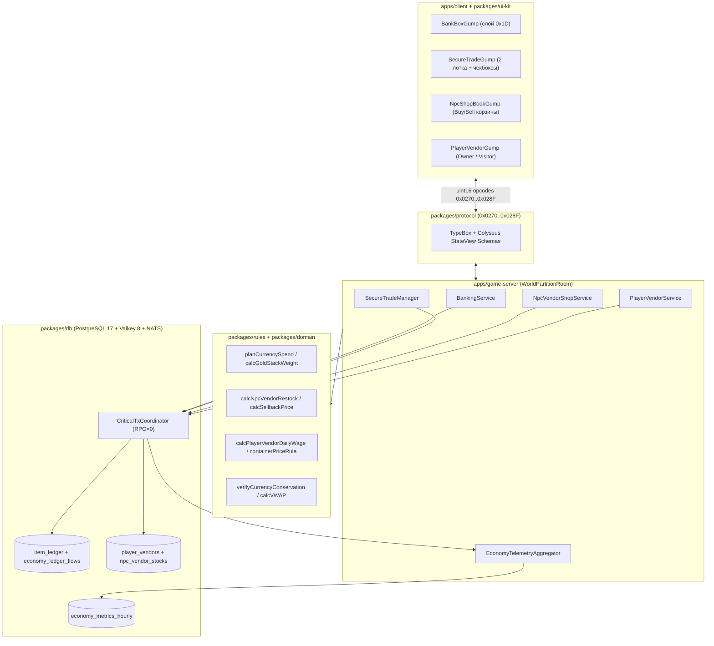
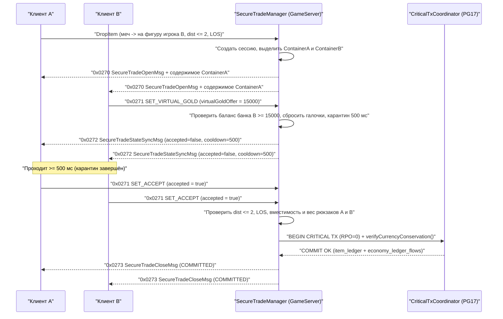

# Design: P21 Экономика и торговля

## Context

Фаза **P21 (`p21-economy-and-trade`)** опирается на фундамент, заложенный в предыдущих фазах:
- **P07 (`@uo3/protocol`)**: бинарно-компактные сообщения с `uint16` опкодами, валидация `TypeBox`, схемы `@colyseus/schema` v3 и порт `ContainerAccessGrantPort` для динамического предоставления и отзыва прав просмотра/модификации контейнеров.
- **P08 (`@uo3/db`, `CriticalTxCoordinator`)**: двухконтурное персистентное хранение, где обычное состояние мира сбрасывается каждые 60 с, а критические имущественные операции выполняются синхронно с `RPO=0` в PostgreSQL 17 с обязательной записью в журнал `item_ledger`.
- **P13 (Инвентарь и контейнеры)**: иерархия контейнеров глубиной до 5 уровней, лимиты `125` предметов и `400.0` камней (`4000` десятых долей камня), стаки до `60000` единиц, двухфазный `Drag-and-Drop` с `BounceBack` и зарезервированный слой экипировки `0x1D` (`Bank`).
- **P14 (Интерактивный UI, гампы и речь)**: `SpeechRouter` с радиусами слышимости `1/15/18` тайлов и `GumpSessionRegistry` (опкоды P14 `0x0150..0x017F`).
- **P19 (ИИ NPC, спавнеры и лут)**: жизненный цикл NPC в `WorldPartitionRoom`, таблицы лута (`FAUCET_MONSTER_LOOT`) и профили мирных городских NPC (банкиров и торговцев).
- **P20 (Добыча ресурсов и базовый крафт)**: потоки сырьевых ресурсов и крафтовых изделий с показателями прочности (`currentHp / maxHp`) и качества (`Exceptional`), поступающих в магазины NPC и на витрины вендоров игроков.

До P21 предметы и золотые монеты существовали как пассивные объекты инвентаря. Задача P21 — ввести полный экономический цикл Ultima Online: Renaissance (UO:R), исключающий любые рассинхронизации, дюпы при дисконнектах или гонках запросов, мошенничество при обмене и бесконтрольную инфляцию.

## Goals / Non-Goals

### Goals
- Реализовать каноническую физическую модель золота (`0x0EED`, стак до `60000`, вес `0.02` камня/монета), банковской ячейки на слое `0x1D` (`125` предметов, `400.0` камней) и банковских чеков (`0x14F0`, цвет `0x0034`, `blessed = true`, номинал `5000..1000000`).
- Обеспечить единый конвейер оплаты `PaymentResolutionEngine`: наличные из рюкзака для покупок `< 2000` золота и автоматический фоллбэк на банковскую ячейку (включая размен чеков со сдачей) при сумме покупки `>= 2000` золота.
- Построить защищённый автомат двухстороннего обмена `Secure Trade` с временными виртуальными контейнерами, поддержкой перевода безналичного банковского баланса (`virtualGoldOffer`), немедленным сбросом обеих галочек и карантином `500 мс` при любом изменении лотка, атомарным коммитом `RPO=0` и гарантированным `Rollback/BounceBack`.
- Реализовать системные магазины NPC (`NpcVendorShopService`) с каталогами `@uo3/content`, корзинами покупки и скупки, анти-арбитражным правилом (`sellBackPrice <= 50% buyPrice`), учётом износа и каноническим 30-минутным циклом рестока с адаптивным удвоением/снижением `currentMaxStock`.
- Реализовать контрактных вендоров игроков (`PlayerVendorService`) с иерархическим ценообразованием контейнеров (`price = 0` `"Not For Sale"` против лота-контейнера `price > 0`), раздельными счетами `holdGold` и `escrowGold`, списанием суточного жалованья каждые `2` реальных часа (`20 + floor(inventoryValue / 500)`) и упаковкой товаров в банк при банкротстве.
- Внедрить строгий финансовый аудит и макроэкономическую телеметрию (`EconomyTelemetryAggregator`): классификацию всех `Faucets` и `Sinks`, проверку закона сохранения валюты при коммите, расчёт `M1/M2/M3`, `Velocity`, индекса цен `VWAP` и детектор аномалий в реальном времени.

### Non-Goals
- Межшардовая торговля и глобальный аукционный дом (противоречит канону UO:R, где торговля привязана к физическим NPC-вендорам в мире).
- Система заказов ремесленников (`Bulk Order Deeds`) — механика после эпохи UO:R, вне скоупа ROADMAP.
- Строительство домов, права совладельцев дома и арендные контракты вендоров (`Vendor Rental Contract`) — вынесены в **P23** (в P21 используется абстрактный порт `IVendorPlacementPolicy`).
- Графические дашборды экономики в `apps/admin` — фронтенд админ-панели реализуется в **P29** (инструменты персонала) (в P21 создаются таблицы агрегатов, метрики Prometheus и REST API `/api/v1/admin/economy/*`).

## Decisions

### Decision 1: Гибридная модель валюты — физические стаки + именные чеки + единый `PaymentResolutionEngine`
- **Выбор**: Золото в мире и инвентаре хранится исключительно как физические стаки `0x0EED` (`maxStack = 60000`, `unitWeightTenths = 0.2`, вес стака `ceil(amount * 0.2)` десятых камня) и предметы `Bank Check` (`0x14F0`, `worth: 5000..1000000`, вес `10` десятых = `1.0` камень, `blessed = true`). При этом все торговые сервисы (покупка у NPC, покупка у вендора игрока, выпуск чека) используют единый детерминированный планировщик списания `planCurrencySpend()` в `@uo3/rules` и исполнитель в `CriticalTxCoordinator`.
- **Обоснование**: В UO:R физический вес золота (`1000` монет = `20` камней) является важнейшим геймплейным ограничителем (риск перевозки золота из подземелий, необходимость банков и чеков). В то же время при покупках на сумму `>= 2000` золота канон UO:R позволяет оплачивать сделку напрямую из банка. Детерминированный алгоритм `planCurrencySpend` собирает монеты из стаков (начиная с наименьших стаков для дефрагментации слотов), а если монет в банке не хватает — погашает наименьший достаточный `Bank Check` и возвращает сдачу (`change >= 5000` — новым чеком в банк; `0 < change < 5000` — стаком монет в банк или рюкзак).
- **Отвергнутые альтернативы**:
  - *Виртуальное числовое поле `character.gold` вместо предметов*: нарушает канон UO:R (невозможно украсть золото из рюкзака, потерять в трупе при смерти, перегрузиться в данже).
  - *Оплата из банка только монетами без размена чеков*: вынуждает игрока вручную бегать в банк и дробить чеки перед каждой покупкой у вендора игрока.

### Decision 2: Виртуальные эфемерные контейнеры `Secure Trade` в памяти партиции с фиксацией только при коммите
- **Выбор**: При открытии сессии `Secure Trade` между игроками A и B сервер создаёт два виртуальных контейнера `ContainerA` и `ContainerB` с временными серийниками из диапазона предметов. Перемещение предмета в лоток обмена временно перепривязывает `parentSerial` предмета к виртуальному контейнеру в памяти `WorldPartitionRoom` и ставит предмет на карантин (`lockedByTradeSessionId`). Синхронная транзакция в PostgreSQL (`CriticalTxCoordinator` `RPO=0`) выполняется **ровно один раз** — в момент финального коммита (`AcceptedA && AcceptedB`), либо не выполняется вовсе при отмене (предметы возвращаются на прежние `parentSerial` в рюкзаки владельцев).
- **Обоснование**: Игроки могут десятки раз перекладывать предметы в окне обмена и менять суммы перед подтверждением. Если синхронно писать в БД каждое перетаскивание внутри незавершённого окна обмена, это создаст лишнюю нагрузку на PG17 и риск того, что после краша партиции предмет останется внутри несуществующего виртуального контейнера. Поскольку до финального коммита владельцем предмета в БД остаётся исходный игрок, при внезапном падении процесса сервера предмет после рестарта гарантированно окажется в рюкзаке своего исходного владельца (`RPO=0` без сиротских контейнеров).
- **Отвергнутые альтернативы**:
  - *Запись каждого шага перетаскивания внутри окна обмена в PostgreSQL*: избыточный I/O и сложная очистка виртуальных контейнеров после аварийного рестарта.

### Decision 3: Анти-скам защита окна обмена — сброс обеих галочек + серверный карантин `500 мс` + перевод `virtualGoldOffer`
- **Выбор**: Любая мутация `ContainerA`, `ContainerB` или числового предложения безналичного банковского золота `virtualGoldOffer` (`0..999999999`) немедленно переводит автомат сессии в состояние `MODIFIED_COOLDOWN`, сбрасывает `acceptedA = false` и `acceptedB = false`, записывает метку `cooldownUntilMs = nowMs + 500` и рассылает пакет `SecureTradeStateSync` (`0x0272`). Любой пакет `SecureTradeConfirmRequest` (`0x0271`) с `accepted = true`, пришедший при `nowMs < cooldownUntilMs`, отклоняется с `ERR_TRADE_CONFIRM_COOLDOWN`.
- **Флаг эпохи**: перевод `virtualGoldOffer` — механика после UO:R; доступен только при флаге `tradeWindowBankGold` профиля эпохи (ADR-010), в профиле UO:R по умолчанию выключен (`ERR_FEATURE_DISABLED`).
- **Обоснование**: Классический вид мошенничества в MMO — быстро убрать дорогой предмет или уменьшить сумму золота за долю секунды до того, как партнёр кликнет по галочке подтверждения. Серверный карантин `500 мс` (10 тиков симуляции по 50 мс) гарантирует, что клиент партнёра успеет отрисовать новое состояние лотка и заблокировать чекбокс до того, как сервер примет подтверждение. Поддержка `virtualGoldOffer` (прямой перевод из банка в банк в окне обмена) избавляет от необходимости выпускать десятки чеков при сделках свыше `1000000` золота.
- **Отвергнутые альтернативы**:
  - *Двухшаговое окно подтверждения (отдельное модальное окно после галочек)*: замедляет мелкие обмены и не соответствует классическому гампу UO:R.

### Decision 4: Изолированное хранение товарных остатков NPC-магазинов и детерминированный 30-минутный ресток
- **Выбор**: Базовые каталоги магазинов (`ShopInventoryProfile`) декларируются в `@uo3/content` (`packages/content/data/shops/*.yaml`), но динамическое состояние запасов каждого конкретного NPC-торговца (`currentStock`, `currentMaxStock`, `lastRestockAtMs`, временный буфер `playerSoldBuffer`) хранится по `npcSerial` в памяти партиции и персистится в таблицу `npc_vendor_stocks` во время 60-секундного dirty-flush (а изменения от покупок фиксируются через `CriticalTxCoordinator`). Цикл рестока запускается каждые `1800` с (`30` реальных минут = `6` игровых часов) с индивидуальным фазовым сдвигом `serial % 120` секунд.
- **Обоснование**: В UO:R запасы реагентов, стрел и свитков у каждого конкретного NPC-торговца конечны и адаптируются к спросу: при полном выкупе (`currentStock == 0`) лимит `currentMaxStock` удваивается вплоть до `maxStock = 999`, а при нулевом спросе (`currentStock == currentMaxStock`) делится пополам вплоть до `baseStock`. Фазовый джиттер `0..120` с предотвращает одновременный пересчёт тысяч торговцев в один тик симуляции.
- **Отвергнутые альтернативы**:
  - *Глобальный общий пул товаров на весь город или шард*: уничтожает локальную географию торговли и конкуренцию за маршруты скупки реагентов.

### Decision 5: Финансовая модель `Player Vendor` — счета `holdGold` / `escrowGold` и плоская шкала жалованья UO:R
- **Выбор**: Каждый контрактный вендор игрока имеет запись в таблице `player_vendors` с двумя раздельными целочисленными балансами (`bigint`): `hold_gold` (резерв, внесённый владельцем на оплату труда) и `escrow_gold` (выручка от продаж посетителям, зачисляемая со ставкой комиссии `0%`). Каждые `7200` секунд (`2` реальных часа = `1` игровой день) сервис `PlayerVendorService` вычисляет жалованье `dailyWage = 20 + floor(totalListedInventoryValue / 500)` и списывает его сначала из `hold_gold`, а остаток — из `escrow_gold` (как сток `SINK_PLAYER_VENDOR_WAGE`). При `hold_gold + escrow_gold < dailyWage` вендор ликвидируется, а его товары упаковываются в `Vendor Recovery Pack` и переносятся напрямую в банковскую ячейку владельца (`0x1D`).
- **Обоснование**: Полное соответствие канону UO:R: отсутствие процентного налога с самой транзакции продажи стимулирует свободную торговлю, тогда как повременная плата `1` золото за каждые `500` золота выставленной цены (`0.2%` за игровой день, или `2.4%` за реальные сутки) заставляет продавцов выставлять реалистичные рыночные цены и не превращать вендоров в бесплатные бесконечные склады по заоблачным ценам. Упаковка товаров в банк при банкротстве предотвращает потерю имущества при временном отсутствии игрока, но требует освободить перегруженный банк для дальнейшего использования.
- **Отвергнутые альтернативы**:
  - *Удаление товаров или выброс их на землю при банкротстве вендора*: создаёт токсичный геймплей караула чужих вендоров и массовые обращения к GM.

### Decision 6: Закон сохранения стоимости в `CriticalTxCoordinator` и потоковая телеметрия `Faucet/Sink`
- **Выбор**: Расширить `CriticalTxCoordinator` (P08) обязательным финансовым валидатором `verifyCurrencyConservation(txContext)`. Каждая критическая транзакция декларирует тип экономического движения:
  1. `TRANSFER` (между игроками, банком, чеками, эскроу вендора): сумма всего золота и номиналов чеков до транзакции должна быть строго равна сумме после транзакции (`deltaGold == 0`).
  2. `FAUCET` (`FAUCET_MONSTER_LOOT`, `FAUCET_NPC_SELLBACK`, `FAUCET_STARTER_GOLD`, `FAUCET_QUEST_REWARD`, `FAUCET_ADMIN_GRANT`): `deltaGold > 0`, обязательна запись в `economy_ledger_flows`.
  3. `SINK` (`SINK_NPC_PURCHASE`, `SINK_PLAYER_VENDOR_WAGE`, `SINK_NPC_SERVICE_FEE`, `SINK_HOUSE_DEED`, `SINK_ADMIN_REVOKE`): `deltaGold < 0`, обязательна запись в `economy_ledger_flows`.
  При нарушении инварианта транзакция откатывается (`ROLLBACK`) до коммита в PG17 и эмитит алерт `ERR_ECONOMY_CONSERVATION_VIOLATION`.
- **Обоснование**: Встраивание проверки сохранения стоимости непосредственно в координатор транзакций БД делает невозможным скрытый дюп золота из-за багов округления, повторной выдачи сдачи при размене чека или гонки состояния в `Secure Trade`.
- **Отвергнутые альтернативы**:
  - *Постфактум-сверка балансов ночным батч-скриптом*: обнаруживает дюп слишком поздно, когда надюпанное золото уже отмыто через десятки честных сделок.

## Архитектура модулей и распределение ответственности

### Пакеты и приложения
1. **`packages/domain/src/economy/*`**:
   - Константы: `GOLD_ITEM_DEF_ID = 0x0EED`, `BANK_CHECK_ITEM_DEF_ID = 0x14F0`, `BANK_CHECK_HUE = 0x0034`, `GOLD_UNIT_WEIGHT_TENTHS = 0.2`, `GOLD_MAX_STACK = 60000`, `BANK_MAX_ITEMS = 125`, `BANK_MAX_WEIGHT_TENTHS = 4000`, `BANK_INTERACT_RANGE = 6`, `BANK_AUTO_DEBIT_THRESHOLD = 2000`, `BANK_CHECK_MIN_WORTH = 5000`, `BANK_CHECK_MAX_WORTH = 1000000`, `SECURE_TRADE_RANGE = 2`, `SECURE_TRADE_COOLDOWN_MS = 500`, `SECURE_TRADE_TIMEOUT_MS = 180000`, `NPC_VENDOR_RANGE = 4`, `NPC_RESTOCK_INTERVAL_MS = 1800000`, `PLAYER_VENDOR_RANGE = 3`, `PLAYER_VENDOR_WAGE_INTERVAL_MS = 7200000`, `PLAYER_VENDOR_BASE_WAGE = 20`, `PLAYER_VENDOR_VALUATION_DIVISOR = 500`.
   - Перечисления `EconomyFlowCategory` (`FAUCET_*`, `SINK_*`, `TRANSFER_*`), `SecureTradeCancelReason`, коды ошибок `ERR_BANK_*`, `ERR_TRADE_*`, `ERR_VENDOR_*`, `ERR_ECONOMY_*`.
   - Интерфейс порта `IVendorPlacementPolicy` (реализация по умолчанию в P21 проверяет рыночные зоны `MarketZone`, в P23 расширяется проверкой публичных домов).
   - Реализация порта `IBankingService`, объявленного в P19 (`npc/npc-speech-and-services`): `BankingService` подменяет реализацию по умолчанию (`ERR_SERVICE_UNAVAILABLE`) и обслуживает `balance`/`withdraw`/`check`; открытие `BankBox` по `"bank"` и отзыв доступа на дистанции `> 6` тайлов остаются за банкиром P19, требование `economy/currency-and-banking` фиксирует тот же контракт для финансовых операций.
2. **`packages/rules/src/economy/*`**:
   - `calcGoldStackWeightTenths(amount: number): number` — возвращает `Math.ceil(amount * 0.2)`.
   - `planCurrencySpend(params: CurrencySpendInput): CurrencySpendPlan` — чистая функция выбора стаков монет и чеков из рюкзака/банка с расчётом сдачи.
   - `evaluateNpcRestockCycle(entry: NpcStockState): NpcStockState` — чистая функция 30-минутного цикла рестока (удвоение при `currentStock === 0`, деление пополам при `currentStock === currentMaxStock`).
   - `calcItemSellbackPrice(baseSellPrice: number, baseBuyPrice: number, currentHp?: number, maxHp?: number): number | null` — анти-арбитражная формула скупки с отсечкой износа `< 20%`.
   - `calcPlayerVendorDailyWage(listedItems: ReadonlyArray<{ price: number; isEquipped: boolean }>): number` — расчёт `20 + Math.floor(sum / 500)`.
   - `verifyCurrencyConservation(tx: EconomyTxAuditInput): ConservationCheckResult` — проверка закона сохранения валюты.
3. **`packages/protocol/src/economy/*`**:
   - Опкоды `0x0270..0x028F` и схемы `TypeBox`.
4. **`packages/content/data/shops/*.yaml`**:
   - Профили магазинов NPC (`blacksmith`, `mage`, `provisioner`, `healer`, `tailor`, `carpenter`, `tinker`, `alchemist`, `bowyer`, `innkeeper`, `jeweler`, `butcher`, `baker`).
5. **`packages/db/src/schema/economy.ts`**:
   - Таблицы Drizzle ORM для PostgreSQL 17: `npc_vendor_stocks`, `player_vendors`, `player_vendor_items`, `economy_ledger_flows`, `economy_metrics_hourly`, `economy_anomalies`.
6. **`apps/game-server/src/economy/*`**:
   - `BankingService`, `SecureTradeManager`, `NpcVendorShopService`, `PlayerVendorService`, `EconomyTelemetryAggregator`.
7. **`apps/api/src/economy/*`**:
   - Контроллер `AdminEconomyController` (`/api/v1/admin/economy/summary`, `/flows`, `/prices`, `/anomalies`), защищённый `JwtAuthGuard` и `@RequireAccessLevel(AccessLevel.Seer)`.
8. **`apps/client/src/features/economy/*` и `packages/ui-kit/src/gumps/economy/*`**:
   - Компоненты `BankBoxGump`, `SecureTradeGump`, `NpcVendorShopGump`, `PlayerVendorOwnerGump`, `PlayerVendorBrowseGump`.

## Модели данных (PostgreSQL 17 / Drizzle ORM)

### 1. Таблица `npc_vendor_stocks`
Хранит динамическое состояние запасов каждого экземпляра системного NPC-торговца:
- `npc_serial` (`integer`, PK) — серийник NPC (`0x20000000..0x3FFFFFFF`).
- `shop_profile_id` (`varchar(64)`, NOT NULL) — ссылка на профиль в `@uo3/content`.
- `partition_id` (`varchar(32)`, NOT NULL) — текущая партиция.
- `stock_entries_json` (`jsonb`, NOT NULL) — массив `{ itemDefId: number, currentStock: number, currentMaxStock: number, soldInCycle: number }`.
- `buyback_buffer_json` (`jsonb`, NOT NULL) — массив временно выкупленных у игроков предметов до ближайшего рестока.
- `last_restock_at` (`timestamptz`, NOT NULL).
- `updated_at` (`timestamptz`, NOT NULL).

### 2. Таблица `player_vendors`
Хранит состояние контрактных вендоров игроков:
- `vendor_serial` (`integer`, PK) — серийник NPC-вендора (`0x20000000..0x3FFFFFFF`).
- `owner_character_id` (`uuid`, NOT NULL, FK -> `characters.id`, INDEX).
- `owner_account_id` (`uuid`, NOT NULL, INDEX).
- `shop_name` (`varchar(40)`, NOT NULL, DEFAULT `'Vendor Shop'`).
- `facet_id` (`smallint`, NOT NULL), `x` (`smallint`, NOT NULL), `y` (`smallint`, NOT NULL), `z` (`smallint`, NOT NULL).
- `house_serial` (`integer`, NULLABLE, INDEX) — привязка к дому (для интеграции с P23).
- `container_serial` (`integer`, NOT NULL) — серийник корневого контейнера витрины вендора.
- `hold_gold` (`bigint`, NOT NULL, DEFAULT `1000`) — зарплатный резерв, внесённый владельцем.
- `escrow_gold` (`bigint`, NOT NULL, DEFAULT `0`) — накопленная выручка от продаж.
- `listed_inventory_value` (`bigint`, NOT NULL, DEFAULT `0`) — кэшированная сумма цен всех активных лотов (`price > 0`).
- `next_wage_deduction_at` (`timestamptz`, NOT NULL) — время следующего списания жалованья (шаг 2 часа).
- `status` (`varchar(24)`, NOT NULL) — `'ACTIVE' | 'BANKRUPT_ARCHIVED' | 'DISMISSED'`.
- `created_at` (`timestamptz`, NOT NULL), `updated_at` (`timestamptz`, NOT NULL).

### 3. Таблица `player_vendor_items`
Хранит ценовые метаданные предметов, находящихся внутри контейнера вендора игрока:
- `item_serial` (`integer`, PK, FK -> `world_items.serial` ON DELETE CASCADE).
- `vendor_serial` (`integer`, NOT NULL, FK -> `player_vendors.vendor_serial` ON DELETE CASCADE, INDEX).
- `price` (`integer`, NOT NULL, DEFAULT `0`) — цена в золоте (`0` = `"Not For Sale"`, `1..10000000`).
- `description` (`varchar(80)`, NOT NULL, DEFAULT `''`).
- `listed_at` (`timestamptz`, NOT NULL).

### 4. Таблица `economy_ledger_flows`
Детализированный журнал всех макроэкономических движений валюты (связан `1:1` или `N:1` с `item_ledger.tx_id`):
- `id` (`bigserial`, PK).
- `ledger_tx_id` (`uuid`, NOT NULL, INDEX) — идентификатор транзакции `CriticalTxCoordinator`.
- `flow_type` (`varchar(16)`, NOT NULL) — `'FAUCET' | 'SINK' | 'TRANSFER'`.
- `category` (`varchar(40)`, NOT NULL, INDEX) — например, `'FAUCET_MONSTER_LOOT'`, `'SINK_NPC_PURCHASE'`, `'TRANSFER_SECURE_TRADE'`.
- `amount_gold` (`bigint`, NOT NULL) — положительное число в золотых монетах.
- `actor_character_id` (`uuid`, NULLABLE, INDEX), `actor_account_id` (`uuid`, NULLABLE, INDEX).
- `counterparty_character_id` (`uuid`, NULLABLE), `counterparty_account_id` (`uuid`, NULLABLE).
- `target_serial` (`integer`, NULLABLE) — серийник NPC, вендора или спавнера.
- `item_def_id` (`integer`, NULLABLE, INDEX), `item_quantity` (`integer`, NULLABLE).
- `facet_id` (`smallint`, NOT NULL), `region_id` (`varchar(64)`, NULLABLE).
- `is_self_account_transfer` (`boolean`, NOT NULL, DEFAULT `false`).
- `created_at` (`timestamptz`, NOT NULL, INDEX).

### 5. Таблица `economy_metrics_hourly`
Агрегированные срезы макроэкономики шарда:
- `bucket_start` (`timestamptz`, PK).
- `m1_cash_gold` (`bigint`, NOT NULL), `m2_bank_gold` (`bigint`, NOT NULL), `m3_vendor_gold` (`bigint`, NOT NULL), `total_money_supply` (`bigint`, NOT NULL).
- `gross_faucet_gold` (`bigint`, NOT NULL), `gross_sink_gold` (`bigint`, NOT NULL), `net_emission_gold` (`bigint`, NOT NULL).
- `sink_to_faucet_ratio_bp` (`integer`, NOT NULL).
- `p2p_trade_volume_gold` (`bigint`, NOT NULL), `player_vendor_volume_gold` (`bigint`, NOT NULL), `gold_velocity_bp` (`integer`, NOT NULL).
- `faucet_breakdown_json` (`jsonb`, NOT NULL), `sink_breakdown_json` (`jsonb`, NOT NULL).
- `top_commodity_prices_json` (`jsonb`, NOT NULL) — массив `{ itemDefId, vwapTenths, medianGold, volumeUnits }`.

## Сетевой протокол (`@uo3/protocol`, опкоды `0x0270..0x028F`)

| Опкод | Направление | Имя сообщения | Поля TypeBox | Описание |
| :--- | :--- | :--- | :--- | :--- |
| `0x0270` | S -> C | `SecureTradeOpenMsg` | `{ sessionId: string, partnerSerial: uint32, partnerName: string, myContainerSerial: uint32, partnerContainerSerial: uint32 }` | Открытие двухстороннего окна `Secure Trade` |
| `0x0271` | C -> S | `SecureTradeActionReq` | `{ sessionId: string, action: 'SET_ACCEPT' \| 'SET_VIRTUAL_GOLD' \| 'CANCEL', accepted?: boolean, virtualGoldOffer?: uint32 }` | Установка/снятие галочки, изменение безналичного золота или отмена |
| `0x0272` | S -> C | `SecureTradeStateSyncMsg` | `{ sessionId: string, acceptedA: boolean, acceptedB: boolean, virtualGoldA: uint32, virtualGoldB: uint32, cooldownRemainingMs: uint16 }` | Синхронизация галочек, сумм и карантина `500 мс` |
| `0x0273` | S -> C | `SecureTradeCloseMsg` | `{ sessionId: string, status: 'COMMITTED' \| 'CANCELLED', reasonCode: string }` | Закрытие окна обмена после коммита или отмены |
| `0x0274` | S -> C | `NpcVendorBuyListMsg` | `{ vendorSerial: uint32, shopProfileId: string, items: Array<{ itemDefId: uint16, hue: uint16, unitPrice: uint32, availableStock: uint16, nameClilocId: uint32 }> }` | Отправка клиенту витрины покупки NPC-магазина |
| `0x0275` | C -> S | `NpcVendorBuyCartReq` | `{ vendorSerial: uint32, lines: Array<{ itemDefId: uint16, quantity: uint16 }> }` (max 64 lines) | Отправка корзины покупки клиентом |
| `0x0276` | S -> C | `NpcVendorSellListMsg` | `{ vendorSerial: uint32, items: Array<{ itemSerial: uint32, itemDefId: uint16, hue: uint16, maxQuantity: uint16, unitSellBackPrice: uint32, durabilityPct: uint8 }> }` | Отправка клиенту списка предметов из его рюкзака, пригодных к продаже NPC |
| `0x0277` | C -> S | `NpcVendorSellCartReq` | `{ vendorSerial: uint32, lines: Array<{ itemSerial: uint32, quantity: uint16 }> }` (max 50 items) | Подтверждение продажи выбранных предметов NPC-торговцу |
| `0x0278` | S -> C | `NpcVendorTxResultMsg` | `{ vendorSerial: uint32, txType: 'BUY' \| 'SELL', success: boolean, totalGold: uint32, paidFromBank: boolean, errorCode?: string }` | Итог транзакции с NPC-торговцем |
| `0x0279` | S -> C | `BankBalanceNotificationMsg` | `{ bankerSerial: uint32, cashCoinsGold: uint32, checksTotalGold: uint64, totalBalanceGold: uint64, usedSlots: uint8, usedWeightTenths: uint16 }` | Сводка состояния банковской ячейки при открытии/запросе баланса |
| `0x0280` | S -> C | `PlayerVendorOwnerGumpMsg` | `{ vendorSerial: uint32, shopName: string, holdGold: uint64, escrowGold: uint64, listedInventoryValue: uint64, dailyWageGold: uint32, paidDaysRemainingTenths: uint32 }` | Данные панели управления собственным вендором |
| `0x0281` | C -> S | `PlayerVendorManageReq` | `{ vendorSerial: uint32, action: 'COLLECT_GOLD' \| 'RENAME_SHOP' \| 'DISMISS', collectAmount?: uint32, newShopName?: string }` | Команды владельца вендора (вывод выручки, переименование, увольнение) |
| `0x0282` | C -> S | `PlayerVendorPriceItemReq` | `{ vendorSerial: uint32, itemSerial: uint32, price: uint32, description: string }` | Установка цены (`0..10000000`) и описания (`<= 80` симв.) на предмет в вендоре |
| `0x0283` | S -> C | `PlayerVendorCatalogSyncMsg` | `{ vendorSerial: uint32, containerSerial: uint32, entries: Array<{ itemSerial: uint32, price: uint32, description: string, isContainerLot: boolean }> }` | Метаданные цен и описаний предметов внутри открытого контейнера вендора |
| `0x0284` | C -> S | `PlayerVendorBuyItemReq` | `{ vendorSerial: uint32, itemSerial: uint32, expectedPrice: uint32 }` | Покупка предмета посетителем у вендора игрока (с защитой от подмены цены `expectedPrice`) |

## Жизненный цикл и алгоритмы

### 1. Диаграмма последовательности: Безопасный обмен (`Secure Trade`) с карантином и `RPO=0`

### 2. Алгоритм разрешения платежа `planCurrencySpend()` (`packages/rules`)
При любой покупке на сумму $P > 0$:
1. Вычисляется сумма наличных монет `0x0EED` в корневом рюкзаке и его незапертых подсумках: $G_{\text{pack}}$.
2. **Путь 1 (Наличные из рюкзака)**: если $G_{\text{pack}} \ge P$, стаки золота в рюкзаке сортируются по возрастанию количества (`amount ASC`), и списывается ровно $P$ монет.
3. **Путь 2 (Безналичное списание из банка)**: если $G_{\text{pack}} < P$:
   - Если $P < 2000$, возвращается отказ `ERR_INSUFFICIENT_GOLD_IN_BACKPACK` (наличные в рюкзаке и средства в банке **не смешиваются** в одной транзакции согласно канону UO:R).
   - Если $P \ge 2000$, сканируется банковская ячейка `0x1D` персонажа: сумма монет $G_{\text{bank}}$ и список банковских чеков $C_1 \le C_2 \le \dots \le C_k$ с суммой номиналов $W_{\text{checks}}$.
   - Если $G_{\text{bank}} + W_{\text{checks}} < P$, возвращается отказ `ERR_BANK_INSUFFICIENT_FUNDS`.
   - Сначала списывается $\min(P, G_{\text{bank}})$ из стаков монет в банке.
   - Если остался непокрытый остаток $R = P - G_{\text{bank}} > 0$, выбирается минимальный префикс чеков (или один наименьший чек $C_j \ge R$), покрывающий $R$. Вычисляется сдача $S = \sum C_{\text{used}} - R$:
     - Если $S \ge 5000$, в банковской ячейке создаётся новый `Bank Check` с номиналом $S$ (`worth = S`, вес `1.0` камень).
     - Если $0 < S < 5000$, сдача $S$ выдаётся стаком золотых монет `0x0EED` в банковскую ячейку (а если вес банка `400.0` камней не позволяет вместить монеты — в рюкзак покупателя).

### 3. Математическая модель 30-минутного рестока NPC-торговцев
Для каждой позиции $i$ в `SellList` профиля магазина на шаге рестока $t_k = t_{k-1} + 1800\,\text{s}$:
$$\text{currentMaxStock}_i^{(k)} = \begin{cases} \min\left(\text{maxStock}_i,\; 2 \cdot \text{currentMaxStock}_i^{(k-1)}\right), & \text{если } \text{currentStock}_i^{(k-1)} = 0 \\ \max\left(\text{baseStock}_i,\; \left\lfloor \dfrac{\text{currentMaxStock}_i^{(k-1)}}{2} \right\rfloor\right), & \text{если } \text{currentStock}_i^{(k-1)} = \text{currentMaxStock}_i^{(k-1)} \\ \text{currentMaxStock}_i^{(k-1)}, & \text{иначе} \end{cases}$$
$$\text{currentStock}_i^{(k)} = \text{currentMaxStock}_i^{(k)}$$
При этом канонический потолок $\text{maxStock}_i \le 999$, а временный буфер выкупленных у игроков трофеев `buybackBuffer` полностью очищается.

## Risks / Trade-offs

- **[Риск гонки при одновременной покупке последнего товара у NPC или вендора игрока]** → Митигация: Все операции покупки сериализуются на уровне `WorldPartitionRoom` через асинхронный мьютекс по `vendorSerial`, а при записи в PG17 используется `SELECT ... FOR UPDATE` строки `player_vendors` / `npc_vendor_stocks` в `CriticalTxCoordinator`. Также клиент в `PlayerVendorBuyItemReq` передаёт `expectedPrice`, что защищает покупателя, если владелец вендора изменил цену за мгновение до клика.
- **[Риск переполнения банковской ячейки при возврате товаров обанкротившегося вендора]** → Митигация: При ликвидации вендора создаётся специальный запечатанный контейнер `Vendor Recovery Pack`, который помещается в банковскую ячейку владельца с флагом `allowOverCapacityInsert = true`. Пока суммарный вес банка превышает `400.0` камней или `125` предметов, игрок может только **забирать** предметы из банка, но не класть новые.
- **[Риск спама запросами `Secure Trade` для отвлечения игрока в PvP]** → Митигация: Серверный кулдаун `2000 мс` на инициацию обмена, запрет открытия обмена, если цель находится в состоянии активного замаха/каста или включила флаг `ignoreTradeRequests`, и мгновенное закрытие окна при получении любого урона или увеличении дистанции `> 2` тайлов.
- **[Риск арбитражного эксплойта (покупка у одного NPC и продажа другому дороже)]** → Митигация: На этапе загрузки `@uo3/content` и в CI выполняется статическая валидация всех профилей `shops/*.yaml`: глобальный максимум `baseSellBackPrice` любого `itemDefId` по всем магазинам шарда обязан быть строго меньше или равен `floor(0.50 * min(baseBuyPrice))` этого же предмета.
- **[Риск деградации производительности при расчёте денежной массы `M1/M2/M3`]** → Митигация: Агрегатор не выполняет полный `SEQ SCAN` таблицы `world_items` каждые 15 минут на основном пуле соединений; вместо этого базовый срез поддерживается инкрементально по потоку `economy_ledger_flows` в памяти/Valkey и сверяется с индексированным запросом по `item_def_id IN (0x0EED, 0x14F0)` на read-реплике/фоновом пуле раз в час.
- **[Риск потери предметов в виртуальном контейнере `Secure Trade` при переходе границы партиции]** → Митигация: Любая попытка инициации `PartitionHandoffTicket` (P12/P32) или телепортации автоматически вызывает синхронный `cancelTradeSession(reason = 'PARTITION_HANDOFF')` с возвратом всех предметов в рюкзаки до сериализации состояния персонажа.

## Migration Plan

1. **Этап 1 (Домен, правила и протокол)**: добавление типов, констант и ошибок в `@uo3/domain`, чистых математических функций в `@uo3/rules` и опкодов `0x0270..0x028F` в `@uo3/protocol`.
2. **Этап 2 (Схема БД и контент)**: применение миграции Drizzle в `@uo3/db` (создание таблиц `npc_vendor_stocks`, `player_vendors`, `player_vendor_items`, `economy_ledger_flows`, `economy_metrics_hourly`, `economy_anomalies`), расширение `CriticalTxCoordinator` проверкой `verifyCurrencyConservation`, добавление профилей магазинов `shops/*.yaml` в `@uo3/content`.
3. **Этап 3 (Серверные сервисы `apps/game-server`)**: подключение `BankingService`, `SecureTradeManager`, `NpcVendorShopService`, `PlayerVendorService` и `EconomyTelemetryAggregator` к `WorldPartitionRoom`, `SpeechRouter` (P14) и `ContainerAccessGrantPort` (P07/P13).
4. **Этап 4 (Клиентские гампы и админский REST API)**: реализация гампов в `@uo3/ui-kit` и `apps/client`, подключение эндпоинтов `/api/v1/admin/economy/*` в `apps/api`.

## Open Questions

- *Нужно ли в будущих фазах (P23+) разрешать перевод `Player Vendor` из одного дома владельца в другой без перевыпуска контракта?* — Отложено до **P23** (в P21 контракт привязывается к точке размещения при активации, а порт `IVendorPlacementPolicy` позволяет P23 добавить команду перемещения внутри дома).
- *Потребуется ли динамический налог на крупных вендоров при превышении порога денежной массы шарда?* — Отложено до этапа балансировки живого шарда (**P31/P34**); все коэффициенты формулы жалованья (`baseWage = 20`, `divisor = 500`) вынесены в типизированный конфиг `@uo3/config`.
