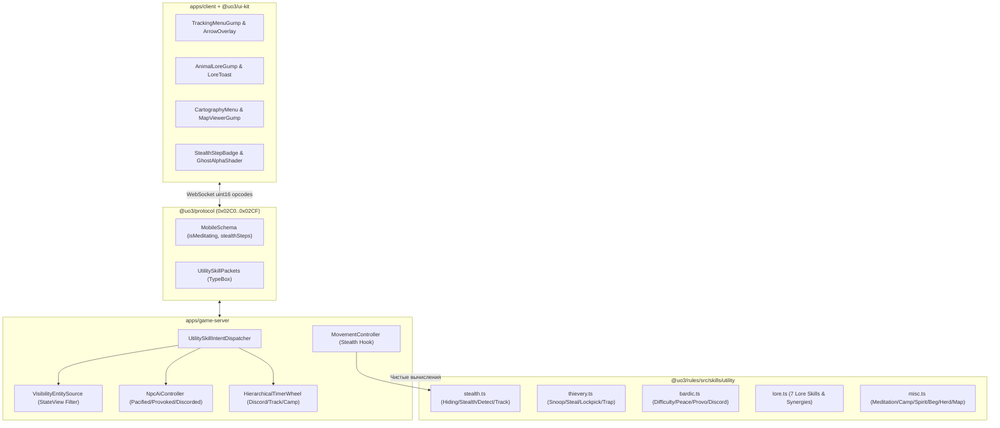
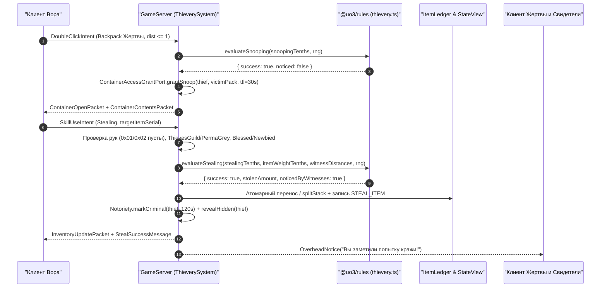
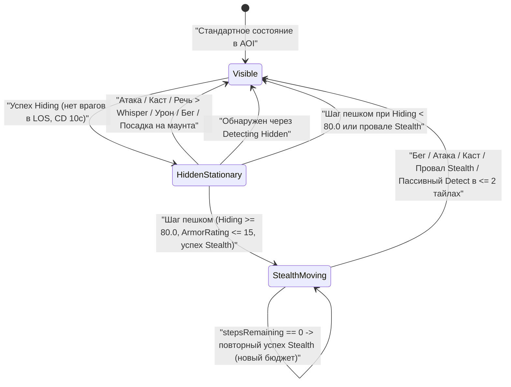

# Design: P22 Утилитарные навыки

## Context

Фаза P22 завершает реализацию канонического реестра из 49 навыков UO:Renaissance, вводя 23 утилитарных навыка в пяти функциональных доменах:
1. **Скрытность и обнаружение (`skills/stealth-and-detection`)**: `Hiding` (ID 21), `Stealth` (ID 47), `Detecting Hidden` (ID 14), `Tracking` (ID 38).
2. **Воровство и взлом (`skills/thievery`)**: `Snooping` (ID 28), `Stealing` (ID 33), `Lockpicking` (ID 24), `Remove Trap` (ID 48).
3. **Бардовское искусство (`skills/bardic-skills`)**: `Musicianship` (ID 29), `Peacemaking` (ID 9), `Provocation` (ID 22), `Discordance` (ID 15).
4. **Знания и идентификация (`skills/lore-and-identification`)**: `Anatomy` (ID 1), `Animal Lore` (ID 2), `Item Identification` (ID 3), `Arms Lore` (ID 4), `Evaluating Intelligence` (ID 16), `Forensic Evaluation` (ID 19), `Taste Identification` (ID 36).
5. **Вспомогательные навыки (`skills/misc-skills`)**: `Begging` (ID 6), `Camping` (ID 10), `Cartography` (ID 12), `Herding` (ID 20), `Meditation` (ID 46), `Spirit Speak` (ID 32).

К моменту старта P22 в кодовой базе уже действуют:
- Детерминированный конвейер проверки и прироста навыков `SkillCheckPipeline` с анти-макро защитой по блокам `8x8` и серийникам целей (P15).
- Фильтрация видимости на базе Colyseus `@colyseus/schema` v3 `StateView` и порт доступа к контейнерам `ContainerAccessGrantPort` (P07/P13).
- Конвейер шагов `checkMovement` и `TimeCreditTracker` (P12).
- Система боевых намерений, `SwingTimer`, `AggressorRecord` (P16) и флаги криминала, кармы и статуса гильдии воров `PermaGrey` (P17).
- Деревья поведения ИИ существ, параметры `minTameSkillTenths`, лояльность и спавнеры (P19).
- Журнал критических операций с предметами `item_ledger` в PostgreSQL 17 (P08).

Архитектура P22 должна строго соблюдать разделение ответственности: чистые изоморфные формулы шансов, сложности и модификаторов размещаются в `@uo3/rules` (ADR-004), типы и коды ошибок — в `@uo3/domain`, сетевые пакеты — в `@uo3/protocol` (ADR-006), а оркестрация состояний мира, таймеров и AOI — в `apps/game-server` (ADR-005).

## Goals / Non-Goals

### Goals
- Обеспечить 100% серверно-авторитарную невидимость (`Hiding`/`Stealth`), при которой координаты скрытого персонажа физически не передаются чужим клиентам через `StateView` до момента раскрытия.
- Реализовать канонические формулы UO:R для всех 23 навыков в `@uo3/rules/src/skills/utility/*` с использованием детерминированного генератора `xoshiro128++` и целочисленной арифметики в базисных пунктах (`0..10000` bp).
- Интегрировать `Snooping` и `Stealing` с `ContainerAccessGrantPort` (P07), системой весов (P13), криминальным статусом и гильдией воров `PermaGrey` (P17), а также журналом `item_ledger` (P08).
- Вычислять `bardingDifficultyTenths` для любых существ из их виталов, навыков и способностей (P19) и управлять состояниями ИИ (`Pacified`, `ProvokedTarget`, `Discorded`).
- Встроить пассивные синергии `Anatomy`, `Evaluating Intelligence`, `Arms Lore`, `Animal Lore` и `Meditation` в расчёты урона (P16/P18), регенерации маны (P15), крафта (P20) и контроля питомцев (P19).
- Предоставить клиентские гампы и визуальные индикаторы в `apps/client` и `@uo3/ui-kit`: меню и стрелку `Tracking`, гамп `Animal Lore`, окно карты `MapGump` и индикацию скрытых шагов.

### Non-Goals
- Раскопки кладов по декодированным `TreasureMap` и спавн сундуков-хранителей — относятся к фазе P25 (`world/treasure-hunting`); P22 отвечает только за декодирование и рендер карты с булавкой.
- Правила домовладения (раскрытие скрытых персонажей владельцем дома, взлом домашних сундуков) — реализуются в P23 (`housing/*`).
- Воровство фракционных сигилов в городах — реализуется в P27 (`pvp/factions`).
- Клиентский синтез и микширование аудио-треков инструментов — реализуется в P28 (`client/audio`); P22 передаёт детерминированные `soundId`.

## Decisions

### Decision 1: Серверно-авторитарное исключение скрытых сущностей из `StateView` AOI
- **Выбор**: Когда мобиль переходит в `Hidden = true`, `VisibilityEntitySource` (P07) вызывает `stateView.remove(mobileSchema)` для всех наблюдателей в секторе, кроме самого игрока, членов его партии (`PartyMember`, P26), владельца (для скрытых питомцев) и аккаунтов персонала с `effectiveAccessLevel >= 2` (Counselor/GM).
- **Обоснование**: Если передавать скрытого игрока в AOI с булевым флагом `isHidden: true`, модифицированный клиент или сниффер пакетов сможет видеть точные координаты воров и засад (мапхак/радар). Исключение из `StateView` гарантирует отсутствие сетевого трафика о скрытой сущности.
- **Отвергнутые альтернативы**:
  - *Передача флага `isHidden` всем клиентам в AOI*: нарушает жёсткое правило авторитарности сервера и защиту от читов (ADR-005).

### Decision 2: Встраивание `Stealth` и `StealthArmorRating` в конвейер `checkMovement`
- **Выбор**: Расширить `MovementValidationContext` (P12) полями `isHidden`, `hidingTenths`, `stealthTenths`, `stealthStepsRemaining` и `stealthArmorRating`. При обработке `WalkRequest` (опкод `0x0101`), если `isHidden == true`:
  1. Если флаг бега `(direction & 0x80) !== 0`, персонаж верхом (`isMounted`) или `hidingTenths < 800`, статус `Hidden` немедленно сбрасывается.
  2. Если `stealthStepsRemaining > 0`, счётчик уменьшается на 1 без броска ГСЧ.
  3. Если `stealthStepsRemaining == 0`, вызывается `evaluateStealthStep()` из `@uo3/rules`: проверяется `stealthArmorRating <= 15` и бросок шанса; при успехе начисляется `floor(stealthTenths / 50)` шагов, при провале `Hidden` сбрасывается.
  4. После завершения шага проверяются соседи в радиусе `<= 2` тайлов на пассивный `Detecting Hidden`.
- **Обоснование**: Скрытное движение в UO:R жёстко привязано к каждому дискретному шагу сетки. Обработка внутри `checkMovement` исключает гонки состояний между сетевым тиком движения и тиком навыков.
- **Отвергнутые альтернативы**:
  - *Таймерный расход скрытности по секундам*: противоречит канону UO:R, где стоящий на месте персонаж остаётся в `Hidden` неограниченно долго, а расход идёт строго по шагам.

### Decision 3: Управление доступом `Snooping` через `ContainerAccessGrantPort` и аудит `Stealing`
- **Выбор**:
  - При успешном `Snooping` сервер регистрирует в `ContainerAccessGrantPort` (P07/P13) временный грант ` SnoopReadGrant` с `ttlMs = 30000`, `maxDistance = 1` и `readOnly = true`. Любая попытка `PickUpItemIntent` (P13) из чужого рюкзака по этому гранту отклоняется — изъять предмет можно исключительно через `SkillUseIntent(Stealing)`.
  - При успешном `Stealing` перемещение предмета или отщепление части стака (`splitStack`) выполняется атомарно в памяти партиции с записью события `STEAL_ITEM` в буфер `item_ledger` (P08) и пометкой предмета флагом `stolenFromSerial` / `stolenAtTick` на 120 с.
- **Обоснование**: Повторное использование `ContainerAccessGrantPort` обеспечивает единообразную проверку дистанции и автоматический отзыв доступа при расхождении игроков, а запись в `item_ledger` позволяет расследовать дюпы и споры.
- **Отвергнутые альтернативы**:
  - *Разрешение обычного Drag-and-Drop из чужого рюкзака после Snooping*: обходит проверки веса, кулдауна и криминального статуса `Stealing`.

### Decision 4: Двухступенчатый конвейер бардовских навыков и расчётная формула `bardingDifficulty`
- **Выбор**:
  - Ввести в `@uo3/rules/src/skills/utility/bardic.ts` чистую функцию `calculateBardingDifficultyTenths(creature: CreatureBardingProfile): number`, вычисляющую сложность существа в десятых долях (0..1600) по канону UO:R:
    $$\text{val} = (\text{MaxHits} \times 1.6) + \text{MaxStam} + \text{MaxMana} + \frac{\sum_{i} \text{SkillTenths}_i}{10} + \text{AbilityBonus}$$
    где `AbilityBonus` добавляет `+100` за дыхание огнём, `+40` за яд атаки уровень $\times 20$, `+100` за магию $\ge 70.0$. Если $\text{val} > 700$, то $\text{val} = 700 + \frac{\text{val} - 700}{3.65}$. Итоговая сложность $\text{bardingDifficultyTenths} = \text{clamp}(\lfloor \text{val} \rfloor, 100, 1600)$.
  - Все бардовские навыки проходят двухфазный конвейер: `Phase 1 (MusicianshipCheck)` $\rightarrow$ списание 1 заряда инструмента $\rightarrow$ `Phase 2 (BardEffectCheck)` с модификаторами `Exceptional (+1000 bp)` и `Slayer (+2000 bp / -2000 bp)`.
- **Обоснование**: Автоматический расчёт `bardingDifficulty` из статов и навыков существа избавляет от ручной калибровки сотен YAML-профилей монстров и гарантирует консистентность при баффах/дебаффах статов.
- **Отвергнутые альтернативы**:
  - *Только захардкоженное поле `bardingDifficulty` в YAML*: легко рассинхронизируется при изменении статов монстров в P19/P25 (опциональное поле `bardingDifficultyOverrideTenths` в YAML оставлено только для квестовых боссов).

### Decision 5: Поддержание `Discordance` и `Tracking` через иерархическое колесо таймеров
- **Выбор**: Активные сессии `DiscordanceSession` (интервал проверки 2000 мс, затухание 4000 мс) и `TrackingSession` (интервал 2000 мс, TTL 150 с) регистрируются в `HierarchicalTimerWheel` партиции (P06) вместо проверки на каждом 50-мс тике симуляции.
- **Обоснование**: Проверка дистанции и статуса `Hidden` раз в 40 тиков (2000 мс) снижает нагрузку на CPU партиции в 40 раз при сотнях активных бардов и следопытов без потери отзывчивости геймплея.
- **Отвергнутые альтернативы**:
  - *Опрос всех мобилей в каждом тике 20 Гц*: создаёт лишнюю нагрузку $O(N)$ на горячем пути симуляции.

### Decision 6: Кольцевой буфер криминалистики `ForensicsAuditState` на трупах и контейнерах
- **Выбор**: Хранить на серверной сущности трупа (`CorpseEntity`, P13/P16) структуру `ForensicsAuditState`: `killerSerial`, `killerName`, `killedAtTick` и ограниченное множество `looterEntries` (до 8 уникальных записей `{ serial, name, tick }`), а на сущности запираемого контейнера — `lastPickerSerial`, `lastPickerName`, `pickedAtTick`.
- **Обоснование**: Ограниченный размер буфера (макс. 8 мародёров) предотвращает раздувание памяти при массовом луте трупа и даёт мгновенный $O(1)$ ответ при применении `Forensic Evaluation` без запросов к БД.
- **Отвергнутые альтернативы**:
  - *Запрос в PostgreSQL `item_ledger` при каждом применении Forensic Evaluation*: нарушает запрет блокирующих I/O-запросов в тике симуляции.

### Decision 7: Трансформация речи призраков в `SpeechRouter` для `Spirit Speak`
- **Выбор**: Встроить в `SpeechRouter` (P14) фильтр `formatGhostSpeech(text, seed)`: когда отправитель имеет `isDead == true`, маршрутизатор один раз генерирует детерминированную строку той же длины, заменяя непробельные символы на `'o'` или `'O'`. При рассылке пакета `OverheadSpeech` (опкод `0x0263`) по получателям в AOI сервер проверяет `recipient.isDead || recipient.hasActiveEffect('SpiritSpeak') || recipient.effectiveAccessLevel >= 2`: если условие истинно, отправляется оригинал `text`, иначе — замаскированная строка.
- **Обоснование**: Серверная маскировка текста гарантирует, что клиент без активного `Spirit Speak` физически не получает текст призрака в сетевом пакете и не может прочитать его через инспектор трафика.
- **Отвергнутые альтернативы**:
  - *Замена символов на стороне клиента*: позволяет легко прочитать речь любого призрака перехватом WebSocket-фрейма.

### Decision 8: Интеграция `Meditation` в тикер виталов и `Camping` в контроллер логаута
- **Выбор**:
  - В `VitalRegenSystem` (P15) расчёт регенерации маны использует чистую функцию `computeManaRegenRateBp(int, meditationTenths, isMeditatingActive, hasBlockingEquipment)` из `@uo3/rules`. Любое событие движения, атаки, начала каста или экипировки предмета с `BlocksMeditation = true` синхронно сбрасывает флаг `isMeditatingActive = false`.
  - Для `Camping` создаётся временная пространственная зона `CampZone` (`radius = 7`, `expiresAtTick = now + 1800 тиков`). Каждые 1000 мс таймер проверяет присутствие создателя и членов его партии в зоне вне боя; по достижении 30 с выставляется `campSecured = true`, который учитывается в `DisconnectPolicy` (P06/P08) для немедленной сериализации и выгрузки персонажа.
- **Обоснование**: Прямая интеграция с существующими системами P15 и P06 сохраняет единый источник истины для виталов и жизненного цикла сессии.
- **Отвергнутые альтернативы**:
  - *Отдельный таймер начисления маны для Meditation параллельно базовой регенерации*: приводит к дрейфу округления и двойным тикам регенерации.

## Архитектура модулей и распределение по пакетам

### Пакет `@uo3/domain`
- `packages/domain/src/skills/utility-types.ts`:
  - `TrackingCategory`: `'Animals' | 'Monsters' | 'NPCs' | 'Players'`.
  - `ContainerTrapType`: `'None' | 'Dart' | 'Poison' | 'Explosion'`.
  - `InstrumentFamily`: `'Lute' | 'Drum' | 'Tambourine' | 'Harp'`.
  - `MapChartKind`: `'Local' | 'City' | 'Sea' | 'World' | 'Treasure'`.
  - Коды ошибок:
    - `ERR_HIDING_COMBAT_OBSERVED`, `ERR_STEALTH_TOO_MUCH_ARMOR`, `ERR_STEALTH_HIDING_TOO_LOW`
    - `ERR_STEAL_TOO_HEAVY`, `ERR_STEAL_HANDS_NOT_EMPTY`, `ERR_STEAL_NOT_IN_THIEVES_GUILD`, `ERR_STEAL_PROTECTED_ITEM`, `ERR_LOCK_MAGICALLY_SEALED`, `ERR_TRAP_NOT_DETECTED`
    - `ERR_BARD_NO_INSTRUMENT`, `ERR_BARD_TARGET_IMMUNE`, `ERR_PROVO_CANNOT_INCITE_PLAYER`, `ERR_PROVO_ILLEGAL_TARGET`, `ERR_DISCORD_ALREADY_ACTIVE`
    - `ERR_ANATOMY_INVALID_TARGET`, `ERR_ARMSLORE_NOT_EQUIPMENT`, `ERR_ITEMID_OUT_OF_RANGE`, `ERR_TASTEID_INVALID_ITEM`, `ERR_ANIMALLORE_INSUFFICIENT_SKILL`
    - `ERR_MEDITATION_ARMOR_OR_HANDS`, `ERR_BEGGING_NPC_COOLDOWN`, `ERR_HERDING_OWNED_PET`, `ERR_CARTOGRAPHY_SKILL_TOO_LOW`.

### Пакет `@uo3/rules`
Все формулы детерминированы, не имеют побочных эффектов и принимают `PRNG` (`xoshiro128++`):
- `packages/rules/src/skills/utility/stealth.ts`:
  - `computeMinHidingDistance(hidingTenths: number): number` $\rightarrow 4 + \lfloor(1000 - \text{hidingTenths}) / 100\rfloor$.
  - `calculateStealthArmorRating(equippedItems: EquippedArmorPiece[]): number`.
  - `evaluateStealthStep(hidingTenths, stealthTenths, armorRating, rng): { success: boolean; grantedSteps: number; errorCode?: string }`.
  - `evaluateActiveDetectHidden(detectorTenths, targetHidingTenths, distance): number` (возвращает `chanceBp`).
  - `evaluatePassiveDetectHidden(observerDetectTenths, observerInt, moverStealthTenths): number`.
  - `computeTrackingRadius(trackingTenths, detectHiddenTenths): number` $\rightarrow 10 + \lfloor(\text{trackingTenths} + \lfloor\text{detectHiddenTenths} / 2\rfloor) / 10\rfloor$.
- `packages/rules/src/skills/utility/thievery.ts`:
  - `evaluateSnooping(snoopingTenths, rng): { success: boolean; noticedByWitnesses: boolean; karmaDelta: number }`.
  - `evaluateStealing(params: StealAttemptInput, rng): StealAttemptOutcome` (расчёт шанса по весу $W \le 100$ десятых, отщепление стака, шанс обнаружения свидетелями в радиусе 7 тайлов).
  - `evaluateLockpicking(skillTenths, lockLevelTenths, maxLockLevelTenths, isMagicLocked, rng): LockpickOutcome`.
  - `evaluateRemoveTrap(removeTrapTenths, lockpickingTenths, detectHiddenTenths, trapPowerTenths, rng): RemoveTrapOutcome`.
- `packages/rules/src/skills/utility/bardic.ts`:
  - `calculateBardingDifficultyTenths(profile: CreatureBardingProfile): number`.
  - `computeInstrumentBonusBp(isExceptional: boolean, instrumentSlayer?: SlayerGroup, targetSlayer?: SlayerGroup): number`.
  - `evaluatePeacemakingArea(musicTenths, peaceTenths, rng)` и `evaluatePeacemakingTarget(musicTenths, peaceTenths, difficultyTenths, bonusBp, rng)`.
  - `evaluateProvocation(musicTenths, provoTenths, victimDiffTenths, targetDiffTenths, bonusBp, rng)`.
  - `evaluateDiscordance(musicTenths, discordTenths, targetDiffTenths, bonusBp, rng): { success: boolean; penaltyBp: number }`.
- `packages/rules/src/skills/utility/lore.ts`:
  - Чистые функции градаций и проверок для `Anatomy`, `Arms Lore`, `Item Identification`, `Evaluating Intelligence`, `Forensic Evaluation`, `Taste Identification`, `Animal Lore`, а также функции пассивных бонусов `computeAnatomyDamageBonusBp`, `computeEvalIntDamageBonusBp`, `computeArmsLoreCraftBonus`, `computeAnimalLoreObedienceBonusBp`.
- `packages/rules/src/skills/utility/misc.ts`:
  - `computeManaRegenPoints(int, meditationTenths, isMeditating, hasBlockingArmorOrShield): number`.
  - `evaluateCamping`, `evaluateSpiritSpeak`, `maskGhostSpeech`, `evaluateBegging`, `evaluateHerding`, `evaluateCartography`.

## Сетевой протокол (`@uo3/protocol`) и модели данных (`@uo3/db`)

### Новые опкоды `0x02C0..0x02CF`
| Опкод | Направление | Имя пакета | Поля TypeBox | Назначение |
|---|---|---|---|---|
| `0x02C0` | S $\rightarrow$ C | `TrackingCategoryPromptPacket` | `sessionId: uint32` | Открытие меню выбора из 4 категорий Tracking |
| `0x02C1` | C $\rightarrow$ S | `TrackingCategorySelectPacket` | `sessionId: uint32, category: uint8` | Выбор категории выслеживания игроком |
| `0x02C2` | S $\rightarrow$ C | `TrackingTargetListPacket` | `sessionId: uint32, targets: Array<{ serial: uint32, name: string, dir: uint8, distBucket: uint8 }>` | Список обнаруженных целей в радиусе |
| `0x02C3` | C $\rightarrow$ S | `TrackingTargetSelectPacket` | `sessionId: uint32, targetSerial: uint32` | Начало преследования выбранной цели |
| `0x02C4` | S $\rightarrow$ C | `TrackingArrowUpdatePacket` | `active: boolean, targetSerial: uint32, targetX: uint16, targetY: uint16` | Обновление или скрытие стрелки следопыта |
| `0x02C5` | S $\rightarrow$ C | `StealthStepUpdatePacket` | `stepsRemaining: uint8, isHidden: boolean` | Индикатор оставшихся скрытых шагов для владельца |
| `0x02C6` | S $\rightarrow$ C | `AnimalLoreGumpPacket` | `serial: uint32, name: string, hits: uint16, maxHits: uint16, stam: uint16, maxStam: uint16, mana: uint16, maxMana: uint16, str: uint16, dex: uint16, int: uint16, ar: uint16, skills: Record<uint8, uint16>, dietMask: uint8, loyalty: uint8` | Данные для гампа `AnimalLoreGump` |
| `0x02C7` | S $\rightarrow$ C | `LoreInspectionResultPacket` | `skillId: uint8, targetSerial: uint32, clilocId: uint32, args: string[], details?: Record<string, number \| string>` | Унифицированный ответ инспекций Anatomy/ArmsLore/ItemID/EvalInt/Forensics/TasteID |
| `0x02C8` | S $\rightarrow$ C | `ContainerTrapStatePacket` | `containerSerial: uint32, trapDetected: boolean, trapType: uint8, triggered: boolean, damage?: uint16` | Индикация обнаружения или срабатывания ловушки |
| `0x02C9` | S $\rightarrow$ C | `BardEffectStatePacket` | `targetSerial: uint32, effectKind: 'Pacified' \| 'Provoked' \| 'Discorded', active: boolean, penaltyBp?: uint16, durationMs?: uint32` | Визуально-звуковой статус бардовского эффекта |
| `0x02CA` | S $\rightarrow$ C | `CartographyMenuPromptPacket` | `penSerial: uint32, availableCharts: uint8[]` | Открытие меню выбора создаваемой карты |
| `0x02CB` | C $\rightarrow$ S | `CartographyCraftSelectPacket` | `penSerial: uint32, chartKind: uint8` | Запрос на рисование карты выбранного масштаба |
| `0x02CC` | S $\rightarrow$ C | `MapDisplayGumpPacket` | `mapSerial: uint32, chartKind: uint8, facetId: uint8, bounds: { x1: uint16, y1: uint16, x2: uint16, y2: uint16 }, pin?: { x: uint16, y: uint16 }, decoded: boolean` | Открытие окна карты местности или клада |
| `0x02CD` | S $\rightarrow$ C | `CampSecureStatusPacket` | `secured: boolean, campfireSerial: uint32, remainingSeconds: uint8` | Уведомление о статусе безопасности лагеря |

### Расширение схемы БД PostgreSQL 17 (`@uo3/db`)
1. В таблице `world_items` (контейнеры, карты и инструменты в JSONB `props` + типизированные колонки):
   - Для контейнеров: `lock_level_tenths SMALLINT`, `max_lock_level_tenths SMALLINT`, `required_lockpick_tenths SMALLINT`, `magic_locked BOOLEAN DEFAULT FALSE`, `trap_type VARCHAR(16) DEFAULT 'None'`, `trap_power_tenths SMALLINT DEFAULT 0`, `last_picker_serial INTEGER`, `last_picker_name VARCHAR(32)`.
   - Для карт: `chart_kind VARCHAR(16)`, `center_x SMALLINT`, `center_y SMALLINT`, `treasure_level SMALLINT`, `target_x SMALLINT`, `target_y SMALLINT`, `decoded_by_serial INTEGER`.
2. В таблице `character_pvp_states` (P17):
   - `thieves_guild_member BOOLEAN NOT NULL DEFAULT FALSE`, `thieves_guild_joined_at TIMESTAMPTZ`, `thieves_guild_suspended_until TIMESTAMPTZ` (блокировка кражи у невиновных при получении `MurderCount > 0`).
3. В таблице `item_ledger` (P08):
   - Новый тип операции `tx_type = 'STEAL_ITEM'` с фиксацией `source_owner_serial`, `actor_serial`, `item_serial`, `amount`, `zone_id`.

## Последовательности взаимодействия (Mermaid)

### Конвейер осмотра и кражи (`Snooping` $\rightarrow$ `Stealing`)

### Конечный автомат состояний скрытности (`Hiding` & `Stealth`)

## Risks / Trade-offs

- **[Утечка координат скрытых игроков через широковещательные пакеты эффектов/звуков]** $\rightarrow$ Митигация: все пакеты, привязанные к `sourceSerial` скрытого мобиля (например, звук шага в `Stealth`), отправляются только самому игроку, а при раскрытии сначала вызывается `stateView.add(mobile)`, и только затем рассылается пакет раскрытия.
- **[Эксплойт бесконечного удержания `Snooping` на расстоянии]** $\rightarrow$ Митигация: `ContainerAccessGrantPort` проверяет условие `chebyshevDistance(thief, victim) <= 1` при каждом тике перемещения любого из двух участников и перед любым чтением вложенной сумки, мгновенно отзывая грант при разрыве дистанции.
- **[Злоупотребление `Provocation` для безнаказанного убийства синих игроков в Trammel]** $\rightarrow$ Митигация: вторая цель (`Target`) навыка `Provocation` проходит полную проверку `ICombatLegalityPolicy.canAttack(bard, target)` (P17); в `Trammel` провокация монстра на игрока жестко блокируется с `ERR_PROVO_ILLEGAL_TARGET`.
- **[Нагрузка на CPU от частых пространственных запросов `Tracking` и `Detecting Hidden`]** $\rightarrow$ Митигация: `Tracking` ограничен кулдауном навыка `10000` мс и использует секторальный индекс `16x16` тайлов (P06) с лимитом выборки первых 32 кандидатов и сортировкой топ-12, а обновление вектора читает координаты цели напрямую по `serial` за $O(1)$.
- **[Инфляция золота через ботов на навыке `Begging`]** $\rightarrow$ Митигация: каждый NPC имеет локальный пул `beggingAllowance` (макс. 50 монет, регенерация 10 монет / 30 мин), кулдаун 5 минут на пару `(playerSerial, npcSerial)`, штраф `-20` кармы и анти-макро гейт по блоку `8x8` (P15).
- **[Дрейф характеристик NPC при наложении/снятии `Discordance`]** $\rightarrow$ Митигация: `Discordance` хранится как обратимый модификатор `StatSkillModifierEntry` с уникальным `sourceId = 'bard:discordance'`, а эффективные статы и навыки пересчитываются чистой функцией от базовых значений, исключая накопление ошибок округления.
- **[Спам объектами костров `Campfire` для блокировки проходов или перегрузки AOI]** $\rightarrow$ Митигация: объект `Campfire (0x0DE3)` имеет флаг `Passable` (не блокирует движение), жёсткий TTL `90000` мс в колесе таймеров и лимит не более 2 активных костров в радиусе 3 тайлов.
- **[Обход 300-секундного логаута в PvP через быстрый `Camping`]** $\rightarrow$ Митигация: таймер безопасности лагеря требует `30000` мс непрерывного отсутствия активных записей в `AggressorRecord` и мгновенно сбрасывается при любом входящем или исходящем уроне.

## Migration Plan

1. **Схема БД (`@uo3/db`)**: создать миграцию Drizzle `0022_utility_skills.sql`, добавляющую поля замков/ловушек/карт и поля гильдии воров в `character_pvp_states`. Все новые колонки имеют безопасные значения по умолчанию (`DEFAULT FALSE` / `'None'` / `0`), что обеспечивает обратную совместимость с существующими шардами.
2. **Контент (`@uo3/content`)**: добавить YAML-реестры `stealth-armor-ratings.yaml`, `bard-instruments.yaml`, `cartography-charts.yaml` и обновить шаблоны сундуков параметрами `lockLevelTenths` и `trapType`.
3. **Пакеты ядра (`@uo3/domain`, `@uo3/rules`, `@uo3/protocol`)**: опубликовать типы, чистые функции 23 навыков и кодеки пакетов `0x02C0..0x02CD`.
4. **Сервер и клиент (`apps/game-server`, `apps/client`)**: подключить обработчики в `SkillUseIntent`, хук `Stealth` в `MovementController`, фильтр `StateView` и клиентские гампы.

## Open Questions

- Должен ли бонус Slayer-инструментов (+2000 bp) отображаться в клиенте отдельной строкой при `Item Identification`, или раскрываться только через название аффикса (например, `Silver Tambourine`)? (По умолчанию в P22 раскрывается полное имя Slayer-группы при успешном `Item Identification`).
- Требуется ли в будущей фазе P31 (LiveOps) отдельный ползунок балансировки капа `bardingDifficulty` для кастомных рейдовых боссов? (Заложено через опциональное поле `bardingDifficultyOverrideTenths` в YAML существа).
