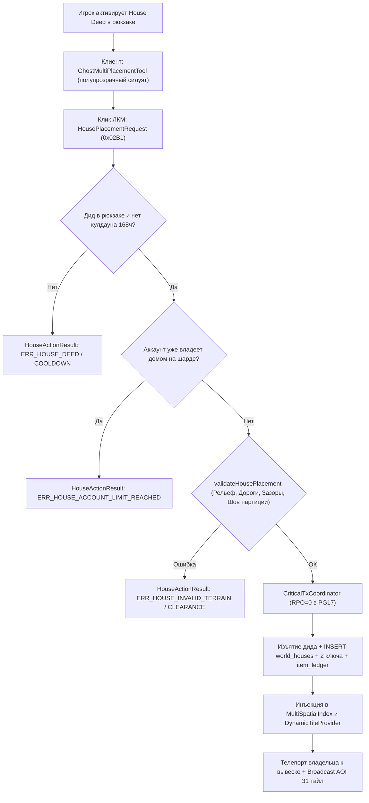
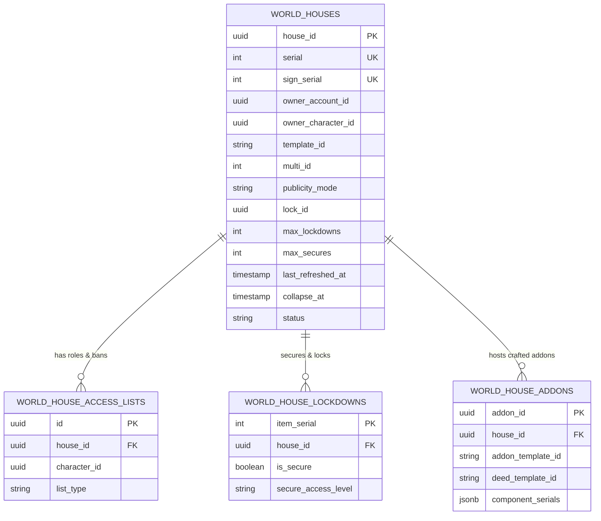
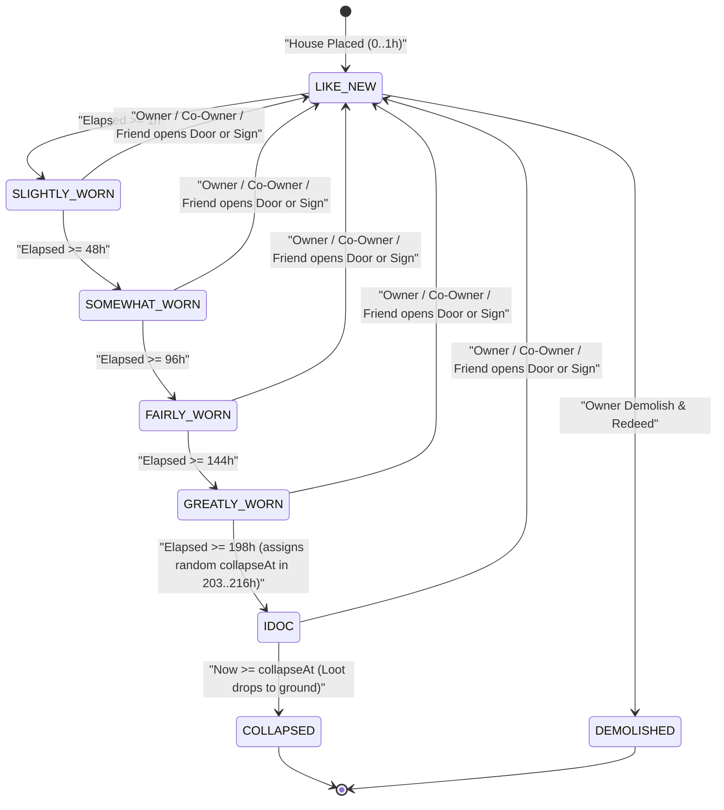

# Design: P23 Дома

## Context

Фаза P23 реализует каноническую систему недвижимости игроков Ultima Online: Renaissance (UO:R) и опирается на фундамент, заложенный в предыдущих фазах:
- **P02 (`@uo3/uo-formats`)**: парсеры `multi.idx` / `multi.mul` (и их синтетический CC0-аналог для CI и dev-мира), возвращающие для каждого `multiId` массив статических компонентов `(itemId, offsetX, offsetY, offsetZ, isVisible)`.
- **P03 (`@uo3/rules/world`)**: интерфейс `DynamicTileProvider`, позволяющий на лету подмешивать динамические тайлы поверх базовой карты в алгоритмы `GetAverageZ`, расчёта опорных поверхностей и 3D DDA Line of Sight без копирования чанков.
- **P05 (`apps/api`, `@uo3/db`)**: токен `CHARACTER_DELETION_GUARDS`, блокирующий удаление персонажа при наличии связанных обязательств.
- **P06/P07 (`apps/game-server`, `@uo3/protocol`)**: сектора `16×16` тайлов, `StateView` Colyseus v3 с поддержкой расширенного радиуса видимости `31` тайл для мульти-объектов и порт `ContainerAccessGrantPort`.
- **P08 (`@uo3/db`)**: `CriticalTxCoordinator` с гарантией `RPO = 0` и неизменяемым журналом `item_ledger` для критических транзакций.
- **P10 (`apps/client`)**: `MultiLayer` в Three.js рендерере для батчинга инстансированных тайлов мульти и послойного отсечения.
- **P12 (`@uo3/rules/movement`)**: функция `checkMovement`, проверяющая флаги `Impassable`, `Surface`, `Bridge`, `StepHeight = 2` и `PersonHeight = 16`.
- **P13/P14**: контейнеры, гампы (`GumpSessionRegistry`), `TargetCursorManager` и `SpeechRouter`.
- **P18**: `IRegionSpellPolicy` для проверки допустимости `Mark`, `Recall`, `Gate Travel` и `Teleport`.
- **P20**: крафтовые `Add-on Deeds` (наковальни, горны, ткацкие станки, кровати, печи) с двухфазной проверкой размещения.
- **P21**: экономика, `Bank Check`, `planCurrencySpend` и порт `IVendorPlacementPolicy` для установки вендоров игроков в публичных домах.

В отличие от одиночных предметов (1 тайл), дом в UO:R — это составная структура размером от `7×7` (Small House) до `31×31` тайла (Castle), пересекающая до 9 секторов `16×16` одновременно. Она меняет физическую проходимость мира, блокирует линию взгляда (LOS), управляет доступом к вложенным контейнерам и вендорам, а при обрушении (IDOC) создаёт пиковую конкурентную нагрузку десятков игроков в одной точке.

## Goals / Non-Goals

### Goals
1. **Изоморфный детерминированный валидатор установки (`validateHousePlacement`)**: единая чистая функция в `@uo3/rules`, исполняемая на клиенте (для подсветки красным/зелёным в `GhostMultiPlacementTool`) и авторитарно на сервере внутри `CriticalTxCoordinator`.
2. **Высокопроизводительный пространственный индекс мульти (`MultiSpatialIndex`)**: регистрация домов по их Bounding Box во всех пересекающихся секторах `16×16` с $O(1)$ проверкой принадлежности точки `(facetId, x, y, z)` дому и инъекцией тайлов стен/полов/лестниц/крыш в `DynamicTileProvider`.
3. **Каноническая модель прав и бюджета хранения UO:R**: ролевая иерархия (`Owner`, `Co-Owner`, `Friend`, `Access List`, `Ban List`), режимы `PUBLIC`/`PRIVATE`, единый пул фиксаций (`maxLockdowns`, где каждый `Secure Container` резервирует 125 единиц) и голосовые команды управления интерьером.
4. **Надёжный жизненный цикл распада (Decay & IDOC)**: 6 стадий износа за 216 реальных часов, автоматический `Refresh` через двери и вывеску, случайный джиттер обрушения в фазе IDOC и атомарное освобождение лута на землю.
5. **Безопасность транзакций (`RPO = 0`)**: защита лимита «1 дом на аккаунт на шарде» уникальным частичным индексом PostgreSQL 17, проведение постройки, передачи, сноса и обрушения через `CriticalTxCoordinator` с записью в `item_ledger`.

### Non-Goals
- Конструктор кастомных домов по тайлам из эпохи Age of Shadows (AoS House Customization) — вне скоупа UO:R.
- Движущиеся мульти-объекты на воде (корабли, их швартовка и трапы) — реализуются в фазе **P24** поверх заложенного здесь `MultiSpatialIndex`.
- Камни гильдий (Guildstones) и война гильдий — реализуются в фазе **P26** (в P23 предоставляется только слот привязки и хук `[TAG]` на вывеске).

## Decisions

### Decision 1: Изоморфная валидация площадки в `@uo3/rules` + двухфазная фиксация в PG17
- **Выбор**: Вся геометрия проверки площадки (`validateHousePlacement`) выносится в чистую функцию `@uo3/rules/src/housing/placement.ts`. На сервере перед записью в БД выполняется:
  1) проверка пространственной блокировки в памяти партиции (`In-Flight Placement Lock` по пересечению Bounding Box + буфер);
  2) синхронная транзакция `CriticalTxCoordinator` в PostgreSQL 17 с уровнем изоляции / уникальным частичным индексом `UNIQUE (shard_id, owner_account_id) WHERE status = 'ACTIVE'`.
- **Обоснование**: Клиент может мгновенно рисовать зелёный или красный контур при движении мыши без сетевых запросов на каждый пиксель, а сервер использует ровно тот же код для финальной проверки, исключая расхождения (ADR-004). Уникальный индекс в БД гарантирует невозможность владения двумя домами даже при одновременной отправке пакетов с двух персонажей одного аккаунта на разных фасетах.
- **Отвергнутые альтернативы**:
  - *Только серверная проверка по клику*: ухудшает UX (игрок не видит до клика, какой именно тайл дерева или дороги мешает установке).
  - *Проверка лимита аккаунта только в памяти комнаты Colyseus*: уязвима к гонке между двумя партициями (например, Trammel и Felucca).

### Decision 2: Пространственная индексация мульти по всем пересекающимся секторам `16×16` и инъекция в `DynamicTileProvider`
- **Выбор**: При загрузке или постройке дома его прямоугольник `[minX..maxX, minY..maxY]` регистрируется во всех секторах `16×16`, которые он пересекает. Статические компоненты шаблона мульти (стены, полы, ступени, крыша) разворачиваются в компактный `MultiTileGrid` и подключаются к `DynamicTileProvider` (P03). Двери и вывеска создаются как отдельные динамические сущности, привязанные к `houseId`.
- **Обоснование**: Castle `31×31` перекрывает от 4 до 9 секторов `16×16`. Если регистрировать дом только по центральной точке, то `checkMovement` (P12), 3D DDA LOS (P03) и `StateView` (P07) на краях замка не увидят стен. Разделение статического каркаса (в `DynamicTileProvider`) и интерактивных дверей/вывески минимизирует число сетевых сущностей Colyseus: вместо ~1200 тайлов замка по сети передаётся 1 дескриптор `MultiEntitySchema` (`multiId`, `x`, `y`, `z`, `houseId`) + 4–6 сущностей дверей и 1 вывеска.
- **Отвергнутые альтернативы**:
  - *Спавн каждого тайла стены дома как отдельного `WorldItem`*: создаёт сотни тысяч лишних объектов в памяти и БД, перегружая сериализацию Colyseus.

### Decision 3: Запрет пересечения границ партиций футпринтом дома (`Partition Seam Guard`)
- **Выбор**: В `validateHousePlacement` вводится правило: прямоугольник дома вместе с буферной зоной (`Bounding Box + 4` тайла) должен целиком принадлежать одной партиции `WorldPartitionRoom`.
- **Обоснование**: Если дом будет разрезан границей двух партиций, его сундуки, двери, фиксации и список посетителей окажутся разделены между двумя процессами/комнатами, что потребует распределённых двухфазных блокировок на каждое открытие сундука или команду `I ban thee`. Запрет постройки на 8-тайловой полосе шва партиции (которые по дизайну P32 проходят по океанам, горам или дорогам) полностью сохраняет локальность состояния дома в одной комнате.
- **Отвергнутые альтернативы**:
  - *Кросс-партиционная репликация интерьера дома через NATS*: неоправданная сложность ради менее чем 0.5% площади карты на швах.

### Decision 4: Единый бюджет хранилища UO:R (`maxLockdowns` включает `Secures * 125`)
- **Выбор**: Реализуется точная математическая модель эпохи UO:Renaissance:
  - Шаблон дома задаёт `maxLockdowns` и `maxSecures`.
  - Каждый установленный защищённый сундук (`Secure Container`) резервирует `125` очков из общего пула `maxLockdowns` (независимо от того, сколько предметов сейчас лежит внутри этого сундука — от 0 до 125).
  - Каждый зафиксированный одиночный предмет на полу (`Locked Down Item`) расходует `1` очко; если зафиксирован незащищённый контейнер, он расходует `1 + count(children)` очков.
  - Формула остатка:
    $$\text{AvailableLockdowns} = \text{MaxLockdowns} - (\text{UsedSecures} \times 125) - \text{CurrentLockdownCount}$$
- **Обоснование**: Исключает обход лимита предметов в доме через вложенные незащищённые сумки и даёт предсказуемую нагрузку на БД и клиентский рендерер (максимальное число предметов в доме строго ограничено `maxLockdowns`).
- **Отвергнутые альтернативы**:
  - *Раздельные независимые пулы для Lockdowns и Secures*: нарушает баланс UO:R, удваивая реальную вместимость домов.

### Decision 5: Перехват голосовых команд дома в конвейере `SpeechRouter`
- **Выбор**: В `SpeechRouter` (P14) регистрируется `HouseSpeechInterceptor`. Когда игрок произносит фразу в обычном или шёпот-канале, интерцептор за $O(1)$ проверяет по `MultiSpatialIndex`, находится ли говорящий внутри периметра какого-либо дома. Если да и текст нормализованно совпадает с одной из 7 канонических команд (`i wish to lock this down`, `i wish to release this`, `i wish to secure this`, `i wish to unsecure this`, `i wish to place a trash barrel`, `i ban thee`, `remove thyself`), команда передаётся в `HouseInteriorService` / `HouseAccessService` для проверки роли и открытия `TargetCursorManager` (таймаут 30 с).
- **Обоснование**: Полное соответствие каноническому UX Ultima Online, при этом речь всё равно отображается над головой персонажа для окружающих, чтобы посетители видели намерение владельца (например, перед `I ban thee`).
- **Отвергнутые альтернативы**:
  - *Управление только кнопками в гампе без голосовых команд*: ломает мышечную память ветеранов UO и макросы клиента.

### Decision 6: Детерминированный автомат распада с рандомизированным окном IDOC
- **Выбор**: Стадия износа дома вычисляется чистой функцией `evaluateHouseDecayStage(elapsedMs, isGrandfathered)` от разницы `now - lastRefreshedAt`:
  - `0..1 ч`: `LIKE_NEW`
  - `1..48 ч`: `SLIGHTLY_WORN`
  - `48..96 ч`: `SOMEWHAT_WORN`
  - `96..144 ч`: `FAIRLY_WORN`
  - `144..198 ч`: `GREATLY_WORN`
  - `198..216 ч`: `IDOC`
  При входе дома в фазу `IDOC` (на 198-м часу) сервер генерирует через сидируемый ГПСЧ `xoshiro128++` скрытый таймстамп `collapseAt` в интервале `[lastRefreshedAt + 203h, lastRefreshedAt + 216h]` (окно от 5 до 18 часов внутри стадии IDOC).
- **Обоснование**: Скрытый джиттер внутри стадии IDOC — важнейший анти-снайпинг механизм UO:R. Если бы дом падал ровно через 216:00:00, боты вычисляли бы секунду падения по моменту перехода в IDOC. Случайное окно 5..18 часов заставляет охотников за IDOC дежурить у дома вживую, создавая точки спонтанного PvP/социального взаимодействия.
- **Отвергнутые альтернативы**:
  - *Фиксированное время падения ровно через 216 часов*: уязвимо для автоматизированных таймеров и кликеров.

### Decision 7: Клиентский Z-Culling крыши и верхних этажей в `MultiLayer`
- **Выбор**: В клиентском `MultiLayer` (P10) каждый компонент мульти при загрузке из `@uo3/uo-formats` размечается высотой `tileZ` и битовой маской принадлежности к внешнему контуру или кровле. Когда координаты управляемого игрока `(playerX, playerY)` входят во внутренний полигон дома (исключая открытые ступени крыльца), в вершинном шейдере / инстанс-буфере `MultiLayer` устанавливается плоскость отсечения `cutoffZ = playerZ + 16`. Все тайлы мульти и предметы интерьера с `z >= cutoffZ` скрываются.
- **Обоснование**: Обеспечивает мгновенное (за 1 кадр без пересборки геометрии) скрытие крыши и верхних этажей при входе в здание и плавное отображение при подъёме по лестнице на 2-й и 3-й этажи.
- **Отвергнутые альтернативы**:
  - *Полная пересборка Three.js Mesh при каждом шаге внутри дома*: вызывает микрофризы и аллокации в GC на крупных домах (`keep`, `castle`).

---

## Каталог канонических шаблонов домов UO:R (`packages/content/housing/house-templates.yaml`)

Все 18 шаблонов домов эпохи UO:Renaissance определяются в декларативном YAML-реестре со следующей таблицей характеристик:

| Template ID | Название | Multi ID | Deed ItemID | Футпринт (W×H) | Цена (Gold) | Max Lockdowns | Max Secures | Max Vendors |
| :--- | :--- | :--- | :--- | :--- | :--- | :--- | :--- | :--- |
| `small_stone_plaster_house` | Small Stone and Plaster House | `0x0064` | `0x14F0` | 7×7 | 43 800 | 425 | 3 | 6 |
| `small_fieldstone_house` | Small Fieldstone House | `0x0066` | `0x14F0` | 7×7 | 43 800 | 425 | 3 | 6 |
| `small_brick_house` | Small Brick House | `0x0068` | `0x14F0` | 7×7 | 43 800 | 425 | 3 | 6 |
| `small_wood_house` | Small Wood House | `0x006A` | `0x14F0` | 7×7 | 43 800 | 425 | 3 | 6 |
| `small_wood_plaster_house` | Small Wood and Plaster House | `0x006C` | `0x14F0` | 7×7 | 43 800 | 425 | 3 | 6 |
| `small_thatched_roof_cottage` | Small Thatched Roof Cottage | `0x006E` | `0x14F0` | 7×7 | 43 800 | 425 | 3 | 6 |
| `small_stone_workshop` | Small Stone Workshop | `0x00A0` | `0x14F0` | 7×7 | 60 600 | 425 | 3 | 6 |
| `small_marble_workshop` | Small Marble Workshop | `0x00A2` | `0x14F0` | 7×7 | 63 000 | 425 | 3 | 6 |
| `small_tower` | Small Tower | `0x0098` | `0x14F0` | 7×8 | 88 500 | 580 | 4 | 8 |
| `sandstone_house_with_patio` | Sandstone House with Patio | `0x009C` | `0x14F0` | 12×9 | 90 900 | 850 | 6 | 12 |
| `two_story_log_cabin` | Two-Story Log Cabin | `0x009A` | `0x14F0` | 8×11 | 97 800 | 1 100 | 8 | 16 |
| `two_story_villa` | Two-Story Villa | `0x009E` | `0x14F0` | 11×11 | 136 500 | 1 100 | 8 | 16 |
| `large_brick_house` | Large Brick House | `0x0074` | `0x14F0` | 14×14 | 144 500 | 1 100 | 8 | 16 |
| `large_patio_house` | Large Patio House | `0x008C` | `0x14F0` | 15×14 | 152 800 | 1 100 | 8 | 16 |
| `large_marble_house_with_patio` | Large Marble House with Patio | `0x0096` | `0x14F0` | 14×14 | 192 000 | 1 370 | 10 | 20 |
| `two_story_wood_plaster_house` | Two-Story Wood and Plaster House | `0x0076` | `0x14F0` | 14×14 | 192 400 | 1 370 | 10 | 20 |
| `two_story_stone_plaster_house` | Two-Story Stone and Plaster House | `0x0078` | `0x14F0` | 14×14 | 192 400 | 1 370 | 10 | 20 |
| `tower` | Tower | `0x007A` | `0x14F0` | 16×14 | 433 200 | 2 119 | 15 | 30 |
| `keep` | Stone Keep | `0x007C` | `0x14F0` | 24×24 | 665 200 | 2 625 | 18 | 36 |
| `castle` | Castle | `0x007E` | `0x14F0` | 31×31 | 1 022 850 | 4 879 | 28 | 56 |

*(Примечание: 18 основных архитектурных классов покрывают все 20 исторических дидов с учётом парных текстурных вариантов).*

---

## Математические алгоритмы и геометрические правила (`packages/rules/src/housing`)

### 1. Алгоритм валидации площадки (`validateHousePlacement`)
Пусть выбранный шаблон дома имеет базовый прямоугольник относительно центра `(cx, cy)`:
$$X \in [cx + x_{\min}, cx + x_{\max}], \quad Y \in [cy + y_{\min}, cy + y_{\max}]$$
и буферную зону расчистки:
- Север, Запад, Восток: $1$ тайл ($x_{\min} - 1$, $x_{\max} + 1$, $y_{\min} - 1$).
- Юг (передний двор и крыльцо): $4$ тайла ($y_{\max} + 1 \dots y_{\max} + 4$).

Проверка выполняется в 6 детерминированных шагов:
1. **Проверка границ партиции (`Partition Boundary Check`)**:
   Прямоугольник $[cx + x_{\min} - 4, cx + x_{\max} + 4] \times [cy + y_{\min} - 4, cy + y_{\max} + 4]$ должен целиком лежать внутри одной серверной партиции (`ERR_HOUSE_CROSSES_PARTITION_BOUNDARY`).
2. **Проверка региона (`Region & Road Check`)**:
   Проверка выполняется через порт `IHousingRegionPolicy`: реализация по умолчанию в P23 использует охраняемые зоны `pvp/guard-zones` (P17) и статический список запретных прямоугольников (`content/housing/restricted-areas.yaml`: подземелья, лунные врата, входы в данжи); фаза P25 заменяет её реализацией на основе `world/regions` без изменения контракта. Ни один тайл внутри $[x_{\min}-1 \dots x_{\max}+1] \times [y_{\min}-1 \dots y_{\max}+4]$ не должен принадлежать региону с флагами `GuardZone`, `Dungeon`, `NoHousing`, находиться ближе 16 тайлов к `Moongate` / входу в подземелье (`ERR_HOUSE_RESTRICTED_REGION`) или содержать тайл дороги (`ERR_HOUSE_ON_ROAD`).
3. **Проверка рельефа основного футпринта (`Terrain Flatness & Surface`)**:
   Для всех тайлов $(x, y) \in [cx + x_{\min}, cx + x_{\max}] \times [cy + y_{\min}, cy + y_{\max}]$:
   - Вычисляется $z(x, y) = \text{GetAverageZ}(x, y)$.
   - Размах высот $\Delta Z = \max z(x, y) - \min z(x, y) \le 5$ (`ERR_HOUSE_INVALID_TERRAIN`).
   - Базовый `landTileId` не имеет флагов `Wet` (вода), `Impassable` (скала/лава) и не относится к списку пещерных/болотных тайлов.
   - На тайле нет статических объектов (`statics`) с флагами `Impassable` или `Surface` выше $z(x, y) + 2$.
4. **Проверка занятости футпринта динамическими объектами (`Footprint Occupancy`)**:
   Внутри основного прямоугольника $[cx + x_{\min}, cx + x_{\max}] \times [cy + y_{\min}, cy + y_{\max}]$ не должно находиться ни одного предмета на земле, спавнера, NPC или другого игрока (кроме самого строящего игрока, который при постройке автоматически выталкивается на точку перед вывеской `(signX, signY + 1, signZ)`). Иначе возвращается `ERR_HOUSE_FOOTPRINT_OCCUPIED`.
5. **Проверка буферной зоны (`Clearance Buffer`)**:
   - В 1-тайловой кайме по бокам и сзади и в 4-тайловом южном дворе перед крыльцом не должно быть блокирующей статики (`Impassable`, деревьев, заборов) и динамических блокирующих предметов (`ERR_HOUSE_CLEARANCE_BLOCKED`).
6. **Проверка дистанции до соседних домов (`Neighbor House Distance`)**:
   Для каждого существующего дома $H_i$ с основным прямоугольником $[x_{i,\min}, x_{i,\max}] \times [y_{i,\min}, y_{i,\max}]$:
   - По оси $X$ зазор между основными прямоугольниками должен быть $\ge 1$ тайл.
   - По оси $Y$ (север-юг) зазор между основным прямоугольником одного дома и южным крыльцом другого должен быть $\ge 5$ тайлов (`ERR_HOUSE_CLEARANCE_BLOCKED`).



---

## Модели данных PostgreSQL 17 (`packages/db/src/schema/housing.ts`)

```typescript
// Таблица активных и исторических домов
export const worldHouses = pgTable('world_houses', {
  houseId: uuid('house_id').primaryKey().defaultRandom(),
  shardId: smallint('shard_id').notNull(),
  facetId: smallint('facet_id').notNull(),
  serial: integer('serial').notNull().unique(), // Серийник мульти-сущности (0x40000000..0x7FFFFFFF)
  signSerial: integer('sign_serial').notNull().unique(),
  templateId: varchar('template_id', { length: 64 }).notNull(),
  multiId: integer('multi_id').notNull(),
  ownerAccountId: uuid('owner_account_id').notNull(),
  ownerCharacterId: uuid('owner_character_id').notNull(),
  houseName: varchar('house_name', { length: 60 }).notNull().default('a house'),
  signGraphicId: integer('sign_graphic_id').notNull().default(0x0BD2),
  centerX: smallint('center_x').notNull(),
  centerY: smallint('center_y').notNull(),
  centerZ: smallint('center_z').notNull(),
  minX: smallint('min_x').notNull(),
  minY: smallint('min_y').notNull(),
  maxX: smallint('max_x').notNull(),
  maxY: smallint('max_y').notNull(),
  signX: smallint('sign_x').notNull(),
  signY: smallint('sign_y').notNull(),
  signZ: smallint('sign_z').notNull(),
  publicityMode: varchar('publicity_mode', { length: 16 }).notNull().default('PRIVATE'), // 'PRIVATE' | 'PUBLIC'
  lockId: uuid('lock_id').notNull(),
  maxLockdowns: smallint('max_lockdowns').notNull(),
  maxSecures: smallint('max_secures').notNull(),
  maxVendors: smallint('max_vendors').notNull(),
  trashBarrelSerial: integer('trash_barrel_serial'),
  guildstoneSerial: integer('guildstone_serial'), // Слот для P26
  isGrandfathered: boolean('is_grandfathered').notNull().default(false),
  isCondemned: boolean('is_condemned').notNull().default(false),
  status: varchar('status', { length: 16 }).notNull().default('ACTIVE'), // 'ACTIVE' | 'DEMOLISHED' | 'COLLAPSED'
  builtAt: timestamp('built_at', { withTimezone: true }).notNull().defaultNow(),
  lastRefreshedAt: timestamp('last_refreshed_at', { withTimezone: true }).notNull().defaultNow(),
  idocEnteredAt: timestamp('idoc_entered_at', { withTimezone: true }),
  collapseAt: timestamp('collapse_at', { withTimezone: true }),
}, (t) => [
  // Жёсткий инвариант: не более 1 активного дома на аккаунт на шарде
  uniqueIndex('uq_world_houses_one_active_per_account')
    .on(t.shardId, t.ownerAccountId)
    .where(sql`${t.status} = 'ACTIVE'`),
  index('idx_world_houses_spatial').on(t.shardId, t.facetId, t.minX, t.maxX, t.minY, t.maxY),
]);

// Списки ролей и банов дома (Co-Owners до 8, Friends до 50, Access до 50, Bans до 50)
export const worldHouseAccessLists = pgTable('world_house_access_lists', {
  id: uuid('id').primaryKey().defaultRandom(),
  houseId: uuid('house_id').notNull().references(() => worldHouses.houseId, { onDelete: 'cascade' }),
  characterId: uuid('character_id').notNull(),
  characterName: varchar('character_name', { length: 64 }).notNull(),
  listType: varchar('list_type', { length: 16 }).notNull(), // 'CO_OWNER' | 'FRIEND' | 'ACCESS' | 'BAN'
  addedByCharacterId: uuid('added_by_character_id').notNull(),
  createdAt: timestamp('created_at', { withTimezone: true }).notNull().defaultNow(),
}, (t) => [
  uniqueIndex('uq_house_access_character').on(t.houseId, t.characterId, t.listType),
]);

// Зафиксированные предметы и защищённые сундуки
export const worldHouseLockdowns = pgTable('world_house_lockdowns', {
  itemSerial: integer('item_serial').primaryKey(),
  houseId: uuid('house_id').notNull().references(() => worldHouses.houseId, { onDelete: 'cascade' }),
  isSecure: boolean('is_secure').notNull().default(false),
  secureAccessLevel: varchar('secure_access_level', { length: 16 }).notNull().default('OWNER_ONLY'), // 'OWNER_ONLY' | 'CO_OWNERS' | 'FRIENDS' | 'ANYONE'
  lockedByCharacterId: uuid('locked_by_character_id').notNull(),
  lockedAt: timestamp('locked_at', { withTimezone: true }).notNull().defaultNow(),
});

// Установленные крафтовые аддоны (из Add-on Deeds P20)
export const worldHouseAddons = pgTable('world_house_addons', {
  addonId: uuid('addon_id').primaryKey().defaultRandom(),
  houseId: uuid('house_id').notNull().references(() => worldHouses.houseId, { onDelete: 'cascade' }),
  addonTemplateId: varchar('addon_template_id', { length: 64 }).notNull(),
  deedTemplateId: varchar('deed_template_id', { length: 64 }).notNull(),
  anchorX: smallint('anchor_x').notNull(),
  anchorY: smallint('anchor_y').notNull(),
  anchorZ: smallint('anchor_z').notNull(),
  componentSerials: jsonb('component_serials').$type<number[]>().notNull(),
  placedByCharacterId: uuid('placed_by_character_id').notNull(),
  createdAt: timestamp('created_at', { withTimezone: true }).notNull().defaultNow(),
});
```



---

## Сетевой протокол и схемы Colyseus (`packages/protocol/src/housing`)

### Опкоды сообщений (`0x02B0..0x02BB`)

| Опкод | Имя сообщения | Направление | Назначение и ключевые поля TypeBox |
| :--- | :--- | :--- | :--- |
| `0x02B0` | `HousePlacementPreviewStart` | S -> C | Запуск режима превью: `deedSerial: uint32`, `templateId: string`, `multiId: uint16`, `footprint: { minX, maxX, minY, maxY }` |
| `0x02B1` | `HousePlacementRequest` | C -> S | Запрос постройки: `deedSerial: uint32`, `targetX: uint16`, `targetY: uint16`, `targetZ: int8` |
| `0x02B2` | `HouseSignGumpOpen` | S -> C | Открытие гампа вывески: `houseId: string`, `houseName: string`, `ownerName: string`, `signGraphicId: uint16`, `decayStage: HouseDecayStage`, `publicityMode: 'PRIVATE'\|'PUBLIC'`, `usedLockdowns: uint16`, `maxLockdowns: uint16`, `usedSecures: uint8`, `maxSecures: uint8`, `usedVendors: uint8`, `maxVendors: uint8`, `viewerRole: HouseAccessRole`, `lists: { coOwners, friends, access, bans }` |
| `0x02B3` | `HouseManageActionRequest` | C -> S | Действие в гампе вывески: `houseId: string`, `action: 'RENAME' \| 'CHANGE_SIGN' \| 'SET_PUBLICITY' \| 'CHANGE_LOCKS' \| 'DEMOLISH' \| 'INIT_TRANSFER'`, `payload: { newName?, signGraphicId?, publicityMode? }` |
| `0x02B4` | `HouseAccessListModifyRequest` | C -> S | Управление списками доступа: `houseId: string`, `listType: 'CO_OWNER' \| 'FRIEND' \| 'ACCESS' \| 'BAN'`, `operation: 'ADD_BY_TARGET' \| 'REMOVE' \| 'CLEAR'`, `targetCharacterId?: string` |
| `0x02B5` | `HouseInteriorCommandRequest` | C -> S | Прямой/голосовой запрос фиксации или изгнания: `command: 'LOCKDOWN' \| 'RELEASE' \| 'SECURE' \| 'UNSECURE' \| 'PLACE_TRASH' \| 'EJECT' \| 'BAN'`, `targetSerial?: uint32` |
| `0x02B6` | `HouseSecureLevelUpdateRequest` | C -> S | Изменение уровня доступа к сундуку: `houseId: string`, `containerSerial: uint32`, `accessLevel: 'OWNER_ONLY' \| 'CO_OWNERS' \| 'FRIENDS' \| 'ANYONE'` |
| `0x02B7` | `HouseTransferOfferEvent` | S -> C | Модальное предложение приёма дома получателю: `transferId: string`, `houseId: string`, `houseName: string`, `templateId: string`, `fromOwnerName: string`, `expiresInMs: uint16` |
| `0x02B8` | `HouseTransferResponse` | C -> S | Ответ получателя на передачу дома: `transferId: string`, `accepted: boolean` |
| `0x02B9` | `HouseActionResult` | S -> C | Результат любой операции с домом: `success: boolean`, `action: string`, `errorCode?: HouseErrorCode`, `messageClilocId?: uint32` |
| `0x02BA` | `HouseMultiSyncEvent` | S -> C | Дескриптор мульти в AOI 31 тайл: `serial: uint32`, `houseId: string`, `multiId: uint16`, `x: uint16`, `y: uint16`, `z: int8`, `signSerial: uint32`, `houseName: string`, `guildTag?: string` |
| `0x02BB` | `HouseCollapseBroadcast` | S -> C | Событие обрушения IDOC / сноса для удаления из `DynamicTileProvider` и `MultiLayer`: `serial: uint32`, `houseId: string`, `reason: 'IDOC' \| 'REDEED'` |

### Схема состояния Colyseus (`HouseMultiSchema`)
В `WorldPartitionState` добавляется коллекция `multis: MapSchema<HouseMultiSchema>`, синхронизируемая через `StateView` всем клиентам, чей секторный AOI (`31` тайл) пересекает Bounding Box дома. Двери дома синхронизируются как `WorldItemSchema` с флагами `isDoor = true`, `isOpen: boolean`, `isLocked: boolean` и `parentMultiSerial: uint32`.



---

## Интеграция с контрактами соседних фаз

1. **`DynamicTileProvider` (P03) & `checkMovement` (P12)**:
   - `HouseSpatialRegistry` реализует `DynamicTileProvider`. Для каждого тайла `(x, y)` внутри Bounding Box дома провайдер возвращает статические тайлы шаблона мульти (`floor`, `wall`, `stairs`, `roof`) со смещением `centerZ + offsetZ`, а также текущее состояние дверей (закрытая дверь добавляет `Impassable` + блокировку LOS; открытая дверь смещается на соседний тайл и освобождает дверной проём).
2. **`ContainerAccessGrantPort` (P07/P13)**:
   - При попытке игрока открыть контейнер или взять из него предмет `HouseInteriorService` проверяет, зарегистрирован ли контейнер в `world_house_lockdowns` с `isSecure = true`. Если да — проверяет роль игрока в доме против `secureAccessLevel` (`OWNER_ONLY`, `CO_OWNERS`, `FRIENDS`, `ANYONE`). Если предмет имеет `isLockedDown = true`, операция `PickUp` отклоняется с `ERR_ITEM_LOCKED_DOWN`.
3. **`IRegionSpellPolicy` (P18)**:
   - Любой тайл, попадающий во внутренний Bounding Box активного дома, отклоняет каст `Mark`, а также выбор целевой точки для `Teleport`, `Recall` и `Gate Travel` с кодом `ERR_TRAVEL_RESTRICTED` / `ERR_TELEPORT_BLOCKED` (коды P18).
4. **`Add-on Deeds` (P20)**:
   - Когда игрок активирует крафтовый `Add-on Deed` (`Anvil Deed`, `Forge Deed`, `Loom Deed`, `Spinning Wheel Deed`, `Small Bed Deed`, `Large Bed Deed`, `Stone Oven Deed`, `Training Dummy Deed`, `Pickpocket Dip Deed`), вызывается `HouseInteriorService.placeAddon()`. Проверяется роль `Owner` или `Co-Owner`, нахождение всех тайлов аддона внутри комнат дома и отсутствие дверей в радиусе 1 тайла (`ERR_HOUSE_ADDON_BLOCKS_DOOR`). При ударе топором по любому компоненту аддона владельцем/совладельцем аддон удаляется и в рюкзак возвращается `Add-on Deed`.
5. **`IVendorPlacementPolicy` (P21)**:
   - Реализует проверку для `Contract of Employment`: дом должен быть в режиме `PUBLIC`, вызывающий игрок должен иметь роль `Owner`, `Co-Owner` или `Friend`, число активных вендоров в доме `< maxVendors`, а на целевом тайле не должно быть других вендоров.
6. **`CHARACTER_DELETION_GUARDS` (P05)**:
   - Зарегистрированный `HouseOwnerDeletionGuard` проверяет `SELECT 1 FROM world_houses WHERE owner_character_id = $1 AND status = 'ACTIVE'` и блокирует удаление персонажа с кодом `ERR_CHARACTER_OWNS_HOUSE`.

---

## Risks / Trade-offs

- **[Риск] Массовая конкуренция и нагрузка в точке обрушения IDOC (50+ игроков спамят PickUp в одном секторе)** → Митигация: обрушение дома выполняется за один тик симуляции (50 мс) с пакетной генерацией дельты `StateView`; существующий рейт-лимитер `Drag-and-Drop` из P13 (не более 1 попытки `PickUp` за 600 мс на игрока) и серверная атомарная привязка `HeldItem` предотвращают дюп и перегрузку цикла комнаты.
- **[Риск] Блокировка проходов между локациями намеренной плотной застройкой** → Митигация: обязательный зазор 1 тайл по бокам/сзади и 4 тайла спереди для каждого дома гарантирует минимум 2..5 тайлов свободного коридора между любыми двумя домами, через который всегда проходит пеший и конный персонаж.
- **[Риск] Использование домов как бесконечной фермы бесплатных дидов или перепродажи участков в первые минуты старта шарда** → Митигация: жёсткий лимит 1 дом на аккаунт на уровне индекса PG17, 7-дневный кулдаун (`168` часов) на установку нового дома и 20% штраф (`SINK_HOUSE_EARLY_REDEED`) при сносе дома в первые 7 дней.
- **[Риск] Запирание игрока внутри дома при установке аддона или фиксации мебели перед дверью** → Митигация: запрет установки аддонов и сундуков в радиусе 1 тайла от любой двери дома (`ERR_HOUSE_ADDON_BLOCKS_DOOR`) плюс доступность команды `Remove thyself` на самого себя для мгновенного выхода к вывеске дома `(signX, signY + 1, signZ)`.
- **[Риск] Персонажи на втором этаже/крыше зависают в воздухе при сносе или обрушении дома** → Митигация: при удалении мульти из `DynamicTileProvider` сервер принудительно пересчитывает `Z` для всех мобилей внутри Bounding Box дома на уровень земли `GetAverageZ(x, y)` и рассылает `TeleportSync`.
- **[Риск] Потеря товаров и золота вендоров игроков при внезапном обрушении дома по IDOC** → Митигация: добровольный снос и перевод в `PRIVATE` блокируются при наличии вендоров (`ERR_HOUSE_HAS_ACTIVE_VENDORS`), а при принудительном обрушении `IDOC` накопленное золото вендоров автоматически переводится в банковский эскроу их владельцев через `CriticalTxCoordinator`.

## Migration Plan

1. Применить миграцию Drizzle `packages/db/drizzle/0023_p23_housing.sql`, создающую таблицы `world_houses`, `world_house_access_lists`, `world_house_lockdowns`, `world_house_addons` и уникальный частичный индекс `uq_world_houses_one_active_per_account`.
2. Загрузить YAML-каталоги `house-templates.yaml`, `house-signs.yaml` и `house-addons.yaml` в `@uo3/content` и сгенерировать синтетические CC0-мульти для всех 18 шаблонов домов в `@uo3/test-kit` и `apps/asset-tool`.
3. Активировать `HouseModule` в `apps/game-server`, подключить `HouseSpatialRegistry` к `DynamicTileProvider`, зарегистрировать реализации портов `IVendorPlacementPolicy`, `IRegionSpellPolicy`, `ContainerAccessGrantPort` и `CHARACTER_DELETION_GUARDS`.
4. Включить клиентский `GhostMultiPlacementTool`, Z-culling крыш в `MultiLayer` и `HouseSignGump` в `@uo3/ui-kit`.

## Open Questions

- Должен ли на шарде включаться опциональный налог на содержание недвижимости (Property Tax) для вывода золота на поздних стадиях экономики? *(Отложено: в базовом каноне UO:R содержание дома бесплатное и требует только регулярного обновления раз в 9 дней; при необходимости налог легко добавляется параметром конфигурации шарда в P30).*
- Разрешать ли прострел заклинаний и стрел сквозь оконные тайлы домов (`allowWindowLos`)? *(По умолчанию `false` согласно канону PvP UO:R, вынесено в конфигурацию шарда `@uo3/config`).*
