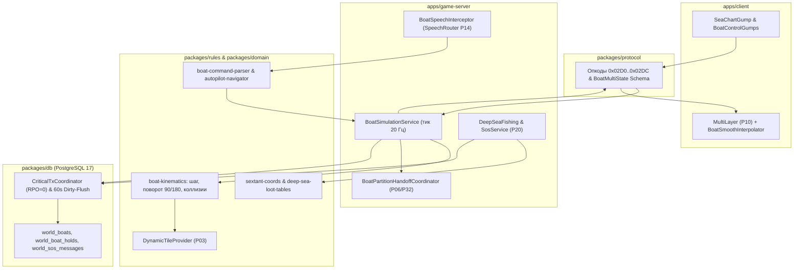
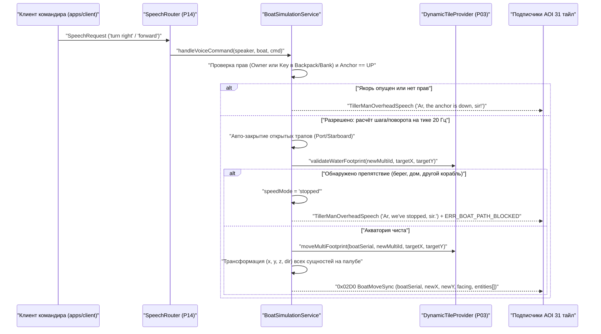

# Design: P24 Корабли и море

## Context

Фаза P24 (`p24-boats-and-sea`) расширяет подсистему мульти-объектов (введённую для домов в P23) до **подвижных многотайловых платформ** (Moving Multis) и открывает морской игровой цикл Ultima Online: Renaissance. В отличие от зданий P23, чьи координаты неизменны от постройки до сноса, корабль:
1. Имеет 4 физические ориентации корпуса (North `0`, East `2`, South `4`, West `6`), каждая из которых соответствует собственному `multiId` и набору смещений тайлов палубы, бортов, мачты, румпельщика (`Tiller Man`), трюма (`Hold`) и двух трапов (`Port/Starboard Gangplank`).
2. Двигается с частотой 1 шаг за 500 мс (`normal`, 10 тиков симуляции) или 1000 мс (`slow`, 20 тиков) в 8 направлениях и совершает мгновенные повороты на $\pm 90^\circ$ и $180^\circ$.
3. Является родительской системой координат для всех находящихся на палубе сущностей (игроков, приручённых питомцев, NPC, трупов и предметов), которые обязаны перемещаться и поворачиваться синхронно с корпусом без проваливания в воду и без ложных срабатываний античита движения (`TimeCreditTracker` из P12).
4. Способен пересекать линию перемены дат (тороидальный шов океана `X = 0 <-> 5119`) и границы серверных партиций (`WorldPartitionRoom` из P06/P32) единым атомарным агрегатом.

Архитектура опирается на зафиксированные контракты P03 (`DynamicTileProvider`), P05 (`CHARACTER_DELETION_GUARDS`), P06/P07 (`StateView` AOI 31 тайл для мульти, `TeleportSync`, `PartitionHandoffTicket`), P08 (`CriticalTxCoordinator` RPO=0 и 60-секундный dirty-flush), P10 (`MultiLayer`), P12 (`checkMovement`), P14 (`SpeechRouter`, `GumpSessionRegistry`, `TargetCursorManager`), P16–P18 (бой, Notoriety, `IRegionSpellPolicy`), P19 (водная локомоция NPC) и P20 (банки рыбы 8×8 и навык Fishing).

## Goals / Non-Goals

### Goals
- Изоморфная детерминированная кинематика кораблей в `@uo3/rules`: проверка водного контура, коллизий, шаг в 8 румбах и матричный разворот палубы на $90^\circ / 180^\circ$.
- Атомарный жизненный цикл корабля через `CriticalTxCoordinator` (RPO=0): покупка дида у `Shipwright`, спуск на воду с выдачей пары ключей, смена замков, докование в `Docked Ship` и 9-суточный износ до затопления.
- Голосовой парсер команд румпельщика, интегрированный в `SpeechRouter` (P14), и автопилот по путевым точкам морской карты (`Sea Chart` + `Sextant`).
- Пакетное обновление позиции корабля и экипажа в `@uo3/protocol` (`0x02D0..0x02DC`) для плавной отрисовки в `apps/client` без рассинхронизации камеры и `MultiLayer`.
- Бесшовный тороидальный переход `X = 0 <-> 5119` и межпартиционный хэндофф корабля со всем содержимым палубы и трюма.
- Полный цикл глубоководного контента UO:R: рыбалка с борта (Fishing ≥ 80.0%), `Big Fish`, магические рыбы, `Special Fishing Net`, бутылки `Waterstained SOS` (уровни 1..4 и `Ancient SOS`), подъём `Shipwreck Chest` и морские монстры (`Sea Serpent`, `Deep Sea Serpent`, `Kraken`, `Leviathan`).

### Non-Goals
- Корабельная артиллерия, пушки, боеприпасы и повреждение корпуса с ремонтом досками (механики дополнения High Seas).
- Плавание персонажей в воде без корабля и подводные локации.
- Свободная постройка кастомных судов игроками.

## Decisions

### Decision 1: Представление корабля как ориентированного Dynamic Multi в `DynamicTileProvider`
- **Выбор**: Каждый из 6 типов кораблей представлен 4 предвычисленными шаблонами мультов (`northMultiId`, `eastMultiId`, `southMultiId`, `westMultiId` — базовые ID `0x4000..0x4017`). При движении или повороте корабль атомарно обновляет свою запись в `DynamicTileProvider` (P03) и секторном индексе `16×16`: старые тайлы освобождаются, новые регистрируются с флагами поверхности палубы (`Surface`, `Bridge` для трапов, `Impassable` для бортов и мачты).
- **Обоснование**: Позволяет `checkMovement` (P12) и 3D DDA LOS (P03) работать на палубе корабля точно так же, как на земле или в доме P23, без специальных веток кода для ходьбы по палубе.
- **Отвергнутые альтернативы**: Хранение локальных координат игроков только относительно корабля с отключением мирового `checkMovement` — отвергнуто, так как ломает расчёт дистанций АОЕ-заклинаний, стрельбы между кораблями и секторный AOI.

### Decision 2: Пакетный перенос экипажа (`BoatSmoothMovePacket`) без расхода `TimeCreditTracker`
- **Выбор**: Когда корабль совершает шаг на $(\Delta x, \Delta y)$ или поворот, сервер вычисляет множество сущностей на борту $E_{\text{board}}$ (все мобилы, трупы и корневые предметы на палубе, чьи координаты $(x, y, z)$ принадлежат футпринту палубы с $|z - z_{\text{deck}}| \le 16$). Сервер атомарно обновляет их мировые координаты и рассылает единый пакет `BoatMoveSync` (`0x02D0`), не затрагивая `TimeCreditTracker` (P12) и не требуя `WalkAck` от клиентов.
- **Обоснование**: Игрок на палубе может одновременно бежать по палубе со своей скоростью (200/400 мс) пока корабль плывёт (500/1000 мс). Разделение собственного шага игрока и переноса платформы исключает ложные `WalkDeny` и визуальный джиттер.
- **Отвергнутые альтернативы**: Рассылка индивидуальных `TeleportSync` (`0x0104`) каждому пассажиру на каждый шаг корабля — отвергнуто из-за $O(N \times M)$ трафика и сброса анимации ходьбы на клиенте каждые 500 мс.

### Decision 3: Матричный поворот на $90^\circ / 180^\circ$ с двухфазной проверкой акватории
- **Выбор**: Поворот вокруг опорной точки корабля $(X_0, Y_0)$ выполняется по целочисленной матрице:
  - Вправо ($+90^\circ$, `CW`): $(dx', dy') = (-dy, dx)$, направление мобилов $d' = (d + 2) \bmod 8$.
  - Влево ($-90^\circ$, `CCW`): $(dx', dy') = (dy, -dx)$, направление мобилов $d' = (d + 6) \bmod 8$.
  - Кругом ($180^\circ$, `Around`): $(dx', dy') = (-dx, -dy)$, направление мобилов $d' = (d + 4) \bmod 8$.
  Перед применением трансформации сервер строит целевой футпринт нового `multiId`, исключает из проверки собственный текущий футпринт этого же корабля и проверяет, что все новые тайлы корпуса лежат на чистой глубокой воде без чужих кораблей, берега, статики и мобилов в воде.
- **Обоснование**: Строго воспроизводит канон UO:R, гарантируя, что ни один предмет или игрок на палубе не окажется за бортом после разворота.
- **Отвергнутые альтернативы**: Постепенный поворот через промежуточные диагональные кадры — в классических ассетах UO мульти-спрайты кораблей существуют только для 4 ортогональных сторон света (N, E, S, W).

### Decision 4: Конечный автомат румпельщика и перехват речи в `SpeechRouter`
- **Выбор**: `BoatCommandParser` в `@uo3/rules` разбирает нормализованную строку речи в структуры `BoatVoiceCommand`. В `SpeechRouter` (P14) регистрируется слушатель: если говорящий (включая призрака владельца!) находится на палубе корабля в радиусе 15 тайлов от его `Tiller Man`, команда передаётся румпельщику этого судна. Приоритет авторизации:
  1. Владелец корабля (`ownerCharacterId === speaker.id`).
  2. Любой персонаж на палубе, имеющий в рюкзаке или банковской ячейке ключ с `keyCode === boat.keyCode`.
- **Обоснование**: Исключает угон корабля случайным пассажиром или захват управления с соседнего судна при сближении бортами.
- **Отвергнутые альтернативы**: Отдельные кнопки управления вместо голосовых команд — нарушает канон UO:R; при этом клиент может отправлять стандартные речевые макросы.

### Decision 5: Межпартиционный хэндофф и тороидальный переход корабля как единой транзакции
- **Выбор**: Корабль принадлежит той партиции `WorldPartitionRoom`, в которой находится его опорная точка $(X_0, Y_0)$. Буфер видимости между партициями составляет $\ge 32$ тайла (P03/P07), что полностью перекрывает максимальный габарит `Large Dragon Ship` ($11 \times 13$ тайлов). Когда $(X_0, Y_0)$ пересекает границу партиции или меридиан $X = 0 \leftrightarrow 5119$:
  1. Исходная партиция сериализует `BoatHandoffPayload` (состояние корабля, `partition_epoch + 1`, трюм, список всех сущностей $E_{\text{board}}$ с их относительными смещениями).
  2. Публикует сообщение в NATS JetStream для целевой партиции и фиксирует эпоху в PostgreSQL.
  3. Всем клиентам на палубе синхронно выдаются `PartitionHandoffTicket` (P12).
- **Обоснование**: Предотвращает «разрезание» корабля на границе воркеров и гарантирует, что экипаж никогда не окажется в воде пока корабль ушёл в соседнюю партицию.
- **Отвергнутые альтернативы**: Запрет пересечения границ партиций кораблями — невозможно для единого бесшовного океана.

### Decision 6: Единый конвейер глубоководной рыбалки, сетей и SOS поверх `FishingService` (P20)
- **Выбор**: В `@uo3/rules` вводится предикат глубокой воды `isDeepWater(facet, x, y)`: квадрат $9 \times 9$ вокруг целевого тайла $(x, y)$ (радиус Чебышёва $\ge 4$, т.е. минимум 5 тайлов до любого тайла суши/мелководья) должен состоять исключительно из тайлов глубокой воды без флага `Wet == false`. При забросе удочки в глубокую воду проверяется:
  1. Наличие в рюкзаке рыбака активного `SOS Message` на том же фасете с $\max(|x - x_{\text{sos}}|, |y - y_{\text{sos}}|) \le 4$ — запускает таблицу подъёма кораблекрушения.
  2. Иначе при `Fishing >= 800` (80.0%) поверх стандартного банка 8×8 (P20) выполняются роллы глубоководных трофеев (`Big Fish`, чудо-рыбы, `Special Fishing Net`, `Sea Serpent`, а при `Fishing >= 900` — `Waterstained SOS`).
- **Обоснование**: Переиспользует пространственные банки ресурсов 8×8 и анти-макро защиту из P15/P20, добавляя детерминированное ветвление по глубине и свиткам SOS.
- **Отвергнутые альтернативы**: Спавн видимых объектов SOS прямо на воде для всех игроков — отвергнуто, так как в UO:R место крушения может выловить только держатель соответствующего свитка SOS.

### Decision 7: Спасение призраков в открытом море и привязка трупов к палубе
- **Выбор**: Труп (`0x2006`), созданный на палубе корабля, получает поле `parentBoatSerial` и локальное смещение `(relX, relY, relZ)`, благодаря чему перемещается и поворачивается вместе с судном до своего распада или докования. Призрак владельца сохраняет право голосовой команды румпельщику (`SpeechRouter` пропускает команды румпельщика от мёртвого владельца/держателя ключа). Для призрака пассажира, застрявшего на чужом или неуправляемом судне вдали от берега, вводится действие `SeaGhostRescue` (`0x02DC`), телепортирующее призрака к ближайшему прибрежному святилищу/целителю.
- **Обоснование**: Решает классическую проблему софт-лока игрока, погибшего посреди океана без возможности дойти пешком по воде до берега.
- **Отвергнутые альтернативы**: Разрешение призракам ходить по глубокой воде — нарушает правила локомоции P12 и позволяет разведку всего океана призраками.

## Архитектура модулей и распределение ответственности

### Пакет `@uo3/domain`
- `BoatType`: `'small_ship' | 'small_dragon_ship' | 'medium_ship' | 'medium_dragon_ship' | 'large_ship' | 'large_dragon_ship'`.
- `BoatFacing`: `0` (North) | `2` (East) | `4` (South) | `6` (West).
- `BoatSpeedMode`: `'stopped' | 'one' | 'slow' | 'normal'`.
- `BoatCourseDirection`: относительное смещение курса `0..7` (Forward, ForwardRight, Right/DriftRight, BackRight, Back, BackLeft, Left/DriftLeft, ForwardLeft).
- `BoatDecayStage`: `0` (LikeNew) .. `5` (InDangerOfSinking).
- `SosDifficultyLevel`: `1 | 2 | 3 | 4` (`isAncient: boolean` для уровня 4).

### Пакет `@uo3/rules`
1. **Каталог корпусов и геометрия (`packages/rules/src/sea/boat-catalog.ts`)**:
   | Тип корабля | Base Multi ID (N/E/S/W) | Цена дида (gp) | Габарит (N/S) | Смещение TillerMan (N) | Смещение Hold (N) | Трапы Port / Starboard (N) |
   |---|---|---|---|---|---|---|
   | `small_ship` | `0x4000..0x4003` | 10 177 | $5 \times 11$ | `(1, 4)` | `(0, -4)` | `(-2, 0)` / `(2, 0)` |
   | `small_dragon_ship` | `0x4004..0x4007` | 10 177 | $5 \times 11$ | `(1, 4)` | `(0, -4)` | `(-2, 0)` / `(2, 0)` |
   | `medium_ship` | `0x4008..0x400B` | 11 552 | $5 \times 13$ | `(1, 5)` | `(0, -4)` | `(-2, 0)` / `(2, 0)` |
   | `medium_dragon_ship` | `0x400C..0x400F` | 11 552 | $5 \times 13$ | `(1, 5)` | `(0, -4)` | `(-2, 0)` / `(2, 0)` |
   | `large_ship` | `0x4010..0x4013` | 12 927 | $5 \times 15$ | `(1, 5)` | `(0, -5)` | `(-2, -1)` / `(2, -1)` |
   | `large_dragon_ship` | `0x4014..0x4017` | 19 200 | $5 \times 15$ | `(1, 5)` | `(0, -5)` | `(-2, -1)` / `(2, -1)` |

2. **Формулы секстанта (`packages/rules/src/sea/sextant.ts`)**:
   Центр отсчёта Британии (Тронный зал Лорда Бритиша): $(X_{\text{center}}, Y_{\text{center}}) = (1323, 1624)$, размер тороидального мира $(W, H) = (5120, 4096)$:
   $$\Delta x = ((X - 1323 + 2560) \bmod 5120) - 2560, \quad \Delta y = ((Y - 1624 + 2048) \bmod 4096) - 2048$$
   $$\text{Lon}_{\text{deg}} = \frac{\Delta x \times 360}{5120}, \quad \text{Lat}_{\text{deg}} = \frac{\Delta y \times 360}{4096}$$
   Градусы и минуты выделяются как $D = \lfloor |\text{deg}| \rfloor$, $M = \lfloor (|\text{deg}| - D) \times 60 \rfloor$, с полушариями `N` ($\Delta y < 0$) / `S` ($\Delta y \ge 0$) и `W` ($\Delta x < 0$) / `E` ($\Delta x \ge 0$).

3. **Глубоководная рыбалка и таблицы SOS (`packages/rules/src/sea/deep-sea-fishing.ts`)**:
   - Проверка глубокой воды: $\forall (dx, dy) \in [-4..4]^2$, тайл $(x+dx, y+dy)$ имеет флаг `Wet`, не имеет суши и $Z = -5$ (уровень океана).
   - При наличии `SOS Message` в радиусе 4 тайлов: шанс вытащить главный `Shipwreck Chest` на заброс $k$ равен $P_{\text{chest}}(k) = \min(10000, 2000 + k \times 1500)\text{ bp}$ (гарантированно не позднее 6-го успешного заброса). Промежуточные забросы выдают декор кораблекрушения (кости, картины, подушки, ракушки).
   - Без SOS при `Fishing >= 800`:
     - `Waterstained SOS` (при `Fishing >= 900`): `150 bp` (1.5%), из них `500 bp` (5%) — `Ancient SOS` (Level 4).
     - `Special Fishing Net`: `200 bp` (2.0%).
     - `Big Fish` (20..200 stones): `250 bp` (2.5%).
     - Магическая рыба (`Prized` +INT, `Wondrous` +DEX, `Truly Rare` +STR, `Peculiar` +Stam): `300 bp` (3.0%).
     - Поимка `Sea Serpent` / `Deep Sea Serpent`: `400 bp` (4.0%).

## Последовательность движения, поворота и синхронизации корабля

## Модели данных (PostgreSQL 17 / Drizzle ORM)

Все критические операции (покупка дида, спуск корабля на воду, смена замков, докование в `Docked Ship`, подъём `Shipwreck Chest` и затопление по износу) выполняются через `CriticalTxCoordinator` (P08) с RPO=0 и записью в `item_ledger`. Текущие координаты плывущего корабля и прогресс автопилота сбрасываются фоновым 60-секундным dirty-flush, а также принудительно при межпартиционном хэндоффе.

### Таблица `world_boats` (`packages/db/src/schema/world-boats.ts`)
- `serial` (`integer`, PK) — серийный номер мульта корабля (`0x40000000..0x7FFFFFFF`).
- `shard_id` (`integer`, FK `shards.id`, indexed).
- `owner_character_id` (`uuid`, FK `characters.id`, indexed) — используется гардом `CHARACTER_DELETION_GUARDS` (P05).
- `owner_account_id` (`uuid`, FK `accounts.id`, indexed) — для проверки лимита $\le 3$ спущенных кораблей на аккаунт.
- `boat_type` (`varchar(32)`, not null) — один из 6 типов.
- `ship_name` (`varchar(40)`, nullable) — пользовательское имя корабля.
- `facet_id` (`smallint`, not null), `x` (`smallint`, not null), `y` (`smallint`, not null), `z` (`smallint`, not null, default `-5`).
- `facing` (`smallint`, not null) — `0 | 2 | 4 | 6`.
- `key_code` (`bigint`, not null) — общий криптографический код замков трапов, трюма и ключей.
- `anchor_down` (`boolean`, not null, default `true`).
- `port_plank_locked` (`boolean`, not null, default `true`), `starboard_plank_locked` (`boolean`, not null, default `true`).
- `hold_serial` (`integer`, unique, not null) — серийник контейнера трюма (`world_items`).
- `tiller_man_serial` (`integer`, unique, not null) — серийник румпельщика.
- `port_plank_serial` (`integer`, unique, not null), `starboard_plank_serial` (`integer`, unique, not null).
- `waypoints_json` (`jsonb`, not null, default `'[]'`) — массив `{ x: number, y: number }[]` до 20 точек и `currentWaypointIndex`.
- `last_refreshed_at` (`timestamptz`, not null) — время последнего открытия трапа или команды румпельщику (срок жизни 216 часов).
- `partition_epoch` (`bigint`, not null, default `1`) — эпоха партиции (P08/P32).

### Таблица `world_sos_messages` (`packages/db/src/schema/world-sos.ts`)
- `item_serial` (`integer`, PK) — серийник предмета `SOS Message` в `world_items`.
- `shard_id` (`integer`, not null), `facet_id` (`smallint`, not null).
- `target_x` (`smallint`, not null), `target_y` (`smallint`, not null).
- `level` (`smallint`, not null) — `1..4`, `is_ancient` (`boolean`, not null, default `false`).
- `pulls_count` (`smallint`, not null, default `0`) — число промежуточных выловленных артефактов.

## Протокол и опкоды (`@uo3/protocol`)

Вводятся uint16 опкоды диапазона `0x02D0..0x02DC` со строгими TypeBox-схемами:
- `0x02D0 BoatMoveSync` (Server -> Client): `{ boatSerial, multiId, x, y, z, facing, durationMs, movedEntities: Array<{ serial, x, y, z, dir }> }` — атомарное перемещение или поворот корабля вместе со всеми объектами на палубе.
- `0x02D1 BoatPlacementPreviewRequest` / `0x02D2 BoatPlacementConfirm` (Client <-> Server): прицел размещения корабля из `Ship Deed` или `Docked Ship` с предпросмотром контура `MultiLayer`.
- `0x02D3 BoatRenameRequest` / `0x02D4 BoatRenameResult` (Client <-> Server): переименование судна (1..40 ASCII символов).
- `0x02D5 BoatDryDockOpenGump` / `0x02D6 BoatDryDockConfirm` (Server <-> Client): диалог подтверждения сворачивания корабля в `Docked Ship`.
- `0x02D7 SeaChartOpenGump` / `0x02D8 SeaChartUpdatePins` (Server <-> Client): просмотр и редактирование до 20 путевых булавок на морской карте (`add`, `insert`, `replace`, `delete`, `clear`).
- `0x02D9 SextantReadingNotify` (Server -> Client): вывод вычисленных координат секстанта `"Xo Y'N, Zo W'E"`.
- `0x02DA SosMessageOpenGump` (Server -> Client): открытие гампа свитка кораблекрушения с текстом бедствия и координатами секстанта.
- `0x02DB SpecialFishingNetSplashEffect` (Server -> Client): визуальный и звуковой эффект 3-секундного бурления воды перед появлением морских чудовищ.
- `0x02DC SeaGhostRescueRequest` (Client -> Server): запрос эвакуации призрака с корабля в открытом море к ближайшему береговому святилищу.

### Стандартизированные коды ошибок
- `ERR_INSUFFICIENT_FUNDS` — нехватка золота при покупке `Ship Deed`.
- `ERR_BOAT_INVALID_WATER` — попытка спустить корабль вне глубокой воды.
- `ERR_BOAT_BLOCKED` — пересечение контура при спуске с берегом, домом, статикой или другим кораблём.
- `ERR_BOAT_ACCOUNT_LIMIT` — превышен лимит 3 активных кораблей на аккаунт.
- `ERR_PLANK_LOCKED` / `ERR_PLANK_OCCUPIED` — попытка войти через запертый трап или нет свободного места для высадки.
- `ERR_HOLD_NOT_ON_BOARD` — попытка открыть трюм, не находясь на палубе этого корабля.
- `ERR_BOAT_NOT_COMMANDER` — голосовая команда от игрока без прав владельца и без ключа.
- `ERR_BOAT_ANCHOR_DOWN` — команда движения/поворота при опущенном якоре.
- `ERR_BOAT_TURN_BLOCKED` / `ERR_BOAT_PATH_BLOCKED` — препятствие по курсу или в зоне разворота.
- `ERR_SPELL_BLOCKED_ON_BOAT` — попытка сотворить блокирующее магическое поле на палубу/трап корабля.
- `ERR_TELEPORT_BOAT_LOCKED` — попытка телепортироваться на палубу чужого запертого корабля без ключа.
- `ERR_BOAT_DOCK_ANCHOR_UP` / `ERR_BOAT_DOCK_NOT_EMPTY` — нарушение условий докования корабля.
- `ERR_CHAR_HAS_ACTIVE_BOAT` — запрет удаления персонажа при наличии спущенного корабля.
- `ERR_NET_REQUIRES_DEEP_WATER` — попытка бросить `Special Fishing Net` на мелководье.

## Risks / Trade-offs

- **[Рассинхронизация клиента при одновременной ходьбе игрока по плывущей палубе]** → Митигация: пакет `0x02D0 BoatMoveSync` смещает базовую позицию игрока на вектор шага корабля $(\Delta x, \Delta y)$ без сброса текущего `walkSequence` и анимации шага на клиенте, а `TimeCreditTracker` учитывает только собственные `WalkRequest` игрока.
- **[Застревание объектов за бортом при повороте на $90^\circ$]** → Митигация: геометрия палубы всех 6 судов симметрична относительно центральной оси при повороте матрицей $(dx, dy) \to (-dy, dx)$; в unit-тестах `@uo3/rules` проверяется биекция каждого тайла палубы для всех 4 ориентаций.
- **[Разделение экипажа при пересечении границы серверных партиций]** → Митигация: корабль передаётся через `BoatPartitionHandoffCoordinator` целиком как единый агрегат вместе со всеми сущностями на палубе в одной NATS-транзакции с барьером `partition_epoch`.
- **[Блокировка узких проливов брошенными кораблями]** → Митигация: 9-суточный таймер авто-затопления неактивных кораблей, возможность владельца свернуть судно в `Docked Ship` с берега и GM-инструмент принудительного докования корабля в банк владельца.
- **[Эксплойт бесконечного фарма морских змеев и сокровищ SOS]** → Митигация: глубоководная рыбалка расходует единицы из пространственного банка ресурсов 8×8 (P20), бросок `Special Fishing Net` имеет кулдаун 10 с, а свиток `SOS Message` атомарно удаляется через `CriticalTxCoordinator` в момент создания `Shipwreck Chest`.
- **[Абуз магических стен в морском бою для «сбрасывания» экипажа с корабля]** → Митигация: `IRegionSpellPolicy` (P18) запрещает каст `Wall of Stone`, `Energy Field`, `Fire Field`, `Poison Field` и `Paralyze Field` на любые тайлы, принадлежащие футпринту корабля (`ERR_SPELL_BLOCKED_ON_BOAT`).
- **[Софт-лок погибшего пассажира посреди океана]** → Митигация: призрак владельца может вести свой корабль к берегу голосовыми командами, а любой призрак на борту может воспользоваться `0x02DC SeaGhostRescueRequest` для эвакуации к ближайшему целителю на суше.

## Migration Plan

1. **Миграция схемы БД (`@uo3/db`)**: добавление таблиц `world_boats` и `world_sos_messages` с индексами по `(shard_id, facet_id, x, y)`, `owner_character_id` и `owner_account_id`. Обратно совместимо с существующими таблицами `world_items` и `world_multis` (P23).
2. **Контент и мульты (`@uo3/content`, `@uo3/uo-formats`)**: добавление 24 синтетических CC0 мульти-шаблонов кораблей (`0x4000..0x4017`), определений NPC `Shipwright` и 4 видов морских чудовищ, таблиц улова и 4 уровней `Shipwreck Chest`.
3. **Регистрация хуков**: подключение `BoatDeletionGuard` в `CHARACTER_DELETION_GUARDS` (P05), `BoatSpellPolicy` в `IRegionSpellPolicy` (P18), `BoatSpeechInterceptor` в `SpeechRouter` (P14) и `BoatHoldAccessPolicy` в `ContainerAccessGrantPort` (P07/P13).

## Open Questions

- Должен ли GM-инструмент в `apps/admin` (P31) позволять принудительное сворачивание застрявшего корабля в банковскую ячейку владельца без очистки трюма (с переносом предметов трюма в упакованный контейнер)? Рекомендуется поддержать этот режим при реализации админ-панели в P31.
- Требуется ли отдельный визуальный индикатор износа на парусах в синтетическом CC0-клиенте помимо текстового статуса у `Tiller Man`? Отложено до полировки шейдеров и эффектов в P28.
