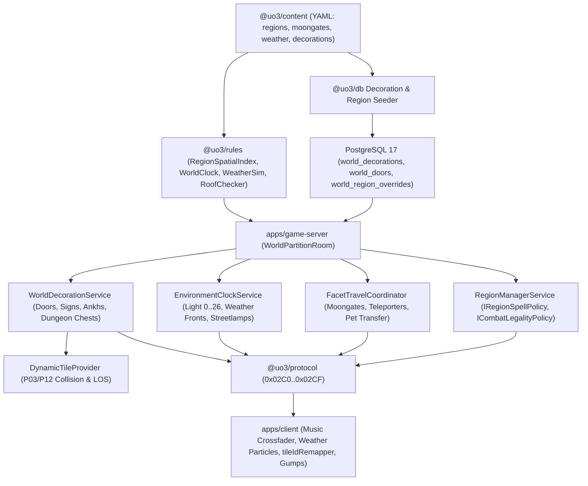
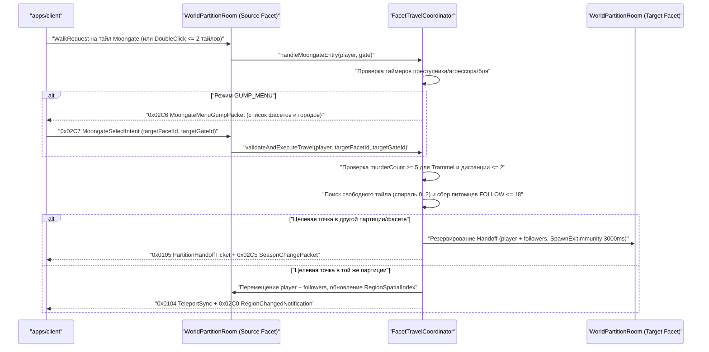

# Design: P25 Регионы и окружение

## Context

Фаза **P25 (`p25-world-regions-and-environment`)** вводит пространственно-правиловую и атмосферную структуру игрового мира Ultima Online: Renaissance. До P25 симуляция (`@uo3/rules` и `apps/game-server`) работала с тайловой геометрией и LOS (P03), передвижением и `PartitionHandoffTicket` (P12), боем (P16), преступностью и вызовом стражи (P17), магией с портом `IRegionSpellPolicy` (P18) и спавнерами/ИИ стражи (P19), но сам мир оставался плоским пространством без границ городов, таверн, подземелий, межфасетных правил `Felucca`/`Trammel`, цикла дня/ночи, погоды, сезонов и интерактивных мировых декораций (дверей, вывесок, уличных фонарей, анкхов, сундуков подземелий).

В соответствии с ADR-001..013:
- Сервер полностью авторитарен: проверка флагов региона, прав перехода между фасетами, расчёт глобального/персонального уровня темноты `0..26`, состояние дверей в `DynamicTileProvider` и замков выполняются исключительно на сервере.
- Изоморфные чистые алгоритмы (индексация прямоугольников регионов по секторам `16×16`, астрономический цикл лун `Trammel`/`Felucca`, формулы времени суток и координат секстанта, симуляция погодных фронтов на `xoshiro128++`, проверка крыши над головой `RoofOcclusionChecker`) размещаются в `@uo3/rules`.
- Все декларативные данные регионов, лунных врат, телепортеров, климатических зон и декораций хранятся в `@uo3/content` (YAML + JSON Schema), причём в репозитории и CI используется синтетический мир (`facetId = 200`) и CC0-заглушки без проприетарных ассетов UO (ADR-002).

## Goals / Non-Goals

### Goals
1. **Детерминированное разрешение региона за `O(1)`**: секторный пространственный индекс `16×16`, мгновенно определяющий активный регион по `(facetId, x, y, z)` с учётом `priority (0..255)` и площади ограничивающего прямоугольника.
2. **Полная реализация региональных политик UO:R**: интеграция `IRegionSpellPolicy` (запреты `Mark`/`Recall`/`Gate Travel`/полей), `ICombatLegalityPolicy` (`FULL_PVP`, `CONSENSUAL_ONLY`, `NO_COMBAT`, правила `Felucca` vs `Trammel`), `isGuarded` (`guards`), `isSafeLogout` (`0 с` в тавернах против `300 с` в мире) и изоляции `JAIL`.
3. **Межфасетная и внутрифасетная навигация**: публичные лунные врата с астрономическим циклом двух лун и гампом выбора, локальные телепортеры подземелий с анти-петлёй `1000 мс`, перенос приручённых питомцев в радиусе `18` тайлов, блокировка входа убийц в `Trammel` и защита точки выхода (`3000 мс` бесплатного `shove` + спиральный поиск тайла).
4. **Канонический цикл времени суток, света, погоды и сезонов**: часы `1 игровой час = 5 реальных минут`, уровень темноты `0..26` (включая `26` в `DUNGEON` и персональные бонусы `Night Sight`/факелов), погодные фронты `xoshiro128++` с отсечением под крышами (`RoofOcclusionChecker`) и 5 сезонных профилей через `tileIdRemapper`.
5. **Декларативные мировые декорации с идемпотентным сидингом**: двери с парными створками и автозакрытием `5000 мс`, замки и ключи, вывески и надгробия, ночные уличные фонари (`20:00..06:00`), анкхи воскрешения, тренировочные манекены и регенерируемые сундуки подземелий с ловушками.

### Non-Goals
- Строительство и размещение домов игроков, кастомные двери и таблички домов (`P23 Дома и строительство`).
- Морские суда, палубные двери и плавание (`P24 Корабли и мореплавание`).
- Навыки `Stealing` и `Remove Trap` (`P22 Воровство и скрытность` — в P25 закладываются свойства замков и ловушек на спавн-сундуках).
- Захват городов фракциями и мировые квестовые вторжения (`P27 Квесты и мировые события`).

## Decisions

### Decision 1: Секторный индекс регионов `16×16` с предсортированными списками прямоугольников
- **Выбор**: Каждый регион задаётся списком осевых прямоугольников `RegionRect { x1, y1, x2, y2, minZ, maxZ }`. При загрузке фасета строится `RegionSpatialIndex`: для каждого сектора `16×16` тайлов формируется плоский массив кандидатов, заранее отсортированный по убыванию `priority (0..255)`, затем по возрастанию суммарной площади `area`, затем по лексикографическому `regionId`.
- **Обоснование**: На каждом шаге движения мобиля (`20 Гц`) сервер обязан проверить смену региона. Так как размер сектора `16×16` совпадает с базовой сеткой симуляции (P01/P06), в один сектор попадает не более `1..4` прямоугольников регионов (например: фасет → город → таверна → комната). Линейный проход по предсортированному списку сектора до первого совпадения `(x, y, z)` выполняется за `O(1)` (`< 50 нс`) без аллокаций памяти.
- **Отвергнутые альтернативы**:
  - *R-Tree на каждый запрос*: избыточные указатели и промахи кэша процессора при миллионах шагов в секунду.
  - *Хранение `regionId` в каждом тайле карты `7168×4096`*: требует `28 МБ` на фасет и не поддерживает перекрытия по высоте `minZ..maxZ` (например, подземелье или второй этаж таверны над тем же `(x, y)`).

### Decision 2: Единый конвейер межфасетных и межпартиционных переходов через `FacetTravelCoordinator`
- **Выбор**: Любой переход через публичные врата (`Public Moongate`), магические врата (`Gate Travel`), заклинание `Recall` или триггерный `WorldTeleporter` проходит через единый серверный пайплайн `FacetTravelCoordinator`:
  1. Валидация статуса мобиля (`murderCount < 5` для `Trammel`, отсутствие таймера преступника/агрессора для врат, отсутствие `JAIL`, проверка `IRegionSpellPolicy`).
  2. Разрешение координаты назначения со спиральным поиском свободного тайла в радиусе `0..2` тайлов через `checkMovement` / `GetAverageZ`.
  3. Сбор живых питомцев и эскорт-NPC в режиме `FOLLOW`/`GUARD` в радиусе `18` тайлов (в пределах `maxFollowers = 5`).
  4. Если целевой `(facetId, x, y)` принадлежит текущей `WorldPartitionRoom` — локальный перенос с пакетом `TeleportSync (0x0104)`. Если другой партиции/фасету — транзакционная фиксация группы (игрок + питомцы) и выдача `PartitionHandoffTicket (0x0105)`.
  5. Начисление баффа `SpawnExitImmunity (3000 мс)` (бесплатный `shove` сквозь мобилей) и `TeleporterCooldown (1000 мс)`.
- **Обоснование**: Исключает расхождение правил между `Recall`, `Moongate` и телепортерами подземелий, гарантируя, что питомцы не потеряются при смене фасета, а убийца никогда не попадёт в `Trammel`.
- **Отвергнутые альтернативы**: Раздельная реализация телепортации в модуле магии (P18) и модуле врат (P25) приводила бы к дублированию логики переноса питомцев и handoff между партициями.

### Decision 3: Двухрежимная математика публичных лунных врат (Astronomical Moon Cycle & Moongate Menu)
- **Выбор**: В `@uo3/rules` реализуются оба канонических режима UO:R, переключаемые конфигурацией фасета/шарда `moongateMode: 'MOON_CYCLE' | 'GUMP_MENU'`:
  - В режиме `MOON_CYCLE` положение двух лун вычисляется чистой функцией от `totalGameMinutes`:
    $$\text{trammelPhase} = \left\lfloor \frac{\text{totalGameMinutes}}{9} \right\rfloor \bmod 8, \quad \text{feluccaPhase} = \left\lfloor \frac{\text{totalGameMinutes}}{14} \right\rfloor \bmod 8$$
    Индекс целевых врат для исходных врат `sourceGateIndex (0..7)` равен:
    $$\text{targetGateIndex} = (\text{sourceGateIndex} + (\text{feluccaPhase} - \text{trammelPhase}) + 8) \bmod 8$$
  - В режиме `GUMP_MENU` (стандарт позднего UO:R после появления `Trammel`) шаг на врата или двойной клик открывает гамп `MoongateMenuGumpPacket (0x02C6)` со списком разрешённых фасетов и городов, а переход совершается по `MoongateSelectIntent (0x02C7)` с повторной серверной проверкой дистанции `<= 2` тайлов.
- **Обоснование**: Позволяет поддерживать как классический хардкорный цикл двух лун, так и каноническое межфасетное меню `Felucca`/`Trammel` эпохи Renaissance без изменения клиент-серверного протокола.
- **Отвергнутые альтернативы**: Жёсткая фиксация только меню лишила бы шард астрономической механики двух лун, описанной в базовых правилах UO.

### Decision 4: Детерминированные игровые часы и кривая освещённости `0..26`
- **Выбор**: Игровое время вычисляется из монотонного серверного времени относительно эпохи шарда `shardEpochUnixMs`:
  $$\text{elapsedRealSec} = \lfloor (\text{nowUnixMs} - \text{shardEpochUnixMs}) / 1000 \rfloor$$
  Так как `1` игровой час = `5` реальных минут (`300 с`), а `1` игровая минута = `5` реальных секунд:
  $$\text{totalGameMinutes} = \lfloor \text{elapsedRealSec} / 5 \rfloor, \quad \text{hour} = \lfloor \text{totalGameMinutes} / 60 \rfloor \bmod 24, \quad \text{minute} = \text{totalGameMinutes} \bmod 60$$
  Базовый уровень темноты открытого мира `openWorldLightLevel (0..18)` вычисляется кусочно-линейной функцией по минутам суток `m = hour * 60 + minute`:
  - День (`06:00..19:59`, `m ∈ [360, 1199]`): `0` (или `+2..+4` при шторме `FIERCE_STORM`).
  - Вечерние сумерки (`20:00..21:59`, `m ∈ [1200, 1319]`):$$\lfloor 18 \times (m - 1200) / 120 \rfloor$$.
  - Ночь (`22:00..03:59`, `m ∈ [1320, 1439] ∪ [0, 239]`): `18`.
  - Рассвет (`04:00..05:59`, `m ∈ [240, 359]`):$$\lfloor 18 \times (360 - m) / 120 \rfloor$$.
  - Для регионов `DUNGEON` `baseLightLevel = 26`.
  - Эффективный уровень темноты игрока: `effectiveLight = clamp(baseLightLevel - max(nightSightBonus, equippedLightBonus), 0, 26)`.
- **Обоснование**: Все партиции шарда вычисляют абсолютно одинаковое время и уровень света без межсерверных блокировок. Клиент получает `GlobalLightLevelPacket (0x02C2)` и `PersonalLightLevelPacket (0x02C3)` только при фактическом изменении целочисленного уровня `0..26` (не чаще `1 Гц`).
- **Отвергнутые альтернативы**: Хранение тикающих часов в БД PostgreSQL создавало бы лишнюю запись каждые `5 с` и дрейф при рестартах партиций.

### Decision 5: Симуляция погодных фронтов на `xoshiro128++` и клиентское отсечение под крышами (`RoofOcclusionChecker`)
- **Выбор**: Фасет делится на климатические макрозоны (`WeatherZone`, например: умеренная, арктическая, пустынная, болотная). Каждые `60 с` (`12` игровых минут) серверный генератор `xoshiro128++`, сидированный `(shardSeed ^ facetId ^ climateZoneId ^ weatherEpochStep)`, обновляет состояние фронта: тип `CLEAR | RAIN | FIERCE_STORM | SNOW | SANDSTORM`, плотность `0..70`, температуру `-30..+45 °C` и вектор ветра `(windDir 0..7, windSpeed 0..100)`.
  На клиенте (и на сервере для проверки затухания костров `Campfire`) используется изоморфный `RoofOcclusionChecker` из `@uo3/rules`: для координаты `(x, y, z)` проверяются статические и динамические тайлы в колонке `(x, y)` с высотой `tileZ ∈ [z + 1, z + 60]`, имеющие флаги `TileFlag.Roof` или `TileFlag.Surface`. При наличии перекрытия клиент за `500 мс` плавно гасит альфа-канал частиц внутри здания и снижает громкость аудио-лупа осадков на `-12 дБ`.
- **Обоснование**: Детерминированный PRNG позволяет синхронизировать погоду между соседними партициями без пересылки тяжёлых сеток, а проверка `TileFlag.Roof | TileFlag.Surface` из `@uo3/rules` гарантирует, что дождь и снег никогда не идут внутри таверн и домов.
- **Отвергнутые альтернативы**: Серверная потайловая рассылка маски дождя для каждого здания перегрузила бы сетевой протокол.

### Decision 6: Декларативный реестр мировых декораций с `decorationKey` и идемпотентным 3-сторонним сидингом
- **Выбор**: Каждая мировая декорация в `@uo3/content/decorations/*.yaml` имеет стабильный строковый ключ `decorationKey` (например, `f200:britain:bank_door_west`) и канонический набор свойств (`kind`, `graphicId`, `hue`, `facetId`, `x`, `y`, `z`, `flags`, `doorConfig`, `signConfig`, `lightConfig`, `containerSpawnConfig`). Сидер `@uo3/db` при старте вычисляет `manifestSha256` каждой записи:
  - Если `decorationKey` отсутствует в `world_decorations` — выделяется серийник из диапазона предметов `0x40000000..0x7FFFFFFF` и создаётся запись.
  - Если `decorationKey` существует, а `manifestSha256` изменился — обновляются статические поля (`graphicId`, `x`, `y`, `z`, `clilocId`), но сохраняются динамические рантайм-поля (`isOpen`, `isLocked`, `currentTrapState`, `nextRespawnAt`), если не передан флаг `--force-reset`.
- **Обоснование**: Позволяет геймдизайнерам безопасно добавлять новые двери, фонари, вывески и сундуки в YAML-файлы в новых релизах, не сбрасывая прогресс вскрытых игроками сундуков и не порождая дубликаты объектов при рестартах шарда.
- **Отвергнутые альтернативы**: Одноразовый SQL-дамп мира не позволяет версионировать декорации в Git и проводить контрактные тесты в CI.

### Decision 7: Кинематика дверей через `DynamicTileProvider` и иерархическое колесо таймеров
- **Выбор**: Каждая дверь `WorldDoor` регистрируется в `DynamicTileProvider` (P03/P12). В состоянии `CLOSED` она находится в базовой точке `(baseX, baseY, baseZ)` с `closedGraphicId` (флаг `Impassable | Door`). При двойном клике (`DoorToggleIntent 0x02C8`) на дистанции `<= 2` тайлов:
  1. Проверяется `isLocked`: если `true`, возвращается `ERR_DOOR_LOCKED`.
  2. Вычисляется открытая позиция `(baseX + dx, baseY + dy, baseZ)` и `openGraphicId`.
  3. Если дверь имеет парную створку `linkedDoorSerial`, обе створки переключаются атомарно в одном тике `50 мс`.
  4. В `HierarchicalTimerWheel` (P06) ставится таймер автозакрытия на `5000 мс` (`100` тиков). При срабатывании таймера сервер проверяет, нет ли на тайле `(baseX, baseY, baseZ)` живого мобиля; если тайл занят — таймер перевзводится ещё на `5000 мс`.
- **Обоснование**: Полностью соответствует поведению дверей в UO:R, мгновенно обновляет 3D A* и `checkMovement` через `DynamicTileProvider` и исключает застревание игроков в закрывающейся створке.
- **Отвергнутые альтернативы**: Закрытие двери с принудительным выталкиванием мобиля позволяло бы использовать двери для эксплойта телепортации сквозь стены.

## Архитектура модулей и поток данных

### Поток межфасетного перехода через публичные лунные врата

## Модели данных (PostgreSQL 17 / Drizzle ORM в `@uo3/db`)

### 1. Таблица `world_region_overrides`
Хранит динамические переопределения флагов регионов, изменённые персоналом через `apps/admin` (базовые определения загружаются из `@uo3/content`):
- `region_id` (`varchar(64)`, PK) — идентификатор региона (`f0:britain_city`, `f200:haven_inn_room_1`).
- `facet_id` (`smallint`, NOT NULL) — идентификатор фасета (`0`, `1`, `200..254`).
- `is_guarded_override` (`boolean`, NULL) — переопределение статуса городской стражи.
- `combat_rule_override` (`varchar(24)`, NULL) — `FULL_PVP | CONSENSUAL_ONLY | NO_COMBAT`.
- `spell_ban_mask_override` (`integer`, NULL) — битовая маска запретов заклинаний.
- `music_track_override` (`smallint`, NULL) — `0..255`.
- `season_override` (`smallint`, NULL) — `0..4`.
- `updated_by_account_id` (`uuid`, NULL) и `updated_at` (`timestamptz`, NOT NULL).

### 2. Таблица `world_decorations`
Хранит все инстанцированные мировые декорации с привязкой к серийным номерам предметов:
- `decoration_key` (`varchar(128)`, PK) — детерминированный ключ из YAML-манифеста.
- `serial` (`integer`, UNIQUE, NOT NULL) — серийный номер объекта (`0x40000000..0x7FFFFFFF`).
- `manifest_sha256` (`char(64)`, NOT NULL) — хэш определения из `@uo3/content`.
- `kind` (`varchar(32)`, NOT NULL) — `DOOR | SIGN | STREETLAMP | ANKH | SHRINE | TELEPORTER | MOONGATE | TRAINING_DUMMY | DUNGEON_CONTAINER | STATIC_PROP`.
- `facet_id` (`smallint`, NOT NULL), `x` (`smallint`, NOT NULL), `y` (`smallint`, NOT NULL), `z` (`smallint`, NOT NULL) — индекс по `(facet_id, x, y)`.
- `graphic_id` (`integer`, NOT NULL), `hue` (`smallint`, NOT NULL DEFAULT 0).
- `cliloc_id` (`integer`, NULL), `title_text` (`varchar(128)`, NULL), `subtitle_text` (`varchar(256)`, NULL).
- `is_lit` (`boolean`, NOT NULL DEFAULT false), `auto_day_night` (`boolean`, NOT NULL DEFAULT false), `light_radius` (`smallint`, NOT NULL DEFAULT 0).
- `is_public_fixture` (`boolean`, NOT NULL DEFAULT true).
- `metadata_json` (`jsonb`, NOT NULL DEFAULT `'{}'`) — параметры телепортера (`targetFacetId, targetX, targetY, targetZ, condition`), анкха или манекена.

### 3. Таблица `world_doors`
Расширение состояния для интерактивных дверей (`kind = 'DOOR'`):
- `serial` (`integer`, PK, FK → `world_decorations.serial`).
- `linked_door_serial` (`integer`, NULL) — серийный номер парной створки.
- `closed_graphic_id` (`integer`, NOT NULL), `open_graphic_id` (`integer`, NOT NULL).
- `open_offset_x` (`smallint`, NOT NULL), `open_offset_y` (`smallint`, NOT NULL).
- `open_sound_id` (`smallint`, NOT NULL), `close_sound_id` (`smallint`, NOT NULL).
- `is_open` (`boolean`, NOT NULL DEFAULT false).
- `is_locked` (`boolean`, NOT NULL DEFAULT false).
- `key_id` (`varchar(64)`, NULL) — идентификатор подходящего ключа.
- `lock_difficulty` (`smallint`, NOT NULL DEFAULT 0) — сложность взлома в десятых (`0..1000`).

### 4. Таблица `world_dungeon_containers`
Состояние спавн-сундуков подземелий (`kind = 'DUNGEON_CONTAINER'`):
- `serial` (`integer`, PK, FK → `world_decorations.serial`).
- `loot_table_id` (`varchar(64)`, NOT NULL) — ссылка на таблицу лута из P19.
- `lock_level` (`smallint`, NOT NULL) — `0..1000` десятых.
- `trap_type` (`varchar(16)`, NOT NULL DEFAULT `'NONE'`) — `NONE | DART | POISON | EXPLOSION`.
- `trap_power` (`smallint`, NOT NULL DEFAULT 0) — базовый урон/уровень яда ловушки (`10..100`).
- `is_locked` (`boolean`, NOT NULL DEFAULT true).
- `is_trap_armed` (`boolean`, NOT NULL DEFAULT true).
- `respawn_min_sec` (`integer`, NOT NULL DEFAULT 900), `respawn_max_sec` (`integer`, NOT NULL DEFAULT 3600).
- `next_respawn_at` (`timestamptz`, NULL) — время следующего пересоздания после опустошения.

## Протокол и сетевые сообщения (`@uo3/protocol`)

Вводятся uint16 опкоды диапазона `0x02C0..0x02CF` со схемами TypeBox:

| Опкод | Направление | Имя пакета | Поля TypeBox | Назначение |
| :--- | :--- | :--- | :--- | :--- |
| `0x02C0` | S → C | `RegionChangedNotification` | `regionId: string`, `regionName: string`, `regionType: uint8`, `isGuarded: boolean`, `isSafeLogout: boolean`, `combatRule: uint8`, `spellBanMask: uint16` | Уведомление о смене активного региона персонажа |
| `0x02C1` | S → C | `MusicTriggerPacket` | `musicTrackId: uint8`, `loop: boolean`, `crossfadeMs: uint16` | Команда переключения музыкальной темы региона |
| `0x02C2` | S → C | `GlobalLightLevelPacket` | `lightLevel: uint8 (0..26)`, `gameHour: uint8 (0..23)`, `gameMinute: uint8 (0..59)` | Обновление базового уровня темноты и игрового времени |
| `0x02C3` | S → C | `PersonalLightLevelPacket` | `mobileSerial: uint32`, `effectiveLightLevel: uint8 (0..26)`, `personalBonus: uint8` | Персональный уровень света от `Night Sight` и факелов |
| `0x02C4` | S → C | `WeatherUpdatePacket` | `weatherType: uint8 (0..4)`, `particleDensity: uint8 (0..70)`, `temperatureC: int8`, `windDir: uint8 (0..7)`, `windSpeed: uint8 (0..100)` | Состояние погодного фронта и вектора ветра |
| `0x02C5` | S → C | `SeasonChangePacket` | `facetId: uint8`, `seasonId: uint8 (0..4)`, `playTransitionSound: boolean` | Установка сезонного профиля фасета/региона |
| `0x02C6` | S → C | `MoongateMenuGumpPacket` | `gateSerial: uint32`, `currentFacetId: uint8`, `destinations: Array<{ facetId: uint8, gateIndex: uint8, nameCliloc: uint32, isAllowed: boolean }>` | Открытие диалога выбора назначения публичных лунных врат |
| `0x02C7` | C → S | `MoongateSelectIntent` | `gateSerial: uint32`, `targetFacetId: uint8`, `targetGateIndex: uint8` | Выбор пункта назначения в меню лунных врат |
| `0x02C8` | C → S | `DoorToggleIntent` | `doorSerial: uint32` | Запрос открытия/закрытия двери двойным кликом |
| `0x02C9` | S → C | `DoorStateChangedPacket` | `doorSerial: uint32`, `isOpen: boolean`, `graphicId: uint16`, `x: uint16`, `y: uint16`, `z: int8`, `soundId: uint16` | Синхронизация положения и звука створки двери |
| `0x02CA` | S → C | `SignPlaqueInspectPacket` | `objectSerial: uint32`, `signGumpId: uint16`, `clilocId: uint32`, `title: string`, `subtitle: string` | Отображение текста вывески, указателя или надгробия |
| `0x02CB` | S → C | `TimeAndCoordsResponsePacket` | `gameHour: uint8`, `gameMinute: uint8`, `formattedTime: string`, `latitudeStr: string`, `longitudeStr: string` | Ответ на использование часов или секстанта |
| `0x02CC` | S → C | `EnvironmentErrorPacket` | `errorCode: string`, `targetSerial: uint32`, `messageCliloc: uint32` | Стандартизированный отказ (`ERR_REGION_*`, `ERR_TRAVEL_*`, `ERR_DOOR_*`) |

### Коды ошибок домена (`@uo3/domain`)
- `ERR_REGION_NOT_GUARDED` — попытка вызвать стражу `guards` вне охраняемого региона.
- `ERR_REGION_SPELL_BANNED` — заклинание перемещения (`Mark`, `Recall`, `Gate Travel`) или любая магия в `JAIL` запрещены регионом.
- `ERR_REGION_FIELD_BANNED` — полевое заклинание запрещено в городе (`NO_FIELDS`).
- `ERR_REGION_COMBAT_FORBIDDEN` — атака или враждебное действие в регионе с `combatRule = NO_COMBAT` или `JAIL`.
- `ERR_REGION_SKILL_BANNED` — использование навыка запрещено в регионе (`JAIL`).
- `ERR_FACET_NON_CONSENSUAL_PVP` — попытка несогласованной атаки игрока на фасете `Trammel`.
- `ERR_MURDERER_TRAMMEL_FORBIDDEN` — попытка убийцы (`murderCount >= 5`) перейти на фасет `Trammel`.
- `ERR_TRAVEL_CRIMINAL_RESTRICTED` — попытка преступника, агрессора или участника боя войти в лунные врата.
- `ERR_TRAVEL_OUT_OF_RANGE` — персонаж отошёл от лунных врат или телепортера дальше `2` тайлов.
- `ERR_TRAVEL_DESTINATION_BLOCKED` — точка назначения непроходима и все тайлы спирали `1..2` заблокированы.
- `ERR_TRAVEL_CONDITION_NOT_MET` — не выполнено условие триггерного телепортера подземелья.
- `ERR_SEXTANT_INDOORS` — попытка использовать секстант внутри региона типа `DUNGEON`.
- `ERR_DOOR_LOCKED` — дверь или сундук заперты на замок.
- `ERR_DOOR_BLOCKED` — закрытию двери мешает мобиль в дверном проёме.
- `ERR_DECORATION_IMMUTABLE` — попытка переместить, украсть, разрушить или переключить защищённую мировую декорацию без прав `GameMaster (2)`.

## Алгоритмы и формулы UO:R

1. **Координаты секстанта относительно Трона Лорда Бритиша `(centerX = 1323, centerY = 1624)`**:
   Для карты шириной `mapWidth = 5120` (континентальная часть фасета) и высотой `mapHeight = 4096`:
   $$\Delta x = ((x - 1323 + \text{mapWidth}/2) \bmod \text{mapWidth}) - \text{mapWidth}/2$$
   $$\Delta y = ((y - 1624 + \text{mapHeight}/2) \bmod \text{mapHeight}) - \text{mapHeight}/2$$
   $$\text{lonDeg} = \frac{\Delta x \times 360}{\text{mapWidth}}, \quad \text{latDeg} = \frac{\Delta y \times 360}{\text{mapHeight}}$$
   Градусы раскладываются на целые градусы и угловые минуты (`0..59`) с суффиксами `N`/`S` и `E`/`W`.

2. **Спиральный поиск свободного тайла прибытия (`resolveArrivalTile`)**:
   Если целевой тайл `(tx, ty, tz)` заблокирован динамическим препятствием, проверяются 8 тайлов кольца `r = 1`, затем 16 тайлов кольца `r = 2` по часовой стрелке начиная с `North (0)`. Выбирается первый тайл, на котором `checkMovement` допускает стояние мобиля с `PersonHeight = 16` и `|tileZ - tz| <= 8`, а между `(tx, ty, tz)` и кандидатом есть прямая видимость 3D DDA LOS (во избежание телепортации за глухую стену).

## Risks / Trade-offs

- **[Риск] Дребезг пакетов региона и музыки при ходьбе игрока вдоль границы города** → Митигация: сервер отправляет `RegionChangedNotification` немедленно (так как правила `isGuarded` и `IRegionSpellPolicy` должны действовать с точностью до тайла), но клиентский `MusicCrossfadeController` применяет таймер анти-дребезга `2000 мс` перед переключением аудиопотока и кроссфейд `1500 мс`.
- **[Риск] Блокировка публичных лунных врат толпой игроков или намеренным спавн-кемпингом** → Митигация: прибывающий игрок получает `3000 мс` эффекта `SpawnExitImmunity`, позволяющего проходить сквозь других мобилей (`shove`) без требования полной стамины и без списания `10` стамины, а при блокировке тайла статикой/полем работает спиральный выбор в радиусе `1..2` тайлов.
- **[Риск] Потеря приручённых питомцев при межфасетном переходе через границу партиций** → Митигация: `FacetTravelCoordinator` включает сериализованные снимки всех следующих питомцев (`FOLLOW`/`GUARD` в радиусе `18` тайлов) в единый payload `PartitionHandoffTicket`, атомарно инстанцируя их рядом с хозяином в целевой партиции.
- **[Риск] Бесконечный цикл телепортации между двумя связанными тайлами-телепортерами** → Митигация: на мобиль при любом срабатывании `WorldTeleporter` вешается метка `lastTeleportAtMs`, блокирующая повторное срабатывание триггера телепортера на `1000 мс`.
- **[Риск] Застревание игрока в автоматически закрывающейся створке двери** → Митигация: таймер автозакрытия `5000 мс` перед возвратом двери в `(baseX, baseY)` проверяет пространственный индекс мобилей; если тайл занят, дверь остаётся открытой и перевзводит таймер ещё на `5000 мс`.
- **[Риск] Сброс состояния взломанных сундуков подземелий при деплое новой версии `@uo3/content`** → Митигация: 3-сторонний идемпотентный сидер сверяет `decoration_key` и `manifest_sha256`, обновляя только статические координаты/тексты и сохраняя `is_locked`, `is_trap_armed` и `next_respawn_at`.
- **[Риск] Нагрузка на CPU при переключении тысяч уличных фонарей в `20:00` и `06:00`** → Митигация: фонари с `autoDayNight = true` индексируются в памяти каждой партиции в отдельном списке `autoDayNightFixtures` и переключаются только при пересечении часа `20` и `6`, рассылая обновления только в сектора, где есть активные `StateView` наблюдатели.

## Migration Plan

1. **Расширение `@uo3/domain` и `@uo3/protocol`**: добавление типов регионов, фасетов, погоды, сезонов, декораций, кодов ошибок `ERR_*` и опкодов `0x02C0..0x02CF`.
2. **Миграция БД в `@uo3/db`**: создание таблиц `world_region_overrides`, `world_decorations`, `world_doors`, `world_dungeon_containers` и идемпотентного сидера декораций.
3. **Изоморфное ядро `@uo3/rules`**: реализация `RegionSpatialIndex`, `IRegionSpellPolicy`, `ICombatLegalityPolicy`, `WorldClockCalculator`, `MoongateCycleCalculator`, `WeatherFrontSimulator`, `RoofOcclusionChecker`, `SextantCalculator`.
4. **Контент `@uo3/content`**: наполнение YAML-манифестов регионов, лунных врат, телепортеров, климатических зон и декораций для синтетического фасета `200` и базовой разметки `Felucca (0)` / `Trammel (1)`.
5. **Интеграция в `apps/game-server`, `apps/client` и `apps/admin`**: подключение сервисов к `WorldPartitionRoom`, рендер погоды, света, сезонов, гампов врат и вывесок на клиенте.

## Open Questions

- *Нужно ли в будущих фазах (`P27 Квесты и мировые события`) разрешать временные динамические регионы вторжений поверх городов с `priority > 200`?* — Архитектура `RegionSpatialIndex` уже поддерживает динамическую вставку и инвалидацию секторов за `O(K)` секторов прямоугольника, поэтому API `registerDynamicRegion` закладывается сразу и будет использован в P27.
