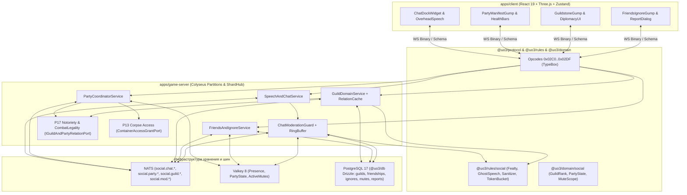
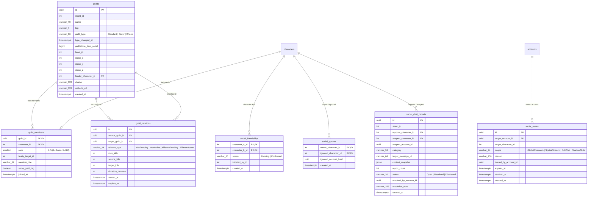
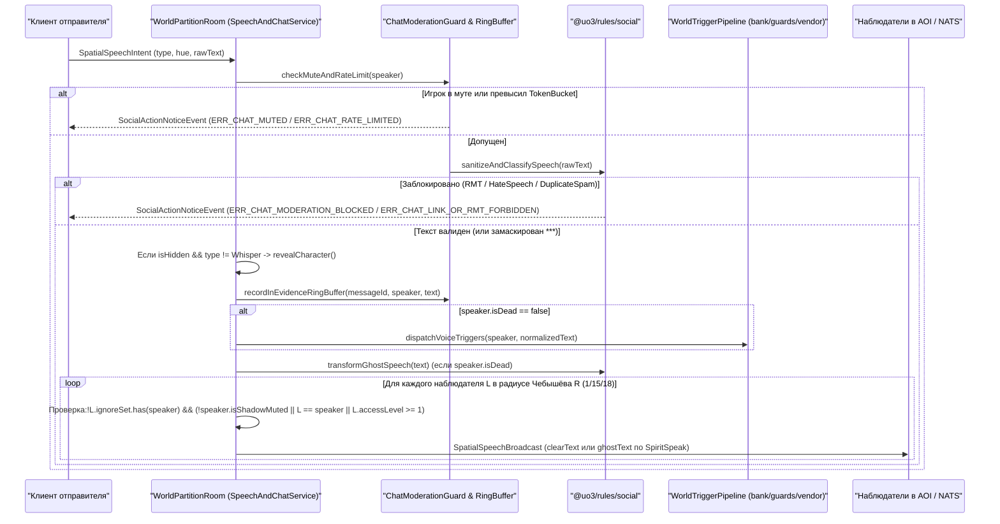

# Design: P26 Социальные системы

## Context

Фаза P26 проектирует и связывает воедино все социальные подсистемы веб-MMORPG UO3 в каноне Ultima Online: Renaissance (UO:R):
1. **Пространственная речь и каналы чата (`social/speech-and-chat`)**: в P14 был введён базовый внутрипартиционный `SpeechRouter` для отображения текста над головой (1/15/18 тайлов). В P26 он расширяется механикой речи мёртвых персонажей (`oOoOOooOO` + расшифровка через навык `Spirit Speak` из P15), правилами раскрытия невидимости/хайда при речи, перехватом ключевых фраз мира (`guards`, `bank`, `vendor buy`, `stable`), межпартиционными тематическими каналами (`General`, `Help`, `Trade`, `Region`), личными сообщениями (`Tell`) и защитой от флуда.
2. **Боевые и охотничьи группы (`social/party`)**: эфемерные объединения от 2 до 10 игроков, существующие поверх нескольких партиций шарда (`WorldPartitionRoom`), с синхронизацией виталов (20 Гц в AOI / 2 Гц вне AOI), распределением добытого с монстров золота (`EqualSplit` / `Manual`), делегированием права безнаказанного обыска трупа сопартийца (`canLootMe` через `ContainerAccessGrantPort` из P07/P13/P17) и статусом `Ally (2)` в `IGuildAndPartyRelationPort`.
3. **Гильдии и дипломатия (`social/guilds`)**: персистентные объединения игроков, учреждаемые через предмет `Guildstone Deed` (`0x14F0` -> мировой объект `Guildstone` `0x0ED4`), с 5 рангами UO:R (`Ronin`, `Member`, `Emissary`, `Warlord`, `Guildmaster`), демократическим голосованием лояльности (`Fealty`), тремя идеологическими типами (`Standard`, `Order`, `Chaos` со щитами `0x1BC4`/`0x1BC3`), двусторонними войнами (с условиями победы `maxKills`/`duration`) и альянсами до 15 гильдий. Враждующие и союзные гильдии интегрируются с `IGuildAndPartyRelationPort` (P17) для легального согласованного PvP без вмешательства стражи и без начисления убийств (`MurderCount`).
4. **Списки друзей и игнорирования (`social/friends-and-ignore`)**: двусторонний граф дружбы (до 100 записей) с отслеживанием присутствия через Valkey и режимом невидимости (`HideOnlineStatus`), экспортом `IFriendRelationQueryPort` для доступа к домам (P23), а также односторонний список игнорирования (до 200 записей) со сложностью фильтрации `O(1)` на горячем пути тика 20 Гц.
5. **Модерация чата (`social/chat-moderation`)**: конвейер Unicode NFKC + anti-homoglyph нормализации, фильтрации обсценной лексики, фишинговых и RMT-ссылок, детектор спама/капслока, серверный кольцевой буфер истории сообщений (50 сообщений на сектор/канал, TTL 15 мин) для верифицируемых жалоб игроков (`ChatReport`), а также система санкций (`Mute` по областям и `ShadowMute` для спам-ботов) с аудитом в PostgreSQL 17.

## Goals / Non-Goals

### Goals
- Обеспечить детерминированную изоморфную логику социальных правил в `@uo3/rules` и чистые доменные типы в `@uo3/domain` (`0` внешних зависимостей).
- Гарантировать отсутствие блокирующих запросов к PostgreSQL или Valkey на горячем пути тика симуляции `20` Гц (50 мс): проверки `IGuildAndPartyRelationPort`, `IgnoreList`, `MuteState` и `TokenBucket` выполняются исключительно по локальным in-memory индексам партиции за `O(1)`.
- Обеспечить межпартиционную маршрутизацию чата (каналы, пати, гильдия, альянс, личные сообщения) и синхронизацию состояния групп/гильдий/мутов через NATS с задержкой `<= 100` мс.
- Гарантировать транзакционную целостность (RPO=0 через `CriticalTxCoordinator` из P08) при создании гильдии (сжигание `Guildstone Deed` и спавн `Guildstone`), упаковке камня в `Teleportation Stone` и удалении персонажа (`CHARACTER_DELETION_GUARDS` из P05).
- Обеспечить серверную верификацию жалоб (`ChatReport`) по кольцевому буферу реальных сообщений, исключив возможность подделки логов модифицированным клиентом.

### Non-Goals
- Реализация четырёх глобальных PvP-фракций UO:R (Minax, True Britannians, Council of Mages, Shadowlords), фракционных сигилов и контроля городов — относится к фазе **P25**.
- Разработка фронтенда веб-консоли администратора `apps/admin` для разбора тикетов — относится к фазе **P29** (в P26 создаются таблицы, доменный сервис и REST-эндпоинты `/api/v1/admin/moderation/*`).
- Голосовой чат (WebRTC) и внешние интеграции с Discord/Telegram.

## Decisions

### Decision 1: Эфемерное состояние Party в Valkey + NATS против хранения в PostgreSQL
- **Выбор**: Состояние групп (`PartyState`: список до 10 участников, лидер, активные приглашения с TTL 30 с, настройки `canLootMe` и `goldShareMode`) хранится в оперативной памяти координатора (`ShardHubRoom` + репликация в Valkey `party:<partyId>` и локальные кэши партиций через NATS `social.party.events`), без записи в PostgreSQL. При этом список разрешённых лутеров трупа в момент смерти персонажа фиксируется непосредственно в метаданных создаваемого трупа (`world_corpses.party_looter_ids`).
- **Обоснование**: В каноне UO:R группа является сессионной структурой и распадается при выходе участников. Отказ от записи в PG при каждом приглашении/выходе устраняет лишнюю нагрузку на БД, а штамповка `party_looter_ids` в запись трупа в момент смерти гарантирует, что права на лут сохранятся даже если группа распадётся через минуту после гибели персонажа.
- **Отвергнутые альтернативы**: Персистентные таблицы `parties` и `party_members` в PostgreSQL (избыточный I/O для короткоживущих сущностей, риск зависших групп после рестарта).

### Decision 2: Локальная реплика матрицы гильдейской дипломатии в каждой партиции для O(1) проверок P17
- **Выбор**: Каждая `WorldPartitionRoom` держит в памяти компактную хеш-таблицу активных гильдейских связей шарда `GuildRelationCache`: `Map<GuildId, { type: GuildType, tag: string, allies: Set<GuildId>, enemies: Set<GuildId> }>`. При любом изменении дипломатии или типа гильдии (`Order`/`Chaos`) `GuildDomainService` записывает транзакцию в PostgreSQL 17 и публикует событие в NATS `social.guild.relation_updated`, обновляющее кэши всех партиций.
- **Обоснование**: Порт `IGuildAndPartyRelationPort.getRelation(attackerId, defenderId)` из P17 вызывается на каждом тике при расчёте цвета подсветки (`Notoriety`), проверке агрессии в боевом цикле (P16), АоЕ-заклинаниях (P18) и реакции стражи (`guards`). Локальный in-memory индекс позволяет выполнять проверку за `< 1` мкс:
  1. Если `charA.partyId !== 0 && charA.partyId === charB.partyId` -> `Ally (2)`.
  2. Если `charA.guildId !== 0 && charB.guildId !== 0`:
     - `charA.guildId === charB.guildId` или `guildA.allies.has(guildB.id)` -> `Ally (2)`;
     - `guildA.enemies.has(guildB.id)` или `(guildA.type === 'Order' && guildB.type === 'Chaos')` или `(guildA.type === 'Chaos' && guildB.type === 'Order')` -> `Enemy (5)`.
- **Отвергнутые альтернативы**: Запросы в Valkey или PostgreSQL при проверке `Notoriety` (недопустимая сетевая задержка внутри 50-мс тика симуляции).

### Decision 3: Демократический пересчёт лидера гильдии через чистую функцию Fealty в `@uo3/rules`
- **Выбор**: Логика голосования лояльности (`Fealty`) выделена в чистую детерминированную функцию `evaluateGuildFealtyElection(members: ReadonlyArray<GuildMemberVoteRecord>, currentMasterId: CharacterId): FealtyElectionResult` в пакете `@uo3/rules`. В голосовании участвуют только активные члены с рангом `>= 2` (`Member`..`Guildmaster`), а кандидаты `1 (Ronin)` не имеют права голоса и не могут быть избраны. Если `fealtyTargetId` участника указывает на выбывшего члена, голос автоматически трактуется как отданный за самого себя. Для смены лидера претендент должен набрать `votes > floor(totalEligibleVoters / 2)` и `votes >= 2`.
- **Обоснование**: Вынос алгоритма в `@uo3/rules` позволяет покрыть все граничные случаи (ничья, выход кандидата, гильдия из 1–2 человек, каскадный пересчёт при кике) быстрыми property-based unit-тестами без поднятия БД.
- **Отвергнутые альтернативы**: Хранение агрегированных счётчиков голосов в таблице `guild_members` с обновлением триггерами БД (сложно отлаживать и тестировать).

### Decision 4: Кольцевой буфер серверных доказательств (Server Evidence Ring Buffer) для верификации ChatReport
- **Выбор**: Для защиты от поддельных жалоб сервер хранит в памяти легковесный кольцевой буфер `ChatEvidenceBuffer`:
  - Для пространственной речи — по ключу макро-сектора `64×64` тайла (`sectorBucketKey`), ёмкость `50` записей.
  - Для глобальных/гильдейских/групповых каналов — по `channelId`, ёмкость `50` записей.
  - Для личных сообщений (`Tell`) — по упорядоченной паре `min(charA, charB):max(charA, charB)`, ёмкость `30` записей.
  Каждая запись хранит `{ messageId: uint64, timestampMs, speakerCharacterId, speakerAccountId, channelOrScope, rawText, normalizedText, facetId, x, y }` с TTL `900` с (15 минут). При вызове `SubmitChatReport` сервер ищет `targetMessageId` (или сообщения `suspectCharacterId` за последние 15 мин в том же контексте) в буфере, извлекает до `20` соседних реплик и сохраняет их в JSONB-колонку `context_snapshot` таблицы `social_chat_reports`.
- **Обоснование**: Клиент никогда не является доверенным источником логов чата. Серверный кольцевой буфер занимает менее 15 МБ ОЗУ на партицию при 2000 онлайн-игроках и даёт модераторам 100% достоверный контекст диалога.
- **Отвергнутые альтернативы**: Логирование абсолютно каждой реплики чата в PostgreSQL (колоссальный write amplification) или доверие тексту, присланному в payload жалобы от клиента (уязвимость к подстановке фейковых оскорблений).

### Decision 5: Многоуровневый конвейер нормализации текста и режим ShadowMute
- **Выбор**: Конвейер обработки текста (`sanitizeAndClassifySpeech` в `@uo3/rules`) работает в 4 детерминированных шага за `< 0.2` мс:
  1. Удаление управляющих символов (`0x00..0x1F`, `0x7F`) и zero-width символов (`U+200B..U+200F`, `U+FEFF`).
  2. Проверка анти-спам окна (5 последних сообщений за 30 с, расстояние Левенштейна `similarity >= 0.85` для 3 сообщений подряд) и авто-понижение CAPS LOCK (если длина `> 12` и доля заглавных `> 80%`).
  3. Построение нормализованной проекции строки: Unicode `NFKC` -> `toLowerCase()` -> таблица замены кириллических/латинских гомоглифов и leet-символов (`0->o`, `1->i`, `3->e`, `4->a`, `@->a`, `$->s`, `!->i`) -> удаление небуквенных разделителей внутри слов -> схлопывание повторов букв (`> 2` подряд).
  4. Сопоставление с Aho-Corasick автоматом запрещённых токенов (`Mask` vs `Block`) и регулярными выражениями URI/RMT-доменов (с проверкой белого списка).
  Для коммерческих спам-ботов вводится статус `ShadowMute`: пакет речи возвращается только самому отправителю (loopback) и персоналу (`AccessLevel >= 1` с префиксом `[SHADOW-MUTED]`), благодаря чему бот не детектирует блокировку и не пересоздаёт аккаунты.
- **Обоснование**: Простые регулярные выражения легко обходятся вставкой точек, пробелов или заменой латинской `o` на кириллическую `о`. Предварительная проекция + Aho-Corasick гарантируют линейное время `O(L)` от длины строки `L <= 128`.
- **Отвергнутые альтернативы**: Внешние облачные ML-модераторы на горячем пути (нарушают бюджет задержки тика и требуют внешнего сетевого доступа).

### Decision 6: Детерминированная обфускация речи призраков и пассивный/активный Spirit Speak
- **Выбор**: Когда говорящий мёртв (`isDead = true`), сервер формирует сразу две версии строки: оригинальную `clearText` и призрачную `ghostText` (каждый непробельный символ заменяется на `'o'` или `'O'` детерминированно от хеша позиции символа и `messageSeed`, пробелы сохраняются). При обходе слушателей в радиусе AOI сервер отправляет `clearText`, если выполняется хотя бы одно условие:
  `listener.isDead || listener.accessLevel >= 1 || listener.baseSpiritSpeakTenths >= 1000 || listener.hasBuff('SpiritSpeakChannel')`; иначе отправляется `ghostText` со шрифтом/цветом призрака.
- **Обоснование**: Формирование `ghostText` строго на сервере исключает читерские модификации клиента, которые могли бы читать переписку мёртвых игроков без прокачки навыка `Spirit Speak`.
- **Отвергнутые альтернативы**: Отправка оригинального текста клиенту с флагом `isGhost = true` для обфускации на стороне UI (уязвимость к перехвату пакетов).

### Decision 7: Двухуровневая синхронизация виталов группы (20 Гц в AOI, 2 Гц межпартиционно)
- **Выбор**: Внутри одного AOI участники группы получают обновления `Hits`/`Mana`/`Stam` штатным механизмом патчей Colyseus `StateView` на частоте 20 Гц. Для участников группы, находящихся за пределами AOI или в другой партиции/фасете, партиция агрегирует грязные изменения виталов и координат `(facetId, x, y)` и публикует батч `PartyVitalsSync` в NATS не чаще чем раз в `500` мс (2 Гц).
- **Обоснование**: Хилеру в бою рядом с танком нужна мгновенная реакция (50 мс), тогда как для сопартийца на другом конце мира обновление полоски здоровья и точки на миникарте 2 раза в секунду визуально неотличимо от реального времени, но снижает межпартиционный NATS-трафик в 10 раз.
- **Отвергнутые альтернативы**: Трансляция каждого тика регенерации всех членов пати через NATS на частоте 20 Гц.

## Архитектура модулей и распределение ответственности

### Пакеты (`packages/*`)
- **`@uo3/domain`** (`packages/domain/src/social/*`):
  - `SpeechType`: `'Whisper' | 'Regular' | 'Yell' | 'Emote'`.
  - `ChatChannelId`: `'General' | 'Help' | 'Trade' | 'Region' | 'Party' | 'Guild' | 'Alliance'`.
  - `GuildRank`: `1 (Ronin) | 2 (Member) | 3 (Emissary) | 4 (Warlord) | 5 (Guildmaster)`.
  - `GuildType`: `'Standard' | 'Order' | 'Chaos'`.
  - `GuildRelationType`: `'Neutral' | 'WarPending' | 'WarActive' | 'AlliancePending' | 'AllianceActive'`.
  - `MuteScope`: `'GlobalChannels' | 'SpatialSpeech' | 'FullChat' | 'ShadowMute'`.
  - `ChatReportCategory`: `'Harassment' | 'Profanity' | 'Spam' | 'RmtOrPhishing' | 'HateSpeech'`.
  - Порты `IGuildAndPartyRelationPort` (совместим с P17), `IFriendRelationQueryPort` (для P23).
- **`@uo3/rules`** (`packages/rules/src/social/*`):
  - `computeSpeechRangeTiles(type: SpeechType): 1 | 15 | 18` и `canHearSpatialSpeech(speakerPos, listenerPos, type)`.
  - `transformGhostSpeech(text: string, seed: number): string` и `canUnderstandGhostSpeech(listenerState): boolean`.
  - `sanitizeAndClassifySpeech(rawText: string, dictionary: CompiledModerationDictionary, options): SpeechSanitizeResult`.
  - `evaluateTokenBucket(state: TokenBucketState, nowMs: number, cost: number): { allowed: boolean, nextState: TokenBucketState, retryAfterMs: number }`.
  - `calculatePartyGoldSplit(totalGold: number, eligibleMemberIds: ReadonlyArray<CharacterId>, looterId: CharacterId): ReadonlyMap<CharacterId, number>`.
  - `evaluateGuildFealtyElection(members: ReadonlyArray<GuildMemberVoteRecord>, currentMasterId: CharacterId): FealtyElectionResult`.
  - `resolveGuildNotorietyRelation(guildA: GuildSnapshot | null, guildB: GuildSnapshot | null, sameParty: boolean): NotorietyRelation`.
- **`@uo3/protocol`** (`packages/protocol/src/social/*`):
  - Опкоды `0x02C0..0x02DF` (см. таблицу протокола ниже) со строгими TypeBox-схемами.
  - Расширения `MobileSchema` (`@colyseus/schema` v3): `guildTag: string` (до 4 симв., пустая строка если нет гильдии), `guildType: uint8` (`0=None/Standard, 1=Order, 2=Chaos`).
- **`@uo3/db`** (`packages/db/src/schema/social.ts`):
  - Таблицы Drizzle ORM для гильдий, дипломатии, друзей, игнора, мутов, жалоб и журнала аудита модерации.

## Модели данных (PostgreSQL 17 / Drizzle ORM)

### Индексы и ограничения целостности
1. **`guilds`**:
   - `UNIQUE (shard_id, lower(name))` и `UNIQUE (shard_id, lower(tag))` — гарантия уникальности имени и аббревиатуры гильдии без учёта регистра.
   - `CHECK (char_length(name) BETWEEN 3 AND 40)` и `CHECK (tag ~ '^[A-Za-z0-9]{1,4}$')`.
2. **`guild_members`**:
   - `UNIQUE (character_id)` — персонаж может состоять (или числиться рекрутом) максимум в одной гильдии одновременно.
   - `CHECK (rank BETWEEN 1 AND 5)`.
3. **`guild_relations`**:
   - `UNIQUE (source_guild_id, target_guild_id)` и `CHECK (source_guild_id <> target_guild_id)`.
4. **`social_friendships`**:
   - Для подтверждённых пар поддерживается канонический порядок `CHECK (character_a_id < character_b_id)` с полем `initiated_by_id`, исключающий дублирование `(A, B)` и `(B, A)`.
5. **`social_moderation_audit_log`**:
   - Append-only таблица `(id, timestamp, actor_account_id, target_account_id, action_type, report_id, payload_jsonb)` для неизменяемого аудита всех действий модерации.

## Протокол и опкоды (`@uo3/protocol` `0x02C0..0x02DF`)

| Опкод | Направление | Имя сообщения | Ключевые поля TypeBox |
| :--- | :--- | :--- | :--- |
| `0x02C0` | C -> S | `SpatialSpeechIntent` | `speechType: uint8 (0=Whisper, 1=Regular, 2=Yell, 3=Emote)`, `hue: uint16`, `text: string (1..128)` |
| `0x02C1` | S -> C | `SpatialSpeechBroadcast` | `speakerSerial: uint32`, `speakerName: string`, `speechType: uint8`, `hue: uint16`, `font: uint8`, `isGhost: boolean`, `messageId: string`, `text: string` |
| `0x02C2` | C -> S | `ChatChannelMessageIntent` | `channelId: ChatChannelId`, `text: string (1..128)` |
| `0x02C3` | S -> C | `ChatChannelMessageEvent` | `channelId: ChatChannelId`, `senderCharacterId: uint32`, `senderName: string`, `guildTag?: string`, `messageId: string`, `timestampMs: uint64`, `text: string` |
| `0x02C4` | C -> S | `ChatChannelSubscriptionIntent` | `channelId: ChatChannelId`, `subscribed: boolean` |
| `0x02C5` | C -> S | `DirectTellIntent` | `targetCharacterId?: uint32`, `targetName?: string`, `text: string (1..128)` |
| `0x02C6` | S -> C | `DirectTellEvent` | `direction: 'Incoming' \| 'OutgoingAck'`, `peerCharacterId: uint32`, `peerName: string`, `messageId: string`, `timestampMs: uint64`, `text: string` |
| `0x02C7` | C -> S | `SocialPrivacySettingsIntent` | `doNotDisturb: boolean`, `hideOnlineStatus: boolean`, `profanityFilterEnabled: boolean` |
| `0x02C8` | C -> S | `PartyActionIntent` | `action: 'Invite' \| 'Accept' \| 'Decline' \| 'Leave' \| 'Kick' \| 'TransferLeader' \| 'SetCanLootMe' \| 'SetGoldShareMode'`, `targetCharacterId?: uint32`, `boolValue?: boolean`, `goldShareMode?: 'Manual' \| 'EqualSplit'` |
| `0x02C9` | S -> C | `PartyStateSnapshotEvent` | `partyId: string`, `leaderCharacterId: uint32`, `goldShareMode: string`, `canLootMe: boolean`, `members: Array<{ slot: uint8, characterId: uint32, name: string, isOnline: boolean }>` |
| `0x02CA` | S -> C | `PartyInvitePromptEvent` | `partyId: string`, `inviterCharacterId: uint32`, `inviterName: string`, `expiresInMs: uint32` |
| `0x02CB` | C -> S | `PartyChatIntent` | `targetSlot?: uint8 (1..10, omit for all)`, `text: string (1..128)` |
| `0x02CC` | S -> C | `PartyVitalsSyncEvent` | `updates: Array<{ characterId: uint32, hits: uint16, maxHits: uint16, mana: uint16, maxMana: uint16, stam: uint16, maxStam: uint16, facetId: uint8, x: uint16, y: uint16 }>` |
| `0x02CD` | C -> S | `GuildFoundIntent` | `deedSerial: uint32`, `name: string (3..40)`, `tag: string (1..4)` |
| `0x02CE` | C -> S | `GuildManageMemberIntent` | `action: 'Recruit' \| 'ApproveRecruit' \| 'Kick' \| 'Resign' \| 'SetRank' \| 'SetTitle' \| 'SetFealty' \| 'ToggleTag'`, `targetCharacterId?: uint32`, `newRank?: uint8`, `title?: string`, `showTag?: boolean` |
| `0x02CF` | C -> S | `GuildDiplomacyIntent` | `action: 'DeclareWar' \| 'AcceptWar' \| 'RejectOrCancelWar' \| 'SurrenderWar' \| 'InviteAlliance' \| 'AcceptAlliance' \| 'LeaveAlliance' \| 'SetGuildType' \| 'PackGuildstone'`, `targetGuildId?: string`, `maxKills?: uint16`, `durationMinutes?: uint32`, `guildType?: GuildType` |
| `0x02D0` | S -> C | `GuildRosterAndDiplomacyEvent` | `guildId: string`, `name: string`, `tag: string`, `guildType: GuildType`, `typeChangeAvailableAtMs: uint64`, `leaderId: uint32`, `members: Array<GuildMemberDto>`, `relations: Array<GuildRelationDto>` |
| `0x02D1` | C -> S | `FriendActionIntent` | `action: 'Request' \| 'Accept' \| 'Decline' \| 'Remove'`, `targetCharacterId: uint32` |
| `0x02D2` | S -> C | `FriendsAndIgnoreSnapshotEvent` | `friends: Array<{ characterId: uint32, name: string, status: 'PendingIn' \| 'PendingOut' \| 'Confirmed', isOnline: boolean }>`, `ignores: Array<{ characterId: uint32, name: string }>` |
| `0x02D3` | S -> C | `FriendPresenceChangedEvent` | `characterId: uint32`, `name: string`, `isOnline: boolean` |
| `0x02D4` | C -> S | `IgnoreActionIntent` | `action: 'Add' \| 'Remove'`, `targetCharacterId: uint32`, `ignoreEntireAccount?: boolean` |
| `0x02D5` | C -> S | `SubmitChatReportIntent` | `suspectCharacterId: uint32`, `category: ChatReportCategory`, `targetMessageId?: string`, `comment?: string (0..256)` |
| `0x02D6` | S -> C | `ChatReportAckEvent` | `reportId: string`, `aggregatedCount: uint16` |
| `0x02D7` | S -> C | `SocialActionNoticeEvent` | `code: string`, `severity: 'Info' \| 'Warning' \| 'Error'`, `retryAfterMs?: uint32`, `remainingSeconds?: uint32`, `message: string` |

### Канонические коды ошибок (`ERR_*`)
- **Речь и чат**: `ERR_CHAT_MESSAGE_EMPTY`, `ERR_CHAT_MESSAGE_LENGTH_INVALID`, `ERR_CHAT_RATE_LIMITED`, `ERR_CHAT_CHANNEL_NOT_JOINED`, `ERR_CHAT_RECIPIENT_OFFLINE`, `ERR_CHAT_RECIPIENT_DND`, `ERR_CHAT_TARGET_IGNORED_BY_YOU`.
- **Группа (Party)**: `ERR_PARTY_FULL`, `ERR_PARTY_ALREADY_IN_PARTY`, `ERR_PARTY_NOT_LEADER`, `ERR_PARTY_INVITE_EXPIRED`, `ERR_PARTY_TARGET_NOT_FOUND`.
- **Гильдии (Guilds)**: `ERR_GUILD_ALREADY_MEMBER`, `ERR_GUILD_NAME_OR_TAG_TAKEN`, `ERR_GUILD_INVALID_HOUSE_PLACEMENT`, `ERR_GUILD_INSUFFICIENT_RANK`, `ERR_GUILD_TYPE_COOLDOWN_ACTIVE`, `ERR_GUILD_ALLIANCE_TYPE_INCOMPATIBLE`, `ERR_GUILD_ALLIANCE_FULL`, `ERR_GUILD_SHIELD_ALIGNMENT_MISMATCH`, `ERR_GUILD_MASTER_CANNOT_DELETE_WITH_MEMBERS`.
- **Друзья и игнор**: `ERR_FRIENDS_LIST_FULL`, `ERR_IGNORE_LIST_FULL`, `ERR_IGNORE_STAFF_FORBIDDEN`, `ERR_SOCIAL_TARGET_UNAVAILABLE_OR_BUSY`.
- **Модерация**: `ERR_CHAT_MODERATION_BLOCKED`, `ERR_CHAT_LINK_OR_RMT_FORBIDDEN`, `ERR_CHAT_DUPLICATE_SPAM`, `ERR_CHAT_MUTED`, `ERR_MODERATION_EVIDENCE_NOT_FOUND`, `ERR_MODERATION_REPORT_QUOTA_EXCEEDED`.

## Алгоритмы и последовательности взаимодействий

### Конвейер обработки речи, модерации и доставки слушателям

### Точные формулы и правила UO:R

1. **Дистанция слышимости пространственной речи**:
   $$d_{\infty}(A, B) = \max(|x_A - x_B|, |y_A - y_B|) \le R_{\text{type}}$$
   где $R_{\text{Whisper}} = 1$, $R_{\text{Regular}} = R_{\text{Emote}} = 15$, $R_{\text{Yell}} = 18$ тайлов при условии $facet_A = facet_B$.
2. **Условие понимания речи призраков**:
   $$\text{Understand}(L) = L.\text{isDead} \lor (L.\text{accessLevel} \ge 1) \lor (L.\text{spiritSpeakBaseTenths} \ge 1000) \lor (L.\text{spiritSpeakBuffExpiresAt} > t_{\text{now}})$$
   При успешном активном применении навыка `Spirit Speak` (конвейер P15) персонаж получает бафф `SpiritSpeakChannel` на $\Delta t = 600\,\text{с}$ ($10$ минут).
3. **Кворум выборов Guildmaster через Fealty**:
   Пусть $V = \{m \in \text{Members} \mid m.\text{rank} \ge 2\}$ — множество полноправных членов гильдии, $N = |V|$.
   Для каждого $m \in V$ эффективный голос:
   $$v(m) = \begin{cases} m.\text{fealtyTargetId}, & \text{если } m.\text{fealtyTargetId} \in V \\ m.\text{characterId}, & \text{иначе} \end{cases}$$
   Кандидат $c \in V$ становится новым `Guildmaster` (ранг `5`), если:
   $$\text{Votes}(c) = |\{m \in V \mid v(m) = c\}| > \lfloor N / 2 \rfloor \quad \text{и} \quad \text{Votes}(c) \ge 2$$
4. **Разделение золота в группе (`EqualSplit`)**:
   Пусть из трупа NPC поднимается $G$ золотых монет (`0x0EED`), а множество живых сопартийцев в том же фасете на расстоянии $d_{\infty} \le 18$ тайлов от трупа равно $P_{\text{near}}$, где $K = |P_{\text{near}}| \ge 1$.
   Каждому участнику $p \in P_{\text{near}}$ начисляется базовая доля $g_{\text{base}} = \lfloor G / K \rfloor$, а непосредственно подбирающему $p_{\text{looter}}$ начисляется $g_{\text{base}} + (G \bmod K)$.

## Risks / Trade-offs

- **[Риск] Спам-шторм в глобальных каналах или флуд в городах с большим скоплением игроков** → Митигация: Двухуровневый in-memory `TokenBucket` (4 сообщения / 1 с на пространственную речь, 1 сообщение / 3 с на глобальные каналы), детектор дубликатов Левенштейна (`similarity >= 0.85`) и `ShadowMute`, изолирующий ботов без обратной связи.
- **[Риск] Обход фильтра нецензурной лексики и RMT через Unicode-гомоглифы и разделители** → Митигация: 4-ступенчатая нормализация `NFKC` + маппинг кириллица/латиница/leet + удаление внутрисловных разделителей перед прогоном через автомат Aho-Corasick.
- **[Риск] Абуз гильдейских войн и смены типа Order/Chaos для избежания криминального статуса в PvP** → Митигация: Жёсткий кулдаун `7` реальных суток (`604800` с) на смену типа гильдии, требование двустороннего согласия для войн между `Standard` гильдиями, и сохранение стандартных правил агрессии P17 для любых задетых третьих лиц (например, АоЕ-магией в городе).
- **[Риск] Потеря контроля над гильдией при удалении или бане персонажа-лидера** → Митигация: Интеграция с `CHARACTER_DELETION_GUARDS` (P05) блокирует удаление лидера при наличии членов, а демократический механизм `Fealty` позволяет оставшимся участникам автоматически переизбрать нового `Guildmaster` большинством голосов `> 50%`.
- **[Риск] Деградация тика 20 Гц при проверке списков игнора и дипломатии гильдий в плотном AOI** → Митигация: Все проверки на горячем пути (`IgnoreList`, `GuildRelationCache`, `PartyMembers`) используют плоские локальные `Set`/`Map` в памяти `WorldPartitionRoom` со сложностью `O(1)` и нулевым сетевым I/O.
- **[Риск] Фабрикация ложных жалоб (`ChatReport`) через подмену текста на клиенте** → Митигация: Сервер принимает жалобу только при наличии верифицированного сообщения в серверном `ChatEvidenceBuffer` (TTL 15 минут) и сохраняет серверный снимок 20 реплик контекста.
- **[Риск] Утечка статуса присутствия игрока нежелательным наблюдателям через список друзей или личные сообщения** → Митигация: Двустороннее подтверждение дружбы, флаг `HideOnlineStatus`, скрывающий онлайн от друзей, и нейтральный ответ `ERR_SOCIAL_TARGET_UNAVAILABLE_OR_BUSY` при блокировке через `IgnoreList`.

## Migration Plan

1. **Миграции БД (`@uo3/db`)**: создать Drizzle-миграцию с таблицами `guilds`, `guild_members`, `guild_relations`, `social_friendships`, `social_ignores`, `social_mutes`, `social_chat_reports`, `social_moderation_audit_log` и расширить метаданные `world_corpses` полем `party_looter_ids` (` integer[]`).
2. **Контент и предметы (`@uo3/content`)**: зарегистрировать определения предметов `Guildstone Deed` (`0x14F0`), `Guildstone` (`0x0ED4`), `Guildstone Teleportation Stone` (`0x1869`), `Order Shield` (`0x1BC4`), `Chaos Shield` (`0x1BC3`) в ассортименте NPC-вендоров (`Provisioner` / `Guildmaster`).
3. **Замена заглушек портов P05/P13/P14/P17**: подключить боевые реализации `IGuildAndPartyRelationPort`, `ContainerAccessGrantPort` (для трупов сопартийцев), `CHARACTER_DELETION_GUARDS` и расширенный `SpeechAndChatService` в DI-контейнер `apps/game-server`.
4. **Откат (Rollback)**: при необходимости отката отключаются NATS-подписки `social.*`, в DI возвращаются `NullGuildAndPartyRelationAdapter`, а таблицы `social_*` и `guilds*` не затрагивают ядро таблиц аккаунтов и инвентаря.

## Open Questions

- *Веб-реестр гильдий (Public Armory)*: стоит ли публиковать открытый веб-рейтинг гильдий и статистику их войн без авторизации на портале шарда? (Решение отложено до фазы клиентского портала P34; REST эндпоинт `/api/v1/social/guilds` в P26 защищён стандартным `JwtAuthGuard`).
- *Автоматическая передача поста Guildmaster при 30 днях неактивности без кворума Fealty*: в текущей спецификации лидерство передаётся через голосование `Fealty` активных участников; при необходимости авто-исключение неактивных членов в `Ronin` для снижения порога кворума может быть настроено параметром конфига `@uo3/config`.
