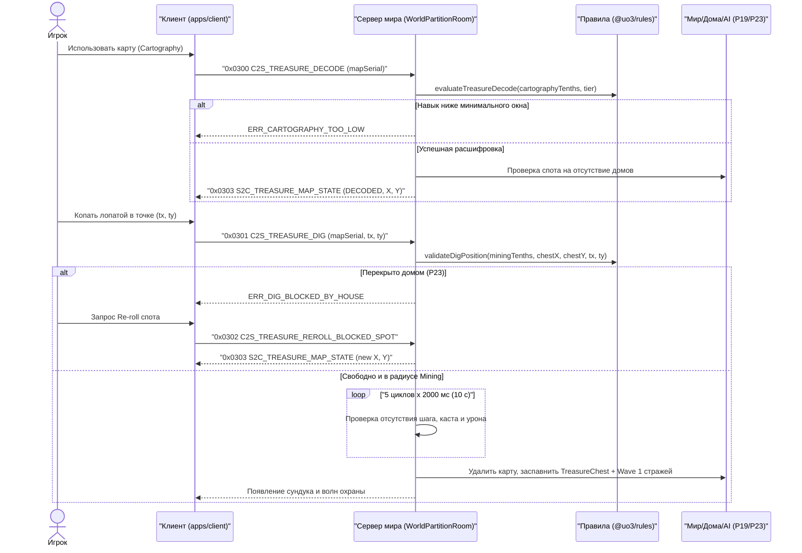
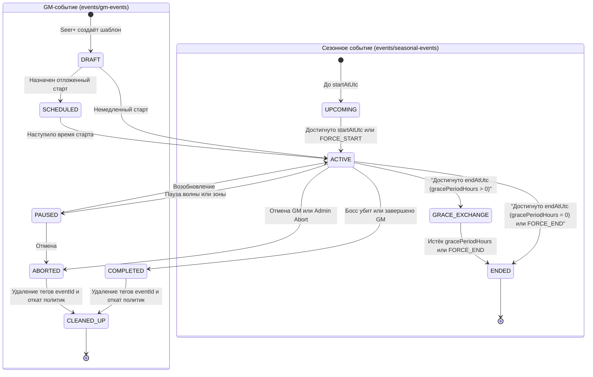
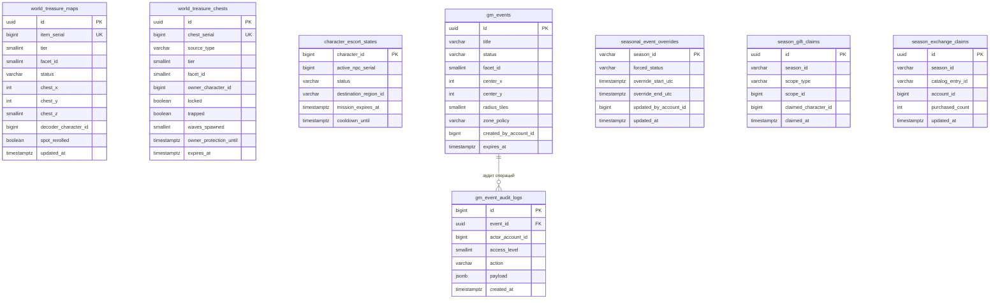

# Design: P27 Квесты и события

## Context

После реализации базового мира, боевой системы, магии, AI/спавнеров (P19), крафта и рыбалки (P20), экономики и `item_ledger` (P21/P08), утилитарных навыков (P22), домов (P23), кораблей и SOS (P24), регионов/сидера/погоды (P25) и социальных систем/пати (P26) сервер UO3 обладает полным набором строительных блоков для динамического мирового контента.

Фаза P27 объединяет четыре взаимосвязанных контура поверх этих блоков:
1. **Карты сокровищ (`events/treasure-maps`)** — связывают лут монстров P19, Cartography и Lockpicking/Remove Trap (P22), Mining/инструменты (P20), проверку коллизий домов (P23), политику преступлений Felucca/Trammel (P17) и глубоководные SOS-сундуки (P24).
2. **Квесты сопровождения (`events/escort-quests`)** — реализуют поведение сервиса `Escortable` (P19) поверх поиска пути (P12), регионов назначения (P25), телепортации Gate Travel (P18) и распределения репутации в пати (P26).
3. **Инструменты событий персонала (`events/gm-events`)** — предоставляют Seer/GM/Admin (P01/P04) управляемые инстансы мировых событий с тегированием сущностей, волнами/боссами, трекером вклада, временными оверрайдами правил зон (P17/P18/P25), суточными квотами и гарантированным cleanup.
4. **Сезонный календарь (`events/seasonal-events`)** — автоматизирует годовые/периодические праздники через декларативные YAML-расписания (`@uo3/content`), 3-сторонний идемпотентный сидер мира (P25), RPO=0 выдачу подарков и обмен токенов (`CriticalTxCoordinator` P08) и анти-абузный сезонный дроп.

Ключевой архитектурный вызов P27 — сохранение **детерминизма и авторитетности сервера** (ADR-001..005), **защиты тика симуляции 20 Гц** при массовых ивентах и спавне стражей, **отсутствия дюпа** на сезонных подарках/обмене токенов и **100% очищаемости мира** от временных объектов ивентов и сундуков.

## Goals / Non-Goals

### Goals
- Обеспечить изоморфное, полностью детерминированное вычисление формул P27 в `@uo3/rules` с покрытием unit-тестами и симулируемым `GameClock`/`xoshiro128++` (`@uo3/test-kit`).
- Гарантировать RPO=0 и отсутствие гонок при выдаче сезонных подарков на аккаунт/персонажа, обмене токенов, выдаче GM-трофеев и экономическом аудите сундуков/эскорта через `CriticalTxCoordinator` и `item_ledger` (`FAUCET_*`/`SINK_*`).
- Обеспечить неблокирующую очистку мира: тегирование всех ивентовых объектов по `eventId`/`seasonId`, автоматический TTL-распад сундуков и orphan reaper при перезапуске узла.
- Защитить тик 20 Гц жёсткими лимитами: кап активных ивентовых существ на фасет (`500`), кап участников локации порталом, региональный кап сезонных монстров и анти-фарм порог на Fame.
- Сохранить чистый DAG зависимостей пакетов (`domain` 0 deps → `rules` → `protocol` → `content` → `db` → `apps/*`).

### Non-Goals
- Реализация сюжетных квестовых цепочек из эпохи Age of Shadows / Mondain's Legacy и систем крафтовых BOD.
- Клиентские звуки, WebGPU-шейдеры и партиклы для раскопок, ловушек и праздников (задаётся событиями для P28).
- Полноценный UI тикет-системы и модерации в `apps/admin` (только API и панель управления событиями/сезонами; полная админ-платформа в P29/P31).
- Кросс-партиционная живая миграция активного GM-события на лету (реализуется в P32 поверх границ партиций).

## Decisions

### 1. Разделение формул в `@uo3/rules` и оркестрации в `apps/game-server`
- **Выбор**: Вся чистая математика (шансы расшифровки Cartography, радиус раскопки по Mining, таблицы тиров сокровищ, расчёт вклада в GM-боссов, формулы наград эскорта, скейлинг сезонного дропа от Fame) выносится в `@uo3/rules/src/events/*` как чистые функции без I/O; мутации мира, таймеры на иерархическом колесе P06 и вызовы БД остаются в `apps/game-server`.
- **Обоснование**: Позволяет клиенту предсказуемо показывать UI-подсказки (например, допустимое окно навыка Cartography или статус элигибельности на подарок) без рассинхронизации с сервером, а `SimulationTestHarness` может гонять тысячи сценариев детерминированно за миллисекунды.
- **Отвергнутые альтернативы**: Размещение расчётов в сервисах NestJS — привело бы к дублированию логики для клиента/ботов и усложнило бы детерминированное тестирование.

### 2. Защита спотов сокровищ от застройки домами через однократный Re-roll заблокированного спота
- **Выбор**: Координаты спота выбираются на валидных точках суши вне городов и существующих домов (`MultiSpatialIndex` P23) при генерации/расшифровке. Если после расшифровки участок был застроен домом, раскопка блокируется с `ERR_DIG_BLOCKED_BY_HOUSE`, а владельцу карты предоставляется безопасный интент `C2S_TREASURE_REROLL_BLOCKED_SPOT`, переназначающий новый свободный спот только при подтверждённой коллизии.
- **Обоснование**: Запрещать игрокам ставить дома (P23) вокруг сотен потенциальных сокровищных точек на карте — плохой UX и противоречит духу UO sandbox. Механизм проверяемого re-roll исключает безвозвратную потерю редкой карты Tier 4–5 и защищён от эксплоита («выбрать спот поближе к городу»), так как переролл работает только при реальном пересечении с домом.
- **Отвергнутые альтернативы**: Автоматический сдвиг клада на ближайший свободный тайл в момент копки — ломает привязку к визуальному маркеру на карте и может вынести сундук в непригодную локацию или воду.

### 3. Унифицированный конвейер сундуков сокровищ для Treasure Maps и глубоководных SOS (P24)
- **Выбор**: Извлечение лута, установка замка/ловушки, спавн стражей, контроль доступа (`ContainerAccessGrantPort`) и TTL-распад вынесены в единый сервис `TreasureChestLifecycleService`, параметризуемый источником (`TREASURE_MAP` | `SOS_BOTTLE`).
- **Обоснование**: Сундуки по картам сокровищ и SOS-сундуки имеют 90% общей механики (тиры 2–4, замок/ловушка, лут-таблицы, волны стражей, TTL 1800/180 с, аудит `FAUCET_TREASURE_CHEST`). Различаются только способ появления (10-секундная копка на земле vs выуживание с палубы корабля P24) и пул стражей (сухопутные vs `Sea Serpent`/`Water Elemental`).
- **Отвергнутые альтернативы**: Два независимых класса сундуков и таблиц лута — привело бы к дублированию проверок доступа Felucca/Trammel и экономического аудита.

### 4. Авторитетная машина состояний эскорта и правило Gate Travel vs Recall
- **Выбор**: Эскорт работает поверх сущности NPC с сервисом `Escortable` (P19), добавляя состояние `EscortQuestInstance` (`IDLE → ESCORTING → COMPLETED | FAILED | ABANDONED`). NPC следует через A* (P12) и переносится вслед за владельцем **только** через открытый однофасетный `Gate Travel`, если находится в радиусе `≤ 2` тайлов, но игнорирует `Recall` (что вызывает провал при отрыве `> 30` тайлов).
- **Обоснование**: Полностью соответствует канону UO:R, предотвращает мгновенный тривиальный фарм эскорт-золота и славы связкой Recall-рун на каждый город, но сохраняет осмысленную тактическую механику с Gate Travel. Глобальный кулдаун `300` с на персонажа дополнительно сдерживает инфляцию.
- **Отвергнутые альтернативы**: Автоматический перенос NPC при `Recall` — превращает квесты сопровождения в безрисковый 5-секундный кликер.

### 5. Обязательное тегирование `eventId` и двухуровневый Orphan Reaper для GM-событий
- **Выбор**: Каждая сущность, порождённая GM-инструментом (`EventMoongate`, волновые монстры, боссы, декорации, призовые сундуки), получает ненулевой `eventId` в серверном состоянии и в персистентной записи. Помимо горячего cleanup при переходе в `COMPLETED`/`ABORTED` или по таймеру `TTL`, при старте `WorldPartitionRoom` выполняется orphan-ревизия, удаляющая оставшиеся сущности событий со статусом `COMPLETED`, `ABORTED`, `CLEANED_UP` или истёкшим `TTL`.
- **Обоснование**: Защищает игровой мир от вечного «мусора» после сбоя сервера или забытого GM-события.
- **Отвергнутые альтернативы**: Ручная уборка декораций и мобов персоналом — неминуемо приводит к забытым ивентовым мобам и заблокированным проходам.

### 6. Слои политик зон GM-событий без мутации таблицы регионов P25
- **Выбор**: Временные правила GM-событий (`PVE_COOP_NO_PK`, `FREE_TOURNAMENT`, `NO_RECALL_NO_GATE`) реализуются как динамический слой-декоратор поверх `IRegionSpellPolicy` (P18/P25) и `ICombatLegalityPolicy` (P16/P17), проверяющий активные баундинг-боксы событий по координатам перед обращением к статической карте регионов.
- **Обоснование**: Исключает необходимость инвалидировать статический 16×16 пространственный индекс регионов P25 или рисковать «залипанием» изменённых флагов на карте после падения сервера.
- **Отвергнутые альтернативы**: Прямое изменение записей `regions` в БД на время ивента — опасно гонками и потерей исходных флагов города/данжа.

### 7. Анти-дюп сезонных подарков и обменов через `CriticalTxCoordinator` и уникальные ключи БД
- **Выбор**: Учёт выданных сезонных подарков (`season_gift_claims`) и ограниченных покупок в обменнике (`season_exchange_claims`) строится на составном `UNIQUE(season_id, scope_type, scope_id)` в PostgreSQL 17 внутри транзакции `CriticalTxCoordinator` (RPO=0) с немедленной записью в `item_ledger`.
- **Обоснование**: Даже при одновременном клике с двух вкладок/сессий или попытке входа с разных шардов на одном аккаунте база данных гарантирует строгую однократность (`ON CONFLICT` / `23505` → `ERR_SEASON_GIFT_ALREADY_CLAIMED`), а выдача предмета и отметка claim фиксируются атомарно.
- **Отвергнутые альтернативы**: Хранение счётчика выдачи только в Valkey с асинхронным flush — уязвимо для race condition и потери при сбое кэша (нарушение RPO=0).

### 8. Декларативный сезонный календарь + hot-override поверх 3-стороннего сидера (P25)
- **Выбор**: Базовый годовой календарь и каталоги наград хранятся в версионируемых YAML-файлах `@uo3/content`, а таблица `seasonal_event_overrides` в PostgreSQL хранит только административные сдвиги дат или принудительные флаги `FORCE_START`/`FORCE_GRACE`/`FORCE_END`. Спавн праздничных декораций и вендоров-обменников использует идемпотентный ключ `season_spawn_key` из 3-стороннего сидера мира P25.
- **Обоснование**: Совмещает воспроизводимость GitOps-конфигурации для тестов/CI с гибкостью live-ops без рестарта и без дублирования декораций.
- **Отвергнутые альтернативы**: Полное хранение определений сезонов и лут-таблиц только в БД — усложняет ревью, тестирование в `@uo3/test-kit` и миграцию между средами.

## Architecture & Data Flows

### Распределение ответственности по пакетам и приложениям

- **`packages/domain/src/events/`** (0 внешних зависимостей):
  - Перечисления: `TreasureTier` (`1..5`), `TreasureMapStatus` (`UNDECODED | DECODED | CONSUMED`), `TreasureSource` (`TREASURE_MAP | SOS_BOTTLE`), `EscortStatus` (`IDLE | ESCORTING | COMPLETED | FAILED | ABANDONED`), `GmEventStatus` (`DRAFT | SCHEDULED | ACTIVE | PAUSED | COMPLETED | ABORTED | CLEANED_UP`), `GmEventZonePolicy` (`NONE | PVE_COOP_NO_PK | FREE_TOURNAMENT | NO_RECALL_NO_GATE`), `SeasonStatus` (`UPCOMING | ACTIVE | GRACE_EXCHANGE | ENDED`), `SeasonClaimScope` (`ACCOUNT | CHARACTER`).
  - Константы и коды ошибок: `ERR_CARTOGRAPHY_TOO_LOW`, `ERR_TREASURE_NOT_DECODER`, `ERR_DIG_TOO_FAR`, `ERR_DIG_BLOCKED`, `ERR_DIG_BLOCKED_BY_HOUSE`, `ERR_DIG_NO_TREASURE_HERE`, `ERR_DIG_ALREADY_ACTIVE`, `ERR_DIG_INTERRUPTED`, `ERR_SPOT_NOT_BLOCKED`, `ERR_WRONG_FACET`, `ERR_CHEST_ACCESS_DENIED`, `ERR_ESCORT_COOLDOWN`, `ERR_ESCORT_LIMIT_REACHED`, `ERR_ESCORT_ALREADY_TAKEN`, `ERR_INSUFFICIENT_ACCESS_LEVEL`, `ERR_EVENT_ENTITY_LIMIT_EXCEEDED`, `ERR_EVENT_ENTRY_DENIED`, `ERR_GM_QUOTA_EXCEEDED`, `ERR_SEASON_GIFT_ALREADY_CLAIMED`, `ERR_SEASON_ELIGIBILITY_FAILED`, `ERR_SEASON_PURCHASE_LIMIT_REACHED`, `ERR_INSUFFICIENT_SEASON_TOKENS`.

- **`packages/rules/src/events/`** (изоморфные детерминированные функции):
  - `treasureRules.ts`: таблица сложности Cartography, формула вероятности расшифровки, радиус Mining, таблица требований Lockpicking, пулы стражей по тирам, генератор лута (на входе `xoshiro128++`).
  - `escortRules.ts`: таблица маршрутов и наград по классам NPC (`goldRange`, `fameRange`, `karmaRange`), проверка допустимой дистанции (`≤ 30`), расчёт деления Fame/Karma на участников пати в радиусе `18` тайлов.
  - `gmEventRules.ts`: матрица прав по `AccessLevel` (Seer=2, GM=3, Admin=5), расчёт вклада (`damage + 0.5 * heal`), порог участия, проверка квот и лимита `500` ивентовых мобов на фасет.
  - `seasonalRules.ts`: вычисление фазы сезона по UTC-времени и override-флагам, расчёт масштабируемого дропа по `Fame` (0 при `Fame < 50` или `isSummoned`), проверка возраста аккаунта/персонажа для подарков.

- **`packages/protocol/src/events/`** (TypeBox + uint16 опкоды):
  - `0x0300` `C2S_TREASURE_DECODE` `{ mapItemSerial: uint32 }`
  - `0x0301` `C2S_TREASURE_DIG` `{ mapItemSerial: uint32, targetX: uint16, targetY: uint16 }`
  - `0x0302` `C2S_TREASURE_REROLL_BLOCKED_SPOT` `{ mapItemSerial: uint32 }`
  - `0x0303` `S2C_TREASURE_MAP_STATE` `{ mapItemSerial: uint32, tier: uint8, status: uint8, facetId: uint8, markerX?: uint16, markerY?: uint16, digProgressMs?: uint16, spotBlockedByHouse?: boolean }`
  - `0x0304` `C2S_ESCORT_ACCEPT` `{ npcSerial: uint32 }`
  - `0x0305` `C2S_ESCORT_ABANDON` `{ npcSerial: uint32 }`
  - `0x0306` `S2C_ESCORT_STATUS` `{ npcSerial: uint32, status: uint8, destinationRegionId: string, destinationName: string, remainingSeconds: uint16, cooldownUntilUnixMs: uint64 }`
  - `0x0307` `C2S_GM_EVENT_COMMAND` `{ eventId?: string, action: string, payloadJson: string }`
  - `0x0308` `S2C_GM_EVENT_STATE` `{ eventId: string, title: string, status: uint8, currentWave: uint16, remainingEntities: uint16, playerContribution: uint32, thresholdMet: boolean }`
  - `0x0309` `S2C_SEASON_CALENDAR_SYNC` `{ serverUtcMs: uint64, seasons: SeasonSummaryDto[] }`
  - `0x030A` `C2S_SEASON_CLAIM_GIFT` `{ seasonId: string }`
  - `0x030B` `C2S_SEASON_EXCHANGE_REWARD` `{ seasonId: string, vendorSerial: uint32, catalogEntryId: string, quantity: uint16 }`
  - `0x030C` `S2C_SEASON_CLAIM_RESULT` `{ seasonId: string, success: boolean, errorCode?: string, rewardItemName?: string }`

- **`packages/content/schemas/` и `packages/content/data/`**:
  - `treasure-spots.schema.json` + `treasure-spots.yaml` (включая споты для dev-фасета `200`).
  - `treasure-tiers.schema.json` + `treasure-tiers.yaml` (параметры тиров 1..5 и таблицы лута/стражей).
  - `escort-routes.schema.json` + `escort-routes.yaml` (маршруты между регионами, профиль засад).
  - `gm-event-templates.schema.json` + `gm-event-templates.yaml` (типовые шаблоны волн, боссов, памятных трофеев).
  - `seasons.schema.json` + `seasons.yaml` (праздники, окна активности и грейс-периода, таблицы дропа, подарков и каталоги обменников).

### Диаграмма 1: Цикл охоты за сокровищами (`events/treasure-maps`)

### Диаграмма 2: Жизненный цикл GM-событий и сезонов

### Диаграмма 3: Схема данных PostgreSQL 17 и транзакционная целостность (`@uo3/db`)

*(Примечание: уникальные индексы `uq_gift_claim (season_id, scope_type, scope_id)` и `uq_exchange_claim (season_id, catalog_entry_id, account_id)` обеспечивают строгую однократность и соблюдение `maxPerAccount` на уровне СУБД).*

## Точные алгоритмы и математические формулы UO:R

### 1. Расшифровка и раскопки карт сокровищ (`treasureRules.ts`)
- **Таблица тиров карт (`Tier 1..5`)**:
  | Тир | Название | Target Cartography (дес.) | Окно попытки (дес.) | Req Lockpicking (дес.) | Золото (GP) | Начальные стражи | Доп. волны (при вскрытии) | Урон ловушки |
  | --- | --- | --- | --- | --- | --- | --- | --- | --- |
  | 1 | Plainly Drawn | `270` (`27.0`) | `20..520` | `360` (`36.0`) / Unlock | `1000` | `3` | `0` | `10..20` |
  | 2 | Expertly Drawn | `710` (`71.0`) | `460..960` | `760` (`76.0`) | `2000` | `4` | `1` (2 стража) | `20..40` |
  | 3 | Adeptly Drawn | `810` (`81.0`) | `560..1060` | `840` (`84.0`) | `3000` | `4` | `1..2` (2–3 стража) | `40..70` |
  | 4 | Cleverly Drawn | `910` (`91.0`) | `660..1160` | `920` (`92.0`) | `4000` | `5` | `2` (2–3 стража) | `70..100` |
  | 5 | Deviously Drawn | `1000` (`100.0`) | `750..1250` | `1000` (`100.0`) | `5000` | `6` | `2` (3 стража) | `100..140` |
- **Шанс расшифровки**:
  $$\text{minSkill} = \text{target} - 250, \quad \text{maxSkill} = \text{target} + 250$$
  $$\text{chanceBp} = \begin{cases} 0 & \text{если } \text{skill} < \text{minSkill (возврат } \texttt{ERR\_CARTOGRAPHY\_TOO\_LOW}\text{)} \\ \min\left(10000,\ \left\lfloor \frac{\text{skill} - \text{minSkill}}{500} \cdot 10000 \right\rfloor\right) & \text{иначе} \end{cases}$$
- **Допустимая погрешность раскопки по Mining**:
  $$\text{maxChebyshevDist} = \begin{cases} 1 & \text{при } \text{Mining} < 510 \\ 2 & \text{при } 510 \le \text{Mining} < 810 \\ 3 & \text{при } 810 \le \text{Mining} < 1000 \\ 4 & \text{при } \text{Mining} = 1000 \end{cases}$$
- **Поэтапная копка**: 5 итераций таймера по `2000` мс (итого `10000` мс). На шагах 2, 3, 4 и 5 клиент получает прогресс, а сундук на сервере резервируется после шага 5. Шаг игрока, начало атаки, чтение заклинания или `FinalDamage >= 1` мгновенно сбрасывают таймер с `ERR_DIG_INTERRUPTED`.
- **SOS-сундуки (P24)**: При рыбалке с корабля в расстоянии `Chebyshev <= 3` от расшифрованного SOS-сообщения вызывается `TreasureChestLifecycleService.spawnFromSos(...)` для тиров `2..4` с морскими стражами (`Sea Serpent`, `Deep Sea Serpent`, `Water Elemental`) на соседних водных тайлах (`2..5` тайлов от борта).

### 2. Квесты сопровождения (`escortRules.ts`)
- **Параметры цикла**: `ESCORT_COOLDOWN_SEC = 300`, `ESCORT_TIMEOUT_SEC = 900`, `ESCORT_MAX_DISTANCE = 30`, `ESCORT_ARRIVAL_RADIUS = 5`, `ESCORT_PARTY_SHARE_RADIUS = 18`, `ESCORT_DEATH_GRACE_SEC = 120`, `ESCORT_DESPAWN_DELAY_SEC = 30`, `ESCORT_GATE_FOLLOW_RADIUS = 2`.
- **Таблица базовых наград**:
  - `Peasant` / `Messenger`: `150..250` GP, Fame `200..300`, Karma `100..200`.
  - `Mage` / `Seeker`: `250..450` GP, Fame `300..400`, Karma `150..250`.
  - `Merchant` / `Noble` / `Bride`: `300..500` GP, Fame `400..500`, Karma `200..300`.
- **Деление в пати**: пусть $N$ — число живых сопартийцев (включая владельца) в радиусе `18` тайлов в целевом регионе; каждому начисляется $\lfloor \text{totalFame} / N \rfloor$ и $\lfloor \text{totalKarma} / N \rfloor$ (минимум `1` при $N \le \text{total}$), а золото выдаётся целиком владельцу (в рюкзак или при перегрузе ≥ 400 камней / ≥ 125 предметов — в банк P21) с записью `FAUCET_ESCORT_REWARD`.

### 3. Вклад и квоты GM-событий (`gmEventRules.ts`)
- **Счётчик вклада**: `contributionScore = damageDealtToEventMobs + floor(healingDoneInZone * 0.5)`.
- **Порог наград**: `threshold = max(configuredMinScore ?? 500, floor(primaryBossMaxHp * 0.01))`.
- **Квотирование GM**: по умолчанию суточный лимит `GM_DAILY_GOLD_QUOTA = 100000` GP и `GM_DAILY_ITEM_GRANTS = 50` (переопределяемо `Admin AccessLevel ≥ 5`). Лимит активных ивентовых существ на фасет `MAX_ACTIVE_EVENT_MOBS_PER_FACET = 500`.

### 4. Скейлинг сезонного дропа и календарь (`seasonalRules.ts`)
- **Вероятность дропа**: для монстра с флагом `isSummoned = false` и `fame >= 50`:
  $$\text{dropChanceBp} = \min\left(\text{maxCapBp},\ \left\lfloor \text{baseDropBp} \cdot \sqrt{\frac{\text{fame}}{1000}} \right\rfloor\right)$$
  При `isSummoned = true` или `fame < 50`: `dropChanceBp = 0`.
- **Состояние сезона**:
  - Если `override.forcedStatus` задан (`FORCE_START` → `ACTIVE`, `FORCE_GRACE` → `GRACE_EXCHANGE`, `FORCE_END` → `ENDED`) — применяется оверрайд;
  - Иначе: `now < startAt` → `UPCOMING`; `startAt <= now < endAt` → `ACTIVE`; `endAt <= now < endAt + graceHours * 3600s` → `GRACE_EXCHANGE`; `now >= graceEnd` → `ENDED`.

## Risks / Trade-offs

- **[Перегрузка тика 20 Гц при массовом спавне на GM-ивенте или одновременной раскопке нескольких карт Tier 5]** → Введён жёсткий глобальный кап `500` активных ивентовых существ на фасет, ограничение `maxParticipants` на `EventMoongate` и привязка циклов стражей/копки к иерархическому колесу таймеров P06 без per-tick аллокаций.
- **[Злоупотребление Re-roll заблокированного спота для телепортации клада к удобному месту]** → Переролл (`C2S_TREASURE_REROLL_BLOCKED_SPOT`) разрешён только при реальном пересечении текущих координат клада с домом (`MultiSpatialIndex`) и помечается флагом `spot_rerolled` с ограничением 1 раза на конкретное перекрытие.
- **[Конфликты временных оверрайдов GM-события при пересечении двух ивентовых баундинг-боксов]** → Валидация при активации `EventInstance`: запрещено пересекать баундинг-зоны двух активных GM-событий с конфликтующими `GmEventZonePolicy` (`ERR_EVENT_ZONE_CONFLICT`).
- **[Эксплоит фарма сезонных токенов новыми ботами-однодневками или убийством скота]** → Отсечение существ с `Fame < 50` и призывных существ на уровне правил дропа + обязательный минимальный порог возраста аккаунта/персонажа для сезонных подарков + лимит `maxPerAccount` в обменнике.
- **[Утечка эскортируемых NPC и исчерпание слотов спавнеров P19 при брошенных квестах]** → Гарантированный TTL `900` с на миссию, отмена при выходе из игры (`> 300` с) или уходе дальше `30` тайлов с автоматическим деспавном через `60` с и освобождением квоты спавнера.
- **[Экономическая инфляция из-за выдачи золота на GM-ивентах и картах]** → Фиксация всех потоков в `FAUCET_TREASURE_CHEST`, `FAUCET_ESCORT_REWARD`, `FAUCET_SEASONAL_REWARD`, `SINK_SEASONAL_TOKEN` и `GM_EVENT_REWARD`, суточные квоты на GM-аккаунт и контроль лимитов через `Admin (5)+`.
- **[Осиротевшие сезонные декорации после нештатного рестарта на границе окончания сезона]** → Идемпотентный 3-сторонний сидер по `season_spawn_key` (P25) при старте узла синхронизируется с вычисленной фазой календаря и очищает лишние объекты в фазе `ENDED`/`GRACE_EXCHANGE`.

## Migration Plan

1. **Миграция БД (`@uo3/db`)**: Добавление 8 таблиц в рамках одной обратимой Drizzle-миграции (`world_treasure_maps`, `world_treasure_chests`, `character_escort_states`, `gm_events`, `gm_event_audit_logs`, `seasonal_event_overrides`, `season_gift_claims`, `season_exchange_claims`) без изменения существующих таблиц P00–P26 (кроме добавления enum-значений причин в `item_ledger`, если строго типизировано).
2. **Контент и фича-флаги (`@uo3/content`, `@uo3/config`)**: Поставка базовых YAML-файлов с отключёнными по умолчанию будущими праздниками и активным тестовым сезоном только на dev-фасете `200`; включение расписания на prod управляется датами UTC или админ-API.
3. **Развёртывание и обратная совместимость**: Новые опкоды `0x0300..0x030C` обратно совместимы со старыми клиентами (неиспользуемые каналы не мешают подключению); при необходимости отката достаточно отключить активные GM-события командой `EmergencyAbortAll`, перевести сезоны в `FORCE_END` (что автоматически очистит временные декорации) и откатить миграцию.

## Open Questions

- *(Неблокирующий, отложено к P30)*: Требуется ли при балансировке шарда корректировка шанса выпадения карт сокровищ Tier 4–5 с конкретных монстров данжей (Balron, Ancient Wyrm) по результатам первых нагрузочных прогонов `bot-client`?
- *(Неблокирующий, отложено к P29/P31)*: Насколько детальные фильтры визуализации истории `gm_event_audit_logs` потребуются в UI веб-админки (помимо обязательного экспорта JSON/пагинации в `/api/v1/admin/events/audit`)?
