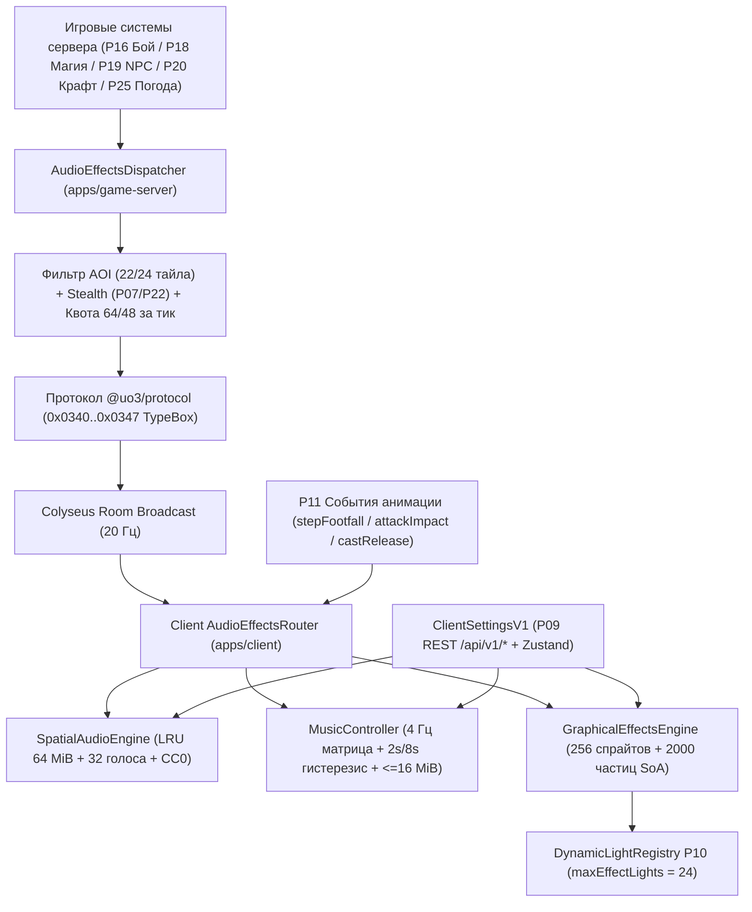
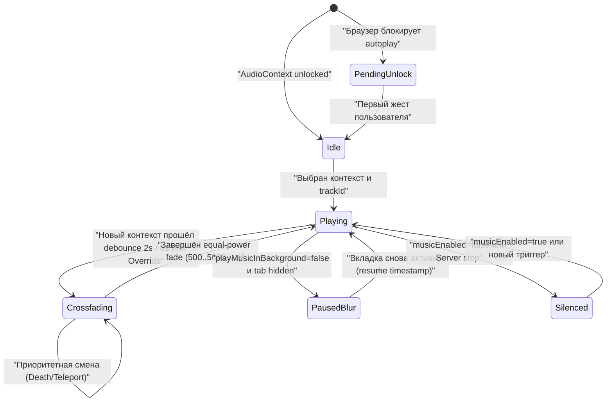
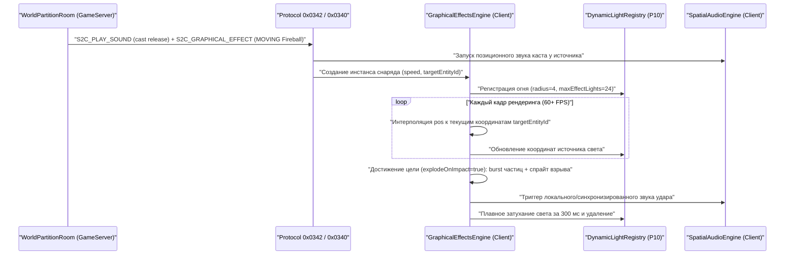

# Design: P28 Звук и эффекты

## Context

Фаза P28 завершает базовый сенсорный слой UO3, объединяя уже реализованные заделы предыдущих фаз в единую детерминированную и масштабируемую систему звука, музыки и графических эффектов:
- **P02 (`@uo3/uo-formats`, OPFS, `useAssetStore`)**: локально импортированные `sound.mul`/`soundidx.mul`/`SoundLegacyMUL.uop`, `art.mul`/`artidx.mul`, `hues.mul` (32×3001 LUT), `animdata.mul`, `light.mul` и строгий запрет проприетарных ассетов UO в репозитории и CI (ADR-002).
- **P07 (`@uo3/protocol`)**: uint16-опкоды, TypeBox-валидация и фильтрация видимости через Colyseus `StateView` и `VisibilityEntitySource`.
- **P09 (`apps/client`, `apps/api`)**: хранение пользовательских настроек в `ClientSettingsV1` (`account_client_profiles` JSONB в PostgreSQL 17).
- **P10 (`apps/client` 2.5D/3D Three.js + R3F)**: `CameraTargetProvider` и `DynamicLightRegistry`, подготовленный специально для P28.
- **P11 (`apps/client`)**: `MobileVisualSnapshot` и события синхронизации с анимацией (`stepFootfall`, `attackImpact`, `castRelease`, `deathFinished`).
- **P16, P18, P19, P20, P22, P25**: источники игровых событий (бой, 64 заклинания, ИИ существ, ремесло, скрытность/стелс, регионы `16×16` с приоритетами `0..255`, игровое время и погода).

Ключевая инженерная задача P28 — обеспечить богатую аудио-визуальную реакцию при массовых сражениях (десятки игроков и заклинаний в AOI на 20 Гц тике) без сетевых штормов, утечек памяти в браузере, раскрытия скрытых персонажей по звуку/эффектам и с 100% работоспособностью без оригинальных файлов UO (CC0-синтез и процедурные шейдеры).

## Goals / Non-Goals

### Goals
- Серверно-авторитарная рассылка боевых, магических, интерактивных, погодных и музыкальных событий по AOI и правилам видимости/стелса.
- Нулевой сетевой трафик на шаги за счёт клиентской генерации `stepFootfall` с распознаванием материала поверхности тайла.
- Точная пространственная акустика изометрии UO: 3D-затухание, экранное стереопанорамирование, отслеживание движущихся сущностей, лимит голосов (`8..64`, по умолчанию `32`) и коалесцирование всплесков.
- Регионная и ситуационная музыка с жёсткой матрицей приоритетов, гистерезисом переходов (2 с на регионах, 8 с в бою), equal-power crossfade и потоковым декодированием (`<= 16 MiB`).
- Полная поддержка всех 5 канонических типов графических эффектов UO (`FIXED_XYZ`, `FOLLOW_ENTITY`, `MOVING`, `LIGHTNING`, `SCREEN_FLASH`), палитр `hues.mul`, интеграции с `DynamicLightRegistry` (`maxEffectLights = 24`) и пулируемых частиц без GC-аллокаций в кадре.
- Доступность: защита от фоточувствительности (`reduceFlashes`), раздельные ползунки громкости, `muteOnBlur`, и стабильный headless-режим для `bot-client` и CI.

### Non-Goals
- Реализация механики бардовских навыков (P22) или расчёта урона/заклинаний (P16/P18).
- Добавление голосового чата (VoIP) или пользовательских загрузок аудио на сервер.
- Серверное хранение или передача оригинальных MP3/WAV/ART файлов клиентам (запрещено ADR-002).
- Переработка геометрии мира P10 или скелетной/спрайтовой анимации P11.

## Decisions

### D1. Гибридная модель событий: серверные события + локальный визуально-синхронизированный слой P11
- **Выбор:** Авторитарные игровые события (удар, парирование, промах, заклинания, двери/сундуки, крафт, гром, серверные музыкальные директивы) рассылаются сервером через протокол `0x0340..0x0347`. Частые клиентские события (шаги видимых мобилов `stepFootfall`, UI-клики, перетаскивание в рюкзаке, брызги частиц при получении числа урона) генерируются локально на клиенте.
- **Обоснование:** Экономит до 70% исходящего трафика при толпе бегущих игроков, гарантирует идеальную синхронизацию звука шага с конкретным кадром анимации P11 и при этом полностью исключает утечку стелса, так как скрытые сущности отсутствуют в `StateView` наблюдателя.
- **Отвергнутые альтернативы:** Отправка `PlaySound` с сервера на каждый шаг — недопустимо нагружает сеть и рассинхронизируется с кадром анимации при сетевом джиттере.

### D2. Лёгкое изометрическое панорамирование вместо Web Audio HRTF `PannerNode`
- **Выбор:** Использование связки `GainNode` + `StereoPannerNode` с вычислением 3D-расстояния `d = sqrt(dx^2 + dy^2 + (dz * 0.1)^2)` и изометрического горизонтального смещения `pan = clamp((dx - dy) / 14, -1.0, 1.0)`.
- **Обоснование:** В изометрической 2.5D-камере UO направление «лево-право» на экране соответствует оси `(dx - dy)`, а Z имеет шаг 4 px (~0.1 тайла в экранной метрике). HRTF-свёртка на `32..64` одновременных голосах создаёт избыточную нагрузку на аудиопоток, тогда как `GainNode + StereoPannerNode` даёт детерминированный, чёткий и дешёвый по CPU результат.
- **Отвергнутые альтернативы:** `PannerNode` в режиме `HRTF` — тяжёлая свертка и искажение восприятия высоты камеры при фиксированном изометрическом угле.

### D3. Приоритетная матрица голосов, коалесцирование и квотирование на сервере
- **Выбор:** Сервер ограничивает очередь до `64` звуковых событий и `48` графических эффектов на подключение за 50 мс тик. Клиент применяет коалесцирование одинаковых `soundId` в окне `40 мс` и радиусе `< 2` тайлов, ограничивает одинаковый `soundId` `<= 4` голосами и общим пулом `8..64` (по умолчанию `32`) с вытеснением по рейтингу `(tierWeight * 10 + spatialGain)`.
- **Обоснование:** При массовых осадах с метеоритным дождём и 30 бойцами предотвращается клиппинг микшера, падение FPS и насыщение WebSocket-канала, при этом собственные действия игрока всегда выживают.
- **Отвергнутые альтернативы:** Простой FIFO drop-newest — приводит к пропаданию критического звука урона или каста самого игрока во время шума шагов толпы.

### D4. Потоковый музыкальный контроллер с гистерезисом и equal-power crossfade
- **Выбор:** Контроллер контекста оценивает приоритет с частотой `4 Гц` (`Login 100 > Death 90 > Combat 80 > Sailing 70 > RegionPriority 0..255 > Wilderness 10`). Переход между регионами требует `2000 мс` debounce; выход из боевой музыки имеет `8000 мс` hysteresis. Воспроизведение цифровых файлов (MP3/OGG) идёт потоково через Blob URL (`HTMLAudioElement` -> `MediaElementAudioSourceNode`), ограничивая число живых потоков двумя (во время кроссфейда `500..5000 мс`) и память `<= 16 MiB`.
- **Обоснование:** Полное декодирование 3–5-минутных MP3-треков в PCM `AudioBuffer` заняло бы десятки мегабайт на трек и тормозило бы главный поток; потоковый граф держит потребление памяти минимальным и не перегружает GC.
- **Отвергнутые альтернативы:** Загрузка всех музыкальных `AudioBuffer` в LRU-кэш — неприемлемый расход RAM.

### D5. Многоуровневая стратегия фолбэков (OPFS -> Sound.def / MIDI -> CC0-синтез)
- **Выбор:** При отсутствии пользовательских файлов в OPFS (чистый старт, синтетический фасет, CI, повреждённый файл) клиент бесшовно переключается на встроенные детерминированные CC0-генераторы звуков и процедурных эмбиент-музыкальных циклов, а также на процедурные CC0 billboard-спрайты для графических эффектов.
- **Обоснование:** Полное соблюдение ADR-002 (ноль проприетарных ассетов в репо) и полная проверяемость E2E-тестов в браузере и ботах без импорта клиента UO.
- **Отвергнутые альтернативы:** Тишина/невидимые эффекты без фолбэка — ломает читаемость боя и делает невозможным тестирование в синтетическом мире.

### D6. SoA-пулы с нулевыми аллокациями в кадре и `InstancedMesh` для частиц и эффектов
- **Выбор:** `ParticlePool` и `EffectInstancePool` используют заранее выделенные типизированные массивы (Structure of Arrays: `Float32Array` для позиций, скоростей, цвета, времени жизни, масштаба) и инстансированный рендеринг в R3F/Three.js. Для динамических огней используется `DynamicLightRegistry` (P10) с жёстким лимитом `maxEffectLights = 24`.
- **Обоснование:** При бюджете до `2000` частиц (`high`) и `256` спрайтовых эффектов инстансинг и SoA-пулы сводят число draw calls к единицам и полностью убирают GC-паузы.
- **Отвергнутые альтернативы:** Создание React-компонентов или `THREE.Sprite` на каждую частицу — вызывает лаги GC и сотни draw calls.

### D7. Расширение `ClientSettingsV1` в PG17 вместо новой таблицы БД
- **Выбор:** Все настройки аудио, музыки, качества эффектов и `reduceFlashes` добавляются как опциональные поля с дефолтами в схему `ClientSettingsV1` (таблица `account_client_profiles` в PostgreSQL 17 из P09).
- **Обоснование:** Ноль миграций новых таблиц, обратная совместимость со старыми JSONB-профилями в БД, единый REST API `/api/v1/profile/settings` и TypeBox-валидация.
- **Отвергнутые альтернативы:** Отдельная таблица `account_audio_settings` — лишний JOIN и дублирование конвейера синхронизации профиля P09.

### D8. Безопасная абстракция портов для `bot-client` и серверной симуляции
- **Выбор:** Разделение доменных контрактов в `@uo3/domain` и `@uo3/protocol`, адаптеров браузера в `apps/client` и лёгкого `NoopAudioEffectsSink` в `apps/bot-client` и `@uo3/test-kit`.
- **Обоснование:** Headless нагрузочные боты и серверные интеграционные тесты проверяют приход и корректность пакетов `0x0340..0x0347` без зависимости от браузерного `AudioContext` и WebGL2.
- **Отвергнутые альтернативы:** Условные `typeof window` проверки внутри самой бизнес-логики — ухудшает тестируемость и связывает модули с глобальным окружением.

## Архитектура модулей и поток данных



### Распределение по пакетам и приложениям

- **`packages/domain`**:
  - `src/audio/types.ts`: `SoundId` (`0..4095`), `SoundCategory` (`sfx | ambient | ui | footsteps`), `SoundPriority` (`CRITICAL_UI=4 | SPELL_SYSTEM=3 | COMBAT=2 | AMBIENT_FOOTSTEP=1`), `MusicTrackId`, `MusicContextKind`, `SurfaceMaterial` (`grass | stone | sand | snow | water | wood | metal`).
  - `src/effects/types.ts`: `GraphicalEffectKind` (`FIXED_XYZ=0 | FOLLOW_ENTITY=1 | MOVING=2 | LIGHTNING=3 | SCREEN_FLASH=4`), `EffectRenderMode` (`0, 2, 3, 4, 5`), `ParticlePresetId`, `EffectQuality` (`low | medium | high`), `AudioEffectsErrorCode` (`ERR_AUDIO_*`, `ERR_EFFECT_*`, `ERR_MUSIC_*`).
- **`packages/uo-formats`**:
  - Расширение `SoundDefParser` (разрешение псевдонимов `Sound.def`), `DigitalMusicConfigParser` (разбор `Music/Digital/Config.txt` и `,loop`), уточнение полей `AnimDataReader` (`frameData[64]`, `frameCount`, `frameInterval`, `startDelay`) для покадровых эффектов.
- **`packages/content`**:
  - `content/audio/sounds.yaml` + `sounds.schema.json`: категории звуков, дефолтные ID шагов по материалам, звуки 64 заклинаний, крафта и UI, CC0-профили синтеза.
  - `content/audio/music.yaml` + `content/audio/region-music.yaml` + JSON Schema: каталог треков (0..49+) и привязка к регионам P25 (`dayTracks`, `nightTracks`, `interiorTracks`, `defaultWilderness`, `combat`, `death`, `sailing`, `login`).
  - `content/effects/effects.yaml` + `particles.yaml` + JSON Schema: спецификации канонических UO-эффектов (ID `art`, кадры, `renderMode`, `lightRadius`, `lightColor`, `particlePreset`, CC0 fallback shape).
- **`packages/protocol`**:
  - Опкоды `0x0340..0x0347` и TypeBox-схемы сообщений; расширение `ClientSettingsV1Schema` полями аудио и эффектов.
- **`apps/api`**:
  - Валидация новых полей `ClientSettingsV1` при `PUT/PATCH /api/v1/profile/settings` с возвратом `ERR_AUDIO_SETTINGS_OUT_OF_RANGE` при нарушении диапазонов.
- **`apps/game-server`**:
  - `AudioEffectsDispatcher` и `MusicDirectiveService`: per-tick буферизация событий на клиента, проверка стелса через `VisibilityEntitySource` (P07/P22), приоритетная фильтрация при переполнении `64` звуков / `48` эффектов, интеграция с боевым тиком (P16), магией (P18), NPC (P19), сбором/крафтом (P20), погодой/телепортами (P25).
- **`apps/client`**:
  - `SoundAssetLoader` (OPFS + `Sound.def` + CC0-синтез + 64 MiB LRU `AudioBufferCache`), `SpatialAudioEngine` (пул `8..64` голосов, коалесцирование 40 мс, `GainNode`+`StereoPannerNode`, привязка к `stepFootfall`), `MusicController` (контекстная FSM, кроссфейд, стрим декодера `<= 16 MiB`, `pending_unlock`, blacklisting), `GraphicalEffectsRenderer` + `ParticlePool` (SoA, `InstancedMesh`, `hues.mul` LUT, `DynamicLightRegistry`, бюджеты `low/medium/high`, `reduceFlashes`), интеграция с UI-настройками и debug HUD.
- **`apps/bot-client`**:
  - Регистрация декодеров `0x0340..0x0347` и `NoopAudioEffectsSink` со счётчиками телеметрии.

## Модели данных и сетевой протокол

### База данных PostgreSQL 17 (`ClientSettingsV1` в `account_client_profiles`)

Отдельные миграции таблиц не требуются: поля добавляются в существующий валидированный JSONB-контракт `ClientSettingsV1` (P09) с автоматическим слиянием дефолтов при чтении старых профилей:

```typescript
// Расширение ClientSettingsV1 в @uo3/protocol
export const AudioAndEffectsSettingsSchema = Type.Object({
  masterVolume: Type.Integer({ minimum: 0, maximum: 100, default: 80 }),
  sfxVolume: Type.Integer({ minimum: 0, maximum: 100, default: 100 }),
  musicVolume: Type.Integer({ minimum: 0, maximum: 100, default: 70 }),
  ambientVolume: Type.Integer({ minimum: 0, maximum: 100, default: 85 }),
  footstepsVolume: Type.Integer({ minimum: 0, maximum: 100, default: 80 }),
  uiVolume: Type.Integer({ minimum: 0, maximum: 100, default: 90 }),
  masterMuted: Type.Boolean({ default: false }),
  sfxMuted: Type.Boolean({ default: false }),
  musicEnabled: Type.Boolean({ default: true }),
  combatMusicEnabled: Type.Boolean({ default: true }),
  muteOnBlur: Type.Boolean({ default: true }),
  playMusicInBackground: Type.Boolean({ default: false }),
  musicCrossfadeMs: Type.Integer({ minimum: 500, maximum: 5000, default: 2000 }),
  maxConcurrentSfx: Type.Integer({ minimum: 8, maximum: 64, default: 32 }),
  audioCacheLimitMb: Type.Integer({ minimum: 32, maximum: 128, default: 64 }),
  effectQuality: Type.Union([Type.Literal('low'), Type.Literal('medium'), Type.Literal('high')], { default: 'high' }),
  reduceFlashes: Type.Boolean({ default: false }),
  showBloodEffects: Type.Boolean({ default: true }),
  showSpellParticles: Type.Boolean({ default: true }),
});
```

### Сообщения протокола (`@uo3/protocol`, uint16 `0x0340..0x0347`)

| Опкод | Имя | Направление | Поля TypeBox и ограничения |
| --- | --- | --- | --- |
| `0x0340` | `S2C_PLAY_SOUND` | Server → Client | `soundId` (0..4095), `x` (int32), `y` (int32), `z` (int16), `facetId` (uint8), `sourceEntityId?` (uint32), `category` (`sfx\|ambient\|ui\|footsteps`), `priority` (1..4), `volumeBp` (0..10000), `nonPositional` (bool) |
| `0x0341` | `S2C_PLAY_MUSIC` | Server → Client | `trackId` (0..255), `mode` (`region\|override\|stinger\|stop`), `fadeMs` (0..5000), `ttlSec?` (1..300), `resetDebounce` (bool). Смена региональной музыки при обычном пересечении границы приходит пакетом P25 `MusicTriggerPacket (0x02E1)`; музыкальный контроллер P28 заменяет базовый `MusicCrossfadeController` P25 и обрабатывает оба пакета, а `mode = region` используется только для ресинхронизации при логине и телепорте |
| `0x0342` | `S2C_GRAPHICAL_EFFECT` | Server → Client | `effectInstanceId?` (uint32), `kind` (`0..4`), `graphicId` (0..65535), `fromX/Y/Z`, `toX/Y/Z`, `sourceEntityId?`, `targetEntityId?`, `speed` (1..255), `durationMs` (50..15000), `fixedDirection` (bool), `explodeOnImpact` (bool), `hue` (0..3000), `partialHue` (bool), `renderMode` (`0\|2\|3\|4\|5`), `scale` (0.25..4.0), `lightRadius` (0..12), `lightColor` (uint32), `particlePreset?` (string), `particleCount` (0..64) |
| `0x0343` | `S2C_EFFECT_BATCH` | Server → Client | `effects`: массив до 48 компактных записей `S2C_GRAPHICAL_EFFECT` за один тик |
| `0x0344` | `S2C_WEATHER_THUNDER` | Server → Client | `strikeX` (int32), `strikeY` (int32), `strikeZ` (int16), `thunderSoundId` (0..4095), `flashIntensityBp` (0..10000) |
| `0x0345` | `S2C_SCREEN_FLASH` | Server → Client | `colorRgb` (uint32), `alphaBp` (0..6000), `durationMs` (50..500) |
| `0x0346` | `S2C_STOP_ATTACHED_EFFECT` | Server → Client | `effectInstanceId` (uint32), `fadeMs` (0..1000) |
| `0x0347` | `S2C_AMBIENT_EMITTER_SYNC` | Server → Client | `emitterId` (uint32), `action` (`upsert\|remove`), `soundId` (0..4095), `x/y/z`, `radius` (1..24), `volumeBp` (0..10000) |

### Коды ошибок (`ERR_*`)
- `ERR_AUDIO_INVALID_SOUND_ID`: `soundId` вне `0..4095`.
- `ERR_AUDIO_INVALID_TRACK_ID`: `trackId` отсутствует в каталоге или вне диапазона.
- `ERR_AUDIO_INVALID_PAYLOAD`: нарушение схемы аудиопакета.
- `ERR_AUDIO_SETTINGS_OUT_OF_RANGE`: пользовательские настройки громкости, лимита голосов или кроссфейда вне границ.
- `ERR_EFFECT_INVALID_SPEC`: `durationMs`, `speed`, `scale`, `hue`, `particleCount` или координаты вне допустимых пределов.
- `ERR_EFFECT_UNKNOWN_KIND`: `kind` не входит в множество `0..4`.
- `ERR_EFFECT_BUDGET_EXCEEDED`: внутренний код статуса при срабатывании сброса/вытеснения.
- `ERR_MUSIC_DIRECTIVE_UNAUTHORIZED`: попытка неавторизованного источника отправить глобальную директиву `override`.

## Математические формулы и алгоритмы

### 1. Пространственное затухание и изометрическая панорама
Пусть позиция слушателя `(lx, ly, lz)`, позиция источника `(sx, sy, sz)`:
- Вектор смещения: `dx = sx - lx`, `dy = sy - ly`, `dz = sz - lz`.
- 3D-расстояние в тайлах (шаг Z = 4 px, `0.1` масштаба тайла):
  `d = sqrt(dx * dx + dy * dy + (dz * 0.1) ^ 2)`
- Затухание (при `refDistance = 2.0`, `maxDistance = 22.0`):
  - Если `d <= 2.0`: `spatialGain = 1.0`.
  - Если `d >= 22.0`: `spatialGain = 0.0` (отсечение до создания голоса).
  - Иначе: `t = (d - 2.0) / (22.0 - 2.0)` → гладкая кривая `spatialGain = (1.0 - t) ^ 1.6`.
- Изометрическое панорамирование:
  В проекции UO ось экрана X направлена вдоль `dx - dy`:
  `pan = clamp((dx - dy) / 14.0, -1.0, 1.0)`.
- Акустическая задержка грома:
  `thunderDelayMs = clamp(round(d * 35), 0, 1500)`.

### 2. Рейтинг вытеснения голосов и коалесцирование
- Рейтинг активного/нового голоса:
  `score = priorityTier * 10.0 + spatialGain + (isSelfSource ? 5.0 : 0.0)`
  где `priorityTier`: `CRITICAL_UI = 4`, `SPELL_SYSTEM = 3`, `COMBAT = 2`, `AMBIENT_FOOTSTEP = 1`.
- При достижении `activeVoices >= maxConcurrentSfx` (или `sameSoundCount >= 4`):
  новый голос вытесняет голос с минимальным `score` (если `new.score > min.score`, уходящий голос гасится за `40 мс`), иначе новый отбрасывается.
- Коалесцирование: хэш-карта `lastPlayedBySoundId` хранит список недавних срабатываний в окне `40 мс`. Если найдена запись с `now - t < 40` и квадратом дистанции `distSq < 4.0` (`< 2` тайла), триггер объединяется без нового голоса.

### 3. Состояние музыкального контроллера и Equal-Power Crossfade



Для equal-power кроссфейда при нормализованном прогрессе `p ∈ [0, 1]`:
- `gainOut = cos(p * Math.PI * 0.5) * targetMusicGain`
- `gainIn = sin(p * Math.PI * 0.5) * targetMusicGain`
Сумма квадратов амплитуд `cos^2 + sin^2 = 1` исключает провал громкости в середине перехода.

### 4. Траектория движущихся снарядов и динамическое освещение



- Преобразование скорости UO `speed` (`1..255`) в скорость в тайлах/сек: `tilesPerSec = 4.0 + (speed / 255.0) * 28.0` (от 4 до 32 тайлов/с).
- Максимальная длительность полёта `MOVING`-снаряда ограничена `maxFlightMs = 3000` (телепорт цели за пределы 24 тайлов завершает эффект).

## Risks / Trade-offs

- **[Перегрузка аудиопотока при осаде или спаме магии]** → Серверное квотирование (64 звука / 48 эффектов на клиента за тик) с приоритетной фильтрацией + клиентское коалесцирование 40 мс + лимит голосов `8..64` (по 4 на `soundId`).
- **[Утечка позиции скрытого/невидимого игрока через шаги P11 или серверные звуки]** → Строгий инвариант: скрытые мобилы отсутствуют в `StateView` наблюдателя (шаги на клиенте не генерируются), а `AudioEffectsDispatcher` фильтрует все серверные звуки и эффекты через `VisibilityEntitySource` до постановки в очередь отправки.
- **[Запрет автовоспроизведения браузером до первого клика]** → Состояние `pending_unlock` в `SpatialAudioEngine` и `MusicController`, безопасное поглощение `NotAllowedError` и автоматический старт при первом событии `pointerdown`/`keydown`.
- **[Утечка памяти при потоковом декодировании музыки и кэшировании SFX]** → Жёсткие бюджеты: `64 MiB` LRU `AudioBufferCache` для SFX (вытесняются только неактивные буферы) и `<= 16 MiB` / максимум 2 активных потока для музыки.
- **[Падение FPS на слабых GPU при множестве прозрачных частиц и динамических огней]** → Предварительно выделенные SoA-пулы, инстансированный рендеринг, бюджеты `effectQuality` (`64/128/256` спрайтов и `200/800/2000` частиц), остановка частиц за фрустумом (`+4` тайла) и лимит `24` источников в `DynamicLightRegistry`.
- **[Повреждённые пользовательские `.mul`/`.mp3` файлы из сторонних клиентов UO]** → Оборачивание декодеров в защищённый конвейер с однократным занесением битого ID в сессионный чёрный список и мгновенным переключением на встроенный CC0-фолбэк.
- **[Триггер фоточувствительности при частых молниях и вспышках]** → Настройка доступности `reduceFlashes`, полностью отключающая `SCREEN_FLASH` и экранное моргание от гроз/заклинаний при сохранении читаемого локального разряда молнии.
- **[Дребезг музыки при беге вдоль границы региона или между мелкими боями]** → Дебаунс `2000 мс` при пересечении границ, гистерезис `8000 мс` для выхода из боевого контекста и мгновенный сброс дебаунса только при явном серверном телепорте.

## Migration Plan

1. **Обратно-совместимое расширение настроек:** Добавить поля `AudioAndEffectsSettingsSchema` в `ClientSettingsV1` с полным набором дефолтов; старые JSONB-записи `account_client_profiles` в PostgreSQL 17 автоматически гидрируются дефолтами без downtime-миграции таблиц.
2. **Поэтапное подключение опкодов `0x0340..0x0347`:** Сначала публикуются типы и схемы в `@uo3/domain`, `@uo3/content`, `@uo3/protocol`; `bot-client` и `apps/client` подключают декодеры до включения рассылки в `apps/game-server`.
3. **Фиче-флаг и откат (Rollback):** На сервере в `@uo3/config` предусмотрены флаги `AUDIO_EFFECTS_DISPATCH_ENABLED=true` и капы `MAX_SOUNDS_PER_TICK=64`, `MAX_EFFECTS_PER_TICK=48`; при необходимости деградации нагрузку можно снизить или отключить серверную рассылку на лету без рестарта БД.
4. **Проверка чистоты репозитория:** CI-гейт запрета проприетарных ассетов UO проверяет, что в `packages/content` и `apps/client` добавлены исключительно текстовые конфиги/YAML и процедурные/CC0-генераторы.

## Open Questions

- **OQ-1 (отложено за скоуп P28):** Поддержка пользовательских кастомных SoundFont `.sf2` файлов для MIDI-треков (пока достаточно встроенного лёгкого Web Audio GM-синтезатора / CC0-лупов и приоритета `Music/Digital/*.mp3`).
- **OQ-2 (отложено за скоуп P28):** Перенос симуляции частиц `high`/`ultra` на WebGPU Compute Shaders при наличии адаптера (в P28 архитектура SoA-пула и `InstancedMesh` работает стабильно как в WebGL2, так и в WebGPU fallback).
- **OQ-3 (отложено на P29+):** Инструмент предпросмотра звуков, музыки и эффектов в веб-админке `apps/admin` для GM-ивентов.
