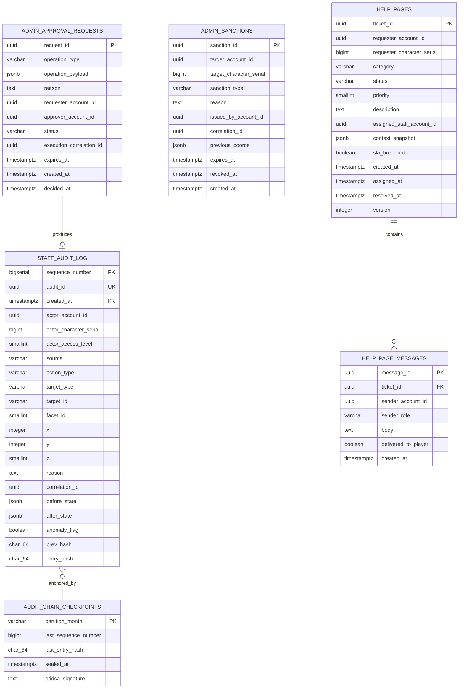
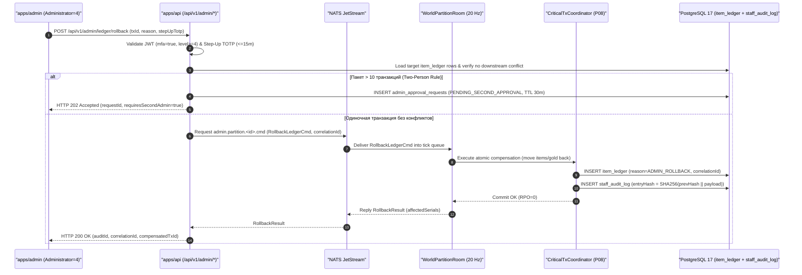

# Design: P29 Инструменты персонала

## Context

Фаза P29 создаёт административный, сервисный и контрольно-аудиторский каркас шарда UO3. К моменту P29 в системе уже заложены:
- Иерархия уровней доступа `AccessLevel` (`0..6`: `Player=0`, `Counselor=1`, `GameMaster=2`, `Seer=3`, `Administrator=4`, `Developer=5`, `Owner=6`) и политика `evaluateAccessPolicy` в `@uo3/domain` (P01, P04).
- Аутентификация EdDSA JWT с поддержкой MFA (TOTP/WebAuthn), сессии в PostgreSQL 17 и Valkey 8, а также шина событий `IDENTITY_EVENTS` в NATS JetStream (`account.banned`, `account.sessions_revoked`, `account.access_level_changed`, `account.effective_level_changed`) из P04.
- Авторитарная симуляция 20 Гц в `WorldPartitionRoom` (P06), фильтрация видимости через `@colyseus/schema` v3 `StateView` и реестр намерений `IntentHandlerRegistry` (P07).
- Персистентность мира с `CriticalTxCoordinator` (синхронный RPO=0), экономическим реестром `item_ledger`, эпохами партиций `partition_epoch` и контрактами отката из P08.
- Двухсторонние гампы `GumpSessionRegistry`, курсор прицела `TargetCursorManager` и маршрутизатор речи `SpeechRouter` (P14, P26).

Ключевая архитектурная проблема P29 — объединить три контура управления миром (внутриигровые команды `[` в реальном времени, веб-консоль `apps/admin` через REST/SSE `/api/v1/admin/*` и двустороннюю систему тикетов `Help Paging`), не нарушив:
1. **Авторитарность партиции (`WorldPartitionRoom`)**: веб-консоль не имеет права напрямую менять строки `characters` или `world_items` в PostgreSQL, пока сущность загружена в память активной партиции, иначе очередной 60-секундный dirty-flush перезапишет изменения или приведёт к дюпу.
2. **Бюджет тика симуляции 50 мс (20 Гц)**: массовые команды вроде `[area 24 respawn` или `[global set` не должны вызывать stop-the-world паузу в игровом цикле.
3. **Экономическую целостность и защиту от злоупотреблений персонала**: любое создание/удаление предмета или откат сделки через GM-инструменты обязаны атомарно отражаться в `item_ledger` и криптографически связном журнале `staff_audit_log`.

## Goals / Non-Goals

### Goals
- Реализовать детерминированный движок внутриигровых команд с префиксом `[` в стиле RunUO/ServUO с модификаторами области (`Self`, `Single`, `Area`, `Region`, `Global`, `Online`, `Multi`), фильтрами `where`, пакетным режимом `[m` и гампом `[props`.
- Обеспечить строгую изоляцию видимости скрытого персонала (`StaffHidden`) в `StateView` AOI: сотрудник с уровнем $L_{\text{staff}}$ полностью исключается из сетевых патчей для любого клиента с эффективным уровнем $L_{\text{viewer}} < L_{\text{staff}}$.
- Построить защищённый MFA-контур `/api/v1/admin/*` в `apps/api` и веб-приложение `apps/admin` для поиска игроков, наложения санкций (`Ban`, `Mute`, `Jail`), инспекции и точечного отката `item_ledger`, контроля партиций, правила двух рук (`Two-Person Rule`) и оркестрации техработ.
- Внедрить систему обращений игроков (`Help Paging`) с авто-выводом из застревания (`Auto-Unstuck`), автоматическим сбором снапшота инцидента (AOI 18 тайлов + 20 реплик чата), гампом `[pages`, SLA-таймерами и синхронизацией с веб-консолью.
- Создать append-only журнал `staff_audit_log` с цепочкой хешей SHA-256, снимками `beforeState`/`afterState`, редактированием PII/секретов, проверкой целостности и детектором аномалий персонала в реальном времени.

### Non-Goals
- Развёртывание инфраструктуры Prometheus/Grafana/Tempo/Loki и профилировщиков — относится к **P30**.
- Детекция читов со стороны обычных игроков (speedhack, packet tampering) — относится к **P31**.
- Автоматическое динамическое расщепление и слияние партиций — относится к **P32**.
- Настройка физического резервного копирования СУБД (pgBackRest/Barman WAL/PITR) — относится к **P33**.

## Decisions

### Decision 1: Декларативный конвейер команд `[` с кооперативным бюджетированием по тикам (10 мс/тик)
- **Выбор**: Перехватчик `StaffCommandInterceptor` встраивается в начало обработчика речевых намерений `WorldPartitionRoom` перед `SpeechRouter`. Любая строка с ведущим символом `[` парсится чистым AST-парсером в `@uo3/rules` на структуру `{ modifier, commandName, args, wherePredicate }`. Для одиночных целей без серийника (`Single`) команда ставится в `PendingStaffCommandSlot` сессии и вызывает `TargetCursorManager.requestTarget(timeoutMs = 30_000)`. Для пакетных модификаторов (`Area`, `Region`, `Global`, `Online`, `Multi`) формируется курсор целей (максимум `500` объектов; свыше — `ERR_GM_BATCH_LIMIT_EXCEEDED`), который исполняется кооперативной очередью `StaffBatchJobRunner` внутри тика симуляции с жёстким бюджетом `MAX_STAFF_BATCH_TICK_MS = 10` мс из 50 мс тика.
- **Обоснование**: Исключает утечку команд с опечатками в открытый чат и гарантирует, что тяжёлая операция над сотнями NPC или спавнеров распределится на несколько последовательных тиков 20 Гц без просадки p99 времени тика партиции.
- **Отвергнутые альтернативы**:
  - *Синхронное выполнение всего пакета `Area`/`Region` в одном тике*: при 400 целях с записью в БД блокирует игровой цикл на 150–300 мс, вызывая джиттер движения у всех игроков партиции.
  - *Парсинг команд на клиенте*: нарушает принцип авторитарности сервера и раскрывает сигнатуры внутренних команд высшего персонала в клиентском бандле.

### Decision 2: Маршрутизация мутаций веб-консоли по схеме «Partition-First / DB-Fallback с проверкой Lease»
- **Выбор**: Когда сотрудник через веб-консоль `apps/admin` выполняет мутацию персонажа, предмета, дома или спавнера (например, `Unstuck`, `Jail`, изменение статов, откат предмета), сервис `AdminMutationRouter` в `apps/api` проверяет в Valkey и таблице аренд активную партицию сущности:
  1. Если сущность загружена в активную `WorldPartitionRoom`, `apps/api` отправляет синхронный RPC-запрос ` NATS request-reply` в топик `admin.partition.<partitionId>.cmd` с таймаутом `3000` мс. Партиция выполняет мутацию в своём игровом цикле через `CriticalTxCoordinator` (RPO=0) и возвращает обновлённый снапшот.
  2. Если персонаж оффлайн, `apps/api` выполняет транзакцию в PostgreSQL 17 с оптимистичной блокировкой `WHERE is_online = false AND partition_epoch = $expected` и атомарной проверкой отсутствия ключа сессии в Valkey. При конфликте возвращается `ERR_ADMIN_CHARACTER_ONLINE_LOCK`.
- **Обоснование**: Полностью устраняет класс багов split-brain между in-memory состоянием Colyseus и PostgreSQL, сохраняя единый путь валидации и записи в `item_ledger`.
- **Отвергнутые альтернативы**:
  - *Прямой `UPDATE` в PostgreSQL с последующим уведомлением партиции о перезагрузке*: создаёт окно гонки (до 60 с), в котором игрок в партиции может потратить или передать предмет до прихода сигнала инвалидации.

### Decision 3: Криптографическая хеш-цепочка `SHA-256` и двухконтурный append-only аудит
- **Выбор**: Таблица `staff_audit_log` проектируется как помесячно партиционированная (`PARTITION BY RANGE (created_at)`) append-only таблица с монотонным `sequence_number BIGSERIAL`. Каждая запись содержит `prev_hash CHAR(64)` и `entry_hash CHAR(64)`, вычисляемый детерминированной функцией в `@uo3/rules`:
  $$\text{entryHash}_n = \text{SHA-256}\left(\text{prevHash}_{n-1} \,\|\, \text{JCS}(\text{canonicalPayload}_n)\right)$$
  где $\text{JCS}$ — каноническая JSON-сериализация (RFC 8785) с предварительно отредактированными полями секретов (`[REDACTED]`). Сериализация последовательности обеспечивается легковесной блокировкой строки текущего чекпоинта шарда в `audit_chain_checkpoints` внутри транзакции записи. На уровне PostgreSQL роль приложения лишается прав `UPDATE` и `DELETE` на `staff_audit_log`, дополнительно устанавливается защитный триггер `BEFORE UPDATE OR DELETE`, выбрасывающий `ERR_AUDIT_IMMUTABLE`. Все действия уровня `Administrator>=4` и события смены `AccessLevel` синхронно дублируются во внешний поток `SECURITY_AUDIT_STREAM` (OTel/Loki).
- **Обоснование**: Даже при компрометации учётной записи администратора или ручном вмешательстве в строки таблицы любое удаление или изменение задним числом немедленно обнаруживается верификатором цепочки (`ERR_AUDIT_CHAIN_TAMPERED`) и сверкой с внешним потоком логов.
- **Отвергнутые альтернативы**:
  - *Обычная таблица логов без хеш-цепочки*: не даёт криптографического доказательства отсутствия пропусков или модификаций записей.
  - *Асинхронная отправка аудита без участия в транзакции мутации*: при падении брокера во время `[add gold_coin` предмет сохранится, а след в аудите пропадёт; поэтому для критических мутаций (`RPO=0`) запись аудита выполняется в той же транзакции `CriticalTxCoordinator`.

### Decision 4: Белый список свойств (`PropsWhitelistPolicy`) с привязкой к `AccessLevel` и доменным инвариантам
- **Выбор**: Команды `[props`, `[get` и `[set` не используют рефлексию произвольных полей JS-объектов. Вместо этого в `@uo3/rules/src/admin/props-whitelist.ts` объявляется строго типизированный реестр дескрипторов свойств по типам сущностей (`PlayerMobile`, `NpcMobile`, `WorldItem`, `WorldSpawner`, `WorldHouse`). Каждый дескриптор задаёт: `minReadLevel`, `minWriteLevel`, схему валидации диапазона UO:R (например, `rawStr: 10..100`, сумма статов $\le 225$, навык `0..1000` десятых, количество в стаке `1..60000`), флаг `requiresCriticalTx` и чистый мутатор, автоматически пересчитывающий производные поля ($Hits_{\max} = 50 + \lfloor STR/2 \rfloor$, вес контейнеров, флаги AOI). Системные поля (`serial`, `accountId`, `createdAt`, `ledgerTxId`) помечены как `immutable: true`.
- **Обоснование**: Предотвращает повреждение инвариантов симуляции (например, установку отрицательного веса или смену серийника живого объекта) и исключает уязвимости prototype pollution / утечки приватных полей состояния.
- **Отвергнутые альтернативы**:
  - *Динамический `Reflect.set` по имени поля*: позволяет гейм-мастеру случайно сломать внутренние ссылки Colyseus Schema или обойти `item_ledger` прямым изменением `amount` у `0x0EED` (Gold Coin).

### Decision 5: Идемпотентный компенсирующий откат `item_ledger` и правило двух рук (`Two-Person Rule`)
- **Выбор**: Откат транзакции предметов/золота в веб-консоли никогда не удаляет и не перезаписывает исторические записи `item_ledger`. Вместо этого сервис `LedgerRollbackCoordinator` строит граф потомков целевой транзакции $T_0$:
  1. Проверяет инвариант отсутствия конфликтов: все предметы из $T_0$ должны существовать, не быть расщеплёнными/уничтоженными и находиться у непосредственных получателей $T_0$ (а сумма золота получателя в рюкзаке + банке `0x1D` должна покрывать откат). При нарушении возвращается `ERR_ADMIN_ROLLBACK_CONFLICT` со списком блокирующих серийников.
  2. Если в пакет отката входит $> 10$ транзакций, либо выполняется массовая выдача компенсации, перманентный бан подсети или назначение `AccessLevel >= 4`, операция создаёт запись в `admin_approval_requests` со статусом `PENDING_SECOND_APPROVAL` (TTL 30 мин). Второй администратор (`approverAccountId != requesterAccountId`, `AccessLevel >= 4`) подтверждает заявку своим свежим MFA-кодом, после чего `CriticalTxCoordinator` атомарно перемещает предметы/золото обратно и записывает компенсирующую транзакцию `ADMIN_ROLLBACK` с тем же `correlationId`.
- **Обоснование**: Сохраняет полную бухгалтерскую сходимость балансов золота (M1/M2/M3) и защищает шард от единоличных ошибок или саботажа одного администратора.
- **Отвергнутые альтернативы**:
  - *Откат состояния персонажа целиком к бэкапу БД часовой давности*: уничтожает честный прогресс игрока за последний час и создаёт возможности для дюпа предметов, переданных другим игрокам после точки бэкапа.

### Decision 6: Захват иммутабельного контекста инцидента в `Help Paging` и двухфазный `Auto-Unstuck`
- **Выбор**: При подаче обращения через гамп `Help` `WorldPartitionRoom` синхронно формирует структуру `HelpPageContextSnapshotV1`:
  - Координаты `(x, y, z, facetId)`, `partitionId`, `regionId`, текущие `Hits/Stam/Mana`, флаги `isCriminal`, `isDead`, `inCombat`.
  - Срез AOI радиуса 18 тайлов: до 64 ближайших мобилов и игроков (`serial`, `name`, `archetypeId`, `notoriety`, `(x, y, z)`).
  - Кольцевой буфер последних 20 реплик локального чата, услышанных заявителем за последние 5 мин (`timestamp`, `speakerSerial`, `speakerName`, `speechType`, `text`, `sha256`).
  Для разгрузки персонала от рутинных застреваний в геометрии вводится `Auto-Unstuck`: при отсутствии боя (`AggressorRecord`), криминального таймера, зоны `Jail` и нахождения в чужом доме, где игрок забанен/не имеет выхода, сервер замораживает персонажа на `120` с (`ERR_UNSTUCK_FROZEN_WAIT`), прерывая процедуру при получении любого урона $\ge 1$, и по таймеру переносит игрока и его питомцев в режиме `FOLLOW/GUARD` в ближайшую опорную точку безопасного города текущего фасета (не более 2 раз за скользящие 24 ч, учёт в Valkey + PG).
- **Обоснование**: Снимает до 80% типовых тикетов `STUCK` в автоматическом режиме без риска абуза для побега из PvP-боя, а для реальных тикетов `HARASSMENT` и `BUG` сохраняет объективные доказательства, даже если нарушитель сразу вышел из игры.
- **Отвергнутые альтернативы**:
  - *Чтение контекста мира только в момент, когда GM открыл тикет*: спустя 10 минут участники конфликта уже покинули локацию, а локальный чат не хранится без привязки к инциденту.

### Decision 7: Строгая фильтрация `StaffHidden` в `StateView` и двухконтурный режим `[gm`
- **Выбор**: У каждого сотрудника в сессии разделяются `assignedAccessLevel` (из БД/JWT) и `effectiveAccessLevel` (`0` или `assignedAccessLevel`), переключаемый командой `[gm`. При `effectiveAccessLevel == 0` сотрудник подчиняется всем правилам обычного игрока, а флаги `StaffHidden` и `Invulnerable` принудительно сбрасываются. При `StaffHidden = true` и `effectiveAccessLevel >= 1` подсистема видимости `WorldPartitionRoom` (P07) при расчёте AOI проверяет условие:
  $$\text{isVisible}(\text{staff}, \text{viewer}) \iff \neg\text{staff.isStaffHidden} \lor \left(\text{viewer.effectiveAccessLevel} \ge \text{staff.effectiveAccessLevel}\right)$$
  При невыполнении условия сущность сотрудника даже не добавляется в `StateView` клиента `viewer` — клиент не получает ни координат, ни серийника, ни шагов сотрудника.
- **Обоснование**: Обычная отправка флага `hidden=true` в клиент позволяет модифицированным клиентам («радарам») видеть присутствие и перемещение GM рядом с ботом или нарушителем. Исключение из `StateView` на сервере делает наблюдение со стороны персонала физически необнаружимым для клиента игрока.
- **Отвергнутые альтернативы**:
  - *Использование обычного игрового навыка `Hiding` для персонала*: может быть раскрыто заклинанием `Reveal` или навыком `Detecting Hidden` и не имеет иерархии между `Counselor`, `GameMaster` и `Administrator`.

---

## Архитектура модулей и контракты

### Распределение ответственности по монорепозиторию

| Пакет / Приложение | Ответственность в фазе P29 |
| :--- | :--- |
| `packages/domain` | Перечисления и типы `StaffCommandName`, `StaffScopeModifier`, `HelpPageCategory`, `HelpPageStatus`, `SanctionType`, `AuditActionType`, `ApprovalStatus`, матрица минимальных уровней доступа `STAFF_COMMAND_ACL`. |
| `packages/rules` | AST-парсер команд `[` и предикатов `where`, реестр `PropsWhitelistPolicy`, расчёт хеш-цепочки `computeAuditEntryHash` и `verifyAuditChain`, редакция секретов `redactAuditPayload`, правила `evaluateStaffAnomaly`, выбор безопасного города `resolveUnstuckDestination`. |
| `packages/protocol` | Опкоды `0x02E0..0x02EF` (TypeBox-схемы команд, гампа `[props`, очереди `[pages`, подачи тикета `Help`, алертов персонала и HUD-статуса GM). |
| `packages/db` | Таблицы Drizzle ORM: `staff_audit_log` (помесячные партиции), `audit_chain_checkpoints`, `help_pages`, `help_page_messages`, `admin_sanctions`, `admin_approval_requests`; SQL-триггер запрета мутаций аудита. |
| `apps/game-server` | `StaffCommandInterceptor`, `StaffBatchJobRunner` (10 мс/тик), исполнители команд, интеграция с `CriticalTxCoordinator` (P08) и `StateView` (`StaffHidden`), захват `HelpPageContextSnapshotV1`, NATS-подписчик `AdminPartitionCommandConsumer`. |
| `apps/api` | Контроллеры `/api/v1/admin/*` (`AdminAuthGuard` + Step-up MFA + RateLimit), `AdminMutationRouter`, `LedgerRollbackCoordinator`, `TwoPersonApprovalService`, `HelpDeskService`, `AuditQueryAndExportService`, `ShardMaintenanceService`, SSE `/api/v1/admin/events/stream`. |
| `apps/admin` | Веб-консоль на React 19 + TanStack Query 5 + `@uo3/ui-kit`: дашборд партиций и экономики M1/M2/M3, поиск игроков/аккаунтов, дерево инвентаря/банка, граф и откат `item_ledger`, очередь `Help Desk`, журнал аудита с проверкой цепочки, страница заявок `Two-Person Rule`. |
| `apps/client` & `packages/ui-kit` | Гампы `HelpRequestGump`, `PlayerTicketNotificationGump`, `StaffPropsGump`, `StaffPagesQueueGump`, визуальный индикатор активного GM-режима (`StaffHidden`/`Invul`) и полупрозрачный рендер скрытых коллег равного или младшего ранга. |

### Сетевой протокол (`@uo3/protocol`, диапазон `0x02E0..0x02EF`)

| Опкод | Направление | Имя сообщения | Ключевые поля TypeBox |
| :--- | :--- | :--- | :--- |
| `0x02E0` | C -> S | `StaffCommandExecuteIntent` | `rawCommand: string (1..512)`, `clientCorrelationId: string` |
| `0x02E1` | S -> C | `StaffCommandFeedbackEvent` | `correlationId: string`, `ok: boolean`, `errorCode?: string`, `message: string`, `affectedCount: uint16` |
| `0x02E2` | S -> C | `StaffModeStateSyncEvent` | `assignedLevel: uint8 (0..6)`, `effectiveLevel: uint8 (0..6)`, `staffHidden: boolean`, `invulnerable: boolean`, `mfaExpiresAtMs: uint64` |
| `0x02E3` | S -> C | `StaffPropsOpenEvent` | `targetSerial: uint32`, `entityKind: string`, `title: string`, `entries: Array<{ key, label, valueType, currentValue, editable, minWriteLevel }>` |
| `0x02E4` | C -> S | `StaffPropsMutateIntent` | `targetSerial: uint32`, `propertyKey: string`, `newValue: unknown`, `reason?: string` |
| `0x02E5` | C -> S | `HelpPageSubmitIntent` | `category: HelpPageCategory`, `description: string (10..500)` |
| `0x02E6` | C -> S | `HelpAutoUnstuckIntent` | `confirmFreeze120s: boolean` |
| `0x02E7` | S -> C | `HelpPagePlayerStateEvent` | `ticketId?: string`, `status?: HelpPageStatus`, `category?: string`, `unstuckRemainingToday: uint8`, `cooldownRemainingSec: uint16`, `unreadMessages: Array<{ id, authorName, body, createdAtMs }>` |
| `0x02E8` | C -> S | `HelpPagePlayerReplyIntent` | `ticketId: string`, `message: string (1..500)`, `cancelTicket?: boolean` |
| `0x02E9` | S -> C | `StaffPagesQueueSyncEvent` | `openCount: uint16`, `breachedCount: uint16`, `items: Array<{ ticketId, category, status, priority, playerSerial, playerName, facetId, x, y, z, assignedStaffName?, createdAtMs, slaBreached }>` |
| `0x02EA` | C -> S | `StaffPageActionIntent` | `ticketId: string`, `action: 'CLAIM' \| 'RELEASE' \| 'ESCALATE' \| 'RESOLVE' \| 'GOTO' \| 'BRING' \| 'REPLY' \| 'SQUELCH'`, `payload?: { message?: string, squelchHours?: uint8, reason?: string }` |
| `0x02EB` | S -> C | `StaffPageDetailEvent` | `ticketId: string`, `snapshot: HelpPageContextSnapshotV1`, `messages: Array<{ id, senderRole, senderName, body, createdAtMs }>` |
| `0x02EC` | S -> C | `ShardMaintenanceBroadcastEvent` | `active: boolean`, `shutdownAtMs?: uint64`, `remainingSec?: uint32`, `reason?: string` |
| `0x02ED` | S -> C | `StaffSecurityAlertEvent` | `alertId: string`, `severity: 'WARN' \| 'CRITICAL'`, `ruleCode: string`, `actorName: string`, `summary: string`, `createdAtMs: uint64` |

### Матрица внутриигровых команд персонала (`AccessLevel 1..6`)

| Команда | Мин. уровень | Модификаторы | Описание и контракты |
| :--- | :--- | :--- | :--- |
| `[gm` | `Counselor (1)` | `Self` | Переключение `effectiveAccessLevel` между `0` и `assignedAccessLevel` (требует MFA $\le 12$ ч). |
| `[pages` | `Counselor (1)` | `Self` | Открытие гампа очереди обращений игроков `StaffPagesQueueGump`. |
| `[tele` | `Counselor (1)` | `Single`, `[m` | Телепортация сотрудника в выбранный прицелом тайл в пределах видимости. |
| `[go <dest>` | `Counselor (1)` | `Self` | Переход к `(x y z [facet])`, именованной локации или серийнику (для `Counselor` — только точки активных тикетов и хабы персонала). |
| `[hide` / `[unhide` | `Counselor (1)` | `Self`, `Single` | Включение/выключение `StaffHidden` с фильтрацией из `StateView` младших рангов. |
| `[invul` | `Counselor (1)` | `Self`, `Single` | Переключение флага неуязвимости `Invulnerable`. |
| `[bring` / `[send` | `GameMaster (2)` | `Single` | Перенос выбранного игрока к сотруднику или в безопасную локацию / `Jail`. |
| `[props` / `[get` / `[set` | `GameMaster (2)` | `Single`, `Area`, `Region`, `Global`, `[m` | Открытие гампа свойств или чтение/запись поля из `PropsWhitelistPolicy` (для `Counselor=1` доступно только чтение `[get` базовых полей тикета). |
| `[add <id> [amt]` | `GameMaster (2)` | `Single`, `[m` | Спавн предмета (`0x40000000..0x7FFFFFFF`) или NPC (`0x20000000..0x3FFFFFFF`); для предметов — синхронная запись `GM_SPAWN` в `item_ledger` (RPO=0). |
| `[dupe [amt]` | `GameMaster (2)` | `Single` | Клонирование предмета с выделением нового серийника и записью `GM_SPAWN` в `item_ledger`. |
| `[remove` / `[delete` | `GameMaster (2)` | `Single`, `Area`, `Region`, `[m` | Удаление предмета или NPC (запрещено на `PlayerMobile` -> `ERR_GM_CANNOT_REMOVE_PLAYER`); запись `GM_DELETE` в `item_ledger`. |
| `[kill` / `[resurrect` / `[heal` | `GameMaster (2)` | `Self`, `Single`, `Area`, `[m` | Мгновенное убийство, воскрешение без `StatLoss` или полное восстановление `Hits/Stam/Mana` и снятие яда. |
| `[squelch <min>` | `GameMaster (2)` | `Single` | Блокировка реплик чата игрока на указанное число минут с записью санкции. |
| `[respawn` / `[regionInfo` | `Seer (3)` | `Single`, `Area`, `Region` | Принудительный тик спавнера(ов) или инспекция параметров текущего региона (P25) и правил `IRegionSpellPolicy`. |
| `[save` / `[doorGen` | `Administrator (4)` | `Global` | Внеочередной барьер инкрементального сохранения мира (кулдаун 30 с, иначе `ERR_GM_SAVE_COOLDOWN`) или запуск идемпотентного сидера дверей/декораций (P25). |

### Модель данных PostgreSQL 17 (`@uo3/db`)

### Поток выполнения критической мутации и точечного отката `item_ledger`

### Алгоритм детекции аномалий персонала (`@uo3/rules/src/admin/anomaly-detector.ts`)

Каждая запись, поступающая в пайплайн аудита, проверяется детерминированным набором правил за скользящее окно времени (счётчики агрегируются в Valkey с TTL 15 мин и сверяются с БД):
1. **`RULE_EXCESSIVE_GOLD_SPAWN`**: если сумма золота (`0x0EED` или `Bank Check 0x14F0`), созданного одним `actorAccountId` через `GM_SPAWN` за скользящие `600` с, превышает `50_000` монет -> `anomalyFlag = true`, публикация `STAFF_ANOMALY_DETECTED`.
2. **`RULE_UNLINKED_PLAYER_TRANSFER`**: если сотрудник (`AccessLevel >= 1`) передаёт предмет игроку (`Player=0`) или кладёт его в контейнер игрока без привязанного активного тикета `HelpPage` или заявки `ADMIN_ROLLBACK` -> критический алерт.
3. **`RULE_MASS_ENTITY_DELETE`**: если за `60` с сотрудник удаляет более `50` предметов или NPC вне тестового фасета (`facetId < 200`) -> предупреждающий алерт.
4. **`RULE_STAFF_SELF_DEALING`**: если `targetAccountId` команды/санкции/передачи имеет пересечение по подсети IP `/24` или `deviceFingerprintHash` с любым игровым аккаунтом самого `actorAccountId` за последние 90 дней -> критический алерт `STAFF_SELF_DEALING_SUSPECTED` в `SECURITY_AUDIT_STREAM`.

### Коды ошибок фазы P29

- **Внутриигровые команды (`admin/gm-commands`)**:
  `ERR_GM_ACCESS_DENIED`, `ERR_GM_MFA_STEPUP_REQUIRED`, `ERR_GM_BATCH_LIMIT_EXCEEDED`, `ERR_GM_RESTRICTED_DESTINATION`, `ERR_GM_INVALID_PROPERTY_MUTATION`, `ERR_GM_CANNOT_REMOVE_PLAYER`, `ERR_GM_SAVE_COOLDOWN`, `ERR_GM_TARGET_TIMEOUT`.
- **Веб-консоль (`admin/admin-console`)**:
  `ERR_ADMIN_AUTH_REQUIRED`, `ERR_ADMIN_STEPUP_MFA_REQUIRED`, `ERR_ADMIN_RATE_LIMITED`, `ERR_ADMIN_REASON_TOO_SHORT`, `ERR_ADMIN_CHARACTER_ONLINE_LOCK`, `ERR_ADMIN_ROLLBACK_CONFLICT`, `ERR_ADMIN_SELF_APPROVAL_FORBIDDEN`, `ERR_ADMIN_APPROVAL_EXPIRED`.
- **Система обращений (`admin/help-paging`)**:
  `ERR_PAGE_ALREADY_ACTIVE`, `ERR_PAGE_ALREADY_CLAIMED`, `ERR_PAGE_RATE_LIMITED`, `ERR_PAGE_SQUELCHED`, `ERR_UNSTUCK_IN_COMBAT`, `ERR_UNSTUCK_COOLDOWN`, `ERR_UNSTUCK_FROZEN_WAIT`.
- **Журнал аудита (`admin/audit-log`)**:
  `ERR_AUDIT_IMMUTABLE`, `ERR_AUDIT_CHAIN_TAMPERED`, `ERR_AUDIT_SECRET_LEAK_BLOCKED`.

## Risks / Trade-offs

- **[Узкое место сериализации `sequence_number` и `prev_hash` в `staff_audit_log`]** → Частота действий персонала составляет единицы или десятки операций в секунду (на порядки ниже игрового трафика), поэтому блокировка строки чекпоинта на время короткой транзакции занимает `< 1` мс и не создаёт конкуренции для игровых таблиц.
- **[Риск просадки тика 20 Гц при массовых командах `[area` / `[region`]** → Жёсткий потолок `500` целей на команду и кооперативный планировщик `StaffBatchJobRunner` с бюджетом `10` мс на тик переносят остаток работы на следующие тики.
- **[Гонка между редактированием оффлайн-персонажа в веб-консоли и его входом в игру]** → Все мутации консоли маршрутизируются через `AdminMutationRouter`: проверка аренды сессии в Valkey и условный `UPDATE ... WHERE is_online = false AND partition_epoch = $1` гарантируют атомарный отказ `ERR_ADMIN_CHARACTER_ONLINE_LOCK` при одновременном логине.
- **[Злоупотребление `Auto-Unstuck` для бесплатного быстрого перемещения или ухода от PvP]** → Трёхступенчатая защита: запрет при активном `AggressorRecord`/криминальном флаге/в чужом доме, обязательная заморозка персонажа на месте на `120` с (прерываемая любым уроном) и суточный лимит 2 использования за 24 ч.
- **[Компрометация сессии одного администратора в `apps/admin`]** → Обязательный MFA со сроком жизни 12 ч, повторный ввод TOTP/WebAuthn каждые 15 мин для критических мутаций, жёсткий rate-limit (120 чтений/мин, 30 мутаций/мин) и правило двух рук (`Two-Person Rule`) для всех массовых или разрушительных операций.
- **[Рост объёма таблицы `staff_audit_log` из-за JSON-снимков `beforeState`/`afterState`]** → В снимки записываются только дифф-проекции изменённых полей (плюс ключевые идентификаторы), а таблица партиционируется помесячно с переносом партиций старше 180 дней в холодный архив и сохранением `lastEntryHash` в `audit_chain_checkpoints`.

## Migration Plan

1. **Пакеты домена, правил и протокола**: добавить типы и константы P29 в `@uo3/domain`, парсер команд, политику `PropsWhitelistPolicy`, функции хеш-цепочки и детектора аномалий в `@uo3/rules`, опкоды `0x02E0..0x02EF` в `@uo3/protocol`.
2. **Миграции БД (`@uo3/db`)**: накатить Drizzle-миграцию для создания таблиц `staff_audit_log` (с партициями на текущий и следующий месяц), `audit_chain_checkpoints`, `help_pages`, `help_page_messages`, `admin_sanctions`, `admin_approval_requests` и триггера иммутабельности `prevent_staff_audit_mutation_trg`.
3. **Игровой сервер (`apps/game-server`)**: зарегистрировать `StaffCommandInterceptor`, `StaffBatchJobRunner`, обработчики `0x02E0..0x02EA` в `IntentHandlerRegistry`, фильтр `StaffHidden` в `StateView` и NATS-консьюмер `AdminPartitionCommandConsumer`.
4. **Административный API (`apps/api`) и веб-консоль (`apps/admin`)**: развернуть модуль `/api/v1/admin/*` с гардами MFA/Step-up/RateLimit и собрать разделы SPA `apps/admin`.
5. **Игровой клиент (`apps/client`, `@uo3/ui-kit`)**: подключить гампы `HelpRequestGump`, `StaffPropsGump`, `StaffPagesQueueGump` и оверлей статуса персонала.

## Open Questions

- Стоит ли в будущих фазах LiveOps (P33) добавить интеграцию вебхуков `STAFF_ANOMALY_DETECTED` и нарушений SLA тикетов `Help Paging` во внешние мессенджеры дежурной смены (Discord / PagerDuty / Telegram), помимо штатного SSE-потока консоли и `SECURITY_AUDIT_STREAM`? (Не блокирует P29; интерфейс нотификатора проектируется с абстрактным портом `IStaffAlertWebhookSink`).
