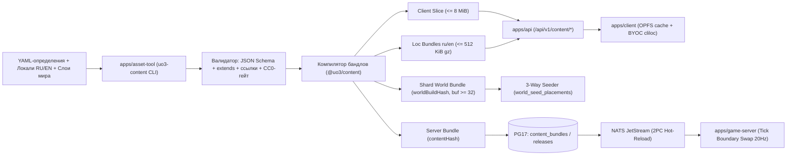
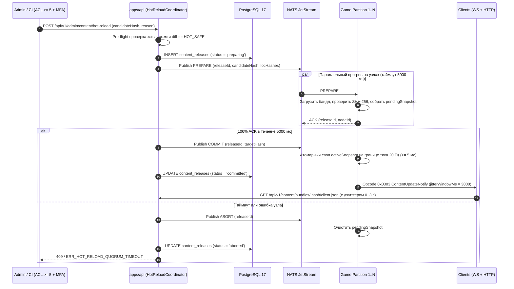
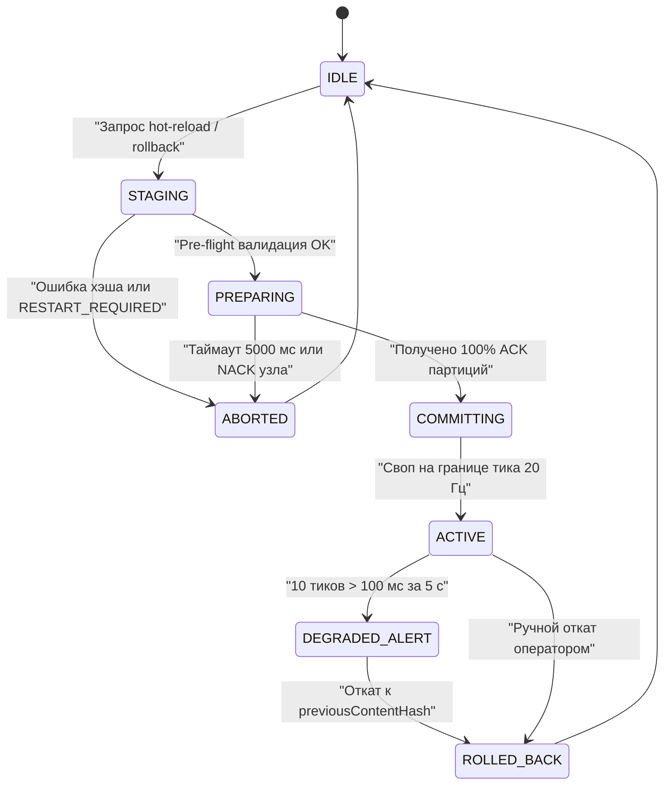

# Design: P30 Контент-пайплайн

## Context

После реализации игровых подсистем P01–P26 в монорепозитории UO3 накоплены изоморфные правила мира (`@uo3/rules`), сетевой протокол (`@uo3/protocol`), клиентские импортеры BYOC-ассетов (`@uo3/uo-formats`), движок симуляции 20 Гц с партициями и `StateView` (`apps/game-server`) и транзакционная модель персистенции в PostgreSQL 17 (`@uo3/db`). Однако игровые определения (предметы, существа, лут, крафт, спавнеры, регионы, вендоры, ресурсные жилы), раскладки статического/динамического мира шарда и мультиязычные строки RU/EN/`cliloc` пока зашиты в коде фикстур и начальных сидов.

Фаза **P30 Контент-пайплайн** создаёт единую, воспроизводимую и строго типизированную архитектуру управления контентом без кода:
1. Авторство в чистом YAML с жёсткими JSON Schema (Draft 2020-12), наследованием, кросс-ссылочной целостностью и защитой от попадания проприетарных ассетов UO (ADR-002).
2. Воспроизводимая компиляция мира шарда (`Shard World Bundle`) с импортом декораций/дверей/регионов/спавнов/ресурсов, 3-сторонним планировщиком сидирования (с сохранением имущества игроков и RPO=0 контрактов P08) и нарезкой партиционных срезов с буфером границ `≥ 32` тайлов (P03/P32).
3. Двуязычная система локализации `ru`/`en` с CLDR-плюрализацией, движком `cliloc` (`~N_label~`, `#id`) и 3-уровневой моделью приоритета поверх клиентских BYOC-файлов в OPFS.
4. Безопасная горячая перезагрузка (`hot-reload`) через 2-фазный NATS-барьер, атомарную подмену `ContentSnapshot` между тиками 20 Гц и бесшовное обновление клиентов без разрыва сессии.

## Goals / Non-Goals

### Goals
- Обеспечить детерминированную компиляцию YAML-определений и локализаций с побайтово воспроизводимыми SHA-256 хэшами (`contentHash`, `locHash`, `worldBuildHash`) независимо от ОС и порядка обхода файловой системы.
- Валидировать `10 000` определений в CI за время `≤ 10 с` с точными JSON Pointer-диагностиками и защитой от регрессий сохранений мира.
- Исключить передачу серверно-авторитарных секретов (весов лута, скрытых флагов ИИ, GM-спавнеров) клиенту через отдельный санитизированный `ClientContentManifest` (`≤ 8 MiB`).
- Реализовать идемпотентный 3-сторонний сидер мира шарда (`CREATE`/`UPDATE`/`UNCHANGED`/`DELETE`) с `--dry-run`, аудитом и откатом без риска для динамических сущностей игроков.
- Обеспечить транзакционную горячую перезагрузку между всеми активными партициями через `PREPARE → COMMIT/ABORT` с переключением на границе 50-мс тика (`≤ 5 мс` паузы) и откатом за `≤ 10 с`.
- Гарантировать соблюдение ADR-002: ноль проприетарных файлов UO в репозитории и тестовых бандлах.

### Non-Goals
- Визуальный GUI-редактор карты, спавнеров и квестовых графов в `apps/admin` (переносится в P31).
- Автоматическая миграция границ живых партиций и перебалансировка игроков между узлами (P32).
- Разрешение горячей перезагрузки для структурно несовместимых изменений вроде ресайза фасетов или сжатия ёмкости уже существующих контейнеров игроков.
- Реализация скриптовых песочниц/пользовательских модов произвольного JS/Lua кода в YAML.

## Decisions

### Decision 1: Двухфазная модель контента — исходный YAML и канонический JSON-бандл
- **Выбор**: Исходники контента хранятся в читаемых YAML 1.2 файлах, а в рантайме сервер и клиент потребляют исключительно скомпилированный канонический JSON-бандл (`bundle.server.json` и `bundle.client.json`) с прекомпилированными индексами и `contentHash`.
- **Обоснование**: Парсинг сотен YAML-файлов и разрешение `extends` на старте каждой партиции медленны и ненадёжны. Канонизация в CI гарантирует единый SHA-256 хэш, одинаковый на всех узлах кластера, и отлавливает ошибки до деплоя.
- **Альтернативы**:
  - *Хранить контент только в таблицах PG17 и править через SQL/админку* — отвергнуто, так как теряется Git-версионирование, code review и детерминированный CI-гейт.
  - *Читать сырые YAML в рантайме* — отвергнуто из-за долгого старта партиций и риска расхождений при частичных деплоях.

### Decision 2: Изоморфные TypeBox-контракты + JSON Schema Draft 2020-12 через Ajv
- **Выбор**: Структурная валидация YAML выполняется прекомпилированными валидаторами Ajv (JSON Schema Draft 2020-12, `strict: true`, `additionalProperties: false`), а доменные границы UO:R и протокольные сообщения описаны в `@uo3/rules` и `@uo3/protocol` на TypeBox.
- **Обоснование**: Ajv даёт исчерпывающие JSON Pointer ошибки для IDE/CLI авторов контента, а общие валидаторы инвариантов в `@uo3/rules` (формулы `NdM+K`, границы стаков `≤ 60000`, контейнеры `≤ 125`, навыки `0..1000`) исключают дублирование логики между компилятором и симуляцией.
- **Альтернативы**:
  - *Использовать только Zod в Node* — отвергнуто из-за худшей совместимости с внешними JSON Schema редакторов (YAML Language Server в VS Code) и менее компактных метаданных для Ajv.

### Decision 3: Санитизированный клиентский срез (`ClientContentManifest`) с лимитом `≤ 8 MiB`
- **Выбор**: Сервер публикует через `apps/api` отдельный клиентский манифест и срез публичных полей, полностью вырезающий `loot_tables`, веса дропа, параметры агрессии ИИ и скрытые триггеры спавнеров.
- **Обоснование**: Защита игровой экономики от анализа скрытых шансов дропа (client data-mining) и минимизация трафика/памяти браузера при старте и hot-reload.
- **Альтернативы**:
  - *Отдавать полный бандл с фильтрацией на клиенте* — отвергнуто как нарушение принципа авторитарного сервера.

### Decision 4: Трёхслойная система `cliloc` и токенизированная передача сообщений по сети
- **Выбор**: Сервер по опкодам `0x0300`/`0x0301` отправляет компактные токены (`clilocId` или `locKey` + до `8` аргументов `≤ 256` символов), а клиент рендерит строку в своей активной локали `ru`/`en` через 3-слойный резолвер: `1) cliloc_ext сервера → 2) пользовательский BYOC cliloc из OPFS (P02) → 3) встроенный CC0 fallback`.
- **Обоснование**: В одной локации одновременно могут находиться игроки с `ru` и `en` интерфейсом; токенизация экономит трафик и обеспечивает мультиязычность без дублирования рассылок.
- **Альтернативы**:
  - *Форматировать все строки на сервере под локаль каждого получателя* — отвергнуто из-за роста нагрузки на игровой цикл 20 Гц и невозможности клиентского ре-рендера при смене языка на лету.

### Decision 5: Идемпотентный 3-сторонний сидер мира по `placementKey` + `payloadHash`
- **Выбор**: Каждая статическая/сидируемая запись мира получает стабильный `placementKey = sha256(facet:kind:stableId)[0..24]` и `payloadHash`. При применении `ShardWorldBundle` в БД (`world_seed_placements`) вычисляется 3-сторонний дифф между прошлым манифестом, текущим состоянием БД и новым билдом; сущности с `source != 'world_seed'` (дома, корабли, лут игроков) неприкосновенны.
- **Обоснование**: Позволяет безопасно обновлять и удалять декорации, двери, спавнеры и сундуки данжей на живом шарде с историей игроков, соблюдая инварианты P08/P23/P25.
- **Альтернативы**:
  - *Полная очистка и перезапись таблиц мира при патче* — категорически неприемлемо для персистентного MMORPG-шарда.

### Decision 6: Партиционные срезы мира с буфером границ `≥ 32` тайлов и индекс регионов `16×16`
- **Выбор**: Сборка мира шарда генерирует отдельные чанки конфигурации для каждой партиции, захватывая полосу перекрытия минимум `32` тайла за её формальными границами (`borderBufferTiles >= 32`), и компилирует плотный индекс регионов по секторам `16×16`.
- **Обоснование**: Согласуется с P03 (срезы карты с буфером `≥ 32`), P12/P16 (AOI 18–24 тайла, 3D DDA LOS), P20 (блоки ресурсов `8×8` и `4×4`) и P25/P32 (корректная обработка границ партиций без вспышек задержек).
- **Альтернативы**:
  - *Запрашивать пограничные метаданные спавнеров/регионов по RPC на каждый шаг* — отвергнуто из-за сетевой латентности внутри 50-мс тика.

### Decision 7: Двухфазная NATS-координация и своп `ContentSnapshot` строго на границе тика 20 Гц
- **Выбор**: Координатор hot-reload в `apps/api` / выделенном контроллере проводит `PREPARE` через NATS (`uo3.content.reload.prepare.<shardId>`, таймаут `5000 мс`) до получения `100%` ACK от активных партиций и API-узлов, затем публикует `COMMIT`. Каждая партиция переносит новый иммутабельный `ContentSnapshot` из `pendingSnapshot` в `activeSnapshot` только в прологе тика `N+1`.
- **Обоснование**: Исключает ситуацию, когда одна партиция уже сменила рецепт/таблицу лута, а соседняя при переходе игрока живёт на старой, а также гарантирует детерминированность расчётов внутри тика.
- **Альтернативы**:
  - *Раздельный горячий релоад по мере готовности каждого узла (eventual)* — отвергнуто из-за рассинхрона цен, весов и рецептов при межпартиционных передачах (P32).

### Decision 8: Защита от thundering herd и кэш 5 последних версий для мгновенного отката
- **Выбор**: Клиенты при получении `ContentUpdateNotify` планируют HTTP-запрос за новым бандлом с равномерным случайным джиттером `[0, jitterWindowMs]` (`3000 мс`), обращаясь к `Cache-Control: immutable` эндпоинтам по хэшу. Узлы сохраняют последние `5` валидированных бандлов на диске/в памяти для немедленного `rollback` (`≤ 10 с`) без участия CI.
- **Обоснование**: При онлайне в тысячи игроков синхронное скачивание даже 1–2 МБ бандла без джиттера создаст пиковый спайк на HTTP-шлюз; локальный кольцевой буфер из 5 версий делает откат тривиальным и мгновенным.
- **Альтернативы**:
  - *Рассылка всего бандла прямо по WebSocket `WorldPartitionRoom`* — отвергнуто, чтобы не забивать игровой канал и не провоцировать дисконнекты по буферу сокета.

## Architecture & Module Layout

### Общий поток контент-пайплайна

### Пакеты и приложения

1. **`@uo3/domain`** (0 внешних зависимостей):
   - Брендированные/строгие типы: `ContentHash`, `LocHash`, `WorldBuildHash`, `ItemDefId`, `CreatureDefId`, `LootTableId`, `RecipeId`, `SpawnerTemplateId`, `RegionDefId`, `VendorInventoryId`, `ResourceVeinDefId`, `ClilocId`, `PlacementKey`.
   - Структуры: `LocalizedTextPayload`, `HotReloadClassification` (`'HOT_SAFE' | 'RESTART_REQUIRED'`), `ContentNamespace`, `ContentErrorCode` (`ERR_CONTENT_*`, `ERR_WORLD_*`, `ERR_LOC_*`, `ERR_HOT_RELOAD_*`).

2. **`@uo3/rules`**:
   - `selectPluralCategory(locale: 'ru' | 'en', count: number): 'one' | 'few' | 'many' | 'other'`
   - `formatClilocTemplate(template: string, rawArgs: string, resolveId: (id: number) => string | undefined, maxDepth = 4): string`
   - `parseDiceFormula(expr: string): { count: number; sides: number; bonus: number }` (`NdM+K`)
   - `validateItemDefInvariants`, `validateCreatureDefInvariants`, `validateLootTableInvariants`, `validateRecipeInvariants`
   - `classifyContentDiff(prevBundle, nextBundle): ContentDiffReport` (детерминированная классификация `HOT_SAFE` vs `RESTART_REQUIRED`).

3. **`@uo3/protocol`** (опкоды `0x0300..0x0305`, TypeBox):
   | Опкод | Имя | Направление | Поля и ограничения |
   |---|---|---|---|
   | `0x0300` | `LocalizedSystemMessage` | S → C | `clilocId?: uint32`, `locKey?: string(128)`, `args: string(256)[<=8]`, `hue: uint16`, `font: uint8`, `channel: uint8` |
   | `0x0301` | `LocalizedEntitySpeech` | S → C | `entitySerial: uint32`, `clilocId?: uint32`, `locKey?: string(128)`, `args: string(256)[<=8]`, `speechType: uint8`, `hue: uint16` |
   | `0x0302` | `ContentVersionHandshake` | S → C | `contentHash: char(64)`, `locHashRu: char(64)`, `locHashEn: char(64)`, `worldBuildHash: char(64)`, `activeLocale: 'ru' \| 'en'` |
   | `0x0303` | `ContentUpdateNotify` | S → C | `reloadSeq: uint32`, `newContentHash: char(64)`, `newLocHashRu: char(64)`, `newLocHashEn: char(64)`, `changedNamespaces: string[<=16]`, `jitterWindowMs: uint16` |
   | `0x0304` | `ClientLocaleSwitchIntent` | C → S | `locale: 'ru' \| 'en'` |
   | `0x0305` | `ClientLocaleSwitchAck` | S → C | `locale: 'ru' \| 'en'`, `locHash: char(64)` |

4. **`@uo3/content`**:
   - `src/schemas/`: JSON Schema (Draft 2020-12) для всех 8 категорий (`items`, `creatures`, `loot_tables`, `recipes`, `spawner_templates`, `regions`, `vendor_inventories`, `resource_veins`), манифестов локализации и `ShardWorldManifest`.
   - `src/yaml/`: парсер YAML с детекцией дублей ключей (положение в файле `file:line:col`) и запретом небезопасных тегов/алиасов бомб.
   - `src/inheritance/`: резолвер `extends` (`maxDepth = 4`, глубокое слияние объектов, полная замена массивов, защита от циклов, отсев `abstract: true`).
   - `src/validator/`: графовая проверка ссылок, гейт чистоты от проприетарных ассетов UO (проверка расширений `.mul/.uop/.idx`, сигнатур байтов и whitelist префиксов URI), проверка обратной совместимости против baseline.
   - `src/compiler/`: каноникализация, вычисление `contentHash`, генерация `bundle.server.json` и санитизированного `bundle.client.json` (`≤ 8 MiB`).
   - `src/localization/`: загрузчик `ru`/`en`, проверка `100%` паритета ключей, проверка плейсхолдеров и ICU-синтаксиса, валидация `cliloc_ext` и циклов `#id`, генератор `pseudo` (`+35%`), экспорт/импорт диффов для переводчиков, XSS-санитайзер, сборка сжатых пакетов `loc.<locale>.<locHash>.json` (`≤ 512 KiB` gzipped для core).
   - `src/world-build/`: импортеры слоёв (декорации, двери, регионы с индексом `16×16`, спавнеры, данж-сундуки, мунгейты, ресурсные узлы `8×8`/`4×4` с капом `16`), верификация проходимости по провайдеру геометрии P03, нарезка партиционных срезов с `borderBufferTiles >= 32`, вычисление `worldBuildHash`, 3-сторонний планировщик сидера (`CREATE`/`UPDATE`/`UNCHANGED`/`DELETE`).

5. **`@uo3/db`** (PostgreSQL 17 + Drizzle ORM):
   - **`content_bundles`**:
     - `content_hash` `char(64) PK`
     - `schema_version` `smallint NOT NULL`
     - `counts_jsonb` `jsonb NOT NULL` (число записей по 8 категориям)
     - `loc_hash_ru` `char(64) NOT NULL`
     - `loc_hash_en` `char(64) NOT NULL`
     - `client_bundle_bytes` `integer NOT NULL`
     - `storage_uri` `text NOT NULL`
     - `created_by` `text NOT NULL`
     - `created_at` `timestamptz NOT NULL DEFAULT now()`
   - **`content_releases`**:
     - `release_id` `uuid PK`
     - `shard_id` `text NOT NULL`
     - `from_content_hash` `char(64)`
     - `to_content_hash` `char(64) NOT NULL`
     - `release_type` `text NOT NULL` (`'boot' | 'hot_reload' | 'rollback'`)
     - `status` `text NOT NULL` (`'preparing' | 'committed' | 'aborted' | 'rolled_back'`)
     - `diff_summary_jsonb` `jsonb NOT NULL`
     - `actor_account_id` `uuid`
     - `reason` `text`
     - `prepare_ms` `integer`
     - `commit_ms` `integer`
     - `degradation_flagged` `boolean NOT NULL DEFAULT false`
     - `created_at` `timestamptz NOT NULL DEFAULT now()`
     - `completed_at` `timestamptz`
     - Индекс `(shard_id, created_at DESC)`
   - **`world_build_manifests`**:
     - `world_build_hash` `char(64) PK`
     - `shard_id` `text NOT NULL`
     - `content_hash` `char(64) NOT NULL REFERENCES content_bundles(content_hash)`
     - `parent_build_hash` `char(64)`
     - `facet_checksums_jsonb` `jsonb NOT NULL`
     - `placement_counts_jsonb` `jsonb NOT NULL`
     - `status` `text NOT NULL` (`'staged' | 'active' | 'superseded' | 'rolled_back'`)
     - `applied_by` `text NOT NULL`
     - `applied_at` `timestamptz NOT NULL DEFAULT now()`
   - **`world_seed_placements`**:
     - `placement_key` `text PK` (формат `s:<shardId>:<facet>:<kind>:<stableIdHash>`)
     - `shard_id` `text NOT NULL`
     - `world_build_hash` `char(64) NOT NULL`
     - `kind` `text NOT NULL` (`'decoration' | 'door' | 'spawner' | 'chest' | 'moongate' | 'resource_node'`)
     - `entity_serial` `bigint` (ссылка на предмет/существо/спавнер, если порождён)
     - `facet` `smallint NOT NULL`
     - `x` `integer NOT NULL`, `y` `integer NOT NULL`, `z` `smallint NOT NULL`
     - `payload_hash` `char(64) NOT NULL`
     - `updated_at` `timestamptz NOT NULL DEFAULT now()`
     - Индекс `(shard_id, facet, kind)` и уникальный индекс по `(shard_id, entity_serial) WHERE entity_serial IS NOT NULL`.

6. **`apps/game-server`**, **`apps/api`**, **`apps/client`**, **`apps/admin`**, **`apps/asset-tool`**:
   - **`ContentSnapshotService`** в `apps/game-server`: хранит `activeSnapshot`, `pendingSnapshot` и кольцевой буфер `last5Snapshots`. На каждом тике 20 Гц в самом начале метода `step(tickIndex)` проверяет атомарный указатель `pendingSnapshot` и при совпадении `targetTick <= tickIndex` выполняет замену ссылки за `O(1)` (`≤ 5 мс` включая перестройку лёгких быстрых lookup-таблиц по числовым `graphic`/индексам).
   - **`HotReloadCoordinator`** (NATS JetStream): управляет распределённым барьером `PREPARE` / `ACK` / `COMMIT` / `ABORT` между всеми активными `WorldPartitionRoom`, `ShardHubRoom` и `apps/api`.
   - **Watchdog деградации тика**: отслеживает длительность тиков в окне `5000 мс` после `COMMIT`; при `10` последовательных тиках `> 100 мс` помечает релиз `degradation_flagged = true`, шлёт критический алерт и активирует кнопку/команду одношагового отката.

### REST API контракты (`apps/api`, префикс `/api/v1`)

| Метод и путь | Доступ | Назначение и кэширование |
|---|---|---|
| `GET /api/v1/content/manifest` | Public / Auth | Возвращает активный `contentHash`, `locHashRu`, `locHashEn`, `worldBuildHash`, URL бандлов и `ETag` |
| `GET /api/v1/content/bundles/:contentHash/client.json` | Public | Санитизированный срез определений (`≤ 8 MiB`), `Cache-Control: public, max-age=31536000, immutable` |
| `GET /api/v1/content/localization/:locale/:locHash.json` | Public | Сжатый пакет локализации (`ru` / `en` / `pseudo`), `ETag` + `immutable` |
| `GET /api/v1/admin/content/releases` | `ACL >= 4` | Пагинированная история релизов `content_releases` с фильтрацией по `shardId` и статусу |
| `POST /api/v1/admin/content/hot-reload` | `ACL >= 5 + MFA` | Запуск 2PC hot-reload с `candidateContentHash`, `reason` и `Idempotency-Key` |
| `POST /api/v1/admin/content/rollback` | `ACL >= 5 + MFA` | Немедленный 2PC-откат на `targetContentHash` (из последних 5 сохранённых) |
| `POST /api/v1/admin/content/world-build/dry-run` | `ACL >= 5 + MFA` | Выполнение 3-стороннего планировщика сидера без записи в БД и возврат счётчиков diff |

### CLI-интерфейс (`apps/asset-tool` → `uo3-content`)

| Команда | Назначение | Коды возврата |
|---|---|---|
| `uo3-content validate [--shard <id>] [--baseline <path>] [--format json]` | Валидация YAML-схем, `extends`, кросс-ссылок, совместимости и чистоты ассетов | `0` OK, `2` схемы/ссылки, `3` политика ассетов / breaking change |
| `uo3-content build --out <dir> [--baseline <path>]` | Детерминированная сборка `bundle.server.json` и `bundle.client.json` с расчётом `contentHash` | `0` OK, `2`/`3` ошибка валидации |
| `uo3-content diff --from <bundle> --to <bundle> [--format json]` | Сравнение двух бандлов с классификацией `HOT_SAFE` / `RESTART_REQUIRED` | `0` OK (`HOT_SAFE`), `4` обнаружен `RESTART_REQUIRED` |
| `uo3-content loc-check` / `loc-export` / `loc-pseudo` | Проверка 100% паритета `ru`/`en` и циклов `cliloc`, выгрузка diff для переводчиков, генерация `pseudo` | `0` OK, `2` отсутствующие ключи/ошибка ICU/XSS |
| `uo3-content world-build --shard <id>` / `world-verify` / `world-dry-run` | Компиляция слоёв фасетов, расчёт `worldBuildHash`, срезы партиций `≥ 32` и dry-run сидера | `0` OK, `2` геометрия/проходимость/буфер |
| `uo3-content reload --target <hash> --reason <text>` / `rollback` | Вызов административного 2PC-контура с подписанным CI-токеном | `0` OK, `5` отказ кворума или RBAC |

### Канонический контракт 8 категорий YAML-определений

1. **`items`**: `schemaVersion`, `id`, `extends?`, `abstract?`, `graphic` (`0..0x3FFF`), `hue` (`0..3000`), `layer?` (`0x01..0x1D`), `weightTenths`, `stackable`, `stackLimit` (`≤ 60000`), `container?` (`maxItems ≤ 125`, `maxWeightTenths ≤ 4000`), `weapon?` (`damageDice: NdM+K`, `speedMs` шаг `250`, `twoHanded`), `armor?` (`armorRating`, `zone`), `decaySeconds` (по умолчанию `3600`), `blessed?`, `nameLocKey`/`nameCliloc?`.
2. **`creatures`**: `schemaVersion`, `id`, `extends?`, `abstract?`, `body` (`0x0001..0x03FF`), `hue`, `aiProfile` (`melee|mage|archer|animal|guard|vendor|banker|healer|trainer|escort`), `str`/`dex`/`int` (`min..max`), `hits` (`min..max`), `skills` (до 49 навыков `0..1000`), `lootTableId?`, `tameDifficultyTenths?`, `controlSlots?` (`1..5`), `vendorInventoryId?`, `fame`, `karma`.
3. **`loot_tables`**: `schemaVersion`, `id`, `rolls` (`1..20`), `goldRange?`, `magicBudgetPoints` (`0..1000`), `entries[]` (`itemDefId?` | `subtableId?`, `chanceBp` `1..10000`, `minQty`, `maxQty`, `guaranteed?`).
4. **`recipes`**: `schemaVersion`, `id`, `craftSkill`, `minSkillTenths` (`0..1000`), `maxSkillTenths` (`0..1000`), `ingredients[]` (`≤ 8` позиций, `itemDefId`, `quantity` `1..60000`), `requiredToolTag`, `requiredHeat?`, `requiredWater?`, `resultItemDefId`, `resultQty`, `exceptionalAllowed`, `smeltYieldBp` (`0..10000`).
5. **`spawner_templates`**: `schemaVersion`, `id`, `entries[]` (`≤ 16` записей `creatureDefId`, `weight`), `minDelaySec` (`5..86400`), `maxDelaySec`, `homeRange` (`1..64`), `maxCount` (`1..100`), `spawnMode` (`point|region_scatter`).
6. **`regions`**: `schemaVersion`, `id`, `priority` (`0..255`), `flags` (`guarded`, `noRecallIn`, `noRecallOut`, `noGate`, `noMark`, `noHousing`, `safeLogout`, `noPvp`), `lightLevelOverride?` (`0..26`), `weatherProfileId?`, `nameLocKey`.
7. **`vendor_inventories`**: `schemaVersion`, `id`, `restockMinutes` (по умолчанию `30`), `buyMarkupBp`, `sellMarkdownBp`, `stock[]` (`itemDefId`, `basePrice`, `initialQty`, `maxQty`).
8. **`resource_veins`**: `schemaVersion`, `id`, `resourceType` (`ore|wood|fish`), `minSkillTenths` (`0..1000`), `harvestItemDefId`, `failItemDefId?`, `bankMaxUnits`, `respawnSeconds`, `colorHue`.

### Протокольные и NATS-схемы сообщений

- **NATS JetStream Subjects (`uo3.content.reload.*`)**:
  - `uo3.content.reload.prepare.<shardId>` — `{ releaseId, fromContentHash, toContentHash, locHashRu, locHashEn, deadlineMs: 5000 }`
  - `uo3.content.reload.ack.<shardId>.<releaseId>` — `{ nodeId, ok: boolean, errorCode?: string, prepareDurationMs: number }`
  - `uo3.content.reload.commit.<shardId>` — `{ releaseId, targetContentHash, targetTickDelay: 1 }`
  - `uo3.content.reload.abort.<shardId>` — `{ releaseId, reasonCode }`
- **Клиентский порядок резолвинга строк**:
  1. Проверка серверного `cliloc_ext` / словаря активной локали (`ru` или `en`) из загруженного `loc.<locale>.<locHash>.json`.
  2. При отсутствии ID (и наличии BYOC-клиента в OPFS из P02) обращение к локальному индексу `cliloc.enu` / `cliloc.rus`.
  3. Обращение к встроенному минимальному синтетическому CC0-словарю из `@uo3/content`.
  4. Фолбэк-строка `[#cliloc:<id>]` с инкрементом клиентской телеметрии пропущенных ключей.

## Detailed Algorithms & Formulas

### 1. Детерминированная каноникализация и хэширование
1. Все текстовые входы нормализуются к LF (`\n`) и NFC Unicode.
2. Объекты сортируются рекурсивно по кодовым единицам UTF-16 ключей (`a < b ? -1 : a > b ? 1 : 0`); массивы верхнего уровня категорий сортируются по `id` (массивы внутри свойств вроде `ingredients` сохраняют порядок автора либо канонизируются согласно схеме).
3. `contentHash = sha256(canonicalJsonString(serverBundlePayload))` (64 hex lowercase).
4. `worldBuildHash = sha256(contentHash + '\n' + canonicalJsonString(facetChecksums) + '\n' + sortedPlacementLines)`.

### 2. CLDR Плюрализация и Cliloc-резолвер
- Для **`ru`** (целые `n = Math.trunc(Math.abs(count))`, дробные → `'other'`):
  - Если число не целое (`!Number.isInteger(count)`) → `'other'`.
  - `mod10 = n % 10`, `mod100 = n % 100`.
  - `mod10 === 1 && mod100 !== 11` → `'one'`
  - `mod10 >= 2 && mod10 <= 4 && (mod100 < 12 || mod100 > 14)` → `'few'`
  - `mod10 === 0 || (mod10 >= 5 && mod10 <= 9) || (mod100 >= 11 && mod100 <= 14)` → `'many'`
  - иначе → `'other'`
- Для **`en`**:
  - `count === 1` → `'one'`, иначе `'other'`.
- **Cliloc подстановки**:
  - Аргументы разделяются символом `\t` (`rawArgs.split('\t')`, максимум `8` аргументов).
  - В шаблоне токены вида `/~(\d+)_[^~]*~/g` заменяются на `args[index - 1]` (1-based).
  - Если значение аргумента начинается с `#` и за ним следуют цифры (`/^#(\d+)$/`), вызывается рекурсивное разрешение `resolveId(Number(m[1]))` при условии `depth < 4`; при превышении глубины подставляется `[#id]`.

### 3. Пространственное выравнивание, 3-стороннее сидирование и нарезка партиций
- Ресурсные блоки:
  - Руда / Рыба: `blockX = Math.floor(x / 8)`, `blockY = Math.floor(y / 8)` (соответствует сетке 8×8 блоков P01/P20).
  - Лес: `blockX = Math.floor(x / 4)`, `blockY = Math.floor(y / 4)` (сетка 4×4 P20).
  - Проверка плотности: `count(nodes in block) <= 16`.
- Сектора регионов:
  - Сектор `16×16`: `sectorX = Math.floor(x / 16)`, `sectorY = Math.floor(y / 16)`.
  - Список регионов в секторе упорядочивается по `(priority DESC, regionId ASC)`.
- Срез партиции `[x1, y1, x2, y2]` с буфером `B >= 32`:
  - Расширенный прямоугольник: `[max(0, x1 - B), max(0, y1 - B), min(W - 1, x2 + B), min(H - 1, y2 + B)]`.
  - Записи строго внутри `[x1..x2, y1..y2]` помечаются `ownership: 'primary'`; записи в окаймляющем кольце шириной `B` помечаются `ownership: 'buffer_readonly'`.
- **Алгоритм 3-стороннего планировщика сидирования (`buildWorldSeedPlan`)**:
  - Входы: `prevPlacements` (из `world_seed_placements` по активному шарду), `targetPlacements` (из нового `ShardWorldBundle`), `occupiedDynamicKeys` (сущности со `source != 'world_seed'`).
  - Для каждого `k` из объединения ключей `targetPlacements ∪ prevPlacements`:
    - Есть в `target`, нет в `prev` → `CREATE` (если точка не занята блокирующим домом из P23; при коллизии в `--dry-run` выводится предупреждение).
    - Есть в `target` и в `prev`, `target.payloadHash === prev.payloadHash` → `UNCHANGED`.
    - Есть в `target` и в `prev`, `target.payloadHash !== prev.payloadHash` → `UPDATE` (обновляются параметры сида с сохранением `entity_serial`, если сущность живая и не модифицирована игроком).
    - Нет в `target`, есть в `prev` → `DELETE` (удаляется только запись с `source = 'world_seed'`, вещи игроков в инвентарях/на полу/в домах игнорируются).
- **Реестр кодов ошибок P30**:
  - Определения: `ERR_CONTENT_DUPLICATE_KEY`, `ERR_CONTENT_SCHEMA_INVALID`, `ERR_CONTENT_INHERITANCE_CYCLE`, `ERR_CONTENT_INHERITANCE_DEPTH`, `ERR_CONTENT_REF_NOT_FOUND`, `ERR_CONTENT_DANGLING_REF`, `ERR_CONTENT_LOOT_CYCLE`, `ERR_CONTENT_PROPRIETARY_ASSET_FORBIDDEN`, `ERR_CONTENT_CLIENT_BUNDLE_TOO_LARGE`, `ERR_CONTENT_BREAKING_CHANGE`.
  - Мир шарда: `ERR_WORLD_MANIFEST_INVALID`, `ERR_WORLD_BUILD_DUPLICATE_PLACEMENT`, `ERR_WORLD_REGION_PRIORITY_CONFLICT`, `ERR_WORLD_SPAWN_UNWALKABLE`, `ERR_WORLD_RESOURCE_CLUSTER_INVALID`, `ERR_WORLD_PARTITION_BUFFER_TOO_SMALL`.
  - Локализация: `ERR_LOC_DUPLICATE_KEY`, `ERR_LOC_MISSING_KEY`, `ERR_LOC_ORPHAN_REFERENCE`, `ERR_LOC_PLACEHOLDER_MISMATCH`, `ERR_LOC_SYNTAX_INVALID`, `ERR_LOC_CLILOC_CYCLE`, `ERR_LOC_BUNDLE_TOO_LARGE`, `ERR_LOC_UNSAFE_MARKUP`.
  - Горячая перезагрузка: `ERR_HOT_RELOAD_UNSAFE_DIFF`, `ERR_HOT_RELOAD_VALIDATION_FAILED`, `ERR_HOT_RELOAD_QUORUM_TIMEOUT`, `ERR_HOT_RELOAD_FORBIDDEN`.

### 4. Двухфазная перезагрузка (2PC) и жизненный цикл релиза

## Risks / Trade-offs

- **[Рассинхронизация версий между `apps/game-server` и клиентом в момент перехода]** → Клиент может отправить интент крафта/использования за миллисекунды до получения `ContentUpdateNotify`. Митигация: сервер авторитарен (отвечает по своему `activeSnapshot` и при несовпадении возвращает стандартизированную ошибку или актуальное уведомление); начатые длительные действия захватывают параметры рецепта на момент старта.
- **[Задержка тика 20 Гц при подмене больших словарей или индексов]** → Прямое копирование 10 000 объектов в главном потоке может превысить 5 мс. Митигация: десериализация и построение immutable `Map`/lookup-индексов происходят асинхронно или в worker на фазе `PREPARE`, а на границе тика выполняется только O(1)-присваивание ссылки и сброс коротких кэшей.
- **[Шторм HTTP-запросов от тысяч клиентов сразу после `COMMIT`]** → Одновременное скачивание `client.json` и `loc.json` перегрузит `apps/api`. Митигация: обязательный клиентский джиттер `0..3000 мс`, сжатые immutability-ответы (`ETag` + `gzip`/`br`), и хранение версионных URL.
- **[Конфликт сидирования мира с предметами или домами игроков]** → Ошибка в `world-build` может удалить или заблокировать постройку игрока. Митигация: строгая изоляция по `source = 'world_seed'` и таблице `world_seed_placements`, проверка коллизий с `world_houses` (P23) в режиме `--dry-run`, запрет автоматического сноса чужих серийников.
- **[Перегрузка или зависание одной партиции в фазе `PREPARE`]** → Недостижение 100% ACK блокирует выкатку на всём шарде. Митигация: строгий таймаут `5000 мс` с безопасным `ABORT` без влияния на игровой процесс, а также отдельный health-статус партиции в реестре P05/P32.
- **[Попадание проприетарных фрагментов UO через импортеры декораций или тестовые `cliloc`]** → Риск нарушения ADR-002. Митигация: статический гейт чистоты контента в `@uo3/content` и CI-проверки запрещённых сигнатур и URI.
- **[Скрытые несовместимые изменения (например, уменьшение лимита стака у предмета, уже лежащего в банке)]** → Риск порчи сохранённых данных игроков. Митигация: обязательная CI-проверка совместимости против baseline-бандла и блок `RESTART_REQUIRED` для структурных правок в hot-reload.

## Migration Plan

1. **Этап 1 (Параллельная совместимость)**: Реализовать `@uo3/content`, схемы и синтетические YAML/локали для тестового фасета `200`, подключить валидацию в CI без ломки существующих тестов P01–P26.
2. **Этап 2 (Адаптация стартовых сидов)**: Перенести хардкодные определения предметов стартового набора (P05/P13), базовых NPC/спавнов (P19), рецептов (P20), регионов (P25) и системных строк в YAML-исходники и `ru`/`en` словари, проверив совпадение инвариантов через контрактные тесты.
3. **Этап 3 (Подключение рантайма и БД)**: Накатить Drizzle-миграцию 4 новых таблиц в `@uo3/db`, включить `ContentSnapshotService` и NATS-подписчика в `apps/game-server`, а также `/api/v1/content/*` в `apps/api`.
4. **Этап 4 (Клиент и Ops)**: Подключить клиентский OPFS-кэш бандлов и 3-слойный `cliloc`-резолвер в `apps/client`/`@uo3/ui-kit`, добавить UI релизов и dry-run в `apps/admin`, зафиксировать обязательный прогон `uo3-content validate` + `loc-check` в `ci-required`.

## Open Questions

- **CDN-выгрузка бандлов**: На раннем этапе `apps/api` отдаёт immutable-бандлы напрямую; вынесение статики во внешнее объектное хранилище/CDN (S3-compatible) отложимо без изменения формата манифеста (`/api/v1/content/manifest` возвращает полные URL).
- **Расширение локалей сверх `ru`/`en`**: Архитектура реестра локалей и `cliloc` поддерживает добавление третьей локали через расширение словаря допустимых кодов, но на этапе P30 строго тестируются и гейтятся только `ru` и `en`.
- **Горячее добавление новых слоёв декораций (`overlayLayers`) для сезонных ивентов**: Базовая структура `overlayLayers` закладывается в `ShardWorldManifest` уже в P30; управление расписанием автоматического включения/выключения ивентов будет расширено на этапе админ-операций (P31/P34).
