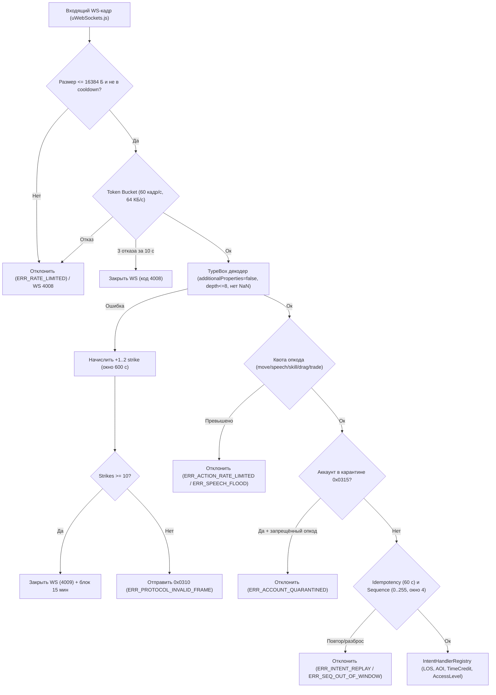
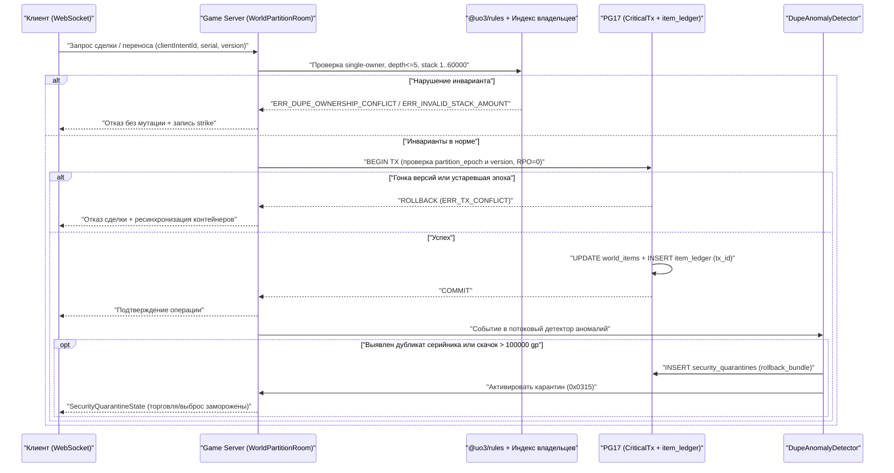
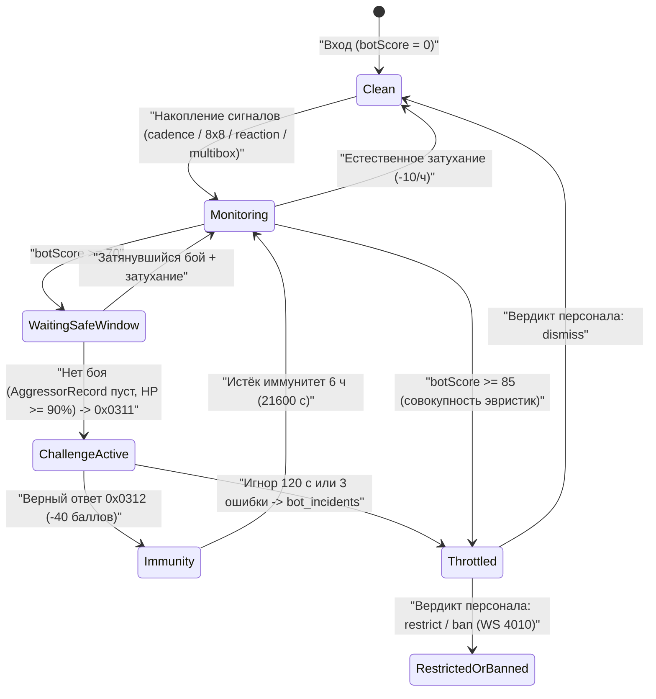

# Design: P31 Безопасность и античит

## Context

Платформа UO3 построена на монорепозитории TypeScript 5 strict ESM (Node 22, pnpm + Turborepo) и включает клиентское веб-приложение (`apps/client` на React 19, Vite 6, Three.js + Web Worker + OPFS), консоль персонала (`apps/admin`), REST API (`apps/api` на NestJS 11 `/api/v1/*`), игровой сервер реального времени (`apps/game-server` на NestJS + Colyseus 0.16 + uWebSockets.js + `@colyseus/schema` v3), общие пакеты (`@uo3/domain`, `@uo3/rules`, `@uo3/protocol`, `@uo3/db`, `@uo3/config`, `@uo3/test-kit`) и инфраструктуру PostgreSQL 17, Valkey 8, NATS JetStream, OTel/Prometheus/Loki/Tempo/Sentry.

К фазе P31 базовые механизмы уже распределены по подсистемам: аутентификация и `AccessLevel 0..6` (P04), игровые тикеты (P05), 20-герцовый тик и WS-коды `4000..4014` (P06), опкоды `uint16`/TypeBox/`StateView`/`IntentHandlerRegistry` (P07), транзакционный координатор `CriticalTxCoordinator` RPO=0 и `item_ledger` с `partition_epoch` (P08), клиентские `WebLocks` + `BroadcastChannel` (P09), трекер времени шагов `TimeCreditTracker` (P12), дерево контейнеров с `HeldItem` 30 с (P13), очередь макросов ≥ 600 мс (P14), анти-макро `8×8` (P15), боевая легальность и `AggressorRecord` (P16–P17), телеметрия `FAUCET_*`/`SINK_*` (P21) и скрытность/воровство (P22).

Задача P31 — замкнуть все эти контракты в единую эшелонированную систему безопасности: исключить доверие к клиенту на уровне протокола и симуляции, защитить 50-мс тик и REST API от флуда, гарантировать неразрушимую экономику без дюпа с автоматическим карантином, отсекать нечеловеческую автоматизацию без вреда для легальных макросов UO:R и укрепить браузерный периметр клиента и админки.

## Goals / Non-Goals

### Goals
- Обеспечить нулевое доверие к клиентским данным на всех этапах декодирования кадров (`16384` байт макс., глубина ≤ `8`, `additionalProperties: false`) и проверки инвариантов симуляции.
- Интегрировать детерминированный property-based fuzzing протокола и 20-герцовой симуляции на синтетическом мире (фасет ID 200) в регулярный тестовый прогон.
- Защитить `apps/game-server` и `apps/api` от флуда, Slowloris и тяжёлых запросов без деградации бюджета тика `50` мс.
- Гарантировать отсутствие дюпа предметов и золота (`0x40000000..0x7FFFFFFF`, чеки `0x14F0`, стаки `1..60000`, escrow вендоров, переходы партиций) с потоковым детектором, 300-секундной/суточной сверкой `item_ledger` и автоматическим торговым карантином (`0x0315`).
- Выявлять ботов по энтропии таймингов, зацикливанию `8×8`, сверхчеловеческим реакциям (< 80 мс) и мультибоксу при полном сохранении легальных встроенных макросов (≥ 600 мс).
- Устранить риски XSS, CSRF, clickjacking и утечки токенов в `apps/client` и `apps/admin` за счёт строгого CSP, SRI, `HttpOnly` refresh cookies, токена доступа в памяти и псевдонимизации ПДн.

### Non-Goals
- Реализация полного интерфейса расследований в админ-панели (покрывается P29; P31 поставляет таблицы, API-эндпоинты, события и очередь инцидентов).
- Межшардовые переезды и балансировка партиций (P32) или инфраструктурные бэкапы WAL/PITR (P33).
- Аппаратные kernel-level античиты (запрещено и невозможно в веб-клиенте) или инвазивный браузерный fingerprinting, нарушающий приватность.
- Блокировка легитимных встроенных клиентских макросов UO:R (`Dress`/`Undress` ≥ 600 мс, `TargetLast`, `UseSkill`, `Cast`).

## Decisions

### Decision 1: Двухступенчатый входной Security Gate перед `IntentHandlerRegistry`
- **Выбор:** Внедрить единый middleware/guard-конвейер в `apps/game-server` перед вызовом обработчиков P07 (`IntentHandlerRegistry`): (1) Pre-decode проверка размера кадра (`≤ 16384` байт), token-bucket соединения и статуса карантина/бана; (2) Декодирование и строгая валидация TypeBox (`additionalProperties: false`, запрет `NaN`/`Infinity`, глубина `≤ 8`, проверка направления `client->server`), проверка `clientIntentId` (окно идемпотентности 60 с) и `sequence` `0..255`; (3) Постинтентная проверка правил в обработчике (LOS, дистанция, `AccessLevel 0..6` + MFA, `TimeCreditTracker`).
- **Обоснование:** Отбрасывание невалидных и флудовых пакетов до аллокации доменных объектов и захода в цикл симуляции экономит CPU тика 20 Гц и гарантирует единую политику начисления security strikes (`0x0310`) для всех 60+ опкодов P12–P26.
- **Отвергнутые альтернативы:** Размазывать проверку размеров, `additionalProperties` и страйков по каждому модулю (P12..P26) — неизбежные пропуски и дублирование логики.

### Decision 2: Иерархический Token Bucket + деградирующий Outbound Backpressure
- **Выбор:** Применить трёхуровневую модель ограничений на WebSocket: (1) общий bucket соединения (`60` кадров/с, burst `120`, `65536` байт/с); (2) раздельные квоты по классам опкодов (движение `12`/с, речь `2`/с burst `5`, таргет/скиллы `5`/с, Drag&Drop `4`/с, гампы `5`/с, торговля `2`/с); (3) CPU-бюджет на клиента `4` мс/тик для дорогих операций (`2`/с). Для исходящего буфера (`256` Кбайт / `200` сообщений) ввести порог сброса `75%` для косметических событий и отключение после `5000` мс затора.
- **Обоснование:** Изоляция корзин гарантирует, что спам кнопками вендора или таргетом не заблокирует шаги игрока, а приоритезация исходящей очереди защищает тик `50` мс комнаты при медленном канале одного из клиентов.
- **Отвергнутые альтернативы:** Единый глобальный лимит на всё без приоритетов (игроки теряли бы контроль движения при открытии меню) или блокирующее ожидание записи в сокет uWebSockets.js.

### Decision 3: Распределённый Valkey Rate-Limiter с Fail-Closed политикой и NATS-отзывом
- **Выбор:** Хранить счётчики API `/api/v1/*` и межшардовых cooldown в Valkey 8 (атомарные Lua-скрипты sliding window). При сбое Valkey > `5` с критические эндпоинты (`/auth/*`, MFA, билеты, права) переходят в жёсткий локальный fail-closed режим (`2` req/мин на IP), а некритические GET-эндпоинты — в 5-секундный локальный буфер. Отзыв сессий/бан из P04 доставляется через NATS JetStream (`IDENTITY_EVENTS` + `SECURITY_EVENTS`), обрывая WS с кодом `4010` за `≤ 5` с.
- **Обоснование:** Предотвращает размножение квоты подбора пароля по числу подов API и исключает «окно безнаказанности» после смены пароля или бана.
- **Отвергнутые альтернативы:** Локальные in-memory лимиты на каждом инстансе API (легко обходятся балансировщиком) или fail-open при деградации Valkey.

### Decision 4: Трёхконтурная защита от дюпа поверх P08 (`CriticalTxCoordinator` + `item_ledger`)
- **Выбор:** (1) In-memory индекс уникальных серийников `0x40000000..0x7FFFFFFF` в комнате с проверкой ацикличности контейнеров (глубина ≤ 5) и `version`; (2) Все критические передачи идут через `CriticalTxCoordinator` (RPO=0) с проверкой `partition_epoch`, ключа идемпотентности и записью в append-only `item_ledger` в одной транзакции PG17; (3) Асинхронный потоковый детектор аномалий + фоновый сверщик (`300` с инкрементально, `24` ч полно) + автоматический торговый карантин (`0x0315`) и генератор пакета отката.
- **Обоснование:** Даже если логическая ошибка или гонка между партициями создаст несогласованность, её обнаружит потоковый детектор за секунды или сверщик за ≤ 5 минут, мгновенно заморозив вывод ценностей и подготовив точечный граф отката без отката всего шарда.
- **Отвергнутые альтернативы:** Только периодические ручные аудиты по логам или отказ от транзакционной сверки ради отложенной записи.

### Decision 5: Поведенческий антибот с защитой легальных макросов UO:R
- **Выбор:** Разделять встроенную очередь клиентских макросов (Dress/Undress ≥ `600` мс, Cast/TargetLast, разрешено правилами) и внешнюю автоматизацию через композитный `botScore ∈ [0..100]`: энтропия интервалов `σ < 12` мс по `50` событиям, пространственная зацикленность по блокам `8×8`/`16×16` > `2700` с, реакции `< 80` мс (≥ 10 за 300 с) и синхронный input broadcasting (`≤ 50` мс на ≥ 3 аккаунтах). При `botScore ≥ 70` и отсутствии активного боя (`AggressorRecord` пуст, HP ≥ 90%) отправляется внебоевой вызов `0x0311`/`0x0312`; при провале или `botScore ≥ 85` включается мягкое экономическое троттление без мгновенного раскрытия порогов и формируется кейс для персонала.
- **Обоснование:** Классическая культура UO:R допускает встроенные макросы и второе окно. Жёсткий автобан по одной эвристике недопустим из-за риска ложных банов; градированный внебоевой вызов отсекает бездушных ботов и не мешает честному PvP.
- **Отвергнутые альтернативы:** Блокировка любых макросов или отправка капчи в разгар боя (ломает PvP и вызывает массовый негатив).

### Decision 6: Браузерная модель без персистентных токенов и со строгим CSP/SRI
- **Выбор:** `apps/client` и `apps/admin` хранят access-токен только в замыкании/Zustand-памяти вкладки, refresh-токен — только в `HttpOnly; Secure; SameSite=Lax` (для админки `Strict`) cookie; ротация вкладок координируется через `WebLocks` + `BroadcastChannel` (P09). Все мутации по cookie защищены проверкой `Origin`/`Referer` + анти-CSRF заголовком. HTML отдаётся с `Content-Security-Policy` без `'unsafe-inline'`/`'unsafe-eval'`, `frame-ancestors 'none'`, `COOP: same-origin` и SRI `sha384` в манифесте Vite. Разбор MUL/UOP остаётся строго внутри Web Worker -> OPFS.
- **Обоснование:** Даже при гипотетической XSS-уязвимости в сторонней библиотеке злоумышленник не сможет прочитать refresh-cookie и не выполнит произвольный `eval`/внешний скрипт.
- **Отвергнутые альтернативы:** Хранение JWT в `localStorage`/`IndexedDB` (уязвимо к любому XSS) или передача игрового билета в query-параметре WebSocket URL (`?token=` утекает в логи прокси).

### Decision 7: Непрерывный Fuzzing и Attack Harness в `@uo3/test-kit`
- **Выбор:** Включить в `@uo3/test-kit` детерминированный генератор мутированных кадров (seeded `xoshiro128++`) и симулятор атак (speedhack, LOS peek, replay, stack overflow, race-dupe, bot-cadence) на синтетическом мире ID 200 с `GameClock.latch()`.
- **Обоснование:** Воспроизводимость по seed позволяет ловить регрессии парсера и экономических инвариантов в CI без недетерминированных падений и без проприетарных ассетов UO (ADR-002).
- **Отвергнутые альтернативы:** Только ручное пентест-тестирование перед релизом.

### Decision 8: Псевдонимизация ПДн и Redaction на границе телеметрии
- **Выбор:** Унифицированный фильтр редактирования в логгере (Pino/OTel/Sentry) заменяет секреты (`Authorization`, `Cookie`, `password`, `token`, `ticket`, `email`) на `[REDACTED]`, а IP-адреса перед записью в долгосрочные таблицы/аналитику усекаются до `/24` (IPv4) / `/48` (IPv6) и сопровождаются ротируемым `HMAC-SHA256` хэшем для корреляции атак.
- **Обоснование:** Позволяет выявлять бот-фермы и флуд-атаки, не превращая аналитические логи и пакеты доказательств в хранилище открытых ПДн.
- **Отвергнутые альтернативы:** Хранение сырых IP и заголовков запросов в общих логах отладки.

## Архитектура модулей

| Слой / Пакет | Новые и расширяемые компоненты | Ответственность |
| :--- | :--- | :--- |
| `@uo3/config` | `SecurityConfigSchema` (TypeBox) | Пороги rate-limit, strike-веса, лимиты `16384`/`256 Кбайт`, пороги `botScore`, CSP origins, соль HMAC (секрет env), режимы `shadow`/`enforce`. |
| `@uo3/domain` | `SecurityStrikePolicy`, `QuarantineState`, `MacroPolicy`, `BotEvidenceSummary` | Типы категорий нарушений, санкций, вердиктов (`dismiss`/`warn`/`restrict`/`ban`), кодов аномалий дюпа (`DUPE_*`). |
| `@uo3/rules` | `StackConservation`, `ContainerAcyclicCheck`, `CadenceStats`, `MovementAuthorityRules` | Чистые изоморфные проверки сохранения суммы стаков (`1..60000`), ацикличности контейнеров (`≤ 5`), дисперсии `σ` и верификации инвариантов. |
| `@uo3/protocol` | Опкоды `0x0310..0x0315`, `StrictFrameValidator`, `SecurityErrorCodes`, `FuzzCorpusGenerator` | Строгие TypeBox-схемы (`additionalProperties: false`), проверка глубины JSON/объектов `≤ 8`, защита от `NaN`/`Infinity`, генерация fuzz-нагрузки. |
| `@uo3/db` | Таблицы `security_strikes`, `security_quarantines`, `bot_incidents`, `ledger_reconciliation_runs`, `security_audit_logs` | Drizzle ORM схемы, миграции, append-only политики/триггеры для `item_ledger` и `security_audit_logs`, индексы сверки. |
| `apps/game-server` | `SecurityGateMiddleware`, `WsRateLimiter`, `StrikeTracker`, `DupeAnomalyDetector`, `BotBehaviorAnalyzer`, `ChallengeScheduler`, `OutboundBackpressure` | Фильтрация каждого WS-кадра, token buckets, защита тика 20 Гц, AOI/StateView изоляция, вызовы `0x0311`, мгновенный карантин `0x0315`. |
| `apps/api` | `DistributedRateLimitGuard`, `SecurityHeadersMiddleware`, `CsrfOriginGuard`, `LedgerReconciliationService`, `QuarantineService`, `SessionHygieneController`, `CspReportController` | Valkey sliding-window лимиты `/api/v1/*`, CSP/SRI/COOP/CSRF, 300с/24ч сверка `item_ledger`, API расследований/отката и управления сессиями. |
| `apps/client` | `BotChallengeModal`, `QuarantineBanner`, `MemoryTokenStore`, `SafeGameText`, `CspViolationReporter` | Внебоевой UI вызова `0x0311`/`0x0312`, хранение access-токена только в памяти, безопасный текстовый рендеринг без HTML, SRI-сборка Vite. |
| `apps/admin` | `BotIncidentsQueuePage`, `DupeQuarantinePage`, `LedgerAuditPage`, `RollbackPreviewDrawer` | Консоль обработки пакетов доказательств, вердикты, снятие/подтверждение карантина и отката, усиленный `SameSite=Strict` + MFA. |
| `packages/test-kit` | `ProtocolFuzzHarness`, `AttackSimulationScenarios` | Детерминированные сценарии атак (replay, speedhack, dupe race, bot cadence, flood) для CI на синтетическом мире. |

## Протокол, схемы и хранилище данных

### Новые опкоды `@uo3/protocol` (`0x0310..0x0315`)

Все схемы регистрируются в `@uo3/protocol` с `additionalProperties: false`, строгой проверкой типов (целые числа через `Type.Integer` с `minimum`/`maximum`) и максимальным размером кадра `16384` байт:

| Опкод | Имя сообщения | Направление | Ключевые поля TypeBox |
| :--- | :--- | :--- | :--- |
| `0x0310` | `SecurityViolationNotice` | `S -> C` | `code: SecurityErrorCode`, `category: 'authority' \| 'rate' \| 'economy' \| 'macro'`, `strikePoints: int(0..100)`, `retryAfterMs: int(0..3600000)`, `frozenUntilMs?: int` |
| `0x0311` | `BotChallengePrompt` | `S -> C` | `challengeId: string(36)`, `promptType: 'select_icon' \| 'simple_math' \| 'drag_glyph'`, `promptPayload: object(depth<=4)`, `expiresAtMs: int`, `attemptsRemaining: int(1..3)` |
| `0x0312` | `BotChallengeResponse` | `C -> S` | `challengeId: string(36)`, `answer: string(1..64)`, `clientDurationMs: int(0..120000)` |
| `0x0313` | `ClientIntegrityTelemetry` | `C -> S` | `rulesetHash: string(64)`, `worldDataVersion: string(1..64)`, `assetManifestHash?: string(64)`, `cspViolationCount: int(0..1000)` |
| `0x0314` | `MacroPolicyNotice` | `S -> C` | `reasonCode: string`, `blockedOpcode: int(0..65535)`, `minIntervalMs: int(100..5000)`, `nextAllowedAtMs: int` |
| `0x0315` | `SecurityQuarantineState` | `S -> C` | `quarantineId: string(36)`, `active: boolean`, `reasonCode: string`, `frozenSystems: string[]`, `expiresAtMs?: int` |

### Коды ошибок безопасности и привязка к WS-кодам P06 (`4000..4014`)
- Коды ошибок протокола и API: `ERR_UNTRUSTED_STATE_MUTATION`, `ERR_PROTOCOL_INVALID_FRAME`, `ERR_INTENT_REPLAY`, `ERR_SEQ_OUT_OF_WINDOW`, `ERR_MOVEMENT_DENIED`, `ERR_LOS_BLOCKED`, `ERR_ENTITY_NOT_VISIBLE`, `ERR_INSUFFICIENT_ACCESS`, `ERR_RULESET_MISMATCH`, `ERR_RATE_LIMITED`, `ERR_ACTION_RATE_LIMITED`, `ERR_SPEECH_FLOOD`, `ERR_COMPUTE_BUDGET_EXCEEDED`, `ERR_DUPE_OWNERSHIP_CONFLICT`, `ERR_TX_CONFLICT`, `ERR_INVALID_STACK_AMOUNT`, `ERR_ACCOUNT_QUARANTINED`, `ERR_MACRO_COOLDOWN`, `ERR_AUTOMATION_SUSPECTED`, `ERR_CSRF_VALIDATION_FAILED`, `ERR_TICKET_INVALID`.
- Маппинг на зарезервированный в P06 диапазон WS close codes `4000..4014`:
  - `4008` — `RATE_LIMIT_EXCEEDED` (3 переполнения token bucket за 10 с, connection flood или медленный читатель > 5000 мс);
  - `4009` — `SECURITY_PROTOCOL_VIOLATION` (накопление 10 strike-баллов за 600 с или критическая подмена протокола);
  - `4010` — `SESSION_REVOKED_OR_BANNED` (принудительный отзыв по `IDENTITY_EVENTS` / бан / смена пароля).

### `@colyseus/schema` v3 и `StateView`
- Все сущности в `WorldPartitionRoom` фильтруются через `StateView` P07 с радиусом AOI `18` тайлов (`24` макс., мульти — `31` тайл).
- Скрытые (`Hidden`), невидимые и чужие закрытые контейнеры полностью исключаются из `StateView` посторонних клиентов (нулевая передача сериалов/координат).
- На приватной схеме владельца `PlayerPrivateSecurityState` (`StateView` только для `sessionId` владельца) добавляются поля `quarantineActive: boolean`, `speechMutedUntilMs: int64`, `activeChallengeId: string`.

### Таблицы PostgreSQL 17 (`@uo3/db`) и ключи Valkey 8
1. **`security_strikes`**: `id (uuid PK)`, `account_id (uuid FK)`, `character_id (int4 nullable)`, `shard_id (text)`, `category (text)`, `error_code (text)`, `points (int2)`, `source_hmac (text)`, `details_redacted (jsonb)`, `expires_at (timestamptz)`, `created_at (timestamptz)`. Индекс `(account_id, expires_at)`.
2. **`security_quarantines`**: `id (uuid PK)`, `account_id (uuid FK)`, `scope (text: 'trade_freeze'|'bot_throttle'|'full_lock')`, `reason_code (text)`, `affected_serials (int4[])`, `related_tx_ids (uuid[])`, `rollback_bundle (jsonb)`, `status (text: 'active'|'resolved'|'rolled_back')`, `created_by (text)`, `resolved_by (uuid nullable)`, `created_at`, `expires_at`, `resolved_at`.
3. **`bot_incidents`**: `id (uuid PK)`, `account_id (uuid FK)`, `character_id (int4)`, `bot_score (int2)`, `triggers (text[])`, `timing_histogram (jsonb)`, `sector_heatmap (jsonb)`, `challenge_history (jsonb)`, `correlated_accounts (uuid[])`, `status (text: 'open'|'dismissed'|'warned'|'restricted'|'banned')`, `reviewer_id (uuid nullable)`, `verdict_note (text nullable)`, `created_at`, `updated_at`. (Частичный уникальный индекс на `(account_id) WHERE status = 'open'` — защита от дублей).
4. **`ledger_reconciliation_runs`**: `id (uuid PK)`, `run_type (text: 'rolling_300s'|'daily_full')`, `window_start (timestamptz)`, `window_end (timestamptz)`, `checked_items (int8)`, `checked_txs (int8)`, `discrepancies_count (int4)`, `discrepancies_sample (jsonb)`, `status (text: 'passed'|'failed')`, `duration_ms (int4)`, `created_at`.
5. **`security_audit_logs`**: append-only журнал (`id`, `actor_account_id`, `actor_acl`, `action`, `target_type`, `target_id`, `source_hmac`, `outcome`, `metadata_redacted`, `created_at`), защищённый триггером запрета `UPDATE`/`DELETE` для роли приложения.
6. **Valkey 8**:
   - `rl:api:{routeGroup}:{scopeKey}` — ZSET/sliding-window счётчики API (TTL по окну);
   - `rl:ip:cooldown:{ipHash}` — автоматический бан на `600` с при `≥ 200` отбросах/мин;
   - `ws:conn:ip:{ipHash}` — активные подключения (макс. `8`) и handshake rate (макс. `20`/60 с);
   - `tx:idemp:{txKey}` — ключи идемпотентности критических намерений (TTL `60` с) и `item:serial:lock:{serial}` для координации переходов;
   - `bot:immunity:{accountId}` — иммунитет к вызову после успешного ответа (`21600` с).

## Математические модели и алгоритмы

### 1. Многоуровневый Token Bucket и Backpressure тика 20 Гц
Для каждого уровня $L \in \{\text{conn}, \text{bytes}, \text{move}, \text{speech}, \text{skill}, \text{drag}, \text{gump}, \text{trade}, \text{compute}\}$ состояние описывается парой $(T_L, t_{\text{last}})$:
$$T_L' = \min\left(B_L,\; T_L + \frac{t_{\text{now}} - t_{\text{last}}}{1000} \cdot R_L\right)$$
где $R_{\text{conn}} = 60\,\text{кадр/с}, B_{\text{conn}} = 120$; $R_{\text{bytes}} = 65536\,\text{Б/с}, B_{\text{bytes}} = 131072$; $R_{\text{move}} = 12$, $R_{\text{speech}} = 2 (B=5)$, $R_{\text{skill}} = 5$, $R_{\text{drag}} = 4$, $R_{\text{gump}} = 5$, $R_{\text{trade}} = 2$, $R_{\text{compute}} = 2$.
Если $T_L' < \text{cost}$, кадр отклоняется до вызова обработчика; при 3 отказах по `conn`/`bytes` в скользящем окне `10 000` мс сокет закрывается кодом `4008`.
При отправке патчей: если `outboundBytes > 196608` (75% от `256` Кбайт) или `outboundMsgs > 150` (75% от `200`), события приоритета `LOW` (партиклы, шаги, декоративные звуки) отбрасываются; состояние `CRITICAL` (позиция игрока, урон, статус сделки, `0x0310..0x0315`) ставится в очередь до лимита `256` Кбайт, после `5000` мс застоя сокет разрывается.

### 2. Накопление Security Strikes
В окне $W = 600\,\text{с}$ суммарный балл $S = \sum_{i \in W} w_i$:
- $w = 1$: ошибка схемы/кадра (`ERR_PROTOCOL_INVALID_FRAME`), выход `sequence` из окна;
- $w = 2$: подмена клиентского поля (`ERR_UNTRUSTED_STATE_MUTATION`), повтор критического ID, попытка доступа к невидимой сущности;
- $w = 5$: попытка вызова GM-команды без `AccessLevel` (`ERR_INSUFFICIENT_ACCESS`).
Пороги: $S \ge 3 \rightarrow$ предупреждение (`0x0310`); $S \ge 5 \rightarrow$ 5-секундная заморозка боевых/торговых намерений; $S \ge 10 \rightarrow$ закрытие WS с кодом `4009` и запрет билетов на `900` с (15 мин).

### 3. Инварианты Anti-Dupe и сверка `item_ledger`
Для каждой операции переноса или изменения стака над множеством предметов $I$:
1. Уникальность владельца: $\forall x \in I,\; |\text{owners}(x)| = 1$, дерево контейнеров не содержит циклов, $\text{depth}(x) \le 5$.
2. Сохранение массы стака: для множества входных стаков $A$ и выходных $B$ одного `itemTypeId` (кроме явных `FAUCET_*`/`SINK_*`) строго $\sum_{a \in A} \text{amount}(a) = \sum_{b \in B} \text{amount}(b)$, при $\forall k,\; 1 \le \text{amount}(k) \le 60000$.
3. Банковские чеки (`0x14F0`): сумма чека $v \in [5000, 1000000] \cap \mathbb{Z}$, при создании `ledger` списывает $v$ из банка в `ESCROW_CHECK`, при обналичивании переводит из `ESCROW_CHECK` в целевой банк.
4. Формула сверки в `LedgerReconciliationService` за окно $[t_0, t_1]$:
$$\text{Qty}_{\text{world}}(t_1) - \text{Qty}_{\text{world}}(t_0) = \sum_{e \in \text{ledger}[t_0, t_1]} (\Delta_{\text{faucet}}(e) - \Delta_{\text{sink}}(e) - \Delta_{\text{decay}}(e))$$
А при агрегации по каждому серийнику $s$ за интервал конечный владелец `owner_after` последней транзакции равен `world_items.owner_id` в `PG17`.

### 4. Модель энтропии и композитный `botScore`
В скользящем окне из $N = 50$ однотипных событий с межсобытийными интервалами $\Delta t_1, \dots, \Delta t_{50}$ (после исключения задержек длиннее 30 с — естественные паузы AFK не портят статистику? Нет, именно непрерывные циклы без пауз имеют малую дисперсию):
$$\mu = \frac{1}{N} \sum_{i=1}^{N} \Delta t_i, \qquad \sigma = \sqrt{\frac{1}{N} \sum_{i=1}^{N} (\Delta t_i - \mu)^2}$$
Композитный скор (ограничен $[0, 100]$):
- $S_{\text{cadence}} = 35$, если $\sigma < 12\,\text{мс}$ и непрерывная длительность цикла $\ge 1800\,\text{с}$ (или 50+ мгновенных кликов по гампам с $\sigma < 5\,\text{мс}$);
- $S_{\text{spatial}} = 25$, если коэффициент повторения маршрута по блокам `8×8` $> 0.92$ дольше `2700` с или столкновения со стеной $> 180$ с без смены вектора;
- $S_{\text{reaction}} = 30$, если зафиксировано $\ge 10$ боевых реакций $< 80\,\text{мс}$ или $\ge 5$ авто-лутов $< 120\,\text{мс}$ за `300` с;
- $S_{\text{multibox}} = 35$, если $\ge 3$ аккаунта с одного IP/подсети исполняют идентичные команды с $|\Delta t| \le 50\,\text{мс}$ $\ge 8$ раз за `60` с.
Итого: $\text{botScore} = \min(100,\; \max(0,\; S_{\text{cadence}} + S_{\text{spatial}} + S_{\text{reaction}} + S_{\text{multibox}} - \text{decay}))$, где $\text{decay} = 10\,\text{баллов/час}$ разнообразной активности; успешный вызов `0x0312` вычитает `40` и ставит `bot:immunity` на `21600` с.

## Диаграммы архитектуры

### 1. Входной конвейер авторитарности и rate-limiting (`apps/game-server`)

### 2. Контур Anti-Dupe, Fencing и автоматического карантина (`CriticalTx` + `item_ledger`)

### 3. Жизненный цикл поведенческого антибота (`botScore` и вызовы)

## Risks / Trade-offs

- **[Ложные срабатывания антибота на опытных игроков и легальные макросы]** → Явное исключение встроенной очереди макросов (`≥ 600` мс), требование высокой статистической значимости (`N = 50` событий, `≥ 10` реакций `< 80` мс), отправка вызова `0x0311` строго вне боя, запрет авто-пермабана и выдача 6-часового иммунитета после прохождения вызова.
- **[Накладные расходы на CPU внутри 50-мс тика из-за валидации и эвристик]** → Быстрый отсев кадров по длине и token-bucket до десериализации; расчёт дисперсии `σ` инкрементально (алгоритм Велфорда $O(1)$ на событие) и вынос тяжёлой сверки `item_ledger` в фоновый воркер `apps/api`.
- **[Блокировка честных пользователей за общим NAT/IP (университет, клуб, семья)]** → Разделение лимитов на IP (`8` WS, `20` handshake/мин) и per-account, а правило `MULTI_BOX_BROADCAST` срабатывает только при синхронности действий `≤ 50` мс по общим целям, а не по одному факту совпадения IP.
- **[Недоступность Valkey при всплеске трафика]** → Для auth/tx вводится fail-closed локальный аварийный лимит (`2` req/мин), чтобы сбой кэша не открыл дверь для брутфорса паролей, при одновременном сохранении 5-секундного локального fallback для non-critical запросов.
- **[Сбой или ложный карантин при легитимной крупной сделке]** → Исключение валидных `FAUCET_*`/банковских чеков `0x14F0`/одобренных торгов из порога `DUPE_BALANCE_SPIKE` (`> 100000` gp), плюс быстрый инструмент `resolve`/`rollback` для GM в админ-консоли.
- **[Ломающие ограничения CSP для WebGL2 / WebGPU / Web Workers / OPFS]** → Явное тестирование production-бандла Vite 6 с `worker-src 'self' blob:`, `connect-src` на разрешённые API/WS origins и автоматизированная E2E-проверка отсутствия CSP-ошибок в браузере.
- **[Утечка ПДн и токенов через стек-трейсы и пакеты доказательств]** → Обязательный redaction-сериализатор в OTel/Sentry/Pino и псевдонимизация IP-адресов через ротируемый `HMAC-SHA256` + усечение маски до сохранения в БД.
- **[Регрессии парсера при добавлении новых опкодов в будущих фазах]** → CI-гейт автоматического прогона `ProtocolFuzzHarness` по всем зарегистрированным опкодам `@uo3/protocol` с проверкой `additionalProperties: false`.

## Migration Plan

1. **Этап 1 — Схемы, контракты и Shadow Mode (`dry-run`):** Выкатить миграции `@uo3/db` (`security_strikes`, `security_quarantines`, `bot_incidents`, `ledger_reconciliation_runs`, `security_audit_logs`), опкоды `0x0310..0x0315`, и включить rate-limiter, детектор дюпа и анализатор ботов в режиме `AUDIT_ONLY` (метрики и логи без киков и карантинов) для калибровки порогов на синтетических и нагрузочных тестах.
2. **Этап 2 — Включение принудительной валидации протокола и API-лимитов:** Переключить `SecurityGateMiddleware` и `DistributedRateLimitGuard` в режим `ENFORCE`, включить строгий CSP/SRI на `apps/client` и `apps/admin` (сначала `Content-Security-Policy-Report-Only` на 1 прогон, затем блокирующий `Content-Security-Policy`).
3. **Этап 3 — Активация вызовов антибота и карантина дюпа:** Включить отправку `0x0311`/`0x0312` вне боя, автоматический торговый карантин `0x0315` при подтверждённом конфликте серийников/несохранности массы и 300-секундную/суточную сверку `item_ledger`.
4. **План отката:** Любой контур (вызовы антибота, торговый карантин, строгий режим strike-банов, CSP report-only) имеет независимый feature-флаг в `@uo3/config` и может быть переведён в `audit_only` без миграции базы данных и без перезапуска схемы мира.

## Open Questions

1. **Криптографическое подписание ответов клиента на `BotChallenge`:** На первом этапе достаточно одноразового серверного nonce в `challengeId` и валидации ответа; при появлении массовых OCR-солверов возможно расширение `promptType` интерактивными игровыми мини-головоломками на канвасе (решение принимается по статистике после бета-теста).
2. **Адаптивные пороги квот при массовых PvP-осадах и ярмарках:** Стандартный лимит `200` исходящих сообщений / `256` Кбайт и `60` входящих кадров/с достаточен для AOI 18–24 тайлов; при наличии в одной зоне > 150 активных бойцов (P34) потребуется уточнить коэффициент агрегации батчей косметики.
3. **Срок хранения ротируемых солей `HMAC-SHA256` для псевдонимизации IP:** Рекомендуемый цикл ротации — 30 дней с хранением секрета в KMS/Vault вне основной БД; точный срок согласуется с политикой приватности перед запуском (P34).
