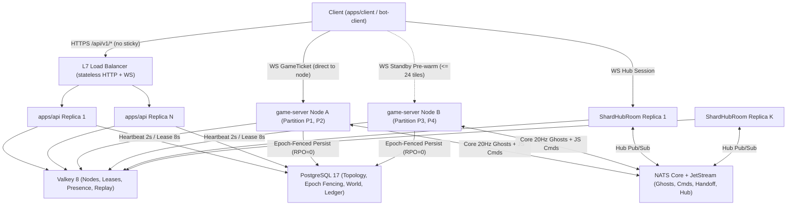
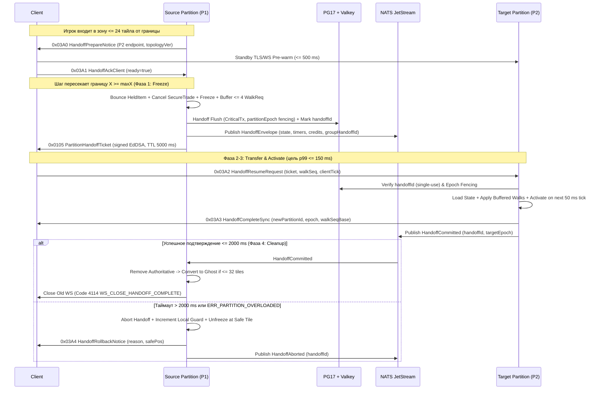
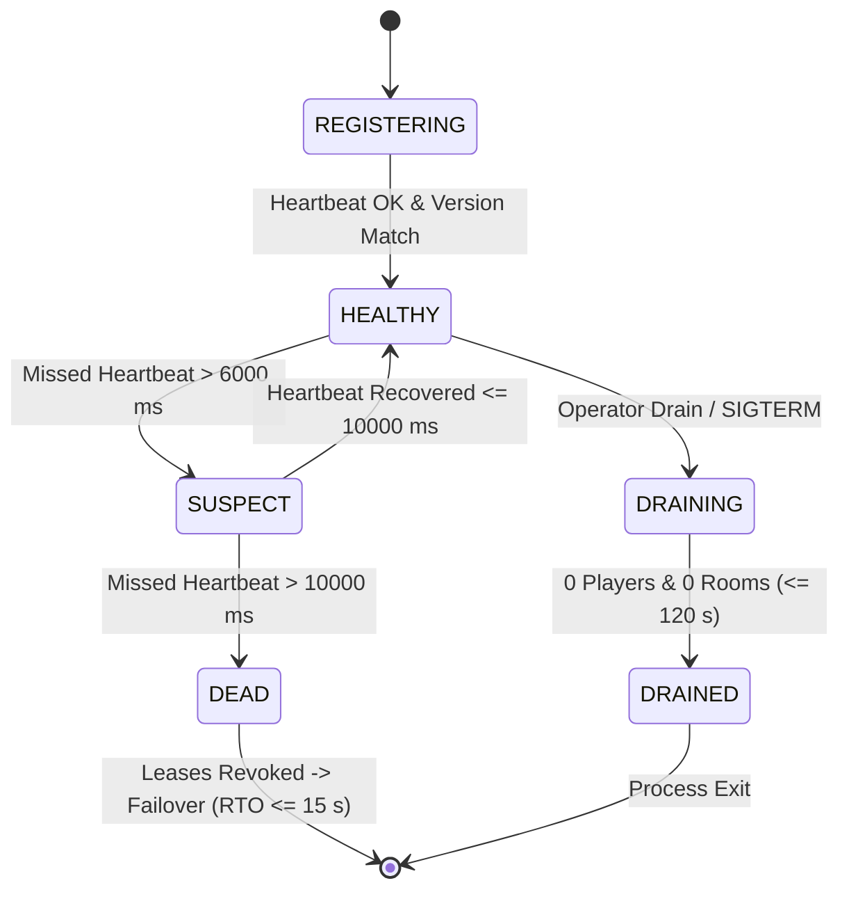

# Design: P32 Масштабирование мира

## Context

До фазы P32 архитектура UO3 поддерживает один процесс `apps/game-server`, обслуживающий фасет в одной комнате `WorldPartitionRoom` (P06), единый экземпляр `ShardHubRoom` и один инстанс `apps/api`. В предыдущих фазах были сознательно заложены все необходимые точки расширения для P32:
- **P03**: срезы `WorldDataModule` с буфером `≥ 32` тайлов, `WorldDataVersionSchema` (SHA-256) и `DynamicTileProvider`.
- **P05**: `GameTicketVerifier` и ключи присутствия/партиций в Valkey 8.
- **P06**: `WorldPartitionRoom` (20 Гц, 50 мс/тик, сектора 16×16) и `ShardHubRoom`, коды закрытия WS `4100..4199` (нормативно — `docs/PROTOCOL_REGISTRY.md`).
- **P07**: `VisibilityEntitySource` с буфером `≥ 32` тайлов, `@colyseus/schema` v3 `StateView` (AOI 18/24/31).
- **P08**: колонка `partition_epoch` для fencing-записей, `CriticalTxCoordinator` (RPO=0), `item_ledger`, handoff-flush.
- **P12**: опкод `0x0105` (`PartitionHandoffTicket`) и `TimeCreditTracker` (100/200/400 мс, джиттер 150 мс, карантин 1000 мс).
- **P13–P26**: `HeldItem` (30 с), `Secure Trade`, `AggressorRecord` (120 с), `SwingTimer`, `MultiSpatialIndex` (31 тайл), тороидальный океан кораблей `X=0↔5119`, регионы 16×16, питомцы `FOLLOW`/`GUARD`, гильдии/пати.
- **P30–P31**: 2PC горячая перезагрузка `ContentSnapshot` через NATS JetStream и сверка инвариантов `item_ledger`.

Ограничение одного процесса Node.js 22 на 20 Гц — ~400–600 активных игроков с плотным боем и ИИ в одной комнате (бюджет тика 50 мс, цель p95 ≤ 35 мс). Для шарда на 5000+ игроков и бесперебойных обновлений необходимо горизонтально разбить мир на множество авторитативных партиций, связать их призрачной репликацией, обеспечить бесшовный переход между ними и оркестрировать кластер узлов `game-server`, `ShardHubRoom` и `api`.

## Goals / Non-Goals

### Goals
- Разбиение любого фасета (Felucca 0, Trammel 1, синтетические 200..254) на произвольное число прямоугольных партиций с выравниванием по секторам 16×16 и единым однопартиционным режимом как частным случаем для dev/CI.
- Бесшовный переход игрока, его питомцев `FOLLOW`/`GUARD` и корабля с экипажем между партициями с **p99 паузы владения ≤ 150 мс**, **0 кадров мигания** на клиенте и **0 дублирования предметов** (инвариант `item_ledger` + `partitionEpoch`).
- Полная прозрачность пограничного геймплея в пределах AOI (18/24/31 тайл): призрачная репликация в буфере `≥ 32` тайлов, кросс-партиционный бой, магия, 3D DDA LOS, речь (1/15/18 тайлов) и синхронизация динамических тайлов за `≤ 100 мс`.
- Горизонтальное масштабирование `apps/api` без sticky sessions, распределённый `ShardHubRoom` (≥ 5000 игроков на шард, задержка глобального чата ≤ 250 мс), автоматический failover партиции (**RTO ≤ 15 с**, **RPO=0** для критических транзакций) и `Graceful Drain` узлов без потерь сессий.
- Сквозная наблюдаемость (метрики Prometheus, распределённая трассировка `traceparent` через OTel) и детерминированное тестирование на мульти-партиционном тест-харнессе и ботах.

### Non-Goals
- Межшардовый перенос персонажей между разными шардами и базами данных.
- Автоматическое геометрическое переразбиение границ (Voronoi/динамический quadtree) в реальном времени без подтверждения топологии.
- Multi-region active-active репликация PostgreSQL 17 и production IaC/Kubernetes Helm-чарты (реализуются в P33).
- Итоговая нагрузочная сертификация на 5000+ ботах (реализуется в P35; в P32 создаются базовые нагрузочные и хаос-сценарии).

## Decisions

### Decision 1: Прямоугольные партиции, выровненные по секторам 16×16, с версионируемым `split`/`merge`
- **Выбор**: Топология каждого фасета задаётся массивом полуоткрытых прямоугольников `[minX, maxX) × [minY, maxY)` с координатами `coord % 16 === 0`, покрывающих 100% валидных тайлов фасета, с монотонным `topologyVersion` и SHA-256 хэшем. Масштабирование геометрии выполняется явными операциями `split` (1 → 2..4) и `merge` (2..4 → 1) через цикл `PREPARING → QUIESCING → CUTOVER → ACTIVE`.
- **Обоснование**: Выравнивание по 16×16 совпадает с пространственными секторами P01/P06, индексом регионов P25 и блоками 8×8 карты P02/P03. Полуоткрытые интервалы гарантируют O(log N) / O(1) однозначное владение каждым тайлом без двойного счёта на границе.
- **Отвергнутые альтернативы**: Автоматический динамический quadtree в реальном времени — создаёт непредсказуемые разрезы через города и жилые кварталы домов (P23) и резко усложняет кэширование срезов карты. Шестиугольная/произвольная полигональная сетка — несовместима с 16×16 секторами и 8×8 блоками MUL/UOP.

### Decision 2: Двухконтурная шина NATS (Core Pub/Sub + JetStream)
- **Выбор**: Использовать два раздельных транспортных контура поверх одного кластера NATS (ADR-008):
  1. **Эфемерный контур (NATS Core Pub/Sub)** для 20 Гц дельт призраков, анимаций, позиционного звука и локальной речи (`at-most-once`, `seqNo`, drop-stale, кольцевой буфер 2000 пакетов).
  2. **Персистентный контур (NATS JetStream)** для протокола handoff, кросс-партиционных боевых/магических команд, динамических тайлов, глобального чата хаба, `IDENTITY_EVENTS` (P04) и 2PC `ContentSnapshot` (P30) (`at-least-once`, `UUIDv7` дедупликация 60 с, consumer ack, DLQ после 3 повторов).
- **Обоснование**: Дельты позиций призраков устаревают через 50 мс — писать их на диск JetStream бессмысленно и губительно для задержек; напротив, команды урона, handoff-подтверждения и баны не могут бесследно теряться.
- **Отвергнутые альтернативы**: Единый JetStream на все сообщения (включая 20 Гц позиции) — перегрузка дисков и рост p99 задержек при 200+ призраках. Прямые gRPC/TCP mesh-соединения между узлами `game-server` — квадратичный рост соединений $O(N^2)$, усложнение discovery и отсутствие встроенной буферизации при кратковременном рестарте узла.

### Decision 3: Однонаправленная призрачная репликация (Read-Only Ghosts) и проксирование команд
- **Выбор**: Авторитативная партиция публикует компактные read-only призраки для всех сущностей в полосе `bufferTiles ≥ 32` тайлов. Соседняя партиция индексирует их в `VisibilityEntitySource` (P07) для `StateView` AOI (18/24/31), но никогда не мутирует и не сохраняет призраков. Любое намерение игрока в отношении призрака пересылается подписанной командой с `commandId` (UUIDv7) в авторитативную партицию цели.
- **Обоснование**: Полностью соблюдается жёсткое правило серверной авторитарности и single-writer для каждой сущности. Устраняются распределённые блокировки (2PC на каждый удар мечом) и конфликты слияния состояния.
- **Отвергнутые альтернативы**: Active-active репликация пограничных сущностей с CRDT — неприменима к строгим игровым инвариантам UO:R (атомарное списание HP, смерть, лут, кража, инвентарь). Уменьшение буфера до 18 тайлов — ломает видимость мульти/домов (31 тайл, P23) и расширенный AOI (24 тайла).

### Decision 4: Четырёхфазный атомарный Handoff с предпрогревом и `partitionEpoch` Fencing
- **Выбор**: Протокол перехода состоит из предварительного прогрева транспорта клиентом (`≤ 24` тайла) и 4-фазного атомарного переключения (`Freeze → Persist → Transfer → Activate`) с подписанным EdDSA одноразовым билетом `PartitionHandoffTicket` (`0x0105`, TTL 5000 мс), буферизацией до 4 шагов движения на время паузы (p99 ≤ 150 мс, таймаут 2000 мс) и привязкой к `partitionEpoch` (P08). Перед фазой `Freeze` выполняются анти-дюп инварианты: возврат `HeldItem` (P13) и отмена `Secure Trade` (P21).
- **Обоснование**: Гарантирует RPO=0 при переходе, исключает гонку «вещь осталась в старой партиции и появилась в новой» и позволяет безопасно откатиться на исходную партицию при сбое приёмника без разрыва сессии игрока.
- **Отвергнутые альтернативы**: «Ленивый» handoff через дисконнект и переподключение через `apps/api` — вызывает паузу 1–3 с, сброс UI, мигание сцены и разрыв боя/движения. Передача состояния исключительно по NATS без фиксации чекпоинта в PG17 — риск потери предметов и дублирования при одновременном краше источника и приёмника.

### Decision 5: Запрет разрезания домов и атомарная групповая миграция (`groupHandoffId`)
- **Выбор**: Размещение нового дома поверх границы партиции запрещено (`ERR_MULTI_CROSSES_PARTITION_BORDER`), а смена топологии валидируется против таблицы `world_houses` (`ERR_TOPOLOGY_CUTS_EXISTING_HOUSE`). Для владельца с питомцами (`FOLLOW`/`GUARD` в радиусе 18 тайлов) и кораблей с палубным экипажем вводится атомарный пакет `groupHandoffId`, мигрирующий всю группу в одном чекпоинте (включая тороидальный переход `X=5119 ↔ 0`).
- **Обоснование**: Разделение одного дома между двумя процессами ломает `MultiSpatialIndex`, контейнеры lockdown/secure и права доступа (P23). Атомарный пакет для корабля гарантирует сохранение относительных координат пассажиров на палубе без ложных откатов `TimeCreditTracker` (P24).
- **Отвергнутые альтернативы**: Разрешение «половинок» дома в разных партициях с распределённой синхронизацией сундуков — избыточная сложность и риск дюпа лута. Поштучная миграция каждого пассажира корабля — визуальный «сброс» игроков за борт в океан при пересечении шва.

### Decision 6: Valkey 8 для быстрых аренд/присутствия + PostgreSQL 17 как источник истины
- **Выбор**: Хартбиты узлов (2 с, TTL 6 с, `DEAD` 10 с), распределённые аренды партиций (`leaseTtlMs = 8000`, Lua compare-and-swap по `nodeId` + `epoch`), одноразовые `handoffId` (replay protection) и глобальное присутствие хранятся в Valkey 8. Каноническая топология (`shard_partition_topologies`), текущий `partitionEpoch` каждой партиции (`shard_partitions`), аудит переходов (`partition_handoff_logs`) и данные мира с `WHERE partition_epoch = $expected` хранятся в PG17.
- **Обоснование**: Valkey даёт субмиллисекундную латентность для маршрутизации входа и детекции сбоев, а PG17 обеспечивает строгий fencing на уровне хранилища мира: даже если Valkey потерял ключ или возникла сетевая сегментация, «зомби-узел» со старым `partitionEpoch` физически не сможет записать состояние в PG17.
- **Отвергнутые альтернативы**: Внешний etcd/Consul — ввод новой инфраструктурной зависимости в нарушение минималистичного стека ADR-008 (PG17 + Valkey 8 + NATS). Хранение хартбитов только в PG17 — лишняя нагрузка на WAL и вакуум при десятках узлов.

### Decision 7: Горизонтально масштабируемый `ShardHubRoom` и Stateless API
- **Выбор**: `apps/api` полностью лишён локального состояния (JWKS кэшируется по TTL, ревокация/rate-limit/каталог маршрутизации — в Valkey 8, данные — в PG17). `ShardHubRoom` запускается в N репликах на разных узлах; каждая реплика обслуживает подмножество подключений клиентов, хранит глобальное присутствие в Valkey Hash/Set (`shard:{id}:presence`) и транслирует гильдейский/пати/глобальный чат через NATS субъекты `uo3.hub.{shardId}.*`.
- **Обоснование**: Снимает ограничение одного Event Loop `ShardHubRoom` и обеспечивает плавный rolling deploy API/хаба (клиенты хаба реконнектятся с джиттером 0..3000 мс без затрагивания игрового сокета партиции).
- **Отвергнутые альтернативы**: Sticky sessions на L7-балансировщике — хрупкий деплой и неравномерная нагрузка. Единственный мастер `ShardHubRoom` — точка отказа и узкое горлышко при 5000+ игроках.

### Decision 8: Взвешенный планировщик размещения и Rate-Limited `Graceful Drain`
- **Выбор**: Координатор размещения (выбираемый через leader-lease в Valkey с TTL 5000 мс) оценивает узлы по взвешенной формуле `PlacementScore` (CPU, RAM, число игроков, аффинность к смежным горячим партициям) и запускает комнаты через командный субъект `uo3.cluster.{shardId}.node.{nodeId}.cmd`. При переводе узла в `DRAINING` игроки мигрируют на предзапущенные замещающие комнаты пакетами со скоростью `≤ 50 игроков/с`.
- **Обоснование**: Пакетная миграция предотвращает thundering herd на PG17, NATS и CPU принимающих узлов во время планового обновления версии.
- **Отвергнутые альтернативы**: Мгновенное переключение всех 400 игроков за 1 тик — лавинообразный всплеск PG-транзакций и задержка тика > 500 мс.

---

## Архитектура и диаграммы

### Общая схема кластера и контуров связи



### Последовательность 4-фазного бесшовного перехода (`Seamless Handoff`)



### Жизненный цикл игрового узла и партиции



---

## Подробная архитектура модулей

### Пакеты (`packages/*`)
1. **`@uo3/domain` (0 deps)**:
   - `src/scaling/partition-topology.ts`: типы `PartitionBounds`, `FacetPartitionDef`, `PartitionTopologyManifest`, `ToroidalSeamConfig`, `HysteresisConfig`. Чистые детерминированные функции:
     - `resolvePartitionForPoint(topology, facetId, x, y): PartitionId | null`
     - `validateFacetTopology(manifest, facetWidth, facetHeight): TopologyValidationResult` (проверка выравнивания `% 16 === 0`, 100% покрытия, отсутствия пересечений, `bufferTiles >= 32`, валидных параметров гистерезиса).
     - `computeBufferedSlice(bounds, bufferTiles, facetMeta): BufferedSliceRect[]` (возвращает 1 прямоугольник или 2 при пересечении тороидального шва океана `X=0↔5119`).
     - `computeNeighborPartitions(topology, partitionId): NeighborLink[]` (включая диагональных и тороидальных соседей).
     - `computeTopologyHash(manifest): string` (канонический JSON + SHA-256).
   - `src/scaling/cluster-types.ts`: `ClusterNodeStatus` (`REGISTERING | HEALTHY | SUSPECT | DRAINING | DRAINED | DEAD`), `PartitionRuntimeStatus` (`UNPLACED | PREPARING | READY | QUIESCING | FAILING_OVER | DEGRADED_UNPLACED | STOPPED`), `HandoffReason`, `HandoffPhase`, `PlacementScoreInput`.
2. **`@uo3/rules`**:
   - `src/world/partition-slice-guard.ts`: расширение P03 `WorldSliceLoader` проверкой `bufferTiles >= 32` и объединением двух полос при тороидальном шве; проверка `assertMultiWithinPartition(footprint, topology)` для P23.
   - `src/scaling/border-hysteresis.ts`: чистая машина состояний предпрогрева (`enter <= 24`, `exit > 28`, idle close `10_000 ms`) и гистерезиса пересечения (`hysteresisTiles = 2`, `hysteresisCooldownMs = 1500`).
   - `src/scaling/placement-scoring.ts`: детерминированная функция расчёта `PlacementScore(node, partition)` и детектор перегрузки (`OverloadEvaluator`).
   - `src/scaling/handoff-movement-carry.ts`: перенос `walkSequence` (`0..255`), `TimeCreditTracker` balance и остатка карантина (`quarantineRemainingMs`) без инфляции кредитов.
3. **`@uo3/protocol`**:
   - Расширение `0x0105` `PartitionHandoffTicket` (зарезервирован в P12) и новые опкоды `0x03A0..0x03A7` (TypeBox-схемы).
   - Коды закрытия WS (P32 новых кодов не вводит, использует нормативные коды `docs/PROTOCOL_REGISTRY.md`): `4114` (`WS_CLOSE_HANDOFF_COMPLETE`, перенаправление), `4115` (`WS_CLOSE_HANDOFF_FAILED`, реконнект), `4116` (`WS_CLOSE_PARTITION_DRAINING`, перенаправление), `4117` (`WS_CLOSE_EPOCH_FENCED`, реконнект), `4118` (`WS_CLOSE_SPLIT_MERGE_RECONNECT`, реконнект); невалидный/повторно использованный билет перехода или входа — `4101` (`WS_CLOSE_INVALID_TICKET`).
   - Схемы NATS (`src/bus/*.ts`): `GhostDeltaBatchSchema`, `GhostKeyframeSchema`, `GhostDespawnSchema`, `GhostResyncRequestSchema`, `CrossPartitionCommandSchema`, `CrossPartitionSpeechSchema`, `CrossPartitionDynamicTileSchema`, `HandoffEnvelopeSchema`, `ClusterNodeHeartbeatSchema`, `ClusterControlCommandSchema`.
   - Расширение `@colyseus/schema` v3 (`MobileSchema`, `GroundItemSchema`, `MultiSchema`): поля `@type('boolean') isGhost`, `@type('string') ownerPartitionId`, `@type('uint32') ghostEpoch`.
4. **`@uo3/db`**:
   - Новые таблицы Drizzle PG17 (`shard_partition_topologies`, `shard_partitions`, `partition_leases`, `partition_handoff_logs`, `cluster_nodes`) + helper `assertEpochFencedUpdate(tx, partitionId, expectedEpoch)` для интеграции с P08 `world_*`.
5. **`@uo3/config`**:
   - TypeBox-переменные окружения: `NATS_URL`, `NATS_STREAM_REPLICAS`, `CLUSTER_NODE_ID`, `CLUSTER_PUBLIC_WS_ENDPOINT`, `CLUSTER_HEARTBEAT_MS` (2000), `CLUSTER_SUSPECT_MS` (6000), `CLUSTER_DEAD_MS` (10000), `PARTITION_LEASE_TTL_MS` (8000), `PARTITION_BUFFER_TILES` (32), `HANDOFF_TIMEOUT_MS` (2000), `HANDOFF_TICKET_TTL_MS` (5000), `GHOST_MAX_BANDWIDTH_BYTES_SEC` (10485760), `DRAIN_RATE_PLAYERS_PER_SEC` (50), `DRAIN_TIMEOUT_MS` (120000), `PARTITION_SOFT_PLAYER_CAP` (400), `REBALANCE_COOLDOWN_MS` (300000).
6. **`@uo3/test-kit`**:
   - `MultiPartitionHarness`: поднимает 2..4 `WorldPartitionRoom` с общим in-memory/NATS-эмулятором шины (с управляемыми задержками, потерями, дубликатами пакетов и сетевыми разрывами), фейковыми часами `GameClock` и проверкой инвариантов владения и `item_ledger`.

### Приложения (`apps/*`)
1. **`apps/game-server`**:
   - `PartitionTopologyService`: загрузка манифеста из PG17, валидация версий (`worldDataVersion`, `rulesetHash`, `contentSnapshotVersion`, `topologyVersion`), оркестрация `split`/`merge` (`PREPARING → QUIESCING → CUTOVER → ACTIVE`).
   - `CrossPartitionBusModule`: NATS Core + JetStream клиент, кольцевой буфер эфемерных дельт (2000 пакетов), токен-бакет 10 МБ/с на соседа, дедупликатор `UUIDv7` (LRU + TTL ≥ 60 с), DLQ-маршрутизатор, проброс `traceparent`.
   - `GhostReplicationManager`: подписка на соседние партиции, приём/публикация призраков с коалесцированием за 50 мс тик, опорные кадры каждые 2000 мс, TTL-сборщик 3000 мс, `GhostResync`, адаптер к `VisibilityEntitySource` (P07) и `DynamicTileProvider` (P03/P18).
   - `CrossPartitionIntentRouter`: перехват намерений по призракам (бой, магия, AOE, речь 1/15/18, осмотр, взаимодействие), проксирование на авторитативную партицию, обработка `ERR_ENTITY_MOVED_PARTITION` (≤ 1 хоп).
   - `SeamlessHandoffCoordinator`: предпрогрев, выпуск/валидация EdDSA билетов, 4-фазный автомат, буфер ≤ 4 шагов, анти-дюп (возврат `HeldItem`, отмена `Secure Trade`), сборка пакетов `groupHandoffId` (питомцы `FOLLOW`/`GUARD`, корабли с экипажем), детерминированный откат и защита от late commit.
   - `ClusterPlacementAgent` & `PlacementCoordinator`: регистрация узла, хартбиты, выбор лидера координации, аренды Valkey + PG fencing, `GracefulDrainController` (50 игроков/с), `FailoverManager` (RTO ≤ 15 с), `OverloadDetector`.
   - `DistributedShardHubRoom`: масштабируемый хаб с NATS fan-out для чата/гильдий/пати/объявлений, Valkey presence и плавным redirect `0x03A6`.
2. **`apps/api`**:
   - `PartitionRoutingService`: кэшированный резолв `(facetId, x, y) → partitionId → node/room` с возвратом `503` + `ERR_PARTITION_UNAVAILABLE` + `Retry-After` при `STARTING`/`FAILING_OVER`.
   - `ClusterAdminController` (`/api/v1/admin/cluster/*`): управление топологией, валидация/запуск `split`/`merge`, `POST /nodes/:nodeId/drain`, просмотр метрик и графа партиций (доступ через `AccessLevel >= 5` + аудит P29).
   - Stateless shutdown hook (`SIGTERM` → `/health/ready` 503 → 30 с drain).
3. **`apps/client`**:
   - `HandoffConnectionManager` в `GameSessionConnector` (P09): обработка `0x03A0` (standby WS pre-warm ≤ 500 мс, автозакрытие через 10 с вне зоны), `0x0105` (переключение на standby и отправка `0x03A2`), `0x03A3` (активация и дедупликация сущностей без сброса `WorldViewportHost` P10 и открытых UI-окон P14), `0x03A4` (откат), `0x03A6` (реконнект хаба с джиттером 0..3000 мс).
4. **`apps/admin`**:
   - Экран «Кластер и партиции»: 2D-карта границ партиций поверх мини-карты фасетов с цветовой индикацией нагрузки тика, таблица узлов (`HEALTHY`/`SUSPECT`/`DRAINING`/`DEAD`), кнопки `Drain`, `Migrate`, `Split/Merge` с предпросмотром конфликтов домов.
5. **`apps/bot-client`**:
   - Сценарии `border-marathon` (бег 100 ботов верхом поперёк границы 50 раз подряд), `cross-border-pvp` (стрельба, магия, AOE и речь через границу), `ship-seam-crossing` (переход корабля с экипажем через границу и тороидальный шов) и `node-kill-failover` (`SIGKILL` узла под нагрузкой с проверкой RTO ≤ 15 с и RPO=0 по `item_ledger`).

---

## Модели данных

### Таблицы PostgreSQL 17 (`@uo3/db`)

```sql
-- Версионируемые топологии партиций на шард
CREATE TABLE shard_partition_topologies (
  shard_id          UUID NOT NULL REFERENCES shards(id),
  topology_version  INTEGER NOT NULL,
  topology_hash     CHAR(64) NOT NULL, -- SHA-256 канонического манифеста
  status            TEXT NOT NULL CHECK (status IN ('DRAFT','PREPARING','ACTIVE','SUPERSEDED','ABORTED')),
  manifest_json     JSONB NOT NULL,    -- массив FacetPartitionDef + hysteresis + bufferTiles
  created_by        UUID NULL,
  created_at        TIMESTAMPTZ NOT NULL DEFAULT now(),
  activated_at      TIMESTAMPTZ NULL,
  PRIMARY KEY (shard_id, topology_version)
);

-- Авторитативное состояние партиций и монотонный epoch fencing
CREATE TABLE shard_partitions (
  shard_id          UUID NOT NULL REFERENCES shards(id),
  partition_id      TEXT NOT NULL,     -- e.g. 'f0-nw', 'f0-ne', 'f200-main'
  facet_id          SMALLINT NOT NULL,
  min_x             INTEGER NOT NULL,
  max_x             INTEGER NOT NULL,
  min_y             INTEGER NOT NULL,
  max_y             INTEGER NOT NULL,
  buffer_tiles      SMALLINT NOT NULL DEFAULT 32 CHECK (buffer_tiles >= 32),
  partition_epoch   BIGINT NOT NULL DEFAULT 1,
  topology_version  INTEGER NOT NULL,
  runtime_status    TEXT NOT NULL CHECK (runtime_status IN (
                      'UNPLACED','PREPARING','READY','QUIESCING','FAILING_OVER','DEGRADED_UNPLACED','STOPPED'
                    )),
  owner_node_id     TEXT NULL,
  room_id           TEXT NULL,
  updated_at        TIMESTAMPTZ NOT NULL DEFAULT now(),
  PRIMARY KEY (shard_id, partition_id)
);
CREATE INDEX idx_shard_partitions_facet ON shard_partitions (shard_id, facet_id, runtime_status);

-- Канонический реестр игровых узлов (зеркало/история к Valkey)
CREATE TABLE cluster_nodes (
  node_id             TEXT PRIMARY KEY,
  shard_id            UUID NOT NULL REFERENCES shards(id),
  public_ws_endpoint  TEXT NOT NULL,
  region              TEXT NOT NULL DEFAULT 'default',
  status              TEXT NOT NULL CHECK (status IN ('REGISTERING','HEALTHY','SUSPECT','DRAINING','DRAINED','DEAD')),
  cpu_capacity        SMALLINT NOT NULL,
  memory_mb           INTEGER NOT NULL,
  active_rooms        SMALLINT NOT NULL DEFAULT 0,
  online_players      INTEGER NOT NULL DEFAULT 0,
  tick_p99_ms         REAL NOT NULL DEFAULT 0,
  world_data_version  CHAR(64) NOT NULL,
  ruleset_hash        CHAR(64) NOT NULL,
  last_heartbeat_at   TIMESTAMPTZ NOT NULL DEFAULT now(),
  started_at          TIMESTAMPTZ NOT NULL DEFAULT now()
);

-- Аудит и чекпоинты бесшовных переходов (anti-dupe & late-commit guard)
CREATE TABLE partition_handoff_logs (
  handoff_id          UUID PRIMARY KEY, -- UUIDv7
  group_handoff_id    UUID NULL,
  shard_id            UUID NOT NULL,
  character_serial    BIGINT NOT NULL,
  account_id          UUID NOT NULL,
  from_partition_id   TEXT NOT NULL,
  from_epoch          BIGINT NOT NULL,
  to_partition_id     TEXT NOT NULL,
  to_epoch            BIGINT NOT NULL,
  reason              TEXT NOT NULL CHECK (reason IN ('border','teleport','moongate','ship','rebalance','failover','split_merge')),
  status              TEXT NOT NULL CHECK (status IN ('INITIATED','FROZEN','PERSISTED','COMMITTED','ABORTED','ROLLED_BACK')),
  pause_duration_ms   INTEGER NULL,
  error_code          TEXT NULL,
  trace_id            TEXT NULL,
  created_at          TIMESTAMPTZ NOT NULL DEFAULT now(),
  completed_at        TIMESTAMPTZ NULL
);
CREATE INDEX idx_handoff_logs_char_time ON partition_handoff_logs (character_serial, created_at DESC);
CREATE INDEX idx_handoff_logs_group ON partition_handoff_logs (group_handoff_id) WHERE group_handoff_id IS NOT NULL;
```

**Fencing-инвариант при записи (интеграция с P08)**:
Каждая запись состояния партиции (dirty flush 60 с, `CriticalTxCoordinator`, handoff flush) выполняет проверку в рамках PG-транзакции:
```sql
SELECT partition_epoch FROM shard_partitions
WHERE shard_id = $1 AND partition_id = $2 FOR SHARE;
-- Если returned_epoch != localEpoch -> ROLLBACK и бросок ERR_PARTITION_EPOCH_STALE
```
При смене владельца партиции координатор атомарно выполняет:
```sql
UPDATE shard_partitions
SET partition_epoch = partition_epoch + 1,
    owner_node_id = $newNodeId,
    room_id = $newRoomId,
    runtime_status = 'PREPARING',
    updated_at = now()
WHERE shard_id = $1 AND partition_id = $2 AND partition_epoch = $expectedEpoch
RETURNING partition_epoch;
```

### Ключи Valkey 8
- `uo3:cluster:{shardId}:node:{nodeId}` (Hash, TTL `6000 ms`, обновляется каждые `2000 ms`): `status`, `wsEndpoint`, `cpuLoad`, `memFreeMb`, `rooms`, `players`, `tickP95Ms`, `tickP99Ms`, `eventLoopLagP99Ms`, `lastBeatMs`.
- `uo3:cluster:{shardId}:lease:{partitionId}` (String JSON `{nodeId, epoch, roomId}`, TTL `8000 ms`, CAS-продление через Lua-скрипт каждые `2500 ms`).
- `uo3:cluster:{shardId}:leader` (String `nodeId`, TTL `5000 ms`, лидер-координатор размещения и failover).
- `uo3:handoff:used:{handoffId}` (`SET NX PX 300000`, одноразовая защита от replay билета `0x0105`).
- `uo3:presence:{shardId}:char:{serial}` (Hash, TTL `60 s`, обновляется атомарно при handoff без сброса online-флага): `accountId`, `partitionId`, `nodeId`, `hubReplicaId`, `guildId`, `partyId`, `online`.
- `uo3:rebalance:cooldown:{shardId}:{partitionId}` (`SET NX PX 300000`, защита от частых миграций).

### Субъекты и потоки NATS / JetStream

| Контур | Поток / Субъект | Семантика | Содержимое |
|---|---|---|---|
| **Core Pub/Sub** | `uo3.{shard}.ghost.{fromP}.{toP}.delta` | At-most-once, drop-stale (`seqNo`) | Батч дельт призраков (20 Гц, коалесцированный) |
| **Core Pub/Sub** | `uo3.{shard}.ghost.{fromP}.{toP}.keyframe` | At-most-once | Опорный кадр всех призраков полосы (каждые 2000 мс / по resync) |
| **Core Pub/Sub** | `uo3.{shard}.ghost.{fromP}.{toP}.resync` | Request / Signal | `GhostResyncRequest` (rate-limit 1/с) |
| **Core Pub/Sub** | `uo3.{shard}.speech.{fromP}.{toP}` | At-most-once | Кросс-граничная речь (1/15/18 тайлов), эмоции, позиц. аудио/VFX |
| **JetStream** (`UO3_CROSS_CMD`) | `uo3.{shard}.cmd.{toP}` | At-least-once, dedup 60 с, max_deliver 3 → DLQ | Кросс-партиционный бой, урон, AOE, заклинания, интеракции, `DynamicTile` |
| **JetStream** (`UO3_HANDOFF`) | `uo3.{shard}.handoff.{toP}` | At-least-once, ordered per `characterSerial` | `HandoffEnvelope`, `HandoffCommitted`, `HandoffAborted` |
| **JetStream** (`UO3_CLUSTER`) | `uo3.{shard}.cluster.events` / `node.{nodeId}.cmd` | At-least-once | Смена топологии, команды `START_ROOM`/`DRAIN`/`SPLIT`/`MERGE`, события `EPOCH_UP` |
| **JetStream** (`UO3_HUB`) | `uo3.{shard}.hub.{channel}` | At-least-once | Чат гильдий, пати, глобальные объявления, статусы друзей, тикеты помощи |
| **JetStream** (`UO3_DLQ`) | `uo3.{shard}.dlq.{stream}` | Retention 7d | Невалидные/необработанные сообщения после 3 попыток + алерт |

### Протокол `@uo3/protocol` (Опкоды и коды ошибок)

| Опкод | Направление | Имя сообщения | Ключевые поля TypeBox |
|---|---|---|---|
| `0x0105` | S → C | `PartitionHandoffTicket` | `handoffId`, `groupHandoffId?`, `fromPartitionId`, `toPartitionId`, `targetWsEndpoint`, `targetRoomId`, `targetEpoch`, `handoffToken` (EdDSA JWT), `issuedAtMs`, `expiresAtMs`, `spawnPos`, `reason`, `worldDataVersion`, `traceparent` |
| `0x03A0` | S → C | `HandoffPrepareNotice` | `targetPartitionId`, `targetWsEndpoint`, `targetEpoch`, `topologyVersion`, `distanceTiles`, `prewarmTtlMs` (10000) |
| `0x03A1` | C → S | `HandoffAckClient` | `targetPartitionId`, `targetEpoch`, `standbyReady: boolean`, `rttMs`, `errorCode?` |
| `0x03A2` | C → S | `HandoffResumeRequest` | `handoffId`, `handoffToken`, `lastConfirmedWalkSeq` (0..255), `bufferedWalks[]` (≤ 4), `clientTick`, `traceparent` |
| `0x03A3` | S → C | `HandoffCompleteSync` | `handoffId`, `newPartitionId`, `partitionEpoch`, `walkSeqBase`, `serverTick`, `worldTimeSync`, `transferredPetSerials[]`, `shipSerial?`, `activeEffectsHash` |
| `0x03A4` | S → C | `HandoffRollbackNotice` | `handoffId`, `reasonCode`, `safePos`, `walkSeqReset`, `serverTick` |
| `0x03A5` | S → C | `GhostBorderStateHint` | `partitionId`, `bounds`, `bufferTiles`, `neighbors[]` (debug/staff) |
| `0x03A6` | S → C | `ClusterTopologyNotice` | `kind: 'HUB_REDIRECT' \| 'SHARD_DRAIN'`, `newEndpoint`, `jitterMinMs`, `jitterMaxMs` |
| `0x03A7` | S → C | `PartitionTelemetryEvent` | `shardId`, `nodes[]`, `partitions[]`, `handoffsPerSec`, `busLagP99Ms` (для `apps/admin`) |

**Реестр кодов ошибок P32**:
- Топология: `ERR_PARTITION_TOPOLOGY_GAP`, `ERR_PARTITION_TOPOLOGY_OVERLAP`, `ERR_PARTITION_BOUNDARY_UNALIGNED`, `ERR_MULTI_CROSSES_PARTITION_BORDER`, `ERR_TOPOLOGY_CUTS_EXISTING_HOUSE`, `ERR_PARTITION_BUFFER_TOO_SMALL`, `ERR_PARTITION_HYSTERESIS_INVALID`, `ERR_PARTITION_VERSION_MISMATCH`, `ERR_TOPOLOGY_CUTOVER_ABORTED`.
- Handoff: `ERR_HANDOFF_TICKET_EXPIRED`, `ERR_HANDOFF_TICKET_INVALID`, `ERR_HANDOFF_TICKET_REPLAYED`, `ERR_HANDOFF_IN_PROGRESS`, `ERR_HANDOFF_OWNERSHIP_CONFLICT`, `ERR_HANDOFF_TIMEOUT`, `ERR_PARTITION_TICKET_MISMATCH`.
- Шина и кластер: `ERR_PARTITION_EPOCH_STALE`, `ERR_ENTITY_MOVED_PARTITION`, `ERR_BUS_STALE_EPOCH`, `ERR_PARTITION_ALREADY_OWNED`, `ERR_PARTITION_UNAVAILABLE`, `ERR_PARTITION_OVERLOADED`, `ERR_PARTITION_DRAINING`, `ERR_CLUSTER_NO_TARGET_NODE`.

---

## Алгоритмы и математические формулы

### 1. Валидация топологии и расчёт тороидального буфера
- Для каждого фасета $(W, H)$ (например, Felucca $7168 \times 4096$, океанский тор $W_{\text{ocean}} = 5120$, подземелья $[5120, 7168)$):
  1. Проверка выравнивания: все внутренние границы $minX, maxX, minY, maxY \equiv 0 \pmod{16}$, кроме внешних краёв фасета.
  2. Проверка отсутствия перекрытий: для каждой пары $i < j$ прямоугольников проверяется $\neg(A.minX < B.maxX \land A.maxX > B.minX \land A.minY < B.maxY \land A.maxY > B.minY)$.
  3. Проверка 100% покрытия: $\sum_i (maxX_i - minX_i)\cdot(maxY_i - minY_i) = W \cdot H$ при условии отсутствия перекрытий и попадания всех прямоугольников внутрь $[0, W)\times[0, H)$.
  4. Расчёт расширенного буфера ($B = \text{bufferTiles} \ge 32$):
     - По $Y$: $[ \max(0, minY - B),\ \min(H, maxY + B) )$.
     - По $X$: если партиция пересекает океанскую зону $[0, 5120)$ и $minX - B < 0$, добавляется обёрнутый прямоугольник $[5120 + (minX - B),\ 5120)$; если $maxX \le 5120$ и $maxX + B > 5120$, добавляется $[0,\ (maxX + B) - 5120)$. В зоне подземелий $[5120, 7168)$ обёртка отключена.
  5. Смежность: партиция $Q$ включается в `neighborPartitionIds(P)`, если хотя бы один буферный прямоугольник $P$ пересекает авторитативный прямоугольник $Q$ ($Q \neq P$).

### 2. Предпрогрев и гистерезис границы
- Расстояние до ближайшей границы с соседом $Q$: $d(p, Q) = \min_{q \in Q} \max(|p_x - q_x|, |p_y - q_y|)$ (метрика Чебышёва, совпадающая с AOI UO:R; с учётом тороидального $\Delta x = \min(|x_1 - x_2|, 5120 - |x_1 - x_2|)$ для океана).
- Вход в предпрогрев: $d(p, Q) \le D_{\text{prewarm}}$ (24 тайла) и standby ещё не открыт.
- Выход из предпрогрева: $d(p, Q) > D_{\text{prewarm}} + 4$ (28 тайлов) непрерывно в течение $10\,000\text{ мс}$.
- Защита от пинг-понга при возврате в предыдущую партицию $P_{\text{prev}}$: если $\text{now} - t_{\text{lastHandoff}} < 1500\text{ мс}$ и проникновение обратно $\le H_{\text{tiles}}$ (2 тайла), повторный обратный handoff откладывается до истечения `hysteresisCooldownMs` либо выхода глубже `hysteresisTiles` (персонаж при этом удерживается на пограничном тайле либо обслуживается в буфере без разрыва сокета).

### 3. Перенос `TimeCreditTracker` и `walkSequence`
- Пусть в момент заморозки на $P_1$ у персонажа: `lastConfirmedWalkSeq = S`, `creditMs = C`, `quarantineUntilMs = Q`, системное время $T_1$.
- В `HandoffEnvelope` передаются: `walkSeq = S`, `creditMs = clamp(C, -150, 400)`, `quarantineRemainingMs = max(0, Q - T_1)`, `mountSpeedClass` (100/200/400 мс).
- На $P_2$ при активации в момент $T_2$: `quarantineUntilMs = T_2 + quarantineRemainingMs`, `creditMs` не получает бонуса за время сетевого перелёта (пауза handoff вычитается из дельты времени, `dt = 0` для первого тика после активации), а каждый из буферизованных шагов `bufferedWalks` (до 4) проверяется стандартной формулой `checkMovement` + `TimeCreditTracker` с проверкой `seq === (expectedSeq) & 0xFF`.

### 4. Коалесцирование и обратное давление призрачной шины
- За каждый 50 мс тик `GhostReplicationManager` собирает мутации сущностей в `bufferTiles` в `Map<EntitySerial, CoalescedGhostDelta>` (перезаписывая предыдущее изменение той же сущности в рамках тика).
- Приоритеты отправки при превышении лимита канала $R_{\max} = 10\text{ МБ/с}$ (токен-бакет с окном 50 мс = 524 КБ/тик):
  - **P0 (гарантировано, JetStream)**: боевые события, урон, смерть, динамические тайлы, handoff.
  - **P1 (20 Гц, Core)**: игроки и атакующие/движущиеся NPC.
  - **P2 (5 Гц при нагрузке, Core)**: статичные NPC и корабли в покое.
  - **P3 (2 Гц при нагрузке, Core)**: предметы на земле и трупы.
- При переполнении кольцевого буфера (2000 пакетов) эфемерные дельты P1–P3 отбрасываются с инкрементом `uo3_bus_dropped_deltas_total`, а после восстановления канала отправляется свежий keyframe.

### 5. Взвешенная оценка узла размещения и детекция перегрузки
Для каждого узла $n$ в статусе `HEALTHY` с достаточной свободной памятью ($memFree_n \ge memReq_p$) и совместимыми хэшами версий вычисляется счёт:
$$\text{PlacementScore}(n, p) = 0.40 \cdot (1 - \text{cpuLoad}_n) + 0.25 \cdot \frac{\text{memFree}_n}{\text{memTotal}_n} + 0.25 \cdot \max\left(0, 1 - \frac{\text{players}_n}{\text{nodeSoftCap}_n}\right) + 0.10 \cdot \text{neighborAffinity}(n, p)$$
где $\text{neighborAffinity}(n, p) = 1$, если узел уже держит смежную партицию с общим трафиком границ и при этом $\text{cpuLoad}_n < 0.60$, иначе $0$ (при высокой нагрузке аффинность отключается, чтобы разводить горячие партиции по разным узлам).

Устойчивая перегрузка партиции фиксируется, если в течение 30 с подряд (6 скользящих окон по 5 с) выполняется хотя бы одно условие:
- `tickDurationP95Ms > 35`, ИЛИ
- `onlinePlayers > partitionSoftCap` (400), ИЛИ
- `eventLoopLagP99Ms > 25`.

---

## Risks / Trade-offs

- **[Дюп предметов при одновременном краше узла во время Handoff]** → Митигация: атомарный возврат `HeldItem` и отмена `Secure Trade` до фазы `Freeze`; фиксация чекпоинта и `partitionEpoch` fencing в PG17 в рамках `CriticalTxCoordinator` (RPO=0); автоматическая сверка `item_ledger` (P31) при failover.
- **[Split-brain двух экземпляров одной партиции при сетевой сегментации]** → Митигация: двухуровневая защита — быстрые TTL-аренды в Valkey (8 с) + жёсткий `partitionEpoch` fencing в PG17. Изолированный узел физически не может зафиксировать ни одну запись в БД и при потере продления аренды немедленно отключает клиентов с кодом `4117`.
- **[Шторм трафика призраков при массовой битве (> 300 игроков) прямо на линии границы]** → Митигация: коалесцирование обновлений в рамках 50 мс тика, приоритетный токен-бакет 10 МБ/с (троттлинг предметов на земле до 2 Гц), кольцевой буфер с drop-stale и отсутствие блокировки основного игрового цикла 20 Гц.
- **[Эффект «пинг-понга» на границе (злонамеренный или случайный бег взад-вперёд)]** → Митигация: зона предпрогрева 24 тайла (выход 28), полоса гистерезиса 2 тайла с `hysteresisCooldownMs = 1500 мс` и ограничение частоты переходов одного аккаунта в анти-чите (P31).
- **[Задержка кросс-партиционного боя (лишние 10–30 мс на NATS-хоп)]** → Митигация: проверка LOS и дистанции выполняется мгновенно на стороне отправителя по 32-тайловому буферу (отсекая невалидные намерения локально), а боевая команда уходит напрямую по локальному LAN NATS кластеру (< 5 мс RTT), укладываясь в целевые ≤ 100 мс (2 тика).
- **[Thundering herd при `Graceful Drain` или перезапуске реплики `ShardHubRoom`]** → Митигация: ограничение скорости миграции игроков на уровне 50 игроков/с для `Graceful Drain` и случайный джиттер переподключения 0..3000 мс для клиентов хаба (`0x03A6`).
- **[Рассинхронизация времени или динамических тайлов между узлами]** → Митигация: обязательный NTP/chrony на узлах (дрейф < 10 мс), привязка игрового времени к монотонному `shardEpochMs`, репликация `DynamicTileProvider` через персистентный JetStream с `GhostResync` при расхождении `seqNo`.
- **[Рост сложности отладки багов, проходящих через 2–3 узла]** → Митигация: обязательный проброс W3C `traceparent` через WS-пакеты handoff (`0x0105`, `0x03A2`) и заголовки NATS, таблица аудита `partition_handoff_logs` и детерминированный `MultiPartitionHarness` в `@uo3/test-kit`.

---

## Migration Plan

1. **Обратная совместимость с однопартиционным режимом (Dev / CI / малые шарды)**:
   - При миграции БД P32 для каждого существующего шарда автоматически создаётся начальная `topologyVersion = 1` с одной партицией на каждый активный фасет (`[0, facetWidth) × [0, facetHeight)`, `bufferTiles = 32`, `neighborPartitionIds = []`).
   - Все существующие тесты P06–P31 продолжают работать без изменений, так как 1 партиция на фасет — вырожденный случай общей топологии с нулевыми расходами на призраков и handoff.
2. **Поэтапное включение на staging**:
   - Шаг 1: Применение миграций `@uo3/db` (`shard_partition_topologies`, `shard_partitions`, `cluster_nodes`, `partition_handoff_logs`).
   - Шаг 2: Развёртывание кластера NATS JetStream (streams `UO3_CROSS_CMD`, `UO3_HANDOFF`, `UO3_CLUSTER`, `UO3_HUB`, `UO3_DLQ`) и обновление `apps/api` в stateless-режиме (2+ реплики за L7 LB).
   - Шаг 3: Запуск 2+ узлов `apps/game-server` с включённым `ClusterPlacementAgent` и распределённым `ShardHubRoom`.
   - Шаг 4: Применение `topologyVersion = 2` (разбиение Felucca и Trammel на 4 партиции, проверенное против существующих `world_houses`) через `split`-процедуру или плановое окно.
   - Шаг 5: Прогон автоматических сценариев `apps/bot-client` (`border-marathon`, `cross-border-pvp`, `ship-seam-crossing`, `node-kill-failover`) и проверка инвариантов `item_ledger`.
3. **План отката (Rollback)**:
   - При обнаружении дефектов многопартиционного режима оператор выполняет `merge` обратно в 1 партицию на фасет (`topologyVersion = N+1`) без потери данных и без отката схемы БД; таблицы P32 обратно совместимы с одноузловым запуском.

---

## Open Questions

- **Аффинность горячих подземелий**: стоит ли в пост-релизе выделять популярные подземелья (Deceit, Destard, Shame) в отдельные микро-партиции внутри восточной полосы `X ∈ [5120, 7168)` с индивидуальным `partitionSoftCap = 200`? (Не блокирует P32 — текущая прямоугольная модель с шагом 16×16 уже поддерживает это на уровне конфигурации топологии).
- **WebTransport / HTTP3 для предпрогрева**: в P32 предпрогрев опирается на стандартный WebSocket поверх TLS (`uWebSockets.js`); переход на WebTransport с 0-RTT остаётся опциональной оптимизацией после запуска (P36).
- **Авто-скейлинг инстансов (KEDA / HPA) по метрикам `uo3_partition_tick_duration_ms`**: сами метрики и эндпоинты `Drain` реализуются в P32, а конкретные манифесты автоскейлера и политики масштабирования нод выносятся в P33.
