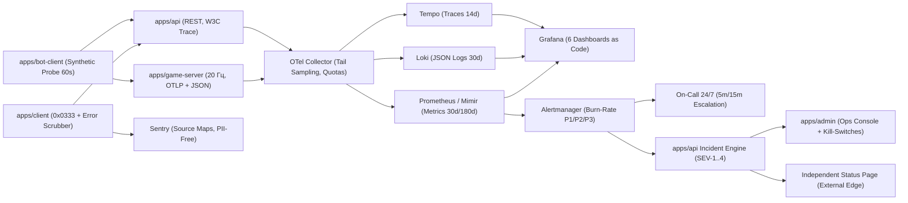
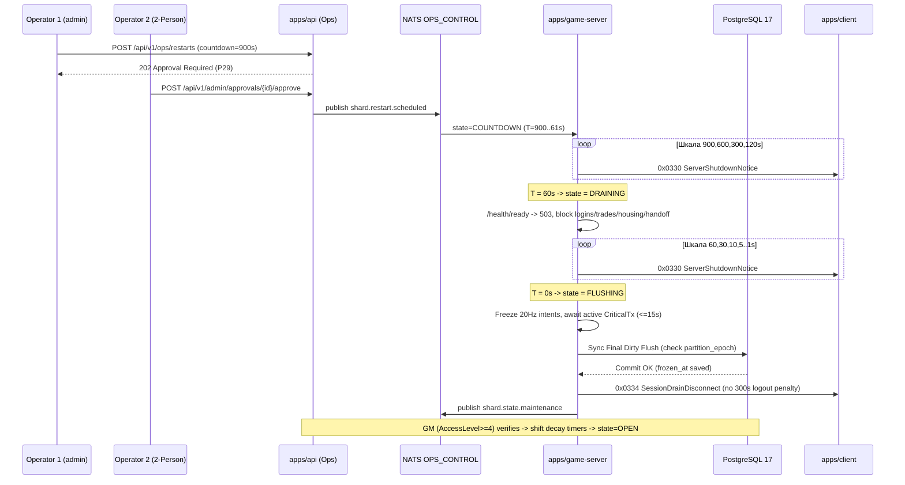
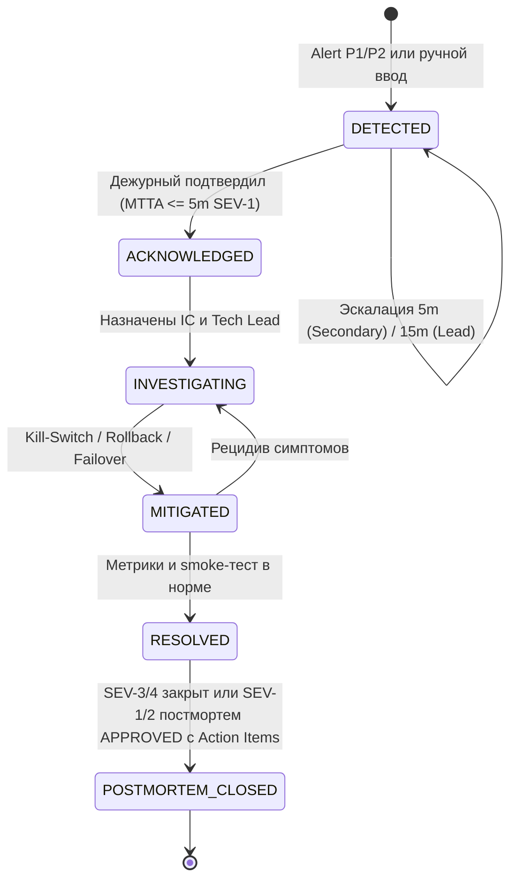

# Design: P33 Наблюдаемость и эксплуатация

## Context

Фаза **P33** завершает построение производственной инженерной платформы поверх всех игровых, экономических, административных, защитных и распределённых подсистем UO3 (**P00–P32**). К этому моменту система включает:
- Игровой сервер `apps/game-server` (NestJS + Colyseus 0.16, uWebSockets.js) с фиксированным тиком симуляции **20 Гц (бюджет 50 мс)**, 60-секундным инкрементальным dirty-flush в PostgreSQL 17 (**P08**), синхронным `CriticalTxCoordinator` (RPO=0 + `item_ledger`), партиционированием мира с `partition_epoch` fencing и бесшовным handoff (**P32**), а также горячей перезагрузкой контента (**P30**) и защитными контурами (**P31**).
- REST API `apps/api` (NestJS 11, `/api/v1/*`, JWKS EdDSA **P04**, метаданные шардов **P05**).
- Веб-клиент `apps/client` (React 19, Vite 6, Three.js, локальный BYOC-импорт в OPFS **P02/P09**), веб-консоль персонала `apps/admin` (**P29**, AccessLevel 0..6, `staff_audit_log`, Two-Person Rule) и headless-клиент `apps/bot-client`.
- Инфраструктуру данных: PostgreSQL 17 (`@uo3/db`), Valkey 8, NATS JetStream, и стек наблюдаемости из **ADR-001..013** (OpenTelemetry, Prometheus, Grafana, Loki, Tempo, Sentry).

Ключевая сложность эксплуатации MMORPG в духе Ultima Online — сочетание жёсткого real-time цикла симуляции (50 мс на тик, где блокировка ввода-вывода или пауза GC срывают движение и бой), stateful-природы игровых партиций, недопустимости потери/дюпа предметов при рестартах и сбоях, а также браузерного кэша BYOC-ассетов в OPFS, который нельзя разрушать при выкатке обновлений клиента.

## Goals / Non-Goals

### Goals
- Обеспечить единую наблюдаемость «три столпа + ошибки + синтетика» с накладными расходами **≤ 1 мс на игровой тик 20 Гц** и жёсткой защитой от взрыва кардинальности и утечки PII.
- Зафиксировать формальные 30-дневные SLO и мультиоконные правила алертинга по скорости сгорания бюджета ошибок (burn-rate), полностью привязанные к версионируемым ранбукам.
- Перевести сборку, поставку (SBOM + подпись), оркестрацию (единый Helm-чарт), секреты, сетевые политики, WAL-бэкапы и еженедельные учения `restore-drill` (RTO ≤ 30 мин, сверка `item_ledger`) в код с автоматическими гейтами CI.
- Гарантировать безопасные релизы без простоя (Expand-and-Contract миграции, канарейки, откат ≤ 5 мин) и безопасные рестарты шарда с поэтапным обратным отсчётом (`0x0330..0x0335`), режимом `DRAINING`, финальным синхронным flush без 300-секундного штрафа логаута и заморозкой игровых таймеров распада во время `MAINTENANCE`.
- Внедрить дисциплинированный цикл реагирования на инциденты (`SEV-1..SEV-4`, on-call 24/7, аварийные рубильники локализации за ≤ 2 с, независимая статус-страница, blameless-постмортемы, ежемесячные GameDay и аудит шума алертов).

### Non-Goals
- Перепроектирование игровых схем персистентности `world_*`/`item_ledger` (**P08**), горячей перезагрузки контента (**P30**), античита (**P31**) или алгоритма разбиения партиций (**P32**).
- Проведение полномасштабного публичного нагрузочного марафона на тысячах одновременных ботов и запуск открытой беты (задача финальной фазы **P34**).
- Внедрение проприетарных клиентских файлов UO в Docker-образы, CI-раннеры или синтетические стенды (запрещено ADR-002).

## Decisions

### D1. Сохранение 9-пакетного DAG монорепозитория без введения лишнего пакета
- **Выбор**: не создавать новый workspace-пакет; чистые доменные константы (SLO, `SEV-1..SEV-4`, состояния шарда, правила PII-редактирования, `ERR_OPS_*`) разместить в `@uo3/domain`, опкоды `0x0330..0x0335` — в `@uo3/protocol`, TypeBox-схемы env — в `@uo3/config`, таблицы учёта и линтер миграций — в `@uo3/db`, рантайм-инструментацию — в модулях `apps/*/src/ops`, а IaC и ранбуки — в `infra/*` и `docs/ops/*`.
- **Обоснование**: сохраняется зафиксированный в **P00** граф зависимостей `6 apps/* + 9 packages/*`, `@uo3/domain` остаётся с 0 зависимостями, исключается дублирование конфигураций сборки Turborepo.
- **Отвергнутые альтернативы**: выделение отдельного `@uo3/observability` (приводит к перестройке DAG P00 и тянет серверные зависимости OTel/Pino в общий слой пакетов).
- **Соответствие ADR**: строго следует ADR-001 (монорепозиторий pnpm/Turborepo) и P00 DAG.

### D2. Стек наблюдаемости OpenTelemetry Collector + LGTM + Sentry с защитой 20 Гц цикла
- **Выбор**: приложения используют OpenTelemetry SDK (метрики и трассы) и Pino (структурированные JSON-логи в `stdout`), экспортируя данные по OTLP/gRPC в локальный/кластерный `OTel Collector`, который маршрутизирует метрики в Prometheus/Mimir, логи — в Loki (через Promtail/Alloy/OTLP), трассы — в Tempo, визуализацию и аннотации — в Grafana, а клиентские и необработанные серверные исключения — в Sentry.
- **Обоснование**: вендор-независимый стандарт OTLP; вынесение ретраев, батчинга, фильтрации квот и tail-based семплирования в `OTel Collector` изолирует Node.js event loop `game-server` от сетевых задержек бэкендов хранения. Внутри `game-server` метрики обновляются через предвыделенные счётчики и гистограммы без аллокаций строк на тике (бюджет ≤ 1 мс).
- **Отвергнутые альтернативы**: прямая запись из `game-server` в Elasticsearch/ClickHouse или проприетарный SaaS-агент с monkey-patching event loop (создаёт риск GC-пауз и vendor lock-in).

### D3. Гибридное tail-based семплирование трасс и запрет per-tick спанов
- **Выбор**: трассировка W3C (`traceparent`/`tracestate`) включается для HTTP-запросов API, событий NATS JetStream, SQL-транзакций и критических WS-намерений (торговля, банк, дома, handoff партиции, GM/ops команды), но **строго запрещена** для рутинной итерации 20 Гц тика и обычных шагов `WalkRequest`. В `OTel Collector` применяется `tail_sampling`: 100% трасс со статусом `ERROR` или длительностью > 200 мс, плюс 1%–10% (настраиваемо по `env`) базовых успешных трасс.
- **Обоснование**: при 1000+ игроках создание спанов на 20 тиках/сек порождает сотни тысяч спанов в секунду и перегружает CPU/память; хвостовое семплирование гарантирует 100% диагностику сбоев и хвостов задержки при умеренной стоимости хранения.
- **Отвергнутые альтернативы**: 100% head-based семплирование (неприемлемо по CPU и объёму Tempo) или 1% head-based без tail-политики (теряет редкие критические ошибки торговли и handoff).

### D4. Единый Helm-чарт с Guaranteed QoS для `StatefulSet` игровых партиций
- **Выбор**: единый Helm v3 чарт `infra/helm/uo3` с валидацией `values.schema.json` и оверлеями `values-dev.yaml`, `values-staging.yaml`, `values-prod.yaml`. Для `apps/game-server` используется `StatefulSet` со стабильными DNS-именами, `requests == limits` по CPU/RAM (Kubernetes Guaranteed QoS), `terminationGracePeriodSeconds: 180` и запретом прямого HPA-downscale; для `apps/api`, `apps/client` (Nginx/static), `apps/admin` — `Deployment` + `HorizontalPodAutoscaler` (`stabilizationWindowSeconds: 180`) + `PodDisruptionBudget` (`minAvailable: 1`).
- **Обоснование**: игровые партиции UO3 чувствительны к CFS CPU throttling и OOM-вытеснению; Guaranteed QoS и стабильные ординалы `StatefulSet` согласованы с `partition_epoch` и координацией партиций из **P32**.
- **Отвергнутые альтернативы**: `Deployment` + HPA по CPU для `game-server` (неконтролируемое убийство активных партиций срывает игровые сессии и провоцирует лавину handoff).

### D5. Внешнее управление секретами и dual-key ротация JWKS EdDSA
- **Выбор**: секреты хранятся во внешнем KMS/Vault и синхронизируются в Kubernetes Secrets через `External Secrets Operator` (refresh ≤ 60 с). Для ключей подписи JWT (**P04**) вводится кольцевой набор активных ключей (`activeKeyId` + `previousKeyId` в JWKS с TTL перекрытия ≥ 24 ч); для паролей БД — dual-user/dual-credential ротация с graceful reconnect пула PG17. В CI запускается gitleaks/trufflehog-гейт (`ERR_OPS_SECRET_DETECTED`).
- **Обоснование**: исключает хранение секретов в Git (даже в зашифрованном виде с общим ключом команды) и устраняет массовый разлогин игроков при плановой смене ключей.
- **Отвергнутые альтернативы**: SOPS/SealedSecrets в Git без автоматической ротации (высокие операционные риски при срочном отзыве ключа).

### D6. Непрерывная WAL-архивация и еженедельный автоматизированный Restore Drill
- **Выбор**: резервное копирование PostgreSQL 17 строится на непрерывной архивации WAL (`archive_timeout = 300s`, RPO ≤ 5 мин, плюс синхронная реплика в кластере для RPO=0) и ежедневных зашифрованных полных бэкапах в географически независимое S3-хранилище (7 дней PITR + 30 дней daily) с SHA-256 контрольными суммами. Еженедельный `CronJob` (`uo3-restore-drill`) поднимает эфемерный PG17, восстанавливает последний базовый бэкап + WAL, запускает верификатор `item_ledger` (**P08/P31**), диапазонов серийников (**P01/P05**), домов (**P23**) и персонажей, замеряет фактический RTO (порог ≤ 30 мин), пишет результат в `ops_restore_drills` и уничтожает стенд.
- **Обоснование**: бэкап, восстановление которого не проверялось автоматически, не является бэкапом; проверка игровых инвариантов `item_ledger` гарантирует бизнес-консистентность, а не только старт процесса СУБД.
- **Отвергнутые альтернативы**: ручные квартальные проверки бэкапов или простая проверка `pg_isready` без валидации `item_ledger`.

### D7. Expand-and-Contract миграции с AST/SQL-линтером и короткими таймаутами блокировок
- **Выбор**: все онлайн-миграции Drizzle в `packages/db/migrations` проверяются CLI-линтером `uo3-db-lint` на запрещённые операции (`DROP COLUMN`, `ALTER COLUMN TYPE`, `RENAME`, `CREATE INDEX` без `CONCURRENTLY`, `ADD COLUMN ... NOT NULL` без безопасного `DEFAULT` или `CHECK ... NOT VALID`). Раннер миграций принудительно выставляет `SET lock_timeout = '5000ms'` и `SET statement_timeout = '60000ms'` с до 3 попыток с экспоненциальной паузой. Деструктивные `contract`-миграции выносятся в следующий релиз или требуют явной директивы `-- uo3:maintenance-only`.
- **Обоснование**: предотвращает блокировку `ACCESS EXCLUSIVE` на таблицах `world_items`/`world_characters` в момент 60-секундного dirty-flush или критических сделок RPO=0 и делает откат кода за ≤ 5 минут безопасным без отката схемы.
- **Отвергнутые альтернативы**: остановка шарда на каждую минорную миграцию (нарушает SLO 99.9%) или автоматический `down`-скрипт миграции при откате (риск потери данных, записанных новым релизом).

### D8. Конечный автомат рестарта, `DRAINING`, финального flush и компенсации таймеров `MAINTENANCE`
- **Выбор**: управление жизненным циклом шарда выполняется через NATS JetStream поток `OPS_CONTROL_STREAM` и хранится в `ops_maintenance_windows` + Valkey-ключе `uo3:shard:{id}:ops_state`.
  Переходы: `OPEN -> COUNTDOWN -> DRAINING (T <= 60s) -> FLUSHING (T = 0s) -> MAINTENANCE -> OPEN`.
  - В `COUNTDOWN` сервер рассылает `0x0330` по шкале `[900, 600, 300, 120, 60, 30, 10, 5, 4, 3, 2, 1]` с (отмена `0x0331` разрешена при `T > 60s`).
  - В `DRAINING` `/health/ready` немедленно отдаёт `503`, новые входы, сделки, размещение домов и handoff блокируются (`ERR_OPS_SHARD_DRAINING`).
  - В `FLUSHING` тик 20 Гц замораживает приём новых намерений, завершает открытые `CriticalTxCoordinator`-транзакции (таймаут 15 с), выполняет синхронный полный flush грязных сущностей с проверкой `partition_epoch`, сохраняет отметку `frozenAtUtcMs` и закрывает WS клиентов пакетом `0x0334` с флагом `gracefulShutdown: true`, что **отключает 300-секундный штраф логаута вне безопасной зоны** (персонаж мгновенно сохраняется и снимается с мира).
  - При выходе из `MAINTENANCE` в `OPEN` вычисляется `downtimeMs = reopenedAtUtcMs - frozenAtUtcMs`, и одним транзакционным обновлением сдвигаются сроки распада предметов на земле (60 мин), трупов (420+420 с) и домов IDOC (**P23**).
- **Обоснование**: исключает откат инвентаря, незаслуженную смерть персонажа при рестарте и «испарение» домов/трупов после длительного техобслуживания.
- **Отвергнутые альтернативы**: немедленный `SIGTERM` с надеждой на 60-секундный dirty-flush (гарантированная потеря до 60 с прогресса и конфликт незавершённых сделок).

### D9. Аварийные рубильники локализации (≤ 2 с) и независимый контур инцидентов
- **Выбор**: аварийные рубильники (`ECONOMY_FREEZE`, `HOUSING_FREEZE`, `PARTITION_QUARANTINE`, `LOGIN_THROTTLE_EMERGENCY`) активируются через `apps/admin` (`AccessLevel >= 5`) с обязательной привязкой к `incident_id` (`ERR_OPS_INCIDENT_REF_REQUIRED`), записываются в PG17 (`ops_kill_switches` + `staff_audit_log` из **P29**), зеркалируются в Valkey и мгновенно рассылаются всем партициям через NATS JetStream (`ops.killswitch.updated`, доставка ≤ 2 с). Публичная страница статуса разворачивается в отдельном отказоустойчивом контуре (статический edge/внешний провайдер) и обновляется через webhook/API.
- **Обоснование**: позволяет локализовать дюп-эксплойт или деградировавшую партицию за 2 секунды без полного отключения шарда, сохраняя доступность коммуникации с игроками даже при падении основного кластера.
- **Отвергнутые альтернативы**: рестарт всех серверов с изменением env-переменных (слишком медленно — минуты потерь экономики при дюпе).

## Архитектура модулей и контракты

### Распределение по модулям монорепозитория

| Слой | Путь | Ответственность |
|---|---|---|
| Домен | `packages/domain/src/ops/*` | Типы SLO, `IncidentSeverity` (`SEV-1..SEV-4`), `ShardOpsMode`, `KillSwitchType`, шкала отсчёта, правила редактирования PII, константы `ERR_OPS_*` (0 deps) |
| Протокол | `packages/protocol/src/ops/*` | Опкоды `0x0330..0x0335`, TypeBox-схемы, Colyseus-поля `ShardOpsBannerState` |
| Конфигурация | `packages/config/src/ops.schema.ts` | TypeBox-схемы OTel, Sentry, проб, graceful shutdown, версии релиза, strict `production` fail-fast валидатор |
| БД | `packages/db/src/schema/ops.ts`, `packages/db/src/cli/migration-lint.ts` | 8 таблиц Drizzle PG17, триггер append-only для `ops_incident_events`, Expand-and-Contract линтер и раннер с таймаутами |
| Game Server | `apps/game-server/src/ops/*` | Реестр метрик `uo3_*` с проверкой кардинальности, Pino+PII, OTel W3C, `/health/*`, координатор `DRAINING`/финального flush, обработчик `0x0333` и kill-switches |
| API | `apps/api/src/ops/*` | `/api/v1/meta/version`, `/api/v1/ops/*` (релизы, рестарты, окна заморозки, restore-drills, инциденты, постмортемы, рубильники, гигиенический отчёт), JWKS dual-key ротация |
| Клиент | `apps/client/src/ops/*` | Агрегатор клиентских метрик (`0x0333` раз в 60 с + opt-out), Sentry PII/path scrubber, баннер таймера рестарта, экран `MAINTENANCE`, детектор обновлений SPA с защитой OPFS |
| Админка | `apps/admin/src/features/ops/*` | UI управления релизами, рестартами (Two-Person Rule), рубильниками, карточками инцидентов, постмортемами, журналом `restore-drill` и ссылками в Grafana/Loki/Tempo |
| Боты | `apps/bot-client/src/probes/*` | Режимы `synthetic-probe` (60 с цикл) и `post-release-smoke` (логин, вход, шаг, чат, банк) |
| Инфраструктура | `infra/docker/*`, `infra/helm/uo3/*`, `infra/observability/*` | 5 Dockerfiles, SBOM/Cosign workflow, Helm-чарт + `values.schema.json`, 6 дашбордов Grafana, правила Prometheus/Alertmanager, OTel Collector, CronJob `restore-drill` |
| Ранбуки | `docs/ops/runbooks/*`, `docs/ops/templates/*` | ≥ 10 стандартизированных ранбуков, шаблон blameless-постмортема, регламент GameDay |

### Таксономия метрик `uo3_*` и математика SLO / Burn Rate

Фиксированный набор разрешённых меток (allowlist проверяется в `MetricRegistry` и в CI-тесте; любое совпадение с запрещённым списком `serial`, `account_id`, `character_id`, `ip`, `session_id`, `email` бросает `ERR_OPS_METRIC_LABEL_CARDINALITY`):
- Базовые: `env`, `service`, `version`, `shard_id`, `partition_id`.
- Доменные (ограниченные enum): `outcome` (`ok`|`error`|`timeout`), `category` (`FAUCET_*`/`SINK_*`), `tx_type`, `reason`, `route`, `status_class` (`2xx`..`5xx`), `severity`.

Ключевые метрики:
- Симуляция и сеть: `uo3_sim_tick_duration_ms` (Histogram, бакеты `[2, 5, 10, 15, 20, 25, 30, 35, 40, 45, 50, 60, 80, 100, 150, 250]`), `uo3_sim_tick_overrun_total`, `uo3_world_entities_active{kind}`, `uo3_ws_connections_active`, `uo3_ws_messages_total{direction,opcode_group}`, `uo3_partition_handoff_duration_ms`, `uo3_partition_handoff_total{outcome}`.
- Персистентность, экономика, безопасность: `uo3_persistence_dirty_flush_duration_ms`, `uo3_persistence_flush_errors_total`, `uo3_persistence_critical_tx_duration_ms{tx_type,outcome}`, `uo3_persistence_wal_last_archive_age_seconds`, `uo3_persistence_backup_last_success_age_seconds`, `uo3_economy_money_supply_gold{tier="M1"|"M2"|"M3"}`, `uo3_economy_flow_gold_total{category}`, `uo3_security_rate_limit_hits_total{scope}`, `uo3_security_ledger_mismatch_total{violation_type}`, `uo3_security_bot_quarantine_total`.
- Клиент и синтетика: `uo3_client_fps_p50`, `uo3_client_fps_p10`, `uo3_client_ws_rtt_ms`, `uo3_client_webgl_context_lost_total`, `uo3_synthetic_probe_success{step}`, `uo3_synthetic_probe_duration_ms{step}`.

Математика SLO (окно `W = 30d = 43200m`):
$$\text{ErrorBudget} = 1 - \text{SLO}, \quad \text{ErrorRatio}(w) = 1 - \text{SLI}(w), \quad \text{BurnRate}(w) = \frac{\text{ErrorRatio}(w)}{\text{ErrorBudget}}$$

| SLO | Цель (30d) | Error Budget | Fast-Burn P1 (`5m` & `1h`, BR ≥ 14.4x, 2% бюджета/ч) | Slow-Burn P2 (`30m` & `6h`, BR ≥ 6x, 5% бюджета/6ч) |
|---|---|---|---|---|
| Доступность API и логина | `≥ 99.9%` | `0.1%` (43.2 мин) | ErrorRatio > `1.44%` в `5m` и `1h` | ErrorRatio > `0.6%` в `30m` и `6h` |
| Бюджет тика 20 Гц (`≤ 50 мс`) | `≥ 99.5%` | `0.5%` (216 мин) | OverrunRatio > `7.2%` в `5m` и `1h` | OverrunRatio > `3.0%` в `30m` и `6h` (или `p99 > 45 мс`) |
| Критические транзакции RPO=0 | `≥ 99.99%` | `0.01%` | FailRatio > `0.144%` в `5m` и `1h` | FailRatio > `0.06%` в `30m` и `6h` |
| Успешность handoff партиций | `≥ 99.9%` | `0.1%` | FailRatio > `1.44%` в `5m` и `1h` | FailRatio > `0.6%` в `30m` и `6h` |

Дополнительная политика: при падении остатка бюджета $\text{BudgetRemaining}_{30d} \le 0$ для любого из двух верхних SLO активируется флаг `ERROR_BUDGET_EXHAUSTED`, блокирующий плановые фичевые релизы в пользу релизов надёжности.

### Протокол `@uo3/protocol` (`0x0330..0x0335`) и реестр ошибок `ERR_OPS_*`

| Опкод | Направление | Имя | Поля TypeBox |
|---|---|---|---|
| `0x0330` | S2C | `ServerShutdownNotice` | `shutdownId: string`, `mode: 'GRACEFUL_RESTART'\|'MAINTENANCE'`, `reasonCode: string`, `remainingSec: uint16`, `scheduledAtUtcMs: uint64`, `estimatedResumeUtcMs?: uint64`, `messageKey: string` |
| `0x0331` | S2C | `ServerShutdownCancelled` | `shutdownId: string`, `reasonCode: string`, `messageKey: string` |
| `0x0332` | S2C | `ShardMaintenanceState` | `shardId: string`, `state: 'OPEN'\|'DRAINING'\|'MAINTENANCE'`, `estimatedResumeUtcMs?: uint64`, `allowedMinAccessLevel: uint8`, `messageKey: string` |
| `0x0333` | C2S | `ClientTelemetryReport` | `sampleWindowSec: uint16 (55..65)`, `fpsP50: uint16`, `fpsP10: uint16`, `wsRttMs: uint16`, `jsHeapMb: uint16`, `webglContextLostCount: uint8`, `assetCacheState: 'SYNTHETIC'\|'BYOC_READY'\|'BYOC_DEGRADED'`, `clientBuildSha: string(max 40)` |
| `0x0334` | S2C | `SessionDrainDisconnect` | `reason: 'GRACEFUL_RESTART'\|'MAINTENANCE'\|'PARTITION_REBALANCE'`, `gracefulNoLogoutPenalty: boolean`, `reconnectAfterMs: uint32`, `estimatedResumeUtcMs?: uint64` |
| `0x0335` | S2C | `OpsNoticeBroadcast` | `noticeId: string`, `severity: 'INFO'\|'WARN'\|'CRITICAL'`, `killSwitch?: string`, `messageKey: string`, `ttlSec: uint16` |

В `@colyseus/schema` (`ShardHubRoom` и `WorldPartitionRoom`) добавляется синхронизируемый подсхема-объект `OpsBannerState` (`mode: string`, `shutdownAtUtcMs: number`, `activeKillSwitches: ArraySchema<string>`), чтобы вновь подключившийся в окне `COUNTDOWN` игрок мгновенно получал актуальный таймер без ожидания следующей отметки шкалы.

Коды ошибок `ERR_OPS_*` (экспортируются из `@uo3/domain`):
- `ERR_OPS_METRIC_LABEL_CARDINALITY` — запрещённая высококардинальная метка метрики.
- `ERR_OPS_TELEMETRY_RATE_LIMIT` — превышение лимита пакетов `0x0333` (> 2 за 60 с).
- `ERR_OPS_FORBIDDEN_ASSET_IN_IMAGE` — обнаружен проприетарный файл UO (`.mul`/`.uop`/`.idx`) при сборке образа.
- `ERR_OPS_UNVERIFIED_IMAGE` — отсутствие или невалидность подписи OCI-образа.
- `ERR_OPS_CONFIG_INVALID` — нарушение схемы конфигурации или небезопасные дефолты в `production`.
- `ERR_OPS_SECRET_DETECTED` — обнаружение секрета сканером в коде/манифестах.
- `ERR_OPS_PROTOCOL_VERSION_MISMATCH` — несовместимая `protocol_version` клиента.
- `ERR_OPS_DEPLOY_FROZEN` — блокировка планового деплоя из-за активного `SEV-1`.
- `ERR_OPS_UNSAFE_MIGRATION` — блокирующий или необратимо ломающий DDL в онлайн-миграции.
- `ERR_OPS_APPROVAL_REQUIRED` — отсутствует подтверждение второго оператора (Two-Person Rule из P29).
- `ERR_OPS_SHARD_DRAINING` — шард в режиме `DRAINING`, вход и рискованные операции закрыты.
- `ERR_OPS_MAINTENANCE_ACTIVE` — шард в режиме `MAINTENANCE`, публичный вход закрыт.
- `ERR_OPS_ROLLBACK_PRECONDITION_FAILED` — не выполнены условия PITR-отката (`MAINTENANCE` + Two-Person Rule).
- `ERR_OPS_CHANGE_FREEZE_ACTIVE` — действует окно заморозки релизов.
- `ERR_OPS_INCIDENT_INVALID` / `ERR_OPS_INCIDENT_REF_REQUIRED` / `ERR_OPS_POSTMORTEM_REQUIRED` / `ERR_OPS_ACTION_ITEM_REQUIRED` / `ERR_OPS_ORPHAN_ALERT` / `ERR_OPS_CHAOS_PROD_FORBIDDEN`.

### Модель данных PostgreSQL 17 (`@uo3/db`)

Все таблицы создаются в схеме `public` с префиксом `ops_*` и внешними ссылками на `accounts.id` (P04), `shards.id` (P05) и `admin_approval_requests.id` (P29):

1. `ops_releases`: `id (uuid PK)`, `version (text)`, `git_sha (text)`, `image_digests (jsonb)`, `protocol_version (int)`, `ruleset_hash (text)`, `schema_migration_id (text)`, `env (text)`, `release_type ('STANDARD'|'HOTFIX'|'ROLLBACK')`, `status ('PENDING'|'STAGING'|'CANARY'|'VERIFYING'|'SUCCEEDED'|'VERIFICATION_FAILED'|'ROLLED_BACK_AUTO'|'ROLLED_BACK_MANUAL')`, `initiated_by (uuid FK)`, `approved_by (uuid FK nullable)`, `approval_request_id (uuid FK nullable)`, `incident_id (uuid FK nullable)`, `canary_metrics_summary (jsonb)`, `started_at`, `finished_at (timestamptz)`. Индекс `(env, started_at DESC)`.
2. `ops_maintenance_windows`: `id (uuid PK)`, `shard_id (text FK)`, `kind ('GRACEFUL_RESTART'|'MAINTENANCE'|'CHANGE_FREEZE')`, `state ('SCHEDULED'|'COUNTDOWN'|'DRAINING'|'FLUSHING'|'ACTIVE'|'COMPLETED'|'CANCELLED')`, `reason_code (text)`, `reason_text (text)`, `countdown_sec (int)`, `scheduled_start_at`, `frozen_at`, `estimated_resume_at`, `reopened_at`, `downtime_compensated_ms (bigint)`, `initiated_by (uuid)`, `approval_request_id (uuid nullable)`.
3. `ops_restore_drills`: `id (uuid PK)`, `trigger_kind ('SCHEDULED_WEEKLY'|'PRE_MIGRATION_MANUAL')`, `release_id (uuid nullable)`, `target_pitr_at (timestamptz)`, `backup_id (text)`, `started_at`, `finished_at`, `rto_seconds (int)`, `ledger_check_passed (boolean)`, `serial_check_passed (boolean)`, `world_check_passed (boolean)`, `status ('RUNNING'|'PASSED'|'FAILED')`, `diagnostics (jsonb)`.
4. `ops_incidents`: `id (uuid PK)`, `code (text unique, e.g. INC-2026-0042)`, `severity ('SEV-1'|'SEV-2'|'SEV-3'|'SEV-4')`, `status ('DETECTED'|'ACKNOWLEDGED'|'INVESTIGATING'|'MITIGATED'|'RESOLVED'|'POSTMORTEM_CLOSED')`, `env (text)`, `shard_id (text nullable)`, `component (text)`, `title (text)`, `alert_fingerprint (text nullable)`, `runbook_url (text nullable)`, `commander_id (uuid nullable)`, `tech_lead_id (uuid nullable)`, `comms_lead_id (uuid nullable)`, `detected_at`, `acknowledged_at`, `mitigated_at`, `resolved_at`, `last_public_update_at`, `slo_budget_consumed_bp (int)`.
5. `ops_incident_events` (**append-only**, защищено триггером БД на запрет `UPDATE`/`DELETE`): `id (bigserial PK)`, `incident_id (uuid FK)`, `event_type ('CREATED'|'STATE_CHANGE'|'SEVERITY_CHANGE'|'ESCALATION'|'HANDOVER'|'KILL_SWITCH'|'PUBLIC_UPDATE'|'NOTE'|'ROLLBACK')`, `actor_id (uuid nullable)`, `payload (jsonb)`, `created_at (timestamptz NOT NULL DEFAULT now())`. Индекс `(incident_id, created_at ASC)`.
6. `ops_postmortems`: `id (uuid PK)`, `incident_id (uuid unique FK)`, `status ('DRAFT'|'IN_REVIEW'|'APPROVED')`, `summary (text)`, `ttd_sec (int)`, `ttm_sec (int)`, `ttr_sec (int)`, `root_cause_analysis (jsonb — 5 Whys & contributing factors)`, `what_went_well (jsonb)`, `what_went_poorly (jsonb)`, `draft_due_at`, `review_due_at`, `approved_by (uuid nullable)`, `approved_at`.
7. `ops_action_items`: `id (uuid PK)`, `postmortem_id (uuid FK)`, `priority ('P1'|'P2'|'P3')`, `category ('PREVENT'|'DETECT'|'MITIGATE'|'RUNBOOK')`, `title (text)`, `owner_id (uuid)`, `due_at (timestamptz)`, `status ('OPEN'|'IN_PROGRESS'|'DONE'|'WONT_FIX')`, `external_issue_url (text nullable)`, `completed_at`.
8. `ops_kill_switches`: `id (uuid PK)`, `shard_id (text)`, `switch_type ('ECONOMY_FREEZE'|'HOUSING_FREEZE'|'PARTITION_QUARANTINE'|'LOGIN_THROTTLE_EMERGENCY')`, `target_partition_id (text nullable)`, `enabled (boolean)`, `incident_id (uuid FK NOT NULL)`, `reason (text)`, `updated_by (uuid FK)`, `updated_at (timestamptz)`. Уникальный индекс `(shard_id, switch_type, COALESCE(target_partition_id, ''))`.

### Алгоритм компенсации игровых таймеров при `MAINTENANCE`

При завершении `FLUSHING` в таблице `ops_maintenance_windows` фиксируется `frozen_at = now_utc`. Перед переводом шарда обратно в `OPEN` (после верификации GM `AccessLevel >= 4`) выполняется единая идемпотентная транзакция PG17 (контроль по `downtime_compensated_ms IS NULL`):
$$\Delta t = \max\left(0,\ \text{reopened\_at} - \text{frozen\_at}\right)$$
1. Предметы на земле (`world_items WHERE container_serial IS NULL AND decay_at IS NOT NULL`): `decay_at = decay_at + interval '1 millisecond' * Δt`.
2. Активные трупы (`world_corpses WHERE decay_at > frozen_at`): `bones_at = bones_at + Δt`, `decay_at = decay_at + Δt`.
3. Дома (`world_houses WHERE decay_paused = false`): `last_refreshed_at = last_refreshed_at + Δt` (сдвиг 6 стадий IDOC **P23**).
4. Фиксация `downtime_compensated_ms = Δt`, `reopened_at = now_utc`, `state = 'COMPLETED'`.

### Диаграммы архитектуры и процессов

#### 1. Контур наблюдаемости, SLO-алертинга и реагирования

#### 2. Управляемый рестарт шарда, `DRAINING` и финальный flush мира

#### 3. Конечный автомат жизненного цикла инцидента

## Risks / Trade-offs

- **[Накладные расходы телеметрии в 20 Гц цикле]** → Использовать предвыделенные структуры счётчиков/гистограмм, асинхронный OTLP-экспорт с ограниченным буфером и строгий запрет per-tick спанов; закрепить в CI бенчмарк-тест (оверхед ≤ 1 мс/тик).
- **[Взрыв кардинальности метрик из-за игровых ID]** → Жёсткий allowlist меток в `MetricRegistry`, валидация в CI с кодом `ERR_OPS_METRIC_LABEL_CARDINALITY` и перенос детальной диагностики по `serial`/`account_id` исключительно в структурированные логи и трассы.
- **[Зависание финального flush при рестарте шарда]** → Разграничить бюджет времени в `terminationGracePeriodSeconds: 180`: 15 с на завершение активных CriticalTx, 75 с на синхронный flush партиции, аварийный диагностический дамп и P1-алерт на 90 с с сохранением fencing `partition_epoch`.
- **[Ложные срабатывания алертов и усталость дежурных (Alert Fatigue)]** → Мультиоконные burn-rate правила (требуют одновременного пробития короткого и длинного окна), правила ингибирования при `MAINTENANCE`/падении узла и автоматический еженедельный аудит шумных правил (> 30% за 14 дней).
- **[Рост стоимости хранения логов и трасс при DDoS или баг-шторме]** → Политика квот в `OTel Collector` с drop-приоритетом (сначала `debug`-логи и базовые трассы, метрики SLO и `error`/аудит безопасности неприкосновенны) + лимит клиентской телеметрии `0x0333` (1 пакет/60 с).
- **[Незамеченная деградация бэкапов или WAL-архива]** → Двойная защита: непрерывный алерт на возраст WAL > 15 мин / бэкапа > 26 ч плюс еженедельный автоматический `restore-drill` с полной сверкой `item_ledger` и замером RTO ≤ 30 мин.
- **[Ошибочное применение хаос-инъекций или PITR-отката в `production`]** → Жёсткие серверные и CLI-гейты: `ERR_OPS_CHAOS_PROD_FORBIDDEN` для GameDay и обязательное сочетание `MAINTENANCE` + Two-Person Rule (`ERR_OPS_ROLLBACK_PRECONDITION_FAILED`) для PITR-отката.
- **[Потеря локального кэша OPFS у игроков при обновлении веб-клиента]** → Разделение версий бандла SPA и мажорной версии схемы OPFS-кэша; сохранение старых хешированных чанков на CDN ≥ 24 часа и ненавязчивый промпт перезагрузки для совместимых минорных обновлений.

## Migration Plan

1. **Этап 1 — Контракты и БД**: добавить доменные константы (`@uo3/domain`), опкоды `0x0330..0x0335` (`@uo3/protocol`), TypeBox-схемы (`@uo3/config`), таблицы `ops_*` (`@uo3/db`) и включить CI-линтер Expand-and-Contract миграций.
2. **Этап 2 — Инструментация и наблюдаемость**: подключить `MetricRegistry`, Pino JSON + PII-редактор, OTel W3C, `/health/{live,ready,startup}`, 6 дашбордов Grafana, правила burn-rate алертов и синтетический зонд `apps/bot-client` сначала в `dev` и `staging`.
3. **Этап 3 — Цепочка поставки и деплой**: перевести все 5 сервисов на hardened multi-stage Dockerfiles + SBOM/Cosign, развернуть единый Helm-чарт в `staging`, включить `default-deny` NetworkPolicies, External Secrets, WAL-архивацию и прогнать первый `restore-drill`.
4. **Этап 4 — Релизный и инцидентный контур**: активировать канареечную выкатку, конечный автомат рестарта/`DRAINING`/`MAINTENANCE` (включая UI в `apps/client` и `apps/admin`), аварийные рубильники, каталог ≥ 10 ранбуков с CI-гейтом, независимую статус-страницу и провести первый учебный GameDay на `staging` перед допуском в `production`.

## Open Questions

- Выбор конкретного управляемого провайдера для внешнего хранилища секретов и независимой страницы статуса (например, HashiCorp Vault vs AWS/GCP KMS + Cloud Secret Manager; self-hosted статус-страница в отдельном регионе vs SaaS Statuspage) — выбирается на этапе инфраструктуры продакшн-кластера и не влияет на контракты External Secrets и webhook-адаптера.
- Конкретный шлюз пейджинга on-call (PagerDuty / Opsgenie / Grafana OnCall) — интегрируется через единый Alertmanager webhook и абстракцию `OnCallNotifierPort`.
- Целевая география второго региона для репликации S3-бэкапов БД и срок хранения cold-архива сверх обязательных 30 дней — конфигурируется параметрами Helm `values-prod.yaml`.
