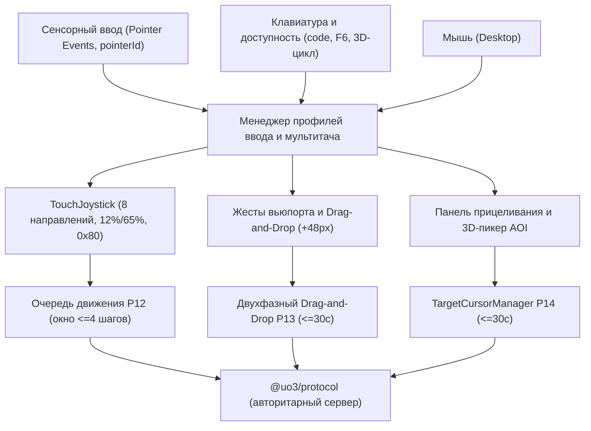
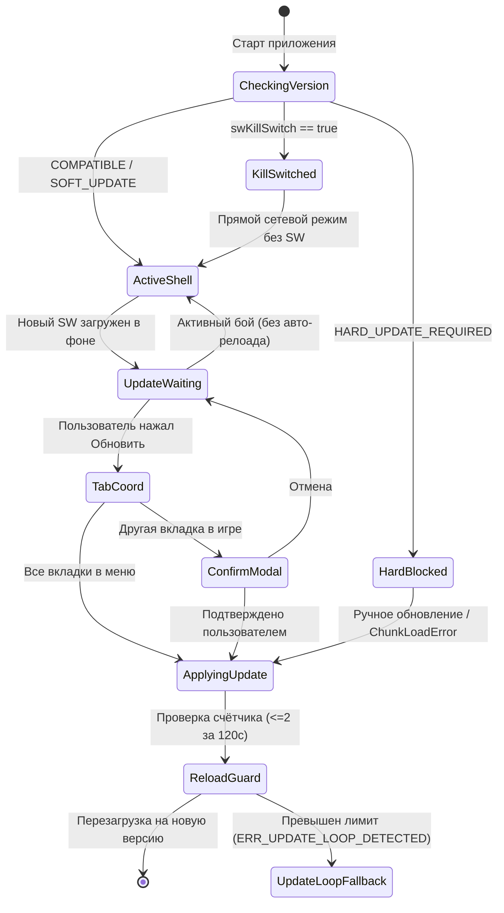
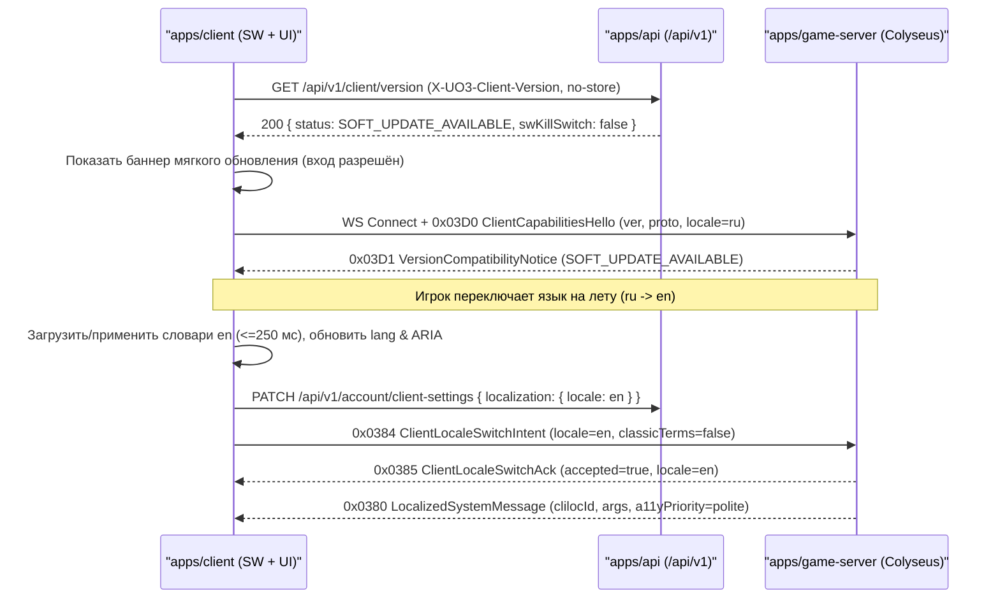

# Design: P34 Качество клиентской платформы

## Context

Фаза **P34** (`p34-client-platform-quality`) формирует платформенный слой качества веб-клиента UO3 поверх функционального фундамента фаз P09–P14 (клиентская оболочка, 3D-рендер вьюпорта, мобилы/анимации, авторитарное движение, инвентарь/контейнеры, гампы/таргетинг/речь/макросы).

Ключевые системные ограничения, унаследованные от архитектуры UO3 (ADR-001..013):
- **Серверная авторитарность:** сенсорное управление, быстрые кнопки прицеливания и клавиатурный перебор целей в 3D-AOI являются исключительно альтернативными способами формирования стандартных клиентских намерений (`WalkRequest`, `PickUp/Drop`, `TargetResponse`, `DoubleClick`, `GumpResponse`) и не обходят лимиты окна шагов (4 шага, 400/200/100 мс), интервал очереди макросов (≥600 мс) или античит-инварианты (P31).
- **Изоляция пользовательских BYOC-ассетов (ADR-002):** импортированные пользователем атласы, карты и `cliloc` хранятся в Origin Private File System (OPFS) и не должны очищаться или повреждаться при обновлении Service Worker, сбросе кэша оболочки или срабатывании аварийного kill-switch. В репозитории и PWA-манифесте допустимы только CC0-ресурсы и синтетические словари.
- **Строгий DAG пакетов:** `@uo3/domain` не имеет внешних зависимостей; протокольные опкоды и TypeBox-схемы изолированы в `@uo3/protocol`; токены и переиспользуемые виджеты находятся в `@uo3/ui-kit`; клиентское состояние интегрируется с существующим Zustand-стором и TanStack Query (`apps/client`).
- **Интеграционные мосты:** P34 зависит строго от P14, но проектирует чистые интерфейсные порты для бесшовной интеграции с P28 (`AudioCueEventPort` для визуального радара звуков), P30 (`RemoteContentLocaleProvider` как верхний слой 3-слойного резолвера `cliloc`) и P31 (совместимость Service Worker с заголовками CSP и SRI).

## Goals / Non-Goals

### Goals
- Обеспечить полноценную, отзывчивую игру в мобильных и планшетных браузерах (iOS Safari 16+, Android Chrome 110+) без отдельной кодовой базы геймплея.
- Достичь соответствия UI стандарту WCAG 2.1 AA (контраст ≥4.5:1 / ≥7:1 в режиме высокого контраста, масштаб до 200%, полная клавиатурная навигация, `aria-live`, защита от вспышек >3 Гц, субтитры звуков).
- Внедрить централизованную систему локализации UI (`ru` / `en`) с переключением за ≤250 мс, 100% CI-паритетом ключей, CLDR-плюрализацией и 3-слойным резолвингом `cliloc`.
- Построить отказоустойчивую систему доставки обновлений через Service Worker без разрыва активных игровых сессий, с межвкладочной координацией, жёсткой/мягкой проверкой совместимости версий, офлайн-оболочкой и серверным `swKillSwitch`.

### Non-Goals
- Нативные обёртки iOS/Android (App Store / Google Play) и нативные геймпад-SDK вне стандартного Web Pointer/Keyboard API.
- Машинный автоперевод игрового контента или локализация пользовательского чата.
- Автоматизация боевых действий (авто-атака, авто-таргет без действия игрока) на мобильных устройствах.
- Поддержка RTL-языков и локалей за пределами `ru`/`en` в рамках P34.

## Decisions

### Decision 1: Единый конвейер Pointer Events поверх существующих протокольных интентов
- **Выбор:** Все сенсорные взаимодействия (виртуальный джойстик, тап/дабл-тап/лонг-пресс на 3D-вьюпорте, pinch-zoom, сенсорный Drag-and-Drop, таргетинг, радиальное меню) реализуются на базе W3C Pointer Events API (`pointerdown/move/up/cancel`, `setPointerCapture`) с явным разделением по `pointerId` и транслируются в существующий слой команд клиента (P12–P14).
- **Обоснование:** Единый слой намерений гарантирует, что клиент на смартфоне подчиняется тем же правилам `WalkIntentQueue` (окно ≤4 шагов), двухфазного Drag-and-Drop (30 с) и таргетинга (30 с), что и десктоп. Изоляция `pointerId` позволяет одновременно бежать джойстиком левой рукой и нажимать слоты или целиться правой.
- **Отвергнутые альтернативы:** Раздельные обработчики `TouchEvents` + `MouseEvents` (дублирование и «призрачные клики» iOS Safari); упрощённый «tap-to-walk» клиентский авто-патфайндинг как основной способ движения (создаёт расхождение с боевой динамикой UO:R и конфликтует с ручным контролем позиции).

### Decision 2: Расширение профиля настроек `ClientSettingsV1` -> `ClientSettingsV2`
- **Выбор:** Схема `ClientSettingsV1` из P09 расширяется обратно совместимо до `ClientSettingsV2` в `@uo3/domain` (с чистым мигратором `migrateClientSettings`), добавляя разделы `touch`, `accessibility`, `localization` и `updates`. Хранение сохраняется в JSONB-колонке `account_client_profiles.settings` (PG17) с локальным зеркалом в `localStorage` для мгновенного применения до авторизации и в офлайне.
- **Обоснование:** Исключает дублирование таблиц профиля и обеспечивает мгновенное применение масштаба, контраста и локали ещё на экране логина/офлайна без FOUC (вспышки нестилизованного UI).
- **Отвергнутые альтернативы:** Отдельные таблицы для каждого блока настроек (лишние JOIN и рассинхронизация); хранение только в `localStorage` (потеря настроек доступности и раскладок при переходе между устройствами).

### Decision 3: Токены доступности через CSS Custom Properties и WCAG-валидатор в `@uo3/domain`
- **Выбор:** Темы (`default`, `high-contrast`), палитры дальтонизма (`none`, `protanopia`, `deuteranopia`, `tritanopia`), масштаб UI (`--uo3-ui-scale: 0.8..2.0`) и масштаб шрифта (`--uo3-font-scale: 1.0..1.75`) применяются через `data-theme`, `data-cvd`, `data-font-profile` и CSS-переменные на корневом узле документа. Чистый вычислитель контрастности WCAG 2.1 размещается в `@uo3/domain` и проверяет все пары токенов в unit-тестах CI.
- **Обоснование:** Переключение масштаба и тем происходит за 1 кадр (<16 мс) без перемонтирования React-дерева и без переподключения 3D-сцены. Автоматическая проверка контраста в CI предотвращает регрессии при правке стилей.
- **Отвергнутые альтернативы:** JavaScript-темизация через контекст с ре-рендером всех узлов (лаги при переключении, лишние перерисовки); CSS-фильтры `filter: url(#cvd)` на весь canvas (искажают художественную палитру 3D-мира вместо точечной адаптации индикаторов ноториети и UI).

### Decision 4: Нативный `Intl`-движок i18n с разделёнными пространствами имён и 3-слойным резолвером `cliloc`
- **Выбор:** В `apps/client` реализуется типизированный i18n-провайдер поверх стандартных браузерных `Intl.PluralRules`, `Intl.NumberFormat`, `Intl.DateTimeFormat`, `Intl.RelativeTimeFormat`. Словари разделены на 10 JSON-пространств имён (`common`, `auth`, `hud`, `gumps`, `skills`, `spells`, `settings`, `errors`, `a11y`, `updates`), подгружаемых лениво и кэшируемых в памяти и Cache Storage. Для `cliloc` вводится детерминированный 3-слойный резолвер (серверный/контентный словарь P30 -> BYOC `cliloc` из OPFS P02 -> встроенный синтетический CC0-словарь).
- **Обоснование:** Нулевой оверхед на полифилы CLDR, полная поддержка 4 русских форм плюрализации (`one`/`few`/`many`/`other`), гарантированная типобезопасность ключей на этапе компиляции TypeScript и полная работоспособность без проприетарных файлов UO.
- **Отвергнутые альтернативы:** Монолитный бандл всех переводов (увеличивает время холодного старта на мобильных сетях); вставка сырого HTML в переводы (угроза XSS).

### Decision 5: Контролируемый Service Worker (`InjectManifest`) с проверкой целостности и запретом кэширования API
- **Выбор:** Используется кастомный TypeScript Service Worker, собираемый Vite-плагином с инъекцией precache-манифеста, содержащего URL и SHA-256 хэш каждого ресурса оболочки. Политика маршрутизации:
  - precache оболочки (хэшированные бандлы, воркеры, CC0-ассеты, шрифты, базовые словари) -> `cache-first` с проверкой целостности;
  - навигационные HTML-запросы -> `network-first` с быстрым фолбэком на precached `index.html` для офлайн-старта;
  - `/api/v1/*`, WebSocket, авторизационные маршруты -> строго `network-only` (явный bypass в `fetch`-хэндлере);
  - OPFS (`navigator.storage.getDirectory()`) -> не затрагивается SW вообще.
  SW никогда не вызывает `self.skipWaiting()` автоматически в фазе `install`, ожидая явного сообщения `UO3_SW_SKIP_WAITING` от клиентского координатора обновлений.
- **Обоснование:** Предотвращает внезапную перезагрузку или рассинхрон чанков во время PvP/PvM боя; гарантирует отсутствие утечки токенов/персональных данных в Cache Storage и полную сохранность гигабайтов BYOC-ассетов в OPFS.
- **Отвергнутые альтернативы:** Автоматический `skipWaiting()` + `clients.claim()` (ломает ленивые чанки в открытой вкладке и выбрасывает игрока из боя); `stale-while-revalidate` для API-ответов (опасность устаревших билетов и профилей).

### Decision 6: Межвкладочная координация обновлений и защита от `ChunkLoadError`-циклов
- **Выбор:** Модуль `UpdateCoordinator` использует `BroadcastChannel("uo3-platform-updates")` для обмена статусами вкладок (`menu` | `in-game` | `combat-or-critical`). Перед отправкой `UO3_SW_SKIP_WAITING` инициатор рассылает `TAB_STATUS_QUERY` (таймаут сбора ответов 150 мс): если другая вкладка в игре — запрашивает подтверждение пользователя; после подтверждения рассылает `RELOAD_COORDINATED` и применяет новый SW. При `ChunkLoadError` или `HARD_UPDATE_REQUIRED` счётчик попыток в `sessionStorage` (`uo3_update_reload_attempts`) допускает не более 2 авто-перезагрузок в скользящем окне 120 с, затем переводит клиент в ручной экран диагностики `ERR_UPDATE_LOOP_DETECTED`.
- **Обоснование:** Решает классическую проблему многовкладочных PWA (одновременный краш соседней вкладки и бесконечный цикл перезагрузок при несогласованном CDN/прокси).
- **Отвергнутые альтернативы:** Локальная перезагрузка одной вкладки без учёта соседних (новый SW контроллер меняет активы под работающей игровой вкладкой).

### Decision 7: Таблица `client_release_policies` и двухконтурная валидация версий (REST + WS)
- **Выбор:** В `@uo3/db` добавляется таблица `client_release_policies` (кэшируемая в Valkey с TTL 15 с и мгновенной инвалидацией при обновлении админкой), хранящая `latest_client_version`, `min_supported_client_version`, `supported_protocol_versions`, `sw_kill_switch`, `sw_min_safe_revision`, `changelog_url`. `apps/api` публикует некэшируемый `GET /api/v1/client/version` (`Cache-Control: no-store`), а `apps/game-server` проверяет совместимость при `onAuth` и рукопожатии `0x03D0`, отклоняя несовместимые клиенты кодом закрытия WS `4120` и сообщением `0x03D1` (`ERR_CLIENT_VERSION_UNSUPPORTED`).
- **Обоснование:** Позволяет за секунды переключить минимальную версию клиента или активировать аварийный `swKillSwitch` без пересборки и рестарта сервисов.
- **Отвергнутые альтернативы:** Жёсткое хранение версий только в env-переменных (требует рестарта подов для аварийного отключения дефектного SW).

### Decision 8: Слабосвязанный мост `AudioCueEventPort` для визуальных подсказок звука
- **Выбор:** Клиентский слой доступности подписывается на типизированную шину событий `AudioCueEventPort` (`category`, `worldX`, `worldY`, `priority`, `clilocOrKey`), куда адаптер звука (из P28 или синтетические события P11/P14) публикует сработавшие значимые звуки. Агрегатор переводит относительный вектор `(dx, dy)` в один из 8 секторов экрана с окном слияния 500 мс.
- **Обоснование:** P34 остаётся полностью тестируемой и функциональной строго поверх зависимости P14 (события ходьбы, атак, каста, речи, дверей), автоматически обогащаясь позиционными звуками при подключении P28.
- **Отвергнутые альтернативы:** Прямая зависимость `apps/client/a11y` от внутренних аудио-буферов Web Audio API (нарушает границы модулей и усложняет тестирование без аудиоконтекста).

## Архитектура модулей и контракты

### Размещение по пакетам и приложениям
- `packages/domain/src/platform/`:
  - `client-settings.ts`: схема и валидатор `ClientSettingsV2`, мигратор `migrateClientSettingsV1ToV2`, допустимые границы параметров.
  - `touch-math.ts`: чистая функция `mapJoystickVectorToDirection(dx, dy, radius, prevDir)` (8 направлений UO:R, мёртвая зона 12%, бег ≥65%, гистерезис ±4°), расчёт расширенных неперекрывающихся хитбоксов кнопок гампа.
  - `a11y-contrast.ts`: вычисление `relativeLuminance`, `contrastRatio`, `meetsWcagAA`/`meetsWcagAAA`, проверка частоты вспышек в скользящем окне 1000 мс (`FlashRateLimiter`).
  - `version-compat.ts`: парсер и компаратор SemVer, чистая функция `evaluateVersionCompatibility(clientMeta, policy)` -> `COMPATIBLE | SOFT_UPDATE_AVAILABLE | HARD_UPDATE_REQUIRED`.
  - `cliloc-format.ts`: парсер и безопасный подстановщик `~N_label~`, 3-слойный резолвер с экранированием.
- `packages/protocol/src/platform/`:
  - Опкоды `0x03D0`, `0x03D1`, `0x03D5` (`0x03D2..0x03D4` — резерв) и расширения схем P30 `0x0380`/`0x0384`/`0x0385` (опциональные поля, обратно совместимо).
  - WS-код закрытия `WS_CLOSE_CLIENT_UPDATE_REQUIRED = 4120` (нормативно — `docs/PROTOCOL_REGISTRY.md`, реконнект «нет»).
  - TypeBox-схемы REST `ClientVersionPolicyResponseSchema`, `ClientSettingsV2PatchSchema`, `ClientPlatformTelemetryBatchSchema`.
  - Коды ошибок `ERR_TOUCH_CONTEXT_LOST`, `ERR_KEYBIND_CONFLICT`, `ERR_A11Y_SETTING_OUT_OF_RANGE`, `ERR_LOCALE_UNSUPPORTED`, `ERR_CLIENT_VERSION_UNSUPPORTED`, `ERR_UPDATE_LOOP_DETECTED`, `ERR_OFFLINE_UNAVAILABLE`, `ERR_STORAGE_QUOTA_EXCEEDED`, `ERR_SW_INTEGRITY_MISMATCH`.
- `packages/db/src/schema/client-release-policies.ts`: таблица PG17 `client_release_policies` и миграция Drizzle.
- `packages/config/src/platform.ts`: дефолтные env-параметры политики версий (fallback при пустой БД) и лимиты телеметрии.
- `packages/ui-kit/src/`:
  - `tokens/accessibility.css`: CSS-токены тем (`default`, `high-contrast`), палитр CVD (`protanopia`, `deuteranopia`, `tritanopia`), масштабов `--uo3-ui-scale` / `--uo3-font-scale`, профилей шрифтов и двойного кольца фокуса.
  - `a11y/`: `FocusScope`, `LandmarkCycleManager` (`F6`/`Shift+F6`), `LiveAnnouncer`, `NotorietyBadge` (цвет + иконка/префикс), `SoundRadarOverlay`.
  - `touch/`: `TouchJoystick`, `QuickActionBar`, `RadialContextMenu`, `TargetQuickBar`, `BottomSheetGump`, `TouchStackSplitDialog`.
- `apps/api/src/modules/client-platform/`:
  - `GET /api/v1/client/version` (`Cache-Control: no-store`).
  - Расширение `GET/PATCH /api/v1/account/client-settings` для `ClientSettingsV2` с валидацией диапазонов (`ERR_A11Y_SETTING_OUT_OF_RANGE`, `ERR_LOCALE_UNSUPPORTED`).
  - `POST /api/v1/telemetry/client-platform` (rate-limited приёмник агрегированных метрик в Prometheus/OTel).
- `apps/game-server/src/modules/client-platform/`:
  - Хук `onAuth` + обработчики `0x03D0` (`C2S_CLIENT_CAPABILITIES_HELLO`), `0x0384` (`ClientLocaleSwitchIntent`, P30), `0x03D5` (`C2S_CLIENT_PLATFORM_TELEMETRY`).
  - Хранение активной локали и режима терминов на `ClientSessionContext`, отправка `0x03D1`, `0x0385`, `0x0380` (опкоды P30 с расширенными P34 полями).
- `apps/client/src/`:
  - `input/touch/`: `InputProfileDetector`, `PointerSessionManager`, `ViewportGestureRecognizer`, `TouchDragController`, `MobileRenderBudgetController`, `GumpHitboxExpander`.
  - `a11y/`: `AccessibilityProvider`, `SystemPreferenceSync`, `KeybindRegistry` (на `KeyboardEvent.code` + sticky modifiers), `WorldKeyboardPicker` (цикл AOI), `VisualSoundAggregator`.
  - `i18n/`: `I18nProvider`, `NamespaceLoader`, `ClilocResolver` (3 слоя), `PseudoLocalizer`, `locales/{ru,en}/{common,auth,hud,gumps,skills,spells,settings,errors,a11y,updates}.json`, CLI-валидатор паритета `scripts/validate-i18n.ts`.
  - `pwa/`: `sw.ts` (Service Worker), `SwRegistrationManager`, `UpdateCoordinator` (`BroadcastChannel`), `VersionCompatibilityGuard`, `ReconnectBackoffController`, `StorageQuotaMonitor`, `PlatformDiagnosticsView`, `public/manifest.webmanifest` + CC0-иконки.

### Модель данных (PG17 / Drizzle)

```sql
CREATE TABLE client_release_policies (
  id                       SMALLINT PRIMARY KEY DEFAULT 1 CHECK (id = 1),
  latest_client_version    VARCHAR(32) NOT NULL,
  min_supported_client_ver VARCHAR(32) NOT NULL,
  supported_protocol_vers  JSONB NOT NULL, -- массив целых чисел, напр. [1, 2]
  sw_kill_switch           BOOLEAN NOT NULL DEFAULT FALSE,
  sw_min_safe_revision     VARCHAR(64) NOT NULL,
  changelog_url            TEXT,
  updated_by               UUID,
  updated_at               TIMESTAMPTZ NOT NULL DEFAULT NOW()
);
```

Расширение `account_client_profiles.settings` (`ClientSettingsV2`, `schemaVersion: 2`):
- `touch`: `{ inputProfile: 'auto'|'desktop'|'tablet'|'phone'|'hybrid', joystickMode: 'floating'|'fixed', joystickSizePx: 96..160, targetLoupeEnabled: boolean, quickBarSlots: 6..12, quickBarOpacity: 40..100, powerSaverMode: 'auto'|'on'|'off', quickBindings: QuickSlotBinding[] }`
- `accessibility`: `{ uiScalePct: 80..200, fontScalePct: 100..175, contrastTheme: 'default'|'high-contrast', colorVisionMode: 'none'|'protanopia'|'deuteranopia'|'tritanopia', reducedMotion: 'system'|'on'|'off', fontProfile: 'classic'|'sans-readable'|'dyslexia-friendly', overheadBackdropOpacity: 0..90, overheadScalePct: 100..200, overheadDurationMs: 3000..12000, soundCaptionsEnabled: boolean, soundRadarEnabled: boolean, screenReaderChatMode: 'off'|'mentions'|'all', stickyModifiers: boolean, keybinds: Record<string, KeybindSpec> }`
- `localization`: `{ locale: 'ru'|'en', classicGameTerms: boolean, preferByocCliloc: boolean }`
- `updates`: `{ autoCheckIntervalSec: 300, notifySoftUpdates: boolean }`

### Протокол `@uo3/protocol` (`0x03D0`, `0x03D1`, `0x03D5`, расширения опкодов P30 + REST)

| Опкод / Маршрут | Направление | Поля TypeBox | Назначение |
|---|---|---|---|
| `0x03D0` `C2S_CLIENT_CAPABILITIES_HELLO` | C -> S | `clientVersion`, `protocolVersion`, `rulesetHash`, `assetFormatVersion`, `locale`, `classicTerms`, `inputProfile`, `platformClass` | Рукопожатие версии, локали и класса клиента |
| `0x03D1` `S2C_VERSION_COMPATIBILITY_NOTICE` | S -> C | `status` (`COMPATIBLE`\|`SOFT_UPDATE_AVAILABLE`\|`HARD_UPDATE_REQUIRED`), `latestClientVersion`, `minSupportedClientVersion`, `changelogUrl?`, `errorCode?` | Вердикт совместимости версий |
| `0x0384` `ClientLocaleSwitchIntent` (P30, расширение) | C -> S | поля P30 + опциональный `classicTerms` (boolean) | Горячее переключение локали в сессии; P34 только расширяет схему P30 (minor-версия протокола) |
| `0x0385` `ClientLocaleSwitchAck` (P30, расширение) | S -> C | поля P30 + `accepted` (boolean), `errorCode?` | Подтверждение или `ERR_LOCALE_UNSUPPORTED` |
| `0x0380` `LocalizedSystemMessage` (P30, расширение) | S -> C | поля P30 + опциональные: `source` (`cliloc`\|`i18n`), `clilocId?`, `i18nKey?`, `args: string[]`, `severity`, `a11yPriority` (`polite`\|`assertive`), `soundCategory?` | Единое локализуемое и доступное уведомление |
| `0x03D5` `C2S_CLIENT_PLATFORM_TELEMETRY` | C -> S | `events: Array<{ kind, count, p50Ms?, code? }>` (≤20 записей/мин) | Обезличенные метрики обновлений и контекста |
| WS Close `4120` (`WS_CLOSE_CLIENT_UPDATE_REQUIRED`) | S -> C | Reason JSON `{ code: "ERR_CLIENT_VERSION_UNSUPPORTED", minVersion }` | Жёсткое отклонение несовместимого клиента |
| `GET /api/v1/client/version` | C -> API | Заголовки `X-UO3-Client-Version`, `X-UO3-Protocol-Version`; `Cache-Control: no-store` | Политика версий, `swKillSwitch`, `swMinSafeRevision` |

### Ключевые алгоритмы и математика

1. **Изометрический маппинг джойстика в 8 направлений UO:R (`packages/domain/src/platform/touch-math.ts`):**
   - Вход: смещение пальца $(dx, dy)$ относительно центра джойстика радиусом $R$, где $+x$ — вправо, $+y$ — вниз.
   - Нормированная амплитуда: $r = \frac{\sqrt{dx^2 + dy^2}}{R}$.
   - Если $r < 0.12$ — нейтральная зона (шаги не генерируются).
   - Угол по часовой стрелке от «вверх по экрану» (North в изометрической проекции UO:R):
     $$\theta = (\operatorname{atan2}(dx, -dy) \cdot \frac{180}{\pi} + 360) \bmod 360$$
   - Сектора 45° центрированы вокруг $k \cdot 45^\circ$ ($k \in \{0..7\}$: `0=N, 1=NE, 2=E, 3=SE, 4=S, 5=SW, 6=W, 7=NW`).
   - Гистерезис: если задано предыдущее направление $k_{\text{prev}}$, смена сектора происходит только при угловом отклонении от центра $k_{\text{prev}} \cdot 45^\circ$ больше $22.5^\circ + 4^\circ = 26.5^\circ$.
   - Флаг бега: `run = (r >= 0.65)`. Итоговый байт направления: `dirByte = k | (run ? 0x80 : 0)`.
   - Частота тиков отправки ограничена таймером движения из P12 (400/200/100 мс) и окном `inFlightSteps < 4`.

2. **Безопасное расширение хитбоксов кнопок гампа (`GumpHitboxExpander`):**
   - Для каждой кнопки $i$ с прямоугольником $[x_1, x_2] \times [y_1, y_2]$ вычисляется желаемое расширение до минимум 40×40 CSS px симметрично от центра $(c_x, c_y)$.
   - Для каждой пары соседних кнопок $i, j$, чьи расширенные прямоугольники пересекаются по обеим осям, граница расширения каждой кнопки обрезается по средней линии $\frac{c_{x,i} + c_{x,j}}{2}$ (или по оси с большим разделением), гарантируя нулевое перекрытие интерактивных областей без смещения исходной графики.

3. **Контраст WCAG 2.1 и защита от вспышек (`packages/domain/src/platform/a11y-contrast.ts`):**
   - Относительная яркость канала $c \in [0, 1]$: $c_{\text{lin}} = c / 12.92$ при $c \le 0.04045$, иначе $((c + 0.055)/1.055)^{2.4}$; $L = 0.2126 R_{\text{lin}} + 0.7152 G_{\text{lin}} + 0.0722 B_{\text{lin}}$.
   - Контраст: $\text{CR} = (L_{\max} + 0.05) / (L_{\min} + 0.05)$. Пороги: AA обычный текст $\ge 4.5$, AA крупный текст/UI $\ge 3.0$, High Contrast $\ge 7.0$.
   - Ограничитель вспышек (`FlashRateLimiter`): хранит метки времени пиковых переходов яркости ($\Delta L \ge 0.1$) в кольцевом буфере за последние 1000 мс. При попытке 4-го перехода в обычном режиме (или 3-го в режиме `reducedMotion`) эффект приглушается к плавному стационарному свечению (жёсткий потолок $\le 3$ Гц всегда, $\le 2$ Гц при снижении движения).

4. **Экспоненциальный реконнект с джиттером:**
   - При обрыве связи в игре: $\text{delay}_k = \lfloor \text{rand}(0.5, 1.0) \cdot \min(30000, 1000 \cdot 2^k) \rfloor$ мс, где $k = 0, 1, 2, \dots$; суммарное окно автоматических попыток $\le 180000$ мс.

5. **3-слойный резолвер `cliloc`:**
   - Приоритет: (1) серверный/контентный словарь активной локали (порт P30, если загружен) -> (2) локальный BYOC `cliloc.{rus|enu}` из OPFS (P02, если `preferByocCliloc === true`) -> (3) встроенный синтетический CC0-словарь (`ru`/`en`).
   - Подстановка параметров: регулярное выражение `/~(\d+)_[^~]*~/g` заменяет токен на `escapeHtml(args[idx - 1] ?? '')`. Если значение аргумента начинается с `#<digits>`, выполняется рекурсивное разрешение вложенного `clilocId` с лимитом глубины $\le 3$.

### Диаграммы архитектуры







## Risks / Trade-offs

- **[Конфликт системных жестов iOS Safari (свайп назад от края экрана, жест домашней полосы)]** → Размещение джойстика и панели быстрых слотов строго внутри `safe-area-inset-*` с минимальным отступом 16 px от боковых краёв и выставлением `touch-action: none` на игровом холсте и контролах.
- **[Застревание пользователей на устаревшем Service Worker при ошибке релиза]** → Введён серверный `swKillSwitch` и `swMinSafeRevision` по некэшируемому эндпоинту `/api/v1/client/version`, плюс защита от бесконечной перезагрузки (лимит 2 попытки за 120 с -> экран ручного сброса).
- **[Случайное удаление многосотмегабайтных BYOC-ассетов пользователя при сбросе кэша]** → Жёсткое разделение хранилищ: SW управляет исключительно именованным Cache Storage (`uo3-shell-*`), никогда не вызывая `navigator.storage` удаление директорий OPFS; кнопка очистки в диагностике явно помечена «без удаления ассетов».
- **[Деградация FPS на мобильных GPU при одновременном масштабировании UI и 3D-рендере]** → Ограничение `devicePixelRatio` (≤2.0 / ≤1.5 в энергосбережении), потолок 30/60 FPS, автоматическая пауза рендера при `visibilitychange` и вынос тяжёлых CSS-теней/blur из мобильного профиля.
- **[Переполнение вёрстки длинными русскоязычными строками при масштабе 200%]** → Обязательное использование гибких контейнеров (`min-width: 0`, `overflow-wrap: anywhere`, внутренняя прокрутка), режим псевдолокализации (`+35%`) и автоматические скриншот/геометрические проверки в Playwright при масштабе 200% и `ru`.
- **[Избыточный шум скринридера в интенсивном бою или людном городе]** → Раздельные `aria-live` очереди (`polite` для журнала, `assertive` для тревог) с дедупликацией и троттлингом ≥1000 мс, плюс настройка уровня озвучивания чата (`off` / `mentions` / `all`).
- **[Обход античита через функции доступности или мобильные быстрые цели]** → Кнопка «Ближайший враг» и клавиатурный цикл AOI работают строго по уже полученному клиентом StateView, требуют явного пользовательского нажатия для каждого действия и отправляют стандартные пакеты на авторитарный сервер.
- **[Несовпадение плейсхолдеров переводов в production]** → Жёсткий CI-гейт валидации словарей (`validate-i18n`) проверяет 100% паритет ключей, состав `{param}` и формы плюрализации до слияния PR.

## Migration Plan

1. **БД и конфигурация:** применить Drizzle-миграцию для создания `client_release_policies` и засеять запись по умолчанию (ID=1) с текущими версиями из `@uo3/config`. Существующие JSONB-записи `account_client_profiles.settings` (`schemaVersion: 1`) лениво мигрируются функцией `migrateClientSettingsV1ToV2` при чтении/записи без простоя БД.
2. **Бэкенд (`apps/api`, `apps/game-server`):** выкатить обратную совместимость первыми — принять клиентов без `0x03D0` в переходный период (дефолтный статус `COMPATIBLE`), включить `GET /api/v1/client/version` и обработку `0x03D0..0x03D5`.
3. **Клиент (`apps/client`, `@uo3/ui-kit`):** выкатить клиент с локализацией, доступностью, сенсорным управлением и Service Worker (включив `swKillSwitch: false` после канареечной проверки на тестовом стенде).
4. **План отката:** при проблемах с Service Worker немедленно включить `sw_kill_switch = true` в `client_release_policies` (действует за ≤15 с TTL Valkey без редеплоя); при проблемах с клиентским релизом откатить статические артефакты и обновить `sw_min_safe_revision`.

## Open Questions

- Поддержка аппаратных Bluetooth-геймпадов (Gamepad API) для мобильных и настольных браузеров — можно вынести в отдельную пост-релизную итерацию поверх уже созданного слоя `InputProfileDetector` и `mapJoystickVectorToDirection`.
- Расширение языкового пакета дополнительными локалями (DE, FR, ES, PT-BR) — архитектурно разблокировано через JSON-пространства имён и `Intl`, выбор списка языков остаётся продуктовым решением после релиза RU/EN.
- Постоянное хранение телеметрии обновлений в аналитическом хранилище (ClickHouse/Loki) сверх метрик Prometheus — может быть подключено через существующий конвейер OTel в последующих операционных задачах.
