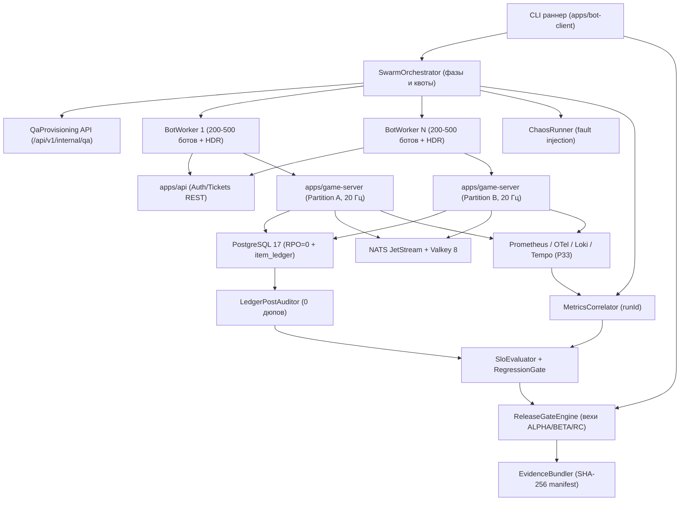
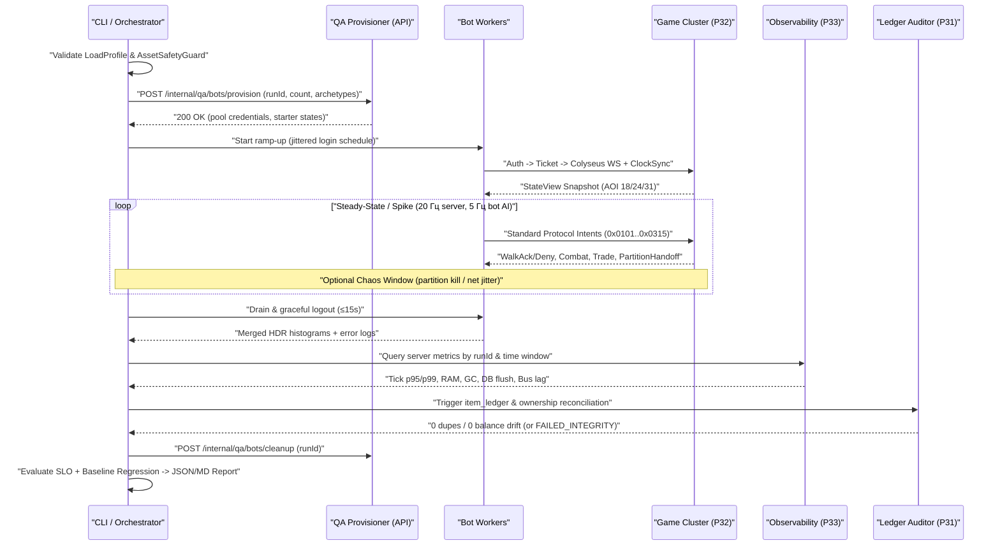
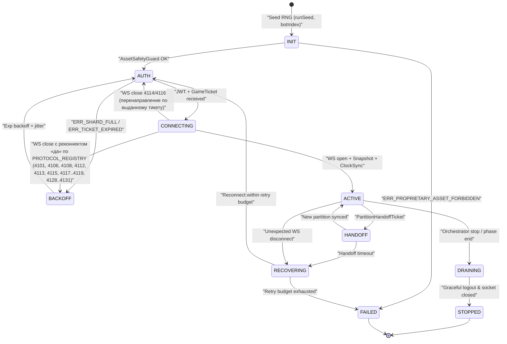

# Design: P35 Нагрузочная и приёмочная валидация

## Context

Фаза P35 завершает инженерный контур качества веб-MMORPG UO3 (Ultima Online: Renaissance, ADR-001..013). К моменту входа в P35 реализованы все функциональные и эксплуатационные подсистемы: изоморфная математика и 3D-геометрия мира (`@uo3/domain`, `@uo3/rules`, P01/P03), авторизация и билеты входа (P04/P05), симуляция 20 Гц с иерархическим колесом таймеров (P06), бинарный протокол и `StateView` AOI 18/24/31 (P07), инкрементальный 60-секундный flush и `CriticalTxCoordinator` RPO=0 с `item_ledger` (P08), полный стек игровых механик (P12–P27), аудио/эффекты с `NoopAudioEffectsSink` (P28), администрирование с Two-Person Rule и hash-chain аудитом (P29), горячий контент и 3-слойная локализация (P30), античит и сверка `item_ledger` (P31), горизонтальное партиционирование с `partition_epoch` и `PartitionHandoffTicket` (P32), а также стек наблюдаемости OTel/Prometheus/Grafana/Loki/Tempo и WAL/PITR restore-drill (P33).

Ключевая архитектурная проблема, решаемая P35: проверить систему как единый распределённый организм под реалистичной и экстремальной игровой нагрузкой, доказать соблюдение канонических констант UO:R и SLO 50-миллисекундного тика при массовых скоплениях, межпартиционных переходах, многочасовой работе и инъекции отказов, а затем формализовать воспроизводимый релизный гейт вех (`ALPHA` / `BETA` / `RC`) с криптографической доказательной базой.

## Goals / Non-Goals

### Goals

- Построить в `apps/bot-client` масштабируемый headless-флот (1..5000+ ботов) поверх реального `@uo3/protocol` SDK и `/api/v1/*` без обхода серверной авторитарности и с бюджетом ≤ 2.5 МБ RAM на активного бота.
- Обеспечить 100% детерминизм поведенческих сценариев от `(runSeed, botIndex)` и полное отсутствие проприетарных ассетов UO (ADR-002: только синтетические фасеты 200..254 и CC0-заглушки).
- Формализовать декларативные профили нагрузки (`ci-smoke`, `baseline`, `crowded-town`, `mass-pvp`, `partition-border`, `economy-burst`, `soak`, `stress`, `chaos-load`), машинопроверяемые SLO, статистический контроль регрессий относительно эталона и обязательный пост-нагрузочный аудит `item_ledger`.
- Реализовать сквозной приёмочный конвейер вех ROADMAP M0–M5 и релизных стадий (`ALPHA` ⊇ M0–M2, `BETA` ⊇ M0–M4, `RC` ⊇ M0–M5), охватывающий игровые E2E-петли UO:R, браузерную проверку `apps/client`, аудит безопасности/античита/правовой чистоты ассетов, проверку DR-учений, управляемый механизм `Waiver` и генерацию подписанного `Release Evidence Bundle`.
- Встроить быстрый контур `ci-smoke` (≤ 5 минут) в PR-пайплайн и расширенные `nightly-baseline` / `release-soak` в регулярные прогоны.

### Non-Goals

- Изменение игровой логики, формул UO:R, баланса или сетевых опкодов игровых доменов (P12–P27).
- Добавление «читерских» или привилегированных игровых опкодов для ботов в `@uo3/protocol`.
- Нагрузочное тестирование браузерного 3D-рендера на тысячах WebGL-инстансов (браузерная проверка выполняется в приёмочном E2E-контуре, а массовые CCU генерируются headless-ботами).
- Развёртывание инфраструктуры Prometheus/Grafana/Loki/Tempo или WAL/PITR с нуля (используются контракты P33).

## Decisions

### Decision 1: Нативный TypeScript-раннер ботов поверх `@uo3/protocol` и `worker_threads` вместо внешних HTTP/WS-генераторов (k6/Locust)

- **Выбор:** Реализовать ботов и нагрузочный оркестратор непосредственно в `apps/bot-client` (Node.js 22 ESM, `child_process`/`worker_threads`) с прямым подключением `@uo3/protocol` (клиентский бинарный кодек, `@colyseus/schema v3` `StateView`, `ClockSync`), `@uo3/rules` (`checkMovement`, `findPathAStar`, `TimeCreditTracker`) и `NoopAudioEffectsSink` (P28).
- **Обоснование:** Протокол UO3 использует stateful бинарные дельты `@colyseus/schema v3`, пространственный индекс AOI (18/24/31), клиентское предсказание 4 шагов `WalkRequest` и сложные многошаговые игровые петли (таргетинг, гампы, Secure Trade, PartitionHandoff). Внешние генераторы (k6/Locust) потребовали бы дублирования бинарного протокола и 3D-навигации, постоянно отставая от схемы и скрывая реальные протокольные регрессии. Нативный воркер на Node.js 22 с shared-only read-only картой синтетического фасета укладывается в ≤ 2.5 МБ RAM/бота (200–500 ботов на один воркер-процесс).
- **Отвергнутые альтернативы:** k6 с Go-расширением (несовместим с `@colyseus/schema v3` и `@uo3/rules` TypeScript), Playwright-ферма на 1000 браузеров (неприемлемые накладные расходы RAM/CPU — > 150 МБ на вкладку; оставлен только для приёмочных E2E-сценариев `apps/client`).

### Decision 2: Иерархический детерминированный Utility-BT планировщик ботов с раздельными циклами 20 Гц / 5 Гц

- **Выбор:** Отделить сетевой цикл бота (приём дельт Colyseus, конвейер шагов `WalkRequest` до 4 неподтверждённых `sequence`, таймеры реакции на `WalkDeny`/`CastDelay`) от цикла принятия решений поведения (5 Гц = 200 мс). Каждый бот владеет изолированным `xoshiro128++` PRNG, сидированным через `SHA-256(runSeed + ":" + botIndex)`.
- **Обоснование:** При 500 ботах на воркер пересчёт Utility-BT на каждом 50 мс тике создал бы лишнюю нагрузку CPU на стороне генератора. Частота 5 Гц совпадает с минимальным шагом бега пешком (200 мс) и полностью достаточна для выбора целей, боя, крафта и торговли, тогда как конвейер движения и обработка входящих пакетов остаются реактивными. Изолированный ГПСЧ гарантирует воспроизводимость и исключает корреляцию случайных выборок между ботами.
- **Отвергнутые альтернативы:** Полноценный 20 Гц планировщик для каждого бота (избыточный CPU генератора), глобальный `Math.random()` (разрушает воспроизводимость багов и регрессионных прогонов).

### Decision 3: Изолированный стендовый провижинер ботов с тройным предохранителем безопасности

- **Выбор:** Добавить в `apps/api` модуль `QaBotProvisioningModule` с эндпоинтами `/api/v1/internal/qa/bots/provision` и `/api/v1/internal/qa/bots/cleanup`. Модуль регистрируется в роутере **только** при одновременном выполнении трёх условий: `NODE_ENV !== 'production'`, `BOT_PROVISIONING_ENABLED === true` в `@uo3/config`, и наличии HMAC-подписи заголовка `X-UO3-QA-Signature` ключом `QA_PROVISIONING_SECRET`. В `production` маршрут возвращает 403 `ERR_PROVISIONING_DISABLED` через глобальный guard-заглушку.
- **Обоснование:** Боты не должны иметь прямого доступа к PostgreSQL (нарушение клиентской границы и переносимости на удалённые staging-стенды), но ручное создание 2000 аккаунтов через публичную регистрацию с rate-limit и MFA замедлило бы CI и исказило бы метрики. Идемпотентный стендовый провижинер с префиксом `qa_<runId>_` решает подготовку и очистку за секунды, оставаясь полностью невозможным к активации в продакшне (дополнительно проверяется гейтом `ERR_UNSAFE_PROD_CONFIG`).
- **Отвергнутые альтернативы:** Прямые SQL-вставки из `apps/bot-client` в БД (нарушает изоляцию и обходит доменные инварианты P04/P05/P13), отключение rate-limit на публичной регистрации (создаёт риск утечки конфига в prod).

### Decision 4: Нулевые изменения игровых опкодов и кардинально ограниченная корреляция `runId`

- **Выбор:** Запретить добавление специальных игровых опкодов для ботов. Все игровые намерения используют штатные опкоды `@uo3/protocol` из блоков фаз P12–P32 (`docs/PROTOCOL_REGISTRY.md`). Для сквозной корреляции метрик клиента и сервера разрешить передачу опционального строкового поля `qaRunId` в `joinOptions` комнаты и HTTP-заголовке `X-UO3-Run-Id`, принимаемого сервером **только** при `QA_TELEMETRY_LABELS_ENABLED=true`, с валидацией `^[a-z0-9-]{8,48}$` и LRU-ограничением активных меток (≤ 16 одновременных `runId`) для защиты от взрыва кардинальности Prometheus.
- **Обоснование:** Гарантирует честность тестирования — игровой сервер обрабатывает пакеты ботов ровно тем же кодом, что и реальных игроков. Ограничение кардинальности защищает Prometheus (P33) от OOM.
- **Отвергнутые альтернативы:** Безусловное прокидывание произвольного `runId` в Prometheus labels (риск взрыва кардинальности), отдельный «тестовый режим» игровой комнаты (искажает профиль нагрузки).

### Decision 5: Потоковые логарифмические гистограммы в `apps/bot-client` вместо хранения сырых сэмплов

- **Выбор:** Использовать фиксированные HDR-гистограммы (диапазон 1 мс..60000 мс, 3 значащие цифры точности, ~12 КБ на метрику) на уровне воркера с агрегацией в оркестраторе по расписанию (1 с шаг для временных рядов) и итоговым слиянием гистограмм (`merge`) без потери точности перцентилей p50/p95/p99/p99.9.
- **Обоснование:** За 24-часовой `soak`-прогон 500 ботов выполняют > 200 млн намерений. Хранение сырых массивов задержек привело бы к OOM в самом нагрузочном генераторе. Слияние HDR-гистограмм математически корректно (в отличие от усреднения перцентилей по воркерам) и расходует константную память O(1).
- **Отвергнутые альтернативы:** Усреднение p95/p99 по воркерам (математически некорректно), запись каждого сэмпла в NDJSON на диск (узкое место I/O на soak-тестах).

### Decision 6: Статистический регрессионный гейт поверх порогов SLO

- **Выбор:** Разделить проверку абсолютных SLO (жёсткие контракты 20 Гц, сети, БД, handoff) и проверку относительной регрессии к сохранённому эталону (`baseline`). Регрессионный компаратор проверяет одновременно практическую значимость (дельта p95/p99 тика или `WalkAck` > +15%, память/бота > +15%, `maxSustainableCcu` < -10%) и статистическую значимость (двусторонний тест Манна–Уитни по 1-секундным окнам steady-state, `p < 0.05`).
- **Обоснование:** Абсолютные SLO защищают игрока от сломанного тика, а регрессионный гейт ловит постепенное «сползание» производительности (например, рост p95 тика с 10 мс до 18 мс ещё зелёный по SLO 25 мс, но является критичной регрессией +80%). Критерий `p < 0.05` подавляет ложные срабатывания от кратковременного шума CI-раннеров.
- **Отвергнутые альтернативы:** Только абсолютные пороги SLO (пропускают раннюю деградацию), сравнение единственного числа без статтеста (высокий уровень flaky-провалов в CI).

### Decision 7: Неинвазивная инъекция сетевого хаоса на границе бот-сокета + контейнерный fault-injector для узлов

- **Выбор:** Реализовать двухуровневый `ChaosController`: (1) клиентский транспортный прокси-слой внутри `apps/bot-client` для точной и детерминированной инъекции джиттера, задержки и процента дропа входящих/исходящих кадров без требования `CAP_NET_ADMIN`/root в CI; (2) инфраструктурный адаптер (Docker Compose / Kubernetes API / process signal) для аварийного убийства процесса партиции (`SIGKILL`), паузы Valkey/NATS и инъекции задержки БД в staging/nightly-стендах.
- **Обоснование:** Позволяет тестировать устойчивость `WalkRequest` и `TimeCreditTracker` к джиттеру ±80 мс и 2% потерь даже в непривилегированном CI-контейнере, сохраняя полноценные инфраструктурные хаос-сценарии на staging.
- **Отвергнутые альтернативы:** Использование `tc netem` везде (требует root-привилегий и ломается в стандартных sandboxed CI-раннерах).

### Decision 8: Подписанный `Release Evidence Bundle` и хардкодный реестр неисключаемых критериев (Non-Waivable Gates)

- **Выбор:** Финальный гейт Go/No-Go работает как чистая детерминированная функция от собранных артефактов (JSON-снимки E2E, load/soak/chaos, `item_ledger`, DR-drill, security/asset-scanner, конфиг-аудит, реестр дефектов и waivers). Критерии `PROPRIETARY_ASSET_SCAN`, `ITEM_LEDGER_INTEGRITY`, `SECURITY_AUTHORITY`, `CRITICAL_TX_RPO_ZERO`, `PROD_CONFIG_SAFETY` жёстко закреплены в `NON_WAIVABLE_GATES` в `@uo3/domain` — попытка создать waiver для них отклоняется с `ERR_WAIVER_FORBIDDEN`. Все входные и итоговые артефакты упаковываются в `Release Evidence Bundle` с каноническим `manifest.json` (SHA-256 каждого файла, отсортированные ключи) и опциональной Ed25519-подписью релиз-инженера.
- **Обоснование:** Исключает «ручное протаскивание» релиза в обход правовых рисков (ADR-002), дюпов экономики или потерь данных, обеспечивая полный аудит любого релиза постфактум.
- **Отвергнутые альтернативы:** Ручной чек-лист в вики/тикет-трекере (непроверяемо, подвержено человеческим ошибкам и устареванию).

## Архитектура модулей

```text
apps/bot-client/
├── src/
│   ├── cli/                      # Точка входа CLI: run-load, run-acceptance, verify-bundle, update-baseline
│   ├── core/
│   │   ├── BotSession.ts         # Полный цикл: HTTP login -> ticket -> Colyseus WS -> ClockSync -> Active -> Drain
│   │   ├── BotWorldView.ts       # Адаптер StateView AOI (18/24/31), чтение позиций, предметов, контейнеров, мульти
│   │   ├── BotNavigator.ts       # Обёртка @uo3/rules findPathAStar + checkMovement + WalkRequest pipeline (до 4 seq)
│   │   ├── DeterministicRng.ts   # SHA-256(runSeed:botIndex) -> xoshiro128++ (@uo3/test-kit)
│   │   ├── AssetSafetyGuard.ts   # Проверка запрета проприетарных ассетов (ERR_PROPRIETARY_ASSET_FORBIDDEN)
│   │   └── NetworkFaultProxy.ts  # Опциональная инъекция джиттера/потерь кадров без root
│   ├── archetypes/               # Utility-BT профили поведения (5 Гц цикл решений)
│   │   ├── ExplorerArchetype.ts
│   │   ├── PveHunterArchetype.ts
│   │   ├── PvpDuelistArchetype.ts
│   │   ├── MageCasterArchetype.ts
│   │   ├── CrafterGathererArchetype.ts
│   │   ├── TraderBankerArchetype.ts
│   │   ├── HomeownerSailorArchetype.ts
│   │   ├── SocialChatterArchetype.ts
│   │   └── adversarial/          # SpeedhackBot, PacketFloodBot, MalformedOpcodeBot, DupeRaceBot, AclBypassBot
│   ├── orchestrator/
│   │   ├── SwarmOrchestrator.ts  # Фазы ramp-up/steady/spike/cooldown, балансировка воркеров, graceful stop ≤15с
│   │   ├── BotWorkerProcess.ts   # Воркер-процесс на 200..500 ботов + HDR-гистограммы
│   │   └── BotProvisionClient.ts # Идемпотентный клиент /api/v1/internal/qa/bots/*
│   ├── load/
│   │   ├── LoadProfileRegistry.ts # YAML/JSON реестр профилей + валидация TypeBox (ERR_INVALID_LOAD_PROFILE)
│   │   ├── SloEvaluator.ts       # Проверка тика 20 Гц, WalkAck, RPO=0 БД, handoff, шины, памяти, AOI
│   │   ├── MetricsCorrelator.ts  # Сбор клиентских HDR + Prometheus/OTel срезов по runId (проверка ≤5% потерь)
│   │   ├── RegressionGate.ts     # Сравнение с baseline (дельта + Mann-Whitney U, ERR_PERF_REGRESSION)
│   │   ├── LedgerPostAuditor.ts  # Вызов сверки item_ledger и инвариантов контейнеров после прогона
│   │   ├── ChaosRunner.ts        # Оркестрация fault-инъекций (partition kill, NATS/Valkey pause, netem)
│   │   └── ReportGenerator.ts    # Генерация summary.json, timeseries.ndjson, report.md
│   └── acceptance/
│       ├── MilestoneMatrix.ts    # Вехи M0..M5 и стадии ALPHA / BETA / RC с трассировкой к OpenSpec P00..P36
│       ├── E2ESuiteRunner.ts     # Сквозные игровые сценарии (onboarding, PvP, magic/craft/econ, houses/ships/events)
│       ├── BrowserAcceptance.ts  # Интеграция с Playwright-проверкой apps/client и apps/admin (WebGL2, 24 света, RU/EN)
│       ├── SecurityAssetAudit.ts # Сканер проприетарных ассетов, fuzzing-отчёт, CSP/SRI, staff_audit_log hash-chain
│       ├── DrConfigValidator.ts  # Проверка свежести DR-учения (≤14 дней), алертов, миграций и продакшн-флагов
│       ├── ReleaseGateEngine.ts  # Расчёт GO / CONDITIONAL_GO / NO_GO + валидация Waivers
│       └── EvidenceBundler.ts    # Сборка и верификация SHA-256 manifest.json (ERR_EVIDENCE_TAMPERED)
apps/api/src/modules/qa-provisioning/
├── qa-provisioning.module.ts     # Условная регистрация только при NODE_ENV!=='production' && BOT_PROVISIONING_ENABLED
├── qa-prod-block.guard.ts        # Глобальная заглушка 403 ERR_PROVISIONING_DISABLED в production
├── qa-provisioning.controller.ts # POST /api/v1/internal/qa/bots/provision, POST /cleanup, GET /readiness
└── qa-provisioning.service.ts    # Идемпотентный upsert пула аккаунтов/персонажей и каскадная очистка
apps/game-server/src/telemetry/
└── qa-run-label.interceptor.ts   # Read-only извлечение и LRU-ограничение метки qa_run_id (≤16 активных)
packages/domain/src/quality/      # Перечисления профилей, статусов, вердиктов, дефектов, NON_WAIVABLE_GATES (0 deps)
packages/config/src/qa.schema.ts  # TypeBox-схемы BOT_PROVISIONING_ENABLED, QA_TELEMETRY_LABELS_ENABLED, SLO defaults
packages/test-kit/src/synthetic/  # Расширение синтетического фасета 200..254 аренами (town, pvp, border, ocean)
packages/db/src/schema/qa.ts      # Drizzle-схемы qa_load_runs, qa_slo_evaluations, qa_acceptance_runs, qa_release_waivers
```

### Диаграмма 1: Архитектура платформы нагрузочного и приёмочного тестирования



### Диаграмма 2: Жизненный цикл нагрузочного прогона с хаос-инъекцией и сверкой целостности



### Диаграмма 3: Конечный автомат headless-бота



## Модели данных и контракты протокола

### 1. Схема таблиц PostgreSQL 17 (`packages/db/src/schema/qa.ts`)

Таблицы создаются в выделенной схеме `qa` (в БД `uo3_test` или выделенной аналитической БД QA, чтобы не смешиваться с горячими игровыми таблицами `world_*`):

- **`qa.qa_load_runs`** — реестр нагрузочных прогонов и эталонов:
  - `run_id` (`uuid`, PK)
  - `profile_name` (`varchar(64)`, NOT NULL) — `ci-smoke | baseline | crowded-town | mass-pvp | partition-border | economy-burst | soak | stress | chaos-load`
  - `profile_version` (`varchar(32)`, NOT NULL), `profile_sha256` (`char(64)`, NOT NULL)
  - `env_class` (`varchar(32)`, NOT NULL) — `ci-local | staging | perf-lab`
  - `git_commit_sha` (`char(40)`, NOT NULL), `ruleset_hash` (`char(64)`, NOT NULL)
  - `run_seed` (`bigint`, NOT NULL), `target_ccu` (`integer`, NOT NULL), `peak_ccu` (`integer`, NOT NULL)
  - `max_sustainable_ccu` (`integer`, NULL — для `stress`)
  - `status` (`varchar(32)`, NOT NULL) — `RUNNING | PASS | WARN | FAIL | FAILED_SLO | FAILED_INTEGRITY | INCOMPLETE_TELEMETRY`
  - `is_baseline` (`boolean`, NOT NULL DEFAULT false)
  - `baseline_promoted_by` (`varchar(128)`, NULL), `baseline_reason` (`text`, NULL)
  - `telemetry_coverage_bp` (`integer`, NOT NULL — 0..10000, порог ≥ 9500)
  - `summary_json` (`jsonb`, NOT NULL), `started_at` (`timestamptz`), `finished_at` (`timestamptz`)
  - Индексы: `idx_qa_load_runs_profile_env_baseline (profile_name, env_class) WHERE is_baseline = true` (partial unique index — не более 1 активного эталона на пару `(profile_name, env_class)`), `idx_qa_load_runs_commit (git_commit_sha)`.

- **`qa.qa_slo_evaluations`** — детализация оценок каждого SLO-индикатора:
  - `id` (`bigserial`, PK)
  - `run_id` (`uuid`, FK → `qa.qa_load_runs.run_id` ON DELETE CASCADE)
  - `slo_key` (`varchar(64)`, NOT NULL) — например, `tick_p95_ms`, `tick_p99_ms`, `tick_overrun_pct`, `walk_ack_p95_ms`, `walk_ack_p99_ms`, `critical_tx_p99_ms`, `handoff_p99_ms`, `bus_lag_max`, `heap_drift_pct_hr`, `ledger_diff_count`
  - `partition_id` (`varchar(64)`, NULL)
  - `threshold_value` (`double precision`, NOT NULL), `actual_value` (`double precision`, NOT NULL)
  - `baseline_value` (`double precision`, NULL), `delta_pct` (`double precision`, NULL), `p_value` (`double precision`, NULL)
  - `verdict` (`varchar(16)`, NOT NULL) — `PASS | WARN | FAIL`
  - Индекс: `idx_qa_slo_run_key (run_id, slo_key)`.

- **`qa.qa_acceptance_runs`** — реестр прогонов приёмки вех и подписанных пакетов:
  - `acceptance_id` (`uuid`, PK)
  - `milestone` (`varchar(16)`, NOT NULL) — `ALPHA | BETA | RC`
  - `release_tag` (`varchar(64)`, NOT NULL), `git_commit_sha` (`char(40)`, NOT NULL), `ruleset_hash` (`char(64)`, NOT NULL)
  - `verdict` (`varchar(24)`, NOT NULL) — `GO | CONDITIONAL_GO | NO_GO`
  - `blocking_reasons` (`jsonb`, NOT NULL DEFAULT `'[]'`)
  - `domain_results_json` (`jsonb`, NOT NULL), `evidence_manifest_sha256` (`char(64)`, NOT NULL)
  - `dr_drill_run_id` (`uuid`, NULL), `dr_drill_at` (`timestamptz`, NULL)
  - `created_at` (`timestamptz`, NOT NULL DEFAULT now()).

- **`qa.qa_release_waivers`** — реестр временных исключений:
  - `waiver_id` (`uuid`, PK)
  - `gate_key` (`varchar(64)`, NOT NULL) — CHECK `gate_key NOT IN ('PROPRIETARY_ASSET_SCAN','ITEM_LEDGER_INTEGRITY','SECURITY_AUTHORITY','CRITICAL_TX_RPO_ZERO','PROD_CONFIG_SAFETY')`
  - `defect_id` (`varchar(64)`, NOT NULL), `severity` (`varchar(8)`, NOT NULL — `P1 | P2 | P3 | WARN`)
  - `justification` (`text`, NOT NULL), `mitigation_plan` (`text`, NOT NULL)
  - `approver_1_id` (`varchar(128)`, NOT NULL), `approver_2_id` (`varchar(128)`, NOT NULL) — CHECK `approver_1_id <> approver_2_id`
  - `expires_at` (`timestamptz`, NOT NULL) — CHECK `expires_at <= created_at + interval '14 days'`
  - `revoked_at` (`timestamptz`, NULL), `created_at` (`timestamptz`, NOT NULL DEFAULT now()).

### 2. Протокольные, REST и TypeBox-контракты

- **Игровой WebSocket-протокол (`@uo3/protocol`):**
  - Ни одного нового игрового опкода не добавляется — боты используют канонические клиентские опкоды из блоков фаз-владельцев по `docs/PROTOCOL_REGISTRY.md`: движение P12 `0x0100..0x011F` (`0x0101` `WalkRequest`, `0x0105` `PartitionHandoffTicket`, `0x0106` `ClientGeometryReady`), предметы P13 `0x0120..0x014F`, гампы/таргетинг/речь P14 `0x0150..0x017F`, навыки P15 `0x0180..0x019F`, бой P16 `0x01A0..0x01CF`, PvP/ноториети P17 `0x01D0..0x01EF`, магия P18 `0x01F0..0x021F`, NPC/питомцы P19 `0x0220..0x023F`, сбор/крафт P20 `0x0240..0x025F`, экономика/торговля P21 `0x0260..0x028F`, утилитарные навыки P22 `0x0290..0x02AF`, дома P23 `0x02B0..0x02CF`, корабли P24 `0x02D0..0x02DF`, регионы/мунгейты P25 `0x02E0..0x02EF`, социальные системы P26 `0x02F0..0x031F`, персонал (только в негативных ACL-тестах и admin-acceptance) P29 `0x0360..0x037F`, контент P30 `0x0380..0x038F`, безопасность P31 `0x0390..0x039F`, handoff P32 `0x03A0..0x03BF`.
  - Схемы Colyseus `@colyseus/schema v3` (`WorldPartitionState`, `MobileSchema`, `ItemSchema`, `MultiSchema`, `StateView`) потребляются ботами строго в режиме чтения через существующий клиентский SDK (P07).
  - Опциональное поле корреляции в `WorldPartitionJoinOptionsSchema` (TypeBox):
    ```ts
    qaRunId: Type.Optional(Type.String({ pattern: '^[a-z0-9-]{8,48}$' }))
    ```
    Игнорируется сервером, если `QA_TELEMETRY_LABELS_ENABLED !== true` или превышен лимит 16 активных меток.

- **Стендовый REST API провижининга (`apps/api`, `/api/v1/internal/qa/bots/*`):**
  - `POST /api/v1/internal/qa/bots/provision`:
    - Request (TypeBox): `{ runId: string, shardId: string, facetId: number (200..254), count: number (1..5000), botTemplates: Array<{ templateKey: string, weightBp: number, stats: { str, dex, int }, skills: Record<string, number>, starterGold: number, starterItems: StarterItemSpec[], accessLevel: 0 }> }`
    - Response: `{ runId: string, createdCount: number, reusedCount: number, accounts: Array<{ botIndex, accountId, username, password, characterId, characterSerial, spawnPos }> }`
  - `POST /api/v1/internal/qa/bots/cleanup`:
    - Request: `{ runId: string, forceKickActive: boolean }`
    - Response: `{ runId: string, removedAccounts: number, removedCharacters: number, removedItems: number, kickedSessions: number }`
  - `GET /api/v1/internal/qa/readiness`:
    - Response: `{ env: string, provisioningEnabled: boolean, devFacetsEnabled: boolean, tlsEnforced: boolean, mfaEnforced: boolean, rulesetHash: string, schemaVersion: string }`

- **Декларативный профиль нагрузки (`LoadProfileV1`, TypeBox):**
  - `schemaVersion: '1.0'`, `name`, `facetId` (200..254), `runSeed`, `targetCcu`, `maxWorkers`
  - `phases: { rampUpSec, steadyStateSec, spikeSec?, spikeCcu?, cooldownSec, stepIncrementCcu?, stepIntervalSec? }`
  - `archetypeMix: Record<BotArchetype, number>` (целые базисные пункты `weightBp`, строгий инвариант `Σ weightBp === 10000`)
  - `slo: SloThresholdMatrix`, `chaos?: ChaosPlanV1`, `postRunAudit: { ledgerReconcile: boolean, containerInvariants: boolean }`

### 3. Реестр кодов ошибок фазы P35

| Код ошибки | Домен | Условие возникновения |
|---|---|---|
| `ERR_PROPRIETARY_ASSET_FORBIDDEN` | `quality/bot-clients` | Попытка загрузки/указания проприетарных ассетов UO в конфигурации бота |
| `ERR_PROVISIONING_DISABLED` | `quality/bot-clients` | Запрос к `/api/v1/internal/qa/bots/*` при продакшн-конфигурации или отключённом флаге |
| `ERR_INVALID_LOAD_PROFILE` | `quality/load-testing` | Нарушение схемы профиля нагрузки (например, `Σ weightBp ≠ 10000`, отрицательные фазы, невалидный фасет) |
| `ERR_SLO_CAPACITY_NOT_MET` | `quality/load-testing` | Не подтверждены ≥ 500 CCU на партицию / ≥ 2000 CCU на шард или p99 серверной обработки команды > 30 мс (ADR, `docs/ARCHITECTURE.md`) |
| `ERR_SLO_BUS_LAG_EXCEEDED` | `quality/load-testing` | Отставание консьюмеров NATS JetStream > 1000 сообщений дольше 15 с |
| `ERR_SOAK_PERFORMANCE_DRIFT` | `quality/load-testing` | Рост p95 тика между первым и последним часом soak-прогона > 20% или дрейф памяти > 2%/ч |
| `ERR_PERF_REGRESSION` | `quality/load-testing` | Статистически значимая регрессия (`p < 0.05`) относительно эталона (> +15% задержка/память или < -10% ёмкость) |
| `ERR_ACCEPTANCE_CRITERIA_INCOMPLETE` | `quality/release-acceptance` | Отсутствует обязательный доменный отчёт для целевой вехи (`ALPHA`/`BETA`/`RC`) |
| `ERR_PROPRIETARY_ASSET_DETECTED` | `quality/release-acceptance` | Сканер правовой чистоты обнаружил проприетарные сигнатуры UO в репо, сборке или тестах |
| `ERR_STALE_DR_DRILL` | `quality/release-acceptance` | Последнее успешное DR-учение (WAL/PITR) старше 14 дней для вехи `RC` |
| `ERR_WAIVER_FORBIDDEN` | `quality/release-acceptance` | Попытка оформить waiver на неисключаемый критерий из `NON_WAIVABLE_GATES` |
| `ERR_EVIDENCE_TAMPERED` | `quality/release-acceptance` | Расхождение SHA-256 контрольной суммы при верификации `Release Evidence Bundle` |
| `ERR_UNSAFE_PROD_CONFIG` | `quality/release-acceptance` | В продакшн-конфигурации включён провижининг ботов, dev-фасеты или отключены TLS/MFA |

## Ключевые алгоритмы и математические формулы

### 1. Детерминированное расщепление ГПСЧ и сглаживание рампы входа

Для каждого бота `i ∈ [0, N-1]` формируется независимое 128-битное начальное состояние генератора `xoshiro128++` (из `@uo3/test-kit`, P01):
$$H_i = \text{SHA-256}(\text{runSeed} \parallel \text{":"} \parallel i), \quad S_i = (H_i[0..3], H_i[4..7], H_i[8..11], H_i[12..15])$$
Момент старта бота `i` на фазе `rampUpSec` с темпом $R = N / T_{\text{ramp}}$ ботов/с и полосой джиттера $J = \min(0.45 / R, 0.5\text{ с})$:
$$t_i = \text{clamp}\left(\frac{i}{R} + (2 u_i - 1) \cdot J,\; 0,\; T_{\text{ramp}}\right), \quad u_i \sim \text{Uniform}[0, 1) \text{ из } S_i$$
При отказе входа (`ERR_SHARD_FULL`, `ERR_TICKET_EXPIRED`) используется экспоненциальный backoff с полным джиттером:
$$\Delta_k = u \cdot \min(30000\text{ мс},\; 500\text{ мс} \cdot 2^k)$$

### 2. Клиентский конвейер шагов и соблюдение UO:R темпов

Бот использует изоморфный `checkMovement` (`PersonHeight=16`, `StepHeight=2`, диагональные углы, двери) и 3D A* (`findPathAStar`) из `@uo3/rules` (P12). Минимальный интервал отправки следующего `WalkRequest` определяется состоянием персонажа:
- Пешком: ходьба `400 мс`, бег `200 мс`.
- Верхом: ходьба `200 мс`, бег `100 мс`.
- Размер скользящего окна неподтверждённых шагов: `inFlight.length < 4`, `sequence = (sequence + 1) & 0xFF`.
- При получении `WalkDeny`: `predictedPos = serverPos`, очистка `inFlight`, сброс `sequence` по ответу сервера и перестроение 3D A* (с бюджетом ≤ 200 узлов на шаг, чтобы не блокировать цикл воркера).
- В адверсарном профиле `SpeedhackBot` преднамеренно нарушается темп (`50 мс`) для проверки срабатывания `TimeCreditTracker` (джиттер 150 мс, карантин 1000 мс) и начисления страйков P31.

### 3. Каноническая матрица SLO (20 Гц симуляция)

| Категория | Метрика | Порог `PASS` | Порог `WARN` | Источник |
|---|---|---|---|---|
| Симуляция 20 Гц | `tick_duration_p95_ms` | ≤ 25 мс | 25..30 мс | `apps/game-server` (OTel) |
| Симуляция 20 Гц | `tick_duration_p99_ms` | ≤ 40 мс | — (жёсткий FAIL > 40 мс ≥ 30 с) | `apps/game-server` (OTel) |
| Симуляция 20 Гц | `tick_overrun_pct` (> 50 мс) | ≤ 0.5% | — (жёсткий FAIL) | `apps/game-server` (OTel) |
| Сетевая задержка | `walk_ack_rtt_p95_ms` | ≤ 80 мс | 80..95 мс | `apps/bot-client` (HDR) |
| Сетевая задержка | `walk_ack_rtt_p99_ms` | ≤ 150 мс | — (жёсткий FAIL) | `apps/bot-client` (HDR) |
| Намерения | `intent_ack_p95_ms` | ≤ 100 мс | 100..115 мс | `apps/bot-client` (HDR) |
| Персистентность | `world_flush_tick_spike_ms` (каждые 60 с) | ≤ 50 мс | — (жёсткий FAIL) | `apps/game-server` |
| RPO=0 БД | `critical_tx_p99_ms` | ≤ 120 мс | 120..140 мс | `apps/game-server` / PG |
| Партиции (P32) | `handoff_p95_ms` / `handoff_p99_ms` | ≤ 250 мс / ≤ 500 мс | — (жёсткий FAIL) | `apps/bot-client` + P32 |
| Шина NATS | `jetstream_consumer_lag_max` | ≤ 1000 msg (> 15 с = FAIL) | 500..1000 msg | NATS exporter |
| AOI трафик | `client_rx_kbps_p95` (в толпе ≥ 150) | ≤ 64 КБ/с | 55..64 КБ/с | `apps/bot-client` |
| Память (Soak) | `server_heap_drift_pct_per_hr` | ≤ 2.0%/ч | 1.5..2.0%/ч | Prometheus (OLS) |
| Event Loop | `event_loop_lag_p99_ms` | ≤ 20 мс | 15..20 мс | Node.js monitor |
| Целостность | `ledger_discrepancies` / `dupe_serials` | `0` / `0` | — (`FAILED_INTEGRITY`) | P31 Reconciler |

### 4. Расчёт дрейфа памяти (Soak) и регрессии к эталону

После 30-минутного окна прогрева для ряда сэмплов памяти $(t_k, m_k)$ (в секундах и байтах) вычисляется линейный наклон методом МНК:
$$\beta_1 = \frac{\sum (t_k - \bar{t})(m_k - \bar{m})}{\sum (t_k - \bar{t})^2}, \quad \text{drift}_{\%/\text{ч}} = \frac{\beta_1 \cdot 3600}{\bar{m}_{\text{warmup}}} \cdot 100\%$$
Прогон проваливается при $\text{drift}_{\%/\text{ч}} > 2.0\%$ или при деградации тика:
$$\frac{\text{p95}_{\text{last\_hour}} - \text{p95}_{\text{first\_hour}}}{\text{p95}_{\text{first\_hour}}} > 0.20 \implies \text{ERR\_SOAK\_PERFORMANCE\_DRIFT}$$

Регрессия к эталону фиксируется (`ERR_PERF_REGRESSION`), если для метрики $M$ выполняется:
$$\Delta_M = \frac{M_{\text{curr}} - M_{\text{base}}}{M_{\text{base}}} > \theta_M \quad \land \quad p_{\text{MannWhitney}} < 0.05$$
где $\theta_{\text{latency}} = +0.15$, $\theta_{\text{memory}} = +0.15$, а для `maxSustainableCcu` проверяется $\Delta_{\text{ccu}} < -0.10$.

### 5. Формула принятия решения Go/No-Go и верификация `Release Evidence Bundle`

Пусть $D_{\text{req}}(\text{milestone})$ — множество обязательных доменов вехи (`ALPHA` / `BETA` / `RC`).
1. Если $\exists d \in D_{\text{req}}$, для которого нет артефакта → `NO_GO` (`ERR_ACCEPTANCE_CRITERIA_INCOMPLETE`).
2. Если провален любой неисключаемый критерий из `NON_WAIVABLE_GATES` или `openP0 > 0` → `NO_GO`.
3. Если провален иной критерий или `openP1 > 0`, проверяется наличие активного `waiver` (две разные подписи, `now() < expires_at`, `expires_at - created_at ≤ 14d`, не отозван):
   - Если хотя бы один блокер не покрыт валидным waiver → `NO_GO`.
   - Если все некритичные блокеры покрыты валидными waivers → `CONDITIONAL_GO`.
4. Иначе → `GO`.

Для `Release Evidence Bundle` строится канонический `manifest.json`, где для каждого файла в директории бандла вычисляется `SHA-256`, пути сортируются лексикографически, а итоговый `bundleSha256` вычисляется по каноническому JSON-представлению списка файлов + метаданных (`gitCommitSha`, `rulesetHash`, `milestone`, `verdict`).

## Risks / Trade-offs

- **[Нагрузка самого генератора ботов искажает измерения задержек]** → Выделять `apps/bot-client` на отдельные CPU-ядра/узлы от `apps/game-server`; контролировать `bot_worker_event_loop_lag_p99_ms ≤ 15 мс` — при перегрузке самого генератора помечать замер задержек предупреждением `GENERATOR_SATURATED`.
- **[Флаки-провалы в CI на общих раннерах из-за шумных соседей]** → Разделить `ci-smoke` (небольшой рой 30 ботов, запас по бюджету, проверка функциональных и базовых SLO без жёсткого регрессионного сравнения на шареных раннерах) и выделенный `perf-lab` с фиксированным железом для `nightly-baseline` и регрессионного гейта (`p < 0.05`).
- **[Утечка эндпоинта провижининга ботов в продакшн]** → Тройной предохранитель (условная регистрация модуля + `NODE_ENV !== 'production'` + HMAC-секрет + глобальная заглушка `403 ERR_PROVISIONING_DISABLED`) и автоматическая блокировка релиза `ERR_UNSAFE_PROD_CONFIG` при проверке продакшн-манифестов.
- **[Взрыв кардинальности Prometheus из-за метки `runId`]** → Метка `qa_run_id` отключена по умолчанию в prod, валидируется regex, и ограничивается LRU-пулом из ≤ 16 активных значений с переполнением в `qa_run_id="overflow"`.
- **[Засорение тестовой БД остатками ботов при аварийном падении оркестратора]** → Все тестовые сущности маркируются префиксом `qa_<runId>_`; добавляется идемпотентная CLI-команда `cleanup-stale --older-than 24h` и `finally`-хук очистки по `SIGTERM`/`SIGINT`.
- **[Несинхронизированные часы между генератором ботов и серверами]** → Для серверных и клиентских задержек используются монотонные таймеры (`performance.now()`), а корреляция временных окон привязывается к NTP/серверному `ClockSync` с допуском окна ±2 с.
- **[Неполное покрытие редких UO:R-механик в нагрузочном миксе]** → Помимо смешанного `baseline` выделены узконаправленные профили (`crowded-town`, `mass-pvp`, `partition-border`, `economy-burst`), а полный перечень редких механик (дома, корабли, карты сокровищ, эскорты, StatLoss) гарантированно прогоняется в приёмочных E2E-наборах.
- **[Подмена или устаревание доказательств приёмочного релиза]** → `Release Evidence Bundle` жёстко привязывает все отчёты к единому `gitCommitSha` и `rulesetHash`, проверяет давность DR-учения (≤ 14 дней для RC) и валидирует SHA-256 манифест командой `verify-bundle`.

## Migration Plan

1. **Применение миграций БД (`@uo3/db`):** развернуть схему `qa` и таблицы `qa_load_runs`, `qa_slo_evaluations`, `qa_acceptance_runs`, `qa_release_waivers` в `uo3_test` и QA-БД стендов (нулевое влияние на рабочие таблицы `world_*` и `accounts`).
2. **Включение стендового провижининга:** активировать `BOT_PROVISIONING_ENABLED=true` и `QA_TELEMETRY_LABELS_ENABLED=true` строго в `.env.test` и `staging`/`perf-lab`; в `production`-шаблонах зафиксировать оба флага как `false`.
3. **Поэтапное введение гейтов в CI:**
   - Этап A: добавить `ci-smoke` (30 ботов, ≤ 5 минут) в PR-пайплайн в режиме advisory на 3 прогона для калибровки порогов CI-раннера, затем перевести в обязательный гейт `ci-required`.
   - Этап B: запустить `nightly-baseline`, `crowded-town`, `mass-pvp`, `partition-border`, `economy-burst`, `chaos-load` и зафиксировать первичный эталон (`is_baseline = true`) на выделенном `perf-lab`.
   - Этап C: провести 24-часовой `release-soak` и полный прогон `run-acceptance --milestone RC`, сформировать первый `Release Evidence Bundle` стадии `RC` (вехи M0–M5); финальный прогон гейта с критериями P36 выполняется в P36.
4. **Откат:** удаление схемы `qa` и отключение `apps/bot-client` job в CI не затрагивает ни один игровой сервис и выполняется за 1 шаг без простоя.

## Open Questions

- Требуется ли публикация итоговых `Release Evidence Bundle` во внешнее WORM-хранилище (S3 Object Lock) помимо артефактов CI и БД `qa.qa_acceptance_runs` (можно добавить адаптер хранилища в пост-релизной итерации без смены формата `manifest.json`).
- Какой конкретный аппаратный профиль выделенного `perf-lab` (число vCPU/RAM на партицию) будет утверждён для финальной номинальной цели CCU на одну партицию перед GA — фиксируется в `LoadProfileV1` для `perf-lab` без изменения кода SLO-движка.
- Нужно ли подписывать `manifest.json` аппаратным ключом (KMS/Cosign) в дополнение к локальной Ed25519/SHA-256 верификации в закрытом контуре CI.
- Планируется ли публикация обезличенных графиков нагрузочных бенчмарков в публичную документацию проекта после релиза (стадия `RC`, веха M5).
