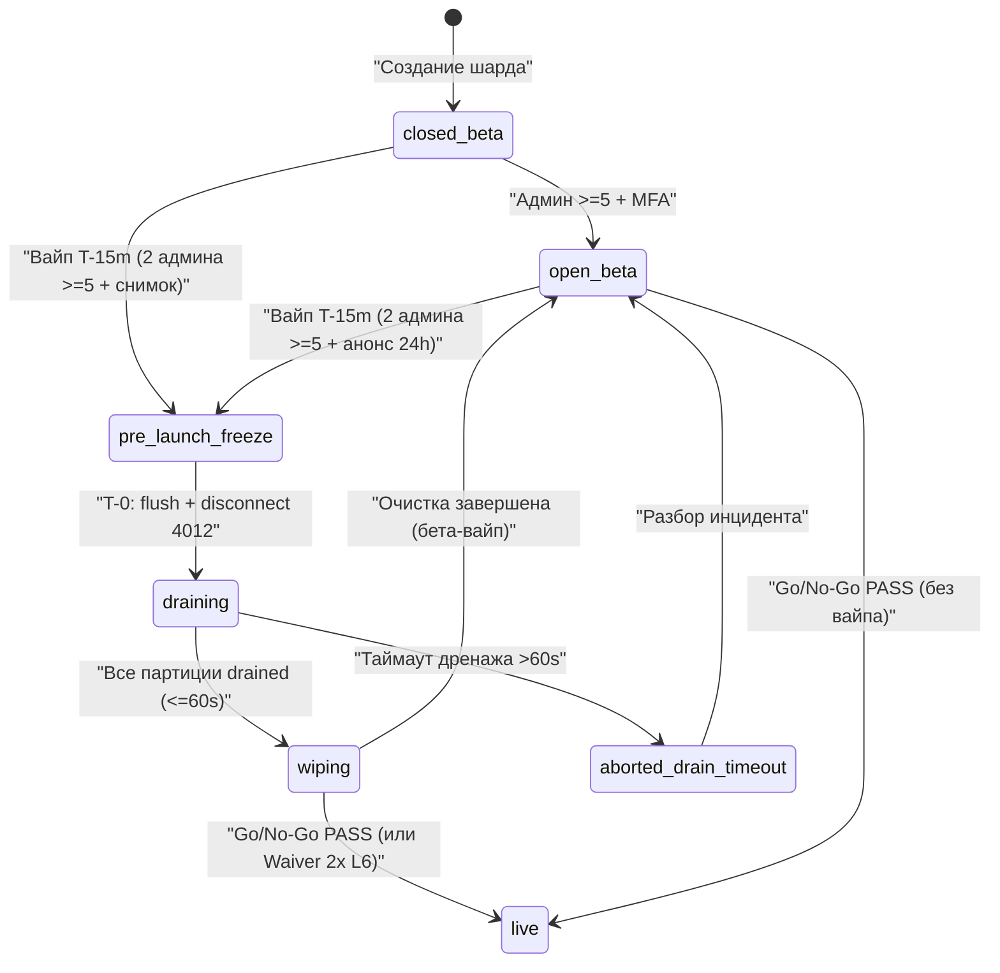
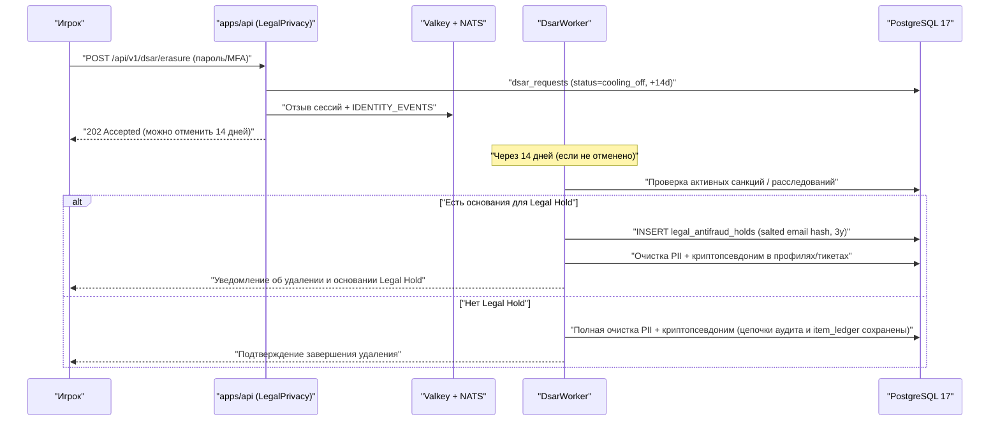
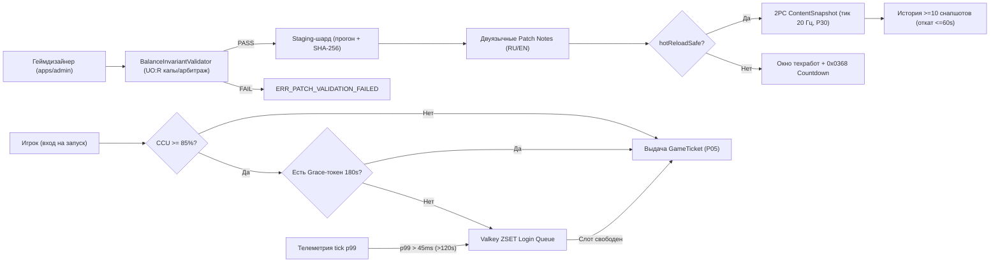

# Design: P36 Бета и запуск

## Context

Фаза P36 завершает дорожную карту UO3, связывая технически готовую игровую платформу (P00–P35) с полноценным контуром бета-тестирования, юридического соответствия, поддержки игроков и пост-релизного живого оперирования (LiveOps).

Ключевые ограничения существующей архитектуры (ADR-001..013 и контракты P00–P35):
- **Серверная авторитарность**: все решения о допуске на шард, блокировке по устаревшему согласию, очередности входа, применении модификаторов событий и откате балансных патчей принимаются исключительно на сервере (`apps/api` и `apps/game-server`).
- **BYOC и запрет проприетарных ассетов (ADR-002)**: ни один файл клиента UO (`.mul`, `.uop`, `.idx`, `.verdata`, `.def`) не может храниться на сервере, в тикетах, в баг-репортах или в тестах; сервер принимает только очищенные скриншоты и обезличенные метаданные.
- **Стек**: TypeScript 5 strict ESM, Node 22, NestJS 11 (`apps/api`), Colyseus 0.16 + `@colyseus/schema` v3 (`apps/game-server`), React 19 + Zustand 5 + TanStack Query 5 (`apps/client`, `apps/admin`), PostgreSQL 17 + Drizzle ORM (`@uo3/db`), Valkey 8, NATS JetStream, OTel/Prometheus/Grafana/Loki/Tempo/Sentry.
- **Критические контракты смежных фаз**:
  - P04: `accounts`, `sessions`, MFA, `IDENTITY_EVENTS` (NATS), `JwtAuthGuard`, `evaluateAccessPolicy`.
  - P05: `shards`, `characters`, `GameTicketVerifier`, выдача игровых билетов.
  - P06/P07/P32: тиковый цикл 20 Гц, WS-коды `4000..4014` (`4012` используется для штатного закрытия при техработах/вайпе), партиционирование и дренаж партиций.
  - P08/P31/P33: `CriticalTxCoordinator` (RPO=0), `item_ledger`, сверка `ledger_reconciliation_runs`, WAL/PITR снимки и `backup_*` restore-drill.
  - P21: денежная масса M1/M2/M3 и телеметрия `FAUCET_*`/`SINK_*`.
  - P27: движок сезонных и GM-событий.
  - P29: `help_pages`, partitioned append-only `staff_audit_log` с SHA-256 hash chain, `admin_sanctions`, `admin_approval_requests` (Two-Person Rule).
  - P30: 2PC горячая перезагрузка `ContentSnapshot` на границе тика 20 Гц и локализация RU/EN.
  - P35: прогоны нагрузочного тестирования и целевые пороги CCU / tick-time p99.

## Goals / Non-Goals

### Goals
- Обеспечить управляемый переход каждого шарда по фазам `closed_beta -> open_beta -> pre_launch_freeze -> live` с криптостойкими инвайтами, очередью ожидания и безопасным регламентом вайпа.
- Обеспечить полное юридическое соответствие глобальному запуску: версионируемый акцепт ToS/Privacy/BYOC EULA, аудит согласий, автоматизированный GDPR экспорт и удаление с сохранением целостности аудита и анти-фрод удержаний, возрастной ценз и фильтрация проприетарных файлов.
- Построить омниканальную поддержку (тикеты + Help Pages + независимые апелляции + двуязычная база знаний + независимая статус-страница с трансляцией в HUD).
- Реализовать LiveOps-конвейер: бесконфликтный календарь событий с kill switch ≤10 с, валидируемые балансные патчи поверх 2PC `ContentSnapshot` с откатом ≤60 с, витрину продуктовых/экономических KPI, Go/No-Go чеклист и адаптивную очередь входа с grace-reconnect.

### Non-Goals
- Биллинг, платежи, подписки и внутриигровой магазин.
- Интеграция со сторонними CRM/Helpdesk SaaS (все данные хранятся и обрабатываются в собственном контуре PostgreSQL 17 / S3-совместимом хранилище для контроля GDPR и отсутствия утечки PII).
- Переписывание движка событий (P27), механизма 2PC hot-reload (P30) или бэкап-подсистемы (P08/P33).

## Decisions

### D1. Единая машина состояний запуска шарда и гейт выдачи игровых билетов
- **Выбор**: В таблицу `shards` (P05) добавляется поле `launch_phase` (`closed_beta | open_beta | pre_launch_freeze | live`) и `launch_policy_json` (лимиты CCU, порог очереди 85%, флаг активного окна вайпа). Централизованный `TicketAdmissionService` в `apps/api` проверяет последовательно: (1) активный статус аккаунта и отсутствие бана/pending_deletion, (2) актуальность обязательных юридических согласий (с учётом grace-периода), (3) соответствие режиму `launch_phase` (наличие `beta_access_grants` или `AccessLevel >= 2` при `closed_beta`; запрет обычных игроков при `pre_launch_freeze` на новые входы/создание персонажей), (4) прохождение адаптивной очереди входа (Valkey ZSET) или валидный `grace_reconnect` токен.
- **Обоснование**: Выдача игрового билета — единственная точка входа в игровой мир (P05/P06). Концентрация всех политик допуска в одном пайплайне исключает обход через альтернативные клиенты и гарантирует детерминированные коды ошибок.
- **Отвергнутые альтернативы**: Проверять бета-инвайты и ToS прямо внутри `WorldPartitionRoom.onAuth` — отклонено, так как создаёт лишнюю нагрузку БД на игровых партициях и дублирует логику при переходе между партициями.

### D2. Оркестратор вайпа поверх Two-Person Rule (P29), RPO=0 снимков (P08/P33) и дренажа партиций (P32)
- **Выбор**: Вайп оформляется как сущность `beta_wipe_runs`, привязанная к `admin_approval_requests` (P29) с обязательными двумя разными администраторами `AccessLevel >= 5`. Перед запуском `WipeOrchestratorService` проверяет 3 предусловия: (1) валидное двойное подтверждение, (2) соблюдение окна анонса (`>= 24h` для `open_beta`, `>= 6h` для `closed_beta`), (3) наличие свежего `backup_snapshots` (P08/P33) статуса `verified` возрастом `<= 30 min`. За 15 минут до `T-0` оркестратор переводит шард в `pre_launch_freeze` (блокирует `CriticalTxCoordinator` для торговли/домов/банков и создание персонажей), рассылает `0x0368 S2C_MAINTENANCE_COUNTDOWN` через NATS `LAUNCH_EVENTS`, а в `T-0` отправляет команду дренажа всем партициям. Очистка таблиц мира (`characters`, `world_items`, `world_houses`, `world_ships`, `guilds`, `item_ledger`, `world_spawners`, `world_corpses`, `world_npcs` с фильтром `shard_id = $1`) и сброс `serial_leases` стартуют строго после перехода 100% партиций в статус `drained` (таймаут 60 с → `aborted_drain_timeout`).
- **Обоснование**: Исключает человеческую ошибку одиночного администратора, гарантирует откатываемость по проверенному снимку и предотвращает гонки записи между «живыми» партициями и SQL-очисткой.
- **Отвергнутые альтернативы**: `TRUNCATE` всей базы данных — отклонено, так как в единой БД могут работать несколько шардов (например, staging и beta) и хранятся аккаунтные таблицы (`accounts`, `legal_consents`, `admin_sanctions`, `beta_badges`).

### D3. Криптографическая псевдонимизация при GDPR Erasure без разрыва хэш-цепочек
- **Выбор**: В `staff_audit_log` (P29) и `item_ledger` (P08) идентификатор аккаунта хранится в виде UUID `account_id`, входящего в SHA-256 hash chain. При исполнении `GDPR Right to Erasure` через 14 дней охлаждения сам UUID аккаунта остаётся ссылочной «пустышкой» (opaque pseudonym), а все PII-поля в `accounts`, `account_oauth`, `account_sessions`, `account_client_profiles`, `support_tickets`, `support_messages` и `beta_feedback` обнуляются или заменяются детерминированным токеном `deleted:<hmac_sha256(pepper_epoch, account_id)[:16]>`, при этом ключи персонального шифрования профиля уничтожаются (crypto-shredding). При активном `legal_hold` в отдельной таблице `legal_antifraud_holds` сохраняется только солёный хэш нормализованного email (`Argon2id` / `HMAC-SHA256` с серверным секретом ротации), ID санкции и `expires_at <= now + 3 years`.
- **Обоснование**: Удовлетворяет ст. 17 GDPR (невозможность реидентификации субъекта данных) и одновременно сохраняет математическую целостность SHA-256 хэш-цепочек аудита (P29) и двойной записи экономики `item_ledger` (P08/P31).
- **Отвергнутые альтернативы**: Физическое `DELETE CASCADE` строк `item_ledger` и `staff_audit_log` — отклонено, так как разрушает криптографическую целостность аудита и ломает сверку `ledger_reconciliation_runs` (P31).

### D4. Многослойная защита IP-политики BYOC в загрузках
- **Выбор**: Создаётся единый `SafeAttachmentPipeline` в `apps/api` для всех пользовательских загрузок (тикеты, баг-репорты). Пайплайн: (1) проверяет размер `<= 5 MiB`, (2) отклоняет запрещённые расширения (`.mul`, `.uop`, `.idx`, `.verdata`, `.def`, `.exe`, `.zip`, `.rar`), (3) читает первые 64 байта и сверяет с белым списком magic bytes (`PNG`, `JPEG`, `WebP`) и чёрным списком сигнатур UO (`MYP\0` для UOP, заголовки IDX/MUL), (4) декодирует и перекодирует изображение в чистый PNG/WebP через встроенный обработчик с полным удалением EXIF/XMP/ICC-профилей, (5) сохраняет объект под случайным UUID-ключом с `Content-Disposition: attachment` и `X-Content-Type-Options: nosniff`.
- **Обоснование**: Полностью исключает случайную или намеренную загрузку проприетарных файлов UO и утечку геолокации/метаданных игроков через EXIF, строго соблюдая ADR-002.
- **Отвергнутые альтернативы**: Проверка только `Content-Type` или расширения файла — отклонено как тривиально обходимая.

### D5. Единый омниканальный поток Support Tickets ↔ Help Pages (P29) и защита от конфликта интересов
- **Выбор**: Вводится таблица `support_tickets` как канонический источник истины для всех обращений (игровых и веб). При создании внутриигрового тикета категории `stuck_character` или `harassment_report` (опкод `0x0365`) сервис в одной транзакции создаёт запись в `support_tickets` и связанную запись в `help_pages` (P29) с единым `correlation_id` и прикреплённым AOI/чат-снапшотом. Изменения статуса в `help_pages` (например, Auto-Unstuck) синхронизируются обратно в `support_tickets` через NATS `SUPPORT_EVENTS`. Для `ban_appeal` проверяется ограничение `issued_by_account_id <> reviewer_account_id` на уровне бизнес-логики и SQL `CHECK`/`trigger`, возвращая `ERR_CONFLICT_OF_INTEREST`.
- **Обоснование**: Игроку достаточно одного интерфейса истории обращений, а GM не нужно переключаться между двумя изолированными очередями при реагировании на инциденты в реальном времени.
- **Отвергнутые альтернативы**: Полностью независимые тикеты и Help Pages — отклонено из-за дублирования обращений и потери контекста при переходе игрока из клиента на веб-портал.

### D6. Автономный read-path публичной статус-страницы и трансляция баннеров
- **Выбор**: Модуль статус-страницы работает в `apps/api` с независимым health-пробером и публикует статический JSON-снимок (`summary.json`) и `incidents.rss` в Valkey + публичный кэшируемый слой (CDN/reverse-proxy, TTL ≤30 с) и резервную реплику, не зависящую от подключения к `apps/game-server`. Аптайм за 90 дней предрасчитывается в `status_daily_rollups` каждые 5 минут. При публикации инцидента уровня `degraded+` или за 60 минут до `maintenance` публикуется событие в NATS `STATUS_EVENTS`; все `ShardHubRoom` и `WorldPartitionRoom` транслируют клиентам `0x0364 S2C_SERVICE_DEGRADATION_BANNER` за ≤30 с.
- **Обоснование**: Статус-страница остаётся доступной (`200 OK`) даже при полном отказе всех игровых шардов и пиковом наплыве игроков, проверяющих причину недоступности.
- **Отвергнутые альтернативы**: Запрашивать статус шардов напрямую в `apps/game-server` на каждый HTTP-запрос пользователя — отклонено из-за каскадного отказа при падении шардов.

### D7. Конвейер балансных патчей поверх 2PC `ContentSnapshot` (P30)
- **Выбор**: Балансный патч представлен записью `liveops_balance_patches`, ссылающейся на иммутабельный артефакт контента (YAML/JSON bundle из P30) и обязательные RU/EN `patch_notes`. Перед переводом в `staged` запускается детерминированный `BalanceInvariantValidator` (из `@uo3/rules`), проверяющий: (1) капы UO:R (статы ≤225, навыки ≤700.0 / 100.0), (2) отсутствие отрицательных весов, урона и цен, (3) отсутствие арбитража `sellPrice > buyPrice` у NPC-вендоров, (4) валидность весов таблиц лута (сумма вероятностей/весов >0, все ссылки на `itemTemplateId` существуют), (5) сохранение обратных контрактов протокола. Для `hotReloadSafe=true` выкладка вызывает существующий 2PC-координатор P30 через NATS; хранятся последние ≥10 снапшотов для атомарного отката `rollbackToPatch(prevId)` за ≤60 с.
- **Обоснование**: Переиспользует проверенную 2PC-механику P30 и добавляет строгий гейт качества, защищающий живую экономику от опечаток в конфигах.
- **Отвергнутые альтернативы**: Прямое редактирование YAML на продакшене без staging-прогона и хранения истории снапшотов — отклонено из-за высокого риска необратимого слома экономики.

### D8. Детерминированные витрины KPI и адаптивная очередь входа с Backpressure
- **Выбор**: Продуктовые KPI (CCU, DAU/WAU/MAU, когорты D1/D7/D30, воронка BYOC) и экономические KPI (M1/M2/M3, `netFaucetRatio`, Джини, распределение 49 навыков) вычисляются фоновыми воркерами в `apps/api` поверх обезличенных событий (PG17 партиционированные таблицы + материализованные суточные срезы `kpi_daily_*`) без зависимости от опциональной клиентской телеметрии. Очередь входа реализуется в Valkey (`launch:queue:{shardId}` как `ZSET`, score = `priorityTier * 1e13 + enqueuedAtMs`, где персонал ≥2 имеет tier `0`, возвращающиеся игроки с валидным `launch:grace:{shardId}:{accountId}` TTL 180 с — пропуск вне очереди, обычные игроки — tier `1`). Адаптивный контроллер впуска читает `tick_p99_ms` шарда из Valkey/Prometheus каждые 5 с и снижает темп впуска при `p99 > 45 ms` (>120 с).
- **Обоснование**: Защищает стабильность тика 20 Гц на старте при резких всплесках CCU, обеспечивает честное FIFO-ожидание и мгновенный возврат при кратковременных разрывах сети.
- **Отвергнутые альтернативы**: Очередь в памяти процесса Node.js — отклонено, так как теряется при рестарте `apps/api` и не работает при нескольких репликах API.

## Архитектура модулей и контракты данных

### Распределение по пакетам и приложениям
- `packages/domain` (0 внешних зависимостей):
  - `src/launch/types.ts`: `ShardLaunchPhase`, `BetaInviteStatus`, `BetaFeedbackCategory`, `FeedbackPriority`, `LegalDocType`, `DsarRequestType`, `TicketCategory`, `TicketStatus`, `ServiceHealthStatus`, `LiveEventType`, `LiveEventStatus`, `BalancePatchStatus`, `LaunchGateStatus`.
  - `src/launch/formulas.ts`: чистые детерминированные функции `computeGiniCoefficient(balances)`, `computeNetFaucetRatio(faucet, sink)`, `computeUptimePercent(totalSec, outageSec)`, `computeQueueEtaSeconds(position, admissionRatePerSec)`, `computeAdaptiveAdmissionRate(baseRate, tickP99Ms, sustainedSec)`, `evaluateLaunchGates(inputs, waivers)`.
- `packages/rules`:
  - `src/launch/balance-invariant-validator.ts`: валидатор инвариантов UO:R для балансных патчей (капы 225 / 7000 десятых, арбитраж цен, веса, ссылки шаблонов лута/крафта).
- `packages/protocol`:
  - `src/opcodes/launch.ts`: опкоды `0x0360..0x0368` + TypeBox-схемы.
  - `src/errors/launch.ts`: коды ошибок `ERR_BETA_INVITE_REQUIRED`, `ERR_INVITE_EXPIRED`, `ERR_INVITE_REVOKED`, `ERR_INVITE_EXHAUSTED`, `ERR_BETA_ALREADY_GRANTED`, `ERR_EMAIL_NOT_VERIFIED`, `ERR_REFERRAL_INELIGIBLE`, `ERR_WIPE_APPROVAL_REQUIRED`, `ERR_WIPE_NOTICE_WINDOW_SHORT`, `ERR_WIPE_SNAPSHOT_MISSING`, `ERR_SHARD_MAINTENANCE_FREEZE`, `ERR_FEEDBACK_RATE_LIMITED`, `ERR_FORBIDDEN_ATTACHMENT`, `ERR_LEGAL_CONSENT_REQUIRED`, `ERR_LEGAL_RECONSENT_REQUIRED`, `ERR_DOCUMENT_VERSION_IMMUTABLE`, `ERR_DSAR_RATE_LIMITED`, `ERR_ACCOUNT_RESTRICTED`, `ERR_AGE_RESTRICTED`, `ERR_AGE_GATE_COOLDOWN`, `ERR_PROPRIETARY_ASSET_FORBIDDEN`, `ERR_TOKEN_EXPIRED`, `ERR_TICKET_VALIDATION_FAILED`, `ERR_TICKET_LIMIT_EXCEEDED`, `ERR_TICKET_NOT_FOUND`, `ERR_ATTACHMENT_LIMIT_EXCEEDED`, `ERR_APPEAL_ALREADY_OPEN`, `ERR_CONFLICT_OF_INTEREST`, `ERR_TICKET_CLOSED`, `ERR_EVENT_SCHEDULE_CONFLICT`, `ERR_AUDIT_REASON_REQUIRED`, `ERR_PATCH_VALIDATION_FAILED`, `ERR_PATCH_STAGING_REQUIRED`, `ERR_PATCH_REQUIRES_MAINTENANCE`, `ERR_PATCH_NOTES_INCOMPLETE`, `ERR_LAUNCH_GATE_FAILED`.
- `packages/db`: миграции таблиц `beta_*`, `legal_*`, `dsar_*`, `support_*`, `kb_*`, `status_*`, `liveops_*`, `kpi_*` + расширение `shards`.
- `apps/api`: модули `BetaProgramModule`, `LegalPrivacyModule`, `DsarWorkerModule`, `PlayerSupportModule`, `KnowledgeBaseModule`, `StatusPageModule`, `LiveOpsModule`, `KpiAnalyticsModule`, `LoginQueueModule`.
- `apps/game-server`: `LaunchProtocolHandlers` (`0x0360..0x0368`), `PreWipeFreezeGuard`, `LiveOpsModifierRuntime` (применение модификаторов на тике 20 Гц), `StatusBannerBroadcaster`.
- `apps/client` & `packages/ui-kit`: экраны инвайта/очереди входа, юридические модалы, раздел приватности/DSAR, форма отзыва/тикета, встроенная БЗ, просмотр Patch Notes, HUD-баннеры деградации и обратного отсчёта.
- `apps/admin`: разделы «Бета и волны», «Мастер вайпа», «Триаж отзывов», «Юридические документы и DSAR», «Тикеты и База знаний», «Статус-страница», «Календарь LiveOps», «Балансные патчи», «Go/No-Go и KPI».

### Схема базы данных PostgreSQL 17 (`@uo3/db`)

1. **Расширение `shards` (P05)**:
   - `launch_phase` (`text NOT NULL DEFAULT 'closed_beta'`, check in `closed_beta`, `open_beta`, `pre_launch_freeze`, `live`)
   - `max_ccu_limit` (`integer NOT NULL DEFAULT 2000`)
   - `queue_trigger_pct` (`smallint NOT NULL DEFAULT 85`)
   - `active_patch_version` (`text NOT NULL DEFAULT '1.0.0'`)
   - `active_ruleset_sha256` (`char(64) NOT NULL`)

2. **Бета-программа (`beta_*`)**:
   - `beta_waves`: `id (uuid PK)`, `name`, `cohort`, `target_shard_id (FK shards)`, `planned_count`, `admitted_count`, `created_by`, `launched_at`, `created_at`.
   - `beta_invite_codes`: `id (uuid PK)`, `code_hash (char(64) UNIQUE)` (хранится SHA-256 от сырого 128-бит кода), `code_prefix (varchar(8))`, `wave_id (FK beta_waves)`, `issuer_account_id (nullable FK accounts)`, `is_referral (boolean)`, `max_uses (int CHECK 1..1000)`, `used_count (int DEFAULT 0 CHECK used_count <= max_uses)`, `revoked_at`, `expires_at`, `created_at`.
   - `beta_access_grants`: `account_id (PK FK accounts)`, `wave_id`, `invite_code_id (nullable)`, `referred_by_account_id (nullable)`, `antifraud_flagged (boolean DEFAULT false)`, `granted_at`, `beta_badge_earned (boolean DEFAULT true)`.
   - `beta_waitlist`: `account_id (PK FK accounts)`, `cohort (text DEFAULT 'default')`, `status ('waiting'|'admitted'|'cancelled')`, `enqueued_at`, `admitted_at`, `wave_id`. Индекс `(cohort, status, enqueued_at)` для быстрого FIFO.
   - `beta_wipe_runs`: `id (uuid PK)`, `shard_id (FK shards)`, `approval_request_id (FK admin_approval_requests)`, `announced_at`, `scheduled_at`, `snapshot_id (FK backup_snapshots)`, `status ('planned'|'approved_ready'|'freezing'|'draining'|'wiping'|'completed'|'aborted_drain_timeout'|'failed')`, `deleted_counts_json (jsonb)`, `started_at`, `finished_at`.
   - `beta_feedback_reports`: `id (uuid PK)`, `public_ref (varchar(16) UNIQUE, 'FB-XXXXXX')`, `account_id (FK accounts)`, `shard_id`, `category`, `priority ('P0'|'P1'|'P2'|'P3')`, `status`, `duplicate_of_id (nullable FK self)`, `title`, `description`, `context_json (jsonb: facet, x, y, z, clientBuild, rulesetSha256)`, `public_resolution`, `restricted_security (boolean)`, `created_at`, `updated_at`.
   - `beta_feedback_notes`: `id`, `report_id`, `author_account_id`, `internal_only (boolean)`, `body`, `created_at`.

3. **Юридический контур и GDPR (`legal_*`, `dsar_*`)**:
   - `legal_documents`: `id (uuid PK)`, `doc_type ('tos'|'privacy'|'eula_byoc'|'community_rules')`, `semver (varchar(32))`, `locale ('ru'|'en')`, `content_md (text)`, `content_sha256 (char(64))`, `requires_reconsent (boolean)`, `grace_days (smallint DEFAULT 14)`, `effective_at`, `published_by`, `published_at`. UNIQUE `(doc_type, semver, locale)`. Trigger запрещает `UPDATE`/`DELETE` после `published_at IS NOT NULL`.
   - `legal_consent_log` (**append-only**, партиционирован по месяцам `accepted_at`): `id (bigint)`, `account_id`, `consent_key` (`tos`/`privacy`/`eula_byoc`/`community_rules`/`analytics_telemetry`/`marketing_email`/`crash_diagnostics`), `document_version (nullable)`, `document_sha256 (nullable)`, `granted (boolean)`, `ip_hash (char(64))`, `user_agent_hash (char(64))`, `accepted_at`. Права роли БД: только `INSERT`/`SELECT`.
   - `account_privacy_settings`: `account_id (PK FK accounts)`, `analytics_telemetry (boolean DEFAULT false)`, `marketing_email (boolean DEFAULT false)`, `crash_diagnostics (boolean DEFAULT false)`, `age_verified_at`, `age_jurisdiction (varchar(8))`, `updated_at`.
   - `dsar_requests`: `id (uuid PK)`, `account_id`, `request_type ('export'|'erasure')`, `status ('pending'|'cooling_off'|'processing'|'ready'|'completed'|'cancelled'|'failed')`, `cooloff_ends_at`, `artifact_key`, `artifact_sha256`, `artifact_expires_at`, `legal_hold_applied (boolean DEFAULT false)`, `requested_at`, `completed_at`.
   - `legal_antifraud_holds`: `id (uuid PK)`, `email_salted_hash (char(64) UNIQUE)`, `sanction_id (FK admin_sanctions)`, `reason`, `expires_at`, `created_at`.
   - `data_retention_runs`: `id (uuid PK)`, `run_date (date)`, `category`, `processed_count (int)`, `status`, `started_at`, `finished_at`.

4. **Поддержка, База знаний и Статус-страница (`support_*`, `kb_*`, `status_*`)**:
   - `support_tickets`: `id (uuid PK)`, `public_ref (varchar(16) UNIQUE, 'SUP-XXXXXX')`, `account_id (FK accounts)`, `category`, `queue`, `status`, `priority`, `assigned_to_account_id`, `help_page_id (nullable FK help_pages)`, `sanction_id (nullable FK admin_sanctions)`, `context_json (jsonb)`, `sla_first_response_due_at`, `first_responded_at`, `escalated_at`, `resolved_at`, `closed_at`, `reopen_count (smallint DEFAULT 0)`, `csat_score (smallint CHECK 1..5)`, `csat_comment`, `created_at`, `updated_at`.
   - `support_messages`: `id (uuid PK)`, `ticket_id (FK support_tickets)`, `author_account_id`, `author_role ('player'|'staff'|'system')`, `internal_only (boolean DEFAULT false)`, `body`, `created_at`.
   - `support_attachments`: `id (uuid PK)`, `owner_type ('ticket_message'|'feedback')`, `owner_id (uuid)`, `uploader_account_id`, `object_key`, `mime_type`, `size_bytes (int CHECK <= 5242880)`, `sha256`, `created_at`.
   - `kb_articles`: `id (uuid PK)`, `slug (varchar(128) UNIQUE)`, `category`, `status ('draft'|'in_review'|'published'|'archived')`, `current_version (int)`, `needs_revision (boolean DEFAULT false)`, `updated_by`, `published_at`, `updated_at`.
   - `kb_article_translations`: `article_id (FK kb_articles)`, `version (int)`, `locale ('ru'|'en')`, `title`, `body_md_sanitized`, `search_tsv (tsvector GENERATED ALWAYS)`, PK `(article_id, version, locale)`. GIN-индексы по `search_tsv` (конфигурации `russian` и `english`).
   - `kb_article_votes`: `article_id`, `version`, `voter_key (varchar(64))`, `helpful (boolean)`, `voted_at`, PK `(article_id, version, voter_key)`.
   - `status_components`: `id (varchar(64) PK)`, `name_ru`, `name_en`, `shard_id (nullable)`, `current_status`, `display_order`, `updated_at`.
   - `status_incidents`: `id (uuid PK)`, `title_ru`, `title_en`, `severity ('degraded'|'partial_outage'|'major_outage'|'maintenance')`, `status ('investigating'|'identified'|'monitoring'|'resolved'|'scheduled'|'in_progress'|'completed')`, `affected_components (text[])`, `scheduled_start_at`, `scheduled_end_at`, `resolved_at`, `created_by`, `created_at`.
   - `status_incident_updates`: `id`, `incident_id (FK status_incidents)`, `status`, `message_ru`, `message_en`, `author_account_id`, `created_at`.
   - `status_daily_rollups`: `component_id`, `day_utc (date)`, `total_seconds (int DEFAULT 86400)`, `outage_seconds (int DEFAULT 0)`, `maintenance_seconds (int DEFAULT 0)`, PK `(component_id, day_utc)`.

5. **LiveOps и KPI (`liveops_*`, `kpi_*`)**:
   - `liveops_events`: `id (uuid PK)`, `event_type`, `title_ru`, `title_en`, `target_shard_ids (text[])`, `starts_at`, `ends_at`, `modifier_preset_json (jsonb)`, `exclusivity_tags (text[])`, `status`, `is_hidden_until_announce (boolean DEFAULT false)`, `kill_switch_reason`, `killed_by`, `created_by`, `created_at`.
   - `liveops_balance_patches`: `id (uuid PK)`, `semver (varchar(32) UNIQUE)`, `content_bundle_id`, `ruleset_sha256 (char(64))`, `hot_reload_safe (boolean)`, `protocol_breaking (boolean)`, `status ('draft'|'validated'|'staged'|'ready_for_release'|'active'|'rolled_back')`, `staging_verified_at`, `notes_ru_json (jsonb)`, `notes_en_json (jsonb)`, `applied_at`, `applied_by`, `created_at`.
   - `liveops_launch_gate_runs`: `id (uuid PK)`, `shard_id`, `verdict ('GO'|'NO_GO'|'GO_WITH_WAIVER')`, `checks_json (jsonb)`, `waiver_approval_id (nullable FK admin_approval_requests)`, `waiver_expires_at`, `evaluated_at`.
   - `kpi_daily_product`: `day_utc (date)`, `shard_id`, `dau`, `wau`, `mau`, `peak_ccu`, `avg_session_sec`, `new_registrations`, `byoc_success_count`, `byoc_fail_count`, `d1_retention_bp`, `d7_retention_bp`, `d30_retention_bp`, PK `(day_utc, shard_id)`.
   - `kpi_daily_economy`: `day_utc (date)`, `shard_id`, `gold_m1 (bigint)`, `gold_m2 (bigint)`, `gold_m3 (bigint)`, `faucet_total (bigint)`, `sink_total (bigint)`, `net_faucet_ratio (numeric(8,4))`, `gini_coeff (numeric(6,4))`, `skill_dist_json (jsonb)`, `top_faucets_json (jsonb)`, PK `(day_utc, shard_id)`.

### Протокол (`@uo3/protocol`) и состояние Colyseus

**Опкоды `0x0360..0x0368` (TypeBox)**:

| Opcode | Имя | Направление | Поля payload |
|---|---|---|---|
| `0x0360` | `C2S_BETA_FEEDBACK_SUBMIT` | C → S | `category`, `title` (5..120), `description` (10..4000), `clientBuild`, `attachmentIds[]` (≤3) |
| `0x0361` | `S2C_BETA_FEEDBACK_ACK` | S → C | `feedbackId`, `publicRef` (`FB-XXXXXX`), `priority` |
| `0x0362` | `S2C_LAUNCH_PHASE_NOTICE` | S → C | `shardId`, `launchPhase`, `plannedWipeAt?`, `activePatchVersion`, `rulesetSha256` |
| `0x0363` | `S2C_LEGAL_RECONSENT_REQUIRED` | S → C | `documents[]` (`docType`, `semver`, `graceEndsAt`, `blocking`) |
| `0x0364` | `S2C_SERVICE_DEGRADATION_BANNER` | S → C | `incidentId?` (null = снять), `severity`, `titleRu`, `titleEn`, `statusPageUrl` |
| `0x0365` | `C2S_SUPPORT_TICKET_CREATE` | C → S | `category`, `subject` (5..140), `body` (10..4000), `attachmentIds[]` (≤3) |
| `0x0366` | `S2C_SUPPORT_TICKET_STATUS` | S → C | `ticketId`, `publicRef` (`SUP-XXXXXX`), `status`, `hasUnreadStaffReply` |
| `0x0367` | `S2C_LIVEOPS_SCHEDULE_SYNC` | S → C | `activeEvents[]` (`id`, `eventType`, `titleRu`, `titleEn`, `endsAt`, `modifiersSummary`), `upcomingEvents[]` |
| `0x0368` | `S2C_MAINTENANCE_COUNTDOWN` | S → C | `reason` (`wipe`|`patch`|`maintenance`), `secondsRemaining`, `freezeCriticalTx`, `disconnectCode` (`4012`) |

**Состояние Colyseus (`@colyseus/schema` v3)** в `ShardHubRoomState`:
- `launchPhase: string`
- `activePatchVersion: string`
- `freezeCriticalTx: boolean`
- `activeIncidentSeverity: string`
- `activeEvents: ArraySchema<ActiveLiveEventSchema>`

**Шины NATS JetStream**:
- `LAUNCH_EVENTS` (retention: `limits`, 7 дней, `WorkQueue`/реплицируемый `Stream`):
  - `launch.phase.changed` — смена `launch_phase` шарда (`shardId`, `fromPhase`, `toPhase`, `actorId`, `timestamp`)
  - `launch.wipe.countdown` — рассылка шагов обратного отсчёта (`T-15m`, `T-5m`, `T-1m`, `T-10s`, `T-0`)
  - `launch.wipe.drain` — команда партициям завершить flush и отключить клиентов с WS-кодом `4012`
  - `launch.wipe.drained` — подтверждение дренажа каждой партицией (`shardId`, `partitionId`, `flushedEntities`)
- `SUPPORT_EVENTS` (retention: `limits`, 14 дней):
  - `support.ticket.created` — уведомление маршрутизатора и мониторинга очередей
  - `support.helppage.synced` — двунаправленная синхронизация статуса между `support_tickets` и `help_pages` (P29)
  - `support.sla.escalated` — оповещение супервайзеров уровня ≥4 на 80% SLA
- `STATUS_EVENTS` (retention: `limits`, 7 дней):
  - `status.incident.updated` — публикация/изменение/закрытие инцидента для рассылки `0x0364` клиентам за ≤30 с
  - `status.maintenance.approaching` — триггер за 60 минут до планового окна техработ
- `LIVEOPS_EVENTS` (retention: `limits`, 30 дней):
  - `liveops.event.transition` — переходы `scheduled -> announced -> active -> ending -> completed`
  - `liveops.event.killswitch` — высокоприоритетная команда немедленной остановки модификаторов события (≤10 с)
  - `liveops.patch.apply` / `liveops.patch.rollback` — координация с 2PC `ContentSnapshot` (P30)
  - `liveops.kpi.alert` — алерты `economy_faucet_anomaly`, `byoc_import_failure_spike`, `launch_queue_admission_throttled`

### Контракт REST API (`apps/api`, `/api/v1/*`)

| Группа | Метод и путь | Доступ / Guard | Rate Limit / Ошибки |
|---|---|---|---|
| Beta | `POST /api/v1/beta/invites/redeem` | `JwtAuthGuard` | 5/мин; `ERR_INVITE_EXPIRED`, `ERR_INVITE_REVOKED`, `ERR_INVITE_EXHAUSTED`, `ERR_BETA_ALREADY_GRANTED` |
| Beta | `POST /api/v1/beta/waitlist` | `JwtAuthGuard` + email verified | 3/ч; `ERR_EMAIL_NOT_VERIFIED` |
| Beta | `POST /api/v1/beta/referrals` | `JwtAuthGuard` + ≥4 ч онлайна | квота 2/волну; `ERR_REFERRAL_INELIGIBLE` |
| Beta (Admin) | `POST /api/v1/beta/waves/launch` | `AccessLevel >= 5` + MFA | `N` ∈ `1..10000` |
| Beta (Admin) | `POST /api/v1/beta/shards/:id/phase` | `AccessLevel >= 5` + MFA | `ERR_LAUNCH_GATE_FAILED` (при переходе в `live`) |
| Beta (Admin) | `POST /api/v1/beta/wipes` / `/:id/execute` | 2× `AccessLevel >= 5` (Two-Person Rule) | `ERR_WIPE_APPROVAL_REQUIRED`, `ERR_WIPE_NOTICE_WINDOW_SHORT`, `ERR_WIPE_SNAPSHOT_MISSING` |
| Beta Feedback | `POST /api/v1/beta/feedback` | `JwtAuthGuard` | 1/60с и 10/ч; `ERR_FEEDBACK_RATE_LIMITED`, `ERR_FORBIDDEN_ATTACHMENT` |
| Legal | `GET /api/v1/legal/documents/current` | Публичный (кэш + ETag) | fallback `ru -> en` |
| Legal | `POST /api/v1/legal/consents/accept` | `JwtAuthGuard` | append-only `legal_consent_log` |
| Legal | `PATCH /api/v1/legal/privacy-settings` | `JwtAuthGuard` | opt-in флаги (`false` по умолчанию) |
| Legal (Admin) | `POST /api/v1/legal/documents` | `AccessLevel >= 5` + MFA | `ERR_DOCUMENT_VERSION_IMMUTABLE` |
| DSAR | `POST /api/v1/dsar/export` | `JwtAuthGuard` + пароль/MFA | 1/24ч; `ERR_DSAR_RATE_LIMITED` |
| DSAR | `POST /api/v1/dsar/erasure` / `/:id/cancel` | `JwtAuthGuard` + пароль/MFA | 14 дн. охлаждения, отзыв сессий |
| Support | `POST /api/v1/support/tickets` | `JwtAuthGuard` (для `ban_appeal` разрешён бан) | ≤5 открытых, ≤3/ч; `ERR_TICKET_LIMIT_EXCEEDED`, `ERR_APPEAL_ALREADY_OPEN` |
| Support | `POST /api/v1/support/tickets/:id/messages` | Владелец или персонал ≥2 | `ERR_TICKET_NOT_FOUND`, `ERR_TICKET_CLOSED`, `ERR_CONFLICT_OF_INTEREST` |
| Support | `POST /api/v1/support/attachments` | `JwtAuthGuard` | ≤3 файла, ≤5 МБ; `ERR_PROPRIETARY_ASSET_FORBIDDEN`, `ERR_ATTACHMENT_LIMIT_EXCEEDED` |
| KB | `GET /api/v1/kb/search` & `/deflect` | Публичный | p95 ≤250 мс, GIN `tsvector` RU/EN |
| KB | `POST /api/v1/kb/articles/:slug/vote` | Публичный / Auth | 1 голос на аккаунт/IP на версию |
| Status | `GET /api/v1/status/summary.json` & `/incidents.rss` | Публичный (автономный) | `Cache-Control: max-age=30`, доступно при падении шардов |
| LiveOps | `GET /api/v1/liveops/calendar` | Публичный | окно `[now, now + 30d]`, скрывает `draft` |
| LiveOps (Admin) | `POST /api/v1/liveops/events` / `/:id/kill` | `AccessLevel >= 4` | `ERR_EVENT_SCHEDULE_CONFLICT`, `ERR_AUDIT_REASON_REQUIRED` |
| LiveOps (Admin) | `POST /api/v1/liveops/patches` / `/:id/apply` / `/rollback` | `AccessLevel >= 5` | `ERR_PATCH_VALIDATION_FAILED`, `ERR_PATCH_STAGING_REQUIRED`, `ERR_PATCH_REQUIRES_MAINTENANCE`, `ERR_PATCH_NOTES_INCOMPLETE` |
| Queue & KPI | `POST /api/v1/shards/:id/queue/join` & `GET /status` | `JwtAuthGuard` | опрос ≤5 с, grace-токен 180 с |

### Пространство ключей Valkey 8

| Ключ Valkey | Тип | TTL | Назначение |
|---|---|---|---|
| `launch:queue:{shardId}` | `ZSET` | Без TTL (чистится по впуску) | Очередь входа; score = `tier * 1e13 + enqueuedAtMs` (`tier=0` персонал ≥2, `tier=1` игроки) |
| `launch:queue:heartbeat:{shardId}:{accountId}` | `STRING` | `20s` | Удаление «зависших» ожидающих клиентов при потере поллинга |
| `launch:grace:{shardId}:{accountId}` | `STRING` | `180s` | Приоритетный возврат игрока после разрыва связи без очереди |
| `launch:admission:rate:{shardId}` | `HASH` | `60s` | Текущая `emaAdmittedPerSec`, `tickP99Ms`, `degradedSinceMs`, `effectiveRate` |
| `rl:feedback:burst:{accountId}` | `STRING` | `60s` | Анти-спам отзывов (1/60 с) |
| `rl:feedback:hour:{accountId}` | `STRING` | `3600s` | Часовой лимит отзывов (10/ч) |
| `rl:ticket:hour:{accountId}` | `STRING` | `3600s` | Часовой лимит создания тикетов (3/ч) |
| `rl:dsar:export:{accountId}` | `STRING` | `86400s` | Лимит GDPR-экспорта (1/24 ч) |
| `agegate:cooldown:{clientFingerprintHash}` | `STRING` | `86400s` | Блокировка подбора даты рождения после `ERR_AGE_RESTRICTED` |
| `status:snapshot:public` | `STRING` | `30s` | Кэшированный JSON/RSS снимок автономной статус-страницы |

### Матрица Go/No-Go гейтов готовности к запуску

| Gate ID | Источник данных | Критерий `PASS` | Свежесть | Waiver (2× L6) |
|---|---|---|---|---|
| `bugs_p0_p1_zero` | `beta_feedback_reports` (P36) | 0 открытых `P0`/`P1` (`status NOT IN ('resolved','wontfix','duplicate')`) | Реальное время | Запрещён для `P0` безопасности (`nonWaivable=true`), допустим ≤72 ч для некритичного `P1` |
| `load_tick_p99` | Отчёт нагрузочного прогона (P35) | `tick_p99_ms <= 40.0` при целевом `max_ccu_limit` | ≤24 ч | Допустим ≤72 ч с временным снижением `max_ccu_limit` |
| `ledger_reconciliation` | `ledger_reconciliation_runs` (P31) | 0 неразрешённых расхождений двойной записи `item_ledger` | ≤24 ч | **Строго запрещён** (`nonWaivable=true`) |
| `backup_restore_drill` | `backup_restore_drills` (P08/P33) | Успешный drill восстановления PITR с верификацией целостности | ≤7 дн. | Допустим ≤72 ч при наличии валидного снимка ≤30 мин |
| `core_services_health` | `status_components` (P36) | `auth_api`, `shard_<id>`, `world_persistence`, `support_desk` в статусе `operational` | Реальное время | Запрещён при `major_outage` |

### Матрица Data Retention и безопасных загрузок

| Категория данных | Политика обработки | Срок хранения | Аудит-таблица |
|---|---|---|---|
| Сырые IP-адреса журналов доступа | Обнуление / необратимое хэширование | 90 дней | `data_retention_runs` |
| Закрытые тикеты и логи чата модерации | Анонимизация PII / удаление старых вложений | 365 дней | `data_retention_runs` |
| Архивы GDPR-экспорта (`dsar_requests`) | Удаление из объектного хранилища (`410 Gone`) | 7 дней | `dsar_requests`, `data_retention_runs` |
| Неподтверждённые черновики регистрации | Полное удаление и освобождение email | 24 часа | `data_retention_runs` |
| Анти-фрод удержания (`legal_antifraud_holds`) | Удаление солёного хэша при отсутствии продления L6 | ≤3 года | `data_retention_runs`, `staff_audit_log` |
| Загрузки пользователей (`SafeAttachmentPipeline`) | Белый список PNG/JPEG/WebP ≤5 МБ, перекодирование, очистка EXIF; бан `.mul`/`.uop`/`MYP\0`/`.idx`/`.verdata`/`.def` | Жизненный цикл тикета/отчёта (≤365 дн.) | `support_attachments`, `SECURITY_AUDIT_STREAM` |

### Ключевые алгоритмы и математические формулы

1. **Коэффициент Джини распределения золота (`packages/domain`)**:
   Для отсортированного по возрастанию массива балансов активных за 30 дней аккаунтов $x_1 \le x_2 \le \dots \le x_n$ ($n \ge 1$, $S = \sum_{i=1}^n x_i$):
   $$G = \begin{cases} 0 & \text{если } S = 0 \text{ или } n \le 1 \\ \dfrac{\sum_{i=1}^n (2i - n - 1) x_i}{n \cdot S} & \text{иначе} \end{cases}$$
   Результат округляется до 4 знаков (`[0.0000, 1.0000]`). Вычисляется на целочисленной арифметике `BigInt` в числителе и знаменателе во избежание переполнения `Number.MAX_SAFE_INTEGER`.

2. **Индекс инфляции и алерт экономического дисбаланса**:
   $$\text{netFaucet}_d = \text{faucetTotal}_d - \text{sinkTotal}_d, \qquad \text{netFaucetRatio}_d = \frac{\text{faucetTotal}_d}{\max(1, \text{sinkTotal}_d)}$$
   $$\mu_7 = \frac{1}{7}\sum_{k=1}^7 \text{netFaucet}_{d-k}, \qquad \Delta = \frac{|\text{netFaucet}_d - \mu_7|}{\max(10000, |\mu_7|)}$$
   Алерт `economy_faucet_anomaly` срабатывает при $\Delta > 0.25$.

3. **90-дневная доступность статус-страницы**:
   $$\text{uptime}_{90d} = 100 \times \left(1 - \frac{\sum_{d=1}^{90} \text{outageSeconds}_d}{\sum_{d=1}^{90} (\text{totalSeconds}_d - \text{maintenanceSeconds}_d)}\right)$$
   Плановые окна `maintenance` учитываются отдельно и не штрафуют SLA доступности.

4. **Адаптивная очередь входа (Login Queue)**:
   - Активация очереди при $\text{activeCCU} \ge \lfloor \text{maxCCU} \times 0.85 \rfloor$.
   - Базовая скорость впуска: $R_{\text{base}} = \max\left(1, \min\left(\text{maxCCU} - \text{activeCCU}, R_{\max}\right)\right)$ игроков/сек (по умолчанию $R_{\max} = 25$/с).
   - Backpressure по тику 20 Гц (бюджет тика 50 мс):
     $$R_{\text{eff}} = \begin{cases} 0 & \text{если } p99 > 50\text{ мс более 120 с} \\ \lfloor 0.5 \cdot R_{\text{base}} \rfloor & \text{если } 45 < p99 \le 50\text{ мс более 120 с} \\ R_{\text{base}} & \text{иначе} \end{cases}$$
   - Оценка времени ожидания: $\text{ETA} = \lceil \text{position} / \max(0.1, \text{EMA}(R_{\text{admitted}})) \rceil$.
   - При обрыве связи `WorldPartitionRoom.onLeave` записывает `launch:grace:{shardId}:{accountId}` в Valkey с `EX 180`; повторный вход с этим токеном пропускается мимо ZSET.

5. **Валидация балансного патча UO:R (`packages/rules`)**:
   - Проверка `statCap === 225`, `skillCapTenths === 7000`, `maxSingleSkillTenths === 1000`, ровно 49 навыков.
   - Для каждого `itemTemplate`: `unitWeightTenths >= 0`, `maxStack <= 60000`.
   - Для каждой пары NPC-вендора `(buyPrice, sellPrice)`: `sellPrice <= buyPrice` (исключение бесконечного арбитража).
   - Для каждой таблицы лута: непустой список записей, все `weight > 0`, ссылочная целостность `itemTemplateId`.

### Диаграммы архитектуры

#### 1. Жизненный цикл запуска шарда и регламента вайпа

#### 2. GDPR Right to Erasure с Legal Hold и сохранением хэш-цепочек

#### 3. Конвейер балансных патчей LiveOps и адаптивная очередь входа

## Risks / Trade-offs

- **[Ложное срабатывание дренажа при вайпе]** → Если одна партиция зависла, жёсткий таймаут 60 с прерывает вайп (`aborted_drain_timeout`) до начала `DELETE`, гарантируя 0 потерь данных; оператор устраняет проблему и перезапускает процедуру с новым снимком.
- **[Конфликт между GDPR Erasure и анти-фродом / аудитом]** → Криптографическая псевдонимизация сохраняет инварианты `item_ledger` и хэш-цепочки `staff_audit_log`, а `legal_antifraud_holds` хранит только необратимый солёный хэш на строго ограниченный срок ≤3 года с обязательным уведомлением субъекта.
- **[Злоупотребление массовыми запросами DSAR-экспорта (DoS на диск/БД)]** → Жёсткий лимит 1 запрос в 24 часа на аккаунт, обязательная реаутентификация (пароль/MFA), отдельная низкоприоритетная очередь воркеров с ограничением параллелизма и автоудаление архивов через 7 дней.
- **[Отказ основной БД/игровых шардов в момент публикации инцидента]** → Статус-страница использует независимый read-path с кэшем в Valkey и внешнем edge-слое; даже при полном падении игровых шардов и росте трафика страница отвечает `200 OK` с предгенерированным JSON/RSS.
- **[Спайк нагрузки при открытии `live`-шарда («эффект толпы»)]** → Адаптивная очередь входа включается заранее на 85% CCU, а при росте `tick p99 > 45 ms` автоматически дросселирует скорость впуска, защищая стабильность 20 Гц для уже играющих.
- **[Случайная загрузка проприетарных ассетов UO в тикетах/фидбэке]** → Двойная проверка расширений и magic bytes (`MYP\0` и др.) + принудительное перекодирование разрешённых изображений (PNG/JPEG/WebP) до записи в объектное хранилище.
- **[Регрессия баланса от горячего патча]** → Обязательный staging-прогон, автоматическая проверка инвариантов UO:R и хранение 10 последних снапшотов позволяют откатить балансный патч за ≤60 с без рестарта шарда.
- **[Конфликт интересов в апелляциях банов]** → Жёсткое серверное ограничение `issued_by_account_id <> reviewer_account_id` и аудит всех просмотров тикетов исключают предвзятое закрытие жалоб.

## Migration Plan

1. **Этап 1 — Миграции БД и пакеты**: применить Drizzle-миграции `@uo3/db` (`beta_*`, `legal_*`, `dsar_*`, `support_*`, `kb_*`, `status_*`, `liveops_*`, `kpi_*`, расширение `shards`) и выложить обновлённые пакеты `@uo3/domain`, `@uo3/rules`, `@uo3/protocol`, `@uo3/ui-kit`.
2. **Этап 2 — Сидирование базового контента**: опубликовать стартовые версии юридических документов `v1.0.0` (`tos`, `privacy`, `eula_byoc`, `community_rules`) на RU/EN, базовые статьи базы знаний (BYOC-настройка, старт в UO:R, безопасность, апелляции) и зарегистрировать компоненты статус-страницы.
3. **Этап 3 — Репетиция на staging**: провести полный dry-run цикл — выпуск тестовой волны, активация инвайтов, подача DSAR export/erasure, тестовый вайп через Two-Person Rule и дренаж партиций, проверка `kill_switch` события, выкладка и откат балансного патча, нагрузочный тест очереди входа с ботами P35.
4. **Этап 4 — Закрытая и открытая бета**: открыть шард в `closed_beta`, выпустить волны из waitlist, провести сбор и триаж фидбэка, перевести в `open_beta` и выполнить контрольный нагрузочный прогон.
5. **Этап 5 — Финальный вайп и GA (`live`)**: выполнить плановый вайп по регламенту T-24h / T-15m / T-0, пройти автоматический чеклист Go/No-Go, перевести шард в `live` с активным мониторингом KPI и адаптивной очередью входа.

## Open Questions

- Точный перечень региональных порогов возраста (13/16/18 лет) по кодам стран ISO-3166-1 alpha-2 конфигурируется в `@uo3/config` и уточняется юристом перед открытием публичной регистрации (по умолчанию безопасно применяется строгий порог 16 лет).
- Конкретный провайдер транзакционной email-доставки (SMTP/API) для уведомлений waitlist, DSAR и тикетов подключается через абстрактный интерфейс `NotificationTransportPort` в `apps/api` и может быть заменён без изменения спецификации.
- Окончательный дизайн косметического значка участника беты (иконка/титул профиля без влияния на статы и геймплей) утверждается перед закрытием `open_beta`.
- Регламент частоты плановых балансных патчей (раз в 2 недели или ежемесячно) устанавливается командой LiveOps после сбора первых 30 дней пост-релизных KPI.
