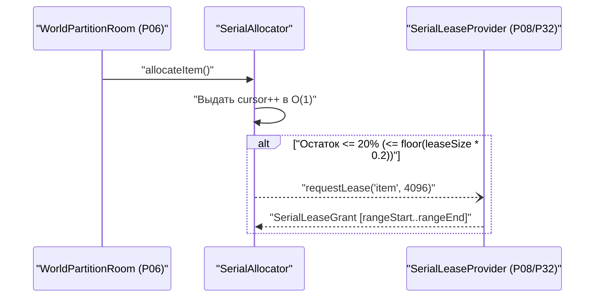

# `domain/entity-identity` — 32-битные серийники и блочная аренда

Модуль `@uo3/domain/identity` реализует детерминированную идентификацию игровых сущностей шарда UO3 (ADR-006 / ADR-007).

## Таблица диапазонов серийников

| Диапазон (hex) | Тип (`SerialKind`) | Назначение |
| --- | --- | --- |
| `0x00000000` | `null` | Пустая ссылка (`SERIAL_NULL`), невалидна как сущность |
| `0x00000001..0x3FFFFFFF` | `mobile` | Мобайлы (`1 073 741 823` значений; `0x00000001..0x1FFFFFFF` — персонажи P05, `0x20000000..0x3FFFFFFF` — NPC) |
| `0x40000000..0x7FFFFFFF` | `item` | Предметы, контейнеры, трупы и мульти (`1 073 741 824` значений) |
| `0x80000000..0xFFFFFFFE` | `ephemeral` | Локальные временные визуальные объекты клиента (`EphemeralSerialAllocator`), запрещены на сервере |
| `0xFFFFFFFF` | `sentinel` | Служебный маркер отмены/отсутствия цели (`SERIAL_SENTINEL`), запрещён к регистрации |

## Форматы сериализации

- **Каноническая строка / JSON:** `0x` + ровно 8 hex-цифр в верхнем регистре (`formatSerial(0x4000002a) === "0x4000002A"`). `parseSerial` принимает hex-строку регистронезависимо (`^0x[0-9a-fA-F]{8}$`) или `uint32`.
- **Бинарная раскладка (4 байта):**
  - Big-Endian (`writeSerialBE` / `readSerialBE`): `0x401234AB` → `[0x40, 0x12, 0x34, 0xAB]`.
  - Little-Endian (`writeSerialLE` / `readSerialLE`): `0x401234AB` → `[0xAB, 0x34, 0x12, 0x40]`.

## Коды ошибок

- `ERR_INVALID_SERIAL` — невалидный `uint32`, неканоническая hex-строка, буфер < 4 байт, пустая ссылка при регистрации.
- `ERR_SERIAL_KIND_MISMATCH` — несовпадение диапазона (`asMobileSerial(0x40000010)`, `asItemSerial(0x0)`).
- `ERR_INVALID_LEASE_SIZE` — размер блока аренды вне `[256, 65536]`.
- `ERR_SERIAL_COLLISION` — попытка зарегистрировать уже занятый серийник в `SerialRegistry`.
- `ERR_RESERVED_SERIAL` — попытка зарегистрировать локальный/маркерный серийник (`>= 0x80000000`) на сервере.
- `ERR_SERIAL_RANGE_EXHAUSTED` — исчерпание пула без переполнения в соседний диапазон.

## Контракт блочной аренды для P08 (PostgreSQL) и P32 (партиции)



### JSON-формат `SerialAllocatorSnapshot`

```json
{
  "mobileCursor": 1,
  "mobileHighWaterMark": 4097,
  "itemCursor": 1073741824,
  "itemHighWaterMark": 1073745920,
  "leaseSize": 4096
}
```
