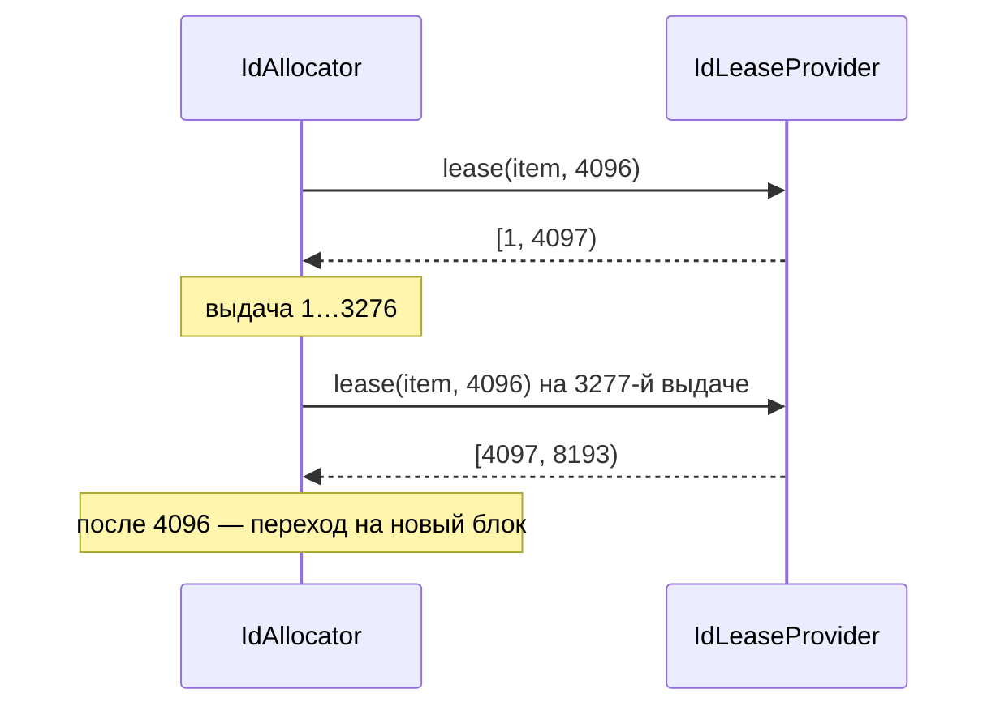

# Идентификаторы сущностей

`EntityId` — 32-битное беззнаковое число: биты 31–29 — вид, биты 28–0 — порядковый номер `1..0x1FFFFFFF`.

| Код | Вид | Буква | Диапазон |
| --- | --- | --- | --- |
| 0 | пустой (только `0`) | — | `0x00000000` |
| 1 | `hero` — герой | `H` | `0x20000001..0x3FFFFFFF` |
| 2 | `creature` — существо, NPC | `C` | `0x40000001..0x5FFFFFFF` |
| 3 | `item` — предмет | `I` | `0x60000001..0x7FFFFFFF` |
| 4 | `structure` — дом, корабль, маяк | `S` | `0x80000001..0x9FFFFFFF` |
| 5, 6 | резерв | — | отклоняются |
| 7 | `ephemeral` — маркер клиента | `E` | `0xE0000001..0xFFFFFFFF` |

## Формы

- Текст: `I-6000002A` — буква и 8 hex-цифр всего значения в верхнем регистре. Другие формы отклоняются.
- JSON: целое число.
- Байты: 4 байта big-endian (`writeEntityId`, `readEntityId`).
- Порядок: беззнаковое сравнение `compareEntityIds`.

## Аллокация

`IdAllocator` ведёт счётчики видов `hero`, `creature`, `item`, `structure` и выдаёт номера из блоков `IdLeaseProvider` (по умолчанию 4 096, допустимо 256–65 536). При остатке 20 % следующий блок запрашивается заранее. Если блок исчерпан, а следующий не получен, `next()` отвечает `ERR_ID_LEASE_PENDING`. Удалённые номера не выдаются повторно.



Снимок для P08 (`snapshot()`): числа `основание вида + номер`. `next` — следующий идентификатор, `highWater` — граница выданных блоков. Поставщик обязан выдавать блоки не ниже `highWater`.

```json
{ "version": 1, "kinds": { "item": { "next": 1610612737, "highWater": 1610616833 } } }
```

При загрузке мира `hydrate` ставит счётчик в `max(максимальный загруженный + 1, highWater)`. События заполнения приходят однократно на 80 % и 95 % диапазона вида; после последнего номера — `ERR_ENTITY_ID_EXHAUSTED`.

`EntityRegistry` отклоняет повторную регистрацию (`ERR_ENTITY_ID_COLLISION`) и маркеры клиента или `0` (`ERR_RESERVED_ENTITY_ID`). `EphemeralIdAllocator` выдаёт маркеры предпросмотра без аренды.

## Коды ошибок

`ERR_INVALID_ENTITY_ID`, `ERR_ENTITY_KIND_MISMATCH`, `ERR_RESERVED_ENTITY_ID`, `ERR_ENTITY_ID_COLLISION`, `ERR_ENTITY_ID_EXHAUSTED`, `ERR_INVALID_LEASE_SIZE`, `ERR_ID_LEASE_PENDING`.
